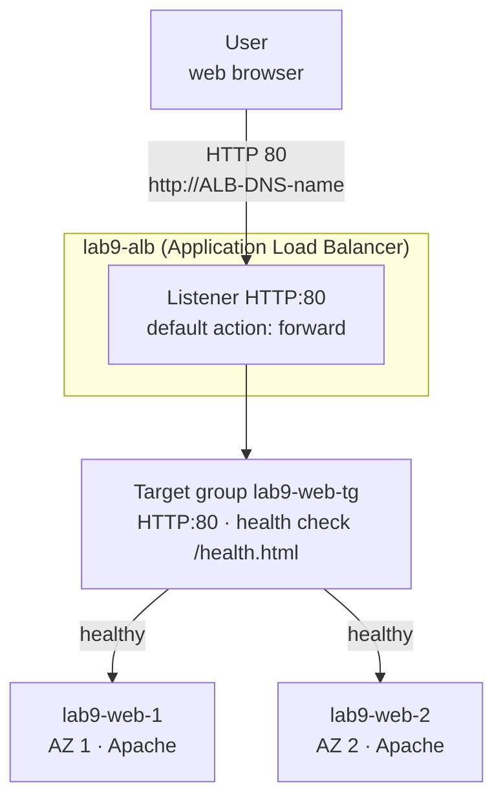
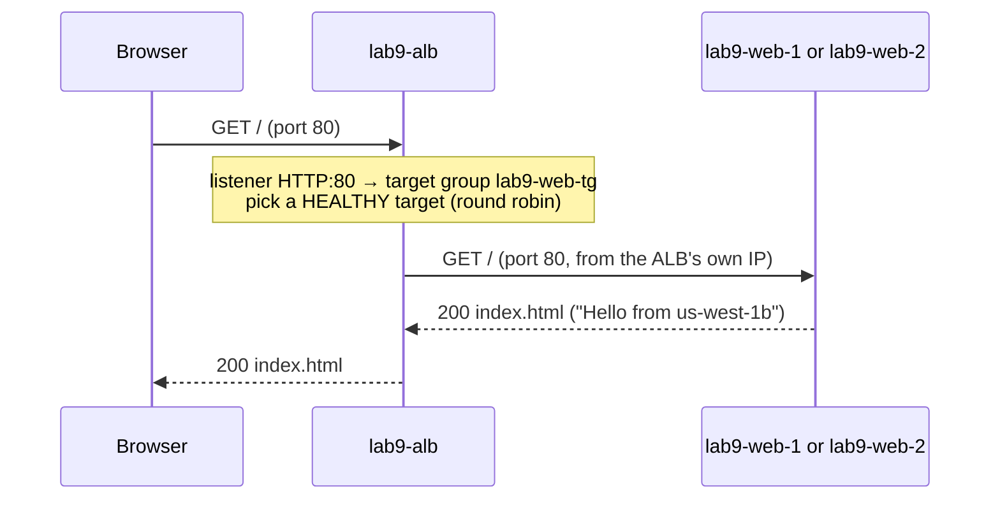

# Lab 9 — Introduction to the Application Load Balancer (ALB)

> 🇫🇷 Version française : [ALB-Intro-Lab.fr.md](ALB-Intro-Lab.fr.md)

> **Audience:** beginners in AWS · **Level:** Foundational
> **Duration:** about 60 minutes · **Method:** AWS Console only (no SSH, no command line required)
> **Region:** `us-west-1` (any Region works) · **Network:** the **default VPC** (nothing to build)

---

## Scenario

Your small web site runs on **one** EC2 instance. If that server stops, the site is down. You'll put **two** identical web servers in **two Availability Zones** behind an **Application Load Balancer**. Users get **one address**; the ALB sends each request to a **healthy** server.

Each server shows a page in a **different colour** with its **Availability Zone**, so you can *see* the load balancer at work.

---

## Learning objectives

By the end of this lab you can:

1. Explain the three building blocks: **load balancer**, **listener**, **target group** (with its **health check**)
2. Launch EC2 web servers with **user data**
3. Create a **target group** and register instances
4. Create an internet-facing **ALB** across two Availability Zones
5. Protect the servers so that **only the ALB** can reach them
6. Watch the ALB **stop sending traffic** to a failed server and **resume** when it comes back

---

## 1. Key ideas in 2 minutes

Think of a restaurant:

| Restaurant | AWS | What it does |
|------------|-----|--------------|
| The front door and its address | **Application Load Balancer** | One public DNS name for everyone, spread across several AZs |
| The host at the door who says "table 4, please" | **Listener** (`HTTP:80`) + its **rule** | Accepts requests on a port and decides where they go |
| The group of tables served by the same team | **Target group** | The list of servers (targets) that can answer, and on which port |
| The waiter checking each table is ready | **Health check** | The ALB requests `/health.html` on each target every 10 s; only **healthy** targets receive users |
| The tables | **Targets** (EC2 instances) | Your web servers |

---

## 2. Architecture

### 2.1 Full lab diagram

```text
                              ┌─ Users (web browser) ────────────────┐
                              │ http://<ALB DNS name>                │
                              └──────────────────────────────────────┘
                                                 │ HTTP 80
                                                 ▼
┌─ AWS Region us-west-1 ───────────────────────────────────────────────────────────────────────────────────┐
│ ┌─ Default VPC 172.31.0.0/16 ──────────────────────────────────────────────────────────────────────────┐ │
│ │ ┌─ lab9-alb · listener HTTP:80 -> target group lab9-web-tg ────────────────────────────────────────┐ │ │
│ │ │ health check: GET /health.html every 10 s                                                        │ │ │
│ │ │    node AZ 1                          node AZ 2                                                  │ │ │
│ │ └──────────────────────────────────────────────────────────────────────────────────────────────────┘ │ │
│ │         │ HTTP 80                                 │ HTTP 80                                          │ │
│ │         ▼                                         ▼                                                  │ │
│ │ ┌─ Availability Zone 1 ─────────────────────────┐  ┌─ Availability Zone 2 ─────────────────────────┐ │ │
│ │ │ ┌─ Default subnet (public) ─────────────────┐ │  │ ┌─ Default subnet (public) ─────────────────┐ │ │ │
│ │ │ │ ★ lab9-web-1  t3.micro                    │ │  │ │ ★ lab9-web-2  t3.micro                    │ │ │ │
│ │ │ │   Apache · index.html                     │ │  │ │   Apache · index.html                     │ │ │ │
│ │ │ └───────────────────────────────────────────┘ │  │ └───────────────────────────────────────────┘ │ │ │
│ │ └───────────────────────────────────────────────┘  └───────────────────────────────────────────────┘ │ │
│ │ sg lab9-alb-sg: IN 80 <- 0.0.0.0/0      sg lab9-web-sg: IN 80 <- lab9-alb-sg ONLY                    │ │
│ └──────────────────────────────────────────────────────────────────────────────────────────────────────┘ │
└──────────────────────────────────────────────────────────────────────────────────────────────────────────┘
```

★ = created in this lab. The default VPC and its subnets already exist in every Region.

### 2.2 The same, as a flow



### 2.3 One request



---

## 3. Before you start

- An AWS account and a user that can create EC2 instances, security groups and load balancers
- Console Region: **US West (N. California) `us-west-1`** (top right)
- The default VPC must exist: **VPC → Your VPCs** shows one VPC with **Default VPC = Yes**. (If it was deleted: **Actions → Create default VPC**.)

**Cost:** 2 × `t3.micro` (~$0.012/hour each, or Free Tier hours) + the ALB (~$0.025/hour + a small usage charge) + public IPv4 addresses ($0.005/hour each). Under **$0.20** for one hour. **Do the cleanup** (Part 9) at the end.

**Worksheet:**

| Item | Value |
|------|-------|
| AZ of `lab9-web-1` / `lab9-web-2` | |
| Public IP of `lab9-web-1` | |
| ALB DNS name | |

---

## Part 1 — Two security groups

**EC2 → Network & Security → Security groups → Create security group** (VPC: the **default VPC**).

| Name | Description | Inbound rule |
|------|-------------|--------------|
| `lab9-alb-sg` | `HTTP from the internet to the ALB` | **HTTP**, port 80, source **Anywhere-IPv4** (`0.0.0.0/0`) |
| `lab9-web-sg` | `HTTP from the ALB only` | **HTTP**, port 80, source **Custom** → type `lab9` and choose **`lab9-alb-sg`** |

Keep the default outbound rule (all traffic allowed) on both.

> 🧠 The source of the web rule is **a security group, not an IP address**. It means "anything that has `lab9-alb-sg` attached", in other words the load balancer. Users can't reach the servers directly.

---

## Part 2 — Launch two web servers

**EC2 → Instances → Launch instances**. Launch them **one at a time** so you can choose a different subnet for each.

| Setting | `lab9-web-1` | `lab9-web-2` |
|---------|--------------|--------------|
| Name | `lab9-web-1` | `lab9-web-2` |
| AMI | **Amazon Linux 2023** (Free tier eligible) | same |
| Instance type | `t3.micro` | same |
| Key pair | **Proceed without a key pair** | same |
| Network settings → **Edit** | VPC: default · Subnet: the **first** subnet (note its AZ) | Subnet in a **different AZ** |
| Auto-assign public IP | **Enable** (the server downloads Apache from the internet) | same |
| Firewall | **Select existing security group** → **`lab9-web-sg`** | same |
| Advanced details → **User data** | paste the script below | same script |

User data ([`scripts/user-data.sh`](scripts/user-data.sh)):

```bash
#!/bin/bash
# File: scripts/user-data.sh
# Purpose : EC2 user data for Lab 9 (ALB introduction). Runs ONCE, as root, at first boot.
#           Installs the Apache web server and writes a one-page HTML site that shows
#           WHICH instance and WHICH Availability Zone answered the request.
# Paste   : EC2 -> Launch instances -> Advanced details -> User data
set -euo pipefail

dnf -y install httpd

# Instance metadata with IMDSv2 (a session token first, then the values)
TOKEN=$(curl -s -X PUT "http://169.254.169.254/latest/api/token" -H "X-aws-ec2-metadata-token-ttl-seconds: 300")
md() { curl -s -H "X-aws-ec2-metadata-token: $TOKEN" "http://169.254.169.254/latest/meta-data/$1"; }
INSTANCE_ID=$(md instance-id)
AZ=$(md placement/availability-zone)
PRIVATE_IP=$(md local-ipv4)

# One colour per AZ, so you can SEE the load balancer switching servers
case "${AZ: -1}" in
  a) COLOR="#2563eb" ;;   # blue
  b) COLOR="#16a34a" ;;   # green
  c) COLOR="#ea580c" ;;   # orange
  *) COLOR="#7c3aed" ;;   # purple
esac

cat > /var/www/html/index.html <<HTML
<!doctype html>
<html lang="en">
<head>
  <meta charset="utf-8">
  <meta name="viewport" content="width=device-width, initial-scale=1">
  <title>Lab 9 - ALB demo</title>
  <style>
    body { margin:0; min-height:100vh; display:grid; place-items:center; background:${COLOR};
           font-family: system-ui, -apple-system, "Segoe UI", Roboto, sans-serif; color:#fff; }
    .card { background:rgba(0,0,0,.25); padding:32px 40px; border-radius:16px; text-align:center; }
    h1 { margin:0 0 8px; font-size:2rem; }
    p  { margin:6px 0; font-size:1.1rem; }
    code { background:rgba(255,255,255,.2); padding:2px 8px; border-radius:6px; }
  </style>
</head>
<body>
  <div class="card">
    <h1>Hello from ${AZ}</h1>
    <p>Instance <code>${INSTANCE_ID}</code></p>
    <p>Private IP <code>${PRIVATE_IP}</code></p>
    <p>Refresh the page: the load balancer may send you to the other server.</p>
  </div>
</body>
</html>
HTML

# Tiny page for the target group health check
echo "OK" > /var/www/html/health.html

systemctl enable --now httpd
```

Click **Launch instance**. Repeat for `lab9-web-2`. Write both AZs in the worksheet.

> 🧠 **User data** is a script the instance runs **once, at first boot**. Here it installs Apache and writes `index.html` (colour + AZ + instance ID) and a tiny `health.html` for the health check.

Wait until both instances show **Status check: 3/3 checks passed** (~2 minutes).

---

## Part 3 — Target group

**EC2 → Load Balancing → Target groups → Create target group**:

| Setting | Value |
|---------|-------|
| Target type | **Instances** |
| Target group name | `lab9-web-tg` |
| Protocol / Port | **HTTP / 80** |
| VPC | default VPC |
| Health check path | **`/health.html`** |
| Advanced health check settings | Healthy threshold **2** · Unhealthy threshold **2** · Timeout **5** · Interval **10** · Success codes **200** |

**Next** → select **`lab9-web-1`** and **`lab9-web-2`** → **Include as pending below** → **Create target group**.

> 🧠 The targets show **Unused** for now: health checks start only when a load balancer uses the target group.

---

## Part 4 — Application Load Balancer

**EC2 → Load Balancing → Load balancers → Create load balancer → Application Load Balancer → Create**:

| Setting | Value |
|---------|-------|
| Load balancer name | `lab9-alb` |
| Scheme | **Internet-facing** |
| IP address type | IPv4 |
| VPC | default VPC |
| Mappings | tick **the two AZs of your instances** (one subnet each) |
| Security groups | remove `default`, select **`lab9-alb-sg`** |
| Listeners and routing | **HTTP : 80** → Default action **Forward to `lab9-web-tg`** |

**Create load balancer.** The state goes from *Provisioning* to **Active** in 2–4 minutes. Copy the **DNS name** (`lab9-alb-123456789.us-west-1.elb.amazonaws.com`) into the worksheet.

Then open **Target groups → `lab9-web-tg` → Targets**: after ~20 seconds both targets are **Healthy** ✅.

---

## Part 5 — Test the load balancer

1. Paste `http://<ALB DNS name>` in a browser (**http**, not https).
2. Refresh several times (or use **Ctrl+Shift+R** / a private window). The **colour** and the **AZ** change: two different servers answer through one address.
3. For an exact count, open **CloudShell** (icon `>_` at the top of the console) and run:

   ```bash
   ALB=<ALB DNS name>
   for i in $(seq 1 10); do curl -s http://$ALB/ | grep -o 'Hello from [a-z0-9-]*'; done | sort | uniq -c
   ```

   ```text
         5 Hello from us-west-1b
         5 Hello from us-west-1c
   ```

> 🧠 A browser often re-uses the same connection, so you may see the same server several times in a row. `curl` opens a new connection each time, so the round robin is easier to see.

---

## Part 6 — Only the ALB can reach the servers

1. Copy the **public IP** of `lab9-web-1` (EC2 → Instances → select it).
2. Open `http://<public IP>` in the browser → it **times out**.

Why? `lab9-web-sg` only allows port 80 **from `lab9-alb-sg`**. Your browser doesn't have that security group; the load balancer does.

> 🧠 In real projects, web servers usually sit in **private subnets** with no public IP at all (see Lab 6). Here we keep the default VPC to stay simple: the security group does the protection.

---

## Part 7 — Watch a server fail and come back

1. **Stop** `lab9-web-2` (Instances → select → **Instance state → Stop instance**).
2. In **Target groups → `lab9-web-tg` → Targets** (refresh), `lab9-web-2` leaves the **Healthy** state: it shows **Unhealthy** while shutting down, then **Unused** with the reason *Target is in the stopped state*.
3. Refresh the site / re-run the CloudShell loop: **all** requests now go to `lab9-web-1`, and the site never went down.
4. **Start** `lab9-web-2` again. After boot and **2 successful health checks** (~20 s), it's **Healthy** and receives traffic again.

> 🧠 The ALB never sends users to an unhealthy target. Two servers in two AZs = the site survives the loss of a server or even of a whole Availability Zone.

---

## Part 8 — Bonus: a second listener rule

Listeners can do more than forward everything. Add a maintenance page **without touching the servers**:

1. **Load balancers → `lab9-alb` → Listeners and rules → HTTP:80 → Manage rules → Add rule**.
2. Name `maintenance` → **Add condition → Path** → `/maintenance*`.
3. Action: **Return fixed response** → Response code **503**, Content type `text/plain`, Response body `Back soon! (answered by the ALB itself)`.
4. Priority **10** → **Create**.

Test: `http://<ALB DNS name>/maintenance` returns the message; `/` still goes to your servers.

> 🧠 Rules are checked by **priority** (lowest number first); the **default** rule applies when nothing else matches. Real apps use path rules like `/api/*` → one target group, `/*` → another.

---

## Validation checklist

| # | Check | Expected |
|---|-------|----------|
| 1 | `lab9-web-tg` → Targets | 2 × **Healthy**, in 2 different AZs |
| 2 | Browser on `http://<ALB DNS>` | Page loads; colour/AZ changes between refreshes |
| 3 | CloudShell loop | Requests split between 2 AZs |
| 4 | Browser on a server's public IP | ❌ Timeout |
| 5 | Stop `lab9-web-2` | Site stays up, only AZ of `lab9-web-1` answers |
| 6 | Start it again | Back to **Healthy**, traffic shared again |
| 7 | `/maintenance` | `503` with the fixed message |

---

## Troubleshooting

| Problem | Likely cause | Fix |
|---------|--------------|-----|
| Browser spins then times out on the ALB | `lab9-alb-sg` has no HTTP 80 from `0.0.0.0/0`, or you typed `https://` | Fix the rule; use `http://` |
| **503 Service Temporarily Unavailable** | No target registered | Register both instances in `lab9-web-tg` |
| **504 Gateway Time-out**, targets *Request timed out* | `lab9-web-sg` doesn't allow 80 **from `lab9-alb-sg`** | Fix the web security group rule |
| Targets **Unhealthy**, *Health checks failed with these codes: [404]* | Health check path wrong | Path must be `/health.html` |
| Targets **Unhealthy**, *Health checks failed* right after launch | Apache still installing, or user data missing | Wait 2 minutes; check **Actions → Instance settings → Edit user data** |
| One target says *Target is in an Availability Zone that is not enabled for the load balancer* | ALB mappings miss that AZ | ALB → **Network mapping → Edit subnets** → add the AZ |
| Page never loads even on the instance | No public IP, so `dnf install httpd` couldn't download anything | Relaunch with **Auto-assign public IP = Enable** |

---

## Part 9 — Cleanup

1. **Load balancers** → `lab9-alb` → **Actions → Delete load balancer** (type `confirm`).
2. **Target groups** → `lab9-web-tg` → **Actions → Delete**.
3. **Instances** → `lab9-web-1`, `lab9-web-2` → **Instance state → Terminate**.
4. **Security groups** → delete `lab9-web-sg` first, then `lab9-alb-sg` (the first one references the second). Wait until the instances are terminated.

✅ Nothing named `lab9-…` remains in EC2.

---

## Review questions

1. What are the three main components of an ALB setup, and what does each one do?
2. Why did the page colour change when you refreshed?
3. Why couldn't you open the web server's public IP directly?
4. What does the health check do, and what happens to an unhealthy target?
5. Why put the two servers in two different Availability Zones?
6. What does a listener rule with a path condition allow?

<details>
<summary><b>Answers</b></summary>

1. **Load balancer**: one entry point (DNS name) spread across AZs. **Listener**: a port/protocol (`HTTP:80`) plus rules that decide where each request goes. **Target group**: the servers that can answer, the port, and the health check.
2. The listener forwarded each request to the target group, which spread them **round robin** across the healthy targets; each server writes a page with its own colour and AZ.
3. `lab9-web-sg` allows port 80 only from sources that have `lab9-alb-sg`, which only the load balancer has.
4. Every 10 s the ALB requests `/health.html` on each target. After **2 failures** a target is unhealthy and receives **no traffic**; after **2 successes** it's healthy again.
5. If one server, or a whole Availability Zone, fails, the other keeps serving: **high availability**.
6. Sending different URLs to different places (other target groups, a redirect, or a fixed response) with **one** load balancer.
</details>

---

## Next steps

- **Lab 6** — the same ALB in front of a Python app and an RDS database, with private subnets
- **Lab 7** — an Auto Scaling group that adds and replaces servers automatically
- **Lab 8** — build everything with CloudFormation
