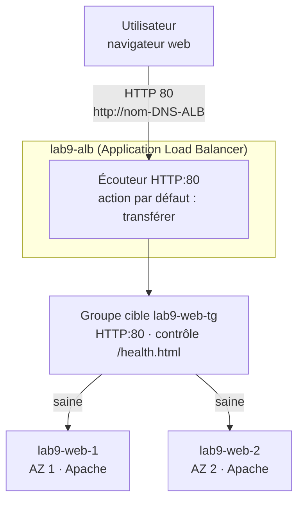
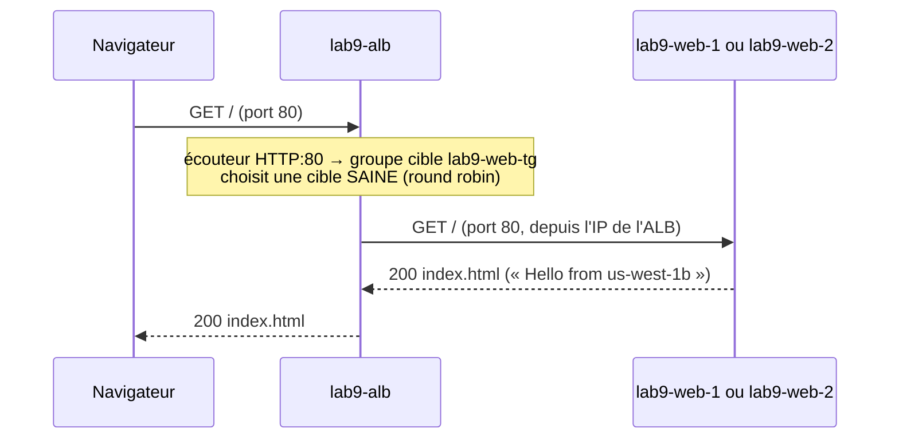

# Lab 9 — Introduction à l'Application Load Balancer (ALB)

> 🇬🇧 English version: [ALB-Intro-Lab.en.md](ALB-Intro-Lab.en.md)

> **Public :** débutants sur AWS · **Niveau :** fondamental
> **Durée :** environ 60 minutes · **Méthode :** console AWS uniquement (ni SSH, ni ligne de commande obligatoire)
> **Région :** `us-west-1` (toute Région convient) · **Réseau :** le **VPC par défaut** (rien à construire)

---

## Scénario

Votre petit site web tourne sur **une seule** instance EC2. Si ce serveur s'arrête, le site est hors ligne. Vous allez placer **deux** serveurs web identiques dans **deux zones de disponibilité** derrière un **Application Load Balancer**. Les utilisateurs ont **une seule adresse** ; l'ALB envoie chaque requête vers un serveur **sain**.

Chaque serveur affiche une page d'une **couleur différente** avec sa **zone de disponibilité**, pour que vous puissiez *voir* l'équilibreur de charge travailler.

---

## Objectifs d'apprentissage

À la fin de ce lab, vous saurez :

1. Expliquer les trois briques : **équilibreur de charge**, **écouteur**, **groupe cible** (avec son **contrôle de santé**)
2. Lancer des serveurs web EC2 avec des **données utilisateur**
3. Créer un **groupe cible** et y inscrire des instances
4. Créer un **ALB** accessible depuis Internet sur deux zones de disponibilité
5. Protéger les serveurs pour que **seul l'ALB** puisse les joindre
6. Observer l'ALB **cesser d'envoyer du trafic** à un serveur en panne puis **reprendre** à son retour

---

## 1. Les idées clés en 2 minutes

Pensez à un restaurant :

| Restaurant | AWS | Rôle |
|------------|-----|------|
| La porte d'entrée et son adresse | **Application Load Balancer** | Un seul nom DNS public pour tous, réparti sur plusieurs AZ |
| L'hôte à l'entrée qui dit « table 4, s'il vous plaît » | **Écouteur** (`HTTP:80`) + sa **règle** | Accepte les requêtes sur un port et décide où elles vont |
| Le groupe de tables servi par la même équipe | **Groupe cible** | La liste des serveurs (cibles) qui peuvent répondre, et sur quel port |
| Le serveur qui vérifie que chaque table est prête | **Contrôle de santé** | L'ALB demande `/health.html` à chaque cible toutes les 10 s ; seules les cibles **saines** reçoivent des utilisateurs |
| Les tables | **Cibles** (instances EC2) | Vos serveurs web |

---

## 2. Architecture

### 2.1 Schéma complet du lab

```text
                              ┌─ Utilisateurs (navigateur web) ──────┐
                              │ http://<nom DNS de l'ALB>            │
                              └──────────────────────────────────────┘
                                                 │ HTTP 80
                                                 ▼
┌─ Région AWS us-west-1 ───────────────────────────────────────────────────────────────────────────────────┐
│ ┌─ VPC par défaut 172.31.0.0/16 ───────────────────────────────────────────────────────────────────────┐ │
│ │ ┌─ lab9-alb · écouteur HTTP:80 -> groupe cible lab9-web-tg ────────────────────────────────────────┐ │ │
│ │ │ contrôle de santé : GET /health.html toutes les 10 s                                             │ │ │
│ │ │    nœud AZ 1                          nœud AZ 2                                                  │ │ │
│ │ └──────────────────────────────────────────────────────────────────────────────────────────────────┘ │ │
│ │         │ HTTP 80                                 │ HTTP 80                                          │ │
│ │         ▼                                         ▼                                                  │ │
│ │ ┌─ Zone de disponibilité 1 ─────────────────────┐  ┌─ Zone de disponibilité 2 ─────────────────────┐ │ │
│ │ │ ┌─ Sous-réseau par défaut (public) ─────────┐ │  │ ┌─ Sous-réseau par défaut (public) ─────────┐ │ │ │
│ │ │ │ ★ lab9-web-1  t3.micro                    │ │  │ │ ★ lab9-web-2  t3.micro                    │ │ │ │
│ │ │ │   Apache · index.html                     │ │  │ │   Apache · index.html                     │ │ │ │
│ │ │ └───────────────────────────────────────────┘ │  │ └───────────────────────────────────────────┘ │ │ │
│ │ └───────────────────────────────────────────────┘  └───────────────────────────────────────────────┘ │ │
│ │ sg lab9-alb-sg : ENTRÉE 80 <- 0.0.0.0/0      sg lab9-web-sg : ENTRÉE 80 <- lab9-alb-sg SEULEMENT     │ │
│ └──────────────────────────────────────────────────────────────────────────────────────────────────────┘ │
└──────────────────────────────────────────────────────────────────────────────────────────────────────────┘
```

★ = créé dans ce lab. Le VPC par défaut et ses sous-réseaux existent déjà dans chaque Région.

### 2.2 La même chose, sous forme de flux



### 2.3 Une requête



---

## 3. Avant de commencer

- Un compte AWS et un utilisateur qui peut créer des instances EC2, des groupes de sécurité et des équilibreurs de charge
- Région de la console : **US West (N. California) `us-west-1`** (en haut à droite)
- Le VPC par défaut doit exister : **VPC → Vos VPC** montre un VPC avec **VPC par défaut = Oui**. (S'il a été supprimé : **Actions → Créer un VPC par défaut**.)

**Coût :** 2 × `t3.micro` (~0,012 $/heure chacune, ou heures de l'offre gratuite) + l'ALB (~0,025 $/heure + un petit coût d'utilisation) + les adresses IPv4 publiques (0,005 $/heure chacune). Moins de **0,20 $** pour une heure. **Faites le nettoyage** (Partie 9) à la fin.

**Fiche de travail :**

| Élément | Valeur |
|---------|--------|
| AZ de `lab9-web-1` / `lab9-web-2` | |
| IP publique de `lab9-web-1` | |
| Nom DNS de l'ALB | |

---

## Partie 1 — Deux groupes de sécurité

**EC2 → Réseau et sécurité → Groupes de sécurité → Créer un groupe de sécurité** (VPC : le **VPC par défaut**).

| Nom | Description | Règle entrante |
|-----|-------------|----------------|
| `lab9-alb-sg` | `HTTP from the internet to the ALB` | **HTTP**, port 80, source **Anywhere-IPv4** (`0.0.0.0/0`) |
| `lab9-web-sg` | `HTTP from the ALB only` | **HTTP**, port 80, source **Personnalisée** → tapez `lab9` et choisissez **`lab9-alb-sg`** |

Gardez la règle sortante par défaut (tout le trafic autorisé) sur les deux.

> 🧠 La source de la règle web est **un groupe de sécurité, pas une adresse IP**. Elle signifie « tout ce qui porte `lab9-alb-sg` », autrement dit l'équilibreur de charge. Les utilisateurs ne peuvent pas joindre les serveurs directement.

---

## Partie 2 — Lancer deux serveurs web

**EC2 → Instances → Lancer des instances**. Lancez-les **une par une** pour choisir un sous-réseau différent pour chacune.

| Paramètre | `lab9-web-1` | `lab9-web-2` |
|-----------|--------------|--------------|
| Nom | `lab9-web-1` | `lab9-web-2` |
| AMI | **Amazon Linux 2023** (éligible à l'offre gratuite) | idem |
| Type d'instance | `t3.micro` | idem |
| Paire de clés | **Continuer sans paire de clés** | idem |
| Paramètres réseau → **Modifier** | VPC : par défaut · Sous-réseau : le **premier** (notez son AZ) | Sous-réseau dans une **autre AZ** |
| Attribuer automatiquement une IP publique | **Activer** (le serveur télécharge Apache depuis Internet) | idem |
| Pare-feu | **Sélectionner un groupe de sécurité existant** → **`lab9-web-sg`** | idem |
| Détails avancés → **Données utilisateur** | collez le script ci-dessous | même script |

Données utilisateur ([`scripts/user-data.sh`](scripts/user-data.sh)) :

```bash
#!/bin/bash
# File: scripts/user-data.sh
# Purpose : EC2 user data for Lab 9 (ALB introduction). Runs ONCE, as root, at first boot.
#           Installs the Apache web server and writes a one-page HTML site that shows
#           WHICH instance and WHICH Availability Zone answered the request.
# Paste   : EC2 -> Launch instances -> Advanced details -> User data
set -euo pipefail

dnf -y install httpd

# Instance metadata with IMDSv2 (a session token first, then the values)
TOKEN=$(curl -s -X PUT "http://169.254.169.254/latest/api/token" -H "X-aws-ec2-metadata-token-ttl-seconds: 300")
md() { curl -s -H "X-aws-ec2-metadata-token: $TOKEN" "http://169.254.169.254/latest/meta-data/$1"; }
INSTANCE_ID=$(md instance-id)
AZ=$(md placement/availability-zone)
PRIVATE_IP=$(md local-ipv4)

# One colour per AZ, so you can SEE the load balancer switching servers
case "${AZ: -1}" in
  a) COLOR="#2563eb" ;;   # blue
  b) COLOR="#16a34a" ;;   # green
  c) COLOR="#ea580c" ;;   # orange
  *) COLOR="#7c3aed" ;;   # purple
esac

cat > /var/www/html/index.html <<HTML
<!doctype html>
<html lang="en">
<head>
  <meta charset="utf-8">
  <meta name="viewport" content="width=device-width, initial-scale=1">
  <title>Lab 9 - ALB demo</title>
  <style>
    body { margin:0; min-height:100vh; display:grid; place-items:center; background:${COLOR};
           font-family: system-ui, -apple-system, "Segoe UI", Roboto, sans-serif; color:#fff; }
    .card { background:rgba(0,0,0,.25); padding:32px 40px; border-radius:16px; text-align:center; }
    h1 { margin:0 0 8px; font-size:2rem; }
    p  { margin:6px 0; font-size:1.1rem; }
    code { background:rgba(255,255,255,.2); padding:2px 8px; border-radius:6px; }
  </style>
</head>
<body>
  <div class="card">
    <h1>Hello from ${AZ}</h1>
    <p>Instance <code>${INSTANCE_ID}</code></p>
    <p>Private IP <code>${PRIVATE_IP}</code></p>
    <p>Refresh the page: the load balancer may send you to the other server.</p>
  </div>
</body>
</html>
HTML

# Tiny page for the target group health check
echo "OK" > /var/www/html/health.html

systemctl enable --now httpd
```

Cliquez sur **Lancer l'instance**. Recommencez pour `lab9-web-2`. Notez les deux AZ dans la fiche.

> 🧠 Les **données utilisateur** sont un script que l'instance exécute **une seule fois, au premier démarrage**. Ici, il installe Apache et écrit `index.html` (couleur + AZ + ID d'instance) et un petit `health.html` pour le contrôle de santé.

Attendez que les deux instances affichent **Contrôle des statuts : 3/3 vérifications réussies** (~2 minutes).

---

## Partie 3 — Groupe cible

**EC2 → Équilibrage de charge → Groupes cibles → Créer un groupe cible** :

| Paramètre | Valeur |
|-----------|--------|
| Type de cible | **Instances** |
| Nom du groupe cible | `lab9-web-tg` |
| Protocole / Port | **HTTP / 80** |
| VPC | VPC par défaut |
| Chemin du contrôle de santé | **`/health.html`** |
| Paramètres avancés du contrôle | Seuil sain **2** · Seuil défaillant **2** · Délai **5** · Intervalle **10** · Codes de réussite **200** |

**Suivant** → sélectionnez **`lab9-web-1`** et **`lab9-web-2`** → **Inclure comme en attente ci-dessous** → **Créer un groupe cible**.

> 🧠 Les cibles sont **Inutilisées** pour l'instant : les contrôles de santé ne démarrent que lorsqu'un équilibreur de charge utilise le groupe cible.

---

## Partie 4 — Application Load Balancer

**EC2 → Équilibrage de charge → Équilibreurs de charge → Créer un équilibreur de charge → Application Load Balancer → Créer** :

| Paramètre | Valeur |
|-----------|--------|
| Nom | `lab9-alb` |
| Schéma | **Accessible sur Internet** |
| Type d'adresse IP | IPv4 |
| VPC | VPC par défaut |
| Mappages | cochez **les deux AZ de vos instances** (un sous-réseau chacune) |
| Groupes de sécurité | retirez `default`, sélectionnez **`lab9-alb-sg`** |
| Écouteurs et routage | **HTTP : 80** → Action par défaut **Transférer vers `lab9-web-tg`** |

**Créer l'équilibreur de charge.** L'état passe de *Approvisionnement* à **Actif** en 2 à 4 minutes. Copiez le **nom DNS** (`lab9-alb-123456789.us-west-1.elb.amazonaws.com`) dans la fiche.

Ouvrez ensuite **Groupes cibles → `lab9-web-tg` → Cibles** : après ~20 secondes, les deux cibles sont **Saines** ✅.

---

## Partie 5 — Tester l'équilibreur de charge

1. Collez `http://<nom DNS de l'ALB>` dans un navigateur (**http**, pas https).
2. Actualisez plusieurs fois (ou **Ctrl+Maj+R** / une fenêtre privée). La **couleur** et l'**AZ** changent : deux serveurs différents répondent via une seule adresse.
3. Pour un comptage exact, ouvrez **CloudShell** (icône `>_` en haut de la console) et exécutez :

   ```bash
   ALB=<nom DNS de l'ALB>
   for i in $(seq 1 10); do curl -s http://$ALB/ | grep -o 'Hello from [a-z0-9-]*'; done | sort | uniq -c
   ```

   ```text
         5 Hello from us-west-1b
         5 Hello from us-west-1c
   ```

> 🧠 Un navigateur réutilise souvent la même connexion : vous pouvez voir le même serveur plusieurs fois de suite. `curl` ouvre une nouvelle connexion à chaque fois, ce qui rend le round robin plus visible.

---

## Partie 6 — Seul l'ALB peut joindre les serveurs

1. Copiez l'**IP publique** de `lab9-web-1` (EC2 → Instances → sélectionnez-la).
2. Ouvrez `http://<IP publique>` dans le navigateur → **délai dépassé**.

Pourquoi ? `lab9-web-sg` n'autorise le port 80 que **depuis `lab9-alb-sg`**. Votre navigateur n'a pas ce groupe de sécurité ; l'équilibreur de charge, si.

> 🧠 Dans les vrais projets, les serveurs web sont généralement dans des **sous-réseaux privés**, sans aucune IP publique (voir le Lab 6). Ici, on garde le VPC par défaut pour rester simple : c'est le groupe de sécurité qui protège.

---

## Partie 7 — Observer une panne et un retour

1. **Arrêtez** `lab9-web-2` (Instances → sélectionnez → **État de l'instance → Arrêter l'instance**).
2. Dans **Groupes cibles → `lab9-web-tg` → Cibles** (actualisez), `lab9-web-2` quitte l'état **Saine** : elle passe **Défaillante** pendant l'arrêt, puis **Inutilisée** avec la raison *Target is in the stopped state*.
3. Actualisez le site / relancez la boucle CloudShell : **toutes** les requêtes vont maintenant vers `lab9-web-1`, et le site n'a jamais été hors ligne.
4. **Démarrez** à nouveau `lab9-web-2`. Après le démarrage et **2 contrôles réussis** (~20 s), elle est **Saine** et reçoit de nouveau du trafic.

> 🧠 L'ALB n'envoie jamais d'utilisateurs vers une cible défaillante. Deux serveurs dans deux AZ = le site survit à la perte d'un serveur, voire d'une zone de disponibilité entière.

---

## Partie 8 — Bonus : une seconde règle d'écouteur

Un écouteur peut faire plus que tout transférer. Ajoutez une page de maintenance **sans toucher aux serveurs** :

1. **Équilibreurs de charge → `lab9-alb` → Écouteurs et règles → HTTP:80 → Gérer les règles → Ajouter une règle**.
2. Nom `maintenance` → **Ajouter une condition → Chemin** → `/maintenance*`.
3. Action : **Retourner une réponse fixe** → Code **503**, Type de contenu `text/plain`, Corps `Back soon! (answered by the ALB itself)`.
4. Priorité **10** → **Créer**.

Test : `http://<nom DNS de l'ALB>/maintenance` renvoie le message ; `/` va toujours vers vos serveurs.

> 🧠 Les règles sont évaluées par **priorité** (le plus petit nombre d'abord) ; la règle **par défaut** s'applique quand aucune autre ne correspond. Les vraies applications utilisent des règles de chemin comme `/api/*` → un groupe cible, `/*` → un autre.

---

## Liste de validation

| # | Vérification | Attendu |
|---|--------------|---------|
| 1 | `lab9-web-tg` → Cibles | 2 × **Saine**, dans 2 AZ différentes |
| 2 | Navigateur sur `http://<DNS de l'ALB>` | La page s'affiche ; couleur/AZ changent entre les actualisations |
| 3 | Boucle CloudShell | Requêtes réparties entre 2 AZ |
| 4 | Navigateur sur l'IP publique d'un serveur | ❌ Délai dépassé |
| 5 | Arrêt de `lab9-web-2` | Le site reste en ligne, seule l'AZ de `lab9-web-1` répond |
| 6 | Redémarrage | De nouveau **Saine**, trafic à nouveau partagé |
| 7 | `/maintenance` | `503` avec le message fixe |

---

## Dépannage

| Problème | Cause probable | Correction |
|----------|----------------|------------|
| Le navigateur tourne puis expire sur l'ALB | `lab9-alb-sg` n'autorise pas HTTP 80 depuis `0.0.0.0/0`, ou vous avez tapé `https://` | Corrigez la règle ; utilisez `http://` |
| **503 Service Temporarily Unavailable** | Aucune cible inscrite | Inscrivez les deux instances dans `lab9-web-tg` |
| **504 Gateway Time-out**, cibles *Request timed out* | `lab9-web-sg` n'autorise pas 80 **depuis `lab9-alb-sg`** | Corrigez la règle du groupe de sécurité web |
| Cibles **Défaillantes**, *Health checks failed with these codes: [404]* | Mauvais chemin de contrôle | Le chemin doit être `/health.html` |
| Cibles **Défaillantes**, *Health checks failed* juste après le lancement | Apache encore en installation, ou données utilisateur absentes | Attendez 2 minutes ; vérifiez **Actions → Paramètres de l'instance → Modifier les données utilisateur** |
| Une cible indique *Target is in an Availability Zone that is not enabled for the load balancer* | Les mappages de l'ALB n'incluent pas cette AZ | ALB → **Mappage réseau → Modifier les sous-réseaux** → ajoutez l'AZ |
| La page ne s'affiche jamais, même sur l'instance | Pas d'IP publique : `dnf install httpd` n'a rien pu télécharger | Relancez avec **Attribuer automatiquement une IP publique = Activer** |

---

## Partie 9 — Nettoyage

1. **Équilibreurs de charge** → `lab9-alb` → **Actions → Supprimer l'équilibreur de charge** (tapez `confirm`).
2. **Groupes cibles** → `lab9-web-tg` → **Actions → Supprimer**.
3. **Instances** → `lab9-web-1`, `lab9-web-2` → **État de l'instance → Résilier**.
4. **Groupes de sécurité** → supprimez d'abord `lab9-web-sg`, puis `lab9-alb-sg` (le premier référence le second). Attendez que les instances soient résiliées.

✅ Plus rien ne s'appelle `lab9-…` dans EC2.

---

## Questions de révision

1. Quels sont les trois composants principaux d'une configuration ALB, et à quoi sert chacun ?
2. Pourquoi la couleur de la page changeait-elle quand vous actualisiez ?
3. Pourquoi ne pouviez-vous pas ouvrir directement l'IP publique du serveur web ?
4. Que fait le contrôle de santé, et qu'arrive-t-il à une cible défaillante ?
5. Pourquoi placer les deux serveurs dans deux zones de disponibilité différentes ?
6. Que permet une règle d'écouteur avec une condition de chemin ?

<details>
<summary><b>Réponses</b></summary>

1. **Équilibreur de charge** : un point d'entrée unique (nom DNS) réparti sur plusieurs AZ. **Écouteur** : un port/protocole (`HTTP:80`) plus des règles qui décident où va chaque requête. **Groupe cible** : les serveurs qui peuvent répondre, le port, et le contrôle de santé.
2. L'écouteur transférait chaque requête au groupe cible, qui les répartissait en **round robin** entre les cibles saines ; chaque serveur affiche une page avec sa propre couleur et son AZ.
3. `lab9-web-sg` n'autorise le port 80 que depuis les sources qui portent `lab9-alb-sg`, ce que seul l'équilibreur de charge possède.
4. Toutes les 10 s, l'ALB demande `/health.html` à chaque cible. Après **2 échecs**, une cible est défaillante et ne reçoit **plus de trafic** ; après **2 réussites**, elle redevient saine.
5. Si un serveur, ou une zone de disponibilité entière, tombe en panne, l'autre continue de servir : **haute disponibilité**.
6. Envoyer des URL différentes vers des destinations différentes (d'autres groupes cibles, une redirection ou une réponse fixe) avec **un seul** équilibreur de charge.
</details>

---

## Pour aller plus loin

- **Lab 6** — le même ALB devant une appli Python et une base RDS, avec des sous-réseaux privés
- **Lab 7** — un groupe Auto Scaling qui ajoute et remplace les serveurs automatiquement
- **Lab 8** — tout construire avec CloudFormation
