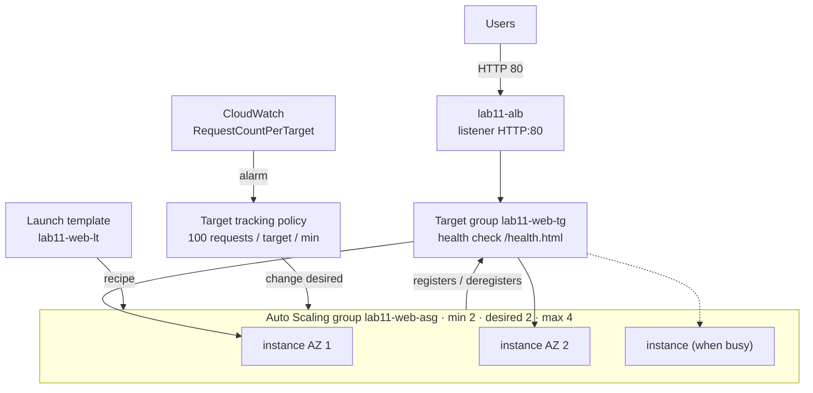
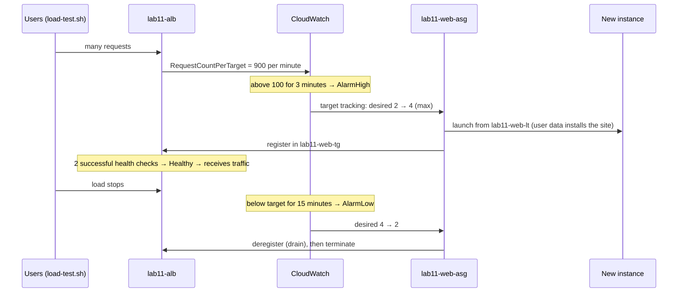

# Lab 11 — Introduction to EC2 Auto Scaling Groups (ASG)

> 🇫🇷 Version française : [ASG-Intro-Lab.fr.md](ASG-Intro-Lab.fr.md)

> **Audience:** beginners in AWS · **Level:** Foundational
> **Prerequisite:** Lab 9 (Introduction to the ALB) · **Duration:** about 90 minutes
> **Method:** AWS Console + 2 commands in CloudShell · **Region:** `us-west-1` · **Network:** the **default VPC**

---

## Scenario

The *Maison Lumière* bistro website (Lab 9) runs on two EC2 instances behind a load balancer. It works, but:

- if an instance crashes at night, nobody replaces it;
- at lunchtime and on Friday evenings, traffic jumps, and two servers aren't always enough;
- the rest of the time, paying for more servers would be a waste.

You'll replace the hand-made instances with an **EC2 Auto Scaling group** that **launches** servers from a template, **keeps** the number you ask for, **replaces** broken ones, and **adds or removes** servers according to the traffic, all by itself.

---

## Learning objectives

1. Create a **launch template**: the recipe for every new server
2. Create an **Auto Scaling group** across two AZs, with **minimum, desired and maximum** capacity
3. Attach the group to an **ALB target group** so new instances are registered automatically
4. Explain **EC2 vs ELB health checks** and the **health check grace period**
5. Watch **self-healing**: a terminated or unhealthy instance is replaced
6. Scale **manually**, with a **target tracking policy**, and with a **scheduled action**
7. Read the **Activity** history and the **CloudWatch alarms** that drive scaling

---

## 1. Key ideas in 3 minutes

| Idea | Meaning | In this lab |
|------|---------|-------------|
| **Launch template** | The recipe for a server: AMI, instance type, security group, user data… | `lab11-web-lt` (Amazon Linux 2023, `t3.micro`, restaurant site) |
| **Auto Scaling group (ASG)** | A group of identical instances that AWS manages for you | `lab11-web-asg` |
| **Minimum / Desired / Maximum** | Never fewer than *min*, never more than *max*; the group always works to have exactly *desired* | 2 / 2 / 4 |
| **Self-healing** | An instance that fails a health check is terminated and replaced | Part 7 |
| **EC2 health check** | "Is the virtual machine running?" | Always on |
| **ELB health check** | "Does the **application** answer the load balancer?" (`/health.html`) | Turned on in Part 5 |
| **Grace period** | Time given to a new instance to boot before its health counts | 120 s |
| **Target tracking policy** | "Keep this metric near this value": AWS adds/removes instances to get there | ~100 requests per instance per minute |
| **Scheduled action** | Change min/desired/max at a given time | Part 10 |
| **Activity** | The ASG's history: every launch and termination, with the reason | Read it all along |

> 🧠 **The one rule to remember:** you no longer manage instances, you manage **numbers** (min, desired, max) and **rules**. The ASG makes reality match them.

---

## 2. Architecture

### 2.1 Full lab diagram

```text
                              ┌─ Users (web browser) ────────────────┐
                              │ http://<ALB DNS name>                │
                              └──────────────────────────────────────┘
                                                 │ HTTP 80
                                                 ▼
┌─ AWS Region us-west-1 ───────────────────────────────────────────────────────────────────────────────────────┐
│ ┌─ Default VPC 172.31.0.0/16 ──────────────────────────────────────────────────────────────────────────────┐ │
│ │ ┌─ lab11-alb · listener HTTP:80 -> target group lab11-web-tg ──────────────────────────────────────────┐ │ │
│ │ │ health check GET /health.html · targets registered BY THE ASG                                        │ │ │
│ │ └──────────────────────────────────────────────────────────────────────────────────────────────────────┘ │ │
│ │         │ HTTP 80 (healthy targets only)                                                                 │ │
│ │ ┌─ Auto Scaling group lab11-web-asg  ·  min 2 · desired 2 · max 4 ─────────────────────────────────────┐ │ │
│ │ │ launch template lab11-web-lt (AL2023, t3.micro, lab11-web-sg, user data = restaurant site)           │ │ │
│ │ │ health checks: EC2 + ELB · grace period 120 s · spread across both AZs                               │ │ │
│ │ │ policy: target tracking, ALB request count per target = 100/min                                      │ │ │
│ │ │ CloudWatch alarms AlarmHigh / AlarmLow -> change 'desired' -> launch / terminate                     │ │ │
│ │ │ ┌─ Availability Zone 1 ─────────────────────────┐  ┌─ Availability Zone 2 ─────────────────────────┐ │ │ │
│ │ │ │ ┌─ Default subnet (public) ─────────────────┐ │  │ ┌─ Default subnet (public) ─────────────────┐ │ │ │ │
│ │ │ │ │ ★ instance (from template)                │ │  │ │ ★ instance (from template)                │ │ │ │ │
│ │ │ │ │   + more when busy (max 4)                │ │  │ │   + more when busy (max 4)                │ │ │ │ │
│ │ │ │ └───────────────────────────────────────────┘ │  │ └───────────────────────────────────────────┘ │ │ │ │
│ │ │ └───────────────────────────────────────────────┘  └───────────────────────────────────────────────┘ │ │ │
│ │ └──────────────────────────────────────────────────────────────────────────────────────────────────────┘ │ │
│ │ sg lab11-alb-sg: IN 80 <- 0.0.0.0/0      sg lab11-web-sg: IN 80 <- lab11-alb-sg ONLY                     │ │
│ └──────────────────────────────────────────────────────────────────────────────────────────────────────────┘ │
└──────────────────────────────────────────────────────────────────────────────────────────────────────────────┘
```

★ = launched by the Auto Scaling group from the launch template (never by hand).

### 2.2 How the pieces fit



### 2.3 The scaling loop



---

## 3. Before you start

- **Lab 9 cleaned up** (or at least its instances terminated): this lab uses new `lab11-…` names
- Console Region **`us-west-1`**, default VPC present (**VPC → Your VPCs → Default VPC = Yes**)
- The lab files:

```
aws-lab-asg-intro/
├── ASG-Intro-Lab.en.md          ← this guide
├── ASG-Intro-Lab.fr.md
├── scripts/
│   └── user-data.sh             restaurant site (from Lab 9) + "started HH:MM" in the badge
└── tools/
    └── load-test.sh             CloudShell: traffic for a few minutes to trigger scaling
```

**Cost:** 2–4 × `t3.micro` (~$0.012/hour each, or Free Tier hours) + ALB (~$0.025/hour) + public IPv4 ($0.005/hour each). About **$0.10–0.15/hour**. **Delete the Auto Scaling group** at the end (Part 11), otherwise it keeps relaunching instances.

**Worksheet:**

| Item | Value |
|------|-------|
| ALB DNS name | |
| Instance IDs launched at creation | |
| Time you started the load test | |

---

## Part 1 — Security groups

**EC2 → Security groups → Create security group** (default VPC), same idea as Lab 9:

| Name | Description | Inbound rule |
|------|-------------|--------------|
| `lab11-alb-sg` | `HTTP from the internet to the ALB` | **HTTP** 80 from **Anywhere-IPv4** |
| `lab11-web-sg` | `HTTP from the ALB only` | **HTTP** 80 from **`lab11-alb-sg`** (choose the security group, not an IP) |

> ⚠️ Lab 9 lesson: if the web rule's source isn't `lab11-alb-sg`, every target is *Request timed out*.

---

## Part 2 — Launch template

**EC2 → Instances → Launch templates → Create launch template**:

| Setting | Value |
|---------|-------|
| Launch template name | `lab11-web-lt` |
| Template version description | `v1 - restaurant site` |
| Auto Scaling guidance | ✅ **Provide guidance to help me set up a template that I can use with EC2 Auto Scaling** |
| Application and OS Images | **Quick Start → Amazon Linux 2023** |
| Instance type | `t3.micro` |
| Key pair | **Don't include in launch template** |
| Network settings → Subnet | **Don't include in launch template** (the ASG chooses the subnets) |
| Network settings → Security groups | **`lab11-web-sg`** |
| Advanced details → Metadata version | **V2 only (token required)** |
| Advanced details → **User data** | paste [`scripts/user-data.sh`](scripts/user-data.sh) (first line exactly `#!/bin/bash`) |

**Create launch template.**

> 🧠 A launch template doesn't start anything: it's a **recipe**. Every instance the ASG launches will be identical: same AMI, same security group, same user data, same site. Instances in the default subnets get a public IP automatically (needed to download Apache).

---

## Part 3 — Target group (empty)

**EC2 → Target groups → Create target group**:

| Setting | Value |
|---------|-------|
| Target type / name | **Instances** / `lab11-web-tg` |
| Protocol / Port / VPC | HTTP / 80 / default VPC |
| Health check path | **`/health.html`** |
| Advanced | Healthy **2** · Unhealthy **2** · Timeout **5** · Interval **10** · Success codes **200** |

**Next** → **don't select any instance** → **Create target group**.

> 🧠 In Lab 9 you registered instances by hand. Here the **Auto Scaling group** will register every instance it launches, and deregister every instance it terminates.

---

## Part 4 — Application Load Balancer

**Load balancers → Create → Application Load Balancer**: name **`lab11-alb`**, **Internet-facing**, IPv4, default VPC, **tick all AZs** (one subnet each), security group **`lab11-alb-sg`** only (remove `default`), listener **HTTP:80 → `lab11-web-tg`** → **Create**.

Copy the **DNS name** into the worksheet. Opening it now gives **503**: the target group is still empty.

---

## Part 5 — Auto Scaling group

**EC2 → Auto Scaling → Auto Scaling groups → Create Auto Scaling group**:

**Step 1 — Launch template**
- Name: **`lab11-web-asg`**
- Launch template: **`lab11-web-lt`**, version **Default (1)**

**Step 2 — Instance launch options**
- VPC: default VPC
- Availability Zones and subnets: **select all the default subnets** (at least 2 AZs)
- AZ distribution: **Balanced best effort**

**Step 3 — Integrate with other services**
- Load balancing: **Attach to an existing load balancer** → **Choose from your load balancer target groups** → **`lab11-web-tg`**
- Health checks: ✅ **Turn on Elastic Load Balancing health checks**
- Health check grace period: **120** seconds

**Step 4 — Group size and scaling**
- Desired capacity **2** · Min desired capacity **2** · Max desired capacity **4**
- Automatic scaling: **Target tracking scaling policy**
  - Policy name: `lab11-requests-per-instance`
  - Metric type: **Application Load Balancer request count per target**
  - Target group: **`lab11-web-tg`**
  - Target value: **100**
  - Instance warmup: **60** seconds
- Instance maintenance policy: **No policy** (default)
- Additional settings: ✅ **Enable group metrics collection within CloudWatch**

**Steps 5–6 — Notifications, Tags**
- Tag: Key `Name`, Value `lab11-web` (✅ tag new instances)

**Step 7 — Review → Create Auto Scaling group.**

Watch it work:
1. **`lab11-web-asg` → Activity** tab: two lines *Launching a new EC2 instance: i-…* with the cause *an instance was started in response to a difference between desired and actual capacity, increasing the capacity from 0 to 2*.
2. **Instance management** tab: 2 instances, one per AZ, *Lifecycle: Pending → InService*.
3. **Target groups → `lab11-web-tg` → Targets**: the 2 instances appear **by themselves**, then become **Healthy** (~2–3 minutes).
4. Open `http://<ALB DNS name>` and refresh: the **Served by** badge alternates between 2 instances in 2 AZs, with their **started** time.

---

## Part 6 — The two kinds of health checks

| | EC2 health check | ELB health check |
|---|------------------|------------------|
| Question | Is the VM running and passing EC2 status checks? | Does the app answer `/health.html` with 200? |
| Catches | Stopped, terminated or impaired instance | Apache stopped, site broken, wrong port… |
| Who asks | EC2 | The load balancer (target group) |
| On in this lab | Always | Yes (Step 3) |

Without the ELB check, an instance whose web server crashed would stay **InService** forever, receiving no traffic but never replaced. The **grace period** (120 s) stops the ASG from killing an instance that's still installing Apache.

---

## Part 7 — Self-healing

### 7.1 An instance disappears
1. **EC2 → Instances** → select one `lab11-web` instance → **Instance state → Terminate**.
2. **ASG → Activity** (refresh): *Terminating EC2 instance… taken out of service in response to an EC2 health check indicating it has been terminated or stopped*, then *Launching a new EC2 instance… increasing the capacity from 1 to 2*.
3. ~3 minutes later: 2 healthy targets again; the new one has a recent **started** time in the badge.

### 7.2 An instance is "sick"
In **CloudShell**:

```bash
aws autoscaling describe-auto-scaling-instances \
  --query "AutoScalingInstances[?AutoScalingGroupName=='lab11-web-asg'].[InstanceId,AvailabilityZone,HealthStatus,LifecycleState]" --output table

aws autoscaling set-instance-health --instance-id <one-instance-id> --health-status Unhealthy
```

The ASG immediately terminates that instance and launches a replacement. This is exactly what happens when the ELB health check fails.

> 🧠 You never "repair" an instance in an ASG: you **replace** it. That only works because every instance is built the same way from the launch template, and stores nothing important on its disk (the site is static; data would live in a database, Lab 6).

---

## Part 8 — Manual scaling

1. **ASG → Details → Group details → Edit** → **Desired capacity = 3** → **Update**.
   Activity: *increasing the capacity from 2 to 3*. A third instance appears and joins the target group.
2. Edit again → **Desired capacity = 2**.
   Activity: *shrinking the capacity from 3 to 2*. The ASG picks an instance **so that the AZs stay balanced**, deregisters it from the target group (it shows **Draining**), then terminates it.
3. Try **Desired = 5**: the console refuses (max is 4). Try **Desired = 1**: refused (min is 2).

---

## Part 9 — Automatic scaling under load

1. Open **CloudShell** and start the load (6 minutes, 10 parallel clients):

   ```bash
   curl -fsSLO https://raw.githubusercontent.com/inspiredevgen/devops-worksphops/refs/heads/main/2-Cloud-Infrastructure/aws-lab-asg-intro/tools/load-test.sh
   bash load-test.sh <ALB DNS name> 6 10
   ```

   (Or upload `tools/load-test.sh` with **Actions → Upload file**.)

2. While it runs, watch three places:
   - **CloudWatch → Alarms**: `TargetTracking-lab11-web-asg-AlarmHigh-…` goes to **In alarm** after about 3 minutes (the request count per target is far above 100).
   - **ASG → Activity**: *Launching a new EC2 instance… changing the desired capacity from 2 to 4* (or 3).
   - **Target groups → Targets**: new instances appear, then become **Healthy**.

3. The script ends by showing who answered: **3–4 different instances** now share the traffic.

   ```text
   Who answers? (30 requests)
         8 Served by i-0aaa… · us-west-1b
         7 Served by i-0bbb… · us-west-1c
         8 Served by i-0ccc… · us-west-1b
         7 Served by i-0ddd… · us-west-1c
   ```

4. **Scale-in:** do nothing. About **15 minutes** after the load stops, `AlarmLow` goes **In alarm**, desired goes back to **2**, and the extra instances are drained and terminated. Look at **ASG → Monitoring** (*Group metrics*: Desired, InService, Total instances) to see the curve go up and down.

> 🧠 **Out fast, in slow** is on purpose: adding capacity too late hurts users; removing it too early causes flapping (scale in, then out again a minute later).

---

## Part 10 — Bonus: scheduled scaling

The bistro knows that lunch (12:00–14:00) is busy. Plan for it instead of reacting:

1. **ASG → Automatic scaling** tab → **Scheduled actions → Create scheduled action**:
   - Name `lunch-rush`, Desired **3**, Min **3**, Max **4**, Recurrence **Once**, start time **5 minutes from now** (check the time zone) → **Create**.
2. Second action `after-lunch`: Desired **2**, Min **2**, Max **4**, Once, start time **10 minutes from now**.
3. Watch **Activity**: the capacity goes to 3 at the first time, back to 2 at the second, with the cause *…by scheduled action lunch-rush*.

> 🧠 In real life you'd use **Recurrence = Cron** (for example every weekday at 11:45) and combine it with the target tracking policy: scheduled actions prepare, target tracking adjusts.

---

## Validation checklist

| # | Check | Expected |
|---|-------|----------|
| 1 | ASG → Instance management | 2 instances **InService**, 2 different AZs |
| 2 | `lab11-web-tg` → Targets | Same 2 instances, **Healthy**, registered without you |
| 3 | Browser on the ALB | Restaurant site, badge alternates between instances |
| 4 | Terminate an instance | Replaced automatically (Activity shows why) |
| 5 | `set-instance-health … Unhealthy` | Instance replaced |
| 6 | Desired 3 → 2 | Third instance launched, then drained and terminated |
| 7 | `load-test.sh` | AlarmHigh in alarm, desired 3–4, more instances in the badge |
| 8 | 15 min after the load | Back to 2 instances |

---

## Troubleshooting

| Problem | Likely cause | Fix |
|---------|--------------|-----|
| Targets *Request timed out* | `lab11-web-sg` rule source isn't `lab11-alb-sg` | Fix the rule (instances don't need replacing) |
| Instances launched, terminated, relaunched in a loop | ELB health check fails (see target reason) and the ASG replaces them | Fix the cause; while debugging, edit the ASG → health checks → untick ELB |
| Targets *Health checks failed* | User data didn't run (blank line before `#!/bin/bash`) or Apache didn't install | Instance → **Actions → Monitor and troubleshoot → Get system log**; fix the template (Part 2 → **Modify template (Create new version)**), set it as default, then terminate the instances so the ASG relaunches them |
| Activity: *Launching a new EC2 instance. Status Reason: … InvalidParameterCombination / not supported in your requested Availability Zone* | Instance type not offered in one AZ | Use `t3.micro` or remove that subnet |
| No public IP on instances, Apache not installed | Default subnet setting changed | **VPC → Subnets → Edit subnet settings → Enable auto-assign public IPv4**, then replace instances |
| No scale-out during the load test | Alarm not reached yet (wait 3–4 min), max = 2, or the policy uses another target group | Check **CloudWatch → Alarms** and the policy's target group |
| You can't delete the security groups | Instances still running / ASG not deleted | Delete the ASG first (Part 11) |

---

## Break & fix

| # | Break it | Observe | Lesson | Fix |
|---|----------|---------|--------|-----|
| B1 | Set **Max = 2**, run the load test | AlarmHigh fires but desired stays 2; Activity has no launch | Max is a hard ceiling (cost control) | Max 4 |
| B2 | Remove the HTTP rule from `lab11-web-sg` for 5 minutes | Targets unhealthy → the ASG **replaces** instances again and again | ELB health checks + a network problem = churn. Find the root cause before blaming the instances | Restore the rule |
| B3 | Template **version 2** with user data starting with an empty line, set as default, then terminate one instance | The new instance never becomes healthy and is replaced in a loop | The template is the single source of truth: one bad version breaks every new instance | Default version back to **1** |
| B4 | Terminate **both** instances at once | Site down (503) for ~3 minutes until the replacements are healthy | Self-healing isn't instant: keep min ≥ 2 in 2 AZs, and don't lose them at the same time | — |

---

## Part 11 — Cleanup (in this order)

1. **Auto Scaling groups → `lab11-web-asg` → Actions → Delete** (type `delete`). This **terminates its instances**. Wait until it disappears.
2. **Load balancers → `lab11-alb` → Delete** · **Target groups → `lab11-web-tg` → Delete**.
3. **Launch templates → `lab11-web-lt` → Actions → Delete template**.
4. **Security groups**: `lab11-web-sg`, then `lab11-alb-sg`.
5. **CloudWatch → Alarms**: the `TargetTracking-lab11-web-asg-…` alarms are deleted with the group; delete any left.

> ⚠️ If you terminate the instances **before** deleting the ASG, it immediately launches new ones. Always delete the **group** first.

---

## Review questions

1. What's the difference between a launch template and an Auto Scaling group?
2. What do min, desired and max mean? What happens if desired is outside min–max?
3. Why turn on ELB health checks, and why is there a grace period?
4. Who registers instances in the target group in this lab?
5. Which metric drove scaling, and why does scale-in take longer than scale-out?
6. You terminated an instance by hand and the ASG launched a new one. Why?
7. Why must you delete the ASG before its instances?
8. When would you use a scheduled action instead of target tracking?

<details>
<summary><b>Answers</b></summary>

1. The **launch template** describes *how* to build one instance (AMI, type, security group, user data). The **ASG** decides *how many* instances run, *where* (subnets/AZs), keeps them healthy, and registers them with the load balancer.
2. **Min**: the group never goes below it. **Max**: never above it (cost ceiling). **Desired**: the number the group works to have right now; policies and you change it, always within min–max (the console refuses other values).
3. EC2 checks only see the virtual machine. **ELB checks** also catch a broken application, so the ASG replaces instances that the load balancer considers unhealthy. The **grace period** gives a new instance time to boot and install the site before its checks count.
4. The **Auto Scaling group**, because it's attached to `lab11-web-tg`: it registers each instance it launches and deregisters (drains) each one it terminates.
5. **ALB request count per target** (target 100 per minute). Scale-out triggers after ~3 minutes above target; scale-in waits ~15 minutes below target to avoid removing capacity too early and flapping.
6. Actual capacity (1) became lower than desired (2): the ASG always works to make them equal.
7. As long as the group exists with desired = 2, any terminated instance is replaced. Deleting the group terminates its instances and stops the replacements.
8. When the load is **predictable** (lunch, business hours, a planned event): capacity is ready **before** the peak, instead of a few minutes after it.
</details>

---

## Next steps

- **Lab 7** — Auto Scaling with a real application, RDS Proxy, Secrets Manager and rolling deployments (instance refresh)
- **Lab 8** — build the whole stack with CloudFormation

## Sources

- [Target tracking scaling policies for Amazon EC2 Auto Scaling](https://docs.aws.amazon.com/autoscaling/ec2/userguide/as-scaling-target-tracking.html)
- [Health checks for instances in an Auto Scaling group](https://docs.aws.amazon.com/autoscaling/ec2/userguide/ec2-auto-scaling-health-checks.html)
- [Scheduled scaling for Amazon EC2 Auto Scaling](https://docs.aws.amazon.com/autoscaling/ec2/userguide/ec2-auto-scaling-scheduled-scaling.html)
