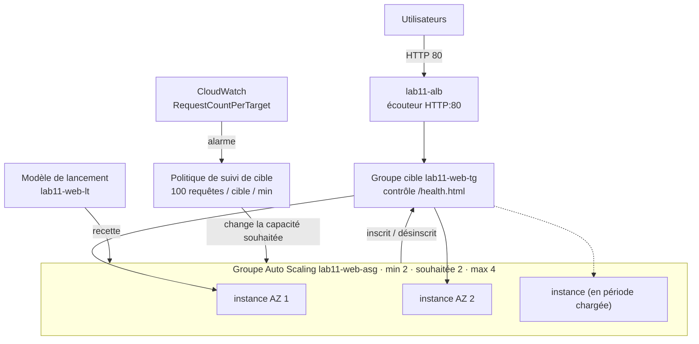
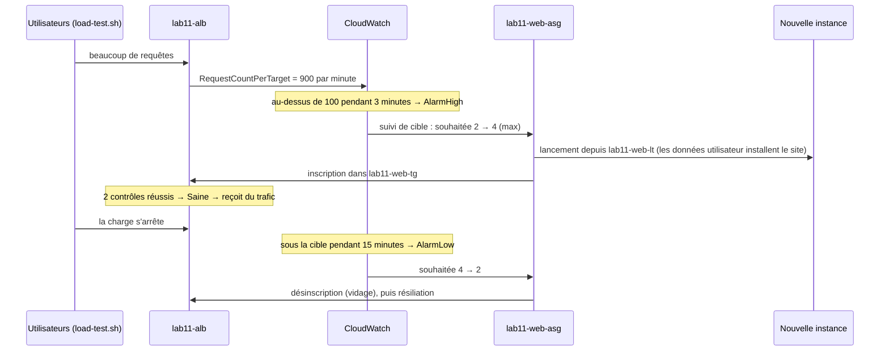

# Lab 11 — Introduction aux groupes EC2 Auto Scaling (ASG)

> 🇬🇧 English version: [ASG-Intro-Lab.en.md](ASG-Intro-Lab.en.md)

> **Public :** débutants sur AWS · **Niveau :** fondamental
> **Prérequis :** Lab 9 (Introduction à l'ALB) · **Durée :** environ 90 minutes
> **Méthode :** console AWS + 2 commandes dans CloudShell · **Région :** `us-west-1` · **Réseau :** le **VPC par défaut**

---

## Scénario

Le site du bistro *Maison Lumière* (Lab 9) tourne sur deux instances EC2 derrière un équilibreur de charge. Il fonctionne, mais :

- si une instance plante la nuit, personne ne la remplace ;
- à midi et le vendredi soir, le trafic bondit, et deux serveurs ne suffisent pas toujours ;
- le reste du temps, payer plus de serveurs serait du gaspillage.

Vous allez remplacer les instances faites à la main par un **groupe EC2 Auto Scaling** qui **lance** des serveurs à partir d'un modèle, **maintient** le nombre demandé, **remplace** ceux qui sont en panne, et **ajoute ou retire** des serveurs selon le trafic, tout seul.

---

## Objectifs d'apprentissage

1. Créer un **modèle de lancement** : la recette de chaque nouveau serveur
2. Créer un **groupe Auto Scaling** sur deux AZ, avec une capacité **minimale, souhaitée et maximale**
3. Rattacher le groupe à un **groupe cible d'ALB** pour que les nouvelles instances soient inscrites automatiquement
4. Expliquer les **contrôles de santé EC2 et ELB** et la **période de grâce**
5. Observer l'**auto-réparation** : une instance résiliée ou défaillante est remplacée
6. Mettre à l'échelle **manuellement**, avec une **politique de suivi de cible**, et avec une **action planifiée**
7. Lire l'historique **Activité** et les **alarmes CloudWatch** qui pilotent la mise à l'échelle

---

## 1. Les idées clés en 3 minutes

| Idée | Signification | Dans ce lab |
|------|---------------|-------------|
| **Modèle de lancement** | La recette d'un serveur : AMI, type d'instance, groupe de sécurité, données utilisateur… | `lab11-web-lt` (Amazon Linux 2023, `t3.micro`, site du restaurant) |
| **Groupe Auto Scaling (ASG)** | Un groupe d'instances identiques qu'AWS gère pour vous | `lab11-web-asg` |
| **Minimum / Souhaitée / Maximum** | Jamais moins que *min*, jamais plus que *max* ; le groupe travaille en permanence à avoir exactement la capacité *souhaitée* | 2 / 2 / 4 |
| **Auto-réparation** | Une instance qui échoue à un contrôle de santé est résiliée et remplacée | Partie 7 |
| **Contrôle de santé EC2** | « La machine virtuelle tourne-t-elle ? » | Toujours actif |
| **Contrôle de santé ELB** | « L'**application** répond-elle à l'équilibreur de charge ? » (`/health.html`) | Activé à la Partie 5 |
| **Période de grâce** | Temps laissé à une nouvelle instance pour démarrer avant que sa santé compte | 120 s |
| **Politique de suivi de cible** | « Garde cette métrique près de cette valeur » : AWS ajoute/retire des instances pour y arriver | ~100 requêtes par instance et par minute |
| **Action planifiée** | Changer min/souhaitée/max à une heure donnée | Partie 10 |
| **Activité** | L'historique de l'ASG : chaque lancement et chaque résiliation, avec la raison | À lire tout au long du lab |

> 🧠 **La règle à retenir :** vous ne gérez plus des instances, vous gérez des **nombres** (min, souhaitée, max) et des **règles**. L'ASG fait correspondre la réalité à ces nombres.

---

## 2. Architecture

### 2.1 Schéma complet du lab

```text
                              ┌─ Utilisateurs (navigateur web) ──────┐
                              │ http://<nom DNS de l'ALB>            │
                              └──────────────────────────────────────┘
                                                 │ HTTP 80
                                                 ▼
┌─ Région AWS us-west-1 ───────────────────────────────────────────────────────────────────────────────────────┐
│ ┌─ VPC par défaut 172.31.0.0/16 ───────────────────────────────────────────────────────────────────────────┐ │
│ │ ┌─ lab11-alb · écouteur HTTP:80 -> groupe cible lab11-web-tg ──────────────────────────────────────────┐ │ │
│ │ │ contrôle GET /health.html · cibles inscrites PAR L'ASG                                               │ │ │
│ │ └──────────────────────────────────────────────────────────────────────────────────────────────────────┘ │ │
│ │         │ HTTP 80 (healthy targets only)                                                                 │ │
│ │ ┌─ Groupe Auto Scaling lab11-web-asg  ·  min 2 · souhaitée 2 · max 4 ──────────────────────────────────┐ │ │
│ │ │ modèle de lancement lab11-web-lt (AL2023, t3.micro, lab11-web-sg, données util. = site restaurant)   │ │ │
│ │ │ contrôles : EC2 + ELB · période de grâce 120 s · réparti sur les deux AZ                             │ │ │
│ │ │ politique : suivi de cible, requêtes ALB par cible = 100/min                                         │ │ │
│ │ │ alarmes CloudWatch AlarmHigh / AlarmLow -> changent « souhaitée » -> lancer / résilier               │ │ │
│ │ │ ┌─ Zone de disponibilité 1 ─────────────────────┐  ┌─ Zone de disponibilité 2 ─────────────────────┐ │ │ │
│ │ │ │ ┌─ Sous-réseau par défaut (public) ─────────┐ │  │ ┌─ Sous-réseau par défaut (public) ─────────┐ │ │ │ │
│ │ │ │ │ ★ instance (du modèle)                    │ │  │ │ ★ instance (du modèle)                    │ │ │ │ │
│ │ │ │ │   + d'autres en charge (max 4)            │ │  │ │   + d'autres en charge (max 4)            │ │ │ │ │
│ │ │ │ └───────────────────────────────────────────┘ │  │ └───────────────────────────────────────────┘ │ │ │ │
│ │ │ └───────────────────────────────────────────────┘  └───────────────────────────────────────────────┘ │ │ │
│ │ └──────────────────────────────────────────────────────────────────────────────────────────────────────┘ │ │
│ │ sg lab11-alb-sg : ENTRÉE 80 <- 0.0.0.0/0      sg lab11-web-sg : ENTRÉE 80 <- lab11-alb-sg SEULEMENT      │ │
│ └──────────────────────────────────────────────────────────────────────────────────────────────────────────┘ │
└──────────────────────────────────────────────────────────────────────────────────────────────────────────────┘
```

★ = lancé par le groupe Auto Scaling à partir du modèle de lancement (jamais à la main).

### 2.2 Comment les pièces s'assemblent



### 2.3 La boucle de mise à l'échelle



---

## 3. Avant de commencer

- **Lab 9 nettoyé** (ou au moins ses instances résiliées) : ce lab utilise de nouveaux noms `lab11-…`
- Région de la console **`us-west-1`**, VPC par défaut présent (**VPC → Vos VPC → VPC par défaut = Oui**)
- Les fichiers du lab :

```
aws-lab-asg-intro/
├── ASG-Intro-Lab.en.md
├── ASG-Intro-Lab.fr.md          ← ce guide
├── scripts/
│   └── user-data.sh             site du restaurant (du Lab 9) + « started HH:MM » dans le badge
└── tools/
    └── load-test.sh             CloudShell : du trafic pendant quelques minutes pour déclencher la mise à l'échelle
```

**Coût :** 2 à 4 × `t3.micro` (~0,012 $/heure chacune, ou heures de l'offre gratuite) + ALB (~0,025 $/heure) + IPv4 publiques (0,005 $/heure chacune). Environ **0,10 à 0,15 $/heure**. **Supprimez le groupe Auto Scaling** à la fin (Partie 11), sinon il relance sans cesse des instances.

**Fiche de travail :**

| Élément | Valeur |
|---------|--------|
| Nom DNS de l'ALB | |
| ID des instances lancées à la création | |
| Heure de début du test de charge | |

---

## Partie 1 — Groupes de sécurité

**EC2 → Groupes de sécurité → Créer un groupe de sécurité** (VPC par défaut), même idée qu'au Lab 9 :

| Nom | Description | Règle entrante |
|-----|-------------|----------------|
| `lab11-alb-sg` | `HTTP from the internet to the ALB` | **HTTP** 80 depuis **Anywhere-IPv4** |
| `lab11-web-sg` | `HTTP from the ALB only` | **HTTP** 80 depuis **`lab11-alb-sg`** (choisissez le groupe de sécurité, pas une IP) |

> ⚠️ Leçon du Lab 9 : si la source de la règle web n'est pas `lab11-alb-sg`, toutes les cibles sont en *Request timed out*.

---

## Partie 2 — Modèle de lancement

**EC2 → Instances → Modèles de lancement → Créer un modèle de lancement** :

| Paramètre | Valeur |
|-----------|--------|
| Nom du modèle | `lab11-web-lt` |
| Description de la version | `v1 - restaurant site` |
| Conseils Auto Scaling | ✅ **Fournir des conseils pour configurer un modèle utilisable avec EC2 Auto Scaling** |
| Images d'application et de système d'exploitation | **Démarrage rapide → Amazon Linux 2023** |
| Type d'instance | `t3.micro` |
| Paire de clés | **Ne pas inclure dans le modèle de lancement** |
| Paramètres réseau → Sous-réseau | **Ne pas inclure dans le modèle de lancement** (l'ASG choisit les sous-réseaux) |
| Paramètres réseau → Groupes de sécurité | **`lab11-web-sg`** |
| Détails avancés → Version des métadonnées | **V2 uniquement (jeton requis)** |
| Détails avancés → **Données utilisateur** | collez [`scripts/user-data.sh`](scripts/user-data.sh) (première ligne exactement `#!/bin/bash`) |

**Créer le modèle de lancement.**

> 🧠 Un modèle de lancement ne démarre rien : c'est une **recette**. Chaque instance lancée par l'ASG sera identique : même AMI, même groupe de sécurité, mêmes données utilisateur, même site. Les instances des sous-réseaux par défaut reçoivent automatiquement une IP publique (nécessaire pour télécharger Apache).

---

## Partie 3 — Groupe cible (vide)

**EC2 → Groupes cibles → Créer un groupe cible** :

| Paramètre | Valeur |
|-----------|--------|
| Type de cible / nom | **Instances** / `lab11-web-tg` |
| Protocole / Port / VPC | HTTP / 80 / VPC par défaut |
| Chemin du contrôle de santé | **`/health.html`** |
| Avancé | Sain **2** · Défaillant **2** · Délai **5** · Intervalle **10** · Codes de réussite **200** |

**Suivant** → **ne sélectionnez aucune instance** → **Créer un groupe cible**.

> 🧠 Au Lab 9, vous inscriviez les instances à la main. Ici, le **groupe Auto Scaling** inscrira chaque instance qu'il lance, et désinscrira chaque instance qu'il résilie.

---

## Partie 4 — Application Load Balancer

**Équilibreurs de charge → Créer → Application Load Balancer** : nom **`lab11-alb`**, **Accessible sur Internet**, IPv4, VPC par défaut, **cochez toutes les AZ** (un sous-réseau chacune), groupe de sécurité **`lab11-alb-sg`** seul (retirez `default`), écouteur **HTTP:80 → `lab11-web-tg`** → **Créer**.

Copiez le **nom DNS** dans la fiche. L'ouvrir maintenant donne **503** : le groupe cible est encore vide.

---

## Partie 5 — Groupe Auto Scaling

**EC2 → Auto Scaling → Groupes Auto Scaling → Créer un groupe Auto Scaling** :

**Étape 1 — Modèle de lancement**
- Nom : **`lab11-web-asg`**
- Modèle de lancement : **`lab11-web-lt`**, version **Default (1)**

**Étape 2 — Options de lancement des instances**
- VPC : VPC par défaut
- Zones de disponibilité et sous-réseaux : **sélectionnez tous les sous-réseaux par défaut** (au moins 2 AZ)
- Distribution entre AZ : **Équilibrée au mieux** (*Balanced best effort*)

**Étape 3 — Intégrer à d'autres services**
- Équilibrage de charge : **Attacher à un équilibreur de charge existant** → **Choisir parmi vos groupes cibles** → **`lab11-web-tg`**
- Contrôles de santé : ✅ **Activer les contrôles de santé Elastic Load Balancing**
- Période de grâce du contrôle de santé : **120** secondes

**Étape 4 — Taille du groupe et mise à l'échelle**
- Capacité souhaitée **2** · Min **2** · Max **4**
- Mise à l'échelle automatique : **Politique de mise à l'échelle avec suivi de cible**
  - Nom : `lab11-requests-per-instance`
  - Type de métrique : **Nombre de requêtes Application Load Balancer par cible**
  - Groupe cible : **`lab11-web-tg`**
  - Valeur cible : **100**
  - Préchauffage des instances : **60** secondes
- Politique de maintenance des instances : **Aucune politique** (défaut)
- Paramètres supplémentaires : ✅ **Activer la collecte des métriques de groupe dans CloudWatch**

**Étapes 5–6 — Notifications, Balises**
- Balise : Clé `Name`, Valeur `lab11-web` (✅ baliser les nouvelles instances)

**Étape 7 — Vérifier → Créer un groupe Auto Scaling.**

Observez-le travailler :
1. **`lab11-web-asg` → onglet Activité** : deux lignes *Launching a new EC2 instance: i-…* avec la cause *an instance was started in response to a difference between desired and actual capacity, increasing the capacity from 0 to 2*.
2. Onglet **Gestion des instances** : 2 instances, une par AZ, *Cycle de vie : Pending → InService*.
3. **Groupes cibles → `lab11-web-tg` → Cibles** : les 2 instances apparaissent **toutes seules**, puis deviennent **Saines** (~2 à 3 minutes).
4. Ouvrez `http://<nom DNS de l'ALB>` et actualisez : le badge **Served by** alterne entre 2 instances dans 2 AZ, avec leur heure de démarrage (**started**).

---

## Partie 6 — Les deux types de contrôles de santé

| | Contrôle de santé EC2 | Contrôle de santé ELB |
|---|-----------------------|-----------------------|
| Question | La VM tourne-t-elle et passe-t-elle les contrôles d'état EC2 ? | L'appli répond-elle 200 sur `/health.html` ? |
| Détecte | Instance arrêtée, résiliée ou dégradée | Apache arrêté, site cassé, mauvais port… |
| Qui demande | EC2 | L'équilibreur de charge (groupe cible) |
| Actif dans ce lab | Toujours | Oui (Étape 3) |

Sans le contrôle ELB, une instance dont le serveur web a planté resterait **InService** indéfiniment, sans recevoir de trafic mais sans jamais être remplacée. La **période de grâce** (120 s) empêche l'ASG de tuer une instance qui installe encore Apache.

---

## Partie 7 — Auto-réparation

### 7.1 Une instance disparaît
1. **EC2 → Instances** → sélectionnez une instance `lab11-web` → **État de l'instance → Résilier**.
2. **ASG → Activité** (actualisez) : *Terminating EC2 instance… taken out of service in response to an EC2 health check indicating it has been terminated or stopped*, puis *Launching a new EC2 instance… increasing the capacity from 1 to 2*.
3. ~3 minutes plus tard : de nouveau 2 cibles saines ; la nouvelle a une heure **started** récente dans le badge.

### 7.2 Une instance est « malade »
Dans **CloudShell** :

```bash
aws autoscaling describe-auto-scaling-instances \
  --query "AutoScalingInstances[?AutoScalingGroupName=='lab11-web-asg'].[InstanceId,AvailabilityZone,HealthStatus,LifecycleState]" --output table

aws autoscaling set-instance-health --instance-id <id-d-une-instance> --health-status Unhealthy
```

L'ASG résilie immédiatement cette instance et en lance une de remplacement. C'est exactement ce qui se passe quand le contrôle ELB échoue.

> 🧠 Dans un ASG, on ne « répare » jamais une instance : on la **remplace**. Cela ne fonctionne que parce que chaque instance est construite de la même façon à partir du modèle, et ne stocke rien d'important sur son disque (le site est statique ; les données seraient dans une base, Lab 6).

---

## Partie 8 — Mise à l'échelle manuelle

1. **ASG → Détails → Détails du groupe → Modifier** → **Capacité souhaitée = 3** → **Mettre à jour**.
   Activité : *increasing the capacity from 2 to 3*. Une troisième instance apparaît et rejoint le groupe cible.
2. Modifiez de nouveau → **Capacité souhaitée = 2**.
   Activité : *shrinking the capacity from 3 to 2*. L'ASG choisit une instance **pour garder les AZ équilibrées**, la désinscrit du groupe cible (elle passe en **Draining**), puis la résilie.
3. Essayez **Souhaitée = 5** : la console refuse (max = 4). Essayez **Souhaitée = 1** : refusé (min = 2).

---

## Partie 9 — Mise à l'échelle automatique sous charge

1. Ouvrez **CloudShell** et lancez la charge (6 minutes, 10 clients en parallèle) :

   ```bash
   curl -fsSLO https://raw.githubusercontent.com/inspiredevgen/devops-worksphops/refs/heads/main/2-Cloud-Infrastructure/aws-lab-asg-intro/tools/load-test.sh
   bash load-test.sh <nom DNS de l'ALB> 6 10
   ```

   (Ou téléversez `tools/load-test.sh` avec **Actions → Charger un fichier**.)

2. Pendant l'exécution, surveillez trois endroits :
   - **CloudWatch → Alarmes** : `TargetTracking-lab11-web-asg-AlarmHigh-…` passe **En alarme** après environ 3 minutes (le nombre de requêtes par cible est bien au-dessus de 100).
   - **ASG → Activité** : *Launching a new EC2 instance… changing the desired capacity from 2 to 4* (ou 3).
   - **Groupes cibles → Cibles** : de nouvelles instances apparaissent, puis deviennent **Saines**.

3. Le script termine en montrant qui a répondu : **3 ou 4 instances différentes** se partagent maintenant le trafic.

   ```text
   Who answers? (30 requests)
         8 Served by i-0aaa… · us-west-1b
         7 Served by i-0bbb… · us-west-1c
         8 Served by i-0ccc… · us-west-1b
         7 Served by i-0ddd… · us-west-1c
   ```

4. **Réduction :** ne faites rien. Environ **15 minutes** après la fin de la charge, `AlarmLow` passe **En alarme**, la capacité souhaitée revient à **2**, et les instances en trop sont vidées puis résiliées. Regardez **ASG → Surveillance** (*Métriques de groupe* : Desired, InService, Total instances) pour voir la courbe monter puis descendre.

> 🧠 **Monter vite, descendre lentement**, c'est voulu : ajouter de la capacité trop tard pénalise les utilisateurs ; en retirer trop tôt provoque des oscillations (réduction, puis nouvelle augmentation une minute plus tard).

---

## Partie 10 — Bonus : mise à l'échelle planifiée

Le bistro sait que le midi (12 h–14 h) est chargé. Anticipez au lieu de réagir :

1. **ASG → onglet Mise à l'échelle automatique** → **Actions planifiées → Créer une action planifiée** :
   - Nom `lunch-rush`, Souhaitée **3**, Min **3**, Max **4**, Récurrence **Une fois**, heure de début **dans 5 minutes** (vérifiez le fuseau horaire) → **Créer**.
2. Seconde action `after-lunch` : Souhaitée **2**, Min **2**, Max **4**, Une fois, heure de début **dans 10 minutes**.
3. Observez **Activité** : la capacité passe à 3 à la première heure, revient à 2 à la seconde, avec la cause *…by scheduled action lunch-rush*.

> 🧠 En vrai, on utiliserait **Récurrence = Cron** (par exemple chaque jour ouvré à 11 h 45) en complément de la politique de suivi de cible : les actions planifiées préparent, le suivi de cible ajuste.

---

## Liste de validation

| # | Vérification | Attendu |
|---|--------------|---------|
| 1 | ASG → Gestion des instances | 2 instances **InService**, 2 AZ différentes |
| 2 | `lab11-web-tg` → Cibles | Les mêmes 2 instances, **Saines**, inscrites sans vous |
| 3 | Navigateur sur l'ALB | Site du restaurant, le badge alterne entre les instances |
| 4 | Résilier une instance | Remplacée automatiquement (Activité indique pourquoi) |
| 5 | `set-instance-health … Unhealthy` | Instance remplacée |
| 6 | Souhaitée 3 → 2 | Troisième instance lancée, puis vidée et résiliée |
| 7 | `load-test.sh` | AlarmHigh en alarme, souhaitée 3–4, plus d'instances dans le badge |
| 8 | 15 min après la charge | Retour à 2 instances |

---

## Dépannage

| Problème | Cause probable | Correction |
|----------|----------------|------------|
| Cibles en *Request timed out* | La source de la règle de `lab11-web-sg` n'est pas `lab11-alb-sg` | Corrigez la règle (inutile de remplacer les instances) |
| Instances lancées, résiliées, relancées en boucle | Le contrôle ELB échoue (voir la raison sur la cible) et l'ASG les remplace | Corrigez la cause ; pendant le débogage, modifiez l'ASG → contrôles de santé → décochez ELB |
| Cibles en *Health checks failed* | Données utilisateur non exécutées (ligne vide avant `#!/bin/bash`) ou Apache non installé | Instance → **Actions → Surveiller et dépanner → Obtenir le journal système** ; corrigez le modèle (Partie 2 → **Modifier le modèle (créer une nouvelle version)**), définissez-la par défaut, puis résiliez les instances pour que l'ASG les relance |
| Activité : *Launching a new EC2 instance. Status Reason: … InvalidParameterCombination / not supported in your requested Availability Zone* | Type d'instance non proposé dans une AZ | Utilisez `t3.micro` ou retirez ce sous-réseau |
| Pas d'IP publique sur les instances, Apache non installé | Réglage du sous-réseau par défaut modifié | **VPC → Sous-réseaux → Modifier les paramètres → Activer l'attribution automatique d'IPv4 publique**, puis remplacez les instances |
| Pas d'augmentation pendant le test de charge | Alarme pas encore atteinte (attendez 3–4 min), max = 2, ou la politique vise un autre groupe cible | Vérifiez **CloudWatch → Alarmes** et le groupe cible de la politique |
| Impossible de supprimer les groupes de sécurité | Instances encore en marche / ASG non supprimé | Supprimez d'abord l'ASG (Partie 11) |

---

## Casser et réparer

| # | Cassez | Observez | Leçon | Réparez |
|---|--------|----------|-------|---------|
| B1 | Mettez **Max = 2**, lancez le test de charge | AlarmHigh se déclenche mais la capacité souhaitée reste à 2 ; aucun lancement dans Activité | Le max est un plafond strict (maîtrise des coûts) | Max 4 |
| B2 | Retirez la règle HTTP de `lab11-web-sg` pendant 5 minutes | Cibles défaillantes → l'ASG **remplace** les instances encore et encore | Contrôles ELB + problème réseau = remplacements en boucle. Trouvez la cause avant d'accuser les instances | Restaurez la règle |
| B3 | Modèle **version 2** dont les données utilisateur commencent par une ligne vide, définie par défaut, puis résiliez une instance | La nouvelle instance ne devient jamais saine et est remplacée en boucle | Le modèle est la source de vérité : une mauvaise version casse chaque nouvelle instance | Version par défaut de nouveau **1** |
| B4 | Résiliez **les deux** instances en même temps | Site indisponible (503) ~3 minutes, jusqu'à ce que les remplaçantes soient saines | L'auto-réparation n'est pas instantanée : gardez min ≥ 2 dans 2 AZ, et ne les perdez pas en même temps | — |

---

## Partie 11 — Nettoyage (dans cet ordre)

1. **Groupes Auto Scaling → `lab11-web-asg` → Actions → Supprimer** (tapez `delete`). Cela **résilie ses instances**. Attendez sa disparition.
2. **Équilibreurs de charge → `lab11-alb` → Supprimer** · **Groupes cibles → `lab11-web-tg` → Supprimer**.
3. **Modèles de lancement → `lab11-web-lt` → Actions → Supprimer le modèle**.
4. **Groupes de sécurité** : `lab11-web-sg`, puis `lab11-alb-sg`.
5. **CloudWatch → Alarmes** : les alarmes `TargetTracking-lab11-web-asg-…` sont supprimées avec le groupe ; supprimez celles qui resteraient.

> ⚠️ Si vous résiliez les instances **avant** de supprimer l'ASG, il en relance immédiatement de nouvelles. Supprimez toujours le **groupe** en premier.

---

## Questions de révision

1. Quelle est la différence entre un modèle de lancement et un groupe Auto Scaling ?
2. Que signifient min, souhaitée et max ? Que se passe-t-il si la capacité souhaitée sort de l'intervalle min–max ?
3. Pourquoi activer les contrôles de santé ELB, et pourquoi une période de grâce ?
4. Qui inscrit les instances dans le groupe cible dans ce lab ?
5. Quelle métrique a piloté la mise à l'échelle, et pourquoi la réduction prend-elle plus de temps que l'augmentation ?
6. Vous avez résilié une instance à la main et l'ASG en a lancé une nouvelle. Pourquoi ?
7. Pourquoi faut-il supprimer l'ASG avant ses instances ?
8. Quand utiliseriez-vous une action planifiée plutôt que le suivi de cible ?

<details>
<summary><b>Réponses</b></summary>

1. Le **modèle de lancement** décrit *comment* construire une instance (AMI, type, groupe de sécurité, données utilisateur). L'**ASG** décide *combien* d'instances tournent, *où* (sous-réseaux/AZ), les maintient en bonne santé, et les inscrit auprès de l'équilibreur de charge.
2. **Min** : le groupe ne descend jamais en dessous. **Max** : jamais au-dessus (plafond de coût). **Souhaitée** : le nombre que le groupe cherche à avoir maintenant ; les politiques et vous la modifiez, toujours entre min et max (la console refuse les autres valeurs).
3. Les contrôles EC2 ne voient que la machine virtuelle. Les **contrôles ELB** détectent aussi une application cassée : l'ASG remplace alors les instances que l'équilibreur considère défaillantes. La **période de grâce** laisse à une nouvelle instance le temps de démarrer et d'installer le site avant que ses contrôles comptent.
4. Le **groupe Auto Scaling**, parce qu'il est rattaché à `lab11-web-tg` : il inscrit chaque instance qu'il lance et désinscrit (vide) chaque instance qu'il résilie.
5. **Le nombre de requêtes ALB par cible** (cible 100 par minute). L'augmentation se déclenche après ~3 minutes au-dessus de la cible ; la réduction attend ~15 minutes sous la cible pour éviter de retirer de la capacité trop tôt et d'osciller.
6. La capacité réelle (1) est devenue inférieure à la capacité souhaitée (2) : l'ASG travaille toujours à les rendre égales.
7. Tant que le groupe existe avec une capacité souhaitée de 2, toute instance résiliée est remplacée. Supprimer le groupe résilie ses instances et arrête les remplacements.
8. Quand la charge est **prévisible** (midi, heures de bureau, événement planifié) : la capacité est prête **avant** le pic, au lieu de quelques minutes après.
</details>

---

## Pour aller plus loin

- **Lab 7** — Auto Scaling avec une vraie application, RDS Proxy, Secrets Manager et déploiements progressifs (actualisation d'instances)
- **Lab 8** — construire toute la pile avec CloudFormation

## Sources

- [Politiques de mise à l'échelle avec suivi de cible pour Amazon EC2 Auto Scaling](https://docs.aws.amazon.com/autoscaling/ec2/userguide/as-scaling-target-tracking.html)
- [Contrôles de santé des instances d'un groupe Auto Scaling](https://docs.aws.amazon.com/autoscaling/ec2/userguide/ec2-auto-scaling-health-checks.html)
- [Mise à l'échelle planifiée pour Amazon EC2 Auto Scaling](https://docs.aws.amazon.com/autoscaling/ec2/userguide/ec2-auto-scaling-scheduled-scaling.html)
