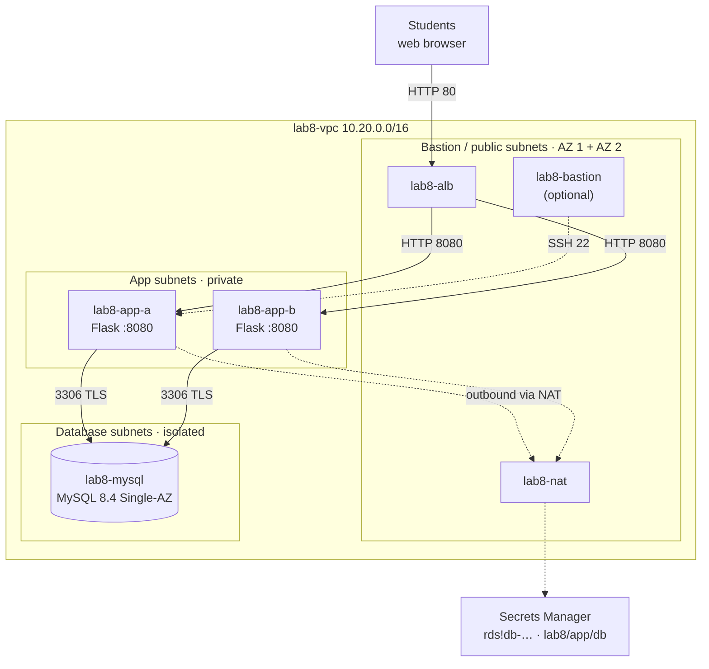
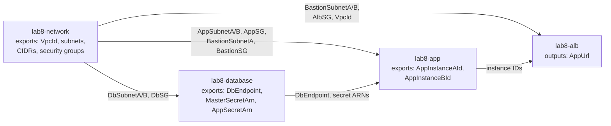
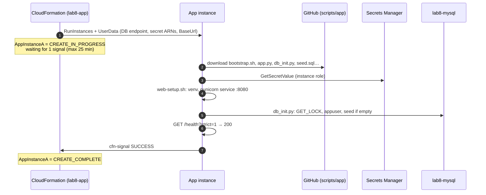

# Lab 8 — Deploy a Two-Tier Web App on Amazon RDS for MySQL with AWS CloudFormation

> 🇫🇷 Version française : [CFN-WebApp-Lab.fr.md](CFN-WebApp-Lab.fr.md)

> **Audience:** Cloud Engineer trainees · **Level:** Associate
> **Starting point:** an empty Region (this lab builds **its own VPC**; the Lab 1 network isn't used) · Lab 6 recommended (same app, built by hand)
> **Duration:** about 3 hours (much of it waiting for stacks) · **Method:** CloudFormation console, 4 YAML templates
> **Region:** `us-west-1`

---

## Scenario

*Pacific Learning Co.* liked the Lab 6 architecture, but the operations team can't rebuild it by hand for every environment (dev, test, production), and nobody remembers which checkbox was ticked six months ago.

Your task: describe the whole platform **as code** with **AWS CloudFormation**, in four layers that different teams could own:

| Stack | Template | Contents |
|-------|----------|----------|
| `lab8-network` | [`01-network.yaml`](cfn/01-network.yaml) | VPC, 6 subnets in 2 AZs (**bastion/public**, **app**, **database**), Internet Gateway, NAT Gateway, route tables, security groups |
| `lab8-database` | [`02-database.yaml`](cfn/02-database.yaml) | RDS for MySQL 8.4, **Free Tier** class, **Single-AZ**, credentials in Secrets Manager |
| `lab8-app` | [`03-app.yaml`](cfn/03-app.yaml) | **2 Amazon Linux 2023 instances** in the app subnets running the Flask app (+ optional bastion) |
| `lab8-alb` | [`04-alb.yaml`](cfn/04-alb.yaml) | **Application Load Balancer** routing HTTP traffic to the 2 instances |

The stacks are linked by **exports** and **imports**: each one publishes the IDs the next one needs. At the end, one click per stack rebuilds the whole platform, identically, in any account.

---

## Learning objectives

1. Read and write CloudFormation **YAML**: `Parameters`, `Resources`, `Outputs`, `Conditions`, `Metadata`
2. Use the intrinsic functions **`!Ref`**, **`!GetAtt`**, **`!Sub`**, **`!Select`/`!GetAZs`**, **`!If`**, **`Fn::ImportValue`**
3. Split infrastructure into **layered stacks** connected by **cross-stack exports**, and explain why CloudFormation protects exports that are in use
4. Get the latest AMI from a public **SSM parameter** instead of hard-coding an AMI ID
5. Keep secrets out of templates: **RDS-managed master secret** and a **generated** application secret
6. Make a stack wait for the application with a **`CreationPolicy`** and **`cfn-signal`**, and understand automatic **rollback**
7. Change running infrastructure safely with **change sets**, and find manual changes with **drift detection**

### Console vs CloudFormation

| | Lab 6 (console) | Lab 8 (CloudFormation) |
|---|-----------------|------------------------|
| How you build | ~150 clicks, in the right order | 4 template uploads |
| Repeat in another account/Region | Redo every click | Same templates, other parameters |
| Review a change | Look at the console after the fact | **Change set** before applying it |
| Someone edits a security group by hand | Nobody notices | **Drift detection** shows it |
| Something fails halfway | Half-built environment to clean up | **Automatic rollback** |
| Delete everything | Remember every resource and the order | Delete 4 stacks |

---

## 1. Architecture

### 1.0 Full project diagram

Each resource is tagged with the stack that creates it.

```text
Students (browser) -> http://<AlbDnsName>   ·   Engineer: console, CloudShell, optional SSH -> bastion
                │ HTTP 80
                ▼
┌─ AWS Region us-west-1 ───────────────────────────────────────────────────────────────────────────────────────────────────┐
│ ┌─ [N] lab8-vpc 10.20.0.0/16 ──────────────────────────────────────────────────────────────────────────────────────────┐ │
│ │ [N] lab8-igw · lab8-public-rt: 0.0.0.0/0 -> igw                                                                      │ │
│ │ ┌─ Availability Zone 1 ─────────────────────────────────┐  ┌─ Availability Zone 2 ─────────────────────────────────┐ │ │
│ │ │ ┌─ [N] lab8-bastion-a 10.20.0.0/24 · PUBLIC ────────┐ │  │ ┌─ [N] lab8-bastion-b 10.20.1.0/24 · PUBLIC ────────┐ │ │ │
│ │ │ │ [L] lab8-alb node    [N] lab8-nat (+EIP)          │ │  │ │ [L] lab8-alb node                                 │ │ │ │
│ │ │ │ [A] lab8-bastion (only if KeyName given)          │ │  │ │                                                   │ │ │ │
│ │ │ └───────────────────────────────────────────────────┘ │  │ └───────────────────────────────────────────────────┘ │ │ │
│ │ │       │ HTTP 8080 (target group)                      │  │       │ HTTP 8080 (target group)                      │ │ │
│ │ │ ┌─ [N] lab8-app-a 10.20.11.0/24 · PRIVATE ──────────┐ │  │ ┌─ [N] lab8-app-b 10.20.12.0/24 · PRIVATE ──────────┐ │ │ │
│ │ │ │ [A] lab8-app-a  t3.micro · AL2023                 │ │  │ │ [A] lab8-app-b  t3.micro · AL2023                 │ │ │ │
│ │ │ │     Flask + gunicorn :8080 · cfn-signal           │ │  │ │     Flask + gunicorn :8080 · cfn-signal           │ │ │ │
│ │ │ └───────────────────────────────────────────────────┘ │  │ └───────────────────────────────────────────────────┘ │ │ │
│ │ │       │ 3306 TLS                                      │  │       │ 3306 TLS (to lab8-mysql in AZ 1)              │ │ │
│ │ │       ▼                                               │  │                                                       │ │ │
│ │ │ ┌─ [N] lab8-db-a 10.20.21.0/24 · ISOLATED ──────────┐ │  │ ┌─ [N] lab8-db-b 10.20.22.0/24 · ISOLATED ──────────┐ │ │ │
│ │ │ │ [D] lab8-mysql  MySQL 8.4 · db.t4g.micro          │ │  │ │ [D] DB subnet group: 2nd AZ (required)            │ │ │ │
│ │ │ │     Single-AZ · encrypted · :3306 TLS             │ │  │ │                                                   │ │ │ │
│ │ │ └───────────────────────────────────────────────────┘ │  │ └───────────────────────────────────────────────────┘ │ │ │
│ │ └───────────────────────────────────────────────────────┘  └───────────────────────────────────────────────────────┘ │ │
│ │ [L] lab8-alb  internet-facing · listener HTTP:80 -> lab8-app-tg (2 instances, :8080, GET /health)                    │ │
│ │ [N] security groups: lab8-alb-sg :80 <- 0.0.0.0/0 · lab8-app-sg :8080 <- alb-sg, :22 <- bastion-sg                   │ │
│ │                      lab8-db-sg :3306 <- app-sg, bastion-sg · lab8-bastion-sg :22 <- AdminCidr                       │ │
│ │ [N] lab8-app-rt: 0.0.0.0/0 -> lab8-nat · lab8-db-rt: local only (no internet in either direction)                    │ │
│ └──────────────────────────────────────────────────────────────────────────────────────────────────────────────────────┘ │
│ [D] Secrets Manager: rds!db-… (master, managed by RDS) · lab8/app/db (appuser, generated)                                │
│ [A] IAM role: SSM + GetSecretValue on those 2 secrets · reached via the NAT Gateway                                      │
│                                                                                                                          │
│ Stacks: [N] lab8-network  [D] lab8-database  [A] lab8-app  [L] lab8-alb                                                  │
└──────────────────────────────────────────────────────────────────────────────────────────────────────────────────────────┘
```

### 1.1 Architecture diagram (Mermaid)



### 1.2 How the stacks depend on each other



**Create** left to right, **delete** right to left. CloudFormation refuses to delete a stack whose exports are still imported (Part 9).

### 1.3 First boot of an app instance and `cfn-signal`



If any step fails, `bootstrap.sh` sends **FAILURE** with the reason, and the stack **rolls back**. Without `CreationPolicy`, CloudFormation would report success as soon as the VM starts, even if the app never works.

### 1.4 CloudFormation cheat sheet (used in these templates)

| Syntax | Meaning | Example in this lab |
|--------|---------|---------------------|
| `Parameters:` | Inputs chosen at deploy time | `AdminCidr`, `DBInstanceClass`, `KeyName` |
| `!Ref X` | ID of resource X, or value of parameter X | `VpcId: !Ref Vpc` |
| `!GetAtt X.Attr` | An attribute of resource X | `!GetAtt Database.Endpoint.Address` |
| `!Sub '…${Name}…'` | String with variables substituted | `!Sub '${AWS::StackName}-VpcId'` |
| `!Select [0, !GetAZs '']` | First AZ of the current Region | Subnets of AZ 1 |
| `Outputs: … Export: Name:` | Publish a value for other stacks | `lab8-network-AppSG` |
| `Fn::ImportValue` | Read another stack's export | `Fn::ImportValue: !Sub '${NetworkStackName}-AppSG'` |
| `Conditions:` + `!If` | Create/set something only in some cases | Bastion only if `KeyName` isn't empty |
| `AWS::SSM::Parameter::Value<…>` | Parameter resolved from SSM Parameter Store | Latest Amazon Linux 2023 AMI |
| `CreationPolicy` | Wait for N success signals | Each app instance |
| `DeletionPolicy` | What happens to the resource when the stack is deleted | `Delete` for the lab DB (`Snapshot` in production) |
| `AWS::NoValue` | "Don't set this property" | No `KeyName` on the instances when empty |

---

## 2. Prerequisites and cost

- An AWS account with permissions for CloudFormation, VPC/EC2, RDS, IAM, Secrets Manager, ELB, Systems Manager
- Console in Region **`us-west-1`**, and **CloudShell** for the test script
- The lab files published in your repository (section 3): the stacks download `scripts/app/*` from GitHub at boot
- Optional: an EC2 key pair if you want the bastion

| Resource | Approximate cost (us-west-1) |
|----------|------------------------------|
| NAT Gateway + its public IPv4 | ~$0.05/hour + $0.005/hour + per GB |
| 2 × EC2 `t3.micro` (+ bastion) | ~$0.012/hour each (Free Tier hours if eligible) |
| RDS `db.t4g.micro`, 20 GB gp2 | ~$0.02/hour (Free Tier or credits if eligible) |
| ALB + 2 public IPv4 | ~$0.025/hour + $0.01/hour |
| Secrets Manager (2 secrets) | $0.40/secret/month, prorated (cents) |

> 💰 About **$0.15/hour** while everything runs. CloudFormation itself is free. **Delete the 4 stacks** the same day (Part 15).

> ℹ️ **Free Tier:** accounts created after July 15, 2025 receive credits under the Free plan instead of the old 12-month offer. `db.t4g.micro`/`db.t3.micro`, Single-AZ and 20 GB gp2 keep the database within the Free Tier limits either way.

### 2.1 Lab worksheet

| Item | Value |
|------|-------|
| Your public IP (`https://checkip.amazonaws.com`) + `/32` | |
| Key pair name (optional) | |
| `BaseUrl` of `scripts/app` | |
| Stack outputs: `DbEndpoint` | |
| Stack outputs: `AppUrl` | |

---

## 3. The lab files

```
aws-lab-cfn-webapp/
├── CFN-WebApp-Lab.en.md          ← this guide
├── CFN-WebApp-Lab.fr.md
├── cfn/
│   ├── 01-network.yaml           stack lab8-network
│   ├── 02-database.yaml          stack lab8-database
│   ├── 03-app.yaml               stack lab8-app
│   └── 04-alb.yaml               stack lab8-alb
└── scripts/
    ├── app/                      downloaded by each app instance at first boot (BaseUrl)
    │   ├── bootstrap.sh          orchestrates the boot, then cfn-signal SUCCESS/FAILURE
    │   ├── web-setup.sh          Python venv, pinned packages, RDS CA, systemd service 'labapp'
    │   ├── db_init.py            database + appuser + seed, ONCE (MySQL named lock)
    │   ├── app.py                Flask app (same as Lab 6): pages, form, /health
    │   ├── requirements.txt      Flask, PyMySQL, gunicorn (pinned)
    │   ├── templates/index.html  the page
    │   └── seed.sql              8 courses, 12 students, 28 enrollments
    └── tools/
        └── alb-check.sh          N requests to the ALB: who answered?
```

| File | What it does |
|------|--------------|
| [`01-network.yaml`](cfn/01-network.yaml) | VPC `10.20.0.0/16` · **bastion/public** subnets `10.20.0.0/24`, `10.20.1.0/24` (ALB nodes, NAT, bastion) · **app** subnets `10.20.11.0/24`, `10.20.12.0/24` (default route → NAT) · **database** subnets `10.20.21.0/24`, `10.20.22.0/24` (**no** default route) · `lab8-alb-sg`, `lab8-bastion-sg`, `lab8-app-sg`, `lab8-db-sg` · 14 exports |
| [`02-database.yaml`](cfn/02-database.yaml) | DB subnet group on the 2 database subnets · `lab8-mysql` (MySQL 8.4, `db.t4g.micro`, 20 GB gp2, encrypted, Single-AZ, not public) with **`ManageMasterUserPassword: true`** · secret **`lab8/app/db`** whose password is **generated** by Secrets Manager |
| [`03-app.yaml`](cfn/03-app.yaml) | IAM role (Session Manager + `GetSecretValue` on the 2 secrets only) · 2 instances from the **latest AL2023 AMI** (SSM parameter), IMDSv2 required, each with a **`CreationPolicy`** · bastion if `KeyName` is set |
| [`04-alb.yaml`](cfn/04-alb.yaml) | ALB in the 2 public subnets · target group `lab8-app-tg` (HTTP 8080, `/health`, 2/2 thresholds, 30 s deregistration delay) with the 2 instance IDs · listener HTTP:80 · output **`AppUrl`** |
| [`bootstrap.sh`](scripts/app/bootstrap.sh) | 1) identity · 2) installs `aws-cfn-bootstrap`, downloads the app · 3) reads both secrets · 4) `web-setup.sh` · 5) `db_init.py` · 6) readiness → **`cfn-signal`**. Any error → FAILURE signal with the line number |
| [`db_init.py`](scripts/app/db_init.py) | Logs in as master (TLS verified), takes **`GET_LOCK('lab8_db_init')`** so the 2 instances don't collide, creates `appuser` for the **2 app subnet CIDRs**, loads `seed.sql` **only if the tables don't exist** |

**Publish** the `cfn/` and `scripts/` folders in your repository, for example
`inspiredevgen/devops-worksphops` → `2-Cloud-Infrastructure/aws-lab-cfn-webapp/`.
The app stack's `BaseUrl` parameter defaults to
`https://raw.githubusercontent.com/inspiredevgen/devops-worksphops/refs/heads/main/2-Cloud-Infrastructure/aws-lab-cfn-webapp/scripts/app`.
Check it in a browser: `…/scripts/app/bootstrap.sh` must show the script, not a 404.

---

## Part 1 — Prepare

1. Console → Region **US West (N. California) us-west-1**.
2. Download the four templates from your repository to your computer (or clone it).
3. Find your public IP: open `https://checkip.amazonaws.com` → note `x.x.x.x/32`.
4. *(Optional, for the bastion)* **EC2 → Key pairs → Create key pair**: `lab8-key`, ED25519, `.pem`.
5. Open each template in an editor and skim it with the cheat sheet (§1.4) at hand.

---

## Part 2 — Stack 1: the network

### 2.1 Read the template
Open [`01-network.yaml`](cfn/01-network.yaml) and find:

- **`!Select [0, !GetAZs '']`** on subnets A, **`[1, …]`** on subnets B: two AZs without hard-coding names.
- **`MapPublicIpOnLaunch: true`** only on the bastion subnets.
- **`DependsOn: GatewayAttachment`** on the EIP and the public route: some dependencies are invisible to CloudFormation (the route needs the IGW *attached*, not just created).
- **`DbRouteTable`** has **no** route: database subnets can't reach the internet, and the internet can't reach them.
- **`SourceSecurityGroupId`** in the app and database rules: the SG chain.
- **`Outputs` → `Export` → `Name: !Sub '${AWS::StackName}-AppSG'`**: the names other stacks import.

### 2.2 Create the stack
**CloudFormation → Stacks → Create stack → With new resources (standard)**:

| Step | Setting | Value |
|------|---------|-------|
| 1 | Prerequisite | **Choose an existing template** → **Upload a template file** → `01-network.yaml` |
| 2 | Stack name | **`lab8-network`** (the other templates import `lab8-network-…`) |
| | `AdminCidr` | your IP **/32** |
| | Other parameters | defaults |
| 3 | Tags | `Project` = `lab8` (propagated to every resource that supports tags) |
| | Stack failure options | **Roll back all stack resources** (default) |
| 4 | Review | **Submit** |

Open the **Events** tab (newest first). Watch `CREATE_IN_PROGRESS` → `CREATE_COMPLETE` for each logical ID. The NAT Gateway takes the longest (~2 minutes). Total: 3–4 minutes.

✅ **Checkpoint:**
- Stack status **CREATE_COMPLETE**.
- **Resources** tab: 26 resources, each with its *Physical ID* (the real `vpc-…`, `subnet-…`, `sg-…`).
- **Outputs** tab: 15 values, 14 of them with an **Export name**.
- **CloudFormation → Exports** (left menu): the `lab8-network-…` exports.
- **VPC → Your VPCs → `lab8-vpc` → Resource map**: 6 subnets, 3 route tables, IGW, NAT.

---

## Part 3 — Stack 2: the database

### 3.1 Read the template
In [`02-database.yaml`](cfn/02-database.yaml):

- `Fn::ImportValue: !Sub '${NetworkStackName}-DbSubnetA'`: the stack name is a parameter, so the same template works for `dev-network`, `prod-network`…
- **`ManageMasterUserPassword: true`**: no password in the template, the parameters or the events. RDS creates the secret `rds!db-…` and rotates it every 7 days.
- **`AWS::SecretsManager::Secret` + `GenerateSecretString`**: Secrets Manager invents the `appuser` password.
- **`DeletionPolicy: Delete`**: right for a lab. The RDS default is `Snapshot`; production databases often use `Retain` or `Snapshot`.
- **`!GetAtt Database.MasterUserSecret.SecretArn`**: an attribute that only exists once RDS has created the secret.

### 3.2 Create the stack
**Create stack → Upload `02-database.yaml`** → name **`lab8-database`** → keep the defaults (`db.t4g.micro`, `8.4`, `labapp`, `admin`) → tag `Project=lab8` → **Submit**.

The DB instance takes **10–15 minutes**. Meanwhile, read [`03-app.yaml`](cfn/03-app.yaml) and [`bootstrap.sh`](scripts/app/bootstrap.sh).

✅ **Checkpoint:**
- **Outputs**: `DbEndpoint` (`lab8-mysql.xxxx.us-west-1.rds.amazonaws.com`), `MasterSecretArn` (`…:secret:rds!db-…`), `AppSecretArn` (`…:secret:lab8/app/db-…`).
- **RDS → `lab8-mysql`**: Single-AZ, not publicly accessible, subnet group `lab8-db-subnet-group`, SG `lab8-db-sg`, encryption on.
- **Secrets Manager**: two secrets. Open **`lab8/app/db`** → *Retrieve secret value*: `username: appuser` and a 32-character password **that no one typed**.

---

## Part 4 — Stack 3: the app tier

### 4.1 Read the template
In [`03-app.yaml`](cfn/03-app.yaml):

- **`LatestAmiId`** has type `AWS::SSM::Parameter::Value<AWS::EC2::Image::Id>`: CloudFormation reads the public parameter `/aws/service/ami-amazon-linux-latest/al2023-ami-kernel-default-x86_64` at deploy time.
- **`AppRole`**: `GetSecretValue` only on the two imported secret ARNs.
- **`CreationPolicy: ResourceSignal: { Count: 1, Timeout: PT25M }`** on each instance.
- **`UserData`** uses the two-argument form of **`Fn::Sub`**: the list of variables (`DbEndpoint`, `MasterSecretArn`…) comes from imports. Note `'${AWS::StackName}'` and `LOGICAL_ID='AppInstanceA'`: `cfn-signal` needs both.
- **`Condition: HasKeyName`** on `Bastion`, and **`!If [HasKeyName, !Ref KeyName, !Ref AWS::NoValue]`** for the key on the app instances.

### 4.2 Create the stack
**Create stack → Upload `03-app.yaml`** → name **`lab8-app`**:

| Parameter | Value |
|-----------|-------|
| `NetworkStackName` / `DatabaseStackName` | `lab8-network` / `lab8-database` |
| `InstanceType` | `t3.micro` |
| `LatestAmiId` | keep the SSM parameter path |
| `KeyName` | **empty** (no bastion, use Session Manager) **or** `lab8-key` |
| `BaseUrl` | the raw URL of **your** `scripts/app` folder |
| `AppVersion` | `1.0.0` |

On the review page, tick **"I acknowledge that AWS CloudFormation might create IAM resources"** (the stack creates a role: capability `CAPABILITY_IAM`) → **Submit**.

### 4.3 Watch the signals
In **Events**, `AppInstanceA` and `AppInstanceB` stay **CREATE_IN_PROGRESS** for 4–8 minutes, then:

```text
AppInstanceA   CREATE_COMPLETE
AppInstanceA   CREATE_IN_PROGRESS   Received SUCCESS signal with UniqueId i-0abc…
```

While waiting, follow one boot live: **EC2 → Instances → `lab8-app-a` → Connect → Session Manager**:

```bash
sudo tail -f /var/log/cloud-init-output.log
```

```text
==> [14:02:11] 5/6 Initializing the database (once for both instances)
[db_init] connected to ip-10-20-21-… running MySQL 8.4.x
[db_init] TLS cipher: TLS_AES_256_GCM_SHA384
[db_init] init lock acquired
[db_init] user appuser ready for 10.20.11.0/24, 10.20.12.0/24
[db_init] seed.sql loaded                      ← on ONE instance
[db_init] tables already exist: seed skipped   ← on the other one
==> [14:02:20] 6/6 Readiness check, then signal CloudFormation
```

> 🧠 **Why the lock?** Both instances boot at the same moment and both run `db_init.py`. Without `GET_LOCK`, they could create the tables twice, or the second could drop the data the first just loaded. The lock serializes them; the "only if the tables don't exist" test makes the script safe to run again (**idempotent**).

> 🧠 **Lab shortcut, stated plainly:** the app role can read the **master** secret because the app instances initialize the database. In production, a one-time job (a Lambda-backed custom resource, or a pipeline step) would do that, and the app role would read only `lab8/app/db`.

---

## Part 5 — Stack 4: the load balancer

**Create stack → Upload `04-alb.yaml`** → name **`lab8-alb`** → defaults → **Submit** (~3 minutes).

✅ **Checkpoint:**
- **Outputs → `AppUrl`**: `http://lab8-alb-….us-west-1.elb.amazonaws.com/`
- **EC2 → Target groups → `lab8-app-tg` → Targets**: `lab8-app-a` and `lab8-app-b` **Healthy** (port 8080).

---

## Part 6 — Test the application

1. Open **`AppUrl`**. The header says *Python · Flask · deployed by CloudFormation*. **Refresh**: *Web instance* and the **AZ badge** alternate.
2. **Register a student**, refresh: the student is visible from both instances.
3. In **CloudShell**:
   ```bash
   curl -fsSLO https://raw.githubusercontent.com/inspiredevgen/devops-worksphops/refs/heads/main/2-Cloud-Infrastructure/aws-lab-cfn-webapp/scripts/tools/alb-check.sh
   ALB=$(aws cloudformation describe-stacks --stack-name lab8-alb \
         --query "Stacks[0].Outputs[?OutputKey=='AlbDnsName'].OutputValue" --output text)
   bash alb-check.sh $ALB 20
   curl -s http://$ALB/health?strict=1 | python3 -m json.tool
   ```
   Expected: 20/20 HTTP 200 across 2 instances in 2 AZs, and `"db": "reachable"`, `"db_tls": "TLS_…"`.

> 🧠 Notice how CloudShell got the ALB name: **from the stack outputs**, not by copy-paste. Scripts and pipelines read outputs the same way.

---

## Part 7 — Change sets: preview before you change

### 7.1 A safe change
**Stacks → `lab8-alb` → Stack actions → Create change set for current stack** → *Use current template* → set **`HealthCheckIntervalSeconds` = 30** → name the change set `slower-health-checks` → **Submit**.

Open the change set:

| Action | Logical ID | Resource type | Replacement |
|--------|-----------|---------------|-------------|
| Modify | `TargetGroup` | `AWS::ElasticLoadBalancingV2::TargetGroup` | **False** |

**Execute change set**. Only the target group attribute changes; the ALB DNS name stays the same.

### 7.2 A change you should think twice about
On **`lab8-app`**, create a change set with **`InstanceType` = `t3.small`** (don't execute it). The change set shows `Modify` on `AppInstanceA`/`AppInstanceB` with **Replacement: False**, but the [property documentation](https://docs.aws.amazon.com/AWSCloudFormation/latest/UserGuide/aws-resource-ec2-instance.html) says *Update requires: Some interruptions*: each instance is **stopped and started**. Both at once means a short outage.

Now create a second change set with **`AppVersion` = `2.0.0`**. It modifies **`UserData`**: also *some interruptions*. And the new user data **does not run again** on an existing instance: it only runs on first boot. **Delete** both change sets.

> 🧠 **Takeaways:** always read the **Replacement** column and the property's *Update requires*; a `Replacement: True` on a database means a **new, empty** database (unless `UpdateReplacePolicy` snapshots it). For rolling app updates, use an Auto Scaling group with instance refresh (Lab 7, extension A).

---

## Part 8 — Drift detection: who changed my security group?

1. Simulate a hurried colleague: **VPC → Security groups → `lab8-app-sg` → Edit inbound rules → Add rule**: Custom TCP **8080** from **0.0.0.0/0** → Save.
2. **CloudFormation → `lab8-network` → Stack actions → Detect drift**. Wait ~1 minute, then **View drift results**:
   - Stack drift status: **DRIFTED**
   - `AppSecurityGroup`: **MODIFIED** → *View drift details*: the extra `SecurityGroupIngress` entry is highlighted.
3. Fix it the IaC way: delete the manual rule, **Detect drift** again → **IN_SYNC**.

> 🧠 Drift detection compares the **template** with **reality** for the properties CloudFormation manages. The rule of thumb: once a resource belongs to a stack, change it **only through the stack**.

---

## Part 9 — Exports protect your dependencies

Try **`lab8-network` → Delete**. The deletion fails with a message like:

```text
Export lab8-network-AppSG cannot be deleted as it is in use by lab8-app
```

The same protection applies to an update that would change an exported value (`Export … cannot be updated as it is in use by …`), for example a template edit that replaces `lab8-app-sg`. This is why stacks are deleted **in reverse order** (Part 15).

> 🧠 Exports are **strong** links. Alternatives: pass IDs as parameters, or store them in **SSM Parameter Store** (weak links, more freedom, less protection). Many teams use exports for the network layer (rarely changes) and parameters elsewhere.

---

## Part 10 — Health and resilience checks

Connect to `lab8-app-b` with **Session Manager** (or `ssh` through the bastion if you set `KeyName`).

1. `sudo systemctl stop labapp` → within ~20 s, `lab8-app-b` is **Unhealthy** in `lab8-app-tg`; `bash alb-check.sh $ALB 20` → all requests go to `lab8-app-a`, no errors. Then `sudo systemctl start labapp`.
2. **Liveness vs readiness:** `curl -s localhost:8080/health` returns 200 even when the database is unreachable; `/health?strict=1` returns 503. The target group uses `/health` (template parameter `HealthCheckPath`). See Lab 6 Part 11 for the full experiment.
3. **Reboot** `lab8-app-b` (EC2 → Instance state → Reboot). The service is enabled in systemd: it returns without any action from CloudFormation. **User data doesn't run again**, and the data is untouched.

---

## Part 11 — Validation

| # | Where | Test | Expected | Proves |
|---|-------|------|----------|--------|
| 1 | CloudFormation | 4 stacks | **CREATE_COMPLETE** (UPDATE_COMPLETE for `lab8-alb`) | Templates deploy |
| 2 | CloudFormation → Exports | List | 14 `lab8-network-*`, 5 `lab8-database-*`, 2 `lab8-app-*`, 1 `lab8-alb-*` | Cross-stack links |
| 3 | `lab8-app` Events | AppInstanceA/B | *Received SUCCESS signal* | App ready before CREATE_COMPLETE |
| 4 | VPC → Route tables | `lab8-db-rt` | Only `10.20.0.0/16 → local` | Isolated database subnets |
| 5 | RDS | `lab8-mysql` | Single-AZ, Publicly accessible **No**, `db.t4g.micro` | Free Tier, private |
| 6 | Secrets Manager | 2 secrets | `rds!db-…`, `lab8/app/db` | No password in templates |
| 7 | CloudShell | `alb-check.sh` | 2 instances, 2 AZs, 20/20 OK | Load balancing |
| 8 | CloudShell | `/health?strict=1` | `"db_tls": "TLS_…"` | Encrypted DB connection |
| 9 | Template search | `grep -i password cfn/*.yaml` | Only comments, `ManageMasterUserPassword`, `GenerateStringKey`: no password value | Secrets by reference only |
| 10 | Drift | `lab8-network` | **IN_SYNC** after Part 8 | No manual changes left |

---

## Part 12 — Troubleshooting

### 12.1 Read the Events tab from the **first** failure

The first `CREATE_FAILED` event (scroll down, oldest failures are lower) gives the real cause; the following ones are usually *Resource creation cancelled*.

| Status reason | Cause | Fix |
|---------------|-------|-----|
| `No export named lab8-network-VpcId found` | Network stack has another name, isn't complete, or is in another Region | Same Region; parameter `NetworkStackName` |
| `Requires capabilities : [CAPABILITY_IAM]` | IAM acknowledgment not ticked | Tick the checkbox (CLI: `--capabilities CAPABILITY_IAM`) |
| `Parameter AdminCidr failed to satisfy constraint` | Not in `x.x.x.x/nn` form | Add `/32` to your IP |
| `Received FAILURE signal … bootstrap.sh failed at line N` | A step of the boot failed | See 12.2 |
| `Failed to receive 1 resource signal(s) within the specified duration` | The instance never signaled (no internet, `bootstrap.sh` not downloaded, `cfn-signal` blocked) | See 12.2; check `lab8-app-rt` → NAT |
| `Cannot find version 8.4 for mysql` | Engine version unavailable | Parameter `EngineVersion` = `8.0` |
| `InvalidParameterCombination` … *does not support creating a DB instance with the following combination* | Class/version/storage combination not offered in the Region | Parameter `DBInstanceClass` = `db.t3.micro` |
| `lab8/app/db already exists` / `scheduled for deletion` | A previous run left the secret | CloudShell: `aws secretsmanager delete-secret --secret-id lab8/app/db --force-delete-without-recovery`, wait 1 min |
| `Export with name lab8-network-VpcId is already exported by stack …` | You created the network twice | Use one stack per name, or another stack name + parameters |

### 12.2 The app instance failed: keep it to investigate

When the app stack rolls back, its instances are **terminated** with their logs. To debug:

1. Delete the failed stack (**ROLLBACK_COMPLETE** stacks can't be updated, only deleted).
2. Create it again with **Stack failure options → Preserve successfully provisioned resources**.
3. When it fails, the instance is still there: **Session Manager** → `sudo less /var/log/cloud-init-output.log`, or **EC2 → Actions → Monitor and troubleshoot → Get system log**.

| The log shows | Cause | Fix |
|---------------|-------|-----|
| `Cannot download bootstrap.sh from …` (event reason) | Wrong `BaseUrl`, private repo, or files not pushed | Open the URL in a browser |
| `curl: (28) … timed out` on everything | No outbound internet | `lab8-app-rt` 0.0.0.0/0 → `lab8-nat`, NAT *Available* |
| `AccessDeniedException … GetSecretValue` | Role policy / secret ARN mismatch | Check `AppRole` policy and the database stack outputs |
| `[db_init] attempt N/30: … timed out` | App → DB path blocked | `lab8-db-sg` 3306 from `lab8-app-sg` |
| `[db_init] … Access denied for user 'admin'` | Master secret just rotated during the boot | Retry (delete + recreate the app stack) |
| `readiness 503` | App up, DB not reachable as `appuser` | `hint` in the JSON; `appuser` hosts = app subnet CIDRs |

---

## Part 13 — Break & fix exercises

| # | Break it | Observe | Lesson | Fix |
|---|----------|---------|--------|-----|
| B1 | Delete `lab8-alb` then `lab8-app`, recreate `lab8-app` with a **wrong `BaseUrl`** | Event: *Received FAILURE signal… Cannot download bootstrap.sh*, then **rollback** of the whole stack | A `CreationPolicy` turns "VM started" into "app works" | Correct `BaseUrl` |
| B2 | Change set on `lab8-network`: `AdminCidr` = `0.0.0.0/0` | Only `BastionSecurityGroup` is modified | Parameters drive security; review before executing | Don't execute it |
| B3 | Manually remove **3306 ← `lab8-app-sg`** from `lab8-db-sg` | Page shows *Cannot reach the database*, targets stay healthy, drift = MODIFIED | Drift detection catches it | Restore the rule (or update the stack) |
| B4 | Try to delete `lab8-database` before `lab8-app` | Refused: exports in use | Dependencies are enforced | Delete in reverse order |
| B5 | Delete `lab8-alb` and `lab8-app`, then create `lab8-app` from a copy of `03-app.yaml` with `Count: 2` in `AppInstanceA`'s `CreationPolicy` | `AppInstanceA` waits 25 min for a second signal that never comes, then rollback | Signals are counted; `CreationPolicy` only applies when the resource is **created** | `Count: 1` |

---

## Part 14 — Extension challenges

**A. Auto Scaling.** Replace the two `AWS::EC2::Instance` with an `AWS::EC2::LaunchTemplate` + `AWS::AutoScaling::AutoScalingGroup` (min 2, `TargetGroupARNs`, `HealthCheckType: ELB`) with a `CreationPolicy` (`MinSuccessfulInstancesPercent`) and an `UpdatePolicy` (`AutoScalingRollingUpdate`). The ALB stack then no longer needs instance IDs.

**B. Nested stacks.** Upload the 4 templates to S3 and write `00-main.yaml` with four `AWS::CloudFormation::Stack` resources passing outputs as parameters (`!GetAtt Network.Outputs.VpcId`). Compare with exports.

**C. Lint and policy as code.** Run `pip install cfn-lint && cfn-lint cfn/*.yaml` in CloudShell, then write a **CloudFormation Guard** rule: *every `AWS::RDS::DBInstance` must have `StorageEncrypted: true` and `PubliclyAccessible: false`*.

**D. Protect the data.** Set `DeletionPolicy: Snapshot` and `UpdateReplacePolicy: Snapshot` on the database, enable **termination protection** on `lab8-database`, and add a **stack policy** denying `Update:Replace` on `Database`.

**E. HTTPS.** Add a `CertificateArn` parameter and a condition: when set, create an HTTPS:443 listener and turn the HTTP:80 listener into a redirect.

**F. Another environment.** Deploy the 4 templates again with stack names `dev8-network`, `dev8-database`… and the `*StackName` parameters set accordingly. What else must change to avoid name conflicts? (Hint: `GroupName`, `DBInstanceIdentifier`, `DBSubnetGroupName`, the secret `Name`, the ALB and target group `Name` are fixed strings.)

**G. Session Manager only.** Remove the bastion subnets' SSH rule and the `KeyName` parameter entirely. What's the smallest network change that still lets the app instances reach Systems Manager? (VPC interface endpoints for `ssm`, `ssmmessages`, `ec2messages`.)

---

## Part 15 — Cleanup (reverse order)

**CloudFormation → Stacks**, one at a time, waiting for **DELETE_COMPLETE** each time:

1. **`lab8-alb`** (~2 min)
2. **`lab8-app`** (~2 min: instances, role, bastion)
3. **`lab8-database`** (~5–10 min: RDS instance, its `rds!db-…` secret, subnet group, `lab8/app/db`)
4. **`lab8-network`** (~3 min: NAT Gateway, EIP, subnets, VPC)

Then:
- **EC2 → Key pairs**: delete `lab8-key` if you created it.
- Check: **CloudFormation → Exports** has no `lab8-…` entries; **RDS** and **EC2** show no `lab8-…` resources; **VPC → Elastic IPs** has no leftover.

> If a deletion fails (**DELETE_FAILED**), read the event reason. Typical case: something created **by hand** inside the VPC (an extra ENI, an endpoint, a manual instance) blocks the VPC deletion. Delete it, then **Retry delete**.

---

## Appendix — Same deployment with the AWS CLI (CloudShell)

```bash
cd ~/aws-lab-cfn-webapp/cfn      # after uploading or cloning the files into CloudShell
MYIP=$(curl -s https://checkip.amazonaws.com)/32
BASEURL=https://raw.githubusercontent.com/inspiredevgen/devops-worksphops/refs/heads/main/2-Cloud-Infrastructure/aws-lab-cfn-webapp/scripts/app

aws cloudformation deploy --stack-name lab8-network  --template-file 01-network.yaml \
  --parameter-overrides AdminCidr=$MYIP --tags Project=lab8
aws cloudformation deploy --stack-name lab8-database --template-file 02-database.yaml --tags Project=lab8
aws cloudformation deploy --stack-name lab8-app      --template-file 03-app.yaml \
  --parameter-overrides BaseUrl=$BASEURL --capabilities CAPABILITY_IAM --tags Project=lab8
aws cloudformation deploy --stack-name lab8-alb      --template-file 04-alb.yaml --tags Project=lab8

aws cloudformation describe-stacks --stack-name lab8-alb --query "Stacks[0].Outputs[?OutputKey=='AppUrl'].OutputValue" --output text
```

`aws cloudformation deploy` creates a **change set** and executes it, so the same command creates *or* updates a stack. Cleanup: `aws cloudformation delete-stack --stack-name <name>` then `aws cloudformation wait stack-delete-complete --stack-name <name>`, in reverse order.

---

## Part 16 — Review questions

1. What's the difference between `!Ref` and `!GetAtt`? Give one example of each from these templates.
2. Why do the subnet resources use `!Select [0, !GetAZs '']` instead of `us-west-1b`?
3. What does an export allow, and what does it prevent? Why must stacks be deleted in reverse order?
4. Why can't the database subnets reach the internet, and why is that fine for RDS?
5. Where do the two database passwords come from, and where do they appear in the templates?
6. What problem does `CreationPolicy` + `cfn-signal` solve? What happens if the signal never arrives?
7. Both instances run `db_init.py` at the same time. What two mechanisms make that safe?
8. A change set shows `Replacement: True` on `AWS::RDS::DBInstance`. What does that mean for the data?
9. Why does changing `AppVersion` (user data) not update the running application?
10. A colleague opened port 8080 to the world on `lab8-app-sg`. How do you find out, and what's the right fix?
11. Why is the AMI given as an SSM parameter path rather than an `ami-…` ID?
12. Name two things in this lab that are acceptable for training but that you would change for production.

<details>
<summary><b>Answers</b></summary>

1. `!Ref` returns a resource's main identifier (or a parameter's value): `!Ref Vpc` → `vpc-…`, `!Ref AppUserSecret` → the secret ARN. `!GetAtt` returns a named attribute: `!GetAtt Database.Endpoint.Address`, `!GetAtt NatEip.AllocationId`, `!GetAtt Database.MasterUserSecret.SecretArn`.
2. AZ names differ between accounts and Regions. `!GetAZs ''` lists the AZs of the Region where the stack is deployed, so the template is portable.
3. It lets another stack read a value with `Fn::ImportValue`. While a value is imported, CloudFormation refuses to delete or change that export, so you can't pull the network out from under the database. Consumers must go first.
4. `lab8-db-rt` has only the `local` route: no IGW, no NAT. RDS doesn't need the internet: clients reach it inside the VPC, and AWS manages it through its own control plane. It's the strongest isolation for the data tier.
5. Master: RDS generates it (`ManageMasterUserPassword: true`) and stores it in `rds!db-…`. App: Secrets Manager generates it (`GenerateSecretString`) in `lab8/app/db`. Neither appears in a template, parameter, output or event: only the secret **ARNs** are exported.
6. Without it, CloudFormation marks an instance complete as soon as EC2 reports it running, even if the app failed to install. With it, the stack waits for a success signal from the app itself. No signal before the timeout (or a FAILURE signal) → the resource fails and the stack rolls back.
7. A MySQL **named lock** (`GET_LOCK`) so only one instance initializes at a time, and an **idempotent** script: users are created `IF NOT EXISTS`/altered, and the seed only runs if the `courses` table doesn't exist.
8. CloudFormation will create a **new** DB instance and delete the old one after the update: the data is lost unless `UpdateReplacePolicy` is `Snapshot`/`Retain` (or you migrate data yourself). Always check the Replacement column for stateful resources.
9. User data runs at **first boot** only. Updating it stops/starts the instance (some interruption) but doesn't re-run it. Use a new instance (replacement, Auto Scaling instance refresh) or a configuration tool (SSM Run Command / State Manager, `cfn-init` with `cfn-hup`).
10. **Detect drift** on `lab8-network` → `AppSecurityGroup` MODIFIED with the extra ingress. Remove the manual rule (or, if the change is wanted, put it in the template and update the stack), then confirm **IN_SYNC**.
11. AMI IDs are different in every Region and change with every patch. The public SSM parameter always resolves to the latest Amazon Linux 2023 AMI in the current Region, at deploy time.
12. Examples: `DeletionPolicy: Delete` on the database (use `Snapshot`/`Retain` + termination protection); the app role reading the master secret (move DB initialization to a one-time job); a single NAT Gateway (one per AZ); HTTP only (HTTPS with ACM); two fixed instances (Auto Scaling group); Single-AZ RDS (Multi-AZ); app code downloaded from a branch (pinned version or AMI).
</details>

---

## Sources

- [AWS::RDS::DBInstance: `ManageMasterUserPassword` and the `MasterUserSecret.SecretArn` attribute](https://docs.aws.amazon.com/AWSCloudFormation/latest/UserGuide/aws-resource-rds-dbinstance.html)
- [AWS::EC2::Instance: update behavior of `InstanceType` and `UserData`](https://docs.aws.amazon.com/AWSCloudFormation/latest/UserGuide/aws-resource-ec2-instance.html)
- [CreationPolicy attribute and cfn-signal](https://docs.aws.amazon.com/AWSCloudFormation/latest/UserGuide/aws-attribute-creationpolicy.html)
- [Fn::ImportValue and cross-stack references](https://docs.aws.amazon.com/AWSCloudFormation/latest/UserGuide/intrinsic-function-reference-importvalue.html)
- [AL2023 on Amazon EC2: public SSM parameters for the latest AMI](https://docs.aws.amazon.com/linux/al2023/ug/ec2.html)
- [Resolving "Export … cannot be updated as it is in use" errors](https://repost.aws/knowledge-center/cloudformation-stack-export-name-error)
- [MySQL account names: CIDR notation in the host part (MySQL 8.0.23+)](https://dev.mysql.com/doc/refman/8.4/en/account-names.html)
