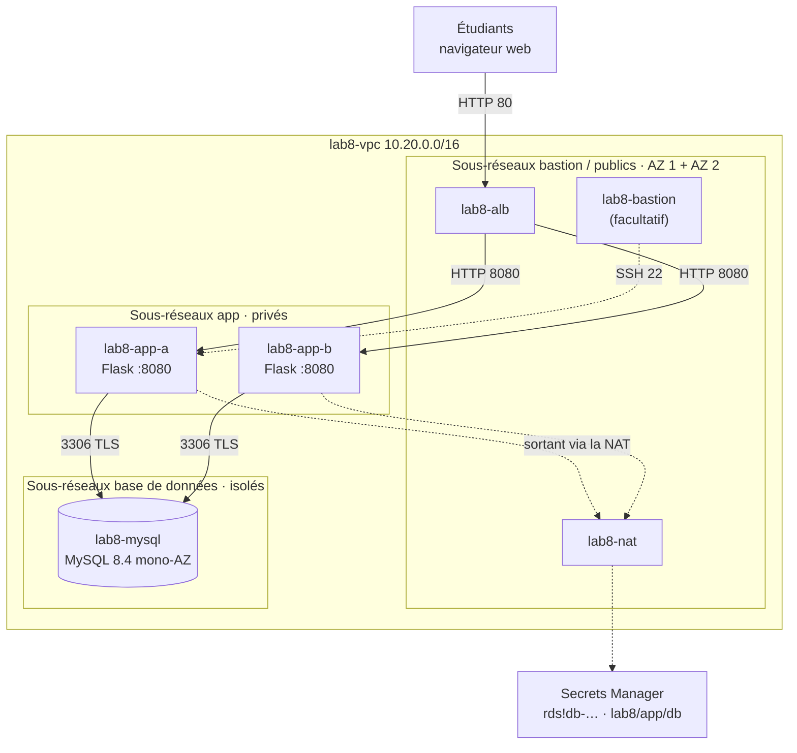
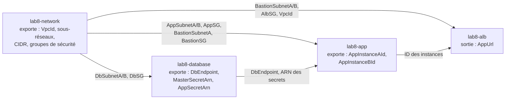
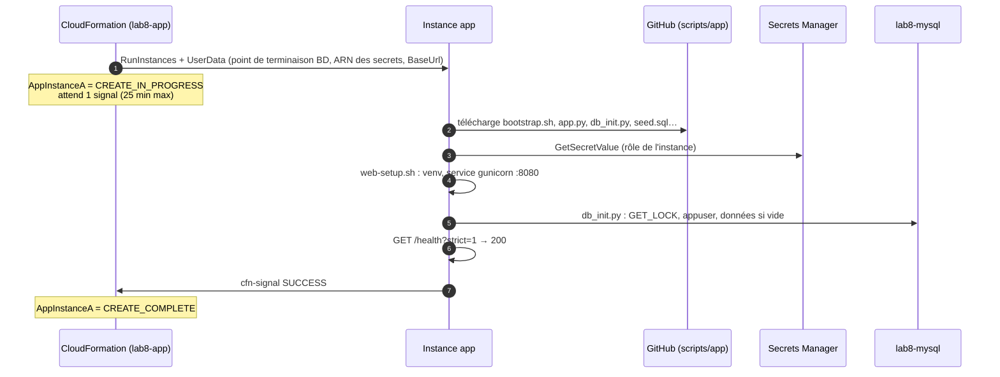

# Lab 8 — Déployer une application web à deux niveaux sur Amazon RDS for MySQL avec AWS CloudFormation

> 🇬🇧 English version: [CFN-WebApp-Lab.en.md](CFN-WebApp-Lab.en.md)

> **Public :** ingénieurs cloud en formation · **Niveau :** Associate
> **Point de départ :** une Région vide (ce lab construit **son propre VPC** ; le réseau du Lab 1 n'est pas utilisé) · Lab 6 recommandé (même appli, construite à la main)
> **Durée :** environ 3 heures (dont beaucoup d'attente des piles) · **Méthode :** console CloudFormation, 4 modèles YAML
> **Région :** `us-west-1`

---

## Scénario

*Pacific Learning Co.* a apprécié l'architecture du Lab 6, mais l'équipe d'exploitation ne peut pas la reconstruire à la main pour chaque environnement (dev, test, production), et personne ne se souvient quelle case a été cochée il y a six mois.

Votre mission : décrire toute la plateforme **sous forme de code** avec **AWS CloudFormation**, en quatre couches que des équipes différentes pourraient posséder :

| Pile | Modèle | Contenu |
|------|--------|---------|
| `lab8-network` | [`01-network.yaml`](cfn/01-network.yaml) | VPC, 6 sous-réseaux dans 2 AZ (**bastion/public**, **app**, **base de données**), passerelle Internet, passerelle NAT, tables de routage, groupes de sécurité |
| `lab8-database` | [`02-database.yaml`](cfn/02-database.yaml) | RDS for MySQL 8.4, classe **offre gratuite**, **mono-AZ**, identifiants dans Secrets Manager |
| `lab8-app` | [`03-app.yaml`](cfn/03-app.yaml) | **2 instances Amazon Linux 2023** dans les sous-réseaux app, exécutant l'appli Flask (+ bastion facultatif) |
| `lab8-alb` | [`04-alb.yaml`](cfn/04-alb.yaml) | **Application Load Balancer** qui achemine le trafic HTTP vers les 2 instances |

Les piles sont reliées par des **exportations** et des **importations** : chacune publie les identifiants dont la suivante a besoin. À la fin, un clic par pile reconstruit toute la plateforme, à l'identique, dans n'importe quel compte.

---

## Objectifs d'apprentissage

1. Lire et écrire du **YAML** CloudFormation : `Parameters`, `Resources`, `Outputs`, `Conditions`, `Metadata`
2. Utiliser les fonctions intrinsèques **`!Ref`**, **`!GetAtt`**, **`!Sub`**, **`!Select`/`!GetAZs`**, **`!If`**, **`Fn::ImportValue`**
3. Découper l'infrastructure en **piles par couches** reliées par des **exportations entre piles**, et expliquer pourquoi CloudFormation protège les exportations utilisées
4. Obtenir la dernière AMI depuis un **paramètre SSM** public plutôt que d'écrire un ID d'AMI en dur
5. Garder les secrets hors des modèles : **secret maître géré par RDS** et secret applicatif **généré**
6. Faire attendre une pile que l'application soit prête avec une **`CreationPolicy`** et **`cfn-signal`**, et comprendre le **retour arrière** automatique
7. Modifier une infrastructure en service en toute sécurité avec les **jeux de modifications** (*change sets*), et repérer les changements manuels avec la **détection de dérive** (*drift*)

### Console ou CloudFormation

| | Lab 6 (console) | Lab 8 (CloudFormation) |
|---|-----------------|------------------------|
| Comment on construit | ~150 clics, dans le bon ordre | 4 téléversements de modèles |
| Refaire dans un autre compte/Région | Refaire chaque clic | Mêmes modèles, autres paramètres |
| Relire une modification | Regarder la console après coup | **Jeu de modifications** avant de l'appliquer |
| Quelqu'un modifie un groupe de sécurité à la main | Personne ne le remarque | La **détection de dérive** le montre |
| Une erreur à mi-chemin | Environnement à moitié construit à nettoyer | **Retour arrière automatique** |
| Tout supprimer | Se souvenir de chaque ressource et de l'ordre | Supprimer 4 piles |

---

## 1. Architecture

### 1.0 Schéma complet du projet

Chaque ressource est étiquetée avec la pile qui la crée.

```text
Étudiants (navigateur) -> http://<AlbDnsName>   ·   Ingénieur : console, CloudShell, SSH facultatif -> bastion
                │ HTTP 80
                ▼
┌─ Région AWS us-west-1 ───────────────────────────────────────────────────────────────────────────────────────────────────┐
│ ┌─ [N] lab8-vpc 10.20.0.0/16 ──────────────────────────────────────────────────────────────────────────────────────────┐ │
│ │ [N] lab8-igw · lab8-public-rt : 0.0.0.0/0 -> igw                                                                     │ │
│ │ ┌─ Zone de disponibilité 1 ─────────────────────────────┐  ┌─ Zone de disponibilité 2 ─────────────────────────────┐ │ │
│ │ │ ┌─ [N] lab8-bastion-a 10.20.0.0/24 · PUBLIC ────────┐ │  │ ┌─ [N] lab8-bastion-b 10.20.1.0/24 · PUBLIC ────────┐ │ │ │
│ │ │ │ [L] nœud lab8-alb    [N] lab8-nat (+EIP)          │ │  │ │ [L] nœud lab8-alb                                 │ │ │ │
│ │ │ │ [A] lab8-bastion (si KeyName fourni)              │ │  │ │                                                   │ │ │ │
│ │ │ └───────────────────────────────────────────────────┘ │  │ └───────────────────────────────────────────────────┘ │ │ │
│ │ │       │ HTTP 8080 (groupe cible)                      │  │       │ HTTP 8080 (groupe cible)                      │ │ │
│ │ │ ┌─ [N] lab8-app-a 10.20.11.0/24 · PRIVÉ ────────────┐ │  │ ┌─ [N] lab8-app-b 10.20.12.0/24 · PRIVÉ ────────────┐ │ │ │
│ │ │ │ [A] lab8-app-a  t3.micro · AL2023                 │ │  │ │ [A] lab8-app-b  t3.micro · AL2023                 │ │ │ │
│ │ │ │     Flask + gunicorn :8080 · cfn-signal           │ │  │ │     Flask + gunicorn :8080 · cfn-signal           │ │ │ │
│ │ │ └───────────────────────────────────────────────────┘ │  │ └───────────────────────────────────────────────────┘ │ │ │
│ │ │       │ 3306 TLS                                      │  │       │ 3306 TLS (vers lab8-mysql en AZ 1)            │ │ │
│ │ │       ▼                                               │  │                                                       │ │ │
│ │ │ ┌─ [N] lab8-db-a 10.20.21.0/24 · ISOLÉ ─────────────┐ │  │ ┌─ [N] lab8-db-b 10.20.22.0/24 · ISOLÉ ─────────────┐ │ │ │
│ │ │ │ [D] lab8-mysql  MySQL 8.4 · db.t4g.micro          │ │  │ │ [D] groupe de sous-réseaux : 2e AZ (requis)       │ │ │ │
│ │ │ │     Mono-AZ · chiffrée · :3306 TLS                │ │  │ │                                                   │ │ │ │
│ │ │ └───────────────────────────────────────────────────┘ │  │ └───────────────────────────────────────────────────┘ │ │ │
│ │ └───────────────────────────────────────────────────────┘  └───────────────────────────────────────────────────────┘ │ │
│ │ [L] lab8-alb  public · écouteur HTTP:80 -> lab8-app-tg (2 instances, :8080, GET /health)                             │ │
│ │ [N] groupes de sécurité : lab8-alb-sg :80 <- 0.0.0.0/0 · lab8-app-sg :8080 <- alb-sg, :22 <- bastion-sg              │ │
│ │                           lab8-db-sg :3306 <- app-sg, bastion-sg · lab8-bastion-sg :22 <- AdminCidr                  │ │
│ │ [N] lab8-app-rt : 0.0.0.0/0 -> lab8-nat · lab8-db-rt : local uniquement (aucun accès Internet)                       │ │
│ └──────────────────────────────────────────────────────────────────────────────────────────────────────────────────────┘ │
│ [D] Secrets Manager : rds!db-… (maître, géré par RDS) · lab8/app/db (appuser, généré)                                    │
│ [A] Rôle IAM : SSM + GetSecretValue sur ces 2 secrets · joints via la passerelle NAT                                     │
│                                                                                                                          │
│ Piles : [N] lab8-network  [D] lab8-database  [A] lab8-app  [L] lab8-alb                                                  │
└──────────────────────────────────────────────────────────────────────────────────────────────────────────────────────────┘
```

### 1.1 Schéma d'architecture (Mermaid)



### 1.2 Comment les piles dépendent les unes des autres



**Créez** de gauche à droite, **supprimez** de droite à gauche. CloudFormation refuse de supprimer une pile dont les exportations sont encore importées (Partie 9).

### 1.3 Premier démarrage d'une instance app et `cfn-signal`



Si une étape échoue, `bootstrap.sh` envoie **FAILURE** avec la raison, et la pile **revient en arrière**. Sans `CreationPolicy`, CloudFormation annoncerait le succès dès le démarrage de la VM, même si l'appli ne fonctionne jamais.

### 1.4 Aide-mémoire CloudFormation (utilisé dans ces modèles)

| Syntaxe | Signification | Exemple dans ce lab |
|---------|---------------|---------------------|
| `Parameters:` | Entrées choisies au déploiement | `AdminCidr`, `DBInstanceClass`, `KeyName` |
| `!Ref X` | ID de la ressource X, ou valeur du paramètre X | `VpcId: !Ref Vpc` |
| `!GetAtt X.Attr` | Un attribut de la ressource X | `!GetAtt Database.Endpoint.Address` |
| `!Sub '…${Name}…'` | Chaîne avec variables substituées | `!Sub '${AWS::StackName}-VpcId'` |
| `!Select [0, !GetAZs '']` | Première AZ de la Région courante | Sous-réseaux de l'AZ 1 |
| `Outputs: … Export: Name:` | Publier une valeur pour d'autres piles | `lab8-network-AppSG` |
| `Fn::ImportValue` | Lire l'exportation d'une autre pile | `Fn::ImportValue: !Sub '${NetworkStackName}-AppSG'` |
| `Conditions:` + `!If` | Créer/définir quelque chose seulement dans certains cas | Bastion seulement si `KeyName` n'est pas vide |
| `AWS::SSM::Parameter::Value<…>` | Paramètre résolu depuis SSM Parameter Store | Dernière AMI Amazon Linux 2023 |
| `CreationPolicy` | Attendre N signaux de succès | Chaque instance app |
| `DeletionPolicy` | Sort de la ressource quand la pile est supprimée | `Delete` pour la BD du lab (`Snapshot` en production) |
| `AWS::NoValue` | « Ne pas définir cette propriété » | Pas de `KeyName` sur les instances si vide |

---

## 2. Prérequis et coût

- Un compte AWS avec des droits sur CloudFormation, VPC/EC2, RDS, IAM, Secrets Manager, ELB, Systems Manager
- Console dans la Région **`us-west-1`**, et **CloudShell** pour le script de test
- Les fichiers du lab publiés dans votre dépôt (section 3) : les piles téléchargent `scripts/app/*` depuis GitHub au démarrage
- Facultatif : une paire de clés EC2 si vous voulez le bastion

| Ressource | Coût approximatif (us-west-1) |
|-----------|-------------------------------|
| Passerelle NAT + son IPv4 publique | ~0,05 $/heure + 0,005 $/heure + par Go |
| 2 × EC2 `t3.micro` (+ bastion) | ~0,012 $/heure chacune (heures gratuites si éligible) |
| RDS `db.t4g.micro`, 20 Go gp2 | ~0,02 $/heure (offre gratuite ou crédits si éligible) |
| ALB + 2 IPv4 publiques | ~0,025 $/heure + 0,01 $/heure |
| Secrets Manager (2 secrets) | 0,40 $/secret/mois, au prorata (quelques centimes) |

> 💰 Environ **0,15 $/heure** quand tout tourne. CloudFormation lui-même est gratuit. **Supprimez les 4 piles** le jour même (Partie 15).

> ℹ️ **Offre gratuite :** les comptes créés après le 15 juillet 2025 reçoivent des crédits dans le plan gratuit au lieu de l'ancienne offre de 12 mois. `db.t4g.micro`/`db.t3.micro`, mono-AZ et 20 Go gp2 restent dans les limites de l'offre gratuite dans les deux cas.

### 2.1 Fiche de travail

| Élément | Valeur |
|---------|--------|
| Votre IP publique (`https://checkip.amazonaws.com`) + `/32` | |
| Nom de la paire de clés (facultatif) | |
| `BaseUrl` de `scripts/app` | |
| Sorties de pile : `DbEndpoint` | |
| Sorties de pile : `AppUrl` | |

---

## 3. Les fichiers du lab

```
aws-lab-cfn-webapp/
├── CFN-WebApp-Lab.en.md
├── CFN-WebApp-Lab.fr.md          ← ce guide
├── cfn/
│   ├── 01-network.yaml           pile lab8-network
│   ├── 02-database.yaml          pile lab8-database
│   ├── 03-app.yaml               pile lab8-app
│   └── 04-alb.yaml               pile lab8-alb
└── scripts/
    ├── app/                      téléchargé par chaque instance app au premier démarrage (BaseUrl)
    │   ├── bootstrap.sh          orchestre le démarrage, puis cfn-signal SUCCESS/FAILURE
    │   ├── web-setup.sh          venv Python, paquets figés, CA RDS, service systemd 'labapp'
    │   ├── db_init.py            base + appuser + données, UNE SEULE FOIS (verrou nommé MySQL)
    │   ├── app.py                appli Flask (identique au Lab 6) : pages, formulaire, /health
    │   ├── requirements.txt      Flask, PyMySQL, gunicorn (figés)
    │   ├── templates/index.html  la page
    │   └── seed.sql              8 cours, 12 étudiants, 28 inscriptions
    └── tools/
        └── alb-check.sh          N requêtes vers l'ALB : qui a répondu ?
```

| Fichier | Ce qu'il fait |
|---------|---------------|
| [`01-network.yaml`](cfn/01-network.yaml) | VPC `10.20.0.0/16` · sous-réseaux **bastion/publics** `10.20.0.0/24`, `10.20.1.0/24` (nœuds ALB, NAT, bastion) · sous-réseaux **app** `10.20.11.0/24`, `10.20.12.0/24` (route par défaut → NAT) · sous-réseaux **base de données** `10.20.21.0/24`, `10.20.22.0/24` (**aucune** route par défaut) · `lab8-alb-sg`, `lab8-bastion-sg`, `lab8-app-sg`, `lab8-db-sg` · 14 exportations |
| [`02-database.yaml`](cfn/02-database.yaml) | Groupe de sous-réseaux BD sur les 2 sous-réseaux base de données · `lab8-mysql` (MySQL 8.4, `db.t4g.micro`, 20 Go gp2, chiffrée, mono-AZ, non publique) avec **`ManageMasterUserPassword: true`** · secret **`lab8/app/db`** dont le mot de passe est **généré** par Secrets Manager |
| [`03-app.yaml`](cfn/03-app.yaml) | Rôle IAM (Session Manager + `GetSecretValue` sur les 2 secrets uniquement) · 2 instances depuis la **dernière AMI AL2023** (paramètre SSM), IMDSv2 obligatoire, chacune avec une **`CreationPolicy`** · bastion si `KeyName` est renseigné |
| [`04-alb.yaml`](cfn/04-alb.yaml) | ALB dans les 2 sous-réseaux publics · groupe cible `lab8-app-tg` (HTTP 8080, `/health`, seuils 2/2, délai de désinscription 30 s) avec les 2 ID d'instance · écouteur HTTP:80 · sortie **`AppUrl`** |
| [`bootstrap.sh`](scripts/app/bootstrap.sh) | 1) identité · 2) installe `aws-cfn-bootstrap`, télécharge l'appli · 3) lit les deux secrets · 4) `web-setup.sh` · 5) `db_init.py` · 6) disponibilité → **`cfn-signal`**. Toute erreur → signal FAILURE avec le numéro de ligne |
| [`db_init.py`](scripts/app/db_init.py) | Se connecte en maître (TLS vérifié), prend **`GET_LOCK('lab8_db_init')`** pour que les 2 instances ne se télescopent pas, crée `appuser` pour les **2 CIDR des sous-réseaux app**, charge `seed.sql` **seulement si les tables n'existent pas** |

**Publiez** les dossiers `cfn/` et `scripts/` dans votre dépôt, par exemple
`inspiredevgen/devops-worksphops` → `2-Cloud-Infrastructure/aws-lab-cfn-webapp/`.
Le paramètre `BaseUrl` de la pile app vaut par défaut
`https://raw.githubusercontent.com/inspiredevgen/devops-worksphops/refs/heads/main/2-Cloud-Infrastructure/aws-lab-cfn-webapp/scripts/app`.
Vérifiez-le dans un navigateur : `…/scripts/app/bootstrap.sh` doit afficher le script, pas une 404.

---

## Partie 1 — Préparer

1. Console → Région **US West (N. California) us-west-1**.
2. Téléchargez les quatre modèles depuis votre dépôt vers votre ordinateur (ou clonez-le).
3. Trouvez votre IP publique : ouvrez `https://checkip.amazonaws.com` → notez `x.x.x.x/32`.
4. *(Facultatif, pour le bastion)* **EC2 → Paires de clés → Créer une paire de clés** : `lab8-key`, ED25519, `.pem`.
5. Ouvrez chaque modèle dans un éditeur et parcourez-le avec l'aide-mémoire (§1.4) sous la main.

---

## Partie 2 — Pile 1 : le réseau

### 2.1 Lire le modèle
Ouvrez [`01-network.yaml`](cfn/01-network.yaml) et repérez :

- **`!Select [0, !GetAZs '']`** sur les sous-réseaux A, **`[1, …]`** sur les B : deux AZ sans écrire leurs noms en dur.
- **`MapPublicIpOnLaunch: true`** uniquement sur les sous-réseaux bastion.
- **`DependsOn: GatewayAttachment`** sur l'EIP et la route publique : certaines dépendances sont invisibles pour CloudFormation (la route a besoin de l'IGW *attachée*, pas seulement créée).
- **`DbRouteTable`** n'a **aucune** route : les sous-réseaux base de données ne peuvent pas joindre Internet, et Internet ne peut pas les joindre.
- **`SourceSecurityGroupId`** dans les règles app et base de données : la chaîne de SG.
- **`Outputs` → `Export` → `Name: !Sub '${AWS::StackName}-AppSG'`** : les noms que les autres piles importent.

### 2.2 Créer la pile
**CloudFormation → Piles → Créer une pile → Avec de nouvelles ressources (standard)** :

| Étape | Paramètre | Valeur |
|-------|-----------|--------|
| 1 | Prérequis | **Choisir un modèle existant** → **Charger un fichier de modèle** → `01-network.yaml` |
| 2 | Nom de la pile | **`lab8-network`** (les autres modèles importent `lab8-network-…`) |
| | `AdminCidr` | votre IP **/32** |
| | Autres paramètres | valeurs par défaut |
| 3 | Balises | `Project` = `lab8` (propagée à chaque ressource qui prend en charge les balises) |
| | Options en cas d'échec | **Restaurer toutes les ressources de la pile** (défaut) |
| 4 | Vérification | **Soumettre** |

Ouvrez l'onglet **Événements** (les plus récents en haut). Suivez `CREATE_IN_PROGRESS` → `CREATE_COMPLETE` pour chaque ID logique. La passerelle NAT est la plus longue (~2 minutes). Total : 3 à 4 minutes.

✅ **Point de contrôle :**
- État de la pile **CREATE_COMPLETE**.
- Onglet **Ressources** : 26 ressources, chacune avec son *ID physique* (les vrais `vpc-…`, `subnet-…`, `sg-…`).
- Onglet **Sorties** : 15 valeurs, dont 14 avec un **Nom d'exportation**.
- **CloudFormation → Exportations** (menu de gauche) : les exportations `lab8-network-…`.
- **VPC → Vos VPC → `lab8-vpc` → Carte des ressources** : 6 sous-réseaux, 3 tables de routage, IGW, NAT.

---

## Partie 3 — Pile 2 : la base de données

### 3.1 Lire le modèle
Dans [`02-database.yaml`](cfn/02-database.yaml) :

- `Fn::ImportValue: !Sub '${NetworkStackName}-DbSubnetA'` : le nom de la pile est un paramètre, donc le même modèle fonctionne pour `dev-network`, `prod-network`…
- **`ManageMasterUserPassword: true`** : aucun mot de passe dans le modèle, les paramètres ou les événements. RDS crée le secret `rds!db-…` et le fait tourner tous les 7 jours.
- **`AWS::SecretsManager::Secret` + `GenerateSecretString`** : Secrets Manager invente le mot de passe d'`appuser`.
- **`DeletionPolicy: Delete`** : adapté à un lab. La valeur par défaut pour RDS est `Snapshot` ; en production, on utilise souvent `Retain` ou `Snapshot`.
- **`!GetAtt Database.MasterUserSecret.SecretArn`** : un attribut qui n'existe qu'une fois le secret créé par RDS.

### 3.2 Créer la pile
**Créer une pile → Charger `02-database.yaml`** → nom **`lab8-database`** → gardez les valeurs par défaut (`db.t4g.micro`, `8.4`, `labapp`, `admin`) → balise `Project=lab8` → **Soumettre**.

L'instance de base prend **10 à 15 minutes**. Pendant ce temps, lisez [`03-app.yaml`](cfn/03-app.yaml) et [`bootstrap.sh`](scripts/app/bootstrap.sh).

✅ **Point de contrôle :**
- **Sorties** : `DbEndpoint` (`lab8-mysql.xxxx.us-west-1.rds.amazonaws.com`), `MasterSecretArn` (`…:secret:rds!db-…`), `AppSecretArn` (`…:secret:lab8/app/db-…`).
- **RDS → `lab8-mysql`** : mono-AZ, non accessible publiquement, groupe de sous-réseaux `lab8-db-subnet-group`, SG `lab8-db-sg`, chiffrement activé.
- **Secrets Manager** : deux secrets. Ouvrez **`lab8/app/db`** → *Récupérer la valeur du secret* : `username: appuser` et un mot de passe de 32 caractères **que personne n'a tapé**.

---

## Partie 4 — Pile 3 : le niveau application

### 4.1 Lire le modèle
Dans [`03-app.yaml`](cfn/03-app.yaml) :

- **`LatestAmiId`** a le type `AWS::SSM::Parameter::Value<AWS::EC2::Image::Id>` : CloudFormation lit le paramètre public `/aws/service/ami-amazon-linux-latest/al2023-ami-kernel-default-x86_64` au moment du déploiement.
- **`AppRole`** : `GetSecretValue` uniquement sur les deux ARN de secrets importés.
- **`CreationPolicy: ResourceSignal: { Count: 1, Timeout: PT25M }`** sur chaque instance.
- **`UserData`** utilise la forme à deux arguments de **`Fn::Sub`** : la liste de variables (`DbEndpoint`, `MasterSecretArn`…) vient des importations. Remarquez `'${AWS::StackName}'` et `LOGICAL_ID='AppInstanceA'` : `cfn-signal` a besoin des deux.
- **`Condition: HasKeyName`** sur `Bastion`, et **`!If [HasKeyName, !Ref KeyName, !Ref AWS::NoValue]`** pour la clé des instances app.

### 4.2 Créer la pile
**Créer une pile → Charger `03-app.yaml`** → nom **`lab8-app`** :

| Paramètre | Valeur |
|-----------|--------|
| `NetworkStackName` / `DatabaseStackName` | `lab8-network` / `lab8-database` |
| `InstanceType` | `t3.micro` |
| `LatestAmiId` | gardez le chemin du paramètre SSM |
| `KeyName` | **vide** (pas de bastion, utilisez Session Manager) **ou** `lab8-key` |
| `BaseUrl` | l'URL brute de **votre** dossier `scripts/app` |
| `AppVersion` | `1.0.0` |

Sur la page de vérification, cochez **« Je reconnais qu'AWS CloudFormation peut créer des ressources IAM »** (la pile crée un rôle : capacité `CAPABILITY_IAM`) → **Soumettre**.

### 4.3 Observer les signaux
Dans **Événements**, `AppInstanceA` et `AppInstanceB` restent **CREATE_IN_PROGRESS** pendant 4 à 8 minutes, puis :

```text
AppInstanceA   CREATE_COMPLETE
AppInstanceA   CREATE_IN_PROGRESS   Received SUCCESS signal with UniqueId i-0abc…
```

En attendant, suivez un démarrage en direct : **EC2 → Instances → `lab8-app-a` → Se connecter → Session Manager** :

```bash
sudo tail -f /var/log/cloud-init-output.log
```

```text
==> [14:02:11] 5/6 Initializing the database (once for both instances)
[db_init] connected to ip-10-20-21-… running MySQL 8.4.x
[db_init] TLS cipher: TLS_AES_256_GCM_SHA384
[db_init] init lock acquired
[db_init] user appuser ready for 10.20.11.0/24, 10.20.12.0/24
[db_init] seed.sql loaded                      ← sur UNE instance
[db_init] tables already exist: seed skipped   ← sur l'autre
==> [14:02:20] 6/6 Readiness check, then signal CloudFormation
```

> 🧠 **Pourquoi le verrou ?** Les deux instances démarrent au même moment et exécutent toutes deux `db_init.py`. Sans `GET_LOCK`, elles pourraient créer les tables deux fois, ou la seconde pourrait effacer les données que la première vient de charger. Le verrou les sérialise ; le test « seulement si les tables n'existent pas » rend le script relançable sans risque (**idempotent**).

> 🧠 **Raccourci de lab, dit clairement :** le rôle app peut lire le secret **maître** parce que les instances app initialisent la base. En production, une tâche ponctuelle (une ressource personnalisée appuyée sur Lambda, ou une étape de pipeline) s'en chargerait, et le rôle app ne lirait que `lab8/app/db`.

---

## Partie 5 — Pile 4 : l'équilibreur de charge

**Créer une pile → Charger `04-alb.yaml`** → nom **`lab8-alb`** → valeurs par défaut → **Soumettre** (~3 minutes).

✅ **Point de contrôle :**
- **Sorties → `AppUrl`** : `http://lab8-alb-….us-west-1.elb.amazonaws.com/`
- **EC2 → Groupes cibles → `lab8-app-tg` → Cibles** : `lab8-app-a` et `lab8-app-b` **Saines** (port 8080).

---

## Partie 6 — Tester l'application

1. Ouvrez **`AppUrl`**. L'en-tête indique *Python · Flask · deployed by CloudFormation*. **Actualisez** : *Web instance* et le **badge d'AZ** alternent.
2. **Inscrivez un étudiant**, actualisez : l'étudiant est visible depuis les deux instances.
3. Dans **CloudShell** :
   ```bash
   curl -fsSLO https://raw.githubusercontent.com/inspiredevgen/devops-worksphops/refs/heads/main/2-Cloud-Infrastructure/aws-lab-cfn-webapp/scripts/tools/alb-check.sh
   ALB=$(aws cloudformation describe-stacks --stack-name lab8-alb \
         --query "Stacks[0].Outputs[?OutputKey=='AlbDnsName'].OutputValue" --output text)
   bash alb-check.sh $ALB 20
   curl -s http://$ALB/health?strict=1 | python3 -m json.tool
   ```
   Attendu : 20/20 HTTP 200 répartis sur 2 instances dans 2 AZ, et `"db": "reachable"`, `"db_tls": "TLS_…"`.

> 🧠 Remarquez comment CloudShell a obtenu le nom de l'ALB : **depuis les sorties de la pile**, pas par copier-coller. Les scripts et les pipelines lisent les sorties de la même façon.

---

## Partie 7 — Jeux de modifications : prévisualiser avant de modifier

### 7.1 Une modification sans risque
**Piles → `lab8-alb` → Actions de pile → Créer un jeu de modifications pour la pile actuelle** → *Utiliser le modèle actuel* → **`HealthCheckIntervalSeconds` = 30** → nommez le jeu `slower-health-checks` → **Soumettre**.

Ouvrez le jeu de modifications :

| Action | ID logique | Type de ressource | Remplacement |
|--------|-----------|-------------------|--------------|
| Modify | `TargetGroup` | `AWS::ElasticLoadBalancingV2::TargetGroup` | **False** |

**Exécuter le jeu de modifications**. Seul l'attribut du groupe cible change ; le nom DNS de l'ALB reste le même.

### 7.2 Une modification à bien réfléchir
Sur **`lab8-app`**, créez un jeu de modifications avec **`InstanceType` = `t3.small`** (ne l'exécutez pas). Il affiche `Modify` sur `AppInstanceA`/`AppInstanceB` avec **Remplacement : False**, mais la [documentation de la propriété](https://docs.aws.amazon.com/AWSCloudFormation/latest/UserGuide/aws-resource-ec2-instance.html) indique *Update requires: Some interruptions* : chaque instance est **arrêtée puis redémarrée**. Les deux en même temps, c'est une courte interruption de service.

Créez maintenant un second jeu avec **`AppVersion` = `2.0.0`**. Il modifie **`UserData`** : là aussi *quelques interruptions*. Et les nouvelles données utilisateur **ne sont pas réexécutées** sur une instance existante : elles ne tournent qu'au premier démarrage. **Supprimez** les deux jeux de modifications.

> 🧠 **À retenir :** lisez toujours la colonne **Remplacement** et la ligne *Update requires* de la propriété ; un `Replacement: True` sur une base de données signifie une **nouvelle base vide** (sauf si `UpdateReplacePolicy` en prend un instantané). Pour des mises à jour progressives de l'appli, utilisez un groupe Auto Scaling avec actualisation d'instances (Lab 7, extension A).

---

## Partie 8 — Détection de dérive : qui a modifié mon groupe de sécurité ?

1. Simulez un collègue pressé : **VPC → Groupes de sécurité → `lab8-app-sg` → Modifier les règles entrantes → Ajouter une règle** : TCP personnalisé **8080** depuis **0.0.0.0/0** → Enregistrer.
2. **CloudFormation → `lab8-network` → Actions de pile → Détecter la dérive**. Attendez ~1 minute, puis **Afficher les résultats de dérive** :
   - État de dérive de la pile : **DRIFTED**
   - `AppSecurityGroup` : **MODIFIED** → *Afficher les détails de la dérive* : l'entrée `SecurityGroupIngress` en trop est surlignée.
3. Corrigez à la manière IaC : supprimez la règle manuelle, **Détecter la dérive** à nouveau → **IN_SYNC**.

> 🧠 La détection de dérive compare le **modèle** à la **réalité** pour les propriétés gérées par CloudFormation. La règle d'or : une fois qu'une ressource appartient à une pile, on la modifie **uniquement via la pile**.

---

## Partie 9 — Les exportations protègent vos dépendances

Essayez **`lab8-network` → Supprimer**. La suppression échoue avec un message du type :

```text
Export lab8-network-AppSG cannot be deleted as it is in use by lab8-app
```

La même protection s'applique à une mise à jour qui changerait une valeur exportée (`Export … cannot be updated as it is in use by …`), par exemple une modification du modèle qui remplacerait `lab8-app-sg`.

> 🧠 Les exportations sont des liens **forts**. Alternatives : passer les ID en paramètres, ou les stocker dans **SSM Parameter Store** (liens faibles, plus de liberté, moins de protection). Beaucoup d'équipes utilisent les exportations pour la couche réseau (qui change rarement) et des paramètres ailleurs.

---

## Partie 10 — Contrôles de santé et résilience

Connectez-vous à `lab8-app-b` avec **Session Manager** (ou `ssh` via le bastion si vous avez renseigné `KeyName`).

1. `sudo systemctl stop labapp` → en ~20 s, `lab8-app-b` est **Défaillante** dans `lab8-app-tg` ; `bash alb-check.sh $ALB 20` → toutes les requêtes vont vers `lab8-app-a`, sans erreur. Puis `sudo systemctl start labapp`.
2. **Vivacité ou disponibilité :** `curl -s localhost:8080/health` renvoie 200 même si la base est injoignable ; `/health?strict=1` renvoie 503. Le groupe cible utilise `/health` (paramètre `HealthCheckPath` du modèle). Voir le Lab 6, Partie 11, pour l'expérience complète.
3. **Redémarrez** `lab8-app-b` (EC2 → État de l'instance → Redémarrer). Le service est activé dans systemd : il revient sans aucune action de CloudFormation. **Les données utilisateur ne sont pas réexécutées**, et les données sont intactes.

---

## Partie 11 — Validation

| # | Où | Test | Attendu | Prouve |
|---|----|------|---------|--------|
| 1 | CloudFormation | 4 piles | **CREATE_COMPLETE** (UPDATE_COMPLETE pour `lab8-alb`) | Les modèles se déploient |
| 2 | CloudFormation → Exportations | Liste | 14 `lab8-network-*`, 5 `lab8-database-*`, 2 `lab8-app-*`, 1 `lab8-alb-*` | Liens entre piles |
| 3 | Événements de `lab8-app` | AppInstanceA/B | *Received SUCCESS signal* | Appli prête avant CREATE_COMPLETE |
| 4 | VPC → Tables de routage | `lab8-db-rt` | Seulement `10.20.0.0/16 → local` | Sous-réseaux BD isolés |
| 5 | RDS | `lab8-mysql` | Mono-AZ, accessible publiquement **Non**, `db.t4g.micro` | Offre gratuite, privée |
| 6 | Secrets Manager | 2 secrets | `rds!db-…`, `lab8/app/db` | Aucun mot de passe dans les modèles |
| 7 | CloudShell | `alb-check.sh` | 2 instances, 2 AZ, 20/20 OK | Équilibrage de charge |
| 8 | CloudShell | `/health?strict=1` | `"db_tls": "TLS_…"` | Connexion BD chiffrée |
| 9 | Recherche dans les modèles | `grep -i password cfn/*.yaml` | Seulement des commentaires, `ManageMasterUserPassword`, `GenerateStringKey` : aucune valeur de mot de passe | Secrets uniquement par référence |
| 10 | Dérive | `lab8-network` | **IN_SYNC** après la Partie 8 | Plus de modification manuelle |

---

## Partie 12 — Dépannage

### 12.1 Lisez l'onglet Événements à partir du **premier** échec

Le premier événement `CREATE_FAILED` (descendez : les échecs les plus anciens sont plus bas) donne la vraie cause ; les suivants sont généralement *Resource creation cancelled*.

| Raison affichée | Cause | Correction |
|-----------------|-------|------------|
| `No export named lab8-network-VpcId found` | La pile réseau a un autre nom, n'est pas terminée, ou est dans une autre Région | Même Région ; paramètre `NetworkStackName` |
| `Requires capabilities : [CAPABILITY_IAM]` | Reconnaissance IAM non cochée | Cochez la case (CLI : `--capabilities CAPABILITY_IAM`) |
| `Parameter AdminCidr failed to satisfy constraint` | Pas au format `x.x.x.x/nn` | Ajoutez `/32` à votre IP |
| `Received FAILURE signal … bootstrap.sh failed at line N` | Une étape du démarrage a échoué | Voir 12.2 |
| `Failed to receive 1 resource signal(s) within the specified duration` | L'instance n'a jamais envoyé de signal (pas d'Internet, `bootstrap.sh` non téléchargé, `cfn-signal` bloqué) | Voir 12.2 ; vérifiez `lab8-app-rt` → NAT |
| `Cannot find version 8.4 for mysql` | Version du moteur indisponible | Paramètre `EngineVersion` = `8.0` |
| `InvalidParameterCombination` … *does not support creating a DB instance with the following combination* | Combinaison classe/version/stockage non proposée dans la Région | Paramètre `DBInstanceClass` = `db.t3.micro` |
| `lab8/app/db already exists` / `scheduled for deletion` | Une exécution précédente a laissé le secret | CloudShell : `aws secretsmanager delete-secret --secret-id lab8/app/db --force-delete-without-recovery`, attendez 1 min |
| `Export with name lab8-network-VpcId is already exported by stack …` | Vous avez créé le réseau deux fois | Une pile par nom, ou un autre nom de pile + paramètres |

### 12.2 L'instance app a échoué : la garder pour enquêter

Quand la pile app revient en arrière, ses instances sont **résiliées** avec leurs journaux. Pour déboguer :

1. Supprimez la pile en échec (une pile en **ROLLBACK_COMPLETE** ne peut pas être mise à jour, seulement supprimée).
2. Recréez-la avec **Options en cas d'échec → Conserver les ressources provisionnées avec succès**.
3. Quand elle échoue, l'instance est toujours là : **Session Manager** → `sudo less /var/log/cloud-init-output.log`, ou **EC2 → Actions → Surveiller et dépanner → Obtenir le journal système**.

| Le journal montre | Cause | Correction |
|-------------------|-------|------------|
| `Cannot download bootstrap.sh from …` (raison de l'événement) | Mauvais `BaseUrl`, dépôt privé, ou fichiers non poussés | Ouvrez l'URL dans un navigateur |
| `curl: (28) … timed out` partout | Pas d'Internet sortant | `lab8-app-rt` 0.0.0.0/0 → `lab8-nat`, NAT *Disponible* |
| `AccessDeniedException … GetSecretValue` | Politique du rôle / ARN du secret incohérent | Vérifiez la politique d'`AppRole` et les sorties de la pile base de données |
| `[db_init] attempt N/30: … timed out` | Chemin app → BD bloqué | `lab8-db-sg` 3306 depuis `lab8-app-sg` |
| `[db_init] … Access denied for user 'admin'` | Secret maître changé par rotation pendant le démarrage | Réessayez (supprimez + recréez la pile app) |
| `readiness 503` | Appli en marche, BD injoignable en `appuser` | `hint` dans le JSON ; hôtes d'`appuser` = CIDR des sous-réseaux app |

---

## Partie 13 — Exercices « casser et réparer »

| # | Cassez | Observez | Leçon | Réparez |
|---|--------|----------|-------|---------|
| B1 | Supprimez `lab8-alb` puis `lab8-app`, recréez `lab8-app` avec un **mauvais `BaseUrl`** | Événement : *Received FAILURE signal… Cannot download bootstrap.sh*, puis **retour arrière** de toute la pile | Une `CreationPolicy` transforme « VM démarrée » en « appli fonctionnelle » | `BaseUrl` correct |
| B2 | Jeu de modifications sur `lab8-network` : `AdminCidr` = `0.0.0.0/0` | Seul `BastionSecurityGroup` est modifié | Les paramètres pilotent la sécurité ; relisez avant d'exécuter | Ne l'exécutez pas |
| B3 | Retirez à la main **3306 ← `lab8-app-sg`** de `lab8-db-sg` | La page affiche *Cannot reach the database*, les cibles restent saines, dérive = MODIFIED | La détection de dérive l'attrape | Restaurez la règle (ou mettez à jour la pile) |
| B4 | Essayez de supprimer `lab8-database` avant `lab8-app` | Refus : exportations utilisées | Les dépendances sont imposées | Supprimez dans l'ordre inverse |
| B5 | Supprimez `lab8-alb` et `lab8-app`, puis créez `lab8-app` depuis une copie de `03-app.yaml` avec `Count: 2` dans la `CreationPolicy` d'`AppInstanceA` | `AppInstanceA` attend 25 min un second signal qui ne vient jamais, puis retour arrière | Les signaux sont comptés ; la `CreationPolicy` ne s'applique qu'à la **création** de la ressource | `Count: 1` |

---

## Partie 14 — Défis d'extension

**A. Auto Scaling.** Remplacez les deux `AWS::EC2::Instance` par un `AWS::EC2::LaunchTemplate` + un `AWS::AutoScaling::AutoScalingGroup` (min 2, `TargetGroupARNs`, `HealthCheckType: ELB`) avec une `CreationPolicy` (`MinSuccessfulInstancesPercent`) et une `UpdatePolicy` (`AutoScalingRollingUpdate`). La pile ALB n'a alors plus besoin des ID d'instance.

**B. Piles imbriquées.** Téléversez les 4 modèles dans S3 et écrivez `00-main.yaml` avec quatre ressources `AWS::CloudFormation::Stack` qui se passent les sorties en paramètres (`!GetAtt Network.Outputs.VpcId`). Comparez avec les exportations.

**C. Linter et politique sous forme de code.** Lancez `pip install cfn-lint && cfn-lint cfn/*.yaml` dans CloudShell, puis écrivez une règle **CloudFormation Guard** : *chaque `AWS::RDS::DBInstance` doit avoir `StorageEncrypted: true` et `PubliclyAccessible: false`*.

**D. Protéger les données.** Mettez `DeletionPolicy: Snapshot` et `UpdateReplacePolicy: Snapshot` sur la base, activez la **protection contre la résiliation** sur `lab8-database`, et ajoutez une **politique de pile** qui refuse `Update:Replace` sur `Database`.

**E. HTTPS.** Ajoutez un paramètre `CertificateArn` et une condition : s'il est renseigné, créez un écouteur HTTPS:443 et transformez l'écouteur HTTP:80 en redirection.

**F. Un autre environnement.** Déployez à nouveau les 4 modèles avec les noms de pile `dev8-network`, `dev8-database`… et les paramètres `*StackName` en conséquence. Que faut-il encore changer pour éviter les conflits de noms ? (Indice : `GroupName`, `DBInstanceIdentifier`, `DBSubnetGroupName`, le `Name` du secret, le `Name` de l'ALB et du groupe cible sont des chaînes fixes.)

**G. Session Manager uniquement.** Supprimez la règle SSH des sous-réseaux bastion et le paramètre `KeyName`. Quel est le plus petit changement réseau qui permet encore aux instances app de joindre Systems Manager ? (Des points de terminaison d'interface VPC pour `ssm`, `ssmmessages`, `ec2messages`.)

---

## Partie 15 — Nettoyage (ordre inverse)

**CloudFormation → Piles**, une à la fois, en attendant **DELETE_COMPLETE** à chaque fois :

1. **`lab8-alb`** (~2 min)
2. **`lab8-app`** (~2 min : instances, rôle, bastion)
3. **`lab8-database`** (~5 à 10 min : instance RDS, son secret `rds!db-…`, groupe de sous-réseaux, `lab8/app/db`)
4. **`lab8-network`** (~3 min : passerelle NAT, EIP, sous-réseaux, VPC)

Ensuite :
- **EC2 → Paires de clés** : supprimez `lab8-key` si vous l'avez créée.
- Vérifiez : **CloudFormation → Exportations** n'a plus d'entrées `lab8-…` ; **RDS** et **EC2** ne montrent plus de ressources `lab8-…` ; **VPC → Adresses IP Elastic** n'a pas de reste.

> Si une suppression échoue (**DELETE_FAILED**), lisez la raison de l'événement. Cas typique : un élément créé **à la main** dans le VPC (une ENI supplémentaire, un point de terminaison, une instance manuelle) bloque la suppression du VPC. Supprimez-le, puis **Réessayer la suppression**.

---

## Annexe — Le même déploiement avec l'AWS CLI (CloudShell)

```bash
cd ~/aws-lab-cfn-webapp/cfn      # après avoir téléversé ou cloné les fichiers dans CloudShell
MYIP=$(curl -s https://checkip.amazonaws.com)/32
BASEURL=https://raw.githubusercontent.com/inspiredevgen/devops-worksphops/refs/heads/main/2-Cloud-Infrastructure/aws-lab-cfn-webapp/scripts/app

aws cloudformation deploy --stack-name lab8-network  --template-file 01-network.yaml \
  --parameter-overrides AdminCidr=$MYIP --tags Project=lab8
aws cloudformation deploy --stack-name lab8-database --template-file 02-database.yaml --tags Project=lab8
aws cloudformation deploy --stack-name lab8-app      --template-file 03-app.yaml \
  --parameter-overrides BaseUrl=$BASEURL --capabilities CAPABILITY_IAM --tags Project=lab8
aws cloudformation deploy --stack-name lab8-alb      --template-file 04-alb.yaml --tags Project=lab8

aws cloudformation describe-stacks --stack-name lab8-alb --query "Stacks[0].Outputs[?OutputKey=='AppUrl'].OutputValue" --output text
```

`aws cloudformation deploy` crée un **jeu de modifications** et l'exécute : la même commande crée *ou* met à jour une pile. Nettoyage : `aws cloudformation delete-stack --stack-name <nom>` puis `aws cloudformation wait stack-delete-complete --stack-name <nom>`, dans l'ordre inverse.

---

## Partie 16 — Questions de révision

1. Quelle est la différence entre `!Ref` et `!GetAtt` ? Donnez un exemple de chacun tiré de ces modèles.
2. Pourquoi les sous-réseaux utilisent-ils `!Select [0, !GetAZs '']` au lieu de `us-west-1b` ?
3. Que permet une exportation, et qu'empêche-t-elle ? Pourquoi faut-il supprimer les piles dans l'ordre inverse ?
4. Pourquoi les sous-réseaux base de données ne peuvent-ils pas joindre Internet, et pourquoi est-ce sans problème pour RDS ?
5. D'où viennent les deux mots de passe de la base, et où apparaissent-ils dans les modèles ?
6. Quel problème résolvent `CreationPolicy` + `cfn-signal` ? Que se passe-t-il si le signal n'arrive jamais ?
7. Les deux instances exécutent `db_init.py` en même temps. Quels deux mécanismes rendent cela sûr ?
8. Un jeu de modifications affiche `Replacement: True` sur `AWS::RDS::DBInstance`. Qu'est-ce que cela signifie pour les données ?
9. Pourquoi changer `AppVersion` (données utilisateur) ne met-il pas à jour l'application en cours ?
10. Un collègue a ouvert le port 8080 au monde entier sur `lab8-app-sg`. Comment le découvrez-vous, et quelle est la bonne correction ?
11. Pourquoi l'AMI est-elle donnée sous forme de chemin de paramètre SSM plutôt que d'ID `ami-…` ?
12. Citez deux choses de ce lab acceptables pour la formation mais que vous changeriez en production.

<details>
<summary><b>Réponses</b></summary>

1. `!Ref` renvoie l'identifiant principal d'une ressource (ou la valeur d'un paramètre) : `!Ref Vpc` → `vpc-…`, `!Ref AppUserSecret` → l'ARN du secret. `!GetAtt` renvoie un attribut nommé : `!GetAtt Database.Endpoint.Address`, `!GetAtt NatEip.AllocationId`, `!GetAtt Database.MasterUserSecret.SecretArn`.
2. Les noms d'AZ diffèrent d'un compte et d'une Région à l'autre. `!GetAZs ''` liste les AZ de la Région où la pile est déployée : le modèle est portable.
3. Elle permet à une autre pile de lire une valeur avec `Fn::ImportValue`. Tant qu'une valeur est importée, CloudFormation refuse de supprimer ou de modifier cette exportation : impossible de retirer le réseau sous les pieds de la base. Les consommateurs doivent partir en premier.
4. `lab8-db-rt` n'a que la route `local` : ni IGW, ni NAT. RDS n'a pas besoin d'Internet : les clients le joignent dans le VPC, et AWS le gère via son propre plan de contrôle. C'est l'isolement le plus fort pour le niveau données.
5. Maître : RDS le génère (`ManageMasterUserPassword: true`) et le stocke dans `rds!db-…`. Appli : Secrets Manager le génère (`GenerateSecretString`) dans `lab8/app/db`. Aucun n'apparaît dans un modèle, un paramètre, une sortie ou un événement : seuls les **ARN** des secrets sont exportés.
6. Sans elle, CloudFormation déclare une instance terminée dès qu'EC2 la signale en marche, même si l'appli n'a pas réussi à s'installer. Avec elle, la pile attend un signal de succès de l'appli elle-même. Pas de signal avant le délai (ou un signal FAILURE) → la ressource échoue et la pile revient en arrière.
7. Un **verrou nommé** MySQL (`GET_LOCK`) pour qu'une seule instance initialise à la fois, et un script **idempotent** : les utilisateurs sont créés `IF NOT EXISTS`/modifiés, et les données ne sont chargées que si la table `courses` n'existe pas.
8. CloudFormation créera une **nouvelle** instance de base et supprimera l'ancienne après la mise à jour : les données sont perdues sauf si `UpdateReplacePolicy` vaut `Snapshot`/`Retain` (ou si vous migrez les données vous-même). Vérifiez toujours la colonne Remplacement pour les ressources avec état.
9. Les données utilisateur ne s'exécutent qu'au **premier démarrage**. Les modifier arrête/redémarre l'instance (quelques interruptions) sans les réexécuter. Utilisez une nouvelle instance (remplacement, actualisation d'instances Auto Scaling) ou un outil de configuration (SSM Run Command / State Manager, `cfn-init` avec `cfn-hup`).
10. **Détecter la dérive** sur `lab8-network` → `AppSecurityGroup` MODIFIED avec l'entrée supplémentaire. Supprimez la règle manuelle (ou, si le changement est voulu, mettez-le dans le modèle et mettez à jour la pile), puis confirmez **IN_SYNC**.
11. Les ID d'AMI diffèrent dans chaque Région et changent à chaque correctif. Le paramètre SSM public pointe toujours vers la dernière AMI Amazon Linux 2023 de la Région courante, au moment du déploiement.
12. Exemples : `DeletionPolicy: Delete` sur la base (utilisez `Snapshot`/`Retain` + protection contre la résiliation) ; le rôle app qui lit le secret maître (déplacez l'initialisation vers une tâche ponctuelle) ; une seule passerelle NAT (une par AZ) ; HTTP seulement (HTTPS avec ACM) ; deux instances fixes (groupe Auto Scaling) ; RDS mono-AZ (Multi-AZ) ; code de l'appli téléchargé depuis une branche (version figée ou AMI).
</details>

---

## Sources

- [AWS::RDS::DBInstance : `ManageMasterUserPassword` et l'attribut `MasterUserSecret.SecretArn`](https://docs.aws.amazon.com/AWSCloudFormation/latest/UserGuide/aws-resource-rds-dbinstance.html)
- [AWS::EC2::Instance : comportement de mise à jour d'`InstanceType` et `UserData`](https://docs.aws.amazon.com/AWSCloudFormation/latest/UserGuide/aws-resource-ec2-instance.html)
- [Attribut CreationPolicy et cfn-signal](https://docs.aws.amazon.com/AWSCloudFormation/latest/UserGuide/aws-attribute-creationpolicy.html)
- [Fn::ImportValue et références entre piles](https://docs.aws.amazon.com/AWSCloudFormation/latest/UserGuide/intrinsic-function-reference-importvalue.html)
- [AL2023 sur Amazon EC2 : paramètres SSM publics de la dernière AMI](https://docs.aws.amazon.com/linux/al2023/ug/ec2.html)
- [Résoudre les erreurs « Export … cannot be updated as it is in use »](https://repost.aws/knowledge-center/cloudformation-stack-export-name-error)
- [Noms de comptes MySQL : notation CIDR dans la partie hôte (MySQL 8.0.23+)](https://dev.mysql.com/doc/refman/8.4/en/account-names.html)
