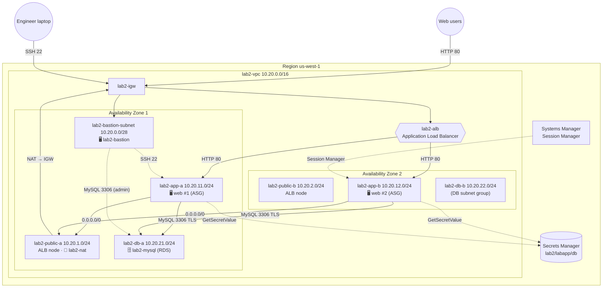
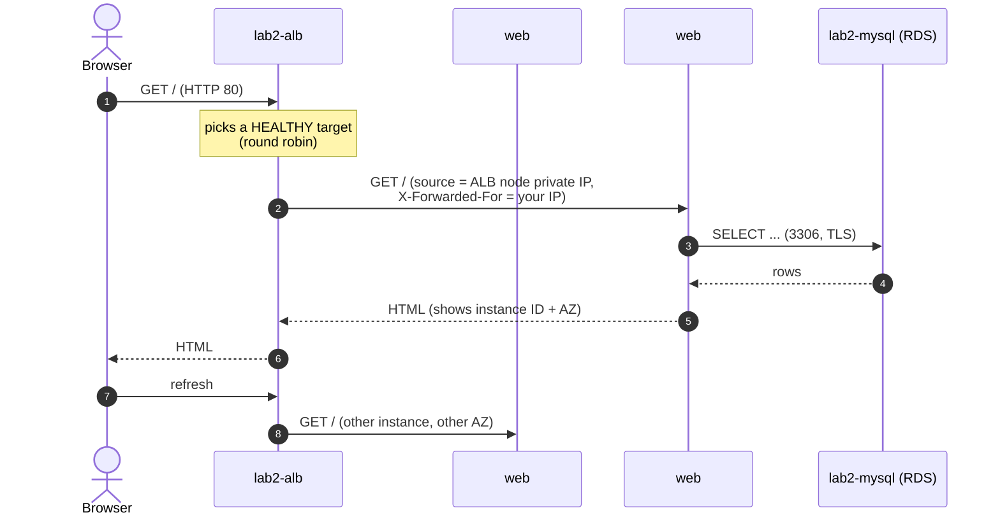
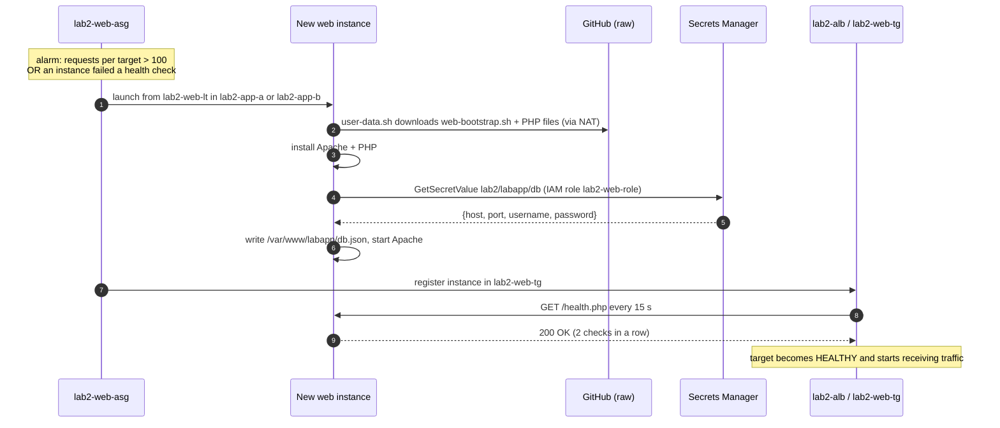

# Lab 2 — Highly Available Web App: ALB + Auto Scaling + Amazon RDS for MySQL (us-west-1)

> **Audience:** Cloud Engineer trainees · **Level:** Associate
> **Prerequisite:** Lab 1 (*Secure VPC with a Bastion Host and a 2-Tier Web App*) or equivalent VPC knowledge
> **Duration:** 4–5 hours · **Region:** `us-west-1` (N. California) · **Method:** AWS Management Console + scripts
> **Estimated cost:** about **US$0.25 per hour** while running (NAT Gateway, ALB, RDS, 3–5 EC2 instances). **Do the cleanup in Part 22.**

---

## Scenario

The *Pacific Learning Co.* student registry from Lab 1 is a success, but it runs on **one web server** and **one self-managed MySQL server**. Management now asks for:

- **No single web server**: traffic must be spread across servers in **two Availability Zones**.
- **Automatic recovery and growth**: failed servers are replaced automatically, and capacity grows with traffic.
- **A managed database**: AWS handles patching, backups, and encryption, so the team stops running MySQL by hand.
- **No passwords in code or in launch templates**: servers fetch credentials at boot from **AWS Secrets Manager**.
- **No public IPs on web servers**: only the load balancer faces the internet.

---

## Learning objectives

By the end of this lab you will be able to:

1. Design a **three-tier VPC**: public, private-app, and isolated-database subnets in two AZs
2. Deploy **Amazon RDS for MySQL** in a DB subnet group with no public access, and connect to it over **TLS**
3. Store and retrieve credentials with **AWS Secrets Manager** and an **IAM role** (no passwords in scripts)
4. Build a **launch template** whose **user data** configures each server at boot
5. Create an **Application Load Balancer**, a **target group** and **health checks**, and explain liveness vs readiness checks
6. Create an **Auto Scaling group** with a **target-tracking** policy, and watch it **scale out** and **self-heal**
7. Manage private servers with both a **bastion host** (SSH ProxyJump) and **Systems Manager Session Manager**
8. Validate the design layer by layer, and troubleshoot it from the error messages

### What changes from Lab 1

| Topic | Lab 1 | Lab 2 |
|-------|-------|-------|
| Web tier | 1 EC2 instance in a **public** subnet | **Auto Scaling group** of 2–4 instances in **private** subnets |
| Entry point | Instance public IP | **Application Load Balancer** DNS name |
| Database | MySQL installed by hand on EC2 | **Amazon RDS for MySQL** (managed) |
| DB subnets | Private subnet with NAT access | **Isolated** subnets: no route to the internet at all |
| Credentials | Passed on the command line | **Secrets Manager** + **IAM role** |
| DB traffic | Unencrypted | **TLS**, with the RDS server certificate verified |
| Server setup | You SSH in and run a script | **User data** runs automatically on every new instance |
| Administration | Bastion only | Bastion **and** Session Manager |

---

## 1. Target architecture

### 1.0 Full project diagram

Everything you will build: region, VPC, Availability Zones, subnets, gateways, load balancer, Auto Scaling group, database, security-group rules, route tables, and the regional services. It displays in any Markdown viewer; widen the window if lines wrap.

```text
   ┌──────────────────────────────┐                    ┌──────────────────────────────┐
   │ Cloud engineer laptop        │                    │ Web users (browser)          │
   │ SSH config + ProxyJump       │                    │ http://<ALB DNS name>/       │
   └──────────────┬───────────────┘                    └──────────────┬───────────────┘
                  │ SSH 22 (your IP only)                             │ HTTP 80
                  ▼                                                   ▼
┌─ AWS Region us-west-1 (N. California) ─────────────────────────────────────────────────────────────────────────────┐
│ ┌─ lab2-vpc 10.20.0.0/16 (DNS hostnames enabled) ────────────────────────────────────────────────────────────────┐ │
│ │                     ┌─ lab2-igw  Internet Gateway ───────────────────────────────────────┐                     │ │
│ │                     │ IN  HTTP 80 -> lab2-alb   ·   IN  SSH 22 -> lab2-bastion           │                     │ │
│ │                     │ OUT NAT Elastic IP / bastion public IP -> internet                 │                     │ │
│ │                     └────────────────────────────────────────────────────────────────────┘                     │ │
│ │                                  │                                                                             │ │
│ │ ┌─ lab2-alb  Application Load Balancer (internet-facing) ────────────────────────────────────────────────────┐ │ │
│ │ │ sg lab2-alb-sg  IN 80 <- 0.0.0.0/0  ·  listener HTTP:80 -> target group lab2-web-tg                        │ │ │
│ │ │ health check GET /health.php every 15 s (liveness) · nodes in lab2-public-a + lab2-public-b                │ │ │
│ │ └────────────────────────────────────────────────────────────────────────────────────────────────────────────┘ │ │
│ │                                  │ forwards to healthy targets                                                 │ │
│ │ ── Availability Zone 1 ───────────────────────────────  ── Availability Zone 2 ─────────────────────────────── │ │
│ │ ┌─ lab2-bastion-subnet 10.20.0.0/28 · PUBLIC ────────┐                                                         │ │
│ │ │ lab2-bastion  t3.micro · Amazon Linux 2023         │                                                         │ │
│ │ │ sg lab2-bastion-sg  IN 22 <- your IP /32           │                                                         │ │
│ │ │ runs db-init.sh and load-test.sh                   │                                                         │ │
│ │ └────────────────────────────────────────────────────┘                                                         │ │
│ │       │ SSH 22 to web servers · MySQL 3306 to RDS (admin)                                                      │ │
│ │ ┌─ lab2-public-a 10.20.1.0/24 · PUBLIC ──────────────┐  ┌─ lab2-public-b 10.20.2.0/24 · PUBLIC ──────────────┐ │ │
│ │ │ ALB node (lab2-alb)                                │  │ ALB node (lab2-alb)                                │ │ │
│ │ │ lab2-nat  NAT Gateway + Elastic IP                 │  │                                                    │ │ │
│ │ │                                                    │  │                                                    │ │ │
│ │ └────────────────────────────────────────────────────┘  └────────────────────────────────────────────────────┘ │ │
│ │       │ HTTP 80          ▲ 0.0.0.0/0 -> lab2-nat              │ HTTP 80 (ALB -> targets)                       │ │
│ │       ▼                  │ dnf · GitHub · AWS APIs            ▼                                                │ │
│ │ ┌─ lab2-app-a 10.20.11.0/24 · PRIVATE (app) ─────────┐  ┌─ lab2-app-b 10.20.12.0/24 · PRIVATE (app) ─────────┐ │ │
│ │ │ web #1  t3.micro · Apache + PHP   (ASG)            │  │ web #2  t3.micro · Apache + PHP   (ASG)            │ │ │
│ │ │ sg lab2-web-sg  IN 80 <- lab2-alb-sg               │  │ sg lab2-web-sg  (same rules)                       │ │ │
│ │ │                 IN 22 <- lab2-bastion-sg           │  │ + web #3, #4 when the ASG scales out               │ │ │
│ │ │ role lab2-web-role (Secrets + SSM)                 │  │                                                    │ │ │
│ │ └────────────────────────────────────────────────────┘  └────────────────────────────────────────────────────┘ │ │
│ │       │ MySQL 3306 over TLS                                   │ MySQL 3306 over TLS                            │ │
│ │       ▼                                                       ▼ (crosses AZs to the primary)                   │ │
│ │ ┌─ lab2-db-a 10.20.21.0/24 · ISOLATED (db) ──────────┐  ┌─ lab2-db-b 10.20.22.0/24 · ISOLATED (db) ──────────┐ │ │
│ │ │ lab2-mysql  RDS for MySQL 8.4 · db.t4g.micro       │  │ part of lab2-db-subnet-group                       │ │ │
│ │ │ sg lab2-db-sg  IN 3306 <- lab2-web-sg              │  │ (standby here with Multi-AZ:                       │ │ │
│ │ │                IN 3306 <- lab2-bastion-sg          │  │  Extension Challenge B)                            │ │ │
│ │ │ no public access · encrypted (KMS)                 │  │                                                    │ │ │
│ │ └────────────────────────────────────────────────────┘  └────────────────────────────────────────────────────┘ │ │
│ │                                                                                                                │ │
│ │ ┌─ lab2-web-asg  Auto Scaling group (min 2 · desired 2 · max 4) ─────────────────────────────────────────────┐ │ │
│ │ │ launch template lab2-web-lt (AL2023 · user-data.sh) · subnets lab2-app-a + lab2-app-b                      │ │ │
│ │ │ target tracking: ALB request count per target = 100 · ELB health checks · grace 300 s                      │ │ │
│ │ └────────────────────────────────────────────────────────────────────────────────────────────────────────────┘ │ │
│ │                                                                                                                │ │
│ │ ┌─ Route tables ─────────────────────────────────────────────────────────────────────────────────────────────┐ │ │
│ │ │ lab2-public-rt  local + 0.0.0.0/0 -> lab2-igw   assoc: lab2-bastion-subnet, lab2-public-a, lab2-public-b   │ │ │
│ │ │ lab2-app-rt     local + 0.0.0.0/0 -> lab2-nat   assoc: lab2-app-a, lab2-app-b                              │ │ │
│ │ │ lab2-db-rt      local only (no internet)        assoc: lab2-db-a, lab2-db-b                                │ │ │
│ │ └────────────────────────────────────────────────────────────────────────────────────────────────────────────┘ │ │
│ └────────────────────────────────────────────────────────────────────────────────────────────────────────────────┘ │
│                                                                                                                    │
│ ┌─ Regional AWS services (reached through the NAT Gateway) ──────────────────────────────────────────────────────┐ │
│ │ Secrets Manager  lab2/labapp/db (appuser) · rds!db-... (RDS master, managed by RDS)                            │ │
│ │ IAM              lab2-web-role: GetSecretValue on lab2/labapp/db + AmazonSSMManagedInstanceCore                │ │
│ │ Systems Manager  Session Manager shell to web servers (no SSH needed)                                          │ │
│ │ CloudWatch       ALB/ASG/RDS metrics · target-tracking alarms                                                  │ │
│ └────────────────────────────────────────────────────────────────────────────────────────────────────────────────┘ │
└────────────────────────────────────────────────────────────────────────────────────────────────────────────────────┘
```

**The five traffic paths you will test**

| Path | Flow |
|------|------|
| 🌐 Web request | Browser → IGW → **ALB** (public subnets) → web instance (private app subnet) → **RDS** 3306 over TLS (isolated DB subnet) |
| 🔐 Admin (SSH) | Laptop → IGW → bastion (SSH 22) → ProxyJump → web instance (SSH 22, private IP) |
| 🖥️ Admin (Session Manager) | AWS console → Systems Manager → SSM agent on the web instance (outbound HTTPS via NAT, **no inbound port**) |
| 🔑 Boot-time config | New web instance → NAT → GitHub (scripts) + **Secrets Manager** (DB credentials via IAM role) |
| 🚫 Blocked by design | Internet → web instances (no public IP) · Internet → RDS (no public access) · DB subnets → internet (no route) · Bastion → web port 80 (only the ALB) |

### 1.1 Architecture diagram (Mermaid)

Rendered automatically on GitHub, GitLab, and in VS Code with a Mermaid preview extension.



### 1.2 IP addressing plan

| Subnet | Tier | CIDR | AZ | Usable IPs | Hosts |
|--------|------|------|----|-----------|-------|
| `lab2-bastion-subnet` | Public | `10.20.0.0/28` | AZ 1 | 11 | Bastion host |
| `lab2-public-a` | Public | `10.20.1.0/24` | AZ 1 | 251 | ALB node, NAT Gateway |
| `lab2-public-b` | Public | `10.20.2.0/24` | AZ 2 | 251 | ALB node |
| `lab2-app-a` | Private (app) | `10.20.11.0/24` | AZ 1 | 251 | Web servers (Auto Scaling) |
| `lab2-app-b` | Private (app) | `10.20.12.0/24` | AZ 2 | 251 | Web servers (Auto Scaling) |
| `lab2-db-a` | Isolated (db) | `10.20.21.0/24` | AZ 1 | 251 | RDS primary |
| `lab2-db-b` | Isolated (db) | `10.20.22.0/24` | AZ 2 | 251 | RDS standby (Multi-AZ, Challenge B) |

> 🧠 **Why does the ALB need two public subnets?** An Application Load Balancer must be placed in **at least two Availability Zones**. It runs a load-balancer node in each subnet you choose.
>
> 🧠 **Why two DB subnets for a single-AZ database?** An RDS **DB subnet group** must contain subnets in **at least two AZs**, so RDS can later move or add a standby without a redesign.

### 1.3 Routing plan

| Route table | Subnets | Routes | Meaning |
|-------------|---------|--------|---------|
| `lab2-public-rt` | bastion, public-a, public-b | `local` · `0.0.0.0/0 → lab2-igw` | Two-way internet |
| `lab2-app-rt` | app-a, app-b | `local` · `0.0.0.0/0 → lab2-nat` | Outbound-only internet (packages, GitHub, AWS APIs) |
| `lab2-db-rt` | db-a, db-b | `local` **only** | **Isolated**: the database can't reach the internet at all |

### 1.4 Security groups (chained by reference)

| Security group | Inbound rule | Source | Purpose |
|----------------|--------------|--------|---------|
| `lab2-bastion-sg` | SSH 22 | **My IP** | Only you reach the bastion |
| `lab2-alb-sg` | HTTP 80 | `0.0.0.0/0` | The public entry point |
| `lab2-web-sg` | HTTP 80 | **`lab2-alb-sg`** | Web servers accept traffic **only from the ALB** |
| `lab2-web-sg` | SSH 22 | **`lab2-bastion-sg`** | Admin through the bastion |
| `lab2-db-sg` | MYSQL/Aurora 3306 | **`lab2-web-sg`** | Only web servers query the database |
| `lab2-db-sg` | MYSQL/Aurora 3306 | **`lab2-bastion-sg`** | Admin path, used once by `db-init.sh` (remove it afterwards: Challenge E) |

> 🧠 **Security-group chaining with an ASG:** web servers come and go, and their IPs change all the time. Because rules reference *security groups*, every new instance launched with `lab2-web-sg` is allowed to reach RDS instantly, with no rule to edit.

### 1.5 Identity and secrets

| Item | Type | Purpose |
|------|------|---------|
| `rds!db-…` | Secrets Manager secret, **created and managed by RDS** | RDS master user `admin` (used only by `db-init.sh`) |
| `lab2/labapp/db` | Secrets Manager secret, **created by you** | Application user `appuser` (least privilege: SELECT/INSERT/UPDATE/DELETE on `labapp`) |
| `lab2-web-role` | IAM role + instance profile | Lets web servers **read only** `lab2/labapp/db`, and register with Systems Manager |

### 1.6 Traffic-flow diagrams

**A web request**



**A new instance joining the group (boot and scale-out)**



---

## 2. Prerequisites

- An AWS account with permission to create VPC, EC2, ELB, Auto Scaling, RDS, Secrets Manager, IAM and Systems Manager resources
- An SSH client (macOS/Linux Terminal, or Windows 10/11 PowerShell)
- The lab scripts published to GitHub (section 3)
- *(Recommended)* An AWS Budget alert at US$20

### 2.1 Cost (approximate, us-west-1; check AWS Pricing for current rates)

| Resource | Approx. hourly cost |
|----------|--------------------|
| NAT Gateway | ~$0.05 + ~$0.05 per GB processed |
| Application Load Balancer | ~$0.025 + LCU usage (cents in this lab) |
| RDS db.t4g.micro (Single-AZ) + 20 GB gp3 | ~$0.02–0.03 |
| EC2: bastion + 2–4 × t3.micro | ~$0.04–0.06 |
| Public IPv4 (NAT EIP, bastion, ALB nodes) | ~$0.005 each |
| Secrets Manager (2 secrets) | ~$0.80 per month, prorated |

> ⚠️ The NAT Gateway, ALB and RDS bill **every hour, even idle**. If you stop for the day, run the cleanup (Part 22). Stopping an RDS instance only pauses compute billing, for 7 days at most.

### 2.2 Lab worksheet

| Item | Value |
|------|-------|
| AZ 1 / AZ 2 names | |
| VPC ID | |
| NAT Gateway Elastic IP | |
| Bastion public IP | |
| RDS endpoint (`lab2-mysql.xxxx.us-west-1.rds.amazonaws.com`) | |
| RDS master secret name (`rds!db-…`) | |
| `appuser` password (printed by `db-init.sh`) | |
| Secret ARN of `lab2/labapp/db` | |
| AWS account ID (12 digits) | |
| ALB DNS name (`lab2-alb-….us-west-1.elb.amazonaws.com`) | |

---

## 3. The lab scripts

All server configuration is done by scripts. **You never type a password into a script or a launch template.**

```
aws-lab-alb-asg-rds/
├── AWS-ALB-ASG-RDS-Lab.md        ← this guide
└── scripts/
    ├── db/
    │   ├── db-init.sh             runs on the BASTION: creates DB, appuser, loads seed.sql into RDS
    │   └── seed.sql               sample data (8 courses, 12 students, 28 enrollments)
    ├── web/
    │   ├── user-data.sh           pasted into the LAUNCH TEMPLATE: downloads and runs web-bootstrap.sh
    │   ├── web-bootstrap.sh       runs on EVERY web instance at boot: Apache + PHP + secret + app
    │   ├── lib.php                shared code: reads db.json, connects to RDS over TLS, IMDSv2
    │   ├── index.php              the student-registry page (shows which instance and AZ served it)
    │   └── health.php             ALB health check (liveness; ?strict=1 for readiness)
    └── tools/
        └── load-test.sh           runs on the BASTION: shows load balancing, generates load to scale out
```

| Script | Where it runs | When | Who runs it |
|--------|---------------|------|-------------|
| [`db/db-init.sh`](scripts/db/db-init.sh) + [`db/seed.sql`](scripts/db/seed.sql) | Bastion | Once, after RDS is available (Part 9) | You |
| [`web/user-data.sh`](scripts/web/user-data.sh) | Every web instance | First boot | **EC2 / cloud-init** (from the launch template) |
| [`web/web-bootstrap.sh`](scripts/web/web-bootstrap.sh) + 3 PHP files | Every web instance | First boot | `user-data.sh` |
| [`tools/load-test.sh`](scripts/tools/load-test.sh) | Bastion | Part 17 | You |

### 3.1 Publish the scripts to GitHub

Web servers launched by the Auto Scaling group download their files from GitHub **at boot**, so the files must be in a repository the instances can reach.

1. Push the `scripts/` folder to your repository, for example:
   `inspiredevgen/devops-worksphops` → `2-Cloud-Infrastructure/aws-lab-alb-asg-rds/scripts/`
2. Confirm that this **raw** URL returns the script (it must start with `#!/bin/bash`, not HTML):
   ```
   https://raw.githubusercontent.com/inspiredevgen/devops-worksphops/refs/heads/main/2-Cloud-Infrastructure/aws-lab-alb-asg-rds/scripts/web/web-bootstrap.sh
   ```
3. If your path is different, edit `BASE_URL` at the top of `scripts/web/user-data.sh`, and use your path in Parts 9 and 17.

> ⚠️ The repository must be **public**. Instances download with plain `curl` and no credentials. (Extension Challenge C moves the files to a private S3 bucket.)

---

## Part 1 — Region and Availability Zones

1. Select **US West (N. California) `us-west-1`** in the console.
2. **EC2 → Dashboard → Zones**: note your two AZ names (e.g. `us-west-1b` and `us-west-1c`) as **AZ 1** and **AZ 2**.

> Most accounts have **two** AZs in `us-west-1`, and the letters differ between accounts. This lab needs exactly two.

---

## Part 2 — VPC

1. **VPC → Your VPCs → Create VPC** → **VPC only**.
   - Name: `lab2-vpc` · IPv4 CIDR: `10.20.0.0/16` · No IPv6 · Tenancy: Default → **Create VPC**.
2. Select `lab2-vpc` → **Actions → Edit VPC settings** → tick **Enable DNS hostnames** → **Save**.

> 🧠 RDS endpoints are DNS names. **DNS resolution** and **DNS hostnames** must both be enabled for instances to resolve them inside the VPC.

---

## Part 3 — Seven subnets

**VPC → Subnets → Create subnet** → VPC `lab2-vpc`. Add all seven with **Add new subnet**:

| Name | AZ | CIDR |
|------|----|------|
| `lab2-bastion-subnet` | AZ 1 | `10.20.0.0/28` |
| `lab2-public-a` | AZ 1 | `10.20.1.0/24` |
| `lab2-public-b` | AZ 2 | `10.20.2.0/24` |
| `lab2-app-a` | AZ 1 | `10.20.11.0/24` |
| `lab2-app-b` | AZ 2 | `10.20.12.0/24` |
| `lab2-db-a` | AZ 1 | `10.20.21.0/24` |
| `lab2-db-b` | AZ 2 | `10.20.22.0/24` |

Then enable **auto-assign public IPv4** on **`lab2-bastion-subnet` only**: select it → **Actions → Edit subnet settings** → tick **Enable auto-assign public IPv4 address** → **Save**.

> 🧠 Unlike Lab 1, `lab2-public-a/b` **don't** need auto-assign: no instance runs there. The ALB and NAT Gateway get their public addresses on their own.

---

## Part 4 — Internet Gateway and public route table

1. **Internet gateways → Create** `lab2-igw` → **Actions → Attach to VPC** → `lab2-vpc`.
2. **Route tables → Create route table** `lab2-public-rt` (VPC `lab2-vpc`).
   - **Routes → Edit routes → Add route:** `0.0.0.0/0` → Internet Gateway `lab2-igw`.
   - **Subnet associations → Edit:** `lab2-bastion-subnet`, `lab2-public-a`, `lab2-public-b`.

---

## Part 5 — NAT Gateway, app route table, and isolated DB route table

### 5.1 NAT Gateway
**NAT gateways → Create NAT gateway**: name `lab2-nat`, subnet **`lab2-public-a`**, connectivity **Public**, availability mode **Zonal** (if shown), **Allocate Elastic IP** → **Create**. Wait for **Available**, and record the EIP.

### 5.2 App route table
**Create route table** `lab2-app-rt` → route `0.0.0.0/0` → NAT Gateway `lab2-nat` → associate **`lab2-app-a`, `lab2-app-b`**.

### 5.3 Isolated DB route table
**Create route table** `lab2-db-rt` → **don't add any route** → associate **`lab2-db-a`, `lab2-db-b`**.

> 🧠 Why create an empty route table instead of leaving the DB subnets on the main table? It makes the intent **explicit and auditable** ("these subnets are isolated"), and it protects them if someone later adds an internet route to the main table. RDS doesn't need internet access: AWS manages patching and backups on its side.

✅ **Checkpoint**

| Route table | Routes | Associations |
|-------------|--------|--------------|
| `lab2-public-rt` | local, `0.0.0.0/0 → igw` | bastion, public-a, public-b |
| `lab2-app-rt` | local, `0.0.0.0/0 → nat` | app-a, app-b |
| `lab2-db-rt` | local | db-a, db-b |

---

## Part 6 — Security groups

**VPC → Security groups → Create security group** (VPC `lab2-vpc`), **in this order**:

| # | Name | Description | Inbound rules |
|---|------|-------------|---------------|
| 1 | `lab2-bastion-sg` | Bastion SSH from admin IP | SSH 22 ← **My IP** |
| 2 | `lab2-alb-sg` | Public load balancer | HTTP 80 ← **Anywhere-IPv4** |
| 3 | `lab2-web-sg` | Web tier (ASG) | HTTP 80 ← **`lab2-alb-sg`** · SSH 22 ← **`lab2-bastion-sg`** |
| 4 | `lab2-db-sg` | RDS MySQL | MYSQL/Aurora 3306 ← **`lab2-web-sg`** · MYSQL/Aurora 3306 ← **`lab2-bastion-sg`** |

Keep the default outbound rule (all traffic) on all four.

✅ **Checkpoint:** in `lab2-web-sg` and `lab2-db-sg`, every source is an **`sg-…` ID**, never a CIDR.

---

## Part 7 — Amazon RDS for MySQL

> ⏱️ RDS takes **10–15 minutes** to create. Start it now, and build the bastion and IAM role (Parts 8 and 11) while you wait.

### 7.1 DB subnet group
**RDS → Subnet groups → Create DB subnet group**:
- Name: `lab2-db-subnet-group` · Description: `Isolated DB subnets` · VPC: `lab2-vpc`
- Availability Zones: **AZ 1 and AZ 2** · Subnets: **`10.20.21.0/24` and `10.20.22.0/24`** (`lab2-db-a`, `lab2-db-b`)
- **Create**

### 7.2 Create the database
**RDS → Databases → Create database**:

| Setting | Value |
|---------|-------|
| Creation method | **Full configuration** (standard create) |
| Engine | **MySQL** · version: latest **8.4.x** |
| Template | **Dev/Test** (or *Free tier* if offered) |
| Availability and durability | **Single-AZ DB instance** (Multi-AZ is Extension Challenge B) |
| DB instance identifier | `lab2-mysql` |
| Master username | `admin` |
| Credentials management | **Managed in AWS Secrets Manager** (encryption key: `aws/secretsmanager`) |
| Instance class | Burstable · **db.t4g.micro** |
| Storage | **gp3**, 20 GiB · storage autoscaling: maximum 50 GiB |
| Compute resource | **Don't connect to an EC2 compute resource** |
| VPC | `lab2-vpc` |
| DB subnet group | `lab2-db-subnet-group` |
| **Public access** | **No** |
| VPC security group | **Choose existing** → `lab2-db-sg` (remove `default`) |
| Availability Zone | AZ 1 |
| Database port | 3306 |
| Database authentication | Password authentication |
| Monitoring | Leave the defaults; disable *Enhanced Monitoring* to save cost |
| **Additional configuration → Initial database name** | `labapp` |
| Backup retention | 1 day |
| Encryption | **Enabled** (default `aws/rds` key) |
| Deletion protection | Off (lab only) |

Click **Create database**.

### 7.3 Record the endpoint and the master secret
When the status is **Available**:
1. **Connectivity & security** → copy the **Endpoint** (`lab2-mysql.xxxxxxxx.us-west-1.rds.amazonaws.com`).
2. **Configuration** → **Master credentials ARN** → follow the link to Secrets Manager → note the secret name `rds!db-…`.

> 🧠 **Explore:** the endpoint is a **DNS name**, not an IP. If RDS fails over or the instance is replaced, the name stays the same and points to the new IP. Always connect by name.

---

## Part 8 — Key pair and bastion host

1. **EC2 → Key pairs → Create key pair**: `lab2-key`, **ED25519**, `.pem`. Move it to `~/.ssh/` and restrict it:
   - macOS/Linux: `chmod 400 ~/.ssh/lab2-key.pem`
   - Windows: `icacls "$env:USERPROFILE\.ssh\lab2-key.pem" /inheritance:r /grant:r "$($env:USERNAME):(R)"`
2. **Launch instance** `lab2-bastion`: Amazon Linux 2023 · `t3.micro` · key `lab2-key` · VPC `lab2-vpc` · subnet **`lab2-bastion-subnet`** · auto-assign public IP **Enable** · SG **`lab2-bastion-sg`** · metadata **V2 only**.
3. Add this to `~/.ssh/config` (replace the bastion IP). The `Host 10.20.*` block lets you reach **any** web instance by its private IP, even though the Auto Scaling group keeps changing them.

```sshconfig
# ---- AWS Lab 2 ----
Host lab2-bastion
    HostName <BASTION_PUBLIC_IP>
    User ec2-user
    IdentityFile ~/.ssh/lab2-key.pem
    IdentitiesOnly yes

Host 10.20.*
    User ec2-user
    IdentityFile ~/.ssh/lab2-key.pem
    IdentitiesOnly yes
    ProxyJump lab2-bastion
```

4. Test: `ssh lab2-bastion` → `exit`.

---

## Part 9 — Initialize the database from the bastion

Wait until `lab2-mysql` is **Available**.

### 9.1 Get the master password
**Secrets Manager → Secrets → `rds!db-…` → Retrieve secret value** → copy the **password**. You'll paste it at a hidden prompt; it's never saved to disk.

### 9.2 Download and run `db-init.sh`

```bash
ssh lab2-bastion

mkdir -p ~/scripts && cd ~/scripts
BASE=https://raw.githubusercontent.com/inspiredevgen/devops-worksphops/refs/heads/main/2-Cloud-Infrastructure/aws-lab-alb-asg-rds/scripts
curl -fsSLO $BASE/db/db-init.sh
curl -fsSLO $BASE/db/seed.sql
head -1 db-init.sh seed.sql            # must show #!/bin/bash and -- File: db/seed.sql

bash db-init.sh <RDS_ENDPOINT>
```

The script:

| Step | What happens | Networking concept |
|------|--------------|--------------------|
| 1/5 | Installs the MySQL 8.4 client (`mysql-community-client`) and `nc` | Bastion reaches the internet through the **IGW** |
| 2/5 | Resolves the endpoint and tests TCP 3306 | The endpoint resolves to a **private IP** in `10.20.21.x`; `lab2-db-sg` admits `lab2-bastion-sg` |
| 3/5 | Downloads the **RDS CA bundle** | TLS with `--ssl-mode=VERIFY_IDENTITY`: traffic is encrypted *and* the server is authenticated |
| 4/5 | Prompts for the master password and logs in as `admin` | Password kept in a temporary owner-only file, deleted on exit |
| 5/5 | Creates `labapp` and `appuser@'10.20.11.%'` + `appuser@'10.20.12.%'`, loads `seed.sql` | **Database-level network restriction**: `appuser` can log in **only from the app subnets** |

Copy the **App password** from the final banner into your worksheet.

> 🧠 **Defense in depth:** even though `lab2-db-sg` lets the bastion reach port 3306, `appuser` *can't* log in from the bastion (`10.20.0.x` doesn't match `10.20.11.%` or `10.20.12.%`). You will prove this in Part 18.

---

## Part 10 — Store the app credentials in Secrets Manager

**Secrets Manager → Store a new secret**:

1. **Secret type:** **Credentials for Amazon RDS database**
2. **User name:** `appuser` · **Password:** *(the App password from `db-init.sh`)*
3. **Encryption key:** `aws/secretsmanager`
4. **Database:** select **`lab2-mysql`** (Secrets Manager adds the host, port and engine for you)
5. **Next** → **Secret name:** `lab2/labapp/db` → **Next**
6. **Rotation:** leave **disabled** → **Next** → **Store**
7. Open the secret, copy its **ARN**, and use **Retrieve secret value** to check that it shows `host`, `port`, `username` and `password`.

> 🧠 **Why not reuse the RDS master secret?** The master user can do anything (drop tables, create users), and RDS rotates its password automatically. The application gets its own **least-privilege** user and its own secret, readable only by `lab2-web-role`.

---

## Part 11 — IAM role for the web servers

1. **IAM → Roles → Create role** → Trusted entity **AWS service** → Use case **EC2** → **Next**.
2. Attach **`AmazonSSMManagedInstanceCore`** (for Session Manager) → **Next** → Name: **`lab2-web-role`** → **Create role**.
3. Open `lab2-web-role` → **Add permissions → Create inline policy** → **JSON**. Paste the policy, replacing `<ACCOUNT_ID>` (top-right menu of the console):

```json
{
  "Version": "2012-10-17",
  "Statement": [
    {
      "Sid": "ReadLabAppDbSecretOnly",
      "Effect": "Allow",
      "Action": "secretsmanager:GetSecretValue",
      "Resource": "arn:aws:secretsmanager:us-west-1:<ACCOUNT_ID>:secret:lab2/labapp/db-??????"
    }
  ]
}
```

4. **Next** → Policy name: `lab2-read-db-secret` → **Create policy**.

> 🧠 Secrets Manager appends **6 random characters** to every secret ARN (`…:secret:lab2/labapp/db-AbC123`). The `-??????` wildcard matches exactly that suffix, and nothing else. A wildcard like `lab2/*` would also grant future secrets you never intended to share.

---

## Part 12 — Target group and Application Load Balancer

### 12.1 Target group
**EC2 → Target groups → Create target group**:

| Setting | Value |
|---------|-------|
| Target type | **Instances** |
| Name | `lab2-web-tg` |
| Protocol / port | HTTP / 80 |
| VPC | `lab2-vpc` |
| Health check path | **`/health.php`** |
| Advanced: healthy / unhealthy threshold | 2 / 2 |
| Advanced: timeout / interval | 5 s / 15 s |
| Advanced: success codes | 200 |

**Next** → don't register any targets (the Auto Scaling group does it) → **Create target group**.

> 🧠 **Liveness vs readiness.** `/health.php` returns **200 whenever Apache and PHP work**, even if the database is down (it reports the DB status in its body). `/health.php?strict=1` returns **503** when the DB is unreachable.
> Why give the ALB the *liveness* check? With a strict check, a database problem would make **every** web server fail at once. The Auto Scaling group (with ELB health checks) would then terminate and replace healthy servers in a loop, which doesn't fix the database and adds load. You will see this in Break & Fix B2.

### 12.2 Application Load Balancer
**EC2 → Load balancers → Create load balancer → Application Load Balancer**:

| Setting | Value |
|---------|-------|
| Name | `lab2-alb` |
| Scheme | **Internet-facing** · IP address type **IPv4** |
| VPC | `lab2-vpc` |
| Mappings | AZ 1 → **`lab2-public-a`** · AZ 2 → **`lab2-public-b`** |
| Security groups | **`lab2-alb-sg`** (remove `default`) |
| Listener | HTTP : 80 → forward to **`lab2-web-tg`** |

**Create load balancer** and copy its **DNS name**. It becomes *Active* in a few minutes. Until targets exist, it answers **503**, which is expected.

---

## Part 13 — Launch template

**EC2 → Launch templates → Create launch template**:

| Setting | Value |
|---------|-------|
| Name | `lab2-web-lt` · description `Lab 2 web tier v1` |
| Auto Scaling guidance | ✅ **Provide guidance to help me set up a template that I can use with EC2 Auto Scaling** |
| AMI | **Amazon Linux 2023** (64-bit x86) |
| Instance type | `t3.micro` |
| Key pair | `lab2-key` |
| Network settings → Subnet | **Don't include in launch template** (the ASG chooses) |
| Security groups | **`lab2-web-sg`** |
| Advanced → **IAM instance profile** | **`lab2-web-role`** |
| Advanced → Metadata accessible / version | Enabled / **V2 only (token required)** |
| Advanced → **User data** | paste the content of **[`scripts/web/user-data.sh`](scripts/web/user-data.sh)** |

The user data contains **no credentials**, only where to find the scripts and the secret's name:

```bash
export SECRET_ID="lab2/labapp/db"
export BASE_URL="https://raw.githubusercontent.com/inspiredevgen/devops-worksphops/refs/heads/main/2-Cloud-Infrastructure/aws-lab-alb-asg-rds/scripts/web"
```

**Create launch template.**

> 🧠 What [`web-bootstrap.sh`](scripts/web/web-bootstrap.sh) does on every new instance:
> 1. Reads its identity (region, AZ, instance ID) from **IMDSv2**
> 2. Installs Apache, PHP-FPM and the PHP MySQL driver (through the NAT)
> 3. Calls **`secretsmanager:GetSecretValue`** with the instance-profile credentials (retries for up to a minute)
> 4. Writes the secret to `/var/www/labapp/db.json` (mode 640, `root:apache`, outside the web root)
> 5. Downloads the **RDS CA bundle** so PHP connects with **TLS** and verifies the server
> 6. Deploys the PHP files, starts the services, and tests TCP 3306 and `/health.php?strict=1`

---

## Part 14 — Auto Scaling group

**EC2 → Auto Scaling groups → Create Auto Scaling group**:

| Step | Setting | Value |
|------|---------|-------|
| 1 | Name | `lab2-web-asg` |
| 1 | Launch template | `lab2-web-lt`, version **Latest** |
| 2 | VPC | `lab2-vpc` |
| 2 | Subnets | **`lab2-app-a`** and **`lab2-app-b`** |
| 2 | AZ distribution | Balanced best effort |
| 3 | Load balancing | **Attach to an existing load balancer** → *Choose from your load balancer target groups* → **`lab2-web-tg`** |
| 3 | Health checks | ✅ **Turn on Elastic Load Balancing health checks** |
| 3 | Health check grace period | **300** seconds |
| 3 | Monitoring | ✅ Enable group metrics collection within CloudWatch |
| 4 | Desired / Min / Max | **2 / 2 / 4** |
| 4 | Scaling | **Target tracking scaling policy** |
| 4 | Policy name | `lab2-req-per-target` |
| 4 | Metric type | **Application Load Balancer request count per target** · target group `lab2-web-tg` |
| 4 | Target value | **100** (requests per target per minute) |
| 4 | Instance warmup | 120 seconds |
| 4 | Instance maintenance policy | No policy |
| 6 | Tags | Key `Name`, value `lab2-web` (tag new instances ✅) |

**Create Auto Scaling group.**

> 🧠 **Why ELB health checks?** By default, an ASG only replaces an instance when **EC2** reports it impaired (the hardware or OS is dead). With ELB health checks, it also replaces instances the **load balancer** sees as unhealthy, for example when Apache never started. The **grace period** (300 s) gives the bootstrap time to finish before failed checks count.

### Watch the instances join

1. **Auto Scaling groups → `lab2-web-asg` → Activity:** two *Launching a new EC2 instance* entries, one per AZ.
2. **Target groups → `lab2-web-tg` → Targets:** status `initial` → **`healthy`** (about 3–5 minutes).

✅ **Checkpoint:** two healthy targets, in **different AZs**.

---

## Part 15 — Test the application through the ALB

1. Open **`http://<ALB_DNS_NAME>/`** in your browser (with `http://`).
   - 8 courses and 12 students are listed.
   - The header shows the **Availability Zone** that served the page.
   - **Served by** shows the instance ID, its private IP (`10.20.11.x` or `10.20.12.x`), the **ALB node IP** as the request source, **your public IP** in `X-Forwarded-For`, the RDS endpoint, and **DB encryption (TLS)** with a cipher such as `TLS_AES_256_GCM_SHA384`.
2. **Refresh several times** (or use a private window): the instance ID and AZ change. Browsers reuse connections, so a terminal shows the effect more clearly:

```bash
for i in $(seq 1 10); do
  curl -s http://<ALB_DNS_NAME>/health.php | grep -E '"served_by"|"az"' | tr -d '\n '; echo
done
```

3. **Register a student.** The confirmation message names the instance that handled the write. Refresh: the new student is visible from **both** instances, because they share one database.

> 🧠 **Why the "Served by" panel shows two IPs:** the web server sees the **ALB node's private IP** as the source (`REMOTE_ADDR`), because the ALB opens a new connection to the target. The real client IP travels in the **`X-Forwarded-For`** header. Logs and security tools must read that header behind a load balancer.

---

## Part 16 — Manage the private web servers

### 16.1 Session Manager (no SSH, no open port)
1. **EC2 → Instances** → select a `lab2-web` instance → **Connect → Session Manager → Connect**.
2. In the browser shell:

```bash
sudo tail -40 /var/log/cloud-init-output.log      # the bootstrap log
curl -s localhost/health.php?strict=1             # readiness from inside
curl -s https://checkip.amazonaws.com             # = your NAT Elastic IP
aws sts get-caller-identity                        # the instance runs as lab2-web-role
```

> 🧠 Session Manager works because the **SSM agent** on the instance connects **outbound** (HTTPS through the NAT) to Systems Manager, and `lab2-web-role` includes `AmazonSSMManagedInstanceCore`. There is **no inbound rule**, no SSH key, and every session can be logged.

### 16.2 SSH through the bastion
Copy a web instance's **private IP** from the console:

```bash
ssh 10.20.11.57          # the "Host 10.20.*" block jumps through lab2-bastion automatically
```

> Compare both methods: which needs an open port, a key file, a public IP? Which leaves an audit trail in AWS?

---

## Part 17 — Auto scaling and self-healing

### 17.1 Scale out under load
On the bastion:

```bash
cd ~/scripts
curl -fsSLO $BASE/tools/load-test.sh        # BASE as in Part 9 (set it again in a new session)
bash load-test.sh <ALB_DNS_NAME> 10 10      # 10 minutes, 10 parallel clients
```

The script first sends 20 requests and shows how they are **spread across instances**. Then it sends sustained traffic with ApacheBench. While it runs, watch:

| Where | What you should see |
|-------|---------------------|
| **CloudWatch → Alarms** | `TargetTracking-lab2-web-asg-AlarmHigh-…` goes to **In alarm** (after ~3 minutes above 100 requests/target/minute) |
| **ASG → Activity** | *Launching a new EC2 instance* ×2 (up to the **max of 4**) |
| **Target group → Targets** | New targets: `initial` → `healthy` |
| End of `load-test.sh` | The final distribution includes the **new instance IDs** |

About 15 minutes after the load stops, the `AlarmLow` alarm triggers **scale-in** back to 2 instances.

> 🧠 **Target tracking** works like a thermostat: you set the target (100 requests per instance per minute), and AWS creates and manages both CloudWatch alarms, adding or removing instances to keep the metric near the target.

### 17.2 Self-healing
1. **EC2 → Instances** → select one `lab2-web` instance → **Instance state → Terminate**.
2. Keep refreshing the website: it **keeps working** (the ALB stops sending traffic to the terminating instance).
3. **ASG → Activity**: *Launching a new EC2 instance … an instance was taken out of service in response to an EC2 health check …*. A replacement joins in about 3–5 minutes.

---

## Part 18 — Validation: prove the design

| # | From | Test | Expected | Proves |
|---|------|------|----------|--------|
| 1 | Laptop | Browser `http://<ALB_DNS>/` | ✅ Page loads | Public entry through ALB |
| 2 | Laptop | `curl -m5 http://<WEB_PRIVATE_IP>/` | ❌ Times out | Web servers have no public path |
| 3 | Laptop | `nslookup <RDS_ENDPOINT>` | Resolves to **10.20.21.x** | RDS has only a private address |
| 4 | Laptop | `nc -zv -w5 <RDS_ENDPOINT> 3306` | ❌ Fails | Private IP isn't routable from the internet |
| 5 | Bastion | `curl -m5 http://<WEB_PRIVATE_IP>/` | ❌ Times out | `lab2-web-sg` accepts port 80 **only from the ALB** |
| 6 | Bastion | `nc -zv -w3 <WEB_PRIVATE_IP> 22` | ✅ Connected | Admin path bastion → web |
| 7 | Bastion | `mysql -h <RDS_ENDPOINT> -u appuser -p --ssl-mode=VERIFY_IDENTITY --ssl-ca=~/rds-ca.pem` | ❌ **Access denied** (network OK!) | MySQL host patterns allow `appuser` only from app subnets |
| 8 | Bastion | `aws secretsmanager get-secret-value --secret-id lab2/labapp/db --region us-west-1` | ❌ *Unable to locate credentials* | Only `lab2-web-role` can read the secret |
| 9 | Web (Session Manager) | `aws secretsmanager get-secret-value --secret-id lab2/labapp/db --region us-west-1 --query Name` | ✅ `"lab2/labapp/db"` | IAM role grants exactly this secret |
| 10 | Web | Same command with `--secret-id 'rds!db-…'` (single quotes: `!` is special in bash) | ❌ AccessDeniedException | Least privilege: the master secret stays private |
| 11 | Web | `curl -s https://checkip.amazonaws.com` | ✅ NAT Elastic IP | Outbound via NAT |
| 12 | Web | `curl -s localhost/health.php` | ✅ `"db_tls": "TLS_…"` | Encrypted DB traffic |
| 13 | Console | Terminate a web instance | ✅ Replaced automatically, site stays up | Self-healing + multi-AZ |

---

## Part 19 — Troubleshooting

### 19.1 Where to look

| Symptom | First place to look |
|---------|--------------------|
| Targets stay `unhealthy` / ALB returns **502/503** | Target group → Targets → **health status details**; then the instance's `/var/log/cloud-init-output.log` (Session Manager) |
| ASG keeps launching and terminating instances | ASG → **Activity** (reason column) + `cloud-init-output.log` of a new instance |
| Page shows *Cannot reach the database* | The **Hint** line on the page, and `/health.php?strict=1` |
| `db-init.sh` fails | Its `[FAIL]` message (each failure points to the layer) |

### 19.2 Common problems

| Problem | Cause | Fix |
|---------|-------|-----|
| ALB returns **503 Service Temporarily Unavailable** | No healthy targets | Wait for the bootstrap (3–5 min); then check the rows below |
| Targets `unhealthy`: **Request timed out** | `lab2-web-sg` doesn't allow 80 from `lab2-alb-sg` | Add the rule (source = **security group**, not a CIDR) |
| Targets `unhealthy`: **Health checks failed with these codes: [404]** | Wrong health check path, or the bootstrap didn't deploy `health.php` | Path must be `/health.php`; check `cloud-init-output.log` |
| `cloud-init-output.log`: `curl: (22) … 404` | `BASE_URL` wrong, or the files aren't pushed to GitHub | Fix `BASE_URL` in the launch template (new version) → instance refresh |
| `cloud-init-output.log`: `curl: (28) … timed out` / `Could not resolve host` | No internet from app subnets | `lab2-app-rt` needs `0.0.0.0/0 → lab2-nat`, associated with both app subnets |
| Bootstrap: **AccessDeniedException** on `GetSecretValue` | Inline policy ARN wrong (region, account ID, name) | Fix `lab2-read-db-secret`; keep the `-??????` suffix |
| Bootstrap: **Unable to locate credentials** | No IAM instance profile on the instance | Launch template → IAM instance profile `lab2-web-role` |
| Bootstrap: **ResourceNotFoundException** | Secret name differs | Name must be exactly `lab2/labapp/db` (or change `SECRET_ID`) |
| Bootstrap: **Secret is missing keys: host** | Secret created as *Other type* without `host` | Recreate it as *Credentials for Amazon RDS database*, or add keys `host`, `port` |
| Page: **Access denied for user 'appuser'** | Password in secret ≠ password in MySQL | Edit the secret value, or re-run `db-init.sh` with `APP_PASSWORD='<secret value>'`; then **instance refresh** |
| Page: **Connection timed out** | `lab2-db-sg` missing 3306 from `lab2-web-sg` | Add the rule |
| Page: TLS / *Cannot connect to MySQL using SSL* | Missing or corrupt `/var/www/labapp/rds-ca.pem` | Re-run `sudo bash /opt/labapp-bootstrap/web-bootstrap.sh` on the instance |
| `db-init.sh`: **TCP 3306 timed out** | `lab2-db-sg` missing 3306 from `lab2-bastion-sg`, or DB not *Available* | Add the rule / wait |
| `db-init.sh`: **Access denied for user 'admin'** | Wrong master password (or it was just rotated) | Retrieve the current value from the `rds!db-…` secret again |
| Session Manager: *instance not available* | SSM agent can't reach AWS, or role missing | NAT route on `lab2-app-rt`; `AmazonSSMManagedInstanceCore` on `lab2-web-role`; wait 5 min after launch |
| No scale-out during load test | Not enough traffic, or warm-up | Run longer / `bash load-test.sh <ALB> 15 20`; check the AlarmHigh state |

### 19.3 Changing configuration: instance refresh
Web servers read the secret and scripts **only at boot**. After changing the secret, the user data, or the launch template:

**ASG → `lab2-web-asg` → Instance refresh → Start instance refresh** (minimum healthy 50 %). Instances are replaced one at a time, and the site stays up.

> 🧠 This is **immutable infrastructure**: you don't patch running servers, you replace them with new ones built from the updated definition.

---

## Part 20 — Break & fix exercises

| # | Break it | Observe | Lesson | Fix |
|---|----------|---------|--------|-----|
| B1 | Delete the HTTP 80 rule from `lab2-web-sg` | Targets → `unhealthy` (timeout) → ALB **503**; after the grace period, the ASG starts **replacing** instances | The ALB is a client of the web tier, and its SG must be allowed | Restore the rule (source `lab2-alb-sg`) |
| B2 | In `lab2-db-sg`, delete the 3306 rule whose source is `lab2-web-sg` | Page shows *Cannot reach the database*, but targets stay **healthy** | Why the ALB uses a **liveness** check, not `?strict=1` | Restore the rule |
| B3 | Set the target group health check path to `/health.php?strict=1`, then repeat B2 | **All** targets unhealthy → 503 → ASG replacement loop (Activity tab) | Cascading failure caused by a deep health check | Revert the path and the rule |
| B4 | Remove `0.0.0.0/0 → lab2-nat` from `lab2-app-rt`, then terminate one instance | The new instance can't download scripts → never healthy → replaced again and again | Boot-time dependencies (NAT, GitHub, AWS APIs) | Restore the route |
| B5 | Detach the inline policy `lab2-read-db-secret`, then run an instance refresh | Bootstrap log: **AccessDeniedException** | How IAM controls access to secrets | Re-attach the policy |
| B6 | Set desired/min capacity to 0 | ALB 503, no targets | Capacity vs health | Set back to 2/2/4 |

---

## Part 21 — Extension challenges

**A. Highly available NAT.** Create `lab2-nat-b` in `lab2-public-b`, split `lab2-app-rt` into one route table per AZ, each pointing to its own NAT. Explain which failure this removes.

**B. Multi-AZ RDS.** Modify `lab2-mysql` → **Multi-AZ DB instance**. Then **Actions → Reboot → Reboot with failover** while running `load-test.sh`. Note the brief interruption, and that the endpoint name doesn't change.

**C. Remove the internet dependency.** Upload the `scripts/web/` files to a private **S3 bucket**, add an **S3 gateway endpoint** plus **interface endpoints** for Secrets Manager, SSM, SSMMessages and EC2Messages, change `user-data.sh` to use `aws s3 cp`, then delete the route to the NAT. (Hint: packages come from the Amazon Linux repos in S3.)

**D. HTTPS.** Request an **ACM certificate** for a domain you own, add an **HTTPS:443** listener, and redirect HTTP → HTTPS.

**E. Close the admin path.** Remove the `lab2-bastion-sg` rule from `lab2-db-sg`. Re-run `db-init.sh` through **Session Manager port forwarding** (`AWS-StartPortForwardingSessionToRemoteHost`) instead.

**F. Golden AMI.** Build an AMI with Apache and PHP pre-installed (EC2 Image Builder or a manual snapshot), use it in a new launch template version, and measure how much faster new instances become healthy.

**G. Secret rotation.** Enable rotation on `lab2/labapp/db`. What breaks, and why? Change `lib.php` to re-read the secret when authentication fails.

---

## Part 22 — Cleanup (in this order)

1. **Auto Scaling groups:** delete `lab2-web-asg` (this terminates its instances). Wait until it disappears.
2. **Load balancers:** delete `lab2-alb`. **Target groups:** delete `lab2-web-tg`.
3. **Launch templates:** delete `lab2-web-lt`.
4. **RDS → Databases → `lab2-mysql` → Actions → Delete**: untick *Create final snapshot*, untick *Retain automated backups*, acknowledge → **Delete** (5–10 min). The `rds!db-…` secret is deleted with it.
5. **RDS → Subnet groups:** delete `lab2-db-subnet-group` (after the DB is gone).
6. **Secrets Manager:** delete `lab2/labapp/db` (minimum waiting period: 7 days). To delete it immediately, run this in **CloudShell**:
   `aws secretsmanager delete-secret --secret-id lab2/labapp/db --force-delete-without-recovery --region us-west-1`
7. **EC2:** terminate `lab2-bastion`.
8. **NAT gateways:** delete `lab2-nat` → wait → **Elastic IPs:** release its EIP.
9. **Security groups:** delete `lab2-db-sg`, then `lab2-web-sg`, `lab2-alb-sg`, then `lab2-bastion-sg`.
10. **Internet gateways:** detach and delete `lab2-igw`.
11. **Your VPCs:** delete `lab2-vpc` (removes subnets and route tables).
12. **IAM:** delete the role `lab2-web-role`. **EC2 → Key pairs:** delete `lab2-key`, and remove the Lab 2 block from `~/.ssh/config`.
13. **CloudWatch → Alarms:** confirm the `TargetTracking-lab2-web-asg-…` alarms are gone (they are deleted with the ASG).

✅ **Final check:** no `lab2-*` resources remain in EC2, VPC, RDS, and Secrets Manager (`us-west-1`), and **Elastic IPs** is empty.

---

## Part 23 — Review questions

1. Why are the web servers in private subnets, and how do they still receive web traffic and download packages?
2. Why must the ALB be placed in at least two subnets, and what does it run in each?
3. What's the difference between the ALB health check and the ASG health check type? Why enable **ELB** health checks?
4. Why does `/health.php` return 200 even when the database is down? What would happen with a strict check?
5. A web instance logs `AccessDeniedException` when calling `GetSecretValue`. Name two possible causes.
6. Why does the inline policy use `lab2/labapp/db-??????` and not `lab2/*`?
7. The bastion can open TCP 3306 to RDS, but `appuser` can't log in from it. Which two controls explain this, and which layer blocks it?
8. What do the web servers see as the client IP, and where is the real client IP?
9. Why do the DB subnets have no route to the internet, and how does RDS still get patches and backups?
10. You changed the secret's password. Why does the app keep failing until you run an instance refresh?
11. How does target tracking decide to add an instance, and why does scale-in take longer than scale-out?
12. Name three advantages of Session Manager over a bastion host.

<details>
<summary><b>Answers</b></summary>

1. To remove any direct internet exposure (no public IPs). Inbound web traffic arrives through the **ALB** in the public subnets (`lab2-web-sg` only accepts the ALB). Outbound traffic (packages, GitHub, AWS APIs) leaves through the **NAT Gateway**, because `lab2-app-rt` routes `0.0.0.0/0` to it.
2. An ALB requires subnets in **at least two AZs** for high availability. It deploys a **load-balancer node** (with an IP) in each selected subnet; if one AZ fails, the other node keeps serving.
3. The **ALB health check** decides whether a target *receives traffic*. The **ASG health check type** decides whether an instance is *replaced*. With only EC2 checks, the ASG replaces an instance only when EC2 reports a failure; with **ELB** checks, it also replaces instances the ALB considers unhealthy (e.g. Apache not running).
4. It's a **liveness** check: it reports that the web server itself works. With a **strict** (readiness) check, a database outage would make *all* targets unhealthy: the ALB returns 503 for everything, and the ASG terminates and replaces healthy servers in a loop, without fixing the database.
5. The inline policy's ARN doesn't match (wrong region, account ID, or secret name, or missing the `-??????` suffix); the policy isn't attached to `lab2-web-role`; or the secret is encrypted with a customer-managed KMS key the role can't use.
6. Secrets Manager adds a 6-character random suffix to secret ARNs. `-??????` matches exactly that suffix, so the role can read **only this secret**. `lab2/*` would also grant every future secret under `lab2/` (least privilege).
7. **Network layer:** `lab2-db-sg` allows 3306 from `lab2-bastion-sg`, so the TCP connection succeeds. **Database layer:** `appuser` exists only as `appuser@'10.20.11.%'` and `appuser@'10.20.12.%'`, and the bastion's IP (`10.20.0.x`) matches neither, so MySQL rejects the login (*Access denied*).
8. The **ALB node's private IP** (`REMOTE_ADDR`), because the ALB opens a new connection. The real client IP is in the **`X-Forwarded-For`** header.
9. The database never needs to initiate internet connections, so removing the route reduces the attack surface. RDS is a **managed service**: AWS performs patching, backups (to S3) and monitoring through its own management plane, not through your VPC routes.
10. Instances read the secret **once, at boot** (`web-bootstrap.sh` writes `db.json`). Running instances keep the old password. An **instance refresh** replaces them, and the new instances read the new value.
11. AWS creates two CloudWatch alarms on the metric (requests per target). **AlarmHigh** fires after ~3 minutes above the target and adds instances proportionally. **AlarmLow** requires ~15 minutes below the target before removing instances, to avoid flapping and protect capacity during short dips.
12. No inbound port or public IP to protect; no SSH keys to distribute or rotate; access controlled by **IAM**; sessions can be logged to CloudWatch/S3 and audited in CloudTrail; no bastion instance to patch or pay for.
</details>
