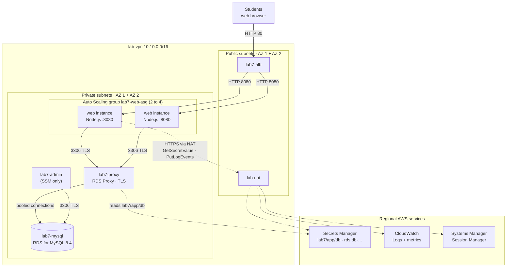
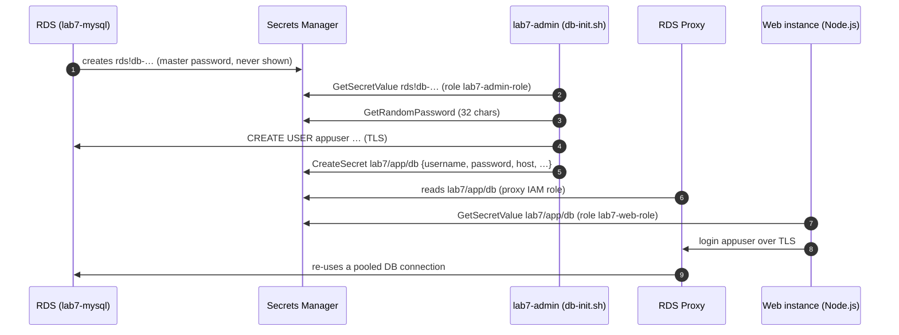
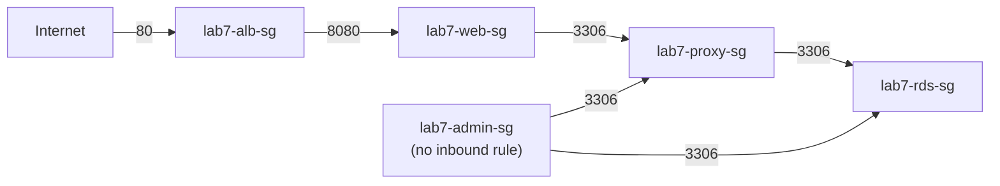
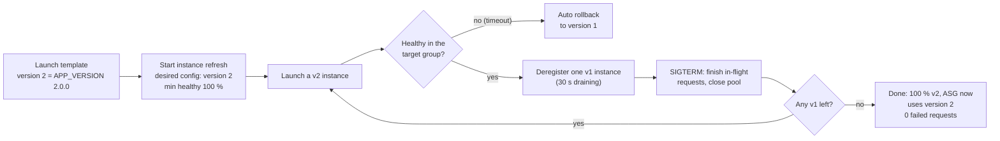

# Lab 7 — Node.js Web App on Amazon RDS for MySQL, the Best-Practice Way (Auto Scaling, RDS Proxy, Secrets Manager)

> 🇫🇷 Version française : [RDS-Node-BestPractice-Lab.fr.md](RDS-Node-BestPractice-Lab.fr.md)

> **Audience:** Cloud Engineer trainees · **Level:** Associate → Professional
> **Starting point:** the **Lab 1** network in `us-west-1`, **including the NAT Gateway** · Lab 6 strongly recommended
> **Duration:** about 4 hours · **Method:** console + scripts (no CloudFormation)
> **Scope:** one Region, **Single-AZ** database (Multi-AZ is discussed, not built)

---

## Scenario

The Lab 6 registry works, but the operations team listed what keeps them awake:

- *"Someone has to SSH into every server, paste a database password and run a script. Last week one server got a typo."*
- *"If a server dies at 3 a.m., nobody replaces it. If traffic doubles, nobody adds one."*
- *"Deploying a new version means stopping servers by hand. Users see errors."*
- *"The database password is in a file on every server and in the chat history."*
- *"Every request opens a new database connection. During the last traffic spike, MySQL hit `max_connections`."*

The development team rewrote the registry in **Node.js** (same features, same data). Your job is to deploy it so that **no human touches a server or sees a password**, the fleet **heals and scales by itself**, new versions roll out **without errors**, and the database is protected by a **connection pool**.

---

## Learning objectives

1. Deploy a fleet with a **launch template**, **user data** and an **EC2 Auto Scaling group** across two AZs, attached to an ALB
2. Let RDS **manage the master password in Secrets Manager**, and store the **application credentials** in a second secret that **no human reads**
3. Give instances **IAM roles** with least privilege (read one secret, write one log group), and administer them with **Session Manager** (no SSH, no bastion, no key pair)
4. Put **RDS Proxy** between the app and the database, with **TLS required**, and measure connection pooling
5. Ship **structured logs** to **CloudWatch Logs** and query them with Logs Insights
6. Perform a **zero-downtime rolling deployment** (v1 → v2) with **instance refresh**, and roll back
7. Observe **self-healing** and **target-tracking scaling**, and recover from a **password rotation** without restarting anything

### What's new compared with Lab 6

| Concern | Lab 6 (manual) | Lab 7 (best practice) |
|---------|----------------|------------------------|
| Server creation | 2 instances launched by hand | **Auto Scaling group** (min 2, max 4) from a **launch template** |
| App installation | SSH + `web-setup.sh` on each server | **User data** runs `bootstrap.sh` at first boot, identical everywhere |
| Admin access | Bastion + SSH keys + port 22 | **Session Manager**: no inbound port, no key, every session logged |
| Master password | Typed by you | **Managed by RDS in Secrets Manager**, read by a script |
| App password | Printed, pasted, stored in a file on each server | Generated by `secretsmanager:GetRandomPassword`, stored in **`lab7/app/db`**, read at runtime through an **IAM role** |
| Database connections | One per request, straight to RDS | App **pool** → **RDS Proxy** (pooling, TLS required) → RDS |
| Dependencies | `pip install` of pinned top-level packages | `npm ci` from a **lock file** (every transitive version pinned) |
| Logs | `journalctl` on each server | **JSON logs** in **CloudWatch Logs**, one stream per instance |
| Failure of a server | Stays down | **Replaced automatically** (ELB health check) |
| New version | Manual | **Instance refresh**: rolling, zero downtime, rollback |
| Shutdown | Process killed | **Graceful**: deregistration delay + SIGTERM handling |

---

## 1. Architecture

### 1.0 Full project diagram

```text
┌────────────────────────┐                        ┌──────────────────────────────────────┐
│ Students (web browser) │                        │ Cloud engineer: console + CloudShell │
│ http://<ALB DNS name>  │                        │ Session Manager (no SSH, no bastion) │
└────────────────────────┘                        └──────────────────────────────────────┘
              │ HTTP 80                                         │ SSM (HTTPS 443, outbound only)
              ▼                                                 ▼
┌─ AWS Region us-west-1 (N. California) ───────────────────────────────────────────────────────────────────────────────────┐
│ ┌─ lab-vpc 10.10.0.0/16 (existing from Lab 1) ─────────────────────────────────────────────────────────────────────────┐ │
│ │ lab-igw Internet Gateway (existing) · lab-public-rt: 0.0.0.0/0 -> igw                                                │ │
│ │ ┌─ ★ lab7-alb ─────────────────────────────────────────────────────────────────────────────────────────────────────┐ │ │
│ │ │ internet-facing · sg lab7-alb-sg IN 80 <- 0.0.0.0/0 · HTTP:80 -> lab7-web-tg                                     │ │ │
│ │ │ lab7-web-tg  HTTP:8080 · GET /health · deregistration delay 30 s  <- registered by the ASG                       │ │ │
│ │ └──────────────────────────────────────────────────────────────────────────────────────────────────────────────────┘ │ │
│ │ ┌─ Availability Zone 1 ─────────────────────────────────┐  ┌─ Availability Zone 2 ─────────────────────────────────┐ │ │
│ │ │ ┌─ lab-public-a 10.10.1.0/24 · PUBLIC ──────────────┐ │  │ ┌─ lab-public-b 10.10.2.0/24 · PUBLIC ──────────────┐ │ │ │
│ │ │ │ ★ lab7-alb node (AZ 1)                            │ │  │ │ ★ lab7-alb node (AZ 2)                            │ │ │ │
│ │ │ │   lab-nat NAT Gateway (existing)                  │ │  │ │                                                   │ │ │ │
│ │ │ └───────────────────────────────────────────────────┘ │  │ └───────────────────────────────────────────────────┘ │ │ │
│ │ │       │ HTTP 8080 (target)                            │  │       │ HTTP 8080 (target)                            │ │ │
│ │ │ ┌─ lab-private-a 10.10.11.0/24 · PRIVATE ───────────┐ │  │ ┌─ lab-private-b 10.10.12.0/24 · PRIVATE ───────────┐ │ │ │
│ │ │ │ ★ ASG instance(s)  Node.js :8080 · v1 -> v2       │ │  │ │ ★ ASG instance(s)  Node.js :8080 · v1 -> v2       │ │ │ │
│ │ │ │   role lab7-web-role · IMDSv2 · no SSH key        │ │  │ │   role lab7-web-role · IMDSv2 · no SSH key        │ │ │ │
│ │ │ │ ★ lab7-admin  t3.micro · SSM only                 │ │  │ │                                                   │ │ │ │
│ │ │ │   db-init.sh · proxy-test.sh                      │ │  │ │                                                   │ │ │ │
│ │ │ │     │ 3306 TLS (pooled)                           │ │  │ │                                                   │ │ │ │
│ │ │ │     ▼                                             │ │  │ │                                                   │ │ │ │
│ │ │ │ ★ lab7-proxy ENI  RDS Proxy :3306 · TLS           │ │  │ │ ★ lab7-proxy ENI  RDS Proxy :3306 · TLS           │ │ │ │
│ │ │ │     │                                             │ │  │ │                                                   │ │ │ │
│ │ │ │     ▼                                             │ │  │ │                                                   │ │ │ │
│ │ │ │ ★ lab7-mysql  RDS MySQL 8.4 · Single-AZ           │ │  │ │                                                   │ │ │ │
│ │ │ │   master secret managed by RDS (rds!db-…)         │ │  │ │   DB subnet group, 2nd AZ (required)              │ │ │ │
│ │ │ └───────────────────────────────────────────────────┘ │  │ └───────────────────────────────────────────────────┘ │ │ │
│ │ └───────────────────────────────────────────────────────┘  └───────────────────────────────────────────────────────┘ │ │
│ │ ┌─ ★ lab7-web-asg ─────────────────────────────────────────────────────────────────────────────────────────────────┐ │ │
│ │ │ launch template lab7-web-lt · min 2 / desired 2 / max 4 · CPU target 40 % · ELB health                           │ │ │
│ │ └──────────────────────────────────────────────────────────────────────────────────────────────────────────────────┘ │ │
│ │ sg chain: lab7-alb-sg -> lab7-web-sg :8080 -> lab7-proxy-sg :3306 -> lab7-rds-sg :3306 <- lab7-admin-sg              │ │
│ │ lab-private-rt: 10.10.0.0/16 -> local · 0.0.0.0/0 -> lab-nat (dnf, npm, GitHub, AWS APIs)                            │ │
│ └──────────────────────────────────────────────────────────────────────────────────────────────────────────────────────┘ │
│                     │ HTTPS 443 (NAT)                                                                                    │
│                     ▼                                                                                                    │
│ ┌─ Regional AWS services (reached through the NAT Gateway, HTTPS + IAM roles) ─────────────────────────────────────────┐ │
│ │ ★ Secrets Manager  lab7/app/db (appuser) · rds!db-… (master)                                                         │ │
│ │ ★ CloudWatch  log groups /lab7/app, /lab7/app-bootstrap · ASG + Proxy metrics · alarms                               │ │
│ │   Systems Manager  Session Manager for lab7-admin and the web instances                                              │ │
│ └──────────────────────────────────────────────────────────────────────────────────────────────────────────────────────┘ │
│                                                                                                                          │
│ ★ = created in this lab · everything else exists from Lab 1                                                              │
└──────────────────────────────────────────────────────────────────────────────────────────────────────────────────────────┘
```

### 1.1 Architecture diagram (Mermaid)



### 1.2 Who knows the passwords?



No step prints a password. No password is in user data, in a file on the web servers, or in this guide.

### 1.3 Security-group chain



There is **no port 22 anywhere**. Session Manager works with **outbound** HTTPS from the instance to the SSM service (through the NAT Gateway).

### 1.4 Rolling deployment with instance refresh



### 1.5 Why RDS Proxy?

| Without a proxy | With RDS Proxy |
|-----------------|----------------|
| Each app process opens its own connections. 4 instances × 10 = 40 MySQL connections, more during a scale-out or a deployment (old and new instances overlap) | The proxy keeps a **pool** of database connections and lends them to client sessions between transactions |
| A connection storm can hit `max_connections` (small for `db.t4g.micro`) | The proxy limits database connections (**connection pool maximum**, a % of `max_connections`) and **queues** the rest |
| A failover or reboot drops every connection; each client must reconnect | The proxy keeps client connections open and reconnects to the database behind them (most useful with Multi-AZ) |
| Each app needs the DB password | Clients authenticate **to the proxy**; the proxy reads the credentials from **Secrets Manager** |

> 💰 RDS Proxy is billed per **vCPU of the database instance** per hour (minimum 2 vCPUs): about **$0.03–0.04/hour** for a `db.t4g.micro`. Delete it at cleanup.

---

## 2. Prerequisites and cost

- The Lab 1 network in `us-west-1` with **`lab-nat`** working (instances reach GitHub, npm, the MySQL repository and the AWS APIs through it)
- Console access with permissions for EC2, Auto Scaling, ELB, RDS, IAM, Secrets Manager, CloudWatch, Systems Manager
- **AWS CloudShell** (console toolbar, icon `>_`) for the test tools: nothing to install on your laptop
- The lab scripts published in your repository (section 3)

| Resource | Approximate cost (us-west-1) |
|----------|------------------------------|
| 2–4 × EC2 `t3.micro` (web) + 1 × `t3.micro` (admin) | ~$0.012/hour each |
| RDS `db.t4g.micro`, 20 GB | ~$0.02/hour (or Free Tier/credits) |
| RDS Proxy | ~$0.03–0.04/hour |
| Application Load Balancer + 2 public IPv4 | ~$0.025/hour + $0.01/hour |
| Secrets Manager (2 secrets) | $0.40 per secret per month, prorated (cents for a day) |
| CloudWatch Logs, detailed monitoring | cents for a lab session |
| NAT Gateway (existing) | ~$0.05/hour + per GB |

> 💰 Expect **$1–2** for a 4-hour session. Do the **cleanup** (Part 22) the same day: the proxy and the ALB bill every hour.

### 2.1 Lab worksheet

| Item | Value |
|------|-------|
| AZ 1 / AZ 2 names | |
| RDS endpoint (`lab7-mysql`) | |
| Master secret name (`rds!db-…`) | |
| Proxy endpoint (`lab7-proxy`) | |
| ALB DNS name | |
| Launch template versions (1 = v1.0.0, 2 = v2.0.0) | |

---

## 3. The lab scripts

```
aws-lab-rds-node-asg/
├── RDS-Node-BestPractice-Lab.en.md   ← this guide
├── RDS-Node-BestPractice-Lab.fr.md
└── scripts/
    ├── db/
    │   ├── db-init.sh          on lab7-admin: master login via its secret, appuser, seed, secret lab7/app/db
    │   ├── proxy-test.sh       on lab7-admin: proxy checks, login through the proxy, pooling demo, registers the proxy
    │   └── seed.sql            8 courses, 12 students, 28 enrollments (same data as Lab 6)
    ├── web/
    │   ├── user-data.sh        pasted in the launch template: downloads and runs bootstrap.sh
    │   ├── bootstrap.sh        Node.js 22, npm ci, RDS CA, systemd service, CloudWatch agent, self-tests
    │   └── app/
    │       ├── server.js       Express app: pages, form, /health, /work, secret refresh, graceful shutdown
    │       ├── views/page.js   the HTML page (same design as Lab 6, escaped output)
    │       ├── package.json    3 dependencies, exact versions
    │       └── package-lock.json   every transitive dependency pinned (npm ci)
    ├── policies/
    │   ├── lab7-web-policy.json     web instances: read lab7/app/db, write /lab7/* logs
    │   └── lab7-admin-policy.json   admin instance: describe RDS/proxy, read rds!db-*, manage lab7/app/db
    └── tools/
        ├── load-test.sh        CloudShell: distribution + CPU load (/work) to trigger scaling
        └── deploy-watch.sh     CloudShell: 1 request/second during a deployment, counts failures
```

| Script | What it does |
|--------|--------------|
| [`db-init.sh`](scripts/db/db-init.sh) | 1) MySQL 8.4 client · 2) `rds:DescribeDBInstances` → endpoint, master user, **master secret ARN** · 3) DNS + TCP 3306 · 4) reads the master password **from Secrets Manager** into a temporary owner-only file (never printed) and logs in over TLS (`VERIFY_IDENTITY`) · 5) generates a 32-character password with **`GetRandomPassword`**, creates `labapp` + `appuser` (`10.10.11.%`, `10.10.12.%`), loads `seed.sql` · 6) **creates or updates `lab7/app/db`** · 7) logs in as `appuser` with the secret and proves it can't `CREATE DATABASE`. Options: `SKIP_SEED=1`, `ROTATE=1` |
| [`proxy-test.sh`](scripts/db/proxy-test.sh) | 1) proxy status, *Require TLS*, auth secret, **target health** · 2) DNS + TCP · 3) `appuser` login **through the proxy** (TLS, Amazon root CA) · 4) **20 short sessions direct vs through the proxy**: count distinct database connections · 5) adds `proxy_host` to `lab7/app/db` |
| [`user-data.sh`](scripts/web/user-data.sh) | Sets `APP_VERSION`, `SECRET_ID`, `BASE_URL`; downloads and runs `bootstrap.sh`. **No secret inside** |
| [`bootstrap.sh`](scripts/web/bootstrap.sh) | 1) identity (IMDSv2) · 2) Node.js 22 + CloudWatch agent · 3) app files + **`npm ci --omit=dev`** · 4) RDS CA bundle · 5) `/etc/labapp/labapp.env` (**no password**) + systemd `labapp` (user `labapp`, `KillSignal=SIGTERM`, `TimeoutStopSec=30`) · 6) logs → `/lab7/app` and `/lab7/app-bootstrap` · 7) readiness check |
| [`server.js`](scripts/web/app/server.js) | Reads `lab7/app/db` (cached 5 min; new version → new pool), connects to `proxy_host` (else `host`) with TLS, **retries once with a fresh secret** on *access denied*, JSON log per request, `/health` (liveness) + `?strict=1` (readiness), `/work?ms=` (CPU burn), `keepAliveTimeout` 65 s, graceful SIGTERM |
| [`load-test.sh`](scripts/tools/load-test.sh) / [`deploy-watch.sh`](scripts/tools/deploy-watch.sh) | Run in **CloudShell** with the ALB DNS name |

Publish the `scripts/` folder to your repository, for example
`inspiredevgen/devops-worksphops` → `2-Cloud-Infrastructure/aws-lab-rds-node-asg/scripts/`.
If you use another location, change `BASE_URL` in `user-data.sh` **and** in `bootstrap.sh`.

---

## Part 1 — Check the existing network

Region **`us-west-1`**:

- [ ] `lab-vpc`: *DNS resolution* and *DNS hostnames* **Enabled**.
- [ ] `lab-public-a`/`lab-public-b` (two AZs) → `lab-public-rt` → `lab-igw`.
- [ ] `lab-private-a`/`lab-private-b` → `lab-private-rt` → **`lab-nat` Available**. In this lab, the NAT Gateway is also the path to Secrets Manager, CloudWatch and Systems Manager.

> 🧠 **Discuss:** what happens to the web tier if the NAT Gateway fails? (New instances can't bootstrap, Session Manager stops, and the running app can't refresh its secret.) Extension **B** replaces this dependency with **VPC interface endpoints**.

---

## Part 2 — Security groups

**VPC → Security groups → Create**, VPC `lab-vpc`, in this order:

| # | Name | Inbound rules |
|---|------|---------------|
| 1 | `lab7-alb-sg` | HTTP 80 from `0.0.0.0/0` |
| 2 | `lab7-web-sg` | Custom TCP **8080** from **`lab7-alb-sg`** · *(no SSH)* |
| 3 | `lab7-admin-sg` | **None** |
| 4 | `lab7-proxy-sg` | MYSQL/Aurora 3306 from **`lab7-web-sg`** · 3306 from **`lab7-admin-sg`** |
| 5 | `lab7-rds-sg` | MYSQL/Aurora 3306 from **`lab7-proxy-sg`** · 3306 from **`lab7-admin-sg`** |

Outbound: default (all) on all five.

✅ **Checkpoint:** no rule anywhere opens port 22. The web tier **cannot** reach RDS directly (only the proxy can): the proxy isn't optional, it's enforced by the network.

> 🧠 Why does `lab7-admin-sg` reach RDS directly? The admin creates users and loads data: administrative sessions are long, rare and need the master account. The proxy is for the application's many short sessions.

---

## Part 3 — IAM roles for the instances

### 3.1 `lab7-web-role`
**IAM → Roles → Create role** → *AWS service* → **EC2** → Next:

1. Attach the managed policy **`AmazonSSMManagedInstanceCore`** (Session Manager).
2. Name `lab7-web-role` → **Create role**.
3. Open the role → **Add permissions → Create inline policy → JSON** → paste [`lab7-web-policy.json`](scripts/policies/lab7-web-policy.json) → name `lab7-web-policy`.

```json
{
  "Version": "2012-10-17",
  "Statement": [
    { "Sid": "ReadOnlyTheAppSecret", "Effect": "Allow", "Action": "secretsmanager:GetSecretValue",
      "Resource": "arn:aws:secretsmanager:us-west-1:*:secret:lab7/app/db-*" },
    { "Sid": "ShipAppLogsToCloudWatch", "Effect": "Allow",
      "Action": ["logs:CreateLogGroup", "logs:CreateLogStream", "logs:PutLogEvents", "logs:PutRetentionPolicy", "logs:DescribeLogStreams"],
      "Resource": "arn:aws:logs:us-west-1:*:log-group:/lab7/*" },
    { "Sid": "CloudWatchAgentDescribe", "Effect": "Allow",
      "Action": ["logs:DescribeLogGroups", "ec2:DescribeTags"], "Resource": "*" }
  ]
}
```

### 3.2 `lab7-admin-role`
Same steps: EC2 trust, **`AmazonSSMManagedInstanceCore`**, name `lab7-admin-role`, inline policy [`lab7-admin-policy.json`](scripts/policies/lab7-admin-policy.json) named `lab7-admin-policy`.

> 🧠 **Least privilege in practice:** the web role can read **one** secret and write to log groups under **`/lab7/`**. It can't list secrets, read the master secret, or change anything in RDS. The `-*` at the end of the secret ARN matches the 6 random characters Secrets Manager appends to every secret ARN.

---

## Part 4 — The database

### 4.1 DB subnet group
**RDS → Subnet groups → Create**: `lab7-db-subnet-group`, VPC `lab-vpc`, subnets **`10.10.11.0/24`** and **`10.10.12.0/24`**.

### 4.2 Create `lab7-mysql`
**RDS → Create database** → **Full configuration**:

| Section | Setting | Value |
|---------|---------|-------|
| Engine | | MySQL, latest **8.4.x** |
| Templates | | **Free tier** (or Dev/Test with the same small settings) |
| Availability | | **Single-AZ** (scope of this lab) |
| Settings | Identifier | `lab7-mysql` |
| | Master username | `admin` |
| | **Credentials management** | **Managed in AWS Secrets Manager** · Encryption key: `aws/secretsmanager` |
| Instance | Class | **db.t4g.micro** (or db.t3.micro) |
| Storage | | gp3/gp2 **20 GiB**, autoscaling **off** |
| Connectivity | VPC / subnet group | `lab-vpc` / `lab7-db-subnet-group` |
| | Public access | **No** |
| | Security group | **`lab7-rds-sg`** only |
| | Availability Zone | AZ 1 |
| Monitoring | | Free defaults |
| Additional configuration | Initial database name | *(empty)* |
| | Backup retention | **7 days** (point-in-time recovery for a week) |
| | Encryption | **Enabled** |
| | Log exports | ✅ **Error log** (to CloudWatch Logs) |
| | Auto minor version upgrade | Enabled |
| | **Deletion protection** | ✅ **Enabled** (you'll turn it off at cleanup) |

**Create database** (10–15 minutes). Meanwhile, continue with Part 5.

When it's *Available*: **Configuration** tab → *Master credentials ARN* → the link opens the secret **`rds!db-…`** in Secrets Manager. Note its name in the worksheet. Notice **Rotation: enabled (every 7 days)**: RDS rotates the master password for you, and nothing needs to change because every tool reads it from the secret.

---

## Part 5 — The admin instance and Session Manager

**EC2 → Launch instances**:

| Setting | Value |
|---------|-------|
| Name | `lab7-admin` |
| AMI / type | Amazon Linux 2023 · `t3.micro` |
| **Key pair** | **Proceed without a key pair** |
| Subnet / public IP | **`lab-private-a`** / **Disable** |
| Security group | **`lab7-admin-sg`** |
| Advanced → IAM instance profile | **`lab7-admin-role`** |
| Advanced → Metadata version | **V2 only** |

After 2–3 minutes: select the instance → **Connect → Session Manager → Connect**. A shell opens in your browser.

```bash
whoami                     # ssm-user
sudo -i -u ec2-user        # optional: work as ec2-user
```

> 🧠 **No inbound rule, no key, no public IP, and yet you have a shell.** The SSM agent on the instance opens an **outbound** HTTPS connection to Systems Manager (through the NAT) and your session travels through it. Sessions can be logged and are controlled by IAM, not by who holds a key file.

---

## Part 6 — Initialize the database and create the app secret

Wait until `lab7-mysql` is **Available**. In the Session Manager shell of `lab7-admin`:

```bash
mkdir -p ~/lab7 && cd ~/lab7
BASE=https://raw.githubusercontent.com/inspiredevgen/devops-worksphops/refs/heads/main/2-Cloud-Infrastructure/aws-lab-rds-node-asg/scripts
curl -fsSLO $BASE/db/db-init.sh
curl -fsSLO $BASE/db/proxy-test.sh
curl -fsSLO $BASE/db/seed.sql
head -1 db-init.sh proxy-test.sh seed.sql

bash db-init.sh
```

No password to type. Expected highlights:

```text
==> 2/7 Looking up lab7-mysql (endpoint, master user, RDS-managed master secret)
Master secret : arn:aws:secretsmanager:us-west-1:…:secret:rds!db-1a2b…
==> 4/7 Master login with the RDS-managed secret (the password is never printed)
Connected to ip-10-10-11-… running MySQL 8.4.x as admin@%
==> 5/7 Database 'labapp', user 'appuser' (10.10.11.% 10.10.12.%), sample data
Generated a new 32-character password with secretsmanager:GetRandomPassword (not displayed)
==> 6/7 Storing the app credentials in Secrets Manager: lab7/app/db
==> 7/7 Proof: appuser logs in with the credentials read back from the secret
| appuser@10.10.11.% |       8 |       12 |          28 |
OK: appuser cannot CREATE DATABASE (least privilege)
```

Open **Secrets Manager → `lab7/app/db`**. *Retrieve secret value* is possible **for you** (your console user has broad rights): in production, people wouldn't have `GetSecretValue` on application secrets at all.

---

## Part 7 — RDS Proxy

**RDS → Proxies → Create proxy**:

| Setting | Value |
|---------|-------|
| Engine family | **MySQL** |
| Proxy identifier | `lab7-proxy` |
| Idle client connection timeout | 30 minutes (default) |
| **Require Transport Layer Security** | ✅ **Enabled** |
| Database | **`lab7-mysql`** |
| Connection pool maximum connections | **50 %** (the proxy may use at most half of `max_connections`; the rest stays available for admins) |
| Secrets Manager secrets | **`lab7/app/db`** |
| Client authentication type | **MySQL Caching SHA2 password** (default) |
| IAM authentication | **Not allowed** |
| IAM role | **Create IAM role** (the console creates a role allowed to read the selected secret) |
| Subnets | **`lab-private-a` and `lab-private-b` only** (remove any public subnet) |
| VPC security group | **`lab7-proxy-sg`** only |

**Create proxy**. Status *Creating* → **Available** takes 5–15 minutes. Then copy its **endpoint** (`lab7-proxy.proxy-xxxx.us-west-1.rds.amazonaws.com`) into the worksheet.

Back in the `lab7-admin` session:

```bash
cd ~/lab7 && bash proxy-test.sh lab7-proxy
```

Expected:

```text
Require TLS  : True
Auth secret  : lab7/app/db-AbCdEf
| lab7-mysql | RDS_INSTANCE | AVAILABLE | None | None |
==> 3/5 appuser login THROUGH the proxy (TLS, certificate + host name verified)
| appuser@10.10.12.% | ip-10-10-11-… | 8.4.x | 12 |
==> 4/5 Connection pooling: 20 short client sessions, one after the other
  PATH                   CLIENT SESSIONS    DISTINCT DATABASE CONNECTIONS
  direct to RDS          20                 20
  through RDS Proxy      20                 1
==> 5/5 Registering the proxy in lab7/app/db (key proxy_host)
```

> 🧠 **Read the pooling table:** directly, every client login creates (and pays for: TLS handshake, authentication, memory) a new MySQL connection. Through the proxy, the 20 sessions were served by **one or a few** pooled database connections that stay open. Also notice `appuser@10.10.12.%`: the database sees the **proxy's** IP, not `lab7-admin`'s.

> ⚠️ Target state **AUTH_FAILURE**? The proxy can't log in to the database with `lab7/app/db`: run `db-init.sh` again (it re-applies the password), then check again after a minute.

---

## Part 8 — Target group

**EC2 → Target groups → Create target group**: type **Instances**, name `lab7-web-tg`, **HTTP 8080**, VPC `lab-vpc`, health check **`/health`**, healthy/unhealthy threshold **2/2**, timeout **5 s**, interval **10 s**, success code **200** → Next → **register nothing** (the Auto Scaling group will) → Create.

Then **`lab7-web-tg` → Attributes → Edit**: **Deregistration delay = 30 seconds** → Save.

> 🧠 The **deregistration delay** is how long the ALB keeps sending in-flight requests to a target it's removing. 300 s (default) makes deployments slow; the app finishes any request in well under 30 s.

---

## Part 9 — Application Load Balancer

Create **`lab7-alb`**: internet-facing, IPv4, `lab-vpc`, **`lab-public-a` + `lab-public-b`**, SG **`lab7-alb-sg`** only, listener **HTTP:80 → `lab7-web-tg`**. Copy the **DNS name** into the worksheet.

---

## Part 10 — Launch template

**EC2 → Launch templates → Create launch template**:

| Setting | Value |
|---------|-------|
| Name / description | `lab7-web-lt` / `v1.0.0` |
| Auto Scaling guidance | ✅ *Provide guidance to help me set up a template that I can use with EC2 Auto Scaling* |
| AMI | **Amazon Linux 2023** (x86_64), from *Quick Start* (the template stores the AMI ID; an SSM-parameter AMI would prevent auto rollback) |
| Instance type | `t3.micro` |
| Key pair | **Don't include in launch template** |
| Network settings → Subnet | **Don't include** (the ASG chooses) · Security group **`lab7-web-sg`** |
| Advanced → IAM instance profile | **`lab7-web-role`** |
| Advanced → Detailed CloudWatch monitoring | **Enable** (1-minute metrics: faster scaling decisions) |
| Advanced → Metadata accessible / version | Enabled / **V2 only (token required)** |
| Advanced → Metadata response hop limit | **1** |
| Advanced → **User data** | the content of [`user-data.sh`](scripts/web/user-data.sh), below |

```bash
#!/bin/bash
# File: scripts/web/user-data.sh
# Purpose : EC2 user data of the launch template 'lab7-web-lt'.
#           Every instance launched by the Auto Scaling group runs it ONCE, as root, at first boot.
#           It downloads bootstrap.sh (through the NAT Gateway) and runs it.
#           There is NO password here: the app reads its credentials from Secrets Manager.
# Paste   : EC2 -> Launch templates -> lab7-web-lt -> Advanced details -> User data
#           Rolling deployment (Part 14): new template version with APP_VERSION="2.0.0", then instance refresh.
# Logs    : /var/log/cloud-init-output.log, also shipped to CloudWatch Logs /lab7/app-bootstrap
set -euo pipefail

# ---- Values you may change ---------------------------------------------------
export APP_VERSION="1.0.0"
export SECRET_ID="lab7/app/db"
export BASE_URL="https://raw.githubusercontent.com/inspiredevgen/devops-worksphops/refs/heads/main/2-Cloud-Infrastructure/aws-lab-rds-node-asg/scripts/web"
# -----------------------------------------------------------------------------

mkdir -p /opt/labapp-bootstrap && cd /opt/labapp-bootstrap
curl -fsSL --retry 5 --retry-delay 5 --retry-all-errors -o bootstrap.sh "${BASE_URL}/bootstrap.sh"
bash bootstrap.sh
```

**Create launch template.**

> 🧠 **User data is not secret**: anyone with `ec2:DescribeInstanceAttribute` can read it. That's why it contains only the **name** of the secret. Hop limit **1** keeps IMDSv2 tokens from being reached by anything forwarded through the instance (e.g. containers).

---

## Part 11 — Auto Scaling group

**EC2 → Auto Scaling groups → Create Auto Scaling group**:

| Step | Setting | Value |
|------|---------|-------|
| 1 | Name | `lab7-web-asg` |
| | Launch template / version | `lab7-web-lt` / **1** (a fixed number, not *Default* or *Latest*) |
| 2 | VPC / AZs and subnets | `lab-vpc` / **`lab-private-a`, `lab-private-b`** |
| | AZ distribution | Balanced best effort |
| 3 | Load balancing | **Attach to an existing load balancer** → *Choose from your load balancer target groups* → **`lab7-web-tg`** |
| | Health checks | ✅ **Turn on Elastic Load Balancing health checks** · grace period **300 s** |
| | Monitoring | ✅ **Enable group metrics collection within CloudWatch** |
| | Instance warmup | ✅ Enable default instance warmup: **120 s** |
| 4 | Desired / Min / Max | **2 / 2 / 4** |
| | Scaling | **Target tracking scaling policy** → *Average CPU utilization* → target **40** |
| | **Instance maintenance policy** | **Launch before terminating** (prioritize availability) |
| 5–6 | Notifications / Tags | none / `Name` = `lab7-web` (✅ tag new instances) |

**Create Auto Scaling group.** Watch **Activity**: two *Launching a new EC2 instance* entries, one per AZ. After 2–4 minutes, **`lab7-web-tg` → Targets** shows two **Healthy** targets.

> 🧠 **ELB health checks + grace period:** with only EC2 health checks, the ASG replaces an instance only if the *machine* fails. With ELB health checks, it also replaces an instance whose *application* stops answering `/health`. The **grace period** gives a new instance time to run its bootstrap before its health counts.

> 🧠 **Why a fixed version number?** With *Latest*, any scale-out launches whatever version was saved last, even one nobody has deployed yet. A fixed number changes only through a deliberate **instance refresh**, and it's required for **auto rollback** (rollback isn't supported when the group uses `$Latest` or `$Default`).

> 🧠 **Why 40 % CPU?** Node.js runs JavaScript on **one core**. On a 2-vCPU `t3.micro`, a fully busy app shows about **50 %**, so a 50 % target would barely ever trigger.

---

## Part 12 — Test and observe

### 12.1 The application
Open `http://<ALB_DNS>/`. In the **Served by** panel: *Through RDS Proxy* = **yes**, *DB endpoint* = the proxy endpoint, *TLS (app → endpoint)* = `TLSv1.3 …`, badge **v1.0.0**. Refresh: the instance and AZ alternate. Register a student.

### 12.2 CloudShell
Open **CloudShell** (Region us-west-1):

```bash
BASE=https://raw.githubusercontent.com/inspiredevgen/devops-worksphops/refs/heads/main/2-Cloud-Infrastructure/aws-lab-rds-node-asg/scripts
curl -fsSLO $BASE/tools/load-test.sh
curl -fsSLO $BASE/tools/deploy-watch.sh
ALB=<ALB_DNS_NAME>
curl -s http://$ALB/health?strict=1 | python3 -m json.tool
```

`"via_proxy": true`, `"db_tls": "TLSv1.3 …"`, `"version": "1.0.0"`.

### 12.3 Logs
**CloudWatch → Log groups**:
- `/lab7/app-bootstrap` → one stream per instance: the whole first boot (`cloud-init-output.log`)
- `/lab7/app` → one stream per instance: one **JSON line per request**

**Logs Insights** → select `/lab7/app` → run:

```sql
fields @timestamp, msg, method, path, status, ms, @logStream
| filter msg = "request"
| stats count() as requests, avg(ms) as avg_ms, max(ms) as max_ms by @logStream, path
| sort requests desc
```

### 12.4 Inside a web instance (no SSH)
**EC2 → Instances** → a `lab7-web` instance → **Connect → Session Manager**:

```bash
systemctl status labapp --no-pager
cat /etc/labapp/labapp.env          # no password in here
sudo tail -3 /var/log/labapp/app.log
curl -s localhost:8080/health?strict=1
```

---

## Part 13 — Self-healing

1. **Terminate** one `lab7-web` instance (EC2 → Instances → Terminate).
   **ASG → Activity**: *…an instance was taken out of service in response to an EC2 health check indicating it has been terminated or stopped*, then *Launching a new EC2 instance*. Capacity is back to 2 within ~3 minutes. With `deploy-watch.sh` running, you may see **a few 502** until the ALB marks the target unhealthy: the instance disappeared *before* being deregistered. Compare with Part 14, where the ASG deregisters and drains an instance before stopping it.
2. **Break the app, not the machine.** In Session Manager on a web instance: `sudo systemctl stop labapp && sudo systemctl disable labapp`.
   After ~20 s the target is **Unhealthy**; after the ELB health check failure, the ASG marks the instance **Unhealthy** and **replaces** it. (In Lab 6, it would have stayed broken.)

---

## Part 14 — Zero-downtime rolling deployment (v1 → v2)

1. **Launch templates → `lab7-web-lt` → Actions → Modify template (Create new version)**: description `v2.0.0`, and in **User data** change only `APP_VERSION="2.0.0"` → **Create template version**. Nothing happens to the running instances: the ASG still uses version **1**.
2. In **CloudShell**, start the watcher:
   ```bash
   bash deploy-watch.sh $ALB 15
   ```
3. **Auto Scaling groups → `lab7-web-asg` → Instance refresh → Start instance refresh**:
   - Instance replacement method: **Launch before terminating** · Minimum healthy **100 %** · Maximum **150 %**
   - ✅ **Skip matching** · ✅ **Enable auto rollback**
   - **Desired configuration** → ✅ **Update launch template** → `lab7-web-lt` version **2**
   - **Start instance refresh**
4. Watch the watcher: lines switch from `v1.0.0` to `v2.0.0` instance by instance, with progress every 10 s. When the refresh is **Successful** (~8–12 minutes), press **Ctrl+C**:

   ```text
   ==> Summary (512 requests)
        301 x v1.0.0   i-0aaa…
         40 x v1.0.0   i-0bbb…
         95 x v2.0.0   i-0ccc…
         76 x v2.0.0   i-0ddd…
     Failed requests (HTTP != 200): 0
     Zero-downtime deployment: users never saw an error.
   ```

What made it zero-downtime: new instances served traffic **before** old ones left (launch before terminating, 100 % minimum healthy), a target only got traffic once **healthy**, the ALB **drained** old targets (30 s), and the app **finished in-flight requests** on SIGTERM.

When the refresh succeeds, the group's details show launch template version **2**: the desired configuration became the group's configuration.

### 14.1 Roll back
Two ways:
- **During** a refresh: **Instance refresh → Start a rollback** (or let auto rollback do it if new instances fail their health checks). The group returns to version 1.
- **After** it: start another instance refresh with desired configuration **version 1**. Rollback is just another deployment of a known-good version.

> 🧠 **Pin what you deploy.** Here v1 and v2 download the same code from the `main` branch and differ only by `APP_VERSION`. In production, each template version would reference an **immutable** artifact: a Git tag or commit in `BASE_URL`, a versioned S3 object, or a pre-built AMI.

---

## Part 15 — Scaling under load

In CloudShell:

```bash
bash load-test.sh $ALB 8 12
```

Meanwhile:
- **CloudWatch → Alarms**: `TargetTracking-lab7-web-asg-AlarmHigh-…` goes **In alarm** after ~3 minutes above 40 %.
- **ASG → Activity**: *Launching a new EC2 instance… changing the desired capacity from 2 to 3* (maybe 4).
- **RDS → Proxies → `lab7-proxy` → Monitoring**: compare **ClientConnections** (grows with instances) and **DatabaseConnections** (stays low).

About 15 minutes after the load stops, the **AlarmLow** alarm scales back in to 2. The ASG chooses which instance to terminate, the ALB drains it, and the app shuts down gracefully.

---

## Part 16 — Password rotation without restart

On `lab7-admin`:

```bash
cd ~/lab7 && ROTATE=1 SKIP_SEED=1 bash db-init.sh
```

The script sets a **new** `appuser` password in MySQL **and** stores it as a new version of `lab7/app/db`. Keep refreshing the site (or run `deploy-watch.sh`) and open **Logs Insights**:

```sql
fields @timestamp, msg, code, secret_version, @logStream
| filter level != "info" or msg = "secret loaded"
| sort @timestamp desc
```

You'll see each instance log **`secret loaded`** with the new version (within 5 minutes), or **`authentication failed, re-reading the secret`** followed by `secret loaded` if a new connection was refused first. **No restart, no redeploy.**

> 🧠 **Honest note:** for a few moments the database, the proxy (which caches the secret) and the app may disagree on the password, and a few requests can fail. That's why AWS's managed rotation for applications uses the **alternating users** strategy (two database users, switched at each rotation): there is always one valid password. That's extension **A**.

---

## Part 17 — Validation

| # | From | Test | Expected | Proves |
|---|------|------|----------|--------|
| 1 | Console | Search all security groups for port 22 | None | No SSH surface |
| 2 | Console | EC2 instances `lab7-web` → *Key pair name* | *(empty)* | No keys to leak |
| 3 | Session Manager | `cat /etc/labapp/labapp.env` | No password | Credentials only in Secrets Manager |
| 4 | Console | EC2 → instance → *Actions → Instance settings → Edit user data* | Only the secret **name** | User data holds no secret |
| 5 | CloudShell | `curl -s $ALB/health?strict=1` | `"via_proxy": true`, `"db_tls": "TLSv1.3 …"` | App → proxy, encrypted |
| 6 | lab7-admin | `proxy-test.sh` table | Proxy: few DB connections | Pooling |
| 7 | Session Manager on a web instance | `nc -zv -w3 <RDS_ENDPOINT> 3306` | ❌ timeout | Web tier can only reach the proxy |
| 8 | Console | Terminate a web instance | Replaced automatically | Self-healing |
| 9 | CloudShell | `deploy-watch.sh` during instance refresh | 0 failed requests | Zero-downtime deployment |
| 10 | Console | CloudWatch Logs `/lab7/app` | One stream per instance, JSON lines | Centralized logs |
| 11 | Console | RDS → `lab7-mysql` → Configuration | Master credentials ARN, Deletion protection on, 7-day backups | Data tier protection |

---

## Part 18 — Troubleshooting

### 18.1 Instances keep being replaced (launch → unhealthy → terminate loop)

1. **CloudWatch → `/lab7/app-bootstrap`** → newest stream: where did `bootstrap.sh` stop?
2. Typical causes:

| Bootstrap log shows | Cause | Fix |
|---------------------|-------|-----|
| `curl: (22) … 404` on `bootstrap.sh` or `app/…` | Wrong `BASE_URL` or files not published | Fix the repository path (in user data **and** bootstrap.sh) |
| `curl` timeouts, `dnf` errors | No internet from the private subnets | `lab-private-rt` → `lab-nat` |
| No log group at all | Bootstrap died before step 6, or the role can't write logs | Session Manager → `sudo tail -50 /var/log/cloud-init-output.log` |
| `readiness 503 … Secrets Manager` | Role/secret problem (below) | — |

> 💡 To debug calmly, set the ASG **health check type** back to EC2 only (or increase the grace period): the instance stays alive while you investigate.

### 18.2 App hints (page or `/health?strict=1` → `hint`)

| Hint starts with | Cause | Fix |
|------------------|-------|-----|
| *Secrets Manager:* | `AccessDeniedException` (role/policy, ARN Region), `ResourceNotFoundException` (name), or no route to the API | Check `lab7-web-role` inline policy, `SECRET_ID`, NAT |
| *Timeout* | `lab7-proxy-sg` 3306 from `lab7-web-sg`, or `lab7-rds-sg` 3306 from `lab7-proxy-sg` | Security groups |
| *Access denied* | Proxy and secret disagree with MySQL | Run `proxy-test.sh`; if targets show `AUTH_FAILURE`, run `db-init.sh` |
| *TLS problem* | Endpoint used by IP, or proxy TLS settings | Use names; *Require TLS* is fine with this app |
| *DNS failure* | Wrong `proxy_host`/`host` in the secret | Re-run `proxy-test.sh` (rewrites `proxy_host`) |

### 18.3 RDS Proxy target not AVAILABLE

| `TargetHealth` | Meaning | Fix |
|----------------|---------|-----|
| `AUTH_FAILURE` | The proxy can't log in to MySQL with the secret | `db-init.sh` (re-applies the password); check the proxy's IAM role can read `lab7/app/db` |
| `CONNECTION_FAILED` / `UNREACHABLE` | Network proxy → DB | `lab7-rds-sg` 3306 **from `lab7-proxy-sg`** |
| `PENDING_PROXY_CAPACITY` | Proxy still provisioning | Wait |

> If proxy-to-database authentication keeps failing with `caching_sha2_password` on your engine version, switch only that account to the older plugin from `lab7-admin`: `ALTER USER 'appuser'@'10.10.11.%' IDENTIFIED WITH mysql_native_password BY '<password from the secret>';` (same for `10.10.12.%`). RDS for MySQL 8.4 still loads this plugin.

### 18.4 Deployment problems

| Symptom | Fix |
|---------|-----|
| Instance refresh *Failed* / *RollbackSuccessful* | New instances never became healthy: read `/lab7/app-bootstrap` for the v2 instances |
| *IrreversibleInstanceRefresh* when rolling back | The group uses `$Latest`/`$Default`, or no desired configuration was given: use explicit version numbers (Part 11) |
| `deploy-watch.sh` shows a few 502 | Deregistration delay too long/short, or SIGTERM not handled: check the target group attribute (30 s) and `TimeoutStopSec` |
| Scale-out never happens | Detailed monitoring off (5-min metrics), target value too high, or `/work` not reached (load-test output shows errors) |

---

## Part 19 — Break & fix exercises

| # | Break it | Observe | Lesson | Fix |
|---|----------|---------|--------|-----|
| B1 | Remove `secretsmanager:GetSecretValue` from `lab7-web-policy`, then start an instance refresh (same version, *Skip matching* off) | The refresh **succeeds**, but pages served by the new instances show the *Secrets Manager* hint | A **liveness** check proves the process runs, not that its configuration works. Gate deployments on readiness too (extension **I**) | Restore the permission, refresh again |
| B2 | In `lab7-proxy-sg`, remove 3306 from `lab7-web-sg` | Pages show *Timeout* hint; targets stay healthy (liveness) | Security groups + liveness vs readiness | Restore the rule |
| B3 | In `lab7-rds-sg`, remove 3306 from `lab7-proxy-sg` | `proxy-test.sh`: targets `UNREACHABLE`; app: timeouts | The proxy is a client of the database too | Restore the rule |
| B4 | Launch template v3 with a typo in `BASE_URL`, instance refresh to v3 | Bootstrap 404, the app never listens, health checks fail → **auto rollback** to v2 | Health checks gate deployments when the failure is visible to them | Nothing to undo: the group is back on v2; fix the template |
| B5 | Set the ASG *desired* to 1 | Activity: *desired capacity is below min* error | Min capacity is a guarantee | Desired 2 |
| B6 | Stop the NAT route (`lab-private-rt` 0.0.0.0/0 removed) for 10 minutes | Running app keeps working (cached secret + open pool); new instances fail to bootstrap; Session Manager disconnects | Know your runtime vs boot-time dependencies | Restore the route |

---

## Part 20 — Extension challenges

**A. Managed rotation for the app secret.** In `lab7/app/db` → **Rotation** → *Edit rotation*: create a rotation function for **Amazon RDS MySQL, alternating users** (needs the master secret as the "superuser" secret). Rotate immediately and watch the app keep working.

**B. Remove the NAT dependency.** Create **interface VPC endpoints** for `secretsmanager`, `logs`, `ssm`, `ssmmessages`, `ec2messages` in the private subnets (SG allowing 443 from `lab7-web-sg` and `lab7-admin-sg`). Which part of the bootstrap still needs internet? (GitHub, npm, dnf: bake an AMI.)

**C. Golden AMI.** Run `bootstrap.sh` on an instance, create an AMI, and use it in a launch template version whose user data only writes `/etc/labapp/labapp.env` and starts the service. Compare instance start time.

**D. HTTPS + WAF.** ACM certificate, HTTPS:443 listener, HTTP → HTTPS redirect, an **AWS WAF** web ACL with the managed core rule set on the ALB.

**E. Enforce TLS on the database.** Custom parameter group (family *mysql8.4*) with `require_secure_transport = 1` attached to `lab7-mysql` (reboot). Verify that the app (through the proxy) and `db-init.sh` still connect, and that a client using `--ssl-mode=DISABLED` is refused.

**F. Alarms.** CloudWatch alarms on `UnHealthyHostCount` (target group), `HTTPCode_Target_5XX_Count` (ALB), `DatabaseConnectionsBorrowLatency` (proxy) and `FreeStorageSpace` (RDS), notifying an SNS topic. A **metric filter** on `/lab7/app` for `level = "error"`.

**G. Multi-AZ (out of scope, costs double).** Modify `lab7-mysql` to Multi-AZ, then *Reboot with failover*: measure how long the app sees errors through the proxy vs directly.

**H. Scheduled scaling.** Add a scheduled action: desired 3 every weekday at 08:00, back to 2 at 18:00.

**I. Readiness gate for deployments.** Create a **metric filter** on `/lab7/app` for `{ $.level = "error" }`, an alarm on it, and select that alarm in the instance refresh settings (*CloudWatch alarm* for auto rollback). Repeat B1 while sending traffic to the home page (`while true; do curl -s -o /dev/null http://$ALB/; sleep 1; done` in CloudShell): the error logs trip the alarm and the refresh rolls back by itself.

---

## Part 21 — The application, in detail

Read [`server.js`](scripts/web/app/server.js) with these questions in mind (your trainer may ask them):

| Feature | Where | Why |
|---------|-------|-----|
| `GetSecretValue` cached 5 min, pool rebuilt only for a new secret version | `getPool()` | Few API calls; picks up rotation and the proxy endpoint automatically |
| Keeps the old pool if Secrets Manager is unreachable | `getPool()` catch | A dependency hiccup shouldn't take the app down |
| One retry with a fresh secret on `ER_ACCESS_DENIED_ERROR` | `withDb()` | Survives rotation without a restart |
| `ssl: { ca: [system roots + RDS bundle], rejectUnauthorized: true }` | pool options | Same code verifies the proxy (Amazon Root CA) and RDS (RDS CA) |
| `conn.query()` with `?` placeholders (not `execute`) | routes | Escaped parameters, and no server-side prepared statements that could **pin** proxy connections |
| `server.keepAliveTimeout = 65000` | end of file | Longer than the ALB idle timeout (60 s): avoids rare 502s on reused connections |
| SIGTERM → `server.close()` → `pool.end()` | `shutdown()` | Graceful scale-in and deployments |
| `/health` vs `/health?strict=1` | route | Liveness for the ALB/ASG, readiness for people and monitoring |
| JSON log lines, health checks not logged | middleware | Queryable logs without noise |

---

## Part 22 — Cleanup (in this order)

1. **Auto Scaling groups → `lab7-web-asg` → Delete** (terminates its instances; wait until they're gone).
2. **Launch templates**: delete `lab7-web-lt`.
3. **Load balancers**: delete `lab7-alb` · **Target groups**: delete `lab7-web-tg`.
4. **RDS → Proxies**: delete `lab7-proxy`.
5. **EC2**: terminate `lab7-admin`.
6. **RDS → `lab7-mysql` → Modify** → untick **Deletion protection** → apply immediately. Then **Delete**: no final snapshot, don't retain automated backups. RDS deletes its `rds!db-…` secret.
7. **Secrets Manager → `lab7/app/db` → Actions → Delete secret** (minimum 7-day waiting period; to delete now, in CloudShell: `aws secretsmanager delete-secret --secret-id lab7/app/db --force-delete-without-recovery`).
8. **RDS → Subnet groups**: delete `lab7-db-subnet-group`.
9. **CloudWatch → Log groups**: delete `/lab7/app`, `/lab7/app-bootstrap`, `/aws/rds/instance/lab7-mysql/error`. **Alarms**: delete any left (target tracking alarms disappear with the ASG).
10. **IAM → Roles**: delete `lab7-web-role`, `lab7-admin-role`, and the proxy role (`rds-proxy-role-…`).
11. **Security groups**: `lab7-rds-sg`, `lab7-proxy-sg`, `lab7-web-sg`, `lab7-admin-sg`, `lab7-alb-sg`.
12. Finished with the series? Follow **Lab 1 cleanup** (NAT Gateway and Elastic IP first).

✅ **Final check (CloudShell):**

```bash
aws autoscaling describe-auto-scaling-groups --query 'AutoScalingGroups[?starts_with(AutoScalingGroupName,`lab7`)].AutoScalingGroupName'
aws rds describe-db-proxies --query 'DBProxies[].DBProxyName'
aws rds describe-db-instances --query 'DBInstances[].DBInstanceIdentifier'
aws elbv2 describe-load-balancers --query 'LoadBalancers[].LoadBalancerName'
```

All should return `[]` (or only resources from other labs).

---

## Part 23 — Review questions

1. List four manual steps from Lab 6 that this lab removed, and what replaced each one.
2. Where is the database password for the app stored, who can read it, and how does the app get it?
3. Why can't the web instances connect to RDS directly in this design, and why is that a good thing?
4. Explain what RDS Proxy did in the pooling test of `proxy-test.sh`.
5. What do the health check grace period and the ELB health check type change for an Auto Scaling group?
6. List the four mechanisms that made the v1 → v2 deployment zero-downtime.
7. Why is the CPU target 40 % in this lab?
8. The NAT Gateway fails. What keeps working and what breaks?
9. Why must user data never contain a password? What does it contain instead?
10. After `ROTATE=1`, how does a running instance end up using the new password without a restart?
11. Which two things would you change first to make this production-ready across AZ failures of the **data** tier?
12. Why does the app use `query()` with placeholders instead of `execute()` when going through RDS Proxy?

<details>
<summary><b>Answers</b></summary>

1. Launching servers → **ASG + launch template**; SSH + `web-setup.sh` → **user data + `bootstrap.sh`**; typing/pasting passwords → **RDS-managed secret + `lab7/app/db` + IAM roles**; registering targets → the ASG **registers/deregisters** automatically; (also) bastion + keys → **Session Manager**; manual redeploy → **instance refresh**.
2. In **Secrets Manager** (`lab7/app/db`), encrypted with KMS. Readers: `lab7-web-role` (GetSecretValue on that secret only), the proxy's IAM role, `lab7-admin-role`, and admins with broad IAM rights. The app calls **GetSecretValue** with the instance role's temporary credentials (from IMDSv2) and caches the value for 5 minutes.
3. `lab7-rds-sg` only allows 3306 from `lab7-proxy-sg` and `lab7-admin-sg`. The network **enforces** that every app connection goes through the proxy (pooling, connection limits, TLS required); a misconfigured app can't bypass it.
4. Each `mysql` run was a new **client** connection. Directly, each created a new MySQL connection (20 IDs). Through the proxy, client sessions were **multiplexed** onto a small pool of long-lived database connections (1–3 IDs), saving handshakes, authentication and memory on the database.
5. **ELB health checks**: the ASG also replaces instances that fail the **target group** health check (application broken), not only EC2 status checks (machine broken). **Grace period**: health check results are ignored for the first N seconds, so a booting instance isn't killed before its bootstrap finishes.
6. **Launch before terminating** with 100 % minimum healthy; traffic only to **healthy** targets; **deregistration delay** draining in-flight requests; the app's **graceful SIGTERM** handling (plus `keepAliveTimeout` > ALB idle timeout).
7. Node.js runs JavaScript on one thread: one busy process uses ~1 of the 2 vCPUs, i.e. ~50 % average. A 50 % target would rarely be crossed.
8. Keeps working: serving traffic (ALB → instances → proxy → RDS are all inside the VPC), with the cached secret and open pool. Breaks: new instances can't bootstrap (GitHub, npm, dnf), Session Manager, CloudWatch log shipping, secret refresh. Interface endpoints + a golden AMI remove most of this dependency.
9. User data is readable by anyone with `ec2:DescribeInstanceAttribute`, appears in the console, and is copied into every launch template version. It contains only non-secret configuration: the app version, the secret **name**, and where to download the code.
10. Either the 5-minute cache expires and the new secret version builds a new pool, or a new connection fails with access denied and `withDb()` forces a secret refresh and retries once.
11. **Multi-AZ** for RDS (standby in another AZ, automatic failover; RDS Proxy shortens the failover seen by the app) and **interface VPC endpoints** or a NAT Gateway **per AZ** (today `lab-nat` lives in AZ 1 only).
12. Server-side prepared statements (`execute`) can **pin** a client session to one database connection in RDS Proxy, which defeats pooling. `query()` with placeholders escapes values client-side and keeps sessions shareable.
</details>

---

## Sources

- [Amazon RDS Proxy announces caching_sha2_password authentication support for MySQL on Aurora and RDS (Dec 2024)](https://aws.amazon.com/about-aws/whats-new/2024/12/amazon-rds-proxy-sha2-password-authentication-mysql-aurora-rds/)
- [Avoiding pinning an RDS Proxy (prepared statements pin MySQL sessions)](https://docs.aws.amazon.com/AmazonRDS/latest/UserGuide/rds-proxy-pinning.html)
- [Use an instance refresh to update instances in an Auto Scaling group](https://docs.aws.amazon.com/autoscaling/ec2/userguide/asg-instance-refresh.html)
- [RollbackInstanceRefresh API: when rollback isn't supported (`$Latest`, `$Default`)](https://docs.aws.amazon.com/AutoScaling/latest/APIReference/API_RollbackInstanceRefresh.html)
- [Node.js in Amazon Linux 2023 (`nodejs22`, `node-22`)](https://docs.aws.amazon.com/linux/al2023/ug/nodejs.html)
- [Secure your Amazon RDS/Aurora admin passwords with AWS Secrets Manager (re:Post)](https://www.repost.aws/articles/ARkjRajxCGTBKvyZS1iTghWA/secure-your-amazon-rds-aurora-admin-passwords-with-aws-secrets-manager)
- [Security Hub RDS.43: RDS Proxy should require TLS (Classmethod)](https://dev.classmethod.jp/en/articles/securityhub-fsbp-remediation-rds-43/)
