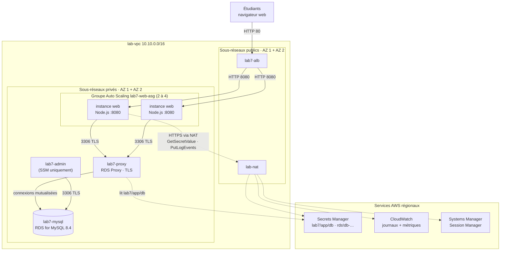
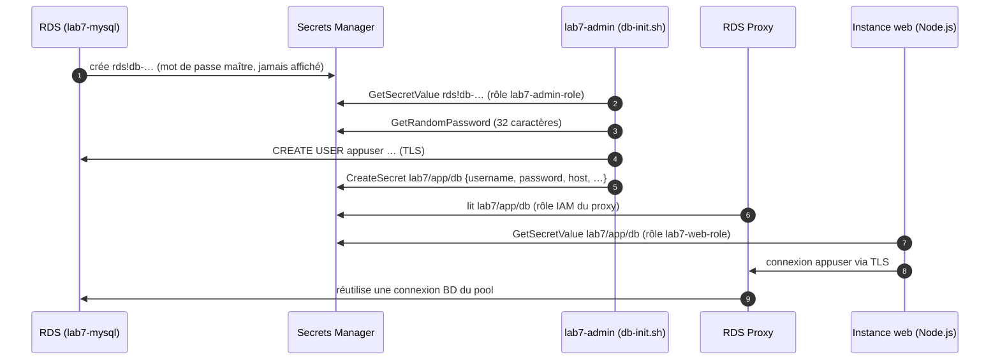
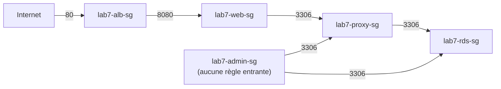
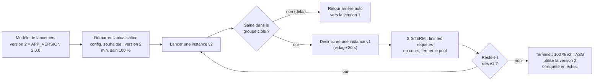

# Lab 7 — Application web Node.js sur Amazon RDS for MySQL, selon les bonnes pratiques (Auto Scaling, RDS Proxy, Secrets Manager)

> 🇬🇧 English version: [RDS-Node-BestPractice-Lab.en.md](RDS-Node-BestPractice-Lab.en.md)

> **Public :** ingénieurs cloud en formation · **Niveau :** Associate → Professional
> **Point de départ :** le réseau du **Lab 1** dans `us-west-1`, **y compris la passerelle NAT** · Lab 6 fortement recommandé
> **Durée :** environ 4 heures · **Méthode :** console + scripts (sans CloudFormation)
> **Périmètre :** une seule Région, base de données **mono-AZ** (le Multi-AZ est expliqué, pas construit)

---

## Scénario

Le registre du Lab 6 fonctionne, mais l'équipe d'exploitation a listé ce qui l'empêche de dormir :

- *« Quelqu'un doit se connecter en SSH à chaque serveur, coller un mot de passe de base de données et lancer un script. La semaine dernière, un serveur a reçu une faute de frappe. »*
- *« Si un serveur meurt à 3 h du matin, personne ne le remplace. Si le trafic double, personne n'en ajoute. »*
- *« Déployer une nouvelle version, c'est arrêter des serveurs à la main. Les utilisateurs voient des erreurs. »*
- *« Le mot de passe de la base est dans un fichier sur chaque serveur et dans l'historique du chat. »*
- *« Chaque requête ouvre une nouvelle connexion à la base. Lors du dernier pic de trafic, MySQL a atteint `max_connections`. »*

L'équipe de développement a réécrit le registre en **Node.js** (mêmes fonctions, mêmes données). Votre mission : le déployer pour qu'**aucun humain ne touche un serveur ni ne voie un mot de passe**, que la flotte **se répare et s'adapte seule**, que les nouvelles versions se déploient **sans erreur**, et que la base soit protégée par un **pool de connexions**.

---

## Objectifs d'apprentissage

1. Déployer une flotte avec un **modèle de lancement**, des **données utilisateur** et un **groupe EC2 Auto Scaling** sur deux AZ, rattaché à un ALB
2. Laisser RDS **gérer le mot de passe maître dans Secrets Manager**, et stocker les **identifiants applicatifs** dans un second secret qu'**aucun humain ne lit**
3. Donner aux instances des **rôles IAM** à moindre privilège (lire un secret, écrire dans un groupe de journaux) et les administrer avec **Session Manager** (ni SSH, ni bastion, ni paire de clés)
4. Placer **RDS Proxy** entre l'appli et la base, avec **TLS obligatoire**, et mesurer la mutualisation des connexions
5. Envoyer des **journaux structurés** vers **CloudWatch Logs** et les interroger avec Logs Insights
6. Réaliser un **déploiement progressif sans interruption** (v1 → v2) avec l'**actualisation d'instances** (*instance refresh*), puis revenir en arrière
7. Observer l'**auto-réparation** et la **mise à l'échelle par suivi de cible**, et survivre à une **rotation de mot de passe** sans rien redémarrer

### Ce qui change par rapport au Lab 6

| Préoccupation | Lab 6 (manuel) | Lab 7 (bonnes pratiques) |
|---------------|----------------|--------------------------|
| Création des serveurs | 2 instances lancées à la main | **Groupe Auto Scaling** (min 2, max 4) à partir d'un **modèle de lancement** |
| Installation de l'appli | SSH + `web-setup.sh` sur chaque serveur | Les **données utilisateur** lancent `bootstrap.sh` au premier démarrage, identique partout |
| Accès d'administration | Bastion + clés SSH + port 22 | **Session Manager** : aucun port entrant, aucune clé, chaque session journalisée |
| Mot de passe maître | Saisi par vous | **Géré par RDS dans Secrets Manager**, lu par un script |
| Mot de passe de l'appli | Affiché, collé, stocké dans un fichier sur chaque serveur | Généré par `secretsmanager:GetRandomPassword`, stocké dans **`lab7/app/db`**, lu à l'exécution grâce à un **rôle IAM** |
| Connexions à la base | Une par requête, directement vers RDS | **Pool** de l'appli → **RDS Proxy** (mutualisation, TLS obligatoire) → RDS |
| Dépendances | `pip install` des paquets principaux figés | `npm ci` depuis un **fichier de verrouillage** (toutes les versions transitives figées) |
| Journaux | `journalctl` sur chaque serveur | **Journaux JSON** dans **CloudWatch Logs**, un flux par instance |
| Panne d'un serveur | Il reste en panne | **Remplacé automatiquement** (contrôle de santé ELB) |
| Nouvelle version | Manuelle | **Actualisation d'instances** : progressive, sans interruption, avec retour arrière |
| Arrêt | Processus tué | **Gracieux** : délai de désinscription + gestion de SIGTERM |

---

## 1. Architecture

### 1.0 Schéma complet du projet

```text
┌────────────────────────────┐                    ┌──────────────────────────────────────┐
│ Étudiants (navigateur web) │                    │ Ingénieur : console + CloudShell     │
│ http://<nom DNS de l'ALB>  │                    │ Session Manager (ni SSH, ni bastion) │
└────────────────────────────┘                    └──────────────────────────────────────┘
              │ HTTP 80                                         │ SSM (HTTPS 443, sortant uniquement)
              ▼                                                 ▼
┌─ Région AWS us-west-1 (Californie du Nord) ──────────────────────────────────────────────────────────────────────────────┐
│ ┌─ lab-vpc 10.10.0.0/16 (existant, Lab 1) ─────────────────────────────────────────────────────────────────────────────┐ │
│ │ lab-igw passerelle Internet (existante) · lab-public-rt : 0.0.0.0/0 -> igw                                           │ │
│ │ ┌─ ★ lab7-alb ─────────────────────────────────────────────────────────────────────────────────────────────────────┐ │ │
│ │ │ public · sg lab7-alb-sg ENTRÉE 80 <- 0.0.0.0/0 · HTTP:80 -> lab7-web-tg                                          │ │ │
│ │ │ lab7-web-tg  HTTP:8080 · GET /health · délai de désinscription 30 s  <- inscrit par l'ASG                        │ │ │
│ │ └──────────────────────────────────────────────────────────────────────────────────────────────────────────────────┘ │ │
│ │ ┌─ Zone de disponibilité 1 ─────────────────────────────┐  ┌─ Zone de disponibilité 2 ─────────────────────────────┐ │ │
│ │ │ ┌─ lab-public-a 10.10.1.0/24 · PUBLIC ──────────────┐ │  │ ┌─ lab-public-b 10.10.2.0/24 · PUBLIC ──────────────┐ │ │ │
│ │ │ │ ★ nœud lab7-alb (AZ 1)                            │ │  │ │ ★ nœud lab7-alb (AZ 2)                            │ │ │ │
│ │ │ │   lab-nat passerelle NAT (existante)              │ │  │ │                                                   │ │ │ │
│ │ │ └───────────────────────────────────────────────────┘ │  │ └───────────────────────────────────────────────────┘ │ │ │
│ │ │       │ HTTP 8080 (cible)                             │  │       │ HTTP 8080 (cible)                             │ │ │
│ │ │ ┌─ lab-private-a 10.10.11.0/24 · PRIVÉ ─────────────┐ │  │ ┌─ lab-private-b 10.10.12.0/24 · PRIVÉ ─────────────┐ │ │ │
│ │ │ │ ★ instance(s) ASG  Node.js :8080 · v1 -> v2       │ │  │ │ ★ instance(s) ASG  Node.js :8080 · v1 -> v2       │ │ │ │
│ │ │ │   rôle lab7-web-role · IMDSv2 · sans clé SSH      │ │  │ │   rôle lab7-web-role · IMDSv2 · sans clé SSH      │ │ │ │
│ │ │ │ ★ lab7-admin  t3.micro · SSM uniquement           │ │  │ │                                                   │ │ │ │
│ │ │ │   db-init.sh · proxy-test.sh                      │ │  │ │                                                   │ │ │ │
│ │ │ │     │ 3306 TLS (mutualisé)                        │ │  │ │                                                   │ │ │ │
│ │ │ │     ▼                                             │ │  │ │                                                   │ │ │ │
│ │ │ │ ★ ENI lab7-proxy  RDS Proxy :3306 · TLS           │ │  │ │ ★ ENI lab7-proxy  RDS Proxy :3306 · TLS           │ │ │ │
│ │ │ │     │                                             │ │  │ │                                                   │ │ │ │
│ │ │ │     ▼                                             │ │  │ │                                                   │ │ │ │
│ │ │ │ ★ lab7-mysql  RDS MySQL 8.4 · mono-AZ             │ │  │ │                                                   │ │ │ │
│ │ │ │   secret maître géré par RDS (rds!db-…)           │ │  │ │   groupe de sous-réseaux BD, 2e AZ (requis)       │ │ │ │
│ │ │ └───────────────────────────────────────────────────┘ │  │ └───────────────────────────────────────────────────┘ │ │ │
│ │ └───────────────────────────────────────────────────────┘  └───────────────────────────────────────────────────────┘ │ │
│ │ ┌─ ★ lab7-web-asg ─────────────────────────────────────────────────────────────────────────────────────────────────┐ │ │
│ │ │ modèle lab7-web-lt · min 2 / souhaité 2 / max 4 · cible CPU 40 % · santé ELB                                     │ │ │
│ │ └──────────────────────────────────────────────────────────────────────────────────────────────────────────────────┘ │ │
│ │ chaîne de SG : lab7-alb-sg -> lab7-web-sg :8080 -> lab7-proxy-sg :3306 -> lab7-rds-sg :3306 <- lab7-admin-sg         │ │
│ │ lab-private-rt : 10.10.0.0/16 -> local · 0.0.0.0/0 -> lab-nat (dnf, npm, GitHub, API AWS)                            │ │
│ └──────────────────────────────────────────────────────────────────────────────────────────────────────────────────────┘ │
│                     │ HTTPS 443 (NAT)                                                                                    │
│                     ▼                                                                                                    │
│ ┌─ Services AWS régionaux (via la passerelle NAT, HTTPS + rôles IAM) ──────────────────────────────────────────────────┐ │
│ │ ★ Secrets Manager  lab7/app/db (appuser) · rds!db-… (maître)                                                         │ │
│ │ ★ CloudWatch  groupes /lab7/app, /lab7/app-bootstrap · métriques ASG + Proxy · alarmes                               │ │
│ │   Systems Manager  Session Manager pour lab7-admin et les instances web                                              │ │
│ └──────────────────────────────────────────────────────────────────────────────────────────────────────────────────────┘ │
│                                                                                                                          │
│ ★ = créé dans ce lab · le reste existe depuis le Lab 1                                                                   │
└──────────────────────────────────────────────────────────────────────────────────────────────────────────────────────────┘
```

### 1.1 Schéma d'architecture (Mermaid)



### 1.2 Qui connaît les mots de passe ?



Aucune étape n'affiche de mot de passe. Aucun mot de passe ne se trouve dans les données utilisateur, dans un fichier des serveurs web, ni dans ce guide.

### 1.3 Chaîne de groupes de sécurité



Il n'y a **aucun port 22 nulle part**. Session Manager fonctionne avec du HTTPS **sortant** de l'instance vers le service SSM (via la passerelle NAT).

### 1.4 Déploiement progressif par actualisation d'instances



### 1.5 Pourquoi RDS Proxy ?

| Sans proxy | Avec RDS Proxy |
|------------|----------------|
| Chaque processus ouvre ses propres connexions. 4 instances × 10 = 40 connexions MySQL, davantage pendant une montée en charge ou un déploiement (anciennes et nouvelles instances se chevauchent) | Le proxy garde un **pool** de connexions BD et les prête aux sessions clientes entre deux transactions |
| Une avalanche de connexions peut atteindre `max_connections` (faible sur `db.t4g.micro`) | Le proxy limite les connexions BD (**nombre maximal de connexions du pool**, en % de `max_connections`) et **met en file** le reste |
| Un basculement ou un redémarrage coupe toutes les connexions ; chaque client doit se reconnecter | Le proxy garde les connexions clientes ouvertes et se reconnecte à la base derrière elles (surtout utile en Multi-AZ) |
| Chaque appli a besoin du mot de passe BD | Les clients s'authentifient **auprès du proxy** ; le proxy lit les identifiants dans **Secrets Manager** |

> 💰 RDS Proxy est facturé par **vCPU de l'instance de base** et par heure (minimum 2 vCPU) : environ **0,03 à 0,04 $/heure** pour un `db.t4g.micro`. Supprimez-le au nettoyage.

---

## 2. Prérequis et coût

- Le réseau du Lab 1 dans `us-west-1` avec **`lab-nat`** fonctionnel (les instances joignent GitHub, npm, le dépôt MySQL et les API AWS à travers lui)
- Un accès console avec des droits sur EC2, Auto Scaling, ELB, RDS, IAM, Secrets Manager, CloudWatch, Systems Manager
- **AWS CloudShell** (barre d'outils de la console, icône `>_`) pour les outils de test : rien à installer sur votre portable
- Les scripts du lab publiés dans votre dépôt (section 3)

| Ressource | Coût approximatif (us-west-1) |
|-----------|-------------------------------|
| 2 à 4 × EC2 `t3.micro` (web) + 1 × `t3.micro` (admin) | ~0,012 $/heure chacune |
| RDS `db.t4g.micro`, 20 Go | ~0,02 $/heure (ou offre gratuite/crédits) |
| RDS Proxy | ~0,03 à 0,04 $/heure |
| Application Load Balancer + 2 IPv4 publiques | ~0,025 $/heure + 0,01 $/heure |
| Secrets Manager (2 secrets) | 0,40 $ par secret et par mois, au prorata (quelques centimes pour une journée) |
| CloudWatch Logs, surveillance détaillée | quelques centimes pour une séance |
| Passerelle NAT (existante) | ~0,05 $/heure + par Go |

> 💰 Comptez **1 à 2 $** pour une séance de 4 heures. Faites le **nettoyage** (Partie 22) le jour même : le proxy et l'ALB sont facturés à l'heure.

### 2.1 Fiche de travail

| Élément | Valeur |
|---------|--------|
| Noms de l'AZ 1 / AZ 2 | |
| Point de terminaison RDS (`lab7-mysql`) | |
| Nom du secret maître (`rds!db-…`) | |
| Point de terminaison du proxy (`lab7-proxy`) | |
| Nom DNS de l'ALB | |
| Versions du modèle de lancement (1 = v1.0.0, 2 = v2.0.0) | |

---

## 3. Les scripts du lab

```
aws-lab-rds-node-asg/
├── RDS-Node-BestPractice-Lab.en.md
├── RDS-Node-BestPractice-Lab.fr.md   ← ce guide
└── scripts/
    ├── db/
    │   ├── db-init.sh          sur lab7-admin : connexion maître via son secret, appuser, données, secret lab7/app/db
    │   ├── proxy-test.sh       sur lab7-admin : vérifs du proxy, connexion via le proxy, démo du pool, enregistre le proxy
    │   └── seed.sql            8 cours, 12 étudiants, 28 inscriptions (mêmes données qu'au Lab 6)
    ├── web/
    │   ├── user-data.sh        collé dans le modèle de lancement : télécharge et lance bootstrap.sh
    │   ├── bootstrap.sh        Node.js 22, npm ci, CA RDS, service systemd, agent CloudWatch, autotests
    │   └── app/
    │       ├── server.js       appli Express : pages, formulaire, /health, /work, rafraîchissement du secret, arrêt gracieux
    │       ├── views/page.js   la page HTML (même design qu'au Lab 6, sortie échappée)
    │       ├── package.json    3 dépendances, versions exactes
    │       └── package-lock.json   toutes les dépendances transitives figées (npm ci)
    ├── policies/
    │   ├── lab7-web-policy.json     instances web : lire lab7/app/db, écrire les journaux /lab7/*
    │   └── lab7-admin-policy.json   instance d'admin : décrire RDS/proxy, lire rds!db-*, gérer lab7/app/db
    └── tools/
        ├── load-test.sh        CloudShell : répartition + charge CPU (/work) pour déclencher la mise à l'échelle
        └── deploy-watch.sh     CloudShell : 1 requête/seconde pendant un déploiement, compte les échecs
```

| Script | Ce qu'il fait |
|--------|---------------|
| [`db-init.sh`](scripts/db/db-init.sh) | 1) client MySQL 8.4 · 2) `rds:DescribeDBInstances` → point de terminaison, utilisateur maître, **ARN du secret maître** · 3) DNS + TCP 3306 · 4) lit le mot de passe maître **dans Secrets Manager** vers un fichier temporaire réservé au propriétaire (jamais affiché) et se connecte en TLS (`VERIFY_IDENTITY`) · 5) génère un mot de passe de 32 caractères avec **`GetRandomPassword`**, crée `labapp` + `appuser` (`10.10.11.%`, `10.10.12.%`), charge `seed.sql` · 6) **crée ou met à jour `lab7/app/db`** · 7) se connecte en `appuser` avec le secret et prouve qu'il ne peut pas faire `CREATE DATABASE`. Options : `SKIP_SEED=1`, `ROTATE=1` |
| [`proxy-test.sh`](scripts/db/proxy-test.sh) | 1) état du proxy, *Require TLS*, secret d'authentification, **santé des cibles** · 2) DNS + TCP · 3) connexion `appuser` **à travers le proxy** (TLS, CA racine Amazon) · 4) **20 sessions courtes en direct ou via le proxy** : compte les connexions BD distinctes · 5) ajoute `proxy_host` à `lab7/app/db` |
| [`user-data.sh`](scripts/web/user-data.sh) | Définit `APP_VERSION`, `SECRET_ID`, `BASE_URL` ; télécharge et lance `bootstrap.sh`. **Aucun secret dedans** |
| [`bootstrap.sh`](scripts/web/bootstrap.sh) | 1) identité (IMDSv2) · 2) Node.js 22 + agent CloudWatch · 3) fichiers de l'appli + **`npm ci --omit=dev`** · 4) bundle CA RDS · 5) `/etc/labapp/labapp.env` (**sans mot de passe**) + systemd `labapp` (utilisateur `labapp`, `KillSignal=SIGTERM`, `TimeoutStopSec=30`) · 6) journaux → `/lab7/app` et `/lab7/app-bootstrap` · 7) contrôle de disponibilité |
| [`server.js`](scripts/web/app/server.js) | Lit `lab7/app/db` (cache de 5 min ; nouvelle version → nouveau pool), se connecte à `proxy_host` (sinon `host`) en TLS, **réessaie une fois avec un secret frais** en cas d'*access denied*, une ligne JSON par requête, `/health` (vivacité) + `?strict=1` (disponibilité), `/work?ms=` (consommation CPU), `keepAliveTimeout` 65 s, SIGTERM gracieux |
| [`load-test.sh`](scripts/tools/load-test.sh) / [`deploy-watch.sh`](scripts/tools/deploy-watch.sh) | À lancer dans **CloudShell** avec le nom DNS de l'ALB |

Publiez le dossier `scripts/` dans votre dépôt, par exemple
`inspiredevgen/devops-worksphops` → `2-Cloud-Infrastructure/aws-lab-rds-node-asg/scripts/`.
Si vous utilisez un autre emplacement, modifiez `BASE_URL` dans `user-data.sh` **et** dans `bootstrap.sh`.

---

## Partie 1 — Vérifier le réseau existant

Région **`us-west-1`** :

- [ ] `lab-vpc` : *Résolution DNS* et *Noms d'hôte DNS* **activés**.
- [ ] `lab-public-a`/`lab-public-b` (deux AZ) → `lab-public-rt` → `lab-igw`.
- [ ] `lab-private-a`/`lab-private-b` → `lab-private-rt` → **`lab-nat` Disponible**. Dans ce lab, la passerelle NAT est aussi le chemin vers Secrets Manager, CloudWatch et Systems Manager.

> 🧠 **À discuter :** que devient le niveau web si la passerelle NAT tombe ? (Les nouvelles instances ne peuvent pas s'initialiser, Session Manager s'arrête et l'appli en cours ne peut plus rafraîchir son secret.) L'extension **B** remplace cette dépendance par des **points de terminaison d'interface VPC**.

---

## Partie 2 — Groupes de sécurité

**VPC → Groupes de sécurité → Créer**, VPC `lab-vpc`, dans cet ordre :

| # | Nom | Règles entrantes |
|---|-----|------------------|
| 1 | `lab7-alb-sg` | HTTP 80 depuis `0.0.0.0/0` |
| 2 | `lab7-web-sg` | TCP personnalisé **8080** depuis **`lab7-alb-sg`** · *(pas de SSH)* |
| 3 | `lab7-admin-sg` | **Aucune** |
| 4 | `lab7-proxy-sg` | MYSQL/Aurora 3306 depuis **`lab7-web-sg`** · 3306 depuis **`lab7-admin-sg`** |
| 5 | `lab7-rds-sg` | MYSQL/Aurora 3306 depuis **`lab7-proxy-sg`** · 3306 depuis **`lab7-admin-sg`** |

Sortant : par défaut (tout) sur les cinq.

✅ **Point de contrôle :** aucune règle n'ouvre le port 22. Le niveau web **ne peut pas** joindre RDS directement (seul le proxy le peut) : le proxy n'est pas facultatif, le réseau l'impose.

> 🧠 Pourquoi `lab7-admin-sg` atteint-il RDS directement ? L'admin crée des utilisateurs et charge des données : les sessions d'administration sont longues, rares et exigent le compte maître. Le proxy sert aux nombreuses sessions courtes de l'application.

---

## Partie 3 — Rôles IAM des instances

### 3.1 `lab7-web-role`
**IAM → Rôles → Créer un rôle** → *Service AWS* → **EC2** → Suivant :

1. Attachez la politique gérée **`AmazonSSMManagedInstanceCore`** (Session Manager).
2. Nom `lab7-web-role` → **Créer le rôle**.
3. Ouvrez le rôle → **Ajouter des autorisations → Créer une politique en ligne → JSON** → collez [`lab7-web-policy.json`](scripts/policies/lab7-web-policy.json) → nom `lab7-web-policy`.

```json
{
  "Version": "2012-10-17",
  "Statement": [
    { "Sid": "ReadOnlyTheAppSecret", "Effect": "Allow", "Action": "secretsmanager:GetSecretValue",
      "Resource": "arn:aws:secretsmanager:us-west-1:*:secret:lab7/app/db-*" },
    { "Sid": "ShipAppLogsToCloudWatch", "Effect": "Allow",
      "Action": ["logs:CreateLogGroup", "logs:CreateLogStream", "logs:PutLogEvents", "logs:PutRetentionPolicy", "logs:DescribeLogStreams"],
      "Resource": "arn:aws:logs:us-west-1:*:log-group:/lab7/*" },
    { "Sid": "CloudWatchAgentDescribe", "Effect": "Allow",
      "Action": ["logs:DescribeLogGroups", "ec2:DescribeTags"], "Resource": "*" }
  ]
}
```

### 3.2 `lab7-admin-role`
Mêmes étapes : confiance EC2, **`AmazonSSMManagedInstanceCore`**, nom `lab7-admin-role`, politique en ligne [`lab7-admin-policy.json`](scripts/policies/lab7-admin-policy.json) nommée `lab7-admin-policy`.

> 🧠 **Le moindre privilège en pratique :** le rôle web peut lire **un** secret et écrire dans les groupes de journaux sous **`/lab7/`**. Il ne peut ni lister les secrets, ni lire le secret maître, ni rien modifier dans RDS. Le `-*` à la fin de l'ARN du secret correspond aux 6 caractères aléatoires que Secrets Manager ajoute à chaque ARN.

---

## Partie 4 — La base de données

### 4.1 Groupe de sous-réseaux BD
**RDS → Groupes de sous-réseaux → Créer** : `lab7-db-subnet-group`, VPC `lab-vpc`, sous-réseaux **`10.10.11.0/24`** et **`10.10.12.0/24`**.

### 4.2 Créer `lab7-mysql`
**RDS → Créer une base de données** → **Configuration complète** :

| Section | Paramètre | Valeur |
|---------|-----------|--------|
| Moteur | | MySQL, dernière **8.4.x** |
| Modèles | | **Offre gratuite** (ou Dev/Test avec les mêmes petits réglages) |
| Disponibilité | | **Mono-AZ** (périmètre de ce lab) |
| Paramètres | Identifiant | `lab7-mysql` |
| | Nom d'utilisateur principal | `admin` |
| | **Gestion des informations d'identification** | **Gérées dans AWS Secrets Manager** · Clé de chiffrement : `aws/secretsmanager` |
| Instance | Classe | **db.t4g.micro** (ou db.t3.micro) |
| Stockage | | gp3/gp2 **20 Gio**, mise à l'échelle automatique **désactivée** |
| Connectivité | VPC / groupe de sous-réseaux | `lab-vpc` / `lab7-db-subnet-group` |
| | Accès public | **Non** |
| | Groupe de sécurité | **`lab7-rds-sg`** seul |
| | Zone de disponibilité | AZ 1 |
| Surveillance | | Valeurs gratuites par défaut |
| Configuration supplémentaire | Nom de base initial | *(vide)* |
| | Rétention des sauvegardes | **7 jours** (restauration à un instant donné sur une semaine) |
| | Chiffrement | **Activé** |
| | Exportations de journaux | ✅ **Journal des erreurs** (vers CloudWatch Logs) |
| | Mise à niveau automatique des versions mineures | Activée |
| | **Protection contre la suppression** | ✅ **Activée** (vous la désactiverez au nettoyage) |

**Créer la base de données** (10 à 15 minutes). Pendant ce temps, passez à la Partie 5.

Quand elle est *Disponible* : onglet **Configuration** → *ARN des informations d'identification principales* → le lien ouvre le secret **`rds!db-…`** dans Secrets Manager. Notez son nom dans la fiche. Remarquez **Rotation : activée (tous les 7 jours)** : RDS change le mot de passe maître pour vous, et rien n'a besoin d'être modifié puisque chaque outil le lit dans le secret.

---

## Partie 5 — L'instance d'administration et Session Manager

**EC2 → Lancer des instances** :

| Paramètre | Valeur |
|-----------|--------|
| Nom | `lab7-admin` |
| AMI / type | Amazon Linux 2023 · `t3.micro` |
| **Paire de clés** | **Continuer sans paire de clés** |
| Sous-réseau / IP publique | **`lab-private-a`** / **Désactiver** |
| Groupe de sécurité | **`lab7-admin-sg`** |
| Avancé → Profil d'instance IAM | **`lab7-admin-role`** |
| Avancé → Version des métadonnées | **V2 uniquement** |

Après 2 à 3 minutes : sélectionnez l'instance → **Se connecter → Session Manager → Se connecter**. Un shell s'ouvre dans votre navigateur.

```bash
whoami                     # ssm-user
sudo -i -u ec2-user        # facultatif : travailler en ec2-user
```

> 🧠 **Aucune règle entrante, aucune clé, aucune IP publique, et pourtant vous avez un shell.** L'agent SSM de l'instance ouvre une connexion HTTPS **sortante** vers Systems Manager (via la NAT), et votre session passe par elle. Les sessions peuvent être journalisées et sont contrôlées par IAM, pas par la possession d'un fichier de clé.

---

## Partie 6 — Initialiser la base et créer le secret de l'appli

Attendez que `lab7-mysql` soit **Disponible**. Dans le shell Session Manager de `lab7-admin` :

```bash
mkdir -p ~/lab7 && cd ~/lab7
BASE=https://raw.githubusercontent.com/inspiredevgen/devops-worksphops/refs/heads/main/2-Cloud-Infrastructure/aws-lab-rds-node-asg/scripts
curl -fsSLO $BASE/db/db-init.sh
curl -fsSLO $BASE/db/proxy-test.sh
curl -fsSLO $BASE/db/seed.sql
head -1 db-init.sh proxy-test.sh seed.sql

bash db-init.sh
```

Aucun mot de passe à saisir. Points marquants attendus :

```text
==> 2/7 Looking up lab7-mysql (endpoint, master user, RDS-managed master secret)
Master secret : arn:aws:secretsmanager:us-west-1:…:secret:rds!db-1a2b…
==> 4/7 Master login with the RDS-managed secret (the password is never printed)
Connected to ip-10-10-11-… running MySQL 8.4.x as admin@%
==> 5/7 Database 'labapp', user 'appuser' (10.10.11.% 10.10.12.%), sample data
Generated a new 32-character password with secretsmanager:GetRandomPassword (not displayed)
==> 6/7 Storing the app credentials in Secrets Manager: lab7/app/db
==> 7/7 Proof: appuser logs in with the credentials read back from the secret
| appuser@10.10.11.% |       8 |       12 |          28 |
OK: appuser cannot CREATE DATABASE (least privilege)
```

Ouvrez **Secrets Manager → `lab7/app/db`**. *Récupérer la valeur du secret* est possible **pour vous** (votre utilisateur console a des droits étendus) : en production, les personnes n'auraient pas du tout `GetSecretValue` sur les secrets applicatifs.

---

## Partie 7 — RDS Proxy

**RDS → Proxys → Créer un proxy** :

| Paramètre | Valeur |
|-----------|--------|
| Famille de moteurs | **MySQL** |
| Identifiant du proxy | `lab7-proxy` |
| Délai d'inactivité des connexions clientes | 30 minutes (défaut) |
| **Exiger le protocole TLS (Transport Layer Security)** | ✅ **Activé** |
| Base de données | **`lab7-mysql`** |
| Nombre maximal de connexions du pool | **50 %** (le proxy utilise au plus la moitié de `max_connections` ; le reste reste disponible pour les admins) |
| Secrets Secrets Manager | **`lab7/app/db`** |
| Type d'authentification client | **MySQL Caching SHA2 password** (défaut) |
| Authentification IAM | **Non autorisée** |
| Rôle IAM | **Créer un rôle IAM** (la console crée un rôle autorisé à lire le secret choisi) |
| Sous-réseaux | **`lab-private-a` et `lab-private-b` uniquement** (retirez tout sous-réseau public) |
| Groupe de sécurité VPC | **`lab7-proxy-sg`** seul |

**Créer le proxy**. L'état passe de *Création* à **Disponible** en 5 à 15 minutes. Copiez ensuite son **point de terminaison** (`lab7-proxy.proxy-xxxx.us-west-1.rds.amazonaws.com`) dans la fiche.

De retour dans la session `lab7-admin` :

```bash
cd ~/lab7 && bash proxy-test.sh lab7-proxy
```

Attendu :

```text
Require TLS  : True
Auth secret  : lab7/app/db-AbCdEf
| lab7-mysql | RDS_INSTANCE | AVAILABLE | None | None |
==> 3/5 appuser login THROUGH the proxy (TLS, certificate + host name verified)
| appuser@10.10.12.% | ip-10-10-11-… | 8.4.x | 12 |
==> 4/5 Connection pooling: 20 short client sessions, one after the other
  PATH                   CLIENT SESSIONS    DISTINCT DATABASE CONNECTIONS
  direct to RDS          20                 20
  through RDS Proxy      20                 1
==> 5/5 Registering the proxy in lab7/app/db (key proxy_host)
```

> 🧠 **Lisez le tableau du pool :** en direct, chaque connexion cliente crée (et paie : négociation TLS, authentification, mémoire) une nouvelle connexion MySQL. Via le proxy, les 20 sessions ont été servies par **une ou quelques** connexions BD mutualisées qui restent ouvertes. Remarquez aussi `appuser@10.10.12.%` : la base voit l'IP **du proxy**, pas celle de `lab7-admin`.

> ⚠️ État de cible **AUTH_FAILURE** ? Le proxy n'arrive pas à se connecter à la base avec `lab7/app/db` : relancez `db-init.sh` (il réapplique le mot de passe), puis revérifiez après une minute.

---

## Partie 8 — Groupe cible

**EC2 → Groupes cibles → Créer un groupe cible** : type **Instances**, nom `lab7-web-tg`, **HTTP 8080**, VPC `lab-vpc`, contrôle de santé **`/health`**, seuils sain/défaillant **2/2**, délai **5 s**, intervalle **10 s**, code de réussite **200** → Suivant → **n'inscrivez rien** (le groupe Auto Scaling s'en charge) → Créer.

Puis **`lab7-web-tg` → Attributs → Modifier** : **Délai de désinscription = 30 secondes** → Enregistrer.

> 🧠 Le **délai de désinscription** est le temps pendant lequel l'ALB laisse finir les requêtes en cours vers une cible qu'il retire. 300 s (défaut) ralentit les déploiements ; l'appli termine toute requête en bien moins de 30 s.

---

## Partie 9 — Application Load Balancer

Créez **`lab7-alb`** : accessible sur Internet, IPv4, `lab-vpc`, **`lab-public-a` + `lab-public-b`**, SG **`lab7-alb-sg`** seul, écouteur **HTTP:80 → `lab7-web-tg`**. Copiez le **nom DNS** dans la fiche.

---

## Partie 10 — Modèle de lancement

**EC2 → Modèles de lancement → Créer un modèle de lancement** :

| Paramètre | Valeur |
|-----------|--------|
| Nom / description | `lab7-web-lt` / `v1.0.0` |
| Conseils Auto Scaling | ✅ *Fournir des conseils pour configurer un modèle utilisable avec EC2 Auto Scaling* |
| AMI | **Amazon Linux 2023** (x86_64), depuis *Démarrage rapide* (le modèle stocke l'ID d'AMI ; une AMI par paramètre SSM empêcherait le retour arrière automatique) |
| Type d'instance | `t3.micro` |
| Paire de clés | **Ne pas inclure dans le modèle** |
| Paramètres réseau → Sous-réseau | **Ne pas inclure** (l'ASG choisit) · Groupe de sécurité **`lab7-web-sg`** |
| Avancé → Profil d'instance IAM | **`lab7-web-role`** |
| Avancé → Surveillance CloudWatch détaillée | **Activer** (métriques à 1 minute : décisions de mise à l'échelle plus rapides) |
| Avancé → Métadonnées accessibles / version | Activé / **V2 uniquement (jeton requis)** |
| Avancé → Limite de sauts de la réponse des métadonnées | **1** |
| Avancé → **Données utilisateur** | le contenu de [`user-data.sh`](scripts/web/user-data.sh), ci-dessous |

```bash
#!/bin/bash
# File: scripts/web/user-data.sh
# Purpose : EC2 user data of the launch template 'lab7-web-lt'.
#           Every instance launched by the Auto Scaling group runs it ONCE, as root, at first boot.
#           It downloads bootstrap.sh (through the NAT Gateway) and runs it.
#           There is NO password here: the app reads its credentials from Secrets Manager.
# Paste   : EC2 -> Launch templates -> lab7-web-lt -> Advanced details -> User data
#           Rolling deployment (Part 14): new template version with APP_VERSION="2.0.0", then instance refresh.
# Logs    : /var/log/cloud-init-output.log, also shipped to CloudWatch Logs /lab7/app-bootstrap
set -euo pipefail

# ---- Values you may change ---------------------------------------------------
export APP_VERSION="1.0.0"
export SECRET_ID="lab7/app/db"
export BASE_URL="https://raw.githubusercontent.com/inspiredevgen/devops-worksphops/refs/heads/main/2-Cloud-Infrastructure/aws-lab-rds-node-asg/scripts/web"
# -----------------------------------------------------------------------------

mkdir -p /opt/labapp-bootstrap && cd /opt/labapp-bootstrap
curl -fsSL --retry 5 --retry-delay 5 --retry-all-errors -o bootstrap.sh "${BASE_URL}/bootstrap.sh"
bash bootstrap.sh
```

**Créer le modèle de lancement.**

> 🧠 **Les données utilisateur ne sont pas secrètes** : toute personne ayant `ec2:DescribeInstanceAttribute` peut les lire. C'est pourquoi elles ne contiennent que le **nom** du secret. Une limite de sauts de **1** empêche les jetons IMDSv2 d'être atteints par ce qui transite par l'instance (par ex. des conteneurs).

---

## Partie 11 — Groupe Auto Scaling

**EC2 → Groupes Auto Scaling → Créer un groupe Auto Scaling** :

| Étape | Paramètre | Valeur |
|-------|-----------|--------|
| 1 | Nom | `lab7-web-asg` |
| | Modèle de lancement / version | `lab7-web-lt` / **1** (un numéro fixe, pas *Default* ni *Latest*) |
| 2 | VPC / AZ et sous-réseaux | `lab-vpc` / **`lab-private-a`, `lab-private-b`** |
| | Distribution entre AZ | Équilibrée au mieux (*Balanced best effort*) |
| 3 | Équilibrage de charge | **Attacher à un équilibreur existant** → *Choisir parmi vos groupes cibles* → **`lab7-web-tg`** |
| | Contrôles de santé | ✅ **Activer les contrôles de santé Elastic Load Balancing** · période de grâce **300 s** |
| | Surveillance | ✅ **Activer la collecte des métriques de groupe dans CloudWatch** |
| | Préchauffage d'instance | ✅ Préchauffage par défaut : **120 s** |
| 4 | Souhaitée / Min / Max | **2 / 2 / 4** |
| | Mise à l'échelle | **Politique de suivi de cible** → *Utilisation moyenne du CPU* → cible **40** |
| | **Politique de maintenance des instances** | **Lancer avant de résilier** (priorité à la disponibilité) |
| 5–6 | Notifications / Balises | aucune / `Name` = `lab7-web` (✅ baliser les nouvelles instances) |

**Créer le groupe Auto Scaling.** Observez **Activité** : deux entrées *Launching a new EC2 instance*, une par AZ. Après 2 à 4 minutes, **`lab7-web-tg` → Cibles** affiche deux cibles **Saines**.

> 🧠 **Contrôles ELB + période de grâce :** avec les seuls contrôles EC2, l'ASG ne remplace une instance que si la *machine* tombe. Avec les contrôles ELB, il remplace aussi une instance dont l'*application* ne répond plus sur `/health`. La **période de grâce** laisse à une nouvelle instance le temps d'exécuter son initialisation avant que sa santé compte.

> 🧠 **Pourquoi un numéro de version fixe ?** Avec *Latest*, toute montée en charge lance la dernière version enregistrée, même une que personne n'a encore déployée. Un numéro fixe ne change que par une **actualisation d'instances** délibérée, et il est requis pour le **retour arrière automatique** (impossible quand le groupe utilise `$Latest` ou `$Default`).

> 🧠 **Pourquoi 40 % de CPU ?** Node.js exécute le JavaScript sur **un seul cœur**. Sur un `t3.micro` à 2 vCPU, une appli totalement occupée affiche environ **50 %** : une cible de 50 % ne se déclencherait presque jamais.

---

## Partie 12 — Tester et observer

### 12.1 L'application
Ouvrez `http://<DNS_ALB>/`. Dans le panneau **Served by** : *Through RDS Proxy* = **yes**, *DB endpoint* = le point de terminaison du proxy, *TLS (app → endpoint)* = `TLSv1.3 …`, badge **v1.0.0**. Actualisez : l'instance et l'AZ alternent. Inscrivez un étudiant.

### 12.2 CloudShell
Ouvrez **CloudShell** (Région us-west-1) :

```bash
BASE=https://raw.githubusercontent.com/inspiredevgen/devops-worksphops/refs/heads/main/2-Cloud-Infrastructure/aws-lab-rds-node-asg/scripts
curl -fsSLO $BASE/tools/load-test.sh
curl -fsSLO $BASE/tools/deploy-watch.sh
ALB=<NOM_DNS_ALB>
curl -s http://$ALB/health?strict=1 | python3 -m json.tool
```

`"via_proxy": true`, `"db_tls": "TLSv1.3 …"`, `"version": "1.0.0"`.

### 12.3 Journaux
**CloudWatch → Groupes de journaux** :
- `/lab7/app-bootstrap` → un flux par instance : tout le premier démarrage (`cloud-init-output.log`)
- `/lab7/app` → un flux par instance : une **ligne JSON par requête**

**Logs Insights** → sélectionnez `/lab7/app` → exécutez :

```sql
fields @timestamp, msg, method, path, status, ms, @logStream
| filter msg = "request"
| stats count() as requests, avg(ms) as avg_ms, max(ms) as max_ms by @logStream, path
| sort requests desc
```

### 12.4 À l'intérieur d'une instance web (sans SSH)
**EC2 → Instances** → une instance `lab7-web` → **Se connecter → Session Manager** :

```bash
systemctl status labapp --no-pager
cat /etc/labapp/labapp.env          # aucun mot de passe ici
sudo tail -3 /var/log/labapp/app.log
curl -s localhost:8080/health?strict=1
```

---

## Partie 13 — Auto-réparation

1. **Résiliez** une instance `lab7-web` (EC2 → Instances → Résilier).
   **ASG → Activité** : *…an instance was taken out of service in response to an EC2 health check indicating it has been terminated or stopped*, puis *Launching a new EC2 instance*. La capacité revient à 2 en ~3 minutes. Avec `deploy-watch.sh` en cours, vous verrez peut-être **quelques 502** jusqu'à ce que l'ALB déclare la cible défaillante : l'instance a disparu *avant* d'être désinscrite. Comparez avec la Partie 14, où l'ASG désinscrit et vide une instance avant de l'arrêter.
2. **Cassez l'appli, pas la machine.** Dans Session Manager sur une instance web : `sudo systemctl stop labapp && sudo systemctl disable labapp`.
   Après ~20 s, la cible est **Défaillante** ; suite à l'échec du contrôle ELB, l'ASG marque l'instance **Unhealthy** et la **remplace**. (Au Lab 6, elle serait restée en panne.)

---

## Partie 14 — Déploiement progressif sans interruption (v1 → v2)

1. **Modèles de lancement → `lab7-web-lt` → Actions → Modifier le modèle (créer une nouvelle version)** : description `v2.0.0`, et dans **Données utilisateur** changez uniquement `APP_VERSION="2.0.0"` → **Créer une version du modèle**. Rien ne se passe pour les instances en cours : l'ASG utilise toujours la version **1**.
2. Dans **CloudShell**, lancez l'observateur :
   ```bash
   bash deploy-watch.sh $ALB 15
   ```
3. **Groupes Auto Scaling → `lab7-web-asg` → Actualisation d'instances → Démarrer l'actualisation d'instances** :
   - Méthode de remplacement : **Lancer avant de résilier** · Minimum sain **100 %** · Maximum **150 %**
   - ✅ **Ignorer les correspondances** (*Skip matching*) · ✅ **Activer le retour arrière automatique**
   - **Configuration souhaitée** → ✅ **Mettre à jour le modèle de lancement** → `lab7-web-lt` version **2**
   - **Démarrer l'actualisation d'instances**
4. Suivez l'observateur : les lignes passent de `v1.0.0` à `v2.0.0` instance par instance, avec la progression toutes les 10 s. Quand l'actualisation est **Réussie** (~8 à 12 minutes), appuyez sur **Ctrl+C** :

   ```text
   ==> Summary (512 requests)
        301 x v1.0.0   i-0aaa…
         40 x v1.0.0   i-0bbb…
         95 x v2.0.0   i-0ccc…
         76 x v2.0.0   i-0ddd…
     Failed requests (HTTP != 200): 0
     Zero-downtime deployment: users never saw an error.
   ```

Ce qui a rendu le déploiement sans interruption : les nouvelles instances ont servi le trafic **avant** le départ des anciennes (lancer avant de résilier, 100 % minimum sain), une cible ne recevait du trafic qu'une fois **saine**, l'ALB a **vidé** les anciennes cibles (30 s), et l'appli a **terminé les requêtes en cours** à la réception de SIGTERM.

Quand l'actualisation réussit, les détails du groupe affichent la version **2** du modèle : la configuration souhaitée est devenue celle du groupe.

### 14.1 Revenir en arrière
Deux façons :
- **Pendant** une actualisation : **Actualisation d'instances → Démarrer un retour arrière** (ou laissez le retour arrière automatique agir si les nouvelles instances échouent à leurs contrôles). Le groupe revient à la version 1.
- **Après** : démarrez une autre actualisation avec la configuration souhaitée **version 1**. Revenir en arrière, c'est simplement redéployer une version connue et saine.

> 🧠 **Figez ce que vous déployez.** Ici, v1 et v2 téléchargent le même code depuis la branche `main` et ne diffèrent que par `APP_VERSION`. En production, chaque version du modèle référencerait un artefact **immuable** : une étiquette ou un commit Git dans `BASE_URL`, un objet S3 versionné, ou une AMI préconstruite.

---

## Partie 15 — Mise à l'échelle sous charge

Dans CloudShell :

```bash
bash load-test.sh $ALB 8 12
```

Pendant ce temps :
- **CloudWatch → Alarmes** : `TargetTracking-lab7-web-asg-AlarmHigh-…` passe **En alarme** après ~3 minutes au-dessus de 40 %.
- **ASG → Activité** : *Launching a new EC2 instance… changing the desired capacity from 2 to 3* (peut-être 4).
- **RDS → Proxys → `lab7-proxy` → Surveillance** : comparez **ClientConnections** (augmente avec les instances) et **DatabaseConnections** (reste bas).

Environ 15 minutes après la fin de la charge, l'alarme **AlarmLow** ramène le groupe à 2. L'ASG choisit l'instance à résilier, l'ALB la vide, et l'appli s'arrête proprement.

---

## Partie 16 — Rotation du mot de passe sans redémarrage

Sur `lab7-admin` :

```bash
cd ~/lab7 && ROTATE=1 SKIP_SEED=1 bash db-init.sh
```

Le script définit un **nouveau** mot de passe `appuser` dans MySQL **et** l'enregistre comme nouvelle version de `lab7/app/db`. Continuez d'actualiser le site (ou lancez `deploy-watch.sh`) et ouvrez **Logs Insights** :

```sql
fields @timestamp, msg, code, secret_version, @logStream
| filter level != "info" or msg = "secret loaded"
| sort @timestamp desc
```

Chaque instance journalise **`secret loaded`** avec la nouvelle version (en moins de 5 minutes), ou **`authentication failed, re-reading the secret`** suivi de `secret loaded` si une nouvelle connexion a d'abord été refusée. **Ni redémarrage, ni redéploiement.**

> 🧠 **En toute honnêteté :** pendant quelques instants, la base, le proxy (qui met le secret en cache) et l'appli peuvent ne pas être d'accord sur le mot de passe, et quelques requêtes peuvent échouer. C'est pourquoi la rotation gérée d'AWS pour les applications utilise la stratégie des **utilisateurs alternés** (deux utilisateurs BD, permutés à chaque rotation) : il existe toujours un mot de passe valide. C'est l'extension **A**.

---

## Partie 17 — Validation

| # | Depuis | Test | Attendu | Prouve |
|---|--------|------|---------|--------|
| 1 | Console | Chercher le port 22 dans tous les groupes de sécurité | Aucun | Pas de surface SSH |
| 2 | Console | Instances `lab7-web` → *Nom de la paire de clés* | *(vide)* | Aucune clé à divulguer |
| 3 | Session Manager | `cat /etc/labapp/labapp.env` | Pas de mot de passe | Identifiants uniquement dans Secrets Manager |
| 4 | Console | EC2 → instance → *Actions → Paramètres d'instance → Modifier les données utilisateur* | Seulement le **nom** du secret | Les données utilisateur ne contiennent aucun secret |
| 5 | CloudShell | `curl -s $ALB/health?strict=1` | `"via_proxy": true`, `"db_tls": "TLSv1.3 …"` | Appli → proxy, chiffré |
| 6 | lab7-admin | Tableau de `proxy-test.sh` | Proxy : peu de connexions BD | Mutualisation |
| 7 | Session Manager sur une instance web | `nc -zv -w3 <POINT_DE_TERMINAISON_RDS> 3306` | ❌ délai dépassé | Le niveau web ne joint que le proxy |
| 8 | Console | Résilier une instance web | Remplacée automatiquement | Auto-réparation |
| 9 | CloudShell | `deploy-watch.sh` pendant l'actualisation | 0 requête en échec | Déploiement sans interruption |
| 10 | Console | CloudWatch Logs `/lab7/app` | Un flux par instance, lignes JSON | Journaux centralisés |
| 11 | Console | RDS → `lab7-mysql` → Configuration | ARN des identifiants maîtres, protection contre la suppression, sauvegardes 7 jours | Protection du niveau données |

---

## Partie 18 — Dépannage

### 18.1 Les instances sont sans cesse remplacées (boucle lancement → défaillante → résiliation)

1. **CloudWatch → `/lab7/app-bootstrap`** → flux le plus récent : où `bootstrap.sh` s'est-il arrêté ?
2. Causes typiques :

| Le journal d'initialisation montre | Cause | Correction |
|------------------------------------|-------|------------|
| `curl: (22) … 404` sur `bootstrap.sh` ou `app/…` | Mauvais `BASE_URL` ou fichiers non publiés | Corrigez le chemin du dépôt (dans les données utilisateur **et** bootstrap.sh) |
| Délais `curl`, erreurs `dnf` | Pas d'Internet depuis les sous-réseaux privés | `lab-private-rt` → `lab-nat` |
| Aucun groupe de journaux | L'initialisation est morte avant l'étape 6, ou le rôle ne peut pas écrire les journaux | Session Manager → `sudo tail -50 /var/log/cloud-init-output.log` |
| `readiness 503 … Secrets Manager` | Problème de rôle/secret (ci-dessous) | — |

> 💡 Pour déboguer au calme, remettez le **type de contrôle de santé** de l'ASG sur EC2 seul (ou augmentez la période de grâce) : l'instance reste en vie pendant votre enquête.

### 18.2 Indices de l'appli (page ou `/health?strict=1` → `hint`)

| L'indice commence par | Cause | Correction |
|-----------------------|-------|------------|
| *Secrets Manager:* | `AccessDeniedException` (rôle/politique, Région de l'ARN), `ResourceNotFoundException` (nom), ou pas de route vers l'API | Vérifiez la politique en ligne de `lab7-web-role`, `SECRET_ID`, la NAT |
| *Timeout* | `lab7-proxy-sg` 3306 depuis `lab7-web-sg`, ou `lab7-rds-sg` 3306 depuis `lab7-proxy-sg` | Groupes de sécurité |
| *Access denied* | Le proxy et le secret ne sont pas d'accord avec MySQL | Lancez `proxy-test.sh` ; si les cibles affichent `AUTH_FAILURE`, lancez `db-init.sh` |
| *TLS problem* | Point de terminaison utilisé par IP, ou réglages TLS du proxy | Utilisez des noms ; *Require TLS* convient à cette appli |
| *DNS failure* | Mauvais `proxy_host`/`host` dans le secret | Relancez `proxy-test.sh` (réécrit `proxy_host`) |

### 18.3 Cible RDS Proxy pas AVAILABLE

| `TargetHealth` | Signification | Correction |
|----------------|---------------|------------|
| `AUTH_FAILURE` | Le proxy ne peut pas se connecter à MySQL avec le secret | `db-init.sh` (réapplique le mot de passe) ; vérifiez que le rôle IAM du proxy peut lire `lab7/app/db` |
| `CONNECTION_FAILED` / `UNREACHABLE` | Réseau proxy → BD | `lab7-rds-sg` 3306 **depuis `lab7-proxy-sg`** |
| `PENDING_PROXY_CAPACITY` | Proxy encore en cours de provisionnement | Attendez |

> Si l'authentification proxy → base échoue toujours avec `caching_sha2_password` sur votre version du moteur, basculez uniquement ce compte vers l'ancien plugin depuis `lab7-admin` : `ALTER USER 'appuser'@'10.10.11.%' IDENTIFIED WITH mysql_native_password BY '<mot de passe du secret>';` (idem pour `10.10.12.%`). RDS for MySQL 8.4 charge toujours ce plugin.

### 18.4 Problèmes de déploiement

| Symptôme | Correction |
|----------|------------|
| Actualisation *Failed* / *RollbackSuccessful* | Les nouvelles instances ne sont jamais devenues saines : lisez `/lab7/app-bootstrap` pour les instances v2 |
| *IrreversibleInstanceRefresh* lors d'un retour arrière | Le groupe utilise `$Latest`/`$Default`, ou aucune configuration souhaitée n'a été donnée : utilisez des numéros de version explicites (Partie 11) |
| `deploy-watch.sh` affiche quelques 502 | Délai de désinscription trop long/court, ou SIGTERM non géré : vérifiez l'attribut du groupe cible (30 s) et `TimeoutStopSec` |
| La montée en charge ne se produit jamais | Surveillance détaillée désactivée (métriques à 5 min), cible trop haute, ou `/work` non atteint (la sortie de load-test affiche des erreurs) |

---

## Partie 19 — Exercices « casser et réparer »

| # | Cassez | Observez | Leçon | Réparez |
|---|--------|----------|-------|---------|
| B1 | Retirez `secretsmanager:GetSecretValue` de `lab7-web-policy`, puis démarrez une actualisation (même version, *Skip matching* désactivé) | L'actualisation **réussit**, mais les pages servies par les nouvelles instances affichent l'indice *Secrets Manager* | Un contrôle de **vivacité** prouve que le processus tourne, pas que sa configuration fonctionne. Conditionnez aussi les déploiements à la disponibilité (extension **I**) | Restaurez l'autorisation, réactualisez |
| B2 | Dans `lab7-proxy-sg`, retirez 3306 depuis `lab7-web-sg` | Pages avec l'indice *Timeout* ; les cibles restent saines (vivacité) | Groupes de sécurité + vivacité vs disponibilité | Restaurez la règle |
| B3 | Dans `lab7-rds-sg`, retirez 3306 depuis `lab7-proxy-sg` | `proxy-test.sh` : cibles `UNREACHABLE` ; appli : délais dépassés | Le proxy est lui aussi un client de la base | Restaurez la règle |
| B4 | Modèle v3 avec une faute dans `BASE_URL`, actualisation vers v3 | Initialisation 404, l'appli n'écoute jamais, les contrôles échouent → **retour arrière automatique** vers v2 | Les contrôles de santé filtrent les déploiements quand la panne leur est visible | Rien à annuler : le groupe est revenu en v2 ; corrigez le modèle |
| B5 | Mettez la capacité *souhaitée* de l'ASG à 1 | Activité : erreur *desired capacity is below min* | La capacité minimale est une garantie | Souhaitée 2 |
| B6 | Retirez la route NAT (`lab-private-rt` 0.0.0.0/0) pendant 10 minutes | L'appli en cours continue (secret en cache + pool ouvert) ; les nouvelles instances échouent à s'initialiser ; Session Manager se déconnecte | Connaître ses dépendances d'exécution vs de démarrage | Restaurez la route |

---

## Partie 20 — Défis d'extension

**A. Rotation gérée du secret de l'appli.** Dans `lab7/app/db` → **Rotation** → *Modifier la rotation* : créez une fonction de rotation pour **Amazon RDS MySQL, utilisateurs alternés** (nécessite le secret maître comme secret « superutilisateur »). Lancez une rotation immédiate et observez l'appli continuer de fonctionner.

**B. Supprimer la dépendance à la NAT.** Créez des **points de terminaison d'interface VPC** pour `secretsmanager`, `logs`, `ssm`, `ssmmessages`, `ec2messages` dans les sous-réseaux privés (SG autorisant 443 depuis `lab7-web-sg` et `lab7-admin-sg`). Quelle partie de l'initialisation a encore besoin d'Internet ? (GitHub, npm, dnf : construisez une AMI.)

**C. AMI de référence (*golden AMI*).** Exécutez `bootstrap.sh` sur une instance, créez une AMI, et utilisez-la dans une version du modèle dont les données utilisateur ne font qu'écrire `/etc/labapp/labapp.env` et démarrer le service. Comparez le temps de démarrage.

**D. HTTPS + WAF.** Certificat ACM, écouteur HTTPS:443, redirection HTTP → HTTPS, une ACL web **AWS WAF** avec le jeu de règles géré de base sur l'ALB.

**E. Imposer TLS côté base.** Groupe de paramètres personnalisé (famille *mysql8.4*) avec `require_secure_transport = 1`, attaché à `lab7-mysql` (redémarrage). Vérifiez que l'appli (via le proxy) et `db-init.sh` se connectent toujours, et qu'un client en `--ssl-mode=DISABLED` est refusé.

**F. Alarmes.** Alarmes CloudWatch sur `UnHealthyHostCount` (groupe cible), `HTTPCode_Target_5XX_Count` (ALB), `DatabaseConnectionsBorrowLatency` (proxy) et `FreeStorageSpace` (RDS), notifiant une rubrique SNS. Un **filtre de métrique** sur `/lab7/app` pour `level = "error"`.

**G. Multi-AZ (hors périmètre, coût doublé).** Passez `lab7-mysql` en Multi-AZ, puis *Redémarrer avec basculement* : mesurez combien de temps l'appli voit des erreurs via le proxy et en direct.

**H. Mise à l'échelle planifiée.** Ajoutez une action planifiée : capacité souhaitée 3 chaque jour ouvré à 08:00, retour à 2 à 18:00.

**I. Barrière de disponibilité pour les déploiements.** Créez un **filtre de métrique** sur `/lab7/app` pour `{ $.level = "error" }`, une alarme dessus, et sélectionnez cette alarme dans les réglages de l'actualisation d'instances (*alarme CloudWatch* pour le retour arrière automatique). Refaites B1 en envoyant du trafic vers la page d'accueil (`while true; do curl -s -o /dev/null http://$ALB/; sleep 1; done` dans CloudShell) : les journaux d'erreur déclenchent l'alarme et l'actualisation revient en arrière seule.

---

## Partie 21 — L'application en détail

Lisez [`server.js`](scripts/web/app/server.js) avec ces questions en tête (votre formateur peut les poser) :

| Fonction | Où | Pourquoi |
|----------|----|----------|
| `GetSecretValue` en cache 5 min, pool reconstruit seulement pour une nouvelle version du secret | `getPool()` | Peu d'appels d'API ; prend en compte automatiquement la rotation et le point de terminaison du proxy |
| Garde l'ancien pool si Secrets Manager est injoignable | `catch` de `getPool()` | Un hoquet d'une dépendance ne doit pas faire tomber l'appli |
| Un nouvel essai avec un secret frais sur `ER_ACCESS_DENIED_ERROR` | `withDb()` | Survit à une rotation sans redémarrage |
| `ssl: { ca: [racines système + bundle RDS], rejectUnauthorized: true }` | options du pool | Le même code vérifie le proxy (Amazon Root CA) et RDS (CA RDS) |
| `conn.query()` avec des marqueurs `?` (pas `execute`) | routes | Paramètres échappés, et pas d'instructions préparées côté serveur qui **épingleraient** (*pinning*) les connexions du proxy |
| `server.keepAliveTimeout = 65000` | fin du fichier | Plus long que le délai d'inactivité de l'ALB (60 s) : évite de rares 502 sur des connexions réutilisées |
| SIGTERM → `server.close()` → `pool.end()` | `shutdown()` | Réduction de capacité et déploiements gracieux |
| `/health` vs `/health?strict=1` | route | Vivacité pour l'ALB/ASG, disponibilité pour les humains et la supervision |
| Lignes de journal JSON, contrôles de santé non journalisés | middleware | Journaux interrogeables sans bruit |

---

## Partie 22 — Nettoyage (dans cet ordre)

1. **Groupes Auto Scaling → `lab7-web-asg` → Supprimer** (résilie ses instances ; attendez leur disparition).
2. **Modèles de lancement** : supprimez `lab7-web-lt`.
3. **Équilibreurs de charge** : supprimez `lab7-alb` · **Groupes cibles** : supprimez `lab7-web-tg`.
4. **RDS → Proxys** : supprimez `lab7-proxy`.
5. **EC2** : résiliez `lab7-admin`.
6. **RDS → `lab7-mysql` → Modifier** → décochez **Protection contre la suppression** → appliquer immédiatement. Puis **Supprimer** : pas d'instantané final, ne pas conserver les sauvegardes automatisées. RDS supprime son secret `rds!db-…`.
7. **Secrets Manager → `lab7/app/db` → Actions → Supprimer le secret** (délai d'attente minimum de 7 jours ; pour supprimer tout de suite, dans CloudShell : `aws secretsmanager delete-secret --secret-id lab7/app/db --force-delete-without-recovery`).
8. **RDS → Groupes de sous-réseaux** : supprimez `lab7-db-subnet-group`.
9. **CloudWatch → Groupes de journaux** : supprimez `/lab7/app`, `/lab7/app-bootstrap`, `/aws/rds/instance/lab7-mysql/error`. **Alarmes** : supprimez celles qui restent (les alarmes de suivi de cible disparaissent avec l'ASG).
10. **IAM → Rôles** : supprimez `lab7-web-role`, `lab7-admin-role` et le rôle du proxy (`rds-proxy-role-…`).
11. **Groupes de sécurité** : `lab7-rds-sg`, `lab7-proxy-sg`, `lab7-web-sg`, `lab7-admin-sg`, `lab7-alb-sg`.
12. Série terminée ? Suivez le **nettoyage du Lab 1** (passerelle NAT et IP Elastic d'abord).

✅ **Vérification finale (CloudShell) :**

```bash
aws autoscaling describe-auto-scaling-groups --query 'AutoScalingGroups[?starts_with(AutoScalingGroupName,`lab7`)].AutoScalingGroupName'
aws rds describe-db-proxies --query 'DBProxies[].DBProxyName'
aws rds describe-db-instances --query 'DBInstances[].DBInstanceIdentifier'
aws elbv2 describe-load-balancers --query 'LoadBalancers[].LoadBalancerName'
```

Toutes doivent renvoyer `[]` (ou seulement des ressources d'autres labs).

---

## Partie 23 — Questions de révision

1. Citez quatre étapes manuelles du Lab 6 supprimées par ce lab, et ce qui a remplacé chacune.
2. Où est stocké le mot de passe de la base pour l'appli, qui peut le lire, et comment l'appli l'obtient-elle ?
3. Pourquoi les instances web ne peuvent-elles pas se connecter directement à RDS dans cette conception, et pourquoi est-ce une bonne chose ?
4. Expliquez ce qu'a fait RDS Proxy dans le test de mutualisation de `proxy-test.sh`.
5. Que changent la période de grâce et le type de contrôle de santé ELB pour un groupe Auto Scaling ?
6. Citez les quatre mécanismes qui ont rendu le déploiement v1 → v2 sans interruption.
7. Pourquoi la cible CPU est-elle de 40 % dans ce lab ?
8. La passerelle NAT tombe en panne. Qu'est-ce qui continue de fonctionner et qu'est-ce qui casse ?
9. Pourquoi les données utilisateur ne doivent-elles jamais contenir de mot de passe ? Que contiennent-elles à la place ?
10. Après `ROTATE=1`, comment une instance en cours finit-elle par utiliser le nouveau mot de passe sans redémarrage ?
11. Quelles deux choses changeriez-vous d'abord pour résister à la panne d'une AZ au niveau **données** ?
12. Pourquoi l'appli utilise-t-elle `query()` avec des marqueurs plutôt que `execute()` à travers RDS Proxy ?

<details>
<summary><b>Réponses</b></summary>

1. Lancer les serveurs → **ASG + modèle de lancement** ; SSH + `web-setup.sh` → **données utilisateur + `bootstrap.sh`** ; saisir/coller les mots de passe → **secret géré par RDS + `lab7/app/db` + rôles IAM** ; inscrire les cibles → l'ASG **inscrit/désinscrit** automatiquement ; (aussi) bastion + clés → **Session Manager** ; redéploiement manuel → **actualisation d'instances**.
2. Dans **Secrets Manager** (`lab7/app/db`), chiffré avec KMS. Lecteurs : `lab7-web-role` (GetSecretValue sur ce seul secret), le rôle IAM du proxy, `lab7-admin-role`, et les admins aux droits IAM étendus. L'appli appelle **GetSecretValue** avec les identifiants temporaires du rôle de l'instance (via IMDSv2) et met la valeur en cache 5 minutes.
3. `lab7-rds-sg` n'autorise 3306 que depuis `lab7-proxy-sg` et `lab7-admin-sg`. Le réseau **impose** que toute connexion de l'appli passe par le proxy (mutualisation, limites de connexions, TLS obligatoire) ; une appli mal configurée ne peut pas le contourner.
4. Chaque exécution de `mysql` était une nouvelle connexion **cliente**. En direct, chacune a créé une nouvelle connexion MySQL (20 ID). Via le proxy, les sessions clientes ont été **multiplexées** sur un petit pool de connexions BD de longue durée (1 à 3 ID), ce qui économise négociations, authentifications et mémoire côté base.
5. **Contrôles ELB** : l'ASG remplace aussi les instances qui échouent au contrôle du **groupe cible** (application cassée), pas seulement aux contrôles d'état EC2 (machine cassée). **Période de grâce** : les résultats sont ignorés pendant les N premières secondes, pour qu'une instance en démarrage ne soit pas tuée avant la fin de son initialisation.
6. **Lancer avant de résilier** avec 100 % minimum sain ; trafic uniquement vers les cibles **saines** ; **délai de désinscription** qui vide les requêtes en cours ; **gestion gracieuse de SIGTERM** par l'appli (plus `keepAliveTimeout` > délai d'inactivité de l'ALB).
7. Node.js exécute le JavaScript sur un seul fil : un processus occupé utilise ~1 des 2 vCPU, soit ~50 % en moyenne. Une cible de 50 % ne serait presque jamais franchie.
8. Continue : le service du trafic (ALB → instances → proxy → RDS, tout est dans le VPC), avec le secret en cache et le pool ouvert. Casse : l'initialisation des nouvelles instances (GitHub, npm, dnf), Session Manager, l'envoi des journaux CloudWatch, le rafraîchissement du secret. Des points de terminaison d'interface + une AMI de référence suppriment l'essentiel de cette dépendance.
9. Les données utilisateur sont lisibles par quiconque a `ec2:DescribeInstanceAttribute`, apparaissent dans la console et sont copiées dans chaque version du modèle. Elles ne contiennent que de la configuration non secrète : la version de l'appli, le **nom** du secret et l'endroit d'où télécharger le code.
10. Soit le cache de 5 minutes expire et la nouvelle version du secret construit un nouveau pool, soit une nouvelle connexion échoue en *access denied* et `withDb()` force un rafraîchissement du secret puis réessaie une fois.
11. Le **Multi-AZ** pour RDS (instance de secours dans une autre AZ, basculement automatique ; RDS Proxy raccourcit le basculement vu par l'appli) et des **points de terminaison d'interface VPC** ou une passerelle NAT **par AZ** (aujourd'hui `lab-nat` n'existe que dans l'AZ 1).
12. Les instructions préparées côté serveur (`execute`) peuvent **épingler** une session cliente à une connexion BD dans RDS Proxy, ce qui annule la mutualisation. `query()` avec des marqueurs échappe les valeurs côté client et garde les sessions partageables.
</details>

---

## Sources

- [Amazon RDS Proxy annonce la prise en charge de l'authentification caching_sha2_password pour MySQL (déc. 2024)](https://aws.amazon.com/about-aws/whats-new/2024/12/amazon-rds-proxy-sha2-password-authentication-mysql-aurora-rds/)
- [Éviter l'épinglage (*pinning*) d'un RDS Proxy (les instructions préparées épinglent les sessions MySQL)](https://docs.aws.amazon.com/AmazonRDS/latest/UserGuide/rds-proxy-pinning.html)
- [Utiliser une actualisation d'instances pour mettre à jour un groupe Auto Scaling](https://docs.aws.amazon.com/autoscaling/ec2/userguide/asg-instance-refresh.html)
- [API RollbackInstanceRefresh : cas où le retour arrière est impossible (`$Latest`, `$Default`)](https://docs.aws.amazon.com/AutoScaling/latest/APIReference/API_RollbackInstanceRefresh.html)
- [Node.js dans Amazon Linux 2023 (`nodejs22`, `node-22`)](https://docs.aws.amazon.com/linux/al2023/ug/nodejs.html)
- [Sécuriser les mots de passe administrateur RDS/Aurora avec AWS Secrets Manager (re:Post)](https://www.repost.aws/articles/ARkjRajxCGTBKvyZS1iTghWA/secure-your-amazon-rds-aurora-admin-passwords-with-aws-secrets-manager)
- [Security Hub RDS.43 : RDS Proxy doit exiger TLS (Classmethod)](https://dev.classmethod.jp/en/articles/securityhub-fsbp-remediation-rds-43/)
