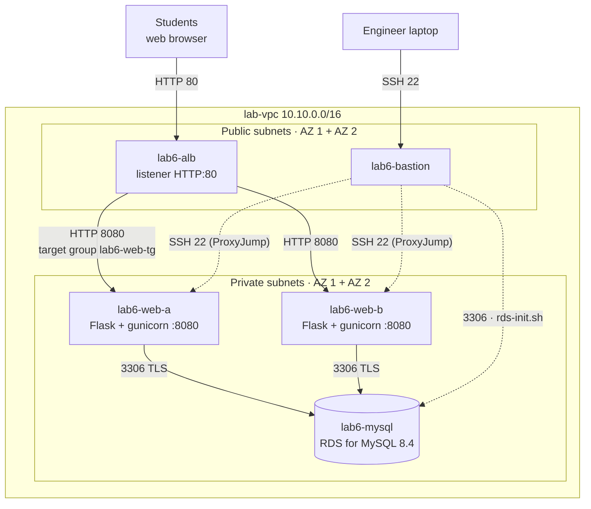
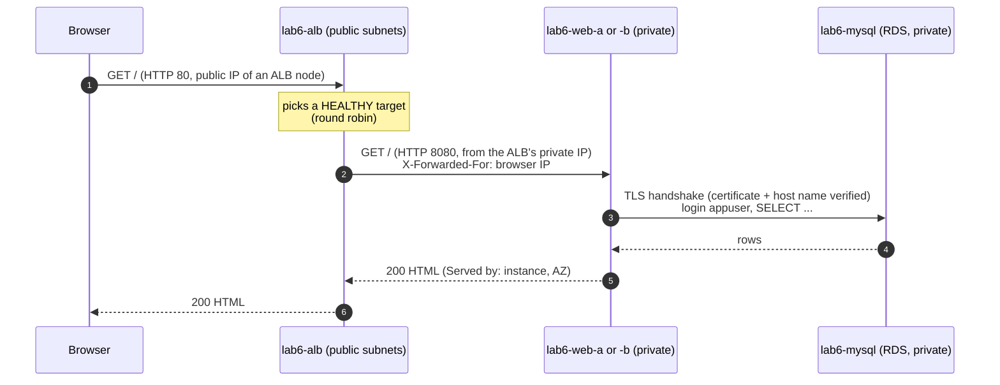
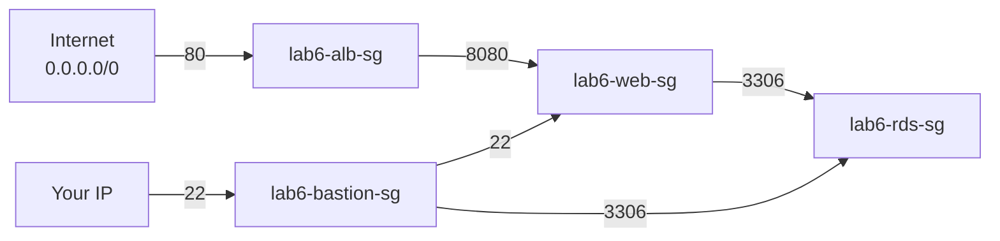

# Lab 6 — Two-Tier Python Web App on Amazon RDS for MySQL, behind an Application Load Balancer

> 🇫🇷 Version française : [RDS-Python-ALB-Lab.fr.md](RDS-Python-ALB-Lab.fr.md)

> **Audience:** Cloud Engineer trainees · **Level:** Associate
> **Starting point:** the **Lab 1** network in `us-west-1`, **including the NAT Gateway** · Lab 3 recommended (RDS basics)
> **Duration:** about 3 hours · **Method:** console + scripts
> **Next:** Lab 7 — the same application in Node.js, deployed the best-practice way

---

## Scenario

*Pacific Learning Co.* has outgrown its single web server. The student registry, a small **Python (Flask)** application, must now:

- run on **two web servers in two Availability Zones**, so losing one server (or one AZ) doesn't stop registrations
- sit behind one stable address: an **Application Load Balancer (ALB)**, the only component reachable from the internet
- store its data in a managed **Amazon RDS for MySQL** database in the **private subnets**, encrypted in transit (TLS)

You'll build each tier by hand in the console, install the application with scripts, then **prove** the design: watch the ALB spread requests, stop a server, cut the database path, and read what the health checks say.

---

## Learning objectives

1. Explain a **two-tier architecture**: presentation/application tier (web servers) and data tier (RDS)
2. Build a **security-group chain**: internet → ALB → web servers → database, where each tier only accepts the one before it
3. Create an **RDS for MySQL** instance in private subnets and initialize it with a least-privilege application account
4. Deploy a **Python** web app as a hardened **systemd** service (non-root user, secrets readable by root only, TLS to the database with certificate verification)
5. Create a **target group** and an **internet-facing ALB** across two AZs
6. Explain **health checks** and the difference between **liveness** and **readiness**
7. Troubleshoot each layer from the error message it produces (502, 504, timeout, access denied, TLS)

---

## 1. Architecture

### 1.0 Full project diagram

```text
┌────────────────────────┐                        ┌──────────────────────────────┐
│ Students (web browser) │                        │ Cloud engineer laptop        │
│ http://<ALB DNS name>  │                        │ ssh lab6-bastion · ProxyJump │
└────────────────────────┘                        └──────────────────────────────┘
              │ HTTP 80                                         │ SSH 22
              ▼                                                 ▼
┌─ AWS Region us-west-1 (N. California) ───────────────────────────────────────────────────────────────────────────────────┐
│ ┌─ lab-vpc 10.10.0.0/16 (existing from Lab 1) ─────────────────────────────────────────────────────────────────────────┐ │
│ │ lab-igw Internet Gateway (existing) · lab-public-rt: 0.0.0.0/0 -> igw                                                │ │
│ │ ┌─ Availability Zone 1 ─────────────────────────────────┐  ┌─ Availability Zone 2 ─────────────────────────────────┐ │ │
│ │ │ ┌─ lab-bastion-subnet 10.10.0.0/28 · PUBLIC ────────┐ │  │ ┌─ (no bastion subnet in AZ 2) ─────────────────────┐ │ │ │
│ │ │ │ ★ lab6-bastion  t3.micro · public IP              │ │  │ │                                                   │ │ │ │
│ │ │ │ ★ sg lab6-bastion-sg  IN 22 <- your IP            │ │  │ │                                                   │ │ │ │
│ │ │ │   runs rds-init.sh (MySQL 8.4 client)             │ │  │ │                                                   │ │ │ │
│ │ │ └───────────────────────────────────────────────────┘ │  │ └───────────────────────────────────────────────────┘ │ │ │
│ │ │       │ SSH 22 · 3306                                 │  │                                                       │ │ │
│ │ │ ┌─ lab-public-a 10.10.1.0/24 · PUBLIC ──────────────┐ │  │ ┌─ lab-public-b 10.10.2.0/24 · PUBLIC ──────────────┐ │ │ │
│ │ │ │ ★ lab6-alb node (AZ 1)                            │ │  │ │ ★ lab6-alb node (AZ 2)                            │ │ │ │
│ │ │ │   lab-nat NAT Gateway (existing)                  │ │  │ │                                                   │ │ │ │
│ │ │ └───────────────────────────────────────────────────┘ │  │ └───────────────────────────────────────────────────┘ │ │ │
│ │ │       │ HTTP 8080 (target)                            │  │       │ HTTP 8080 (target)                            │ │ │
│ │ │ ┌─ lab-private-a 10.10.11.0/24 · PRIVATE ───────────┐ │  │ ┌─ lab-private-b 10.10.12.0/24 · PRIVATE ───────────┐ │ │ │
│ │ │ │ ★ lab6-web-a  t3.micro · no public IP             │ │  │ │ ★ lab6-web-b  t3.micro · no public IP             │ │ │ │
│ │ │ │   Flask + gunicorn :8080 (systemd labapp)         │ │  │ │   Flask + gunicorn :8080 (systemd labapp)         │ │ │ │
│ │ │ │     │ 3306 TLS                                    │ │  │ │                                                   │ │ │ │
│ │ │ │     ▼                                             │ │  │ │                                                   │ │ │ │
│ │ │ │ ★ lab6-mysql  RDS MySQL 8.4 · db.t4g.micro        │ │  │ │                                                   │ │ │ │
│ │ │ │   Single-AZ · :3306 · encrypted · TLS             │ │  │ │   DB subnet group, 2nd AZ (required)              │ │ │ │
│ │ │ └───────────────────────────────────────────────────┘ │  │ └───────────────────────────────────────────────────┘ │ │ │
│ │ └───────────────────────────────────────────────────────┘  └───────────────────────────────────────────────────────┘ │ │
│ │ ┌─ ★ lab6-alb  Application Load Balancer · internet-facing ────────────────────────────────────────────────────────┐ │ │
│ │ │ sg lab6-alb-sg  IN 80 <- 0.0.0.0/0 · listener HTTP:80 -> target group lab6-web-tg                                │ │ │
│ │ │ lab6-web-tg  instances lab6-web-a + lab6-web-b · HTTP:8080 · health check GET /health -> 200                     │ │ │
│ │ └──────────────────────────────────────────────────────────────────────────────────────────────────────────────────┘ │ │
│ │ sg lab6-web-sg  IN 8080 <- lab6-alb-sg                                                                               │ │
│ │                 IN 22 <- lab6-bastion-sg                                                                             │ │
│ │ sg lab6-rds-sg  IN 3306 <- lab6-web-sg, lab6-bastion-sg                                                              │ │
│ │ lab-private-rt: 10.10.0.0/16 -> local · 0.0.0.0/0 -> lab-nat (pip install, RDS CA download)                          │ │
│ └──────────────────────────────────────────────────────────────────────────────────────────────────────────────────────┘ │
│                                                                                                                          │
│ ★ = created in this lab · everything else exists from Lab 1                                                              │
└──────────────────────────────────────────────────────────────────────────────────────────────────────────────────────────┘
```

### 1.1 Architecture diagram (Mermaid)



### 1.2 One request, end to end



### 1.3 Security-group chain



Each arrow is **one inbound rule** whose source is the security group on its left (never an IP range, except the two entry points). A server that isn't in `lab6-web-sg` can't reach the database, even from inside the VPC.

### 1.4 Starting point and what you add

| Already there (Lab 1) | You add in this lab |
|------------------------|---------------------|
| `lab-vpc`, 5 subnets, `lab-igw`, `lab-nat`, `lab-public-rt`, `lab-private-rt` | 4 security groups, key pair `lab6-key` |
| | `lab6-bastion` (public), `lab6-web-a` and `lab6-web-b` (private) |
| | DB subnet group + `lab6-mysql` (RDS for MySQL 8.4) |
| | Target group `lab6-web-tg` + load balancer `lab6-alb` |

### 1.5 Health checks: liveness vs readiness

The application exposes two checks:

| URL | Answers 200 when… | Used by |
|-----|-------------------|---------|
| `/health` (**liveness**) | the web server process works, **even if the database is down** (the JSON says `"db": "unreachable"`) | the **ALB target group** |
| `/health?strict=1` (**readiness**) | the web server works **and** it can query the database (503 otherwise) | you, the setup script, monitoring |

> 🧠 **Why not use the strict check for the ALB?** If the database fails, a strict check marks **every** web server unhealthy at the same moment. Replacing web servers can't fix a database problem, and users would get a bare ALB error instead of a page explaining the issue. You'll test both behaviours in Part 11.

---

## 2. Prerequisites and cost

- The Lab 1 network in `us-west-1`, with **`lab-nat`** working (the private web servers download Python packages through it)
- An SSH client (macOS/Linux Terminal, or Windows 10/11 PowerShell)
- The lab scripts published in your repository (section 3)

| Resource | Approximate cost (us-west-1) | Free Tier |
|----------|------------------------------|-----------|
| 3 × EC2 `t3.micro` | ~$0.012/hour each | 750 h/month for eligible accounts (shared by all instances) |
| RDS `db.t4g.micro`, 20 GB | ~$0.02/hour | Eligible plans/credits, see Lab 3 §2.1 |
| Application Load Balancer | ~$0.025/hour + capacity units | Not free on paid plans |
| Public IPv4 (bastion + 2 ALB nodes) | $0.005/hour each | — |
| NAT Gateway (existing) | ~$0.05/hour + per GB | — |

> 💰 A 3-hour session costs well under $1 on top of the NAT Gateway. Do the **cleanup** (Part 16) the same day.

### 2.1 Lab worksheet

| Item | Value |
|------|-------|
| AZ 1 / AZ 2 names | |
| Bastion public IP | |
| `lab6-web-a` private IP (10.10.11.x) | |
| `lab6-web-b` private IP (10.10.12.x) | |
| RDS master username / password | `admin` / |
| RDS endpoint | |
| `appuser` password (printed by `rds-init.sh`) | |
| ALB DNS name | |

---

## 3. The lab scripts

```
aws-lab-rds-python-alb/
├── RDS-Python-ALB-Lab.en.md        ← this guide
├── RDS-Python-ALB-Lab.fr.md
└── scripts/
    ├── db/
    │   ├── rds-init.sh             runs on the BASTION: MySQL client, network + TLS checks, DB + appuser + data
    │   └── seed.sql                8 courses, 12 students, 28 enrollments (safe to re-run)
    ├── web/
    │   ├── web-setup.sh            runs on EACH web server: Python, venv, app, RDS CA, systemd service, self-tests
    │   ├── app.py                  the Flask application (pages, form, /health)
    │   ├── requirements.txt        pinned packages: Flask, PyMySQL, gunicorn
    │   └── templates/index.html    the page (Jinja2, auto-escaped)
    └── tools/
        └── alb-check.sh            sends N requests to the ALB and counts who answered
```

| Script | What it does |
|--------|--------------|
| [`rds-init.sh`](scripts/db/rds-init.sh) | 1) installs the **MySQL 8.4 client** · 2) checks the endpoint resolves to a **private IP** and that **TCP 3306** is open · 3) downloads the **RDS CA bundle** · 4) logs in as `admin` over TLS (hidden prompt, never saved) · 5) creates database `labapp` and **`appuser`** allowed **only from `10.10.11.%` and `10.10.12.%`** (the web subnets) with SELECT/INSERT/UPDATE/DELETE, loads `seed.sql` · 6) shows the accounts and prints the exact command for the web servers |
| [`web-setup.sh`](scripts/web/web-setup.sh) | 1) reads the instance identity (IMDSv2) · 2) installs Python 3.12 (or 3.11) · 3) downloads the app, creates a **virtual environment** and installs the **pinned** packages · 4) downloads the RDS CA bundle · 5) writes `/etc/labapp/labapp.env` (**root-only**, holds the password) and the systemd service `labapp` (gunicorn, 2 workers, port 8080, user `labapp`) · 6) self-tests: TCP 3306, service status, `/health?strict=1` |
| [`app.py`](scripts/web/app.py) | `GET /` page · `POST /students` (transaction: student + optional enrollment) · `GET /health` (liveness) and `/health?strict=1` (readiness). Each database error comes with a **hint** naming the layer to check |
| [`alb-check.sh`](scripts/tools/alb-check.sh) | `bash alb-check.sh <ALB_DNS> [20]` → table of instance / AZ / database state / HTTP code |

Publish the `scripts/` folder to your repository, for example
`inspiredevgen/devops-worksphops` → `2-Cloud-Infrastructure/aws-lab-rds-python-alb/scripts/`.

---

## Part 1 — Check the existing network

In the console (Region **`us-west-1`**):

- [ ] **VPC → Your VPCs → `lab-vpc`**: *DNS resolution* and *DNS hostnames* are **Enabled** (RDS and the ALB are reached by DNS name).
- [ ] `lab-public-a` and `lab-public-b` are in **different AZs**, associated with `lab-public-rt` (`0.0.0.0/0 → lab-igw`). An internet-facing ALB needs **two public subnets in two AZs**.
- [ ] `lab-private-a` and `lab-private-b` are associated with `lab-private-rt` (`0.0.0.0/0 → lab-nat`).
- [ ] **NAT gateways → `lab-nat`** is *Available*.

Record both AZ names in the worksheet.

---

## Part 2 — Security groups

**VPC → Security groups → Create security group**, VPC **`lab-vpc`**. Create them **in this order** (each one references the previous ones).

| # | Name | Description | Inbound rules |
|---|------|-------------|---------------|
| 1 | `lab6-alb-sg` | `HTTP from the internet to the ALB` | **HTTP** 80 from **Anywhere-IPv4** `0.0.0.0/0` |
| 2 | `lab6-bastion-sg` | `SSH from the admin IP` | **SSH** 22 from **My IP** |
| 3 | `lab6-web-sg` | `App port from the ALB, SSH from the bastion` | **Custom TCP 8080** from **`lab6-alb-sg`** · **SSH** 22 from **`lab6-bastion-sg`** |
| 4 | `lab6-rds-sg` | `MySQL from the web tier and the bastion` | **MYSQL/Aurora** 3306 from **`lab6-web-sg`** · **MYSQL/Aurora** 3306 from **`lab6-bastion-sg`** |

Keep the default outbound rule (all traffic) on all four.

✅ **Checkpoint:** in `lab6-web-sg` and `lab6-rds-sg`, every source is an **`sg-…`** ID. Only `lab6-alb-sg` (80) and `lab6-bastion-sg` (22, your IP) accept addresses.

> 🧠 **Why 8080 and not 80 on the web servers?** The app runs as an unprivileged user (`labapp`), and only root can listen below port 1024. The ALB translates: users see port 80, the servers listen on 8080. Nobody but the ALB can reach 8080.

---

## Part 3 — Key pair and bastion host

### 3.1 Key pair
**EC2 → Key pairs → Create key pair**: name `lab6-key`, type **ED25519**, format **.pem**.

- macOS/Linux: `mv ~/Downloads/lab6-key.pem ~/.ssh/ && chmod 400 ~/.ssh/lab6-key.pem`
- Windows PowerShell:
  ```powershell
  Move-Item "$env:USERPROFILE\Downloads\lab6-key.pem" "$env:USERPROFILE\.ssh\"
  icacls "$env:USERPROFILE\.ssh\lab6-key.pem" /inheritance:r /grant:r "$($env:USERNAME):(R)"
  ```

### 3.2 Launch the bastion
**EC2 → Instances → Launch instances**:

| Setting | Value |
|---------|-------|
| Name | `lab6-bastion` |
| AMI | **Amazon Linux 2023** (64-bit x86) |
| Instance type | `t3.micro` |
| Key pair | `lab6-key` |
| Network settings → **Edit** | VPC `lab-vpc` · Subnet **`lab-bastion-subnet`** · Auto-assign public IP **Enable** |
| Security group | Select existing → **`lab6-bastion-sg`** |
| Advanced details → Metadata version | **V2 only (token required)** |

Record its **public IPv4** in the worksheet.

> ⏱️ Start **Part 4** now: the RDS instance takes 10–15 minutes to create. Come back to Part 5 while it builds.

---

## Part 4 — The database: subnet group and RDS instance

### 4.1 DB subnet group
**RDS → Subnet groups → Create DB subnet group**: name `lab6-db-subnet-group`, VPC `lab-vpc`, AZs **AZ 1 + AZ 2**, subnets **`10.10.11.0/24`** and **`10.10.12.0/24`** only.

### 4.2 Create the database
**RDS → Databases → Create database**:

| Section | Setting | Value |
|---------|---------|-------|
| Creation method | | **Full configuration** |
| Engine | | **MySQL**, latest **8.4.x** |
| Templates | | **Free tier** (or **Dev/Test** with the same small settings) |
| Availability | Deployment | **Single-AZ DB instance deployment (1 instance)** |
| Settings | DB instance identifier | `lab6-mysql` |
| | Master username | `admin` |
| | Credentials management | **Self managed** → strong password (no `/ ' " @` or space) → worksheet |
| Instance configuration | Class | **db.t4g.micro** (or db.t3.micro) |
| Storage | | General Purpose SSD, **20 GiB**, **untick** storage autoscaling |
| Connectivity | Compute resource | Don't connect to an EC2 compute resource |
| | VPC / DB subnet group | `lab-vpc` / **`lab6-db-subnet-group`** |
| | **Public access** | **No** |
| | VPC security group | Choose existing → **`lab6-rds-sg`** only (remove `default`) |
| | Availability Zone | **AZ 1** |
| Monitoring | | Free defaults (no Enhanced Monitoring) |
| Additional configuration | Initial database name | *(leave empty: `rds-init.sh` creates `labapp`)* |
| | Backup retention | **1 day** · Encryption **enabled** · Deletion protection **off** (lab) |

**Create database.**

> 🧠 **Self managed password in this lab, Secrets Manager in Lab 7.** Here you type the passwords and put the app password in a root-only file on each server: simple, and the usual starting point. Lab 7 shows the production way, where no human ever sees them.

---

## Part 5 — Launch the two web servers

**EC2 → Launch instances**, twice, with these values (only the name and subnet change):

| Setting | `lab6-web-a` | `lab6-web-b` |
|---------|--------------|--------------|
| AMI / type | Amazon Linux 2023 · `t3.micro` | same |
| Key pair | `lab6-key` | same |
| Subnet | **`lab-private-a`** | **`lab-private-b`** |
| Auto-assign public IP | **Disable** | **Disable** |
| Security group | **`lab6-web-sg`** | **`lab6-web-sg`** |
| Metadata version | **V2 only** | **V2 only** |

Record both **private IPs**.

### 5.1 SSH configuration with ProxyJump
Add to `~/.ssh/config` (Windows: `C:\Users\<you>\.ssh\config`):

```sshconfig
Host lab6-bastion
    HostName <BASTION_PUBLIC_IP>
    User ec2-user
    IdentityFile ~/.ssh/lab6-key.pem
    IdentitiesOnly yes

Host lab6-web-a
    HostName <WEB_A_PRIVATE_IP>
    User ec2-user
    IdentityFile ~/.ssh/lab6-key.pem
    IdentitiesOnly yes
    ProxyJump lab6-bastion

Host lab6-web-b
    HostName <WEB_B_PRIVATE_IP>
    User ec2-user
    IdentityFile ~/.ssh/lab6-key.pem
    IdentitiesOnly yes
    ProxyJump lab6-bastion
```

Test: `ssh lab6-web-a` then `exit`.

> 🧠 **ProxyJump** opens an SSH session to the bastion and, *through* it, a second one to the private server. The private key never leaves your laptop (much safer than copying it to the bastion).

---

## Part 6 — Initialize the database (from the bastion)

Wait until `lab6-mysql` is **Available**, then copy its **endpoint** (RDS → `lab6-mysql` → *Connectivity & security*).

```bash
ssh lab6-bastion

mkdir -p ~/lab6 && cd ~/lab6
BASE=https://raw.githubusercontent.com/inspiredevgen/devops-worksphops/refs/heads/main/2-Cloud-Infrastructure/aws-lab-rds-python-alb/scripts
curl -fsSLO $BASE/db/rds-init.sh
curl -fsSLO $BASE/db/seed.sql
head -1 rds-init.sh seed.sql        # must show '#!/bin/bash' and '-- File: scripts/db/seed.sql'

bash rds-init.sh <RDS_ENDPOINT>
```

Enter the master password at the hidden prompt. Expected end of the output:

```text
==> 6/6 Accounts and data
+---------+------------+-----------------------+
| User    | Host       | plugin                |
+---------+------------+-----------------------+
| appuser | 10.10.11.% | caching_sha2_password |
| appuser | 10.10.12.% | caching_sha2_password |
+---------+------------+-----------------------+
...
 NEXT: on EACH web server (lab6-web-a and lab6-web-b), run:
   sudo DB_HOST=lab6-mysql.xxxx.us-west-1.rds.amazonaws.com DB_PASSWORD='App#…Aa9' bash web-setup.sh
```

**Copy that `NEXT` command** into the worksheet.

> 🧠 **Discuss:** `appuser` exists only for `10.10.11.%` and `10.10.12.%`. Try it from the bastion (`10.10.0.x`): `mysql -h <RDS_ENDPOINT> -u appuser -p` → **Access denied**. The *network* lets the bastion in (`lab6-rds-sg`), but the *database* refuses this account from there. Two independent controls.

---

## Part 7 — Deploy the application on both web servers

From your laptop, on **`lab6-web-a`**:

```bash
ssh lab6-web-a
BASE=https://raw.githubusercontent.com/inspiredevgen/devops-worksphops/refs/heads/main/2-Cloud-Infrastructure/aws-lab-rds-python-alb/scripts
curl -fsSLO $BASE/web/web-setup.sh
sudo DB_HOST=<RDS_ENDPOINT> DB_PASSWORD='<APPUSER_PASSWORD>' bash web-setup.sh
```

> ⚠️ Keep the **single quotes** around the password: it contains `#`, which the shell would otherwise treat as the start of a comment.

Expected self-tests (step 6/6):

```text
  OK   TCP lab6-mysql.xxxx.us-west-1.rds.amazonaws.com:3306 reachable (lab6-rds-sg allows lab6-web-sg)
  OK   service labapp is running
  Readiness (/health?strict=1):
    {"az":"us-west-1b","db":"reachable","db_tls":"TLS_AES_256_GCM_SHA384","served_by":"i-0abc…","students":12,…}
```

Repeat **the same three commands on `lab6-web-b`**. Its output shows the other AZ.

Explore what the script built (on either server):

```bash
systemctl status labapp --no-pager           # gunicorn master + 2 workers, user labapp
sudo cat /etc/labapp/labapp.env              # root only: try without sudo -> Permission denied
ls -l /etc/labapp/labapp.env                 # -rw------- root root
curl -s localhost:8080/health | python3 -m json.tool
journalctl -u labapp -n 20 --no-pager        # gunicorn access log
```

> 🧠 **Hardening in the service:** the app runs as `labapp` (not root), the password file is readable by **root only** (systemd reads it *before* dropping privileges), packages are **pinned** in `requirements.txt` and isolated in a **virtual environment**, and the connection to RDS verifies the **certificate and the host name** (`ssl_verify_identity`).

---

## Part 8 — Target group

**EC2 → Target groups → Create target group**:

| Setting | Value |
|---------|-------|
| Target type | **Instances** |
| Name | `lab6-web-tg` |
| Protocol / Port | **HTTP / 8080** |
| VPC | `lab-vpc` |
| Health check protocol / path | HTTP · **`/health`** |
| Advanced health check settings | Port *traffic port* · Healthy threshold **2** · Unhealthy threshold **2** · Timeout **5 s** · Interval **10 s** · Success codes **200** |

**Next** → select **`lab6-web-a`** and **`lab6-web-b`** → port **8080** → **Include as pending below** → **Create target group**.

> 🧠 Health checks start only once the target group is attached to a load balancer: until Part 9, the targets show **Unused** (*Target group is not configured to receive traffic from the load balancer*).

---

## Part 9 — Application Load Balancer

**EC2 → Load balancers → Create load balancer → Application Load Balancer**:

| Setting | Value |
|---------|-------|
| Name | `lab6-alb` |
| Scheme | **Internet-facing** |
| IP address type | IPv4 |
| VPC | `lab-vpc` |
| Mappings | **AZ 1 → `lab-public-a`** · **AZ 2 → `lab-public-b`** |
| Security groups | **`lab6-alb-sg`** only (remove `default`) |
| Listener | **HTTP : 80** → Default action: forward to **`lab6-web-tg`** |

**Create load balancer.** Wait until the state is **Active** (2–4 minutes), then copy the **DNS name** into the worksheet. In **Target groups → `lab6-web-tg` → Targets**, both instances become **Healthy** after about 20 seconds.

> ⚠️ Select the **public** subnets. An internet-facing ALB placed in private subnets gets created, but nobody can reach it: its nodes need a route to the internet gateway.

---

## Part 10 — Test through the load balancer

1. Open `http://<ALB_DNS_NAME>/` in a browser. You see the courses, the students and the **Served by** panel.
2. **Refresh** several times (or use a private window): the **AZ badge** and **Web instance** alternate between the two servers. *Request from (ALB)* shows a private `10.10.1.x`/`10.10.2.x` address (an ALB node), and *Client IP (X-Forwarded-For)* shows **your** public IP.
3. **Register a student** (choose a course). The success message names the instance that handled the write. Refresh: the student appears whichever server answers, because **both share the same database**: the web tier is *stateless*.
4. Register the **same email again**: *That email address is already registered* (a `UNIQUE` constraint in MySQL, enforced for both servers).
5. From your laptop, CloudShell or the bastion:

   ```bash
   curl -fsSLO https://raw.githubusercontent.com/inspiredevgen/devops-worksphops/refs/heads/main/2-Cloud-Infrastructure/aws-lab-rds-python-alb/scripts/tools/alb-check.sh
   bash alb-check.sh <ALB_DNS_NAME> 20
   ```
   ```text
     COUNT    INSTANCE               AZ             DATABASE     HTTP
     10       i-0aaa…                us-west-1b     reachable    200
     10       i-0bbb…                us-west-1c     reachable    200
   HTTP 200: 20/20 · errors: 0
   Requests are spread across instances in different AZs: the ALB is load balancing.
   ```

---

## Part 11 — High availability experiments

### 11.1 Lose a web server
On `lab6-web-a`: `sudo systemctl stop labapp`.

- **Target groups → `lab6-web-tg` → Targets**: within ~20 s, `lab6-web-a` turns **Unhealthy** (*Health checks failed*).
- `bash alb-check.sh <ALB> 20`: **all** requests go to `lab6-web-b`; **no errors**.
- Restart it: `sudo systemctl start labapp` → Healthy again after 2 checks.

> 🧠 Between the failure and the 2nd failed check (up to ~20 s), a few requests may still reach `lab6-web-a` and return **502**. Shorter intervals detect failures faster but cost more checks: a classic trade-off.

### 11.2 Lose the database path (liveness)
In **`lab6-rds-sg`**, delete the inbound rule **3306 ← `lab6-web-sg`**.

- The page still loads, from both servers, with a red box: *Cannot reach the database… Hint: Connection timed out: packets are dropped. Check lab6-rds-sg…*
- The targets stay **Healthy**: `/health` is a **liveness** check.
- `curl -s http://<ALB>/health?strict=1` → **HTTP 503**, `"status": "degraded"`.

### 11.3 Same failure with a readiness check (fail open)
Edit the target group health check path to **`/health?strict=1`** and wait 30 seconds.

- Both targets become **Unhealthy**… yet the site still answers! When **all** targets are unhealthy, an ALB **fails open**: it sends traffic to all of them, because something is better than nothing.
- Restore the 3306 rule, then set the path back to **`/health`**.

> 🧠 **Conclusion:** use **liveness** for the load balancer (it decides *where* to send traffic), and **readiness** for monitoring and alarms (it tells you the service is *degraded*). Lab 7 adds Auto Scaling, where this choice becomes even more important: a failing health check makes the group **terminate** instances.

---

## Part 12 — Validation

| # | From | Test | Expected | Proves |
|---|------|------|----------|--------|
| 1 | Browser | `http://<ALB>/` refreshed 10 times | Both instances, 2 AZs | Load balancing across AZs |
| 2 | Laptop | `curl -m5 http://<WEB_A_PRIVATE_IP>:8080/` | ❌ Timeout | Web servers are private |
| 3 | Laptop | `nslookup <RDS_ENDPOINT>` | 10.10.11.x | Database is private |
| 4 | Bastion | `curl -m5 http://<WEB_A_PRIVATE_IP>:8080/health` | ❌ Timeout | 8080 only from `lab6-alb-sg` |
| 5 | Bastion | `mysql -h <RDS_ENDPOINT> -u appuser -p` | ❌ Access denied | `appuser` restricted to the web subnets |
| 6 | `lab6-web-a` | `curl -s localhost:8080/health?strict=1` | `"db_tls": "TLS_…"` | Encryption in transit |
| 7 | `lab6-web-a` | `cat /etc/labapp/labapp.env` (no sudo) | Permission denied | Secret file protected |
| 8 | Console | Target group → Targets | 2 × Healthy | Health checks |
| 9 | Browser | Register a student, refresh | Student visible from both servers | Stateless web tier, shared data tier |
| 10 | `alb-check.sh` | 20 requests | 20 × HTTP 200, 2 instances | End-to-end |

---

## Part 13 — Troubleshooting

### 13.1 Read the HTTP code: it names the layer

| You see | Who produced it | Meaning | Check |
|---------|-----------------|---------|-------|
| Browser spins, then times out | Nobody | Can't reach the ALB | `lab6-alb-sg` 80 from `0.0.0.0/0`; ALB in **public** subnets; listener 80 |
| **503** Service Temporarily Unavailable | ALB | No registered targets in the target group | Targets registered on port 8080 |
| **504** Gateway Time-out | ALB | Target didn't answer in time (packets dropped) | `lab6-web-sg` inbound 8080 **from `lab6-alb-sg`** |
| **502** Bad Gateway | ALB | Connection refused/reset by the target | `systemctl status labapp`; app listening on 8080 |
| Page with *Cannot reach the database* | The app | Web tier fine, data tier not | Read the **Hint** line |

### 13.2 Unhealthy targets: read the reason

**Target groups → `lab6-web-tg` → Targets** → hover the status:

| Reason | Fix |
|--------|-----|
| *Request timed out* | `lab6-web-sg`: 8080 from `lab6-alb-sg` |
| *Health checks failed with these codes: [404]* | Health check path must be `/health` |
| *Connection refused* / *Health checks failed* | Service down: `sudo systemctl restart labapp`, then `journalctl -u labapp -n 50` |
| *Target is in an Availability Zone that is not enabled for the load balancer* | ALB mappings must include the AZ of that instance |

### 13.3 Application hints (`/health?strict=1` → `hint`)

| Hint starts with | Cause | Fix |
|------------------|-------|-----|
| *Connection timed out* | `lab6-rds-sg` misses 3306 from `lab6-web-sg`, or wrong `DB_HOST` | Rule / `/etc/labapp/labapp.env` |
| *Access denied* | Wrong password, or the server's IP doesn't match `10.10.11.%`/`10.10.12.%` | Re-run `web-setup.sh` with the password from `rds-init.sh` (or re-run `rds-init.sh`: it keeps the same password) |
| *TLS problem* | `DB_HOST` is an IP, or the CA bundle is missing | Use the endpoint **name**; re-run `web-setup.sh` |
| *Login OK but no access to DB_NAME* | `rds-init.sh` not run (database or grants missing) | Run `rds-init.sh` |
| *DNS failure* | Typo in the endpoint | Fix `DB_HOST` |

### 13.4 Setup problems

| Problem | Fix |
|---------|-----|
| `web-setup.sh` hangs at step 2 or 3 (`dnf`/`pip`) | The web server has no internet: `lab-private-rt` must route `0.0.0.0/0 → lab-nat`, NAT *Available* |
| `ssh lab6-web-a` times out | `lab6-web-sg` needs SSH 22 **from `lab6-bastion-sg`**; check the private IP in `~/.ssh/config` |
| `syntax error near unexpected token 'newline'` | A web page was downloaded instead of the script: use the **raw.githubusercontent.com** URL with `curl -fsSLO` |
| Changed the password in `labapp.env` by hand, no effect | `sudo systemctl restart labapp` (systemd reads the file at start) |

---

## Part 14 — Break & fix exercises

| # | Break it | Observe | Lesson | Fix |
|---|----------|---------|--------|-----|
| B1 | Remove **8080 ← `lab6-alb-sg`** from `lab6-web-sg` | Both targets *Request timed out* → Unhealthy; the ALB fails open, and users get **504** | The ALB is just another client for the security group | Restore the rule |
| B2 | Health check path → `/status` | *codes: [404]* → Unhealthy | The health check must match a real URL | Path `/health` |
| B3 | On `lab6-web-b`: `sudo systemctl stop labapp` | Only web-a answers, no errors | Redundancy across AZs | `sudo systemctl start labapp` |
| B4 | In `/etc/labapp/labapp.env` on web-a, change one character of `DB_PASSWORD`, restart | Half of the pages show *Access denied* | Config drift between servers: one reason Lab 7 automates deployment | Fix the value, restart |
| B5 | Deregister `lab6-web-a` from the target group | Its requests drain (300 s default), then only web-b answers | **Deregistration delay** lets in-flight requests finish | Register it again |
| B6 | **RDS → `lab6-mysql` → Actions → Reboot** | ~1 min of *Cannot reach the database* pages; recovers alone | The app opens a new connection per request: no restart needed | — |

---

## Part 15 — Extension challenges

**A. HTTPS.** If you own a domain, request an **ACM certificate**, add an **HTTPS:443 listener**, and change the HTTP:80 listener to **redirect** to HTTPS. Add 443 to `lab6-alb-sg`.

**B. Access logs.** Enable ALB **access logs** to an S3 bucket (Lab 4). Find your own requests and the target that answered each one.

**C. Alarm on unhealthy hosts.** Create a CloudWatch alarm on `UnHealthyHostCount ≥ 1` for `lab6-web-tg` (dimension TargetGroup + LoadBalancer) that emails you through SNS. Trigger it with B3.

**D. Stickiness.** Enable **stickiness** (load balancer-generated cookie, 1 minute) on the target group. Refresh: the same instance answers. Why doesn't this app *need* it?

**E. Least-privilege bastion.** Remove `3306 ← lab6-bastion-sg` from `lab6-rds-sg` once the database is initialized. What can you no longer do? When would you add it back?

**F. Prepare for Lab 7.** Create an **AMI** from `lab6-web-a` and a **launch template** that uses it. What would still be manual? (Hint: the password in `labapp.env`.)

---

## Part 16 — Cleanup (in this order)

The network belongs to Lab 1: **delete only Lab 6 resources.**

1. **EC2 → Load balancers**: delete `lab6-alb`.
2. **EC2 → Target groups**: delete `lab6-web-tg`.
3. **EC2 → Instances**: terminate `lab6-web-a`, `lab6-web-b`, `lab6-bastion`.
4. **RDS → Databases → `lab6-mysql` → Delete**: untick *Create final snapshot* and *Retain automated backups*, type `delete me`.
5. **RDS → Subnet groups**: delete `lab6-db-subnet-group` (after the database is gone).
6. **Security groups**, in this order: `lab6-rds-sg`, `lab6-web-sg`, `lab6-alb-sg`, `lab6-bastion-sg` (a group can't be deleted while another group references it).
7. **Key pairs**: delete `lab6-key` (unless you continue with your own variations); remove the `lab6-*` blocks from `~/.ssh/config`.
8. Going on to Lab 7? Keep the Lab 1 network. Otherwise, follow **Lab 1 cleanup** (NAT Gateway and its Elastic IP first).

✅ **Final check:** EC2, Load balancers and RDS are empty of `lab6-*` resources in `us-west-1`.

---

## Part 17 — Review questions

1. What makes this architecture "two-tier", and which tier holds the state?
2. Why does the ALB need two public subnets, while the web servers don't need any public IP?
3. Write the security-group chain from the internet to the database. Why are sources security groups rather than CIDR blocks?
4. A user gets **504** and another gets **502**. What's different, and where do you look for each?
5. Why does the web server listen on 8080, and how does a user still reach it on port 80?
6. What does `X-Forwarded-For` contain, and why does the app need it?
7. Explain liveness vs readiness, and why the ALB uses the liveness check in this lab.
8. All targets are unhealthy, but the site still answers. Why?
9. Name three hardening measures in `web-setup.sh` and the risk each one reduces.
10. What remains manual in this design, and what problems would that cause with 10 servers?

<details>
<summary><b>Answers</b></summary>

1. Tier 1 = presentation + application logic (the Flask servers behind the ALB); tier 2 = data (RDS). The web tier is **stateless**: every piece of state (students, enrollments) lives in RDS, which is why any server can answer any request.
2. An internet-facing ALB creates one **node per enabled AZ**, each with a public IP in that AZ's public subnet. The web servers receive traffic only from those nodes, over private IPs, so they stay in private subnets; their outbound internet (packages) goes through the NAT Gateway.
3. Internet → `lab6-alb-sg` (80) → `lab6-web-sg` (8080, source `lab6-alb-sg`) → `lab6-rds-sg` (3306, source `lab6-web-sg`). SG references follow **roles**: a new web server or a replaced ALB node is allowed automatically, without tracking IP addresses.
4. **504**: the ALB got no answer in time: packets are dropped (security group, or the server is frozen). **502**: the target refused or reset the connection or sent an invalid response: the service is down or crashing. Check `lab6-web-sg` for 504; `systemctl status labapp` / `journalctl` for 502.
5. Ports below 1024 require root, and the app runs as the unprivileged `labapp` user. The ALB listener is on 80 and forwards to the target group port 8080.
6. The browser's public IP. The ALB opens its own connection to the server, so the server only sees the ALB node's IP as the source; the original client IP travels in this header (for logs, rate limiting, geolocation…).
7. **Liveness** = "this process works" (`/health`). **Readiness** = "this instance can serve real requests, dependencies included" (`/health?strict=1`). The ALB decides *where* to send traffic: a database outage affects every server equally, so a readiness check would remove all of them and show users a bare error instead of a helpful page.
8. **Fail open**: when no target is healthy, the ALB routes requests to all registered targets rather than dropping everything.
9. Non-root service user (limits damage of a compromise); root-only env file (other local users and the app's own files can't leak the password); pinned packages in a venv (no surprise upgrades, no conflicts with system Python); TLS with certificate **and** host-name verification (no eavesdropping, no impersonation); systemd `NoNewPrivileges`/`ProtectSystem` (limits privilege escalation and file tampering).
10. Launching servers, running the setup script, typing/copying the database password, registering targets. With 10 servers: slow, error-prone (B4: one wrong password), no self-healing, no scaling, and the password is copied to many places. Lab 7 solves this with a launch template, user data, an Auto Scaling group and Secrets Manager.
</details>
