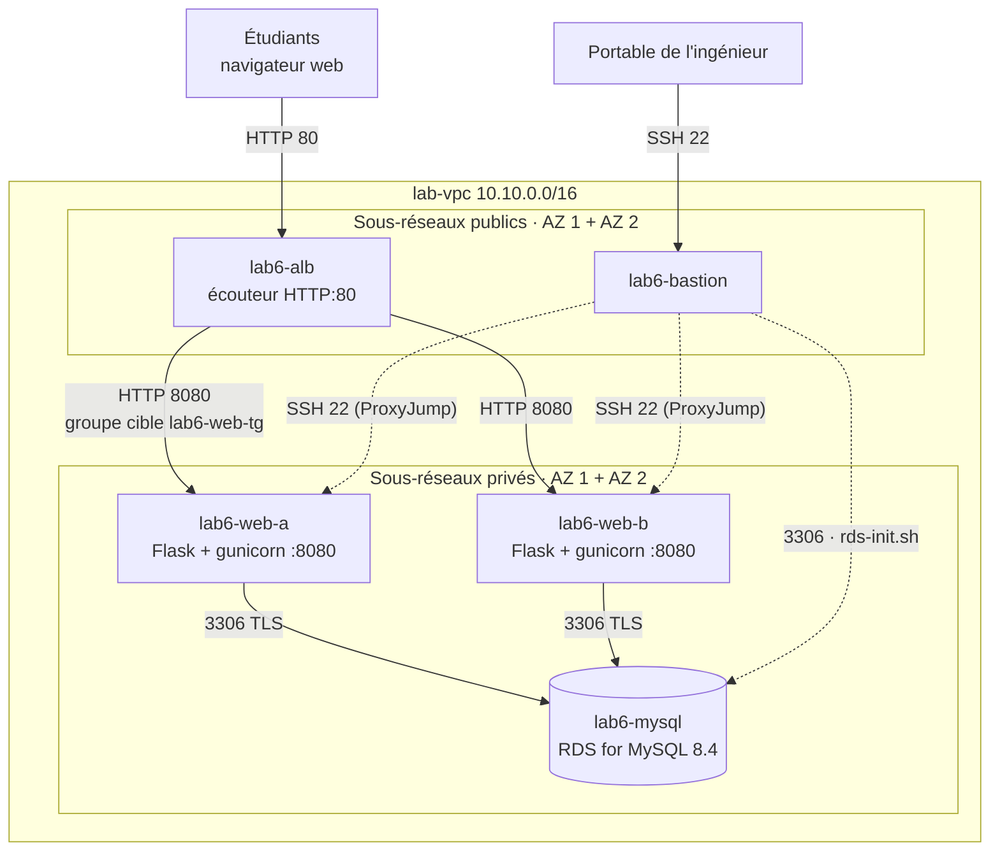
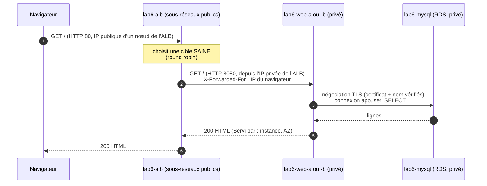
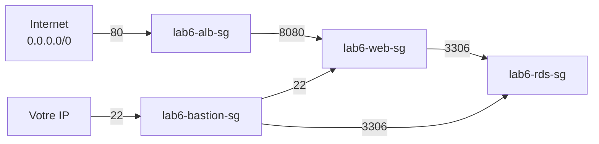

# Lab 6 — Application web Python à deux niveaux sur Amazon RDS for MySQL, derrière un Application Load Balancer

> 🇬🇧 English version: [RDS-Python-ALB-Lab.en.md](RDS-Python-ALB-Lab.en.md)

> **Public :** ingénieurs cloud en formation · **Niveau :** Associate
> **Point de départ :** le réseau du **Lab 1** dans `us-west-1`, **y compris la passerelle NAT** · Lab 3 recommandé (bases de RDS)
> **Durée :** environ 3 heures · **Méthode :** console + scripts
> **Suite :** Lab 7 — la même application en Node.js, déployée selon les bonnes pratiques

---

## Scénario

*Pacific Learning Co.* a dépassé les capacités de son unique serveur web. Le registre des étudiants, une petite application **Python (Flask)**, doit désormais :

- tourner sur **deux serveurs web dans deux zones de disponibilité**, pour que la perte d'un serveur (ou d'une AZ) n'arrête pas les inscriptions
- être accessible à une adresse stable : un **Application Load Balancer (ALB)**, seul composant joignable depuis Internet
- stocker ses données dans une base gérée **Amazon RDS for MySQL**, dans les **sous-réseaux privés**, chiffrée en transit (TLS)

Vous construirez chaque niveau à la main dans la console, installerez l'application avec des scripts, puis **prouverez** la conception : observer l'ALB répartir les requêtes, arrêter un serveur, couper l'accès à la base et lire ce que disent les contrôles de santé.

---

## Objectifs d'apprentissage

1. Expliquer une **architecture à deux niveaux** : niveau présentation/application (serveurs web) et niveau données (RDS)
2. Construire une **chaîne de groupes de sécurité** : Internet → ALB → serveurs web → base de données, chaque niveau n'acceptant que le précédent
3. Créer une instance **RDS for MySQL** dans des sous-réseaux privés et l'initialiser avec un compte applicatif à moindre privilège
4. Déployer une application web **Python** comme service **systemd** durci (utilisateur non root, secret lisible par root seulement, TLS vers la base avec vérification du certificat)
5. Créer un **groupe cible** et un **ALB public** sur deux AZ
6. Expliquer les **contrôles de santé** et la différence entre **vivacité** (*liveness*) et **disponibilité** (*readiness*)
7. Dépanner chaque couche à partir du message d'erreur qu'elle produit (502, 504, délai dépassé, accès refusé, TLS)

---

## 1. Architecture

### 1.0 Schéma complet du projet

```text
┌────────────────────────────┐                    ┌──────────────────────────────┐
│ Étudiants (navigateur web) │                    │ Portable de l'ingénieur      │
│ http://<nom DNS de l'ALB>  │                    │ ssh lab6-bastion · ProxyJump │
└────────────────────────────┘                    └──────────────────────────────┘
              │ HTTP 80                                         │ SSH 22
              ▼                                                 ▼
┌─ Région AWS us-west-1 (Californie du Nord) ──────────────────────────────────────────────────────────────────────────────┐
│ ┌─ lab-vpc 10.10.0.0/16 (existant, Lab 1) ─────────────────────────────────────────────────────────────────────────────┐ │
│ │ lab-igw passerelle Internet (existante) · lab-public-rt : 0.0.0.0/0 -> igw                                           │ │
│ │ ┌─ Zone de disponibilité 1 ─────────────────────────────┐  ┌─ Zone de disponibilité 2 ─────────────────────────────┐ │ │
│ │ │ ┌─ lab-bastion-subnet 10.10.0.0/28 · PUBLIC ────────┐ │  │ ┌─ (pas de sous-réseau bastion en AZ 2) ────────────┐ │ │ │
│ │ │ │ ★ lab6-bastion  t3.micro · IP publique            │ │  │ │                                                   │ │ │ │
│ │ │ │ ★ sg lab6-bastion-sg  ENTRÉE 22 <- votre IP       │ │  │ │                                                   │ │ │ │
│ │ │ │   exécute rds-init.sh (client MySQL 8.4)          │ │  │ │                                                   │ │ │ │
│ │ │ └───────────────────────────────────────────────────┘ │  │ └───────────────────────────────────────────────────┘ │ │ │
│ │ │       │ SSH 22 · 3306                                 │  │                                                       │ │ │
│ │ │ ┌─ lab-public-a 10.10.1.0/24 · PUBLIC ──────────────┐ │  │ ┌─ lab-public-b 10.10.2.0/24 · PUBLIC ──────────────┐ │ │ │
│ │ │ │ ★ nœud lab6-alb (AZ 1)                            │ │  │ │ ★ nœud lab6-alb (AZ 2)                            │ │ │ │
│ │ │ │   lab-nat passerelle NAT (existante)              │ │  │ │                                                   │ │ │ │
│ │ │ └───────────────────────────────────────────────────┘ │  │ └───────────────────────────────────────────────────┘ │ │ │
│ │ │       │ HTTP 8080 (cible)                             │  │       │ HTTP 8080 (cible)                             │ │ │
│ │ │ ┌─ lab-private-a 10.10.11.0/24 · PRIVÉ ─────────────┐ │  │ ┌─ lab-private-b 10.10.12.0/24 · PRIVÉ ─────────────┐ │ │ │
│ │ │ │ ★ lab6-web-a  t3.micro · sans IP publique         │ │  │ │ ★ lab6-web-b  t3.micro · sans IP publique         │ │ │ │
│ │ │ │   Flask + gunicorn :8080 (systemd labapp)         │ │  │ │   Flask + gunicorn :8080 (systemd labapp)         │ │ │ │
│ │ │ │     │ 3306 TLS                                    │ │  │ │                                                   │ │ │ │
│ │ │ │     ▼                                             │ │  │ │                                                   │ │ │ │
│ │ │ │ ★ lab6-mysql  RDS MySQL 8.4 · db.t4g.micro        │ │  │ │                                                   │ │ │ │
│ │ │ │   Mono-AZ · :3306 · chiffrée · TLS                │ │  │ │   groupe de sous-réseaux BD, 2e AZ (requis)       │ │ │ │
│ │ │ └───────────────────────────────────────────────────┘ │  │ └───────────────────────────────────────────────────┘ │ │ │
│ │ └───────────────────────────────────────────────────────┘  └───────────────────────────────────────────────────────┘ │ │
│ │ ┌─ ★ lab6-alb  Application Load Balancer · accessible depuis Internet ─────────────────────────────────────────────┐ │ │
│ │ │ sg lab6-alb-sg  ENTRÉE 80 <- 0.0.0.0/0 · écouteur HTTP:80 -> groupe cible lab6-web-tg                            │ │ │
│ │ │ lab6-web-tg  instances lab6-web-a + lab6-web-b · HTTP:8080 · contrôle GET /health -> 200                         │ │ │
│ │ └──────────────────────────────────────────────────────────────────────────────────────────────────────────────────┘ │ │
│ │ sg lab6-web-sg  ENTRÉE 8080 <- lab6-alb-sg                                                                           │ │
│ │                 ENTRÉE 22 <- lab6-bastion-sg                                                                         │ │
│ │ sg lab6-rds-sg  ENTRÉE 3306 <- lab6-web-sg, lab6-bastion-sg                                                          │ │
│ │ lab-private-rt : 10.10.0.0/16 -> local · 0.0.0.0/0 -> lab-nat (pip install, certificat RDS)                          │ │
│ └──────────────────────────────────────────────────────────────────────────────────────────────────────────────────────┘ │
│                                                                                                                          │
│ ★ = créé dans ce lab · le reste existe depuis le Lab 1                                                                   │
└──────────────────────────────────────────────────────────────────────────────────────────────────────────────────────────┘
```

### 1.1 Schéma d'architecture (Mermaid)



### 1.2 Une requête, de bout en bout



### 1.3 Chaîne de groupes de sécurité



Chaque flèche est **une règle entrante** dont la source est le groupe de sécurité à sa gauche (jamais une plage d'adresses, sauf aux deux points d'entrée). Un serveur qui n'est pas dans `lab6-web-sg` ne peut pas joindre la base, même depuis l'intérieur du VPC.

### 1.4 Point de départ et ajouts

| Déjà en place (Lab 1) | Ajouté dans ce lab |
|------------------------|--------------------|
| `lab-vpc`, 5 sous-réseaux, `lab-igw`, `lab-nat`, `lab-public-rt`, `lab-private-rt` | 4 groupes de sécurité, paire de clés `lab6-key` |
| | `lab6-bastion` (public), `lab6-web-a` et `lab6-web-b` (privés) |
| | Groupe de sous-réseaux BD + `lab6-mysql` (RDS for MySQL 8.4) |
| | Groupe cible `lab6-web-tg` + équilibreur de charge `lab6-alb` |

### 1.5 Contrôles de santé : vivacité ou disponibilité

L'application expose deux contrôles :

| URL | Répond 200 quand… | Utilisé par |
|-----|-------------------|-------------|
| `/health` (**vivacité**) | le processus web fonctionne, **même si la base est en panne** (le JSON indique `"db": "unreachable"`) | le **groupe cible de l'ALB** |
| `/health?strict=1` (**disponibilité**) | le serveur fonctionne **et** peut interroger la base (503 sinon) | vous, le script d'installation, la supervision |

> 🧠 **Pourquoi ne pas utiliser le contrôle strict pour l'ALB ?** Si la base tombe, un contrôle strict déclare **tous** les serveurs web défaillants au même moment. Remplacer des serveurs web ne répare pas une base de données, et les utilisateurs verraient une erreur brute de l'ALB au lieu d'une page qui explique le problème. Vous testerez les deux comportements dans la Partie 11.

---

## 2. Prérequis et coût

- Le réseau du Lab 1 dans `us-west-1`, avec **`lab-nat`** fonctionnel (les serveurs web privés téléchargent les paquets Python à travers lui)
- Un client SSH (Terminal macOS/Linux, ou PowerShell Windows 10/11)
- Les scripts du lab publiés dans votre dépôt (section 3)

| Ressource | Coût approximatif (us-west-1) | Offre gratuite |
|-----------|-------------------------------|----------------|
| 3 × EC2 `t3.micro` | ~0,012 $/heure chacune | 750 h/mois pour les comptes éligibles (partagées entre instances) |
| RDS `db.t4g.micro`, 20 Go | ~0,02 $/heure | Selon le plan/crédits, voir Lab 3 §2.1 |
| Application Load Balancer | ~0,025 $/heure + unités de capacité | Non gratuit sur les plans payants |
| IPv4 publiques (bastion + 2 nœuds ALB) | 0,005 $/heure chacune | — |
| Passerelle NAT (existante) | ~0,05 $/heure + par Go | — |

> 💰 Une séance de 3 heures coûte bien moins de 1 $ en plus de la passerelle NAT. Faites le **nettoyage** (Partie 16) le jour même.

### 2.1 Fiche de travail

| Élément | Valeur |
|---------|--------|
| Noms de l'AZ 1 / AZ 2 | |
| IP publique du bastion | |
| IP privée de `lab6-web-a` (10.10.11.x) | |
| IP privée de `lab6-web-b` (10.10.12.x) | |
| Utilisateur / mot de passe maître RDS | `admin` / |
| Point de terminaison RDS | |
| Mot de passe `appuser` (affiché par `rds-init.sh`) | |
| Nom DNS de l'ALB | |

---

## 3. Les scripts du lab

```
aws-lab-rds-python-alb/
├── RDS-Python-ALB-Lab.en.md
├── RDS-Python-ALB-Lab.fr.md        ← ce guide
└── scripts/
    ├── db/
    │   ├── rds-init.sh             sur le BASTION : client MySQL, tests réseau + TLS, base + appuser + données
    │   └── seed.sql                8 cours, 12 étudiants, 28 inscriptions (relançable)
    ├── web/
    │   ├── web-setup.sh            sur CHAQUE serveur web : Python, venv, appli, CA RDS, service systemd, autotests
    │   ├── app.py                  l'application Flask (pages, formulaire, /health)
    │   ├── requirements.txt        paquets figés : Flask, PyMySQL, gunicorn
    │   └── templates/index.html    la page (Jinja2, échappement automatique)
    └── tools/
        └── alb-check.sh            envoie N requêtes à l'ALB et compte qui a répondu
```

| Script | Ce qu'il fait |
|--------|---------------|
| [`rds-init.sh`](scripts/db/rds-init.sh) | 1) installe le **client MySQL 8.4** · 2) vérifie que le point de terminaison résout vers une **IP privée** et que **TCP 3306** est ouvert · 3) télécharge le **bundle CA RDS** · 4) se connecte en `admin` via TLS (saisie masquée, jamais enregistrée) · 5) crée la base `labapp` et **`appuser`**, autorisé **uniquement depuis `10.10.11.%` et `10.10.12.%`** (les sous-réseaux web) avec SELECT/INSERT/UPDATE/DELETE, charge `seed.sql` · 6) affiche les comptes et la commande exacte pour les serveurs web |
| [`web-setup.sh`](scripts/web/web-setup.sh) | 1) lit l'identité de l'instance (IMDSv2) · 2) installe Python 3.12 (ou 3.11) · 3) télécharge l'appli, crée un **environnement virtuel** et installe les paquets **figés** · 4) télécharge le bundle CA RDS · 5) écrit `/etc/labapp/labapp.env` (**root uniquement**, contient le mot de passe) et le service systemd `labapp` (gunicorn, 2 workers, port 8080, utilisateur `labapp`) · 6) autotests : TCP 3306, état du service, `/health?strict=1` |
| [`app.py`](scripts/web/app.py) | page `GET /` · `POST /students` (transaction : étudiant + inscription facultative) · `GET /health` (vivacité) et `/health?strict=1` (disponibilité). Chaque erreur de base est accompagnée d'un **indice** nommant la couche à vérifier |
| [`alb-check.sh`](scripts/tools/alb-check.sh) | `bash alb-check.sh <DNS_ALB> [20]` → tableau instance / AZ / état de la base / code HTTP |

Publiez le dossier `scripts/` dans votre dépôt, par exemple
`inspiredevgen/devops-worksphops` → `2-Cloud-Infrastructure/aws-lab-rds-python-alb/scripts/`.

---

## Partie 1 — Vérifier le réseau existant

Dans la console (Région **`us-west-1`**) :

- [ ] **VPC → Vos VPC → `lab-vpc`** : *Résolution DNS* et *Noms d'hôte DNS* sont **activés** (RDS et l'ALB sont joints par nom DNS).
- [ ] `lab-public-a` et `lab-public-b` sont dans **deux AZ différentes**, associés à `lab-public-rt` (`0.0.0.0/0 → lab-igw`). Un ALB public exige **deux sous-réseaux publics dans deux AZ**.
- [ ] `lab-private-a` et `lab-private-b` sont associés à `lab-private-rt` (`0.0.0.0/0 → lab-nat`).
- [ ] **Passerelles NAT → `lab-nat`** est *Disponible*.

Notez les deux noms d'AZ dans la fiche de travail.

---

## Partie 2 — Groupes de sécurité

**VPC → Groupes de sécurité → Créer un groupe de sécurité**, VPC **`lab-vpc`**. Créez-les **dans cet ordre** (chacun référence les précédents).

| # | Nom | Description | Règles entrantes |
|---|-----|-------------|------------------|
| 1 | `lab6-alb-sg` | `HTTP from the internet to the ALB` | **HTTP** 80 depuis **Anywhere-IPv4** `0.0.0.0/0` |
| 2 | `lab6-bastion-sg` | `SSH from the admin IP` | **SSH** 22 depuis **Mon IP** |
| 3 | `lab6-web-sg` | `App port from the ALB, SSH from the bastion` | **TCP personnalisé 8080** depuis **`lab6-alb-sg`** · **SSH** 22 depuis **`lab6-bastion-sg`** |
| 4 | `lab6-rds-sg` | `MySQL from the web tier and the bastion` | **MYSQL/Aurora** 3306 depuis **`lab6-web-sg`** · **MYSQL/Aurora** 3306 depuis **`lab6-bastion-sg`** |

Conservez la règle sortante par défaut (tout le trafic) sur les quatre.

✅ **Point de contrôle :** dans `lab6-web-sg` et `lab6-rds-sg`, chaque source est un identifiant **`sg-…`**. Seuls `lab6-alb-sg` (80) et `lab6-bastion-sg` (22, votre IP) acceptent des adresses.

> 🧠 **Pourquoi 8080 et pas 80 sur les serveurs web ?** L'application tourne sous un utilisateur non privilégié (`labapp`), et seul root peut écouter sous le port 1024. L'ALB traduit : les utilisateurs voient le port 80, les serveurs écoutent sur 8080. Personne d'autre que l'ALB ne peut joindre 8080.

---

## Partie 3 — Paire de clés et bastion

### 3.1 Paire de clés
**EC2 → Paires de clés → Créer une paire de clés** : nom `lab6-key`, type **ED25519**, format **.pem**.

- macOS/Linux : `mv ~/Downloads/lab6-key.pem ~/.ssh/ && chmod 400 ~/.ssh/lab6-key.pem`
- PowerShell Windows :
  ```powershell
  Move-Item "$env:USERPROFILE\Downloads\lab6-key.pem" "$env:USERPROFILE\.ssh\"
  icacls "$env:USERPROFILE\.ssh\lab6-key.pem" /inheritance:r /grant:r "$($env:USERNAME):(R)"
  ```

### 3.2 Lancer le bastion
**EC2 → Instances → Lancer des instances** :

| Paramètre | Valeur |
|-----------|--------|
| Nom | `lab6-bastion` |
| AMI | **Amazon Linux 2023** (x86 64 bits) |
| Type d'instance | `t3.micro` |
| Paire de clés | `lab6-key` |
| Paramètres réseau → **Modifier** | VPC `lab-vpc` · Sous-réseau **`lab-bastion-subnet`** · Attribution automatique d'IP publique **Activer** |
| Groupe de sécurité | Sélectionner existant → **`lab6-bastion-sg`** |
| Détails avancés → Version des métadonnées | **V2 uniquement (jeton requis)** |

Notez son **IPv4 publique** dans la fiche.

> ⏱️ Commencez la **Partie 4** maintenant : l'instance RDS met 10 à 15 minutes à se créer. Passez à la Partie 5 pendant ce temps.

---

## Partie 4 — La base de données : groupe de sous-réseaux et instance RDS

### 4.1 Groupe de sous-réseaux BD
**RDS → Groupes de sous-réseaux → Créer un groupe de sous-réseaux de base de données** : nom `lab6-db-subnet-group`, VPC `lab-vpc`, AZ **AZ 1 + AZ 2**, sous-réseaux **`10.10.11.0/24`** et **`10.10.12.0/24`** uniquement.

### 4.2 Créer la base
**RDS → Bases de données → Créer une base de données** :

| Section | Paramètre | Valeur |
|---------|-----------|--------|
| Méthode de création | | **Configuration complète** |
| Moteur | | **MySQL**, dernière **8.4.x** |
| Modèles | | **Offre gratuite** (ou **Dev/Test** avec les mêmes petits réglages) |
| Disponibilité | Déploiement | **Instance de base de données mono-AZ (1 instance)** |
| Paramètres | Identifiant | `lab6-mysql` |
| | Nom d'utilisateur principal | `admin` |
| | Gestion des informations d'identification | **Autogéré** → mot de passe robuste (sans `/ ' " @` ni espace) → fiche |
| Configuration de l'instance | Classe | **db.t4g.micro** (ou db.t3.micro) |
| Stockage | | SSD à usage général, **20 Gio**, **décochez** la mise à l'échelle automatique |
| Connectivité | Ressource de calcul | Ne pas se connecter à une ressource de calcul EC2 |
| | VPC / groupe de sous-réseaux | `lab-vpc` / **`lab6-db-subnet-group`** |
| | **Accès public** | **Non** |
| | Groupe de sécurité VPC | Choisir existant → **`lab6-rds-sg`** seul (retirez `default`) |
| | Zone de disponibilité | **AZ 1** |
| Surveillance | | Valeurs gratuites par défaut (pas de surveillance améliorée) |
| Configuration supplémentaire | Nom de base initial | *(vide : `rds-init.sh` crée `labapp`)* |
| | Rétention des sauvegardes | **1 jour** · Chiffrement **activé** · Protection contre la suppression **désactivée** (lab) |

**Créer la base de données.**

> 🧠 **Mot de passe autogéré dans ce lab, Secrets Manager dans le Lab 7.** Ici, vous saisissez les mots de passe et placez celui de l'appli dans un fichier lisible par root sur chaque serveur : simple, et c'est le point de départ habituel. Le Lab 7 montre la méthode de production, où aucun humain ne les voit.

---

## Partie 5 — Lancer les deux serveurs web

**EC2 → Lancer des instances**, deux fois, avec ces valeurs (seuls le nom et le sous-réseau changent) :

| Paramètre | `lab6-web-a` | `lab6-web-b` |
|-----------|--------------|--------------|
| AMI / type | Amazon Linux 2023 · `t3.micro` | idem |
| Paire de clés | `lab6-key` | idem |
| Sous-réseau | **`lab-private-a`** | **`lab-private-b`** |
| Attribution d'IP publique | **Désactiver** | **Désactiver** |
| Groupe de sécurité | **`lab6-web-sg`** | **`lab6-web-sg`** |
| Version des métadonnées | **V2 uniquement** | **V2 uniquement** |

Notez les deux **IP privées**.

### 5.1 Configuration SSH avec ProxyJump
Ajoutez à `~/.ssh/config` (Windows : `C:\Users\<vous>\.ssh\config`) :

```sshconfig
Host lab6-bastion
    HostName <IP_PUBLIQUE_BASTION>
    User ec2-user
    IdentityFile ~/.ssh/lab6-key.pem
    IdentitiesOnly yes

Host lab6-web-a
    HostName <IP_PRIVEE_WEB_A>
    User ec2-user
    IdentityFile ~/.ssh/lab6-key.pem
    IdentitiesOnly yes
    ProxyJump lab6-bastion

Host lab6-web-b
    HostName <IP_PRIVEE_WEB_B>
    User ec2-user
    IdentityFile ~/.ssh/lab6-key.pem
    IdentitiesOnly yes
    ProxyJump lab6-bastion
```

Test : `ssh lab6-web-a` puis `exit`.

> 🧠 **ProxyJump** ouvre une session SSH vers le bastion puis, *à travers* elle, une seconde vers le serveur privé. La clé privée ne quitte jamais votre portable (bien plus sûr que de la copier sur le bastion).

---

## Partie 6 — Initialiser la base (depuis le bastion)

Attendez que `lab6-mysql` soit **Disponible**, puis copiez son **point de terminaison** (RDS → `lab6-mysql` → *Connectivité et sécurité*).

```bash
ssh lab6-bastion

mkdir -p ~/lab6 && cd ~/lab6
BASE=https://raw.githubusercontent.com/inspiredevgen/devops-worksphops/refs/heads/main/2-Cloud-Infrastructure/aws-lab-rds-python-alb/scripts
curl -fsSLO $BASE/db/rds-init.sh
curl -fsSLO $BASE/db/seed.sql
head -1 rds-init.sh seed.sql        # doit afficher '#!/bin/bash' et '-- File: scripts/db/seed.sql'

bash rds-init.sh <POINT_DE_TERMINAISON_RDS>
```

Saisissez le mot de passe maître à l'invite masquée. Fin de sortie attendue :

```text
==> 6/6 Accounts and data
+---------+------------+-----------------------+
| User    | Host       | plugin                |
+---------+------------+-----------------------+
| appuser | 10.10.11.% | caching_sha2_password |
| appuser | 10.10.12.% | caching_sha2_password |
+---------+------------+-----------------------+
...
 NEXT: on EACH web server (lab6-web-a and lab6-web-b), run:
   sudo DB_HOST=lab6-mysql.xxxx.us-west-1.rds.amazonaws.com DB_PASSWORD='App#…Aa9' bash web-setup.sh
```

**Copiez cette commande `NEXT`** dans la fiche.

> 🧠 **À discuter :** `appuser` n'existe que pour `10.10.11.%` et `10.10.12.%`. Essayez depuis le bastion (`10.10.0.x`) : `mysql -h <POINT_DE_TERMINAISON_RDS> -u appuser -p` → **Access denied**. Le *réseau* laisse entrer le bastion (`lab6-rds-sg`), mais la *base* refuse ce compte depuis là. Deux contrôles indépendants.

---

## Partie 7 — Déployer l'application sur les deux serveurs web

Depuis votre portable, sur **`lab6-web-a`** :

```bash
ssh lab6-web-a
BASE=https://raw.githubusercontent.com/inspiredevgen/devops-worksphops/refs/heads/main/2-Cloud-Infrastructure/aws-lab-rds-python-alb/scripts
curl -fsSLO $BASE/web/web-setup.sh
sudo DB_HOST=<POINT_DE_TERMINAISON_RDS> DB_PASSWORD='<MOT_DE_PASSE_APPUSER>' bash web-setup.sh
```

> ⚠️ Gardez les **apostrophes** autour du mot de passe : il contient `#`, que le shell traiterait sinon comme le début d'un commentaire.

Autotests attendus (étape 6/6) :

```text
  OK   TCP lab6-mysql.xxxx.us-west-1.rds.amazonaws.com:3306 reachable (lab6-rds-sg allows lab6-web-sg)
  OK   service labapp is running
  Readiness (/health?strict=1):
    {"az":"us-west-1b","db":"reachable","db_tls":"TLS_AES_256_GCM_SHA384","served_by":"i-0abc…","students":12,…}
```

Répétez **les trois mêmes commandes sur `lab6-web-b`**. Sa sortie montre l'autre AZ.

Explorez ce que le script a construit (sur l'un ou l'autre serveur) :

```bash
systemctl status labapp --no-pager           # maître gunicorn + 2 workers, utilisateur labapp
sudo cat /etc/labapp/labapp.env              # root seulement : essayez sans sudo -> Permission denied
ls -l /etc/labapp/labapp.env                 # -rw------- root root
curl -s localhost:8080/health | python3 -m json.tool
journalctl -u labapp -n 20 --no-pager        # journal d'accès gunicorn
```

> 🧠 **Durcissement du service :** l'appli tourne sous `labapp` (pas root), le fichier du mot de passe n'est lisible **que par root** (systemd le lit *avant* de baisser les privilèges), les paquets sont **figés** dans `requirements.txt` et isolés dans un **environnement virtuel**, et la connexion à RDS vérifie **le certificat et le nom d'hôte** (`ssl_verify_identity`).

---

## Partie 8 — Groupe cible

**EC2 → Groupes cibles → Créer un groupe cible** :

| Paramètre | Valeur |
|-----------|--------|
| Type de cible | **Instances** |
| Nom | `lab6-web-tg` |
| Protocole / Port | **HTTP / 8080** |
| VPC | `lab-vpc` |
| Contrôle de santé : protocole / chemin | HTTP · **`/health`** |
| Paramètres avancés du contrôle | Port *trafic* · Seuil sain **2** · Seuil défaillant **2** · Délai **5 s** · Intervalle **10 s** · Codes de réussite **200** |

**Suivant** → sélectionnez **`lab6-web-a`** et **`lab6-web-b`** → port **8080** → **Inclure comme en attente ci-dessous** → **Créer un groupe cible**.

> 🧠 Les contrôles de santé ne démarrent qu'une fois le groupe cible attaché à un équilibreur de charge : jusqu'à la Partie 9, les cibles sont **Inutilisées** (*Target group is not configured to receive traffic from the load balancer*).

---

## Partie 9 — Application Load Balancer

**EC2 → Équilibreurs de charge → Créer un équilibreur de charge → Application Load Balancer** :

| Paramètre | Valeur |
|-----------|--------|
| Nom | `lab6-alb` |
| Schéma | **Accessible sur Internet** |
| Type d'adresse IP | IPv4 |
| VPC | `lab-vpc` |
| Mappages | **AZ 1 → `lab-public-a`** · **AZ 2 → `lab-public-b`** |
| Groupes de sécurité | **`lab6-alb-sg`** seul (retirez `default`) |
| Écouteur | **HTTP : 80** → action par défaut : transférer vers **`lab6-web-tg`** |

**Créer l'équilibreur de charge.** Attendez l'état **Actif** (2 à 4 minutes), puis copiez le **nom DNS** dans la fiche. Dans **Groupes cibles → `lab6-web-tg` → Cibles**, les deux instances deviennent **Saines** en 20 secondes environ.

> ⚠️ Choisissez les sous-réseaux **publics**. Un ALB public placé dans des sous-réseaux privés est bien créé, mais personne ne peut le joindre : ses nœuds ont besoin d'une route vers la passerelle Internet.

---

## Partie 10 — Tester à travers l'équilibreur de charge

1. Ouvrez `http://<NOM_DNS_ALB>/` dans un navigateur. Vous voyez les cours, les étudiants et le panneau **Served by**.
2. **Actualisez** plusieurs fois (ou utilisez une fenêtre privée) : le **badge d'AZ** et **Web instance** alternent entre les deux serveurs. *Request from (ALB)* montre une adresse privée `10.10.1.x`/`10.10.2.x` (un nœud de l'ALB), et *Client IP (X-Forwarded-For)* montre **votre** IP publique.
3. **Inscrivez un étudiant** (choisissez un cours). Le message de succès nomme l'instance qui a traité l'écriture. Actualisez : l'étudiant apparaît quel que soit le serveur qui répond, car **les deux partagent la même base** : le niveau web est *sans état*.
4. Inscrivez **le même e-mail** à nouveau : *That email address is already registered* (une contrainte `UNIQUE` dans MySQL, appliquée pour les deux serveurs).
5. Depuis votre portable, CloudShell ou le bastion :

   ```bash
   curl -fsSLO https://raw.githubusercontent.com/inspiredevgen/devops-worksphops/refs/heads/main/2-Cloud-Infrastructure/aws-lab-rds-python-alb/scripts/tools/alb-check.sh
   bash alb-check.sh <NOM_DNS_ALB> 20
   ```
   ```text
     COUNT    INSTANCE               AZ             DATABASE     HTTP
     10       i-0aaa…                us-west-1b     reachable    200
     10       i-0bbb…                us-west-1c     reachable    200
   HTTP 200: 20/20 · errors: 0
   Requests are spread across instances in different AZs: the ALB is load balancing.
   ```

---

## Partie 11 — Expériences de haute disponibilité

### 11.1 Perdre un serveur web
Sur `lab6-web-a` : `sudo systemctl stop labapp`.

- **Groupes cibles → `lab6-web-tg` → Cibles** : en ~20 s, `lab6-web-a` devient **Défaillante** (*Health checks failed*).
- `bash alb-check.sh <ALB> 20` : **toutes** les requêtes vont vers `lab6-web-b` ; **aucune erreur**.
- Redémarrez-le : `sudo systemctl start labapp` → de nouveau Sain après 2 contrôles.

> 🧠 Entre la panne et le 2e contrôle échoué (jusqu'à ~20 s), quelques requêtes peuvent encore atteindre `lab6-web-a` et renvoyer **502**. Des intervalles plus courts détectent plus vite mais coûtent plus de contrôles : un compromis classique.

### 11.2 Perdre l'accès à la base (vivacité)
Dans **`lab6-rds-sg`**, supprimez la règle entrante **3306 ← `lab6-web-sg`**.

- La page se charge toujours, depuis les deux serveurs, avec un encadré rouge : *Cannot reach the database… Hint: Connection timed out: packets are dropped. Check lab6-rds-sg…*
- Les cibles restent **Saines** : `/health` est un contrôle de **vivacité**.
- `curl -s http://<ALB>/health?strict=1` → **HTTP 503**, `"status": "degraded"`.

### 11.3 Même panne avec un contrôle de disponibilité (*fail open*)
Modifiez le chemin du contrôle de santé du groupe cible en **`/health?strict=1`** et attendez 30 secondes.

- Les deux cibles deviennent **Défaillantes**… et pourtant le site répond encore ! Quand **toutes** les cibles sont défaillantes, un ALB **s'ouvre** (*fail open*) : il envoie le trafic à toutes, car mieux vaut quelque chose que rien.
- Restaurez la règle 3306, puis remettez le chemin à **`/health`**.

> 🧠 **Conclusion :** utilisez la **vivacité** pour l'équilibreur de charge (il décide *où* envoyer le trafic), et la **disponibilité** pour la supervision et les alarmes (elle vous dit que le service est *dégradé*). Le Lab 7 ajoute l'Auto Scaling, où ce choix devient encore plus important : un contrôle de santé en échec fait **résilier** des instances par le groupe.

---

## Partie 12 — Validation

| # | Depuis | Test | Attendu | Prouve |
|---|--------|------|---------|--------|
| 1 | Navigateur | `http://<ALB>/` actualisé 10 fois | Les deux instances, 2 AZ | Répartition entre AZ |
| 2 | Portable | `curl -m5 http://<IP_PRIVEE_WEB_A>:8080/` | ❌ Délai dépassé | Les serveurs web sont privés |
| 3 | Portable | `nslookup <POINT_DE_TERMINAISON_RDS>` | 10.10.11.x | La base est privée |
| 4 | Bastion | `curl -m5 http://<IP_PRIVEE_WEB_A>:8080/health` | ❌ Délai dépassé | 8080 uniquement depuis `lab6-alb-sg` |
| 5 | Bastion | `mysql -h <POINT_DE_TERMINAISON_RDS> -u appuser -p` | ❌ Access denied | `appuser` limité aux sous-réseaux web |
| 6 | `lab6-web-a` | `curl -s localhost:8080/health?strict=1` | `"db_tls": "TLS_…"` | Chiffrement en transit |
| 7 | `lab6-web-a` | `cat /etc/labapp/labapp.env` (sans sudo) | Permission denied | Fichier secret protégé |
| 8 | Console | Groupe cible → Cibles | 2 × Saine | Contrôles de santé |
| 9 | Navigateur | Inscrire un étudiant, actualiser | Visible depuis les deux serveurs | Niveau web sans état, niveau données partagé |
| 10 | `alb-check.sh` | 20 requêtes | 20 × HTTP 200, 2 instances | De bout en bout |

---

## Partie 13 — Dépannage

### 13.1 Lisez le code HTTP : il nomme la couche

| Vous voyez | Produit par | Signification | Vérifier |
|------------|-------------|---------------|----------|
| Le navigateur tourne puis expire | Personne | ALB injoignable | `lab6-alb-sg` 80 depuis `0.0.0.0/0` ; ALB dans les sous-réseaux **publics** ; écouteur 80 |
| **503** Service Temporarily Unavailable | ALB | Aucune cible enregistrée dans le groupe | Cibles enregistrées sur le port 8080 |
| **504** Gateway Time-out | ALB | La cible n'a pas répondu à temps (paquets ignorés) | `lab6-web-sg` entrée 8080 **depuis `lab6-alb-sg`** |
| **502** Bad Gateway | ALB | Connexion refusée/réinitialisée par la cible | `systemctl status labapp` ; appli à l'écoute sur 8080 |
| Page avec *Cannot reach the database* | L'appli | Niveau web OK, niveau données non | Lisez la ligne **Hint** |

### 13.2 Cibles défaillantes : lisez la raison

**Groupes cibles → `lab6-web-tg` → Cibles** → survolez l'état :

| Raison | Correction |
|--------|------------|
| *Request timed out* | `lab6-web-sg` : 8080 depuis `lab6-alb-sg` |
| *Health checks failed with these codes: [404]* | Le chemin doit être `/health` |
| *Connection refused* / *Health checks failed* | Service arrêté : `sudo systemctl restart labapp`, puis `journalctl -u labapp -n 50` |
| *Target is in an Availability Zone that is not enabled for the load balancer* | Les mappages de l'ALB doivent inclure l'AZ de cette instance |

### 13.3 Indices de l'application (`/health?strict=1` → `hint`)

| L'indice commence par | Cause | Correction |
|-----------------------|-------|------------|
| *Connection timed out* | `lab6-rds-sg` sans 3306 depuis `lab6-web-sg`, ou mauvais `DB_HOST` | Règle / `/etc/labapp/labapp.env` |
| *Access denied* | Mauvais mot de passe, ou l'IP du serveur ne correspond pas à `10.10.11.%`/`10.10.12.%` | Relancez `web-setup.sh` avec le mot de passe de `rds-init.sh` (ou relancez `rds-init.sh` : il garde le même mot de passe) |
| *TLS problem* | `DB_HOST` est une IP, ou le bundle CA manque | Utilisez le **nom** du point de terminaison ; relancez `web-setup.sh` |
| *Login OK but no access to DB_NAME* | `rds-init.sh` non exécuté (base ou droits absents) | Exécutez `rds-init.sh` |
| *DNS failure* | Faute de frappe dans le point de terminaison | Corrigez `DB_HOST` |

### 13.4 Problèmes d'installation

| Problème | Correction |
|----------|------------|
| `web-setup.sh` bloque à l'étape 2 ou 3 (`dnf`/`pip`) | Le serveur n'a pas Internet : `lab-private-rt` doit router `0.0.0.0/0 → lab-nat`, NAT *Disponible* |
| `ssh lab6-web-a` expire | `lab6-web-sg` doit autoriser SSH 22 **depuis `lab6-bastion-sg`** ; vérifiez l'IP privée dans `~/.ssh/config` |
| `syntax error near unexpected token 'newline'` | Une page web a été téléchargée à la place du script : utilisez l'URL **raw.githubusercontent.com** avec `curl -fsSLO` |
| Mot de passe modifié à la main dans `labapp.env`, sans effet | `sudo systemctl restart labapp` (systemd lit le fichier au démarrage) |

---

## Partie 14 — Exercices « casser et réparer »

| # | Cassez | Observez | Leçon | Réparez |
|---|--------|----------|-------|---------|
| B1 | Retirez **8080 ← `lab6-alb-sg`** de `lab6-web-sg` | Les deux cibles *Request timed out* → Défaillantes ; l'ALB s'ouvre et les utilisateurs reçoivent **504** | L'ALB n'est qu'un client de plus pour le groupe de sécurité | Restaurez la règle |
| B2 | Chemin du contrôle → `/status` | *codes: [404]* → Défaillante | Le contrôle doit viser une URL réelle | Chemin `/health` |
| B3 | Sur `lab6-web-b` : `sudo systemctl stop labapp` | Seul web-a répond, aucune erreur | Redondance entre AZ | `sudo systemctl start labapp` |
| B4 | Dans `/etc/labapp/labapp.env` sur web-a, changez un caractère de `DB_PASSWORD`, redémarrez | La moitié des pages affichent *Access denied* | Dérive de configuration entre serveurs : une raison pour laquelle le Lab 7 automatise le déploiement | Corrigez, redémarrez |
| B5 | Désinscrivez `lab6-web-a` du groupe cible | Ses requêtes se vident (300 s par défaut), puis seul web-b répond | Le **délai de désinscription** laisse finir les requêtes en cours | Réinscrivez-la |
| B6 | **RDS → `lab6-mysql` → Actions → Redémarrer** | ~1 min de pages *Cannot reach the database* ; rétablissement seul | L'appli ouvre une connexion par requête : pas de redémarrage nécessaire | — |

---

## Partie 15 — Défis d'extension

**A. HTTPS.** Si vous possédez un domaine, demandez un **certificat ACM**, ajoutez un **écouteur HTTPS:443**, et changez l'écouteur HTTP:80 en **redirection** vers HTTPS. Ajoutez 443 à `lab6-alb-sg`.

**B. Journaux d'accès.** Activez les **journaux d'accès** de l'ALB vers un compartiment S3 (Lab 4). Retrouvez vos propres requêtes et la cible qui a répondu à chacune.

**C. Alarme sur les hôtes défaillants.** Créez une alarme CloudWatch `UnHealthyHostCount ≥ 1` pour `lab6-web-tg` (dimensions TargetGroup + LoadBalancer) qui vous envoie un e-mail via SNS. Déclenchez-la avec B3.

**D. Persistance de session.** Activez la **persistance** (*stickiness*, cookie généré par l'équilibreur, 1 minute) sur le groupe cible. Actualisez : la même instance répond. Pourquoi cette appli n'en a-t-elle *pas besoin* ?

**E. Bastion à moindre privilège.** Retirez `3306 ← lab6-bastion-sg` de `lab6-rds-sg` une fois la base initialisée. Que ne pouvez-vous plus faire ? Quand l'ajouteriez-vous de nouveau ?

**F. Préparer le Lab 7.** Créez une **AMI** à partir de `lab6-web-a` et un **modèle de lancement** qui l'utilise. Que resterait-il de manuel ? (Indice : le mot de passe dans `labapp.env`.)

---

## Partie 16 — Nettoyage (dans cet ordre)

Le réseau appartient au Lab 1 : **supprimez uniquement les ressources du Lab 6.**

1. **EC2 → Équilibreurs de charge** : supprimez `lab6-alb`.
2. **EC2 → Groupes cibles** : supprimez `lab6-web-tg`.
3. **EC2 → Instances** : résiliez `lab6-web-a`, `lab6-web-b`, `lab6-bastion`.
4. **RDS → Bases de données → `lab6-mysql` → Supprimer** : décochez *Créer un instantané final* et *Conserver les sauvegardes automatisées*, tapez `delete me`.
5. **RDS → Groupes de sous-réseaux** : supprimez `lab6-db-subnet-group` (une fois la base supprimée).
6. **Groupes de sécurité**, dans cet ordre : `lab6-rds-sg`, `lab6-web-sg`, `lab6-alb-sg`, `lab6-bastion-sg` (un groupe référencé par un autre ne peut pas être supprimé).
7. **Paires de clés** : supprimez `lab6-key` ; retirez les blocs `lab6-*` de `~/.ssh/config`.
8. Vous enchaînez avec le Lab 7 ? Gardez le réseau du Lab 1. Sinon, suivez le **nettoyage du Lab 1** (passerelle NAT et son IP Elastic d'abord).

✅ **Vérification finale :** EC2, Équilibreurs de charge et RDS ne contiennent plus de ressources `lab6-*` dans `us-west-1`.

---

## Partie 17 — Questions de révision

1. Qu'est-ce qui rend cette architecture « à deux niveaux », et quel niveau détient l'état ?
2. Pourquoi l'ALB a-t-il besoin de deux sous-réseaux publics, alors que les serveurs web n'ont besoin d'aucune IP publique ?
3. Écrivez la chaîne de groupes de sécurité d'Internet jusqu'à la base. Pourquoi les sources sont-elles des groupes de sécurité plutôt que des blocs CIDR ?
4. Un utilisateur reçoit **504** et un autre **502**. Quelle différence, et où regardez-vous pour chacun ?
5. Pourquoi le serveur web écoute-t-il sur 8080, et comment un utilisateur l'atteint-il quand même sur le port 80 ?
6. Que contient `X-Forwarded-For`, et pourquoi l'appli en a-t-elle besoin ?
7. Expliquez vivacité et disponibilité, et pourquoi l'ALB utilise ici le contrôle de vivacité.
8. Toutes les cibles sont défaillantes, mais le site répond encore. Pourquoi ?
9. Citez trois mesures de durcissement de `web-setup.sh` et le risque que chacune réduit.
10. Qu'est-ce qui reste manuel dans cette conception, et quels problèmes cela poserait-il avec 10 serveurs ?

<details>
<summary><b>Réponses</b></summary>

1. Niveau 1 = présentation + logique applicative (les serveurs Flask derrière l'ALB) ; niveau 2 = données (RDS). Le niveau web est **sans état** : tout l'état (étudiants, inscriptions) vit dans RDS, c'est pourquoi n'importe quel serveur peut répondre à n'importe quelle requête.
2. Un ALB public crée **un nœud par AZ activée**, chacun avec une IP publique dans le sous-réseau public de cette AZ. Les serveurs web ne reçoivent du trafic que de ces nœuds, via des IP privées : ils restent donc dans des sous-réseaux privés ; leur accès sortant (paquets) passe par la passerelle NAT.
3. Internet → `lab6-alb-sg` (80) → `lab6-web-sg` (8080, source `lab6-alb-sg`) → `lab6-rds-sg` (3306, source `lab6-web-sg`). Les références de SG suivent des **rôles** : un nouveau serveur web ou un nœud d'ALB remplacé est autorisé automatiquement, sans suivre d'adresses IP.
4. **504** : l'ALB n'a pas reçu de réponse à temps : des paquets sont ignorés (groupe de sécurité, ou serveur figé). **502** : la cible a refusé ou réinitialisé la connexion ou renvoyé une réponse invalide : le service est arrêté ou plante. Vérifiez `lab6-web-sg` pour 504 ; `systemctl status labapp` / `journalctl` pour 502.
5. Les ports sous 1024 exigent root, et l'appli tourne sous l'utilisateur non privilégié `labapp`. L'écouteur de l'ALB est sur 80 et transfère vers le port 8080 du groupe cible.
6. L'IP publique du navigateur. L'ALB ouvre sa propre connexion vers le serveur, qui ne voit donc que l'IP du nœud de l'ALB comme source ; l'IP d'origine voyage dans cet en-tête (journaux, limitation de débit, géolocalisation…).
7. **Vivacité** = « ce processus fonctionne » (`/health`). **Disponibilité** = « cette instance peut servir de vraies requêtes, dépendances comprises » (`/health?strict=1`). L'ALB décide *où* envoyer le trafic : une panne de base touche tous les serveurs de la même façon ; un contrôle de disponibilité les retirerait tous et montrerait aux utilisateurs une erreur brute au lieu d'une page utile.
8. ***Fail open*** : quand aucune cible n'est saine, l'ALB envoie les requêtes à toutes les cibles enregistrées au lieu de tout rejeter.
9. Utilisateur de service non root (limite les dégâts d'une compromission) ; fichier d'environnement lisible par root seulement (les autres utilisateurs locaux et les fichiers de l'appli ne peuvent pas divulguer le mot de passe) ; paquets figés dans un venv (pas de mise à jour surprise, pas de conflit avec le Python système) ; TLS avec vérification du certificat **et** du nom d'hôte (pas d'écoute, pas d'usurpation) ; `NoNewPrivileges`/`ProtectSystem` de systemd (limite l'élévation de privilèges et la modification de fichiers).
10. Lancer les serveurs, exécuter le script d'installation, saisir/copier le mot de passe de la base, inscrire les cibles. Avec 10 serveurs : lent, source d'erreurs (B4 : un seul mot de passe faux), pas d'auto-réparation, pas de mise à l'échelle, et le mot de passe copié en de nombreux endroits. Le Lab 7 résout cela avec un modèle de lancement, des données utilisateur, un groupe Auto Scaling et Secrets Manager.
</details>
