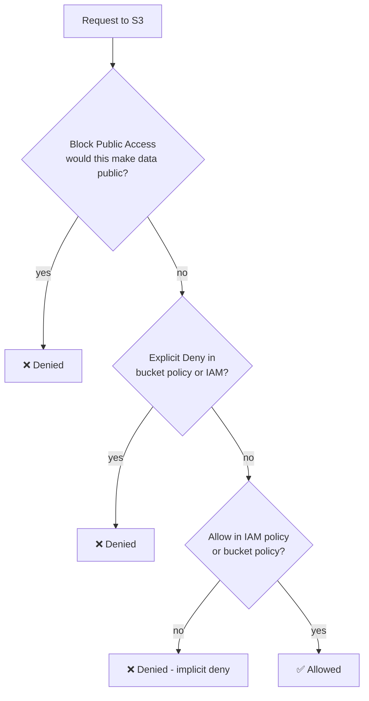
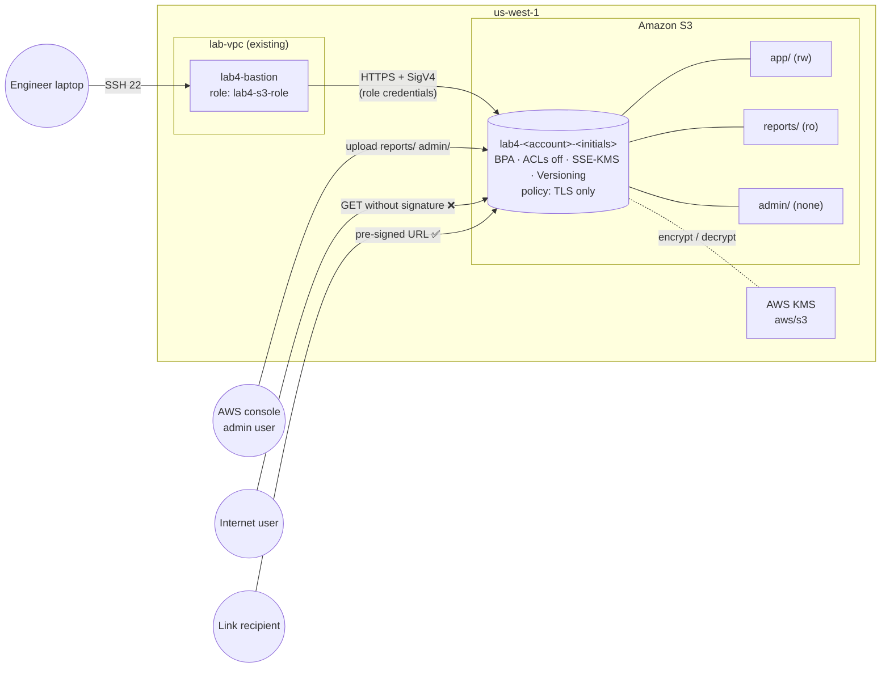
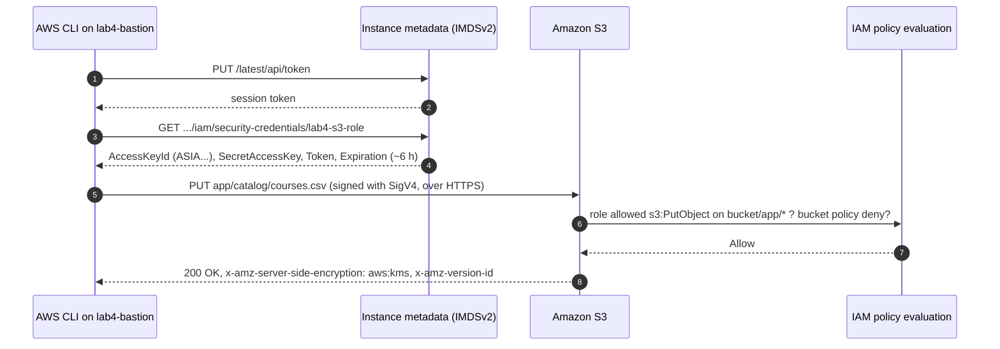
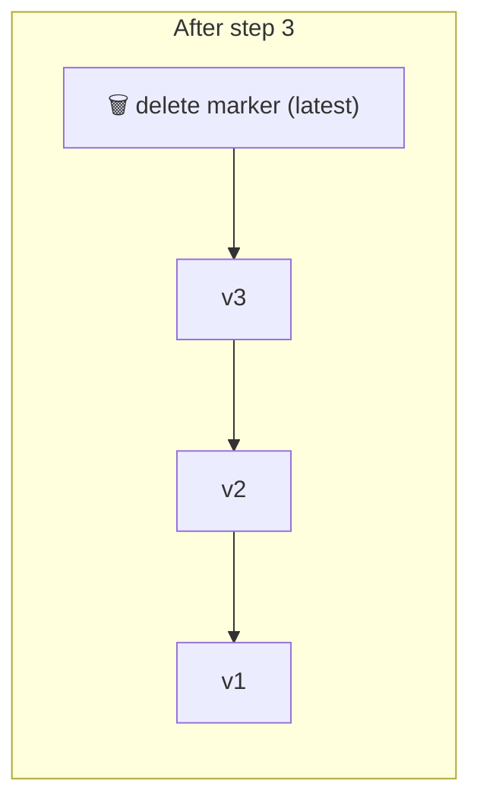

# Lab 4 — Amazon S3 Core & Security: Buckets, Objects, Encryption, Versioning, Policies and Pre-signed URLs

> 🇫🇷 Version française : [S3-Core-Security-Lab.fr.md](S3-Core-Security-Lab.fr.md)

> **Audience:** Cloud Engineer trainees · **Level:** Foundational → Associate
> **Starting point:** the **Lab 1** network in `us-west-1` (VPC, public bastion subnet, Internet Gateway)
> **Duration:** about 2.5 hours · **Method:** AWS Management Console + scripts run on a bastion with an IAM role
> **Next:** Lab 5 — S3 private access from a VPC (gateway endpoint), storage classes and lifecycle

---

## Scenario

*Pacific Learning Co.* needs a place to store its course catalogue, application configuration, monthly reports and confidential HR files. You will create one **Amazon S3 bucket** that follows the company's security baseline:

- **Nothing is public, ever**, even by mistake.
- **Everything is encrypted**, at rest and in transit.
- **Deleted or overwritten files can be recovered.**
- The application gets **only the access it needs**: it writes to its own area, reads reports, and never sees HR data.
- Files can be **shared temporarily** with people outside AWS, without making them public.

---

## Learning objectives

1. Explain S3's building blocks: **buckets, objects, keys, prefixes, metadata, Regions**
2. Create a bucket with the secure defaults: **Block Public Access**, **ACLs disabled**, **SSE-KMS + Bucket Key**, **Versioning**
3. Give an EC2 instance S3 access with an **IAM role** (no access keys), scoped **by prefix**
4. Write a **bucket policy** that enforces **TLS**, and see Block Public Access reject a public policy
5. Use **versioning** to recover overwritten and deleted objects, and explain **delete markers**
6. Share private objects with **pre-signed URLs**, and explain their limits
7. Validate the whole configuration with an automated test script

---

## 1. Concepts in 5 minutes

| Concept | What it is | Example in this lab |
|---------|-----------|---------------------|
| **Bucket** | Container for objects. Name **globally unique**, data stored in **one Region** | `lab4-123456789012-ab` in `us-west-1` |
| **Object** | A file (0 B to 5 TB) + metadata | `courses.csv` |
| **Key** | The object's full name inside the bucket | `app/catalog/courses.csv` |
| **Prefix** | The beginning of a key. "Folders" are just prefixes; S3 has no real directories | `app/`, `reports/`, `admin/` |
| **Metadata** | System (Content-Type, size, ETag…) and user-defined (`x-amz-meta-*`) | `owner=lab4` |
| **Version ID** | Unique ID of each version of an object (when versioning is enabled) | `3sL4kqtJlcpXroDTDmJ.rmSpXd3dIbrHY` |
| **Durability / availability** | 99.999999999 % durability (11 nines), data in ≥ 3 AZs for S3 Standard | — |

### 1.1 Who can access an object? (evaluation order)



Three rules: **everything is denied by default**, an **Allow** opens access, and an **explicit Deny always wins**. Block Public Access sits on top: it can block public grants even when a policy allows them.

### 1.2 Encryption options

| Option | Keys managed by | Audit in CloudTrail | Cost | Used here |
|--------|-----------------|--------------------|------|-----------|
| **SSE-S3** (AES-256) | S3 | No key-usage events | Free | Default for every new bucket since 2023 |
| **SSE-KMS** with `aws/s3` key | AWS KMS (AWS managed key) | Yes (`Decrypt`, `GenerateDataKey`) | KMS requests; reduced by **S3 Bucket Key** | ✅ |
| **SSE-KMS** with a customer managed key | You (key policy, rotation, disable) | Yes | + $1/month per key | Challenge B |
| **DSSE-KMS** | Two layers of KMS encryption | Yes | Higher | — |
| **SSE-C** | You send the key with each request | — | — | — |
| **In transit** | TLS (HTTPS) | — | — | Enforced by bucket policy |

> 🧠 **S3 Bucket Key:** without it, S3 calls KMS for every object, which adds cost and can hit request limits. With it, S3 gets a short-lived bucket-level key from KMS and derives per-object keys locally, cutting KMS requests by up to 99 %.

---

## 2. Architecture

### 2.0 Full project diagram

```text
   ┌────────────────────────────┐                        ┌────────────────────────────┐
   │ Cloud engineer laptop      │                        │ AWS console (admin user)   │
   │ ssh lab4-bastion           │                        │ uploads reports/ + admin/  │
   └────────────────────────────┘                        └────────────────────────────┘
                 │ SSH 22                                       │ HTTPS (console)
┌─ AWS Region us-west-1 (N. California) ───────────────────────────────────────────────────────────────────┐
│ ┌─ lab-vpc 10.10.0.0/16 (existing from Lab 1) ─────────────────────────────────────────────────────────┐ │
│ │       ┌─ lab-igw  Internet Gateway (existing) ───────────────────┐                                   │ │
│ │       │ bastion -> S3 public endpoint over HTTPS                 │                                   │ │
│ │       └──────────────────────────────────────────────────────────┘                                   │ │
│ │                                   │                                                                  │ │
│ │ ┌─ lab-bastion-subnet 10.10.0.0/28 · PUBLIC (existing) ──────────────┐                               │ │
│ │ │ ★ lab4-bastion  t3.micro · Amazon Linux 2023 · AWS CLI             │                               │ │
│ │ │ ★ sg lab4-bastion-sg   IN 22 <- your IP /32                        │                               │ │
│ │ │ ★ instance profile lab4-s3-role (temporary credentials)            │                               │ │
│ │ │   runs s3-explore / versioning / presign / security-tests          │                               │ │
│ │ └────────────────────────────────────────────────────────────────────┘                               │ │
│ │                                                                                                      │ │
│ │ lab-public-rt: 0.0.0.0/0 -> lab-igw (NAT Gateway not needed in this lab)                             │ │
│ └──────────────────────────────────────────────────────────────────────────────────────────────────────┘ │
│                                   │ HTTPS 443 (TLS) · signed with lab4-s3-role                           │
│                                   ▼                                                                      │
│ ┌─ Amazon S3 (regional service, outside the VPC) · https://s3.us-west-1.amazonaws.com ─────────────────┐ │
│ │ ┌─ ★ lab4-<account-id>-<initials>   general purpose bucket ────────────────────────────────────────┐ │ │
│ │ │ Block Public Access  ON (4/4)        Object Ownership  Bucket owner enforced (ACLs off)          │ │ │
│ │ │ Default encryption   SSE-KMS (aws/s3) + S3 Bucket Key        Versioning  Enabled                 │ │ │
│ │ │ Bucket policy        DenyInsecureTransport (aws:SecureTransport = false -> Deny)                 │ │ │
│ │ │                                                                                                  │ │ │
│ │ │ ┌─ lab4-s3-role permissions by prefix ─┐                                                         │ │ │
│ │ │ │ app/      read + write               │                                                         │ │ │
│ │ │ │ reports/  read only                  │                                                         │ │ │
│ │ │ │ admin/    no access                  │                                                         │ │ │
│ │ │ └──────────────────────────────────────┘                                                         │ │ │
│ │ └──────────────────────────────────────────────────────────────────────────────────────────────────┘ │ │
│ └──────────────────────────────────────────────────────────────────────────────────────────────────────┘ │
│                                                                                                          │
│ ┌─ IAM · KMS ──────────────────────────────────────────────────────────────────────────────────────────┐ │
│ │ ★ IAM role lab4-s3-role  ·  trust: ec2.amazonaws.com  ·  inline policy lab4-s3-access                │ │
│ │ AWS KMS  aws/s3 (AWS managed key)  ·  data keys cached per bucket (S3 Bucket Key)                    │ │
│ └──────────────────────────────────────────────────────────────────────────────────────────────────────┘ │
│                                                                                                          │
│ ★ = created in this lab · everything else exists from Lab 1                                              │
└──────────────────────────────────────────────────────────────────────────────────────────────────────────┘
                 ▲                                              ▲
                 │ denied (403)                                 │ allowed
   ┌────────────────────────────┐                        ┌────────────────────────────┐
   │ Anyone on the internet     │                        │ Recipient of a link        │
   │ plain URL or http://       │                        │ pre-signed URL (HTTPS)     │
   └────────────────────────────┘                        └────────────────────────────┘
```

### 2.1 Architecture diagram (Mermaid)



### 2.2 How the bastion gets permission (no access keys)



### 2.3 What you build

| # | Resource | Name |
|---|----------|------|
| 1 | S3 bucket (secure settings) | `lab4-<account-id>-<initials>` |
| 2 | IAM role + inline policy | `lab4-s3-role` / `lab4-s3-access` |
| 3 | Security group, key pair, EC2 bastion | `lab4-bastion-sg`, `lab4-key`, `lab4-bastion` |
| 4 | Objects in three zones | `app/`, `reports/`, `admin/` |
| 5 | Bucket policy | `DenyInsecureTransport` |

### 2.4 Permission zones

| Prefix | Content | Admin (console) | `lab4-s3-role` (application) |
|--------|---------|-----------------|------------------------------|
| `app/` | Catalogue, config, images | Full | **Read + write + delete** (creates delete markers) |
| `reports/` | Monthly reports | Full | **Read only** |
| `admin/` | HR / payroll | Full | **No access** (can see key names in a listing, can't read) |
| bucket settings | Policy, encryption, BPA, versioning | Full | **Read only** (to run the tests) |

---

## 3. Prerequisites and cost

- The Lab 1 network in `us-west-1`: `lab-vpc`, `lab-bastion-subnet` (auto-assign public IPv4 on) associated with `lab-public-rt` (`0.0.0.0/0 → lab-igw`). The NAT Gateway is **not** needed.
- An SSH client · your **AWS account ID** (12 digits, top-right menu of the console)

| Item | Approx. cost |
|------|--------------|
| S3 storage (a few KB) and requests | Fractions of a cent |
| KMS requests to `aws/s3` (reduced by Bucket Key) | Fractions of a cent |
| `lab4-bastion` t3.micro + public IPv4 | ~$0.02/hour (Free Tier-eligible instance) |

### 3.1 Lab worksheet

| Item | Value |
|------|-------|
| AWS account ID | |
| Your initials (lowercase) | |
| Bucket name `lab4-<account-id>-<initials>` | |
| Bastion public IP | |

---

## 4. The lab scripts

```
aws-lab-s3-core-security/
├── S3-Core-Security-Lab.en.md / .fr.md
└── scripts/
    ├── common.sh                 shared helpers (sourced by the other scripts)
    ├── s3-explore.sh             objects, prefixes, metadata, encryption, the 3 permission zones
    ├── s3-versioning-demo.sh     versions, delete markers, undelete, rollback
    ├── s3-presign-demo.sh        pre-signed URLs: valid, tampered, HTTP, expired
    ├── s3-security-tests.sh      20 automated checks of the whole configuration
    ├── s3-cleanup.sh             empties a VERSIONED bucket (run in CloudShell)
    ├── policies/
    │   ├── lab4-s3-role-policy.json    IAM policy for lab4-s3-role
    │   └── lab4-bucket-policy.json     bucket policy (TLS only)
    └── sample-data/
        ├── enrollments-2026-10.txt     uploaded by you to reports/
        └── payroll.csv                 uploaded by you to admin/
```

Publish the folder to your repository (for example `2-Cloud-Infrastructure/aws-lab-s3-core-security/`), and download the `scripts/` folder to your laptop too: you need `policies/` and `sample-data/` in the console.

> 🛡️ **The security tests are safe:** the "must be denied" tests only re-apply each setting's *current* value. Even with a misconfigured, too-powerful role, running them never weakens the bucket.

---

## Part 1 — Check the starting point

In **`us-west-1`**:
- [ ] **VPC → Subnets → `lab-bastion-subnet`**: route table `lab-public-rt` with `0.0.0.0/0 → igw-…`; *Auto-assign public IPv4* = Yes.
- [ ] Note your **account ID** and choose your **bucket name**: `lab4-<account-id>-<initials>` (lowercase, digits and hyphens only). Write it in the worksheet.

> 🧠 **Why the account ID in the name?** Bucket names are **globally unique across all AWS accounts**. Including your account ID avoids collisions, and makes the owner obvious in logs.

---

## Part 2 — Create the bucket with secure settings

**S3 → Create bucket** (check that the Region selector shows **US West (N. California) us-west-1**):

| Setting | Value | Why |
|---------|-------|-----|
| Bucket type | **General purpose** | Standard S3 bucket (directory buckets are for S3 Express One Zone) |
| Bucket name | `lab4-<account-id>-<initials>` | Globally unique |
| **Object Ownership** | **ACLs disabled (recommended)**: *Bucket owner enforced* | Access is controlled only by policies; ACLs can't grant anything |
| **Block Public Access** | ✅ **Block all public access** (all 4 boxes) | Guardrail: no ACL or policy can make data public |
| **Bucket Versioning** | **Enable** | Overwrites and deletes become recoverable |
| Tags | `Project = lab4` | Cost allocation and cleanup |
| **Default encryption** | **SSE-KMS** · key: **AWS managed key (`aws/s3`)** | Encrypt every object, with KMS audit |
| **Bucket Key** | **Enable** | Fewer KMS calls, lower cost |
| Advanced → Object Lock | Disable | WORM retention, covered in Challenge C (only at creation time) |

**Create bucket.**

### 2.1 Explore the bucket's tabs
Open the bucket and look at each tab:

| Tab | Look at |
|-----|---------|
| **Objects** | Empty. Note the **Create folder** button |
| **Properties** | Region, ARN (`arn:aws:s3:::lab4-…`), Versioning *Enabled*, Default encryption *SSE-KMS*, Bucket Key *Enabled* |
| **Permissions** | Block Public Access *On*, Bucket policy *empty*, Object Ownership *Bucket owner enforced* |
| **Metrics / Management** | Storage metrics (updated daily), lifecycle rules (Lab 5) |

---

## Part 3 — IAM role for the application

### 3.1 Prepare the policy
Open `scripts/policies/lab4-s3-role-policy.json` and replace **every** `BUCKET_NAME` with your bucket name (3 places).

```json
{
  "Version": "2012-10-17",
  "Statement": [
    { "Sid": "BucketLevelReadOnly", "Effect": "Allow",
      "Action": ["s3:ListBucket", "s3:ListBucketVersions", "s3:GetBucketLocation", "s3:GetBucketVersioning",
                 "s3:GetBucketPolicy", "s3:GetBucketPublicAccessBlock", "s3:GetBucketOwnershipControls",
                 "s3:GetEncryptionConfiguration"],
      "Resource": "arn:aws:s3:::BUCKET_NAME" },
    { "Sid": "AppZoneReadWrite", "Effect": "Allow",
      "Action": ["s3:GetObject", "s3:GetObjectVersion", "s3:PutObject", "s3:DeleteObject"],
      "Resource": "arn:aws:s3:::BUCKET_NAME/app/*" },
    { "Sid": "ReportsZoneReadOnly", "Effect": "Allow",
      "Action": ["s3:GetObject", "s3:GetObjectVersion"],
      "Resource": "arn:aws:s3:::BUCKET_NAME/reports/*" }
  ]
}
```

> 🧠 **Two kinds of resources:** bucket-level actions (`ListBucket`, `Get*Configuration`) apply to `arn:aws:s3:::bucket`; object-level actions (`GetObject`, `PutObject`) apply to `arn:aws:s3:::bucket/key`. Putting `ListBucket` on `bucket/*` is a classic mistake: listing then fails with *AccessDenied*.
>
> 🧠 **What's missing on purpose:** no `admin/*`, no `s3:PutObjectAcl`, no `s3:DeleteObjectVersion` (permanent deletes), no `s3:PutBucket*` or `s3:DeleteBucket*`. Least privilege means granting only what the application needs.
>
> 🧠 **No KMS permission needed?** Objects use the AWS managed key `aws/s3`. Its key policy lets any principal in your account use it **through S3**. A customer managed key would also need `kms:Decrypt` / `kms:GenerateDataKey` (Challenge B).

### 3.2 Create the role
1. **IAM → Roles → Create role** → Trusted entity **AWS service** → Use case **EC2** → **Next** → skip the managed policies → **Next**.
2. Role name: **`lab4-s3-role`** → **Create role**.
3. Open the role → **Add permissions → Create inline policy → JSON** → paste your edited policy → **Next** → name **`lab4-s3-access`** → **Create policy**.

---

## Part 4 — Bastion host with the role

1. **Security group** `lab4-bastion-sg` (VPC `lab-vpc`): inbound **SSH 22 from My IP**.
2. **Key pair** `lab4-key` (ED25519, `.pem`) → move to `~/.ssh/` → `chmod 400 ~/.ssh/lab4-key.pem` (Windows: `icacls … /inheritance:r /grant:r "$($env:USERNAME):(R)"`).
3. **Launch instance** `lab4-bastion`:

| Setting | Value |
|---------|-------|
| AMI / type | Amazon Linux 2023 · `t3.micro` |
| Key pair | `lab4-key` |
| Network | VPC `lab-vpc` · subnet **`lab-bastion-subnet`** · public IP **Enable** · SG **`lab4-bastion-sg`** |
| Advanced → **IAM instance profile** | **`lab4-s3-role`** |
| Advanced → Metadata version | **V2 only** |

4. `~/.ssh/config`:

```sshconfig
Host lab4-bastion
    HostName <BASTION_PUBLIC_IP>
    User ec2-user
    IdentityFile ~/.ssh/lab4-key.pem
    IdentitiesOnly yes
```

5. Test the role:

```bash
ssh lab4-bastion
aws sts get-caller-identity          # Arn: ...:assumed-role/lab4-s3-role/i-0abc...
aws s3 ls                            # AccessDenied: the role can't list ALL buckets (s3:ListAllMyBuckets)
aws s3 ls s3://<BUCKET_NAME>         # works (empty for now)
ls ~/.aws 2>/dev/null || echo "no ~/.aws folder: no access keys stored on this server"
```

> 🧠 `aws s3 ls` without a bucket calls `ListAllMyBuckets`, which the role doesn't have. That's least privilege in action, not an error in your setup.

---

## Part 5 — Upload the administrator's files (console)

You act as the **administrator** here: your console user has full access.

1. **Objects → Create folder** → name `reports` → **Create folder**. Open `reports/` → **Upload → Add files** → `sample-data/enrollments-2026-10.txt` → **Upload**.
2. Same for **`admin/`** with `sample-data/payroll.csv`.
3. Open `reports/enrollments-2026-10.txt` → **Properties**: note *Server-side encryption: SSE-KMS*, *Bucket Key: Enabled*, *Storage class: Standard*, and the **Version ID**.
4. Click **Open** → the file displays (the console uses a temporary pre-signed link).
5. Copy the **Object URL** (`https://<bucket>.s3.us-west-1.amazonaws.com/reports/…`) and paste it into a **private browser window** → **AccessDenied** (XML error). The bucket is private.

> 🧠 **"Create folder"** creates a zero-byte object named `reports/`, so that the console can show an empty folder. It's only a key ending with `/`.

---

## Part 6 — Explore S3 from the bastion

```bash
ssh lab4-bastion
mkdir -p ~/scripts && cd ~/scripts
BASE=https://raw.githubusercontent.com/inspiredevgen/devops-worksphops/refs/heads/main/2-Cloud-Infrastructure/aws-lab-s3-core-security/scripts
for f in common.sh s3-explore.sh s3-versioning-demo.sh s3-presign-demo.sh s3-security-tests.sh; do
  curl -fsSLO "$BASE/$f"
done
head -1 *.sh                          # every file must start with #!/bin/bash

bash s3-explore.sh <BUCKET_NAME>
```

| Step | What you see | Concept |
|------|--------------|---------|
| 1/6 | `assumed-role/lab4-s3-role/i-…` | Temporary credentials from the instance role |
| 2/6–3/6 | 4 objects uploaded to `app/` | Upload with metadata, Content-Type, Cache-Control |
| 4/6 | `PRE admin/ PRE app/ PRE reports/`, then the full listing, then `CommonPrefixes` | Folders are **prefixes + delimiter `/`** |
| 5/6 | `Encryption: aws:kms`, `BucketKey: true`, a `VersionId` | Default encryption and versioning apply automatically |
| 6/6 | 6 checks: app rw ✅, reports read ✅ / write ❌, admin read ❌, admin list ✅ | Least privilege **by prefix** |

> 🧠 **Listing ≠ reading.** The role can *see* `admin/payroll.csv` in a listing (because `s3:ListBucket` is granted on the whole bucket), but `GetObject` is denied. Key names can be sensitive too: Challenge A restricts listing with the `s3:prefix` condition.

---

## Part 7 — Bucket policy: enforce TLS, and meet Block Public Access

### 7.1 Enforce encryption in transit
**Permissions → Bucket policy → Edit** → paste `scripts/policies/lab4-bucket-policy.json` (replace `BUCKET_NAME` twice) → **Save changes**.

```json
{
  "Version": "2012-10-17",
  "Statement": [
    {
      "Sid": "DenyInsecureTransport",
      "Effect": "Deny",
      "Principal": "*",
      "Action": "s3:*",
      "Resource": ["arn:aws:s3:::BUCKET_NAME", "arn:aws:s3:::BUCKET_NAME/*"],
      "Condition": { "Bool": { "aws:SecureTransport": "false" } }
    }
  ]
}
```

> 🧠 This statement **denies** any request that doesn't use TLS, for everyone, including you and the role. Because an explicit Deny always wins, no IAM permission can bypass it.

### 7.2 Try to make the bucket public (it must fail)
Edit the bucket policy again and **add** this statement inside `"Statement": [ … ]` (after a comma):

```json
    {
      "Sid": "PublicReadAttempt",
      "Effect": "Allow",
      "Principal": "*",
      "Action": "s3:GetObject",
      "Resource": "arn:aws:s3:::BUCKET_NAME/app/*"
    }
```

**Save** → the console refuses: *"…Block Public Access settings… public policies are blocked"*. Remove the statement and keep only `DenyInsecureTransport`.

> 🧠 `Principal: "*"` with `Allow` makes data public. **BlockPublicPolicy** rejects such policies before they're saved, and **RestrictPublicBuckets** ignores them if they already exist. Turning off Block Public Access should be a deliberate, reviewed decision (for example for a public website, and even then CloudFront with a private bucket is better).

---

## Part 8 — Versioning: recover from mistakes

On the bastion:

```bash
cd ~/scripts && bash s3-versioning-demo.sh <BUCKET_NAME>
```

| Step | What happens | What to notice |
|------|--------------|----------------|
| 1/6 | 3 PUTs on `app/config/feature-flags.json` | 3 version IDs; only the newest is *latest* |
| 2/6 | GET with `--version-id` | Any old version can be read |
| 3/6 | DELETE without a version ID | S3 adds a **delete marker**; the object returns **404**, yet nothing was erased |
| 4/6 | Undelete | Removing the marker = deleting a version → **denied** for the role; the script restores by **copying v3 on top** instead |
| 5/6 | Roll back to v1 | Copy v1 → new current version; history is preserved |
| 6/6 | Permanent delete of v2 | **Denied**: `s3:DeleteObjectVersion` stays with administrators |



---

## Part 9 — Versions in the console (administrator)

1. **Objects** → toggle **Show versions** on. Open `app/config/` → you see every version and the **delete marker** from step 3.
2. Select the **delete marker** → **Delete** → type `permanently delete` → **Delete objects**. As an administrator, you can remove the marker (permanent version delete).
3. Toggle **Show versions** off: the object shows its latest version.

> 🧠 **Cost reminder:** every version is stored and billed. Lab 5 adds a **lifecycle rule** that expires old (non-current) versions automatically.

---

## Part 10 — Share privately with pre-signed URLs

```bash
cd ~/scripts && bash s3-presign-demo.sh <BUCKET_NAME>
```

| Check | Expected | Why |
|-------|----------|-----|
| Plain object URL (no signature) | ❌ 403 | Bucket is private |
| Pre-signed URL over HTTPS | ✅ 200 + the file content | The signature carries the role's permission |
| Tampered signature (1 character changed) | ❌ 403 SignatureDoesNotMatch | Any change invalidates the signature |
| Same URL over **http://** | ❌ 403 | Your bucket policy denies non-TLS requests |
| 20-second URL after 25 seconds | ❌ 403 Request has expired | Time-limited access |

**Console version:** select `app/share/welcome-letter.txt` → **Object actions → Share with a presigned URL** → 10 minutes → **Create** → open the copied link in a private window.

> 🧠 **Limits of pre-signed URLs:**
> - Anyone holding the URL can use it until it expires, so treat it like a password.
> - It never grants more than its signer has: a URL signed by `lab4-s3-role` for `admin/payroll.csv` would still be denied.
> - Signed with **role** credentials, it also dies when the role session expires (a few hours), whatever `--expires-in` says. The maximum is 7 days with long-term credentials.

---

## Part 11 — Validate everything

```bash
cd ~/scripts && bash s3-security-tests.sh <BUCKET_NAME>
```

Expected: **all 20 checks PASS**:

| Group | Checks |
|-------|--------|
| Bucket settings | BPA 4/4 · ACLs disabled · SSE-KMS + Bucket Key · Versioning · TLS policy present |
| IAM least privilege | app/ write, read, delete ✅ · reports/ write ❌ · admin/ read ❌ · change policy ❌ · change BPA ❌ · change versioning ❌ · permanent version delete ❌ |
| Making data public | object ACL public-read ❌ · upload with public-read ❌ · anonymous GET ❌ |
| Encryption | signed HTTPS ✅ · same request over HTTP ❌ · new object encrypted with aws:kms ✅ |

### 11.1 Validation table (manual)

| # | Test | Expected | Proves |
|---|------|----------|--------|
| 1 | Object URL in a private browser window | AccessDenied | Private by default |
| 2 | Public `Allow *` bucket policy | Rejected on save | Block Public Access |
| 3 | `aws s3 cp s3://<bucket>/admin/payroll.csv -` on the bastion | AccessDenied | Prefix-scoped IAM |
| 4 | `aws s3 ls` (all buckets) on the bastion | AccessDenied | No `ListAllMyBuckets` |
| 5 | Pre-signed URL in a private window | File content | Temporary delegated access |
| 6 | Object properties | SSE-KMS, Bucket Key enabled | Encryption at rest |
| 7 | Show versions | Versions + delete markers | Recoverability |
| 8 | **CloudTrail → Event history**, event source `kms.amazonaws.com` | `GenerateDataKey` / `Decrypt` events from S3 | KMS key usage is audited |

---

## Part 12 — Troubleshooting

| Problem | Cause | Fix |
|---------|-------|-----|
| `Unable to locate credentials` on the bastion | No instance profile | EC2 → instance → **Actions → Security → Modify IAM role** → `lab4-s3-role` |
| `head-bucket … 403` from every script | `BUCKET_NAME` not replaced in the IAM policy, or typo in the bucket name | Fix the inline policy `lab4-s3-access` |
| `ListBucket` denied but `GetObject` works | `ListBucket` granted on `bucket/*` instead of `bucket` | Bucket-level actions need the **bucket ARN** |
| `s3-explore.sh`: "Read reports/" fails with **404** | Part 5 skipped, or file uploaded to the wrong prefix | Upload `reports/enrollments-2026-10.txt` |
| `s3-versioning-demo.sh`: *Versioning is 'None'* | Versioning not enabled | Properties → Bucket Versioning → **Enable** |
| `s3-security-tests.sh`: HTTP request **allowed** | Bucket policy missing or `BUCKET_NAME` not replaced | Part 7.1 |
| Saving a bucket policy: *Invalid principal / resource* | JSON typo, or `BUCKET_NAME` left | Validate the JSON, check both ARNs |
| `syntax error … <!DOCTYPE html>` | A web page was downloaded | Use the **raw.githubusercontent.com** URL with `curl -fsSLO` |
| *The bucket you tried to delete is not empty* | Versions and delete markers remain | `s3-cleanup.sh` (Part 15) |

---

## Part 13 — Break & fix

| # | Break it | Observe | Lesson | Fix |
|---|----------|---------|--------|-----|
| B1 | Remove the IAM role from the bastion | `Unable to locate credentials` | Credentials come from the instance profile | Re-attach `lab4-s3-role` |
| B2 | In `lab4-s3-access`, change `app/*` to `apps/*` | Writes to `app/` denied | Resource ARNs must match keys exactly | Revert |
| B3 | Add to the bucket policy a `Deny` of `s3:GetObject` on `reports/*` for `Principal: *` | The **role** can't read reports, and neither can **you** in the console | Explicit Deny beats every Allow, admins included | Remove the statement |
| B4 | Upload a file with the console and override encryption to **SSE-S3** | Object shows `AES256` | Default encryption applies only when the request doesn't specify one | Enforce with a policy (Challenge B) |
| B5 | Generate a pre-signed URL for `admin/payroll.csv` **with the role** | URL is generated, but returns 403 | Signing succeeds without checking access; the permission check happens when the URL is used | — |

---

## Part 14 — Extension challenges

**A. Hide the admin/ key names.** Add `"Condition": {"StringLike": {"s3:prefix": ["app/*", "reports/*", ""]}}` to a separate `ListBucket` statement. Then the role can list `app/` and `reports/`, but `aws s3 ls s3://<bucket>/admin/` is denied.

**B. Customer managed KMS key.** Create a KMS key `lab4-s3-key`, set it as the bucket's default encryption, and add a bucket policy that denies `PutObject` unless `s3:x-amz-server-side-encryption-aws-kms-key-id` equals its ARN. What must the role's IAM policy now include?

**C. Object Lock (WORM).** Create a second bucket **with Object Lock enabled**, put an object with **Compliance** retention for 1 day, then try to delete that version, even as an administrator.

**D. Audit trail.** Enable **CloudTrail data events** for your bucket (or server access logging to another bucket) and find your `GetObject` calls from the bastion.

**E. Event notifications.** Send `s3:ObjectCreated:*` events from `app/` to an SNS topic with an email subscription.

**F. Cross-Region Replication.** Replicate `reports/` to a bucket in `us-east-1` (versioning is required on both sides: you already have it).

---

## Part 15 — Cleanup

1. Open **AWS CloudShell** (console toolbar, Region `us-west-1`) and upload `scripts/s3-cleanup.sh` (*Actions → Upload file*):
   ```bash
   bash s3-cleanup.sh <BUCKET_NAME> --delete-bucket
   ```
   Type the bucket name to confirm. The script deletes **every version and delete marker**, aborts incomplete multipart uploads, then deletes the bucket.
   > Why not just *Empty* in the console? It works too (it removes all versions); the script shows what happens behind the scenes, and why `aws s3 rm --recursive` is **not** enough on a versioned bucket.
2. **EC2:** terminate `lab4-bastion`, delete `lab4-bastion-sg` and the key pair `lab4-key`; remove the `lab4-bastion` block from `~/.ssh/config`.
3. **IAM:** delete the role `lab4-s3-role`.
4. Keep the Lab 1 network if you continue with **Lab 5**.

---

## Part 16 — Review questions

1. Why must bucket names be globally unique, while the data lives in a single Region?
2. What are "folders" in S3? What does the console's *Create folder* actually create?
3. Name the four Block Public Access settings and what each one blocks.
4. Why are ACLs disabled, and what controls access instead?
5. `ListBucket` on `arn:aws:s3:::bucket/*` doesn't work. Why?
6. What's the difference between SSE-S3 and SSE-KMS, and what does an S3 Bucket Key change?
7. What happens when you delete an object in a versioned bucket without a version ID? How do you undelete it?
8. Why doesn't `lab4-s3-role` have `s3:DeleteObjectVersion`?
9. How does the bucket policy enforce TLS, and why can't an IAM Allow bypass it?
10. Who can use a pre-signed URL, for how long, and with which permissions?
11. A URL signed by the role for `admin/payroll.csv` is generated without error. Will it work? Why?
12. Why is `aws s3 rm --recursive` not enough to empty a versioned bucket?

<details>
<summary><b>Answers</b></summary>

1. Names are part of DNS hostnames (`<bucket>.s3.<region>.amazonaws.com`) shared by all AWS customers, so they must be unique worldwide. The objects themselves are stored only in the Region you choose (unless you replicate them).
2. Prefixes: parts of object keys before a `/`. S3 is a flat key-value store; the console and `--delimiter /` *display* prefixes as folders. *Create folder* creates a zero-byte object whose key ends with `/`.
3. **BlockPublicAcls** (rejects requests that add public ACLs), **IgnorePublicAcls** (ignores existing public ACLs), **BlockPublicPolicy** (rejects bucket policies that grant public access), **RestrictPublicBuckets** (limits buckets with public policies to AWS service principals and the owner account).
4. ACLs are a legacy, per-object mechanism that's hard to audit. With *Bucket owner enforced*, the bucket owner owns every object and access is controlled only by **IAM policies and bucket policies** (plus Block Public Access).
5. `ListBucket` is a **bucket-level** action; its resource is the bucket ARN `arn:aws:s3:::bucket`, not object ARNs (`bucket/*`).
6. SSE-S3 uses keys managed entirely by S3 (free, no key-level audit). SSE-KMS uses AWS KMS keys: key usage is logged in CloudTrail and controlled by key policies (and you can use your own key). A **Bucket Key** lets S3 reuse a bucket-level data key, so it calls KMS far less often (lower cost and throttling risk).
7. S3 adds a **delete marker** as the latest version; GET returns 404, but older versions remain. To undelete, delete the **delete marker** (by its version ID), or copy a previous version on top.
8. Deleting a specific version is **permanent**. An application shouldn't be able to destroy history; only administrators (ideally with MFA, or prevented by Object Lock) should.
9. A `Deny` statement for `Principal: *` with condition `aws:SecureTransport = false`. In policy evaluation, an **explicit Deny always overrides any Allow**, from IAM or the bucket policy.
10. **Anyone** who has the URL, until it expires (`--expires-in`, at most 7 days, and no longer than the signing session's credentials), with the **permissions of the signer**, limited to that object and operation.
11. No. Generating a URL is a local signing operation with no access check. When the URL is used, S3 evaluates the signer's permissions, and the role has no access to `admin/`, so the result is 403.
12. On a versioned bucket, `rm` only adds **delete markers**; all previous versions remain (and are billed), and the bucket can't be deleted while any version or marker exists. You must delete every **version ID** (what `s3-cleanup.sh` does) or use the console's *Empty*.
</details>
