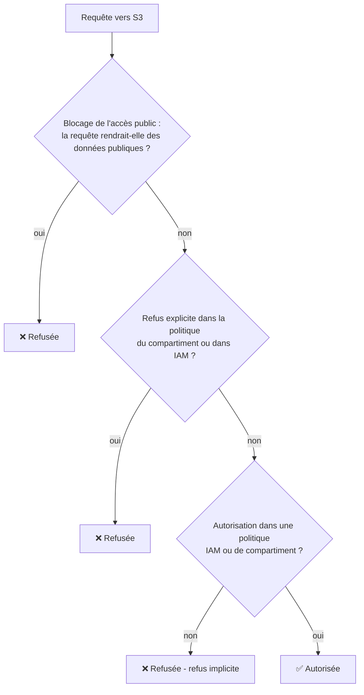
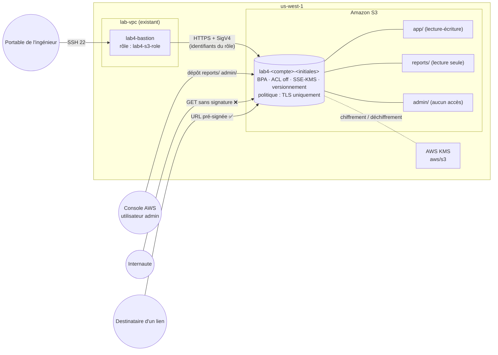
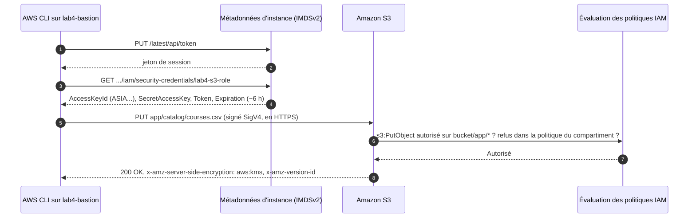
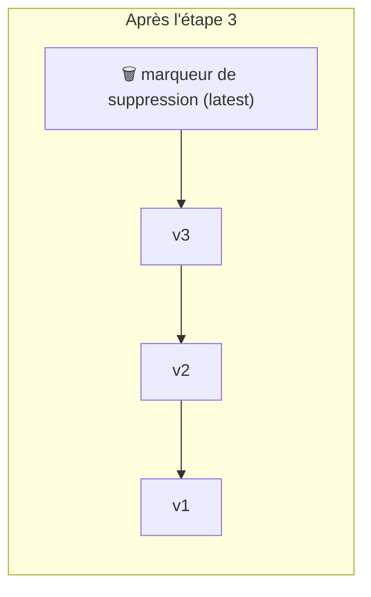

# Lab 4 — Amazon S3 : fondamentaux et sécurité (compartiments, objets, chiffrement, versionnement, politiques et URL pré-signées)

> 🇬🇧 English version: [S3-Core-Security-Lab.en.md](S3-Core-Security-Lab.en.md)

> **Public :** futur·e·s ingénieur·e·s cloud · **Niveau :** Fondamental → Associé
> **Point de départ :** le réseau du **Lab 1** dans `us-west-1` (VPC, sous-réseau public du bastion, passerelle Internet)
> **Durée :** environ 2 h 30 · **Méthode :** console AWS + scripts exécutés sur un bastion doté d'un rôle IAM
> **Ensuite :** Lab 5 — Accès privé à S3 depuis un VPC (point de terminaison de passerelle), classes de stockage et cycle de vie

> 💡 Les noms de menus et de boutons sont donnés **tels qu'ils apparaissent dans la console AWS en anglais** (par exemple **Create bucket**), avec leur traduction lorsque c'est utile. Les commandes et le code restent en anglais.

---

## Scénario

*Pacific Learning Co.* doit stocker son catalogue de cours, la configuration de son application, ses rapports mensuels et des fichiers RH confidentiels. Vous allez créer un **compartiment (bucket) Amazon S3** conforme au socle de sécurité de l'entreprise :

- **Rien n'est jamais public**, même par erreur.
- **Tout est chiffré**, au repos et en transit.
- **Un fichier supprimé ou écrasé peut être récupéré.**
- L'application obtient **uniquement les accès nécessaires** : elle écrit dans sa zone, lit les rapports et ne voit jamais les données RH.
- Des fichiers peuvent être **partagés temporairement** avec des personnes hors d'AWS, sans être rendus publics.

---

## Objectifs d'apprentissage

1. Expliquer les briques de S3 : **compartiments, objets, clés, préfixes, métadonnées, Régions**
2. Créer un compartiment avec des paramètres sûrs : **blocage de l'accès public**, **ACL désactivées**, **SSE-KMS + S3 Bucket Key**, **versionnement**
3. Donner à une instance EC2 un accès à S3 via un **rôle IAM** (sans clés d'accès), limité **par préfixe**
4. Écrire une **politique de compartiment** qui impose **TLS**, et constater que le blocage de l'accès public rejette une politique publique
5. Utiliser le **versionnement** pour récupérer des objets écrasés ou supprimés, et expliquer les **marqueurs de suppression**
6. Partager des objets privés avec des **URL pré-signées**, et en connaître les limites
7. Valider toute la configuration avec un script de tests automatisés

---

## 1. Les concepts en 5 minutes

| Concept | Définition | Exemple dans ce lab |
|---------|-----------|---------------------|
| **Compartiment (bucket)** | Conteneur d'objets. Nom **unique au monde**, données stockées dans **une seule Région** | `lab4-123456789012-ab` dans `us-west-1` |
| **Objet** | Un fichier (0 o à 5 To) + ses métadonnées | `courses.csv` |
| **Clé** | Le nom complet de l'objet dans le compartiment | `app/catalog/courses.csv` |
| **Préfixe** | Le début d'une clé. Les « dossiers » ne sont que des préfixes : S3 n'a pas de vrais répertoires | `app/`, `reports/`, `admin/` |
| **Métadonnées** | Système (Content-Type, taille, ETag…) et définies par l'utilisateur (`x-amz-meta-*`) | `owner=lab4` |
| **ID de version** | Identifiant unique de chaque version d'un objet (si le versionnement est activé) | `3sL4kqtJlcpXroDTDmJ.rmSpXd3dIbrHY` |
| **Durabilité / disponibilité** | Durabilité de 99,999999999 % (11 neuf), données réparties sur ≥ 3 AZ pour S3 Standard | — |

### 1.1 Qui peut accéder à un objet ? (ordre d'évaluation)



Trois règles : **tout est refusé par défaut**, une **autorisation (Allow)** ouvre l'accès, et un **refus explicite (Deny) l'emporte toujours**. Le blocage de l'accès public s'applique par-dessus : il peut bloquer des accès publics même si une politique les autorise.

### 1.2 Options de chiffrement

| Option | Clés gérées par | Audit dans CloudTrail | Coût | Utilisée ici |
|--------|-----------------|----------------------|------|--------------|
| **SSE-S3** (AES-256) | S3 | Pas d'événement d'utilisation de clé | Gratuit | Par défaut pour tout nouveau compartiment depuis 2023 |
| **SSE-KMS** avec la clé `aws/s3` | AWS KMS (clé gérée par AWS) | Oui (`Decrypt`, `GenerateDataKey`) | Requêtes KMS, réduites par la **S3 Bucket Key** | ✅ |
| **SSE-KMS** avec une clé gérée par le client | Vous (politique de clé, rotation, désactivation) | Oui | + 1 $/mois par clé | Défi B |
| **DSSE-KMS** | Deux couches de chiffrement KMS | Oui | Plus élevé | — |
| **SSE-C** | Vous envoyez la clé à chaque requête | — | — | — |
| **En transit** | TLS (HTTPS) | — | — | Imposé par la politique de compartiment |

> 🧠 **S3 Bucket Key :** sans elle, S3 appelle KMS pour chaque objet, ce qui coûte plus cher et peut atteindre les limites de requêtes. Avec elle, S3 obtient de KMS une clé de courte durée au niveau du compartiment et en dérive localement les clés de chaque objet : jusqu'à 99 % de requêtes KMS en moins.

---

## 2. Architecture

### 2.0 Diagramme complet du projet

```text
   ┌────────────────────────────┐                        ┌────────────────────────────┐
   │ Portable de l'ingénieur    │                        │ Console AWS (admin)        │
   │ ssh lab4-bastion           │                        │ dépose reports/ + admin/   │
   └────────────────────────────┘                        └────────────────────────────┘
                 │ SSH 22                                       │ HTTPS (console)
┌─ Région AWS us-west-1 (Californie du Nord) ──────────────────────────────────────────────────────────────┐
│ ┌─ lab-vpc 10.10.0.0/16 (existant, Lab 1) ─────────────────────────────────────────────────────────────┐ │
│ │       ┌─ lab-igw  passerelle Internet (existante) ───────────────┐                                   │ │
│ │       │ bastion -> point de terminaison public S3 en HTTPS       │                                   │ │
│ │       └──────────────────────────────────────────────────────────┘                                   │ │
│ │                                   │                                                                  │ │
│ │ ┌─ lab-bastion-subnet 10.10.0.0/28 · PUBLIC (existant) ──────────────┐                               │ │
│ │ │ ★ lab4-bastion  t3.micro · Amazon Linux 2023 · AWS CLI             │                               │ │
│ │ │ ★ sg lab4-bastion-sg   ENTRÉE 22 <- votre IP /32                   │                               │ │
│ │ │ ★ profil d'instance lab4-s3-role (identifiants temporaires)        │                               │ │
│ │ │   exécute s3-explore / versioning / presign / security-tests       │                               │ │
│ │ └────────────────────────────────────────────────────────────────────┘                               │ │
│ │                                                                                                      │ │
│ │ lab-public-rt : 0.0.0.0/0 -> lab-igw (passerelle NAT inutile dans ce lab)                            │ │
│ └──────────────────────────────────────────────────────────────────────────────────────────────────────┘ │
│                                   │ HTTPS 443 (TLS) · signed with lab4-s3-role                           │
│                                   ▼                                                                      │
│ ┌─ Amazon S3 (service régional, hors du VPC) · https://s3.us-west-1.amazonaws.com ─────────────────────┐ │
│ │ ┌─ ★ lab4-<id-compte>-<initiales>   compartiment à usage général ──────────────────────────────────┐ │ │
│ │ │ Blocage accès public  ACTIVÉ (4/4)   Propriété des objets  propriétaire imposé (ACL off)         │ │ │
│ │ │ Chiffrement par défaut SSE-KMS (aws/s3) + S3 Bucket Key        Versionnement  Activé             │ │ │
│ │ │ Politique de compartiment  DenyInsecureTransport (aws:SecureTransport = false -> Deny)           │ │ │
│ │ │                                                                                                  │ │ │
│ │ │ ┌─ droits de lab4-s3-role par préfixe ─┐                                                         │ │ │
│ │ │ │ app/      lecture + écriture         │                                                         │ │ │
│ │ │ │ reports/  lecture seule              │                                                         │ │ │
│ │ │ │ admin/    aucun accès                │                                                         │ │ │
│ │ │ └──────────────────────────────────────┘                                                         │ │ │
│ │ └──────────────────────────────────────────────────────────────────────────────────────────────────┘ │ │
│ └──────────────────────────────────────────────────────────────────────────────────────────────────────┘ │
│                                                                                                          │
│ ┌─ IAM · KMS ──────────────────────────────────────────────────────────────────────────────────────────┐ │
│ │ ★ Rôle IAM lab4-s3-role  ·  approbation : ec2.amazonaws.com  ·  politique lab4-s3-access             │ │
│ │ AWS KMS  aws/s3 (clé gérée par AWS)  ·  clés de données en cache par compartiment (Bucket Key)       │ │
│ └──────────────────────────────────────────────────────────────────────────────────────────────────────┘ │
│                                                                                                          │
│ ★ = créé dans ce lab · le reste existe depuis le Lab 1                                                   │
└──────────────────────────────────────────────────────────────────────────────────────────────────────────┘
                 ▲                                              ▲
                 │ refusé (403)                                 │ autorisé
   ┌────────────────────────────┐                        ┌────────────────────────────┐
   │ N'importe qui sur Internet │                        │ Destinataire d'un lien     │
   │ URL simple ou http://      │                        │ URL pré-signée (HTTPS)     │
   └────────────────────────────┘                        └────────────────────────────┘
```

### 2.1 Diagramme d'architecture (Mermaid)



### 2.2 Comment le bastion obtient ses droits (sans clés d'accès)



### 2.3 Ce que vous construisez

| # | Ressource | Nom |
|---|-----------|-----|
| 1 | Compartiment S3 (paramètres sécurisés) | `lab4-<id-compte>-<initiales>` |
| 2 | Rôle IAM + politique en ligne | `lab4-s3-role` / `lab4-s3-access` |
| 3 | Groupe de sécurité, paire de clés, bastion EC2 | `lab4-bastion-sg`, `lab4-key`, `lab4-bastion` |
| 4 | Objets répartis en trois zones | `app/`, `reports/`, `admin/` |
| 5 | Politique de compartiment | `DenyInsecureTransport` |

### 2.4 Zones de permissions

| Préfixe | Contenu | Admin (console) | `lab4-s3-role` (application) |
|---------|---------|-----------------|------------------------------|
| `app/` | Catalogue, configuration, images | Total | **Lecture + écriture + suppression** (crée des marqueurs de suppression) |
| `reports/` | Rapports mensuels | Total | **Lecture seule** |
| `admin/` | RH / paie | Total | **Aucun accès** (voit les noms de clés dans une liste, ne peut pas lire) |
| paramètres du compartiment | Politique, chiffrement, BPA, versionnement | Total | **Lecture seule** (pour exécuter les tests) |

---

## 3. Prérequis et coût

- Le réseau du Lab 1 dans `us-west-1` : `lab-vpc`, `lab-bastion-subnet` (attribution automatique d'IPv4 publique activée) associé à `lab-public-rt` (`0.0.0.0/0 → lab-igw`). La passerelle NAT n'est **pas** nécessaire.
- Un client SSH · votre **ID de compte AWS** (12 chiffres, menu en haut à droite de la console)

| Élément | Coût approximatif |
|---------|-------------------|
| Stockage S3 (quelques Ko) et requêtes | Fractions de centime |
| Requêtes KMS vers `aws/s3` (réduites par la Bucket Key) | Fractions de centime |
| `lab4-bastion` t3.micro + IPv4 publique | ~0,02 $/heure (instance éligible à l'offre gratuite) |

### 3.1 Fiche de travail

| Élément | Valeur |
|---------|--------|
| ID de compte AWS | |
| Vos initiales (minuscules) | |
| Nom du compartiment `lab4-<id-compte>-<initiales>` | |
| IP publique du bastion | |

---

## 4. Les scripts du lab

```
aws-lab-s3-core-security/
├── S3-Core-Security-Lab.en.md / .fr.md
└── scripts/
    ├── common.sh                 fonctions partagées (chargées par les autres scripts)
    ├── s3-explore.sh             objets, préfixes, métadonnées, chiffrement, les 3 zones de permissions
    ├── s3-versioning-demo.sh     versions, marqueurs de suppression, restauration, retour arrière
    ├── s3-presign-demo.sh        URL pré-signées : valide, falsifiée, HTTP, expirée
    ├── s3-security-tests.sh      20 vérifications automatiques de la configuration
    ├── s3-cleanup.sh             vide un compartiment VERSIONNÉ (à exécuter dans CloudShell)
    ├── policies/
    │   ├── lab4-s3-role-policy.json    politique IAM de lab4-s3-role
    │   └── lab4-bucket-policy.json     politique de compartiment (TLS uniquement)
    └── sample-data/
        ├── enrollments-2026-10.txt     à déposer par vous dans reports/
        └── payroll.csv                 à déposer par vous dans admin/
```

Publiez le dossier dans votre dépôt (par exemple `2-Cloud-Infrastructure/aws-lab-s3-core-security/`), et téléchargez aussi le dossier `scripts/` sur votre portable : vous aurez besoin de `policies/` et `sample-data/` dans la console.

> 💬 Les scripts affichent leurs messages en anglais. Les tableaux de ce guide expliquent chaque résultat en français.

> 🛡️ **Les tests de sécurité sont sans danger :** les tests « doit être refusé » ne font que ré-appliquer la valeur *actuelle* de chaque paramètre. Même avec un rôle mal configuré et trop puissant, leur exécution n'affaiblit jamais le compartiment.

---

## Partie 1 — Vérifier le point de départ

Dans **`us-west-1`** :
- [ ] **VPC → Subnets → `lab-bastion-subnet`** : table de routage `lab-public-rt` avec `0.0.0.0/0 → igw-…` ; *Auto-assign public IPv4* = Yes.
- [ ] Notez votre **ID de compte** et choisissez le **nom du compartiment** : `lab4-<id-compte>-<initiales>` (minuscules, chiffres et tirets uniquement). Inscrivez-le dans la fiche.

> 🧠 **Pourquoi l'ID de compte dans le nom ?** Les noms de compartiments sont **uniques parmi tous les comptes AWS du monde**. Inclure votre ID de compte évite les collisions et identifie clairement le propriétaire dans les journaux.

---

## Partie 2 — Créer le compartiment avec des paramètres sûrs

**S3 → Create bucket** (vérifiez que le sélecteur de Région affiche **US West (N. California) us-west-1**) :

| Paramètre | Valeur | Pourquoi |
|-----------|--------|----------|
| Bucket type | **General purpose** | Compartiment S3 standard (les compartiments de répertoire servent à S3 Express One Zone) |
| Bucket name | `lab4-<id-compte>-<initiales>` | Unique au monde |
| **Object Ownership** (propriété des objets) | **ACLs disabled (recommended)** : *Bucket owner enforced* | L'accès n'est contrôlé que par les politiques ; les ACL ne peuvent rien accorder |
| **Block Public Access** (blocage de l'accès public) | ✅ **Block all public access** (les 4 cases) | Garde-fou : aucune ACL ni politique ne peut rendre les données publiques |
| **Bucket Versioning** (versionnement) | **Enable** | Écrasements et suppressions deviennent récupérables |
| Tags | `Project = lab4` | Répartition des coûts et nettoyage |
| **Default encryption** (chiffrement par défaut) | **SSE-KMS** · clé : **AWS managed key (`aws/s3`)** | Chiffre chaque objet, avec audit KMS |
| **Bucket Key** | **Enable** | Moins d'appels KMS, coût réduit |
| Advanced → Object Lock | Disable | Rétention WORM, vue au défi C (activable uniquement à la création) |

**Create bucket.**

### 2.1 Explorer les onglets du compartiment
Ouvrez le compartiment et parcourez chaque onglet :

| Onglet | À observer |
|--------|-----------|
| **Objects** | Vide. Repérez le bouton **Create folder** |
| **Properties** | Région, ARN (`arn:aws:s3:::lab4-…`), Versioning *Enabled*, Default encryption *SSE-KMS*, Bucket Key *Enabled* |
| **Permissions** | Block Public Access *On*, Bucket policy *vide*, Object Ownership *Bucket owner enforced* |
| **Metrics / Management** | Métriques de stockage (mises à jour chaque jour), règles de cycle de vie (Lab 5) |

---

## Partie 3 — Rôle IAM de l'application

### 3.1 Préparer la politique
Ouvrez `scripts/policies/lab4-s3-role-policy.json` et remplacez **chaque** `BUCKET_NAME` par le nom de votre compartiment (3 occurrences).

```json
{
  "Version": "2012-10-17",
  "Statement": [
    { "Sid": "BucketLevelReadOnly", "Effect": "Allow",
      "Action": ["s3:ListBucket", "s3:ListBucketVersions", "s3:GetBucketLocation", "s3:GetBucketVersioning",
                 "s3:GetBucketPolicy", "s3:GetBucketPublicAccessBlock", "s3:GetBucketOwnershipControls",
                 "s3:GetEncryptionConfiguration"],
      "Resource": "arn:aws:s3:::BUCKET_NAME" },
    { "Sid": "AppZoneReadWrite", "Effect": "Allow",
      "Action": ["s3:GetObject", "s3:GetObjectVersion", "s3:PutObject", "s3:DeleteObject"],
      "Resource": "arn:aws:s3:::BUCKET_NAME/app/*" },
    { "Sid": "ReportsZoneReadOnly", "Effect": "Allow",
      "Action": ["s3:GetObject", "s3:GetObjectVersion"],
      "Resource": "arn:aws:s3:::BUCKET_NAME/reports/*" }
  ]
}
```

> 🧠 **Deux types de ressources :** les actions au niveau du compartiment (`ListBucket`, `Get*Configuration`) s'appliquent à `arn:aws:s3:::bucket` ; les actions sur les objets (`GetObject`, `PutObject`) s'appliquent à `arn:aws:s3:::bucket/clé`. Mettre `ListBucket` sur `bucket/*` est une erreur classique : le listage échoue alors avec *AccessDenied*.
>
> 🧠 **Ce qui manque volontairement :** pas de `admin/*`, pas de `s3:PutObjectAcl`, pas de `s3:DeleteObjectVersion` (suppressions définitives), pas de `s3:PutBucket*` ni `s3:DeleteBucket*`. Le moindre privilège consiste à n'accorder que ce dont l'application a besoin.
>
> 🧠 **Aucune permission KMS ?** Les objets utilisent la clé gérée par AWS `aws/s3`. Sa politique de clé autorise tout principal de votre compte à l'utiliser **via S3**. Une clé gérée par le client exigerait aussi `kms:Decrypt` / `kms:GenerateDataKey` (défi B).

### 3.2 Créer le rôle
1. **IAM → Roles → Create role** → Trusted entity **AWS service** → Use case **EC2** → **Next** → ignorez les politiques gérées → **Next**.
2. Nom du rôle : **`lab4-s3-role`** → **Create role**.
3. Ouvrez le rôle → **Add permissions → Create inline policy → JSON** → collez votre politique modifiée → **Next** → nom **`lab4-s3-access`** → **Create policy**.

---

## Partie 4 — Bastion doté du rôle

1. **Groupe de sécurité** `lab4-bastion-sg` (VPC `lab-vpc`) : entrée **SSH 22 depuis My IP**.
2. **Paire de clés** `lab4-key` (ED25519, `.pem`) → déplacez-la dans `~/.ssh/` → `chmod 400 ~/.ssh/lab4-key.pem` (Windows : `icacls … /inheritance:r /grant:r "$($env:USERNAME):(R)"`).
3. **Launch instance** `lab4-bastion` :

| Paramètre | Valeur |
|-----------|--------|
| AMI / type | Amazon Linux 2023 · `t3.micro` |
| Key pair | `lab4-key` |
| Network | VPC `lab-vpc` · sous-réseau **`lab-bastion-subnet`** · IP publique **Enable** · SG **`lab4-bastion-sg`** |
| Advanced → **IAM instance profile** | **`lab4-s3-role`** |
| Advanced → Metadata version | **V2 only** |

4. `~/.ssh/config` :

```sshconfig
Host lab4-bastion
    HostName <IP_PUBLIQUE_BASTION>
    User ec2-user
    IdentityFile ~/.ssh/lab4-key.pem
    IdentitiesOnly yes
```

5. Tester le rôle :

```bash
ssh lab4-bastion
aws sts get-caller-identity          # Arn: ...:assumed-role/lab4-s3-role/i-0abc...
aws s3 ls                            # AccessDenied : le rôle ne peut pas lister TOUS les compartiments (s3:ListAllMyBuckets)
aws s3 ls s3://<NOM_COMPARTIMENT>    # fonctionne (vide pour l'instant)
ls ~/.aws 2>/dev/null || echo "pas de dossier ~/.aws : aucune clé d'accès stockée sur ce serveur"
```

> 🧠 `aws s3 ls` sans compartiment appelle `ListAllMyBuckets`, que le rôle n'a pas. C'est le moindre privilège à l'œuvre, pas une erreur de configuration.

---

## Partie 5 — Déposer les fichiers de l'administrateur (console)

Ici, vous jouez le rôle de l'**administrateur** : votre utilisateur de console a un accès complet.

1. **Objects → Create folder** → nom `reports` → **Create folder**. Ouvrez `reports/` → **Upload → Add files** → `sample-data/enrollments-2026-10.txt` → **Upload**.
2. Même chose pour **`admin/`** avec `sample-data/payroll.csv`.
3. Ouvrez `reports/enrollments-2026-10.txt` → **Properties** : notez *Server-side encryption: SSE-KMS*, *Bucket Key: Enabled*, *Storage class: Standard* et le **Version ID**.
4. Cliquez sur **Open** → le fichier s'affiche (la console utilise un lien pré-signé temporaire).
5. Copiez l'**Object URL** (`https://<compartiment>.s3.us-west-1.amazonaws.com/reports/…`) et collez-la dans une **fenêtre de navigation privée** → **AccessDenied** (erreur XML). Le compartiment est privé.

> 🧠 **« Create folder »** crée un objet de zéro octet nommé `reports/`, pour que la console puisse afficher un dossier vide. Ce n'est qu'une clé qui se termine par `/`.

---

## Partie 6 — Explorer S3 depuis le bastion

```bash
ssh lab4-bastion
mkdir -p ~/scripts && cd ~/scripts
BASE=https://raw.githubusercontent.com/inspiredevgen/devops-worksphops/refs/heads/main/2-Cloud-Infrastructure/aws-lab-s3-core-security/scripts
for f in common.sh s3-explore.sh s3-versioning-demo.sh s3-presign-demo.sh s3-security-tests.sh; do
  curl -fsSLO "$BASE/$f"
done
head -1 *.sh                          # chaque fichier doit commencer par #!/bin/bash

bash s3-explore.sh <NOM_COMPARTIMENT>
```

| Étape | Ce que vous voyez | Concept |
|-------|-------------------|---------|
| 1/6 | `assumed-role/lab4-s3-role/i-…` | Identifiants temporaires issus du rôle de l'instance |
| 2/6–3/6 | 4 objets déposés dans `app/` | Dépôt avec métadonnées, Content-Type, Cache-Control |
| 4/6 | `PRE admin/ PRE app/ PRE reports/`, puis la liste complète, puis `CommonPrefixes` | Les dossiers sont des **préfixes + délimiteur `/`** |
| 5/6 | `Encryption: aws:kms`, `BucketKey: true`, un `VersionId` | Chiffrement par défaut et versionnement s'appliquent automatiquement |
| 6/6 | 6 vérifications : app lecture-écriture ✅, reports lecture ✅ / écriture ❌, admin lecture ❌, admin listage ✅ | Moindre privilège **par préfixe** |

> 🧠 **Lister ≠ lire.** Le rôle peut *voir* `admin/payroll.csv` dans une liste (car `s3:ListBucket` est accordé sur tout le compartiment), mais `GetObject` est refusé. Les noms de clés peuvent aussi être sensibles : le défi A restreint le listage avec la condition `s3:prefix`.

---

## Partie 7 — Politique de compartiment : imposer TLS, et découvrir le blocage de l'accès public

### 7.1 Imposer le chiffrement en transit
**Permissions → Bucket policy → Edit** → collez `scripts/policies/lab4-bucket-policy.json` (remplacez `BUCKET_NAME` deux fois) → **Save changes**.

```json
{
  "Version": "2012-10-17",
  "Statement": [
    {
      "Sid": "DenyInsecureTransport",
      "Effect": "Deny",
      "Principal": "*",
      "Action": "s3:*",
      "Resource": ["arn:aws:s3:::BUCKET_NAME", "arn:aws:s3:::BUCKET_NAME/*"],
      "Condition": { "Bool": { "aws:SecureTransport": "false" } }
    }
  ]
}
```

> 🧠 Cette déclaration **refuse** toute requête qui n'utilise pas TLS, pour tout le monde, y compris vous et le rôle. Un refus explicite l'emportant toujours, aucune permission IAM ne peut la contourner.

### 7.2 Tenter de rendre le compartiment public (cela doit échouer)
Modifiez de nouveau la politique et **ajoutez** cette déclaration dans `"Statement": [ … ]` (après une virgule) :

```json
    {
      "Sid": "PublicReadAttempt",
      "Effect": "Allow",
      "Principal": "*",
      "Action": "s3:GetObject",
      "Resource": "arn:aws:s3:::BUCKET_NAME/app/*"
    }
```

**Save** → la console refuse : *« …Block Public Access settings… public policies are blocked »*. Retirez la déclaration et ne gardez que `DenyInsecureTransport`.

> 🧠 `Principal: "*"` avec `Allow` rend les données publiques. **BlockPublicPolicy** rejette ce type de politique avant son enregistrement, et **RestrictPublicBuckets** l'ignore si elle existe déjà. Désactiver le blocage de l'accès public doit être une décision délibérée et revue (par exemple pour un site web public, et même dans ce cas, CloudFront devant un compartiment privé est préférable).

---

## Partie 8 — Versionnement : réparer les erreurs

Sur le bastion :

```bash
cd ~/scripts && bash s3-versioning-demo.sh <NOM_COMPARTIMENT>
```

| Étape | Ce qui se passe | À remarquer |
|-------|-----------------|-------------|
| 1/6 | 3 PUT sur `app/config/feature-flags.json` | 3 ID de version ; seule la plus récente est *latest* |
| 2/6 | GET avec `--version-id` | Toute ancienne version reste lisible |
| 3/6 | DELETE sans ID de version | S3 ajoute un **marqueur de suppression** ; l'objet renvoie **404**, pourtant rien n'a été effacé |
| 4/6 | Restauration | Retirer le marqueur = supprimer une version → **refusé** pour le rôle ; le script restaure en **copiant la v3 par-dessus** |
| 5/6 | Retour à la v1 | Copie de la v1 → nouvelle version courante ; l'historique est conservé |
| 6/6 | Suppression définitive de la v2 | **Refusée** : `s3:DeleteObjectVersion` reste réservé aux administrateurs |



---

## Partie 9 — Les versions dans la console (administrateur)

1. **Objects** → activez **Show versions**. Ouvrez `app/config/` → vous voyez chaque version et le **marqueur de suppression** de l'étape 3.
2. Sélectionnez le **marqueur de suppression** → **Delete** → tapez `permanently delete` → **Delete objects**. En tant qu'administrateur, vous pouvez retirer le marqueur (suppression définitive d'une version).
3. Désactivez **Show versions** : l'objet affiche sa dernière version.

> 🧠 **Rappel de coût :** chaque version est stockée et facturée. Le Lab 5 ajoute une **règle de cycle de vie** qui fait expirer automatiquement les anciennes versions (non courantes).

---

## Partie 10 — Partager en privé avec des URL pré-signées

```bash
cd ~/scripts && bash s3-presign-demo.sh <NOM_COMPARTIMENT>
```

| Vérification | Attendu | Pourquoi |
|--------------|---------|----------|
| URL simple de l'objet (sans signature) | ❌ 403 | Le compartiment est privé |
| URL pré-signée en HTTPS | ✅ 200 + le contenu du fichier | La signature porte les droits du rôle |
| Signature falsifiée (1 caractère modifié) | ❌ 403 SignatureDoesNotMatch | Toute modification invalide la signature |
| Même URL en **http://** | ❌ 403 | Votre politique de compartiment refuse les requêtes sans TLS |
| URL de 20 secondes, après 25 secondes | ❌ 403 Request has expired | Accès limité dans le temps |

**Version console :** sélectionnez `app/share/welcome-letter.txt` → **Object actions → Share with a presigned URL** → 10 minutes → **Create** → ouvrez le lien copié dans une fenêtre privée.

> 🧠 **Limites des URL pré-signées :**
> - Quiconque possède l'URL peut l'utiliser jusqu'à son expiration : traitez-la comme un mot de passe.
> - Elle n'accorde jamais plus que les droits de son signataire : une URL signée par `lab4-s3-role` pour `admin/payroll.csv` reste refusée.
> - Signée avec des identifiants de **rôle**, elle cesse aussi de fonctionner quand la session du rôle expire (quelques heures), quoi qu'indique `--expires-in`. Le maximum est de 7 jours avec des identifiants à long terme.

---

## Partie 11 — Tout valider

```bash
cd ~/scripts && bash s3-security-tests.sh <NOM_COMPARTIMENT>
```

Résultat attendu : **les 20 vérifications sont PASS** :

| Groupe | Vérifications |
|--------|---------------|
| Paramètres du compartiment | BPA 4/4 · ACL désactivées · SSE-KMS + Bucket Key · versionnement · politique TLS présente |
| Moindre privilège IAM | app/ écriture, lecture, suppression ✅ · reports/ écriture ❌ · admin/ lecture ❌ · modifier la politique ❌ · modifier le BPA ❌ · modifier le versionnement ❌ · suppression définitive d'une version ❌ |
| Rendre des données publiques | ACL public-read sur un objet ❌ · dépôt avec public-read ❌ · GET anonyme ❌ |
| Chiffrement | requête signée en HTTPS ✅ · même requête en HTTP ❌ · nouvel objet chiffré en aws:kms ✅ |

### 11.1 Tableau de validation (manuel)

| # | Test | Attendu | Démontre |
|---|------|---------|----------|
| 1 | URL de l'objet dans une fenêtre privée | AccessDenied | Privé par défaut |
| 2 | Politique publique `Allow *` | Rejetée à l'enregistrement | Blocage de l'accès public |
| 3 | `aws s3 cp s3://<compartiment>/admin/payroll.csv -` sur le bastion | AccessDenied | IAM limité par préfixe |
| 4 | `aws s3 ls` (tous les compartiments) sur le bastion | AccessDenied | Pas de `ListAllMyBuckets` |
| 5 | URL pré-signée dans une fenêtre privée | Contenu du fichier | Accès délégué temporaire |
| 6 | Propriétés de l'objet | SSE-KMS, Bucket Key activée | Chiffrement au repos |
| 7 | Show versions | Versions + marqueurs de suppression | Récupérabilité |
| 8 | **CloudTrail → Event history**, source `kms.amazonaws.com` | Événements `GenerateDataKey` / `Decrypt` émis par S3 | L'utilisation de la clé KMS est auditée |

---

## Partie 12 — Dépannage

| Problème | Cause | Solution |
|----------|-------|----------|
| `Unable to locate credentials` sur le bastion | Aucun profil d'instance | EC2 → instance → **Actions → Security → Modify IAM role** → `lab4-s3-role` |
| `head-bucket … 403` dans tous les scripts | `BUCKET_NAME` non remplacé dans la politique IAM, ou faute dans le nom | Corrigez la politique en ligne `lab4-s3-access` |
| `ListBucket` refusé mais `GetObject` fonctionne | `ListBucket` accordé sur `bucket/*` au lieu de `bucket` | Les actions au niveau du compartiment exigent l'**ARN du compartiment** |
| `s3-explore.sh` : « Read reports/ » échoue en **404** | Partie 5 sautée, ou fichier déposé sous un autre préfixe | Déposez `reports/enrollments-2026-10.txt` |
| `s3-versioning-demo.sh` : *Versioning is 'None'* | Versionnement non activé | Properties → Bucket Versioning → **Enable** |
| `s3-security-tests.sh` : requête HTTP **autorisée** | Politique de compartiment absente ou `BUCKET_NAME` non remplacé | Partie 7.1 |
| Enregistrement de la politique : *Invalid principal / resource* | Faute de JSON, ou `BUCKET_NAME` resté | Validez le JSON, vérifiez les deux ARN |
| `syntax error … <!DOCTYPE html>` | Une page web a été téléchargée | Utilisez l'URL **raw.githubusercontent.com** avec `curl -fsSLO` |
| *The bucket you tried to delete is not empty* | Il reste des versions et des marqueurs | `s3-cleanup.sh` (partie 15) |

---

## Partie 13 — Casser et réparer

| # | Casser | Observer | Leçon | Réparer |
|---|--------|----------|-------|---------|
| B1 | Retirer le rôle IAM du bastion | `Unable to locate credentials` | Les identifiants viennent du profil d'instance | Ré-attacher `lab4-s3-role` |
| B2 | Dans `lab4-s3-access`, remplacer `app/*` par `apps/*` | Écritures dans `app/` refusées | Les ARN de ressources doivent correspondre exactement aux clés | Rétablir |
| B3 | Ajouter à la politique du compartiment un `Deny` de `s3:GetObject` sur `reports/*` pour `Principal: *` | Le **rôle** ne lit plus les rapports, et **vous** non plus dans la console | Un refus explicite bat toute autorisation, administrateurs compris | Retirer la déclaration |
| B4 | Déposer un fichier dans la console en forçant le chiffrement **SSE-S3** | L'objet affiche `AES256` | Le chiffrement par défaut ne s'applique que si la requête n'en précise pas | L'imposer par une politique (défi B) |
| B5 | Générer **avec le rôle** une URL pré-signée pour `admin/payroll.csv` | L'URL est générée, mais renvoie 403 | La signature se fait sans vérifier les droits ; la vérification a lieu à l'utilisation | — |

---

## Partie 14 — Défis complémentaires

**A. Masquer les noms de clés d'admin/.** Ajoutez `"Condition": {"StringLike": {"s3:prefix": ["app/*", "reports/*", ""]}}` à une déclaration `ListBucket` séparée. Le rôle peut alors lister `app/` et `reports/`, mais `aws s3 ls s3://<compartiment>/admin/` est refusé.

**B. Clé KMS gérée par le client.** Créez une clé KMS `lab4-s3-key`, définissez-la comme chiffrement par défaut du compartiment, et ajoutez une politique de compartiment qui refuse `PutObject` si `s3:x-amz-server-side-encryption-aws-kms-key-id` ne correspond pas à son ARN. Que doit désormais contenir la politique IAM du rôle ?

**C. Object Lock (WORM).** Créez un second compartiment **avec Object Lock activé**, déposez un objet avec une rétention **Compliance** d'un jour, puis tentez de supprimer cette version, même en tant qu'administrateur.

**D. Piste d'audit.** Activez les **événements de données CloudTrail** pour votre compartiment (ou la journalisation des accès serveur vers un autre compartiment) et retrouvez vos appels `GetObject` depuis le bastion.

**E. Notifications d'événements.** Envoyez les événements `s3:ObjectCreated:*` de `app/` vers une rubrique SNS avec un abonnement par courriel.

**F. Réplication inter-Régions.** Répliquez `reports/` vers un compartiment de `us-east-1` (le versionnement est requis des deux côtés : vous l'avez déjà).

---

## Partie 15 — Nettoyage

1. Ouvrez **AWS CloudShell** (barre d'outils de la console, Région `us-west-1`) et téléversez `scripts/s3-cleanup.sh` (*Actions → Upload file*) :
   ```bash
   bash s3-cleanup.sh <NOM_COMPARTIMENT> --delete-bucket
   ```
   Tapez le nom du compartiment pour confirmer. Le script supprime **chaque version et chaque marqueur de suppression**, annule les téléversements en plusieurs parties inachevés, puis supprime le compartiment.
   > Pourquoi pas simplement *Empty* dans la console ? Cela fonctionne aussi (toutes les versions sont supprimées) ; le script montre ce qui se passe en coulisses, et pourquoi `aws s3 rm --recursive` ne **suffit pas** sur un compartiment versionné.
2. **EC2 :** résiliez `lab4-bastion`, supprimez `lab4-bastion-sg` et la paire de clés `lab4-key` ; retirez le bloc `lab4-bastion` de `~/.ssh/config`.
3. **IAM :** supprimez le rôle `lab4-s3-role`.
4. Conservez le réseau du Lab 1 si vous poursuivez avec le **Lab 5**.

---

## Partie 16 — Questions de révision

1. Pourquoi les noms de compartiments doivent-ils être uniques au monde, alors que les données résident dans une seule Région ?
2. Que sont les « dossiers » dans S3 ? Que crée réellement le bouton *Create folder* de la console ?
3. Nommez les quatre paramètres du blocage de l'accès public et ce que chacun bloque.
4. Pourquoi les ACL sont-elles désactivées, et qu'est-ce qui contrôle l'accès à la place ?
5. `ListBucket` sur `arn:aws:s3:::bucket/*` ne fonctionne pas. Pourquoi ?
6. Quelle est la différence entre SSE-S3 et SSE-KMS, et que change une S3 Bucket Key ?
7. Que se passe-t-il quand on supprime un objet d'un compartiment versionné sans ID de version ? Comment le restaurer ?
8. Pourquoi `lab4-s3-role` n'a-t-il pas `s3:DeleteObjectVersion` ?
9. Comment la politique de compartiment impose-t-elle TLS, et pourquoi une autorisation IAM ne peut-elle pas la contourner ?
10. Qui peut utiliser une URL pré-signée, pendant combien de temps et avec quels droits ?
11. Une URL signée par le rôle pour `admin/payroll.csv` est générée sans erreur. Fonctionnera-t-elle ? Pourquoi ?
12. Pourquoi `aws s3 rm --recursive` ne suffit-il pas à vider un compartiment versionné ?

<details>
<summary><b>Réponses</b></summary>

1. Les noms font partie de noms d'hôte DNS (`<compartiment>.s3.<region>.amazonaws.com`) partagés par tous les clients AWS : ils doivent donc être uniques au monde. Les objets, eux, ne sont stockés que dans la Région choisie (sauf réplication).
2. Des préfixes : la partie des clés d'objets qui précède un `/`. S3 est un magasin clé-valeur plat ; la console et `--delimiter /` *affichent* les préfixes comme des dossiers. *Create folder* crée un objet de zéro octet dont la clé se termine par `/`.
3. **BlockPublicAcls** (rejette les requêtes qui ajoutent des ACL publiques), **IgnorePublicAcls** (ignore les ACL publiques existantes), **BlockPublicPolicy** (rejette les politiques de compartiment qui accordent un accès public), **RestrictPublicBuckets** (limite les compartiments à politique publique aux principaux de services AWS et au compte propriétaire).
4. Les ACL sont un mécanisme hérité, objet par objet, difficile à auditer. Avec *Bucket owner enforced*, le propriétaire du compartiment possède tous les objets et l'accès n'est contrôlé que par les **politiques IAM et de compartiment** (plus le blocage de l'accès public).
5. `ListBucket` est une action **au niveau du compartiment** ; sa ressource est l'ARN du compartiment `arn:aws:s3:::bucket`, pas l'ARN des objets (`bucket/*`).
6. SSE-S3 utilise des clés entièrement gérées par S3 (gratuit, pas d'audit par clé). SSE-KMS utilise des clés AWS KMS : leur utilisation est journalisée dans CloudTrail et contrôlée par des politiques de clé (et vous pouvez utiliser votre propre clé). Une **Bucket Key** permet à S3 de réutiliser une clé de données au niveau du compartiment : beaucoup moins d'appels KMS (coût et risque de limitation réduits).
7. S3 ajoute un **marqueur de suppression** comme version la plus récente ; un GET renvoie 404, mais les anciennes versions restent. Pour restaurer : supprimez le **marqueur** (par son ID de version), ou copiez une version précédente par-dessus.
8. Supprimer une version précise est **définitif**. Une application ne doit pas pouvoir détruire l'historique ; seuls les administrateurs devraient le pouvoir (idéalement avec MFA, ou empêchés par Object Lock).
9. Une déclaration `Deny` pour `Principal: *` avec la condition `aws:SecureTransport = false`. Dans l'évaluation des politiques, un **refus explicite l'emporte toujours sur toute autorisation**, qu'elle vienne d'IAM ou de la politique du compartiment.
10. **N'importe qui** possédant l'URL, jusqu'à son expiration (`--expires-in`, 7 jours au maximum, et jamais au-delà de la session des identifiants signataires), avec les **droits du signataire**, limités à cet objet et à cette opération.
11. Non. Générer une URL est une opération de signature locale, sans contrôle d'accès. À l'utilisation, S3 évalue les droits du signataire, et le rôle n'a aucun accès à `admin/` : le résultat est 403.
12. Sur un compartiment versionné, `rm` ne fait qu'ajouter des **marqueurs de suppression** ; toutes les versions précédentes restent (et sont facturées), et le compartiment ne peut pas être supprimé tant qu'il reste une version ou un marqueur. Il faut supprimer chaque **ID de version** (ce que fait `s3-cleanup.sh`) ou utiliser *Empty* dans la console.
</details>
