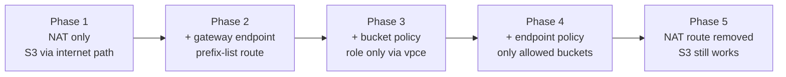
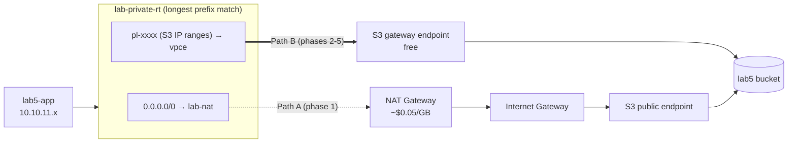
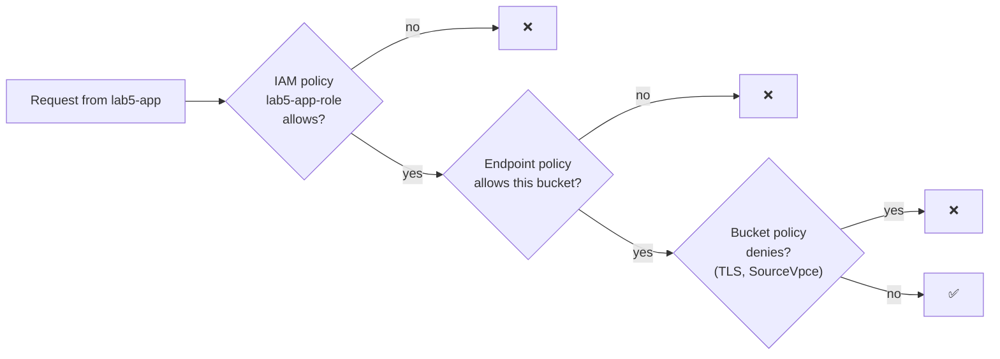

# Lab 5 — Amazon S3 from a Private Subnet (Gateway Endpoint) + Storage Classes & Lifecycle

> 🇫🇷 Version française : [S3-Private-Access-Lifecycle-Lab.fr.md](S3-Private-Access-Lifecycle-Lab.fr.md)

> **Audience:** Cloud Engineer trainees · **Level:** Associate
> **Starting point:** the **Lab 1** network in `us-west-1`, **including the NAT Gateway** · Lab 4 recommended (S3 basics)
> **Duration:** about 3 hours (+ an optional check the next day for lifecycle expiration) · **Method:** console + scripts
> **Previous:** Lab 4 — S3 Core & Security

---

## Scenario

*Pacific Learning Co.*'s application server runs in a **private subnet**. It stores logs, exports and archives in S3, and today all that traffic leaves through the **NAT Gateway**, which charges for every gigabyte. Security also wants proof that the application's credentials **only work from inside the company network**.

Your mission has two halves:

**A. Private access**: send S3 traffic through a free **S3 gateway endpoint**, lock the bucket to that endpoint, and restrict what the endpoint can reach.
**B. Cost optimization**: choose the right **storage class** for each kind of data, restore archives, and automate everything with **lifecycle rules**.

---

## Learning objectives

1. Explain how a private instance reaches S3 **through a NAT Gateway** vs **through a gateway endpoint**, and what each costs
2. Create an **S3 gateway endpoint** and read the **prefix-list route** it adds to a route table
3. Restrict a role to a VPC endpoint with the **`aws:SourceVpce`** condition in a bucket policy
4. Write an **endpoint policy**, and explain the three gates: IAM policy, bucket policy, endpoint policy
5. Prove S3 keeps working **without any internet access**
6. Compare the **seven storage classes**, and **restore** objects from Glacier Flexible Retrieval and Deep Archive
7. Create **lifecycle rules** for tiering, expiration, old versions and incomplete uploads, and verify them

---

## 1. Architecture

### 1.0 Full project diagram

```text
   ┌──────────────────────────────┐
   │ Cloud engineer laptop        │
   │ ssh lab5-app (ProxyJump)     │
   └──────────────────────────────┘
                 │ SSH 22
                 ▼
┌─ AWS Region us-west-1 (N. California) ───────────────────────────────────────────────────────────────────────────┐
│ ┌─ lab-vpc 10.10.0.0/16 (existing from Lab 1) ─────────────────────────────────────────────────────────────────┐ │
│ │         ┌─ lab-igw  Internet Gateway (existing) ───────────────────────┐                                     │ │
│ │         │ ▲ PATH A · phase 1 (NAT -> IGW -> S3)                        │                                     │ │
│ │         └──────────────────────────────────────────────────────────────┘                                     │ │
│ │ ┌─ Availability Zone 1 ────────────────────────────────────────────────────────────────────────────────────┐ │ │
│ │ │ ┌─ lab-bastion-subnet 10.10.0.0/28 · PUBLIC ───────────┐                                                 │ │ │
│ │ │ │ ★ lab5-bastion  t3.micro (no IAM role)               │                                                 │ │ │
│ │ │ │ ★ sg lab5-bastion-sg  IN 22 <- your IP               │                                                 │ │ │
│ │ │ └──────────────────────────────────────────────────────┘                                                 │ │ │
│ │ │       │ SSH 22 (ProxyJump)                                                                               │ │ │
│ │ │ ┌─ lab-public-a 10.10.1.0/24 · PUBLIC ─────────────────┐                                                 │ │ │
│ │ │ │   lab-nat  NAT Gateway (existing)                    │                                                 │ │ │
│ │ │ │   ~$0.05 per GB processed                            │                                                 │ │ │
│ │ │ └──────────────────────────────────────────────────────┘                                                 │ │ │
│ │ │       ▲ PATH A · phase 1                                                                                 │ │ │
│ │ │ ┌─ lab-private-a 10.10.11.0/24 · PRIVATE ──────────────┐     PATH A · phase 1      PATH B · phases 2-5   │ │ │
│ │ │ │ ★ lab5-app  t3.micro · no public IP                  │     0.0.0.0/0 -> NAT      pl-xxxx -> vpce       │ │ │
│ │ │ │ ★ role lab5-app-role (S3 bucket + EC2 read)          │     -> IGW -> S3          AWS network only      │ │ │
│ │ │ │ ★ sg lab5-app-sg  IN 22 <- lab5-bastion-sg           │     billed per GB         no charge             │ │ │
│ │ │ │   runs s3-path-check / s3-storage-classes            │                                                 │ │ │
│ │ │ └──────────────────────────────────────────────────────┘                                                 │ │ │
│ │ └──────────────────────────────────────────────────────────────────────────────────────────────────────────┘ │ │
│ │ lab-private-rt: 10.10.0.0/16 -> local · 0.0.0.0/0 -> lab-nat (removed in phase 5) · ★ pl-xxxx (S3) -> vpce   │ │
│ │ ┌─ ★ lab5-s3-gateway  S3 gateway endpoint (free) · associated with lab-private-rt ─────────────────────────┐ │ │
│ │ │   endpoint policy (phase 4): lab5 bucket + Amazon Linux 2023 repositories only                           │ │ │
│ │ └──────────────────────────────────────────────────────────────────────────────────────────────────────────┘ │ │
│ └──────────────────────────────────────────────────────────────────────────────────────────────────────────────┘ │
│                                         │ PATH B · phases 2-5 (vpce)                                             │
│                                         ▼                                                                        │
│ ┌─ Amazon S3 (regional service) ───────────────────────────────────────────────────────────────────────────────┐ │
│ │ ┌─ ★ lab5-<account-id>-<initials> ───────────────────────────────────┐  ┌─ al2023-repos-us-west-1-de612dc2 ┐ │ │
│ │ │ Block Public Access ON · ACLs off · Versioning ON · SSE-S3         │  │ Amazon Linux 2023 packages (dnf) │ │ │
│ │ │ bucket policy: TLS only · lab5-app-role ONLY via vpce-xxxx         │  │ owned by AWS, allowed by         │ │ │
│ │ │ lifecycle: logs/ tiering · tmp/ 1 day · old versions               │  │ the endpoint policy              │ │ │
│ │ │                                                                    │  └──────────────────────────────────┘ │ │
│ │ │ archive/  one object per storage class (7)                         │                                       │ │
│ │ │ logs/     ~220 KB log files (lifecycle)                            │                                       │ │
│ │ │ tmp/      scratch files (expire after 1 day)                       │                                       │ │
│ │ └────────────────────────────────────────────────────────────────────┘                                       │ │
│ └──────────────────────────────────────────────────────────────────────────────────────────────────────────────┘ │
│                                                                                                                  │
│ ★ = created in this lab · everything else exists from Lab 1                                                      │
└──────────────────────────────────────────────────────────────────────────────────────────────────────────────────┘
```

### 1.1 The five phases of Part A



| Phase | Change | `s3-path-check.sh` shows |
|-------|--------|---------------------------|
| 1 | None | Route `0.0.0.0/0 → nat-…` · Internet ✅ · S3 ✅ (through the NAT) · ListAllMyBuckets ✅ |
| 2 | Gateway endpoint on `lab-private-rt` | New route `pl-… → vpce-…` · S3 now uses the **endpoint** |
| 3 | Bucket policy `aws:SourceVpce` | S3 ✅ through the endpoint; **❌ if the endpoint is detached** |
| 4 | Endpoint policy | Own bucket ✅ · dnf ✅ · **ListAllMyBuckets ❌** (even though IAM allows it) |
| 5 | NAT route removed | Internet ❌ · EC2 API ❌ · **S3 ✅ · dnf ✅** |

### 1.2 Two ways from a private subnet to S3



> 🧠 **Why the endpoint wins once it exists:** the prefix list `pl-…` contains the specific S3 IP ranges of the Region. Routing always uses the **most specific match**, so packets to S3 go to the endpoint even though `0.0.0.0/0 → NAT` is still there.

### 1.3 Three gates for every S3 request from the app



All three must allow; any explicit Deny wins.

### 1.4 What you build

| # | Resource | Name |
|---|----------|------|
| 1 | S3 bucket | `lab5-<account-id>-<initials>` |
| 2 | IAM role + inline policy | `lab5-app-role` / `lab5-app-access` |
| 3 | Bastion + SG + key pair | `lab5-bastion`, `lab5-bastion-sg`, `lab5-key` |
| 4 | Private app instance + SG | `lab5-app`, `lab5-app-sg` |
| 5 | S3 gateway endpoint | `lab5-s3-gateway` |
| 6 | Bucket policy, endpoint policy, 3 lifecycle rules | from `scripts/policies/` |

---

## 2. Prerequisites and cost

- Lab 1 network in `us-west-1`: `lab-vpc`; `lab-bastion-subnet` (public); `lab-private-a` associated with **`lab-private-rt`** (`0.0.0.0/0 → lab-nat`); **NAT Gateway `lab-nat` Available**
- Your **account ID**

| Item | Approx. cost |
|------|--------------|
| NAT Gateway (already running) | ~$0.05/hour + ~$0.05 per GB processed |
| S3 gateway endpoint | **Free** (no hourly or per-GB charge) |
| 2 × t3.micro + bastion public IPv4 | ~$0.03/hour |
| S3 storage and requests | Cents |
| Expedited restore of a tiny Glacier object | About $0.01 |
| Objects in IA / Glacier / Deep Archive | Billed for their **minimum duration** (30/90/180 days) even if deleted early: a fraction of a cent for these tiny files |

### 2.1 Lab worksheet

| Item | Value |
|------|-------|
| Account ID | |
| Bucket name `lab5-<account-id>-<initials>` | |
| NAT Elastic IP | |
| Bastion public IP | |
| `lab5-app` private IP | |
| Endpoint ID `vpce-…` | |
| S3 prefix list ID `pl-…` | |

---

## 3. The lab scripts

```
aws-lab-s3-private-lifecycle/
├── S3-Private-Access-Lifecycle-Lab.en.md / .fr.md
└── scripts/
    ├── common.sh               shared helpers
    ├── s3-path-check.sh        route table, internet, S3, dnf, conclusion: run after every phase
    ├── s3-storage-classes.sh   upload | status | restore | lifecycle | report
    ├── s3-cleanup.sh           empties a versioned bucket (CloudShell)
    └── policies/
        ├── lab5-app-role-policy.json   IAM policy for lab5-app-role
        ├── lab5-bucket-policy.json     TLS only + role only through the endpoint
        ├── lab5-endpoint-policy.json   endpoint limited to the lab bucket + AL2023 repos
        └── lab5-lifecycle.json         3 lifecycle rules (CLI alternative to the console)
```

Publish to your repository, for example `2-Cloud-Infrastructure/aws-lab-s3-private-lifecycle/`.

---

## Part 1 — Check the starting point

- [ ] **VPC → NAT gateways → `lab-nat`**: *Available*. Note its **Elastic IP**.
- [ ] **Route tables → `lab-private-rt`**: routes `10.10.0.0/16 → local` and `0.0.0.0/0 → nat-…`; associated with `lab-private-a`.
- [ ] **`lab-bastion-subnet`** uses `lab-public-rt` (`0.0.0.0/0 → igw-…`).
- [ ] **VPC → Endpoints**: no S3 endpoint exists yet in `lab-vpc`.

---

## Part 2 — Create the bucket

**S3 → Create bucket** (Region **us-west-1**):

| Setting | Value |
|---------|-------|
| Bucket type / name | General purpose · `lab5-<account-id>-<initials>` |
| Object Ownership | **ACLs disabled** |
| Block Public Access | **Block all public access** ✅ |
| Bucket Versioning | **Enable** (needed for the old-versions lifecycle rule) |
| Default encryption | **SSE-S3** (default; Lab 4 covered SSE-KMS) |

**Create bucket.**

---

## Part 3 — IAM role for the application

1. Edit `scripts/policies/lab5-app-role-policy.json`: replace `BUCKET_NAME` (2 places).

```json
{
  "Version": "2012-10-17",
  "Statement": [
    { "Sid": "LabBucketLevel", "Effect": "Allow",
      "Action": ["s3:ListBucket", "s3:ListBucketVersions", "s3:GetBucketLocation", "s3:GetLifecycleConfiguration"],
      "Resource": "arn:aws:s3:::BUCKET_NAME" },
    { "Sid": "LabBucketObjects", "Effect": "Allow",
      "Action": ["s3:GetObject", "s3:GetObjectVersion", "s3:PutObject", "s3:DeleteObject", "s3:RestoreObject"],
      "Resource": "arn:aws:s3:::BUCKET_NAME/*" },
    { "Sid": "ListAllBucketsForEndpointPolicyDemo", "Effect": "Allow",
      "Action": "s3:ListAllMyBuckets", "Resource": "*" },
    { "Sid": "ReadNetworkConfigForPathCheck", "Effect": "Allow",
      "Action": ["ec2:DescribeRouteTables", "ec2:DescribeVpcEndpoints"], "Resource": "*" }
  ]
}
```

2. **IAM → Roles → Create role** → AWS service **EC2** → no managed policy → name **`lab5-app-role`** → **Create**.
3. **Add permissions → Create inline policy → JSON** → paste → name **`lab5-app-access`** → **Create policy**.

> 🧠 `s3:ListAllMyBuckets` is granted on purpose: in phase 4 you'll see the **endpoint policy** block it although IAM allows it. `ec2:Describe*` lets `s3-path-check.sh` print the instance's route table.

---

## Part 4 — Bastion and private application server

### 4.1 Security groups (VPC `lab-vpc`)
| Name | Inbound |
|------|---------|
| `lab5-bastion-sg` | SSH 22 ← **My IP** |
| `lab5-app-sg` | SSH 22 ← **`lab5-bastion-sg`** |

### 4.2 Key pair
`lab5-key` (ED25519, `.pem`) → `~/.ssh/` → `chmod 400 ~/.ssh/lab5-key.pem`.

### 4.3 Instances

| Setting | `lab5-bastion` | `lab5-app` |
|---------|----------------|------------|
| AMI / type | Amazon Linux 2023 · t3.micro | Amazon Linux 2023 · t3.micro |
| Subnet | `lab-bastion-subnet` | **`lab-private-a`** |
| Public IP | **Enable** | **Disable** |
| Security group | `lab5-bastion-sg` | `lab5-app-sg` |
| IAM instance profile | *(none)* | **`lab5-app-role`** |
| Metadata | V2 only | V2 only |

### 4.4 SSH config

```sshconfig
Host lab5-bastion
    HostName <BASTION_PUBLIC_IP>
    User ec2-user
    IdentityFile ~/.ssh/lab5-key.pem
    IdentitiesOnly yes

Host lab5-app
    HostName <APP_PRIVATE_IP>
    User ec2-user
    IdentityFile ~/.ssh/lab5-key.pem
    IdentitiesOnly yes
    ProxyJump lab5-bastion
```

> 🧠 Why SSH through a bastion and not Session Manager here? In phase 5 you remove internet access from `lab-private-rt`. Session Manager needs to reach the SSM service (through the NAT, or SSM interface endpoints), but SSH from the bastion uses the VPC's `local` route, so your session survives every phase.

---

## Part 5 — Phase 1: S3 through the NAT Gateway

```bash
ssh lab5-app
mkdir -p ~/scripts && cd ~/scripts
BASE=https://raw.githubusercontent.com/inspiredevgen/devops-worksphops/refs/heads/main/2-Cloud-Infrastructure/aws-lab-s3-private-lifecycle/scripts
for f in common.sh s3-path-check.sh s3-storage-classes.sh; do curl -fsSLO "$BASE/$f"; done
head -1 *.sh                                   # #!/bin/bash ×3

bash s3-path-check.sh <BUCKET_NAME> --speed
```

Expected:
- Route table: `0.0.0.0/0 → nat-…` *(default route via NAT Gateway)*
- Internet ✅: the internet sees the **NAT Elastic IP**
- S3: write ✅ · read ✅ · ListAllMyBuckets ✅ · dnf ✅
- Conclusion: **S3 traffic → NAT GATEWAY → internet gateway → S3 public endpoint**
- `--speed`: time to upload and download 50 MB. Write it down.

> 💸 **Cost of path A:** the NAT charges about **$0.05 per GB** in each direction. 1 TB of backups per month through the NAT ≈ **$50 in data processing alone**, on top of the NAT's hourly cost. Through a gateway endpoint, the same traffic costs **$0**.

---

## Part 6 — Phase 2: add the S3 gateway endpoint

**VPC → Endpoints → Create endpoint**:

| Setting | Value |
|---------|-------|
| Name | `lab5-s3-gateway` |
| Type | **AWS services** |
| Services | search `s3` → select **`com.amazonaws.us-west-1.s3`** with type **Gateway** (not *Interface*) |
| VPC | `lab-vpc` |
| Route tables | ✅ **`lab-private-rt`** only |
| Policy | **Full access** (you restrict it in phase 4) |

**Create endpoint.** Record its ID `vpce-…`.

Look at what changed:
1. **Route tables → `lab-private-rt` → Routes**: a new route **`pl-xxxxxxxx` → `vpce-…`**. Record the `pl-` ID.
2. **VPC → Managed prefix lists → `com.amazonaws.us-west-1.s3`**: the **S3 IP ranges** of the Region. That's what the `pl-` route points at.

Re-run on `lab5-app`:

```bash
bash s3-path-check.sh <BUCKET_NAME> --speed
```

Expected: the route table now lists **`pl-… → vpce-…  <- S3 prefix list (gateway endpoint)`**, and the conclusion becomes **S3 traffic → S3 GATEWAY ENDPOINT**. Compare the speed with phase 1.

> 🧠 **Gateway vs interface endpoints for S3**
>
> | | Gateway endpoint | Interface endpoint (PrivateLink) |
> |---|---|---|
> | How | Route-table entry (prefix list) | ENIs with private IPs in your subnets |
> | Cost | **Free** | Per hour per AZ + per GB |
> | Reachable from on-premises / peered VPCs | No | Yes |
> | DNS | Unchanged (public S3 names) | Endpoint-specific DNS names |
> | Typical use | Instances inside the VPC | Hybrid networks (VPN/Direct Connect) |

---

## Part 7 — Phase 3: lock the app role to the endpoint

### 7.1 Apply the bucket policy
Edit `scripts/policies/lab5-bucket-policy.json`: replace `BUCKET_NAME` (4 places), `ACCOUNT_ID` and `VPCE_ID` → **S3 → bucket → Permissions → Bucket policy → Edit** → paste → **Save**.

```json
{
  "Sid": "AppRoleOnlyThroughVpcEndpoint",
  "Effect": "Deny",
  "Principal": { "AWS": "arn:aws:iam::ACCOUNT_ID:role/lab5-app-role" },
  "Action": "s3:*",
  "Resource": ["arn:aws:s3:::BUCKET_NAME", "arn:aws:s3:::BUCKET_NAME/*"],
  "Condition": { "StringNotEquals": { "aws:SourceVpce": "VPCE_ID" } }
}
```

> ⚠️ **Why the Deny targets only `lab5-app-role`:** a `Deny` for `Principal: "*"` with `aws:SourceVpce` would also block **you** in the console (console requests don't come through your endpoint), and you could lock yourself out of your own bucket. Scope VPC restrictions to the principals that should be restricted, or add an exception for an administrator role.

Re-run `bash s3-path-check.sh <BUCKET_NAME>` → S3 still ✅ (the requests come through `vpce-…`).

### 7.2 Prove the condition works
1. **VPC → Endpoints → `lab5-s3-gateway` → Route tables → Manage route tables** → **untick** `lab-private-rt` → **Modify route tables**.
2. Re-run the check: the `pl-` route is gone, traffic goes through the NAT again, and **S3 write/read → denied/failed (AccessDenied)**. The role's credentials only work through the endpoint.
3. **Re-associate** `lab-private-rt` with the endpoint, and re-run: ✅ again.

> 🧠 This is how companies make stolen credentials useless outside their network: even if `lab5-app-role`'s temporary keys leaked, S3 would refuse them from anywhere except this VPC endpoint.

---

## Part 8 — Phase 4: endpoint policy (what the VPC may reach in S3)

**VPC → Endpoints → `lab5-s3-gateway` → Policy → Edit policy → Custom** → paste `scripts/policies/lab5-endpoint-policy.json` (replace `BUCKET_NAME` twice) → **Save**.

```json
{
  "Version": "2012-10-17",
  "Statement": [
    { "Sid": "LabBucketOnly", "Effect": "Allow", "Principal": "*", "Action": "s3:*",
      "Resource": ["arn:aws:s3:::BUCKET_NAME", "arn:aws:s3:::BUCKET_NAME/*"] },
    { "Sid": "AmazonLinux2023PackageRepositories", "Effect": "Allow", "Principal": "*", "Action": "s3:GetObject",
      "Resource": "arn:aws:s3:::al2023-repos-us-west-1-de612dc2/*" }
  ]
}
```

Re-run the check:

| Test | Result | Why |
|------|--------|-----|
| Own bucket write/read | ✅ | Allowed by IAM, endpoint and bucket policies |
| **List ALL buckets** | ❌ | IAM allows it, but `ListAllMyBuckets` isn't in the endpoint policy |
| dnf makecache | ✅ | Amazon Linux 2023 packages are served **from S3**: the second statement allows their bucket |

**Experiment:** remove the `AmazonLinux2023PackageRepositories` statement, save, and re-run: **dnf fails**. Put it back.

> 🧠 **Endpoint policies prevent data exfiltration:** even a fully privileged user on `lab5-app` can't copy data to *their own* bucket through this endpoint. The repository bucket name comes from the AWS documentation for Amazon Linux 2023 (`al2023-repos-<region>-de612dc2`).

---

## Part 9 — Phase 5: no internet, S3 still works

1. **Route tables → `lab-private-rt` → Edit routes** → **Remove** the `0.0.0.0/0 → nat-…` route → **Save**. (The `pl-…` route can't be edited here: the endpoint manages it.)
2. On `lab5-app` (your SSH session survives: it uses the `local` route):

```bash
bash s3-path-check.sh <BUCKET_NAME>
```

| Check | Result |
|-------|--------|
| Route table | **Cannot call the EC2 API** (no route to the internet, and no EC2 interface endpoint) |
| Internet (`checkip`) | ❌ |
| S3 own bucket | ✅ |
| dnf makecache | ✅ |
| Conclusion | **S3 works without internet**: only a gateway endpoint can explain it |

3. **Restore** the route: `lab-private-rt` → **Add route** `0.0.0.0/0` → NAT Gateway `lab-nat` → **Save**. Other labs need it.

> 🧠 The gateway endpoint gives access to **S3 only** (and DynamoDB has its own). Every other AWS API (EC2, SSM, CloudWatch, Secrets Manager…) needs a NAT or its own **interface endpoint**. Many regulated workloads run with no internet at all: gateway endpoints for S3/DynamoDB plus interface endpoints for the rest.

---

## Part 10 — Storage classes

### 10.1 The seven classes

| Class | Designed for | First-byte latency | Min. duration | Retrieval fee | AZs |
|-------|-------------|--------------------|---------------|---------------|-----|
| **S3 Standard** | Frequently accessed data | ms | — | — | ≥ 3 |
| **S3 Intelligent-Tiering** | Unknown or changing access | ms | — | — (monitoring fee per object ≥ 128 KB) | ≥ 3 |
| **S3 Standard-IA** | Accessed about monthly | ms | 30 days | per GB | ≥ 3 |
| **S3 One Zone-IA** | Re-creatable, infrequent data | ms | 30 days | per GB | **1** |
| **S3 Glacier Instant Retrieval** | Archives read ~quarterly | ms | 90 days | per GB (higher) | ≥ 3 |
| **S3 Glacier Flexible Retrieval** | Archives, restore in minutes–hours | **restore first**: Expedited 1–5 min · Standard 3–5 h · Bulk 5–12 h | 90 days | per GB + per request | ≥ 3 |
| **S3 Glacier Deep Archive** | Long-term retention (7–10+ years) | **restore first**: Standard ≤ 12 h · Bulk ≤ 48 h | 180 days | per GB + per request | ≥ 3 |

The **storage price** per GB-month goes down from top to bottom, while access costs and delays go up. IA and Glacier Instant Retrieval bill a **minimum object size of 128 KB**. Check current us-west-1 prices on the Amazon S3 pricing page.

### 10.2 Upload one object per class
On `lab5-app`:

```bash
cd ~/scripts
bash s3-storage-classes.sh <BUCKET_NAME> upload
```

The status table at the end shows **GET NOW? = no (InvalidObjectState)** for `GLACIER` and `DEEP_ARCHIVE`: those objects must be **restored** before they can be read.

In the console: open `archive/GLACIER.txt` → **Properties → Storage class**, and notice that **Open / Download** are disabled.

### 10.3 Restore archives

```bash
bash s3-storage-classes.sh <BUCKET_NAME> restore     # GLACIER: Expedited (1-5 min) · DEEP_ARCHIVE: Standard (<= 12 h)
bash s3-storage-classes.sh <BUCKET_NAME> status      # RESTORE column: IN PROGRESS -> READY until <date>
```

Run `status` again after about 5 minutes: `archive/GLACIER.txt` becomes **READY** and **GET NOW? = yes**. Check `DEEP_ARCHIVE` the next day.

> 🧠 A restore creates a **temporary copy** (here for 1 day) next to the archived object; the object itself **stays in its archive class**. To move it permanently, copy it onto itself with a new storage class (console: *Actions → Edit storage class*).
> *Expedited* may answer `GlacierExpeditedRetrievalNotAvailable` when capacity is busy: retry, or use `restore archive/GLACIER.txt Standard 1`.

### 10.4 Changing the class of an existing object
Console: select `archive/STANDARD.txt` → **Actions → Edit storage class** → **Glacier Instant Retrieval** → **Save**. Then, with versioning on, look at **Show versions**: the change created a **new version** (it's a copy).

---

## Part 11 — Lifecycle rules

You create the three rules from `lab5-lifecycle.json`.

| Rule | Scope | Actions | Why |
|------|-------|---------|-----|
| `logs-tiering` | prefix `logs/` | day 30 → Standard-IA · day 90 → Glacier IR · day 180 → Deep Archive · **expire day 730** | Logs are read a lot at first, then rarely, then kept for compliance |
| `tmp-expire-after-1-day` | prefix `tmp/` | **expire day 1** | Scratch files clean themselves up |
| `versions-and-housekeeping` | whole bucket | non-current versions → Glacier IR at day 30, **delete at day 90 (keep the 2 newest)** · remove expired delete markers · **abort incomplete multipart uploads after 7 days** | Versioning protects data; this rule stops old versions and failed uploads from piling up |

### 11.1 Console
**S3 → bucket → Management → Create lifecycle rule**, three times:

**Rule 1:** name `logs-tiering` · *Limit the scope* → prefix `logs/` · actions: ✅ *Transition current versions between storage classes* (Standard-IA 30 days, Glacier Instant Retrieval 90 days, Glacier Deep Archive 180 days) · ✅ *Expire current versions of objects* (730 days).

**Rule 2:** name `tmp-expire-after-1-day` · prefix `tmp/` · ✅ *Expire current versions* (1 day).

**Rule 3:** name `versions-and-housekeeping` · *Apply to all objects* (acknowledge) · ✅ *Transition noncurrent versions* (Glacier Instant Retrieval, 30 days after becoming noncurrent) · ✅ *Permanently delete noncurrent versions* (90 days, number of newer versions to retain: 2) · ✅ *Delete expired object delete markers or incomplete multipart uploads* → both boxes, 7 days.

> The console warns that the transition may **cost more for small objects** (under 128 KB): by default, lifecycle **skips objects smaller than 128 KB**. The script's log files are ~220 KB on purpose.

**CLI alternative (CloudShell, as administrator):** upload `lab5-lifecycle.json`, then:
```bash
aws s3api put-bucket-lifecycle-configuration --bucket <BUCKET_NAME> --lifecycle-configuration file://lab5-lifecycle.json
```

### 11.2 Verify immediately
On `lab5-app`:

```bash
bash s3-storage-classes.sh <BUCKET_NAME> lifecycle
```

You see the three rules, then the **`Expiration` header** that S3 sets at upload time:
- `tmp/scratch.txt` → `expiry-date="…", rule-id="tmp-expire-after-1-day"`
- `logs/…/app-2026-10-01.log` → `rule-id="logs-tiering"` (expiration in 730 days)
- `archive/STANDARD.txt` → no expiration rule

> 🧠 Lifecycle runs **asynchronously** (typically within 24–48 h after an object becomes eligible), and dates are rounded to the next midnight UTC. **Tomorrow:** `aws s3 ls s3://<BUCKET_NAME>/tmp/` is empty.

### 11.3 See it all
```bash
bash s3-storage-classes.sh <BUCKET_NAME> report      # objects and bytes per storage class
```
**S3 → Storage Lens → Default dashboard** (account-wide usage, updated daily) and **bucket → Metrics** complete the picture.

---

## Part 12 — Validation

| # | Test | Expected | Proves |
|---|------|----------|--------|
| 1 | `lab-private-rt` routes | `pl-… → vpce-…` | Gateway endpoint route (prefix list) |
| 2 | Path check, phase 2 | Conclusion: gateway endpoint | Most specific route wins |
| 3 | Endpoint detached + bucket policy | AccessDenied for the app role | `aws:SourceVpce` condition |
| 4 | Console access to the bucket as admin | Works | Deny scoped to the role only |
| 5 | Phase 4: `ListAllMyBuckets` | Denied | Endpoint policy is a separate gate |
| 6 | Phase 4: dnf | Works | AL2023 repos allowed in the endpoint policy |
| 7 | Phase 5: internet / EC2 API | Fail | Gateway endpoint covers S3 only |
| 8 | Phase 5: S3 | Works | Private access without internet |
| 9 | `archive/GLACIER.txt` before restore | InvalidObjectState | Archive tiers need a restore |
| 10 | After Expedited restore | Readable, class still GLACIER | Restores are temporary copies |
| 11 | `tmp/scratch.txt` headers | `Expiration … rule-id=tmp-expire-after-1-day` | Lifecycle rule matched |
| 12 | Next day: `tmp/` | Empty | Lifecycle expiration ran |

---

## Part 13 — Troubleshooting

| Problem | Cause | Fix |
|---------|-------|-----|
| `ssh lab5-app` hangs | `lab5-app-sg` source isn't `lab5-bastion-sg`, or wrong private IP | Fix the SG rule / `~/.ssh/config` |
| Phase 1: `curl` to GitHub fails | No NAT route | `lab-private-rt`: `0.0.0.0/0 → lab-nat` |
| No `pl-` route after creating the endpoint | Wrong route table ticked, or *Interface* type chosen | Endpoint → Route tables → tick `lab-private-rt`; type must be **Gateway** |
| Phase 3: AccessDenied even through the endpoint | Wrong `VPCE_ID` or `ACCOUNT_ID` in the bucket policy | Copy the exact `vpce-…` ID |
| You lost console access to the bucket | A Deny for `Principal: "*"` with `aws:SourceVpce` | Edit the bucket policy as the **root user** (or another admin outside the restriction) and scope it to the role |
| Phase 4: dnf fails | The AL2023 repository statement was removed, or the wrong Region in its ARN | Restore the statement with `us-west-1` |
| Phase 5: everything S3 fails | Endpoint not associated with `lab-private-rt` | Re-associate |
| `restore`: GlacierExpeditedRetrievalNotAvailable | No Expedited capacity at the moment | Retry, or use the Standard tier |
| `lifecycle`: NoSuchLifecycleConfiguration | Rules not created yet | Part 11 |
| Lifecycle rule rejected | Transition days too close (e.g. Standard-IA before day 30) | Respect the minimums shown in 10.1 |

---

## Part 14 — Break & fix

| # | Break it | Observe | Lesson |
|---|----------|---------|--------|
| B1 | Associate the endpoint with **`lab-public-rt`** instead of `lab-private-rt` | `lab5-app` goes back through the NAT and the bucket policy denies it | Endpoints act through the **route tables you pick** |
| B2 | Change the bucket policy's `VPCE_ID` to a fake `vpce-0000…` | The app is denied everywhere | Conditions must match exactly |
| B3 | Endpoint policy: change `BUCKET_NAME` to another bucket | The app loses access to its own bucket | Endpoint policy is evaluated on every request through the endpoint |
| B4 | Remove `s3:RestoreObject` from `lab5-app-access` | `restore` → AccessDenied | Restoring is a separate permission |
| B5 | Create a rule transitioning `logs/` to Standard-IA after **10 days** | The console/API refuses it | Standard-IA requires ≥ 30 days in the current class |

---

## Part 15 — Extension challenges

**A. Interface endpoint for S3.** Create an S3 **interface** endpoint in `lab-private-a` with its own security group, and access the bucket with `--endpoint-url https://bucket.vpce-…s3.us-west-1.vpce.amazonaws.com`. When would you need it rather than the gateway endpoint?

**B. Fully private instance.** Add **interface endpoints** for `ssm`, `ssmmessages` and `ec2messages`, attach `AmazonSSMManagedInstanceCore` to `lab5-app-role`, remove the NAT route, and connect with **Session Manager**.

**C. Restrict the whole bucket to the VPC.** Replace the role-scoped Deny with `aws:SourceVpc` for all principals **except** an administrator role (use `aws:PrincipalArn` with `ArnNotEquals`).

**D. Intelligent-Tiering archive tiers.** On the bucket, create an **Intelligent-Tiering archive configuration** (Archive Access after 90 days, Deep Archive Access after 180 days) for prefix `exports/`.

**E. S3 Inventory + Athena.** Configure a daily **S3 Inventory** report (CSV) into another bucket, then query storage classes and sizes with **Amazon Athena**.

**F. Cost model.** Your company stores 50 TB of logs per year. Using the pricing page for us-west-1, estimate the yearly cost with everything in Standard vs with the `logs-tiering` rule.

---

## Part 16 — Cleanup

1. **Route table:** make sure `lab-private-rt` has `0.0.0.0/0 → lab-nat` again (Phase 5 restore).
2. **VPC → Endpoints:** delete `lab5-s3-gateway` (its `pl-` route disappears from `lab-private-rt`).
3. **CloudShell** (Region us-west-1): upload `scripts/s3-cleanup.sh` →
   ```bash
   bash s3-cleanup.sh <BUCKET_NAME> --delete-bucket
   ```
   Deleting IA/Glacier/Deep Archive objects early bills the rest of their minimum duration: a fraction of a cent here.
4. **EC2:** terminate `lab5-app` and `lab5-bastion`; delete `lab5-app-sg` (first), then `lab5-bastion-sg`; delete the key pair `lab5-key`; remove the Lab 5 blocks from `~/.ssh/config`.
5. **IAM:** delete `lab5-app-role`.
6. If you're done with the series, follow **Lab 1, Part 15** to delete the NAT Gateway (~$0.05/hour) and the network.

---

## Part 17 — Review questions

1. Why does adding a gateway endpoint change the path to S3 even though the `0.0.0.0/0 → NAT` route is still there?
2. What exactly does the `pl-…` route contain, and who maintains it?
3. Compare gateway and interface endpoints for S3: cost, mechanism, and when you'd need the interface type.
4. What does `aws:SourceVpce` check, and why did the lab apply the Deny only to `lab5-app-role`?
5. `lab5-app-role` allows `s3:ListAllMyBuckets`, yet the call fails in phase 4. Why?
6. Why must the endpoint policy allow `al2023-repos-us-west-1-de612dc2`?
7. In phase 5, S3 works but `aws ec2 describe-route-tables` doesn't. Explain.
8. When would you choose Glacier Instant Retrieval over Glacier Flexible Retrieval? Over Standard-IA?
9. What does a restore do to an object in Glacier Flexible Retrieval? Which class is it in afterwards?
10. Why don't the lifecycle rules transition objects smaller than 128 KB by default?
11. Explain each action of the `versions-and-housekeeping` rule and the problem it prevents.
12. How can you check that a lifecycle expiration rule applies to an object without waiting a day?

<details>
<summary><b>Answers</b></summary>

1. Routing uses the **longest prefix match**. The prefix list contains the specific S3 IP ranges for the Region, which are more specific than `0.0.0.0/0`, so S3-bound packets follow the `pl-… → vpce-…` route.
2. The public IP ranges of S3 in that Region (AWS-managed prefix list `com.amazonaws.us-west-1.s3`). AWS maintains it; you can't edit it, and the endpoint adds and removes the route automatically.
3. **Gateway:** free, a route-table entry, works only for traffic from inside the VPC. **Interface (PrivateLink):** hourly + per-GB cost, ENIs with private IPs in your subnets, reachable from on-premises (VPN/Direct Connect) and peered networks, with its own DNS names. Use the interface type for hybrid access or when routes can't be used.
4. It compares the ID of the VPC endpoint the request came through with the given value; requests not coming through that endpoint have a different or no `aws:SourceVpce`. Scoping the Deny to the role restricts the application without locking administrators (whose console requests don't come through the endpoint) out of the bucket.
5. A request through the endpoint must also be allowed by the **endpoint policy**. It only allows actions on the lab bucket and the AL2023 repository objects, and `ListAllMyBuckets` (resource `*`) isn't included, so the request is denied.
6. Amazon Linux 2023 downloads its packages from that S3 bucket. Once the endpoint exists, `dnf` traffic to S3 goes through the endpoint, so the endpoint policy must allow it, or package installs and updates fail.
7. A gateway endpoint provides access to **S3 only**. The EC2 API is a different service endpoint, which needs internet access (NAT) or an EC2 **interface** endpoint.
8. Glacier IR: archives that must be readable **instantly** (milliseconds) but are rarely accessed (about quarterly), at lower storage cost than Standard-IA but higher retrieval cost. Glacier Flexible: archives where waiting minutes to hours is acceptable, at lower storage cost. Standard-IA: accessed about monthly, with a 30-day minimum.
9. It creates a **temporary readable copy** for the number of days requested. The object itself stays in **GLACIER**; when the copy expires, it's unreadable again until a new restore.
10. Transition requests and per-object overhead (and the 128 KB minimum billable size in IA classes) can make transitioning small objects cost more than it saves. Since 2024, S3 applies a default minimum object size of 128 KB to transitions.
11. Non-current versions move to Glacier IR after 30 days (cheaper), then are deleted after 90 days, keeping the 2 newest (bounded history). Expired delete markers (markers with no versions left) are removed (clean listings, fewer requests). Incomplete multipart uploads are aborted after 7 days (their parts are invisible but billed).
12. Look at the object's **`Expiration`** response header (`head-object`, or the console's object overview). S3 sets it at upload time with the expiry date and the matching `rule-id`.
</details>

---

Sources: [Amazon EMR — Sample policies for private subnets that access Amazon S3 (Amazon Linux 2023 repository bucket)](https://docs.aws.amazon.com/emr/latest/ManagementGuide/private-subnet-iampolicy.html)
