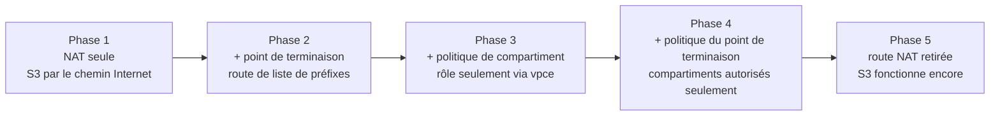
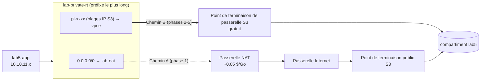
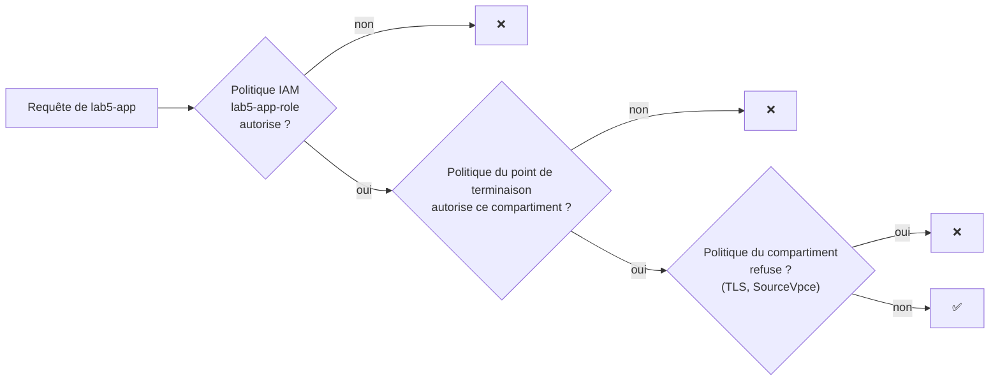

# Lab 5 — Amazon S3 depuis un sous-réseau privé (point de terminaison de passerelle) + classes de stockage et cycle de vie

> 🇬🇧 English version: [S3-Private-Access-Lifecycle-Lab.en.md](S3-Private-Access-Lifecycle-Lab.en.md)

> **Public :** futur·e·s ingénieur·e·s cloud · **Niveau :** Associé
> **Point de départ :** le réseau du **Lab 1** dans `us-west-1`, **passerelle NAT comprise** · Lab 4 recommandé (bases de S3)
> **Durée :** environ 3 h (+ une vérification facultative le lendemain pour l'expiration du cycle de vie) · **Méthode :** console + scripts
> **Précédent :** Lab 4 — S3 : fondamentaux et sécurité

> 💡 Les noms de menus et de boutons sont donnés **tels qu'ils apparaissent dans la console AWS en anglais**, avec leur traduction lorsque c'est utile. Les commandes, le code et les messages des scripts restent en anglais.

---

## Scénario

Le serveur d'application de *Pacific Learning Co.* tourne dans un **sous-réseau privé**. Il stocke journaux, exports et archives dans S3, et aujourd'hui tout ce trafic sort par la **passerelle NAT**, qui facture chaque gigaoctet. L'équipe sécurité veut aussi la preuve que les identifiants de l'application **ne fonctionnent que depuis le réseau de l'entreprise**.

Votre mission a deux volets :

**A. Accès privé** : faire passer le trafic S3 par un **point de terminaison de passerelle S3** gratuit, verrouiller le compartiment sur ce point de terminaison, et limiter ce que ce dernier peut atteindre.
**B. Optimisation des coûts** : choisir la bonne **classe de stockage** pour chaque type de données, restaurer des archives, et tout automatiser avec des **règles de cycle de vie**.

---

## Objectifs d'apprentissage

1. Expliquer comment une instance privée atteint S3 **via une passerelle NAT** ou **via un point de terminaison de passerelle**, et ce que coûte chaque solution
2. Créer un **point de terminaison de passerelle S3** et lire la **route de liste de préfixes** qu'il ajoute à une table de routage
3. Limiter un rôle à un point de terminaison VPC avec la condition **`aws:SourceVpce`** dans une politique de compartiment
4. Écrire une **politique de point de terminaison**, et expliquer les trois contrôles : politique IAM, politique de compartiment, politique de point de terminaison
5. Prouver que S3 continue de fonctionner **sans aucun accès Internet**
6. Comparer les **sept classes de stockage**, et **restaurer** des objets depuis Glacier Flexible Retrieval et Deep Archive
7. Créer des **règles de cycle de vie** pour les paliers, l'expiration, les anciennes versions et les téléversements inachevés, et les vérifier

---

## 1. Architecture

### 1.0 Diagramme complet du projet

```text
   ┌──────────────────────────────┐
   │ Portable de l'ingénieur      │
   │ ssh lab5-app (ProxyJump)     │
   └──────────────────────────────┘
                 │ SSH 22
                 ▼
┌─ Région AWS us-west-1 (Californie du Nord) ──────────────────────────────────────────────────────────────────────┐
│ ┌─ lab-vpc 10.10.0.0/16 (existant, Lab 1) ─────────────────────────────────────────────────────────────────────┐ │
│ │         ┌─ lab-igw  passerelle Internet (existante) ───────────────────┐                                     │ │
│ │         │ ▲ CHEMIN A · phase 1 (NAT -> IGW -> S3)                      │                                     │ │
│ │         └──────────────────────────────────────────────────────────────┘                                     │ │
│ │ ┌─ Zone de disponibilité 1 ────────────────────────────────────────────────────────────────────────────────┐ │ │
│ │ │ ┌─ lab-bastion-subnet 10.10.0.0/28 · PUBLIC ───────────┐                                                 │ │ │
│ │ │ │ ★ lab5-bastion  t3.micro (sans rôle IAM)             │                                                 │ │ │
│ │ │ │ ★ sg lab5-bastion-sg  ENTRÉE 22 <- votre IP          │                                                 │ │ │
│ │ │ └──────────────────────────────────────────────────────┘                                                 │ │ │
│ │ │       │ SSH 22 (ProxyJump)                                                                               │ │ │
│ │ │ ┌─ lab-public-a 10.10.1.0/24 · PUBLIC ─────────────────┐                                                 │ │ │
│ │ │ │   lab-nat  passerelle NAT (existante)                │                                                 │ │ │
│ │ │ │   ~0,05 $ par Go traité                              │                                                 │ │ │
│ │ │ └──────────────────────────────────────────────────────┘                                                 │ │ │
│ │ │       ▲ CHEMIN A · phase 1                                                                               │ │ │
│ │ │ ┌─ lab-private-a 10.10.11.0/24 · PRIVÉ ────────────────┐     CHEMIN A · phase 1    CHEMIN B · phases 2-5 │ │ │
│ │ │ │ ★ lab5-app  t3.micro · sans IP publique              │     0.0.0.0/0 -> NAT      pl-xxxx -> vpce       │ │ │
│ │ │ │ ★ rôle lab5-app-role (compartiment + lecture EC2)    │     -> IGW -> S3          réseau AWS seul       │ │ │
│ │ │ │ ★ sg lab5-app-sg  ENTRÉE 22 <- lab5-bastion-sg       │     facturé au Go         gratuit               │ │ │
│ │ │ │   exécute s3-path-check / s3-storage-classes         │                                                 │ │ │
│ │ │ └──────────────────────────────────────────────────────┘                                                 │ │ │
│ │ └──────────────────────────────────────────────────────────────────────────────────────────────────────────┘ │ │
│ │ lab-private-rt : 10.10.0.0/16 -> local · 0.0.0.0/0 -> lab-nat (retiré en phase 5) · ★ pl-xxxx (S3) -> vpce   │ │
│ │ ┌─ ★ lab5-s3-gateway  point de terminaison de passerelle S3 (gratuit) · lab-private-rt ────────────────────┐ │ │
│ │ │   politique du point de terminaison (phase 4) : compartiment lab5 + dépôts AL2023                        │ │ │
│ │ └──────────────────────────────────────────────────────────────────────────────────────────────────────────┘ │ │
│ └──────────────────────────────────────────────────────────────────────────────────────────────────────────────┘ │
│                                         │ CHEMIN B · phases 2-5 (vpce)                                           │
│                                         ▼                                                                        │
│ ┌─ Amazon S3 (service régional) ───────────────────────────────────────────────────────────────────────────────┐ │
│ │ ┌─ ★ lab5-<id-compte>-<initiales> ───────────────────────────────────┐  ┌─ al2023-repos-us-west-1-de612dc2 ┐ │ │
│ │ │ Blocage accès public · ACL off · versionnement · SSE-S3            │  │ paquets Amazon Linux 2023 (dnf)  │ │ │
│ │ │ politique : TLS seul · lab5-app-role SEULEMENT via vpce            │  │ appartient à AWS, autorisé       │ │ │
│ │ │ cycle de vie : logs/ par paliers · tmp/ 1 jour · versions          │  │ par la politique du vpce         │ │ │
│ │ │                                                                    │  └──────────────────────────────────┘ │ │
│ │ │ archive/  un objet par classe de stockage (7)                      │                                       │ │
│ │ │ logs/     journaux ~220 Ko (cycle de vie)                          │                                       │ │
│ │ │ tmp/      fichiers temporaires (expirent en 1 jour)                │                                       │ │
│ │ └────────────────────────────────────────────────────────────────────┘                                       │ │
│ └──────────────────────────────────────────────────────────────────────────────────────────────────────────────┘ │
│                                                                                                                  │
│ ★ = créé dans ce lab · le reste existe depuis le Lab 1                                                           │
└──────────────────────────────────────────────────────────────────────────────────────────────────────────────────┘
```

### 1.1 Les cinq phases du volet A



| Phase | Changement | `s3-path-check.sh` affiche |
|-------|------------|-----------------------------|
| 1 | Aucun | Route `0.0.0.0/0 → nat-…` · Internet ✅ · S3 ✅ (via la NAT) · ListAllMyBuckets ✅ |
| 2 | Point de terminaison de passerelle sur `lab-private-rt` | Nouvelle route `pl-… → vpce-…` · S3 passe désormais par le **point de terminaison** |
| 3 | Politique de compartiment `aws:SourceVpce` | S3 ✅ via le point de terminaison ; **❌ si on le dissocie** |
| 4 | Politique du point de terminaison | Propre compartiment ✅ · dnf ✅ · **ListAllMyBuckets ❌** (alors qu'IAM l'autorise) |
| 5 | Route NAT retirée | Internet ❌ · API EC2 ❌ · **S3 ✅ · dnf ✅** |

### 1.2 Deux chemins d'un sous-réseau privé vers S3



> 🧠 **Pourquoi le point de terminaison l'emporte dès qu'il existe :** la liste de préfixes `pl-…` contient les plages d'IP S3 précises de la Région. Le routage choisit toujours la **correspondance la plus spécifique** : les paquets vers S3 vont donc au point de terminaison, même si `0.0.0.0/0 → NAT` est toujours présente.

### 1.3 Trois contrôles pour chaque requête S3 de l'application



Les trois doivent autoriser ; tout refus explicite l'emporte.

### 1.4 Ce que vous construisez

| # | Ressource | Nom |
|---|-----------|-----|
| 1 | Compartiment S3 | `lab5-<id-compte>-<initiales>` |
| 2 | Rôle IAM + politique en ligne | `lab5-app-role` / `lab5-app-access` |
| 3 | Bastion + SG + paire de clés | `lab5-bastion`, `lab5-bastion-sg`, `lab5-key` |
| 4 | Instance applicative privée + SG | `lab5-app`, `lab5-app-sg` |
| 5 | Point de terminaison de passerelle S3 | `lab5-s3-gateway` |
| 6 | Politique de compartiment, politique de point de terminaison, 3 règles de cycle de vie | dans `scripts/policies/` |

---

## 2. Prérequis et coût

- Le réseau du Lab 1 dans `us-west-1` : `lab-vpc` ; `lab-bastion-subnet` (public) ; `lab-private-a` associé à **`lab-private-rt`** (`0.0.0.0/0 → lab-nat`) ; **passerelle NAT `lab-nat` à l'état Available**
- Votre **ID de compte**

| Élément | Coût approximatif |
|---------|-------------------|
| Passerelle NAT (déjà en service) | ~0,05 $/heure + ~0,05 $ par Go traité |
| Point de terminaison de passerelle S3 | **Gratuit** (ni coût horaire ni coût au Go) |
| 2 × t3.micro + IPv4 publique du bastion | ~0,03 $/heure |
| Stockage et requêtes S3 | Quelques centimes |
| Restauration Expedited d'un tout petit objet Glacier | Environ 0,01 $ |
| Objets en IA / Glacier / Deep Archive | Facturés pour leur **durée minimale** (30/90/180 jours) même supprimés plus tôt : une fraction de centime pour ces petits fichiers |

### 2.1 Fiche de travail

| Élément | Valeur |
|---------|--------|
| ID de compte | |
| Nom du compartiment `lab5-<id-compte>-<initiales>` | |
| IP élastique de la NAT | |
| IP publique du bastion | |
| IP privée de `lab5-app` | |
| ID du point de terminaison `vpce-…` | |
| ID de la liste de préfixes S3 `pl-…` | |

---

## 3. Les scripts du lab

```
aws-lab-s3-private-lifecycle/
├── S3-Private-Access-Lifecycle-Lab.en.md / .fr.md
└── scripts/
    ├── common.sh               fonctions partagées
    ├── s3-path-check.sh        table de routage, Internet, S3, dnf, conclusion : à lancer après chaque phase
    ├── s3-storage-classes.sh   upload | status | restore | lifecycle | report
    ├── s3-cleanup.sh           vide un compartiment versionné (CloudShell)
    └── policies/
        ├── lab5-app-role-policy.json   politique IAM de lab5-app-role
        ├── lab5-bucket-policy.json     TLS uniquement + rôle seulement via le point de terminaison
        ├── lab5-endpoint-policy.json   point de terminaison limité au compartiment du lab + dépôts AL2023
        └── lab5-lifecycle.json         3 règles de cycle de vie (alternative CLI à la console)
```

Publiez le dossier dans votre dépôt, par exemple `2-Cloud-Infrastructure/aws-lab-s3-private-lifecycle/`.

---

## Partie 1 — Vérifier le point de départ

- [ ] **VPC → NAT gateways → `lab-nat`** : *Available*. Notez son **IP élastique**.
- [ ] **Route tables → `lab-private-rt`** : routes `10.10.0.0/16 → local` et `0.0.0.0/0 → nat-…` ; associée à `lab-private-a`.
- [ ] **`lab-bastion-subnet`** utilise `lab-public-rt` (`0.0.0.0/0 → igw-…`).
- [ ] **VPC → Endpoints** : aucun point de terminaison S3 n'existe encore dans `lab-vpc`.

---

## Partie 2 — Créer le compartiment

**S3 → Create bucket** (Région **us-west-1**) :

| Paramètre | Valeur |
|-----------|--------|
| Bucket type / name | General purpose · `lab5-<id-compte>-<initiales>` |
| Object Ownership | **ACLs disabled** |
| Block Public Access | **Block all public access** ✅ |
| Bucket Versioning | **Enable** (nécessaire pour la règle de cycle de vie des anciennes versions) |
| Default encryption | **SSE-S3** (par défaut ; le Lab 4 a couvert SSE-KMS) |

**Create bucket.**

---

## Partie 3 — Rôle IAM de l'application

1. Modifiez `scripts/policies/lab5-app-role-policy.json` : remplacez `BUCKET_NAME` (2 occurrences).

```json
{
  "Version": "2012-10-17",
  "Statement": [
    { "Sid": "LabBucketLevel", "Effect": "Allow",
      "Action": ["s3:ListBucket", "s3:ListBucketVersions", "s3:GetBucketLocation", "s3:GetLifecycleConfiguration"],
      "Resource": "arn:aws:s3:::BUCKET_NAME" },
    { "Sid": "LabBucketObjects", "Effect": "Allow",
      "Action": ["s3:GetObject", "s3:GetObjectVersion", "s3:PutObject", "s3:DeleteObject", "s3:RestoreObject"],
      "Resource": "arn:aws:s3:::BUCKET_NAME/*" },
    { "Sid": "ListAllBucketsForEndpointPolicyDemo", "Effect": "Allow",
      "Action": "s3:ListAllMyBuckets", "Resource": "*" },
    { "Sid": "ReadNetworkConfigForPathCheck", "Effect": "Allow",
      "Action": ["ec2:DescribeRouteTables", "ec2:DescribeVpcEndpoints"], "Resource": "*" }
  ]
}
```

2. **IAM → Roles → Create role** → AWS service **EC2** → aucune politique gérée → nom **`lab5-app-role`** → **Create**.
3. **Add permissions → Create inline policy → JSON** → collez → nom **`lab5-app-access`** → **Create policy**.

> 🧠 `s3:ListAllMyBuckets` est accordé exprès : en phase 4, vous verrez la **politique du point de terminaison** le bloquer alors qu'IAM l'autorise. `ec2:Describe*` permet à `s3-path-check.sh` d'afficher la table de routage de l'instance.

---

## Partie 4 — Bastion et serveur applicatif privé

### 4.1 Groupes de sécurité (VPC `lab-vpc`)
| Nom | Entrée |
|-----|--------|
| `lab5-bastion-sg` | SSH 22 ← **My IP** |
| `lab5-app-sg` | SSH 22 ← **`lab5-bastion-sg`** |

### 4.2 Paire de clés
`lab5-key` (ED25519, `.pem`) → `~/.ssh/` → `chmod 400 ~/.ssh/lab5-key.pem`.

### 4.3 Instances

| Paramètre | `lab5-bastion` | `lab5-app` |
|-----------|----------------|------------|
| AMI / type | Amazon Linux 2023 · t3.micro | Amazon Linux 2023 · t3.micro |
| Sous-réseau | `lab-bastion-subnet` | **`lab-private-a`** |
| IP publique | **Enable** | **Disable** |
| Groupe de sécurité | `lab5-bastion-sg` | `lab5-app-sg` |
| Profil d'instance IAM | *(aucun)* | **`lab5-app-role`** |
| Métadonnées | V2 only | V2 only |

### 4.4 Configuration SSH

```sshconfig
Host lab5-bastion
    HostName <IP_PUBLIQUE_BASTION>
    User ec2-user
    IdentityFile ~/.ssh/lab5-key.pem
    IdentitiesOnly yes

Host lab5-app
    HostName <IP_PRIVEE_APP>
    User ec2-user
    IdentityFile ~/.ssh/lab5-key.pem
    IdentitiesOnly yes
    ProxyJump lab5-bastion
```

> 🧠 Pourquoi SSH via un bastion et pas Session Manager ici ? En phase 5, vous retirez l'accès Internet de `lab-private-rt`. Session Manager doit joindre le service SSM (via la NAT, ou des points de terminaison d'interface SSM), alors que SSH depuis le bastion utilise la route `local` du VPC : votre session survit à toutes les phases.

---

## Partie 5 — Phase 1 : S3 via la passerelle NAT

```bash
ssh lab5-app
mkdir -p ~/scripts && cd ~/scripts
BASE=https://raw.githubusercontent.com/inspiredevgen/devops-worksphops/refs/heads/main/2-Cloud-Infrastructure/aws-lab-s3-private-lifecycle/scripts
for f in common.sh s3-path-check.sh s3-storage-classes.sh; do curl -fsSLO "$BASE/$f"; done
head -1 *.sh                                   # #!/bin/bash ×3

bash s3-path-check.sh <NOM_COMPARTIMENT> --speed
```

Résultat attendu :
- Table de routage : `0.0.0.0/0 → nat-…` *(route par défaut via la passerelle NAT)*
- Internet ✅ : Internet voit l'**IP élastique de la NAT**
- S3 : écriture ✅ · lecture ✅ · ListAllMyBuckets ✅ · dnf ✅
- Conclusion : **S3 traffic → NAT GATEWAY → internet gateway → S3 public endpoint**
- `--speed` : temps d'envoi et de téléchargement de 50 Mo. Notez-le.

> 💸 **Coût du chemin A :** la NAT facture environ **0,05 $ par Go** dans chaque sens. 1 To de sauvegardes par mois via la NAT ≈ **50 $ de traitement de données seulement**, en plus du coût horaire de la NAT. Via un point de terminaison de passerelle, le même trafic coûte **0 $**.

---

## Partie 6 — Phase 2 : ajouter le point de terminaison de passerelle S3

**VPC → Endpoints → Create endpoint** :

| Paramètre | Valeur |
|-----------|--------|
| Name | `lab5-s3-gateway` |
| Type | **AWS services** |
| Services | cherchez `s3` → sélectionnez **`com.amazonaws.us-west-1.s3`** de type **Gateway** (pas *Interface*) |
| VPC | `lab-vpc` |
| Route tables | ✅ **`lab-private-rt`** uniquement |
| Policy | **Full access** (restreinte en phase 4) |

**Create endpoint.** Notez son ID `vpce-…`.

Observez ce qui a changé :
1. **Route tables → `lab-private-rt` → Routes** : une nouvelle route **`pl-xxxxxxxx` → `vpce-…`**. Notez l'ID `pl-`.
2. **VPC → Managed prefix lists → `com.amazonaws.us-west-1.s3`** : les **plages d'IP S3** de la Région. C'est la destination de la route `pl-`.

Relancez sur `lab5-app` :

```bash
bash s3-path-check.sh <NOM_COMPARTIMENT> --speed
```

Résultat attendu : la table de routage affiche désormais **`pl-… → vpce-…  <- S3 prefix list (gateway endpoint)`**, et la conclusion devient **S3 traffic → S3 GATEWAY ENDPOINT**. Comparez la vitesse avec la phase 1.

> 🧠 **Point de terminaison de passerelle ou d'interface pour S3**
>
> | | Passerelle (Gateway) | Interface (PrivateLink) |
> |---|---|---|
> | Fonctionnement | Entrée de table de routage (liste de préfixes) | ENI avec IP privées dans vos sous-réseaux |
> | Coût | **Gratuit** | À l'heure par AZ + au Go |
> | Accessible depuis le site / des VPC appairés | Non | Oui |
> | DNS | Inchangé (noms S3 publics) | Noms DNS propres au point de terminaison |
> | Usage typique | Instances dans le VPC | Réseaux hybrides (VPN/Direct Connect) |

---

## Partie 7 — Phase 3 : verrouiller le rôle de l'application sur le point de terminaison

### 7.1 Appliquer la politique de compartiment
Modifiez `scripts/policies/lab5-bucket-policy.json` : remplacez `BUCKET_NAME` (4 occurrences), `ACCOUNT_ID` et `VPCE_ID` → **S3 → compartiment → Permissions → Bucket policy → Edit** → collez → **Save**.

```json
{
  "Sid": "AppRoleOnlyThroughVpcEndpoint",
  "Effect": "Deny",
  "Principal": { "AWS": "arn:aws:iam::ACCOUNT_ID:role/lab5-app-role" },
  "Action": "s3:*",
  "Resource": ["arn:aws:s3:::BUCKET_NAME", "arn:aws:s3:::BUCKET_NAME/*"],
  "Condition": { "StringNotEquals": { "aws:SourceVpce": "VPCE_ID" } }
}
```

> ⚠️ **Pourquoi le refus ne vise que `lab5-app-role` :** un `Deny` pour `Principal: "*"` avec `aws:SourceVpce` vous bloquerait **vous aussi** dans la console (ses requêtes ne passent pas par votre point de terminaison), et vous pourriez perdre l'accès à votre propre compartiment. Limitez les restrictions VPC aux principaux concernés, ou ajoutez une exception pour un rôle administrateur.

Relancez `bash s3-path-check.sh <NOM_COMPARTIMENT>` → S3 toujours ✅ (les requêtes passent par `vpce-…`).

### 7.2 Prouver que la condition fonctionne
1. **VPC → Endpoints → `lab5-s3-gateway` → Route tables → Manage route tables** → **décochez** `lab-private-rt` → **Modify route tables**.
2. Relancez la vérification : la route `pl-` a disparu, le trafic repasse par la NAT, et **S3 écriture/lecture → denied/failed (AccessDenied)**. Les identifiants du rôle ne fonctionnent qu'à travers le point de terminaison.
3. **Ré-associez** `lab-private-rt` au point de terminaison, puis relancez : ✅ à nouveau.

> 🧠 C'est ainsi que les entreprises rendent des identifiants volés inutilisables hors de leur réseau : même si les clés temporaires de `lab5-app-role` fuyaient, S3 les refuserait partout sauf via ce point de terminaison VPC.

---

## Partie 8 — Phase 4 : politique du point de terminaison (ce que le VPC peut atteindre dans S3)

**VPC → Endpoints → `lab5-s3-gateway` → Policy → Edit policy → Custom** → collez `scripts/policies/lab5-endpoint-policy.json` (remplacez `BUCKET_NAME` deux fois) → **Save**.

```json
{
  "Version": "2012-10-17",
  "Statement": [
    { "Sid": "LabBucketOnly", "Effect": "Allow", "Principal": "*", "Action": "s3:*",
      "Resource": ["arn:aws:s3:::BUCKET_NAME", "arn:aws:s3:::BUCKET_NAME/*"] },
    { "Sid": "AmazonLinux2023PackageRepositories", "Effect": "Allow", "Principal": "*", "Action": "s3:GetObject",
      "Resource": "arn:aws:s3:::al2023-repos-us-west-1-de612dc2/*" }
  ]
}
```

Relancez la vérification :

| Test | Résultat | Pourquoi |
|------|----------|----------|
| Écriture/lecture dans le compartiment | ✅ | Autorisée par IAM, le point de terminaison et la politique du compartiment |
| **Lister TOUS les compartiments** | ❌ | IAM l'autorise, mais `ListAllMyBuckets` n'est pas dans la politique du point de terminaison |
| dnf makecache | ✅ | Les paquets d'Amazon Linux 2023 sont servis **depuis S3** : la deuxième déclaration autorise leur compartiment |

**Expérience :** retirez la déclaration `AmazonLinux2023PackageRepositories`, enregistrez, relancez : **dnf échoue**. Remettez-la.

> 🧠 **Les politiques de point de terminaison empêchent l'exfiltration de données :** même un utilisateur disposant de tous les droits sur `lab5-app` ne peut pas copier des données vers *son propre* compartiment à travers ce point de terminaison. Le nom du compartiment des dépôts provient de la documentation AWS pour Amazon Linux 2023 (`al2023-repos-<region>-de612dc2`).

---

## Partie 9 — Phase 5 : plus d'Internet, S3 fonctionne toujours

1. **Route tables → `lab-private-rt` → Edit routes** → **Remove** sur la route `0.0.0.0/0 → nat-…` → **Save**. (La route `pl-…` n'est pas modifiable ici : c'est le point de terminaison qui la gère.)
2. Sur `lab5-app` (votre session SSH survit : elle utilise la route `local`) :

```bash
bash s3-path-check.sh <NOM_COMPARTIMENT>
```

| Vérification | Résultat |
|--------------|----------|
| Table de routage | **Cannot call the EC2 API** (aucune route vers Internet, et pas de point de terminaison d'interface EC2) |
| Internet (`checkip`) | ❌ |
| S3, propre compartiment | ✅ |
| dnf makecache | ✅ |
| Conclusion | **S3 works without internet** : seul un point de terminaison de passerelle peut l'expliquer |

3. **Rétablissez** la route : `lab-private-rt` → **Add route** `0.0.0.0/0` → NAT Gateway `lab-nat` → **Save**. Les autres labs en ont besoin.

> 🧠 Le point de terminaison de passerelle donne accès à **S3 uniquement** (DynamoDB a le sien). Toutes les autres API AWS (EC2, SSM, CloudWatch, Secrets Manager…) exigent une NAT ou leur propre **point de terminaison d'interface**. De nombreuses charges réglementées fonctionnent sans aucun accès Internet : points de terminaison de passerelle pour S3/DynamoDB, et d'interface pour le reste.

---

## Partie 10 — Classes de stockage

### 10.1 Les sept classes

| Classe | Conçue pour | Latence du premier octet | Durée min. | Frais de récupération | AZ |
|--------|-------------|--------------------------|------------|------------------------|----|
| **S3 Standard** | Données souvent consultées | ms | — | — | ≥ 3 |
| **S3 Intelligent-Tiering** | Accès inconnu ou variable | ms | — | — (frais de surveillance par objet ≥ 128 Ko) | ≥ 3 |
| **S3 Standard-IA** | Accès environ mensuel | ms | 30 jours | au Go | ≥ 3 |
| **S3 One Zone-IA** | Données recréables, peu consultées | ms | 30 jours | au Go | **1** |
| **S3 Glacier Instant Retrieval** | Archives lues ~chaque trimestre | ms | 90 jours | au Go (plus élevé) | ≥ 3 |
| **S3 Glacier Flexible Retrieval** | Archives, restauration en minutes ou heures | **restauration d'abord** : Expedited 1–5 min · Standard 3–5 h · Bulk 5–12 h | 90 jours | au Go + par requête | ≥ 3 |
| **S3 Glacier Deep Archive** | Conservation longue (7 à 10 ans et plus) | **restauration d'abord** : Standard ≤ 12 h · Bulk ≤ 48 h | 180 jours | au Go + par requête | ≥ 3 |

Le **prix du stockage** par Go-mois baisse de haut en bas, tandis que les coûts et délais d'accès augmentent. Les classes IA et Glacier Instant Retrieval facturent une **taille minimale d'objet de 128 Ko**. Consultez les prix actuels de us-west-1 sur la page de tarification d'Amazon S3.

### 10.2 Déposer un objet par classe
Sur `lab5-app` :

```bash
cd ~/scripts
bash s3-storage-classes.sh <NOM_COMPARTIMENT> upload
```

Le tableau d'état final affiche **GET NOW? = no (InvalidObjectState)** pour `GLACIER` et `DEEP_ARCHIVE` : ces objets doivent être **restaurés** avant de pouvoir être lus.

Dans la console : ouvrez `archive/GLACIER.txt` → **Properties → Storage class**, et remarquez que **Open / Download** sont désactivés.

### 10.3 Restaurer des archives

```bash
bash s3-storage-classes.sh <NOM_COMPARTIMENT> restore     # GLACIER : Expedited (1-5 min) · DEEP_ARCHIVE : Standard (<= 12 h)
bash s3-storage-classes.sh <NOM_COMPARTIMENT> status      # colonne RESTORE : IN PROGRESS -> READY until <date>
```

Relancez `status` après environ 5 minutes : `archive/GLACIER.txt` passe à **READY** et **GET NOW? = yes**. Vérifiez `DEEP_ARCHIVE` le lendemain.

> 🧠 Une restauration crée une **copie temporaire** (ici pour 1 jour) à côté de l'objet archivé ; l'objet lui-même **reste dans sa classe d'archive**. Pour le déplacer durablement, copiez-le sur lui-même avec une nouvelle classe (console : *Actions → Edit storage class*).
> *Expedited* peut répondre `GlacierExpeditedRetrievalNotAvailable` quand la capacité est saturée : réessayez, ou utilisez `restore archive/GLACIER.txt Standard 1`.

### 10.4 Changer la classe d'un objet existant
Console : sélectionnez `archive/STANDARD.txt` → **Actions → Edit storage class** → **Glacier Instant Retrieval** → **Save**. Puis, le versionnement étant activé, regardez **Show versions** : le changement a créé une **nouvelle version** (c'est une copie).

---

## Partie 11 — Règles de cycle de vie

Vous créez les trois règles de `lab5-lifecycle.json`.

| Règle | Portée | Actions | Pourquoi |
|-------|--------|---------|----------|
| `logs-tiering` | préfixe `logs/` | jour 30 → Standard-IA · jour 90 → Glacier IR · jour 180 → Deep Archive · **expiration au jour 730** | Les journaux sont très lus au début, puis rarement, puis conservés pour la conformité |
| `tmp-expire-after-1-day` | préfixe `tmp/` | **expiration au jour 1** | Les fichiers temporaires se nettoient seuls |
| `versions-and-housekeeping` | tout le compartiment | versions non courantes → Glacier IR au jour 30, **suppression au jour 90 (en gardant les 2 plus récentes)** · suppression des marqueurs de suppression expirés · **annulation des téléversements en plusieurs parties inachevés après 7 jours** | Le versionnement protège les données ; cette règle évite l'accumulation d'anciennes versions et de téléversements ratés |

### 11.1 Console
**S3 → compartiment → Management → Create lifecycle rule**, trois fois :

**Règle 1 :** nom `logs-tiering` · *Limit the scope* → préfixe `logs/` · actions : ✅ *Transition current versions between storage classes* (Standard-IA 30 jours, Glacier Instant Retrieval 90 jours, Glacier Deep Archive 180 jours) · ✅ *Expire current versions of objects* (730 jours).

**Règle 2 :** nom `tmp-expire-after-1-day` · préfixe `tmp/` · ✅ *Expire current versions* (1 jour).

**Règle 3 :** nom `versions-and-housekeeping` · *Apply to all objects* (cochez l'avertissement) · ✅ *Transition noncurrent versions* (Glacier Instant Retrieval, 30 jours après être devenue non courante) · ✅ *Permanently delete noncurrent versions* (90 jours, nombre de versions récentes à conserver : 2) · ✅ *Delete expired object delete markers or incomplete multipart uploads* → les deux cases, 7 jours.

> La console avertit que la transition peut **coûter plus cher pour les petits objets** (moins de 128 Ko) : par défaut, le cycle de vie **ignore les objets de moins de 128 Ko**. Les journaux du script font ~220 Ko exprès.

**Alternative CLI (CloudShell, en administrateur) :** téléversez `lab5-lifecycle.json`, puis :
```bash
aws s3api put-bucket-lifecycle-configuration --bucket <NOM_COMPARTIMENT> --lifecycle-configuration file://lab5-lifecycle.json
```

### 11.2 Vérifier immédiatement
Sur `lab5-app` :

```bash
bash s3-storage-classes.sh <NOM_COMPARTIMENT> lifecycle
```

Vous voyez les trois règles, puis l'**en-tête `Expiration`** que S3 positionne au dépôt de l'objet :
- `tmp/scratch.txt` → `expiry-date="…", rule-id="tmp-expire-after-1-day"`
- `logs/…/app-2026-10-01.log` → `rule-id="logs-tiering"` (expiration dans 730 jours)
- `archive/STANDARD.txt` → aucune règle d'expiration

> 🧠 Le cycle de vie s'exécute **de façon asynchrone** (en général sous 24 à 48 h après qu'un objet devient éligible), et les dates sont arrondies au minuit UTC suivant. **Demain :** `aws s3 ls s3://<NOM_COMPARTIMENT>/tmp/` est vide.

### 11.3 Vue d'ensemble
```bash
bash s3-storage-classes.sh <NOM_COMPARTIMENT> report      # objets et octets par classe de stockage
```
**S3 → Storage Lens → Default dashboard** (utilisation à l'échelle du compte, mise à jour quotidienne) et **compartiment → Metrics** complètent le tableau.

---

## Partie 12 — Validation

| # | Test | Attendu | Démontre |
|---|------|---------|----------|
| 1 | Routes de `lab-private-rt` | `pl-… → vpce-…` | Route du point de terminaison de passerelle (liste de préfixes) |
| 2 | Vérification du chemin, phase 2 | Conclusion : point de terminaison de passerelle | La route la plus spécifique l'emporte |
| 3 | Point de terminaison dissocié + politique de compartiment | AccessDenied pour le rôle de l'application | Condition `aws:SourceVpce` |
| 4 | Accès console au compartiment en administrateur | Fonctionne | Refus limité au rôle |
| 5 | Phase 4 : `ListAllMyBuckets` | Refusé | La politique du point de terminaison est un contrôle à part |
| 6 | Phase 4 : dnf | Fonctionne | Dépôts AL2023 autorisés dans la politique du point de terminaison |
| 7 | Phase 5 : Internet / API EC2 | Échec | Le point de terminaison de passerelle ne couvre que S3 |
| 8 | Phase 5 : S3 | Fonctionne | Accès privé sans Internet |
| 9 | `archive/GLACIER.txt` avant restauration | InvalidObjectState | Les classes d'archive exigent une restauration |
| 10 | Après restauration Expedited | Lisible, classe toujours GLACIER | Les restaurations sont des copies temporaires |
| 11 | En-têtes de `tmp/scratch.txt` | `Expiration … rule-id=tmp-expire-after-1-day` | Règle de cycle de vie appliquée |
| 12 | Le lendemain : `tmp/` | Vide | L'expiration a eu lieu |

---

## Partie 13 — Dépannage

| Problème | Cause | Solution |
|----------|-------|----------|
| `ssh lab5-app` bloque | La source de `lab5-app-sg` n'est pas `lab5-bastion-sg`, ou mauvaise IP privée | Corrigez la règle du SG / `~/.ssh/config` |
| Phase 1 : `curl` vers GitHub échoue | Pas de route NAT | `lab-private-rt` : `0.0.0.0/0 → lab-nat` |
| Pas de route `pl-` après la création | Mauvaise table de routage cochée, ou type *Interface* choisi | Endpoint → Route tables → cochez `lab-private-rt` ; le type doit être **Gateway** |
| Phase 3 : AccessDenied même via le point de terminaison | `VPCE_ID` ou `ACCOUNT_ID` erroné dans la politique | Copiez l'ID `vpce-…` exact |
| Vous avez perdu l'accès console au compartiment | Un `Deny` pour `Principal: "*"` avec `aws:SourceVpce` | Modifiez la politique avec l'**utilisateur root** (ou un autre administrateur non concerné) et limitez-la au rôle |
| Phase 4 : dnf échoue | La déclaration des dépôts AL2023 a été retirée, ou la Région est fausse dans son ARN | Rétablissez la déclaration avec `us-west-1` |
| Phase 5 : tout S3 échoue | Point de terminaison non associé à `lab-private-rt` | Ré-associez |
| `restore` : GlacierExpeditedRetrievalNotAvailable | Pas de capacité Expedited à ce moment | Réessayez, ou utilisez le palier Standard |
| `lifecycle` : NoSuchLifecycleConfiguration | Règles pas encore créées | Partie 11 |
| Règle de cycle de vie refusée | Jours de transition trop proches (par ex. Standard-IA avant le jour 30) | Respectez les minimums du 10.1 |

---

## Partie 14 — Casser et réparer

| # | Casser | Observer | Leçon |
|---|--------|----------|-------|
| B1 | Associer le point de terminaison à **`lab-public-rt`** au lieu de `lab-private-rt` | `lab5-app` repasse par la NAT et la politique du compartiment la refuse | Un point de terminaison agit via **les tables de routage choisies** |
| B2 | Remplacer le `VPCE_ID` de la politique par un faux `vpce-0000…` | L'application est refusée partout | Les conditions doivent correspondre exactement |
| B3 | Dans la politique du point de terminaison, remplacer `BUCKET_NAME` par un autre compartiment | L'application perd l'accès à son propre compartiment | La politique du point de terminaison est évaluée à chaque requête qui le traverse |
| B4 | Retirer `s3:RestoreObject` de `lab5-app-access` | `restore` → AccessDenied | Restaurer est une permission distincte |
| B5 | Créer une règle de transition de `logs/` vers Standard-IA après **10 jours** | La console / l'API la refuse | Standard-IA exige ≥ 30 jours dans la classe actuelle |

---

## Partie 15 — Défis complémentaires

**A. Point de terminaison d'interface pour S3.** Créez un point de terminaison S3 de type **interface** dans `lab-private-a` avec son propre groupe de sécurité, et accédez au compartiment avec `--endpoint-url https://bucket.vpce-…s3.us-west-1.vpce.amazonaws.com`. Quand en auriez-vous besoin plutôt que du point de terminaison de passerelle ?

**B. Instance entièrement privée.** Ajoutez des **points de terminaison d'interface** pour `ssm`, `ssmmessages` et `ec2messages`, attachez `AmazonSSMManagedInstanceCore` à `lab5-app-role`, retirez la route NAT et connectez-vous avec **Session Manager**.

**C. Restreindre tout le compartiment au VPC.** Remplacez le refus ciblé sur le rôle par `aws:SourceVpc` pour tous les principaux **sauf** un rôle administrateur (utilisez `aws:PrincipalArn` avec `ArnNotEquals`).

**D. Paliers d'archive d'Intelligent-Tiering.** Sur le compartiment, créez une **configuration d'archivage Intelligent-Tiering** (Archive Access après 90 jours, Deep Archive Access après 180 jours) pour le préfixe `exports/`.

**E. S3 Inventory + Athena.** Configurez un rapport **S3 Inventory** quotidien (CSV) vers un autre compartiment, puis interrogez classes de stockage et tailles avec **Amazon Athena**.

**F. Modèle de coût.** Votre entreprise stocke 50 To de journaux par an. Avec la page de tarification de us-west-1, estimez le coût annuel avec tout en Standard, puis avec la règle `logs-tiering`.

---

## Partie 16 — Nettoyage

1. **Table de routage :** vérifiez que `lab-private-rt` contient de nouveau `0.0.0.0/0 → lab-nat` (rétablissement de la phase 5).
2. **VPC → Endpoints :** supprimez `lab5-s3-gateway` (sa route `pl-` disparaît de `lab-private-rt`).
3. **CloudShell** (Région us-west-1) : téléversez `scripts/s3-cleanup.sh` →
   ```bash
   bash s3-cleanup.sh <NOM_COMPARTIMENT> --delete-bucket
   ```
   Supprimer tôt des objets IA/Glacier/Deep Archive facture le reste de leur durée minimale : une fraction de centime ici.
4. **EC2 :** résiliez `lab5-app` et `lab5-bastion` ; supprimez `lab5-app-sg` (en premier), puis `lab5-bastion-sg` ; supprimez la paire de clés `lab5-key` ; retirez les blocs du Lab 5 de `~/.ssh/config`.
5. **IAM :** supprimez `lab5-app-role`.
6. Si vous avez terminé la série, suivez la **partie 15 du Lab 1** pour supprimer la passerelle NAT (~0,05 $/heure) et le réseau.

---

## Partie 17 — Questions de révision

1. Pourquoi l'ajout d'un point de terminaison de passerelle change-t-il le chemin vers S3 alors que la route `0.0.0.0/0 → NAT` existe toujours ?
2. Que contient exactement la route `pl-…`, et qui la maintient ?
3. Comparez points de terminaison de passerelle et d'interface pour S3 : coût, fonctionnement, et cas où le type interface est nécessaire.
4. Que vérifie `aws:SourceVpce`, et pourquoi le lab n'applique-t-il le refus qu'à `lab5-app-role` ?
5. `lab5-app-role` autorise `s3:ListAllMyBuckets`, pourtant l'appel échoue en phase 4. Pourquoi ?
6. Pourquoi la politique du point de terminaison doit-elle autoriser `al2023-repos-us-west-1-de612dc2` ?
7. En phase 5, S3 fonctionne mais `aws ec2 describe-route-tables` non. Expliquez.
8. Quand choisir Glacier Instant Retrieval plutôt que Glacier Flexible Retrieval ? Plutôt que Standard-IA ?
9. Que fait une restauration à un objet de Glacier Flexible Retrieval ? Dans quelle classe se trouve-t-il ensuite ?
10. Pourquoi les règles de cycle de vie ne font-elles pas transiter par défaut les objets de moins de 128 Ko ?
11. Expliquez chaque action de la règle `versions-and-housekeeping` et le problème qu'elle évite.
12. Comment vérifier qu'une règle d'expiration s'applique à un objet sans attendre un jour ?

<details>
<summary><b>Réponses</b></summary>

1. Le routage utilise la **correspondance du préfixe le plus long**. La liste de préfixes contient les plages d'IP S3 précises de la Région, plus spécifiques que `0.0.0.0/0` : les paquets destinés à S3 suivent donc la route `pl-… → vpce-…`.
2. Les plages d'IP publiques de S3 dans cette Région (liste de préfixes gérée par AWS `com.amazonaws.us-west-1.s3`). AWS la maintient ; vous ne pouvez pas la modifier, et le point de terminaison ajoute et retire la route automatiquement.
3. **Passerelle :** gratuite, une entrée de table de routage, ne fonctionne que pour le trafic issu du VPC. **Interface (PrivateLink) :** coût horaire + au Go, ENI avec IP privées dans vos sous-réseaux, accessible depuis le site (VPN/Direct Connect) et des réseaux appairés, avec ses propres noms DNS. On utilise le type interface pour l'accès hybride ou quand on ne peut pas passer par les routes.
4. Elle compare l'ID du point de terminaison VPC par lequel la requête est arrivée à la valeur indiquée ; une requête qui ne passe pas par ce point de terminaison a un `aws:SourceVpce` différent ou absent. Cibler le refus sur le rôle restreint l'application sans bloquer les administrateurs (dont les requêtes de console ne passent pas par le point de terminaison).
5. Une requête qui traverse le point de terminaison doit aussi être autorisée par la **politique du point de terminaison**. Celle-ci n'autorise que des actions sur le compartiment du lab et sur les objets des dépôts AL2023 ; `ListAllMyBuckets` (ressource `*`) n'y figure pas : la requête est refusée.
6. Amazon Linux 2023 télécharge ses paquets depuis ce compartiment S3. Dès que le point de terminaison existe, le trafic `dnf` vers S3 le traverse : sa politique doit l'autoriser, sinon les installations et mises à jour de paquets échouent.
7. Un point de terminaison de passerelle ne donne accès qu'à **S3**. L'API EC2 est un autre service, qui exige un accès Internet (NAT) ou un point de terminaison **d'interface** EC2.
8. Glacier IR : archives qui doivent être lisibles **instantanément** (millisecondes) mais rarement consultées (environ chaque trimestre), avec un stockage moins cher que Standard-IA mais une récupération plus chère. Glacier Flexible : archives pour lesquelles attendre des minutes ou des heures est acceptable, avec un stockage encore moins cher. Standard-IA : accès environ mensuel, durée minimale de 30 jours.
9. Elle crée une **copie temporaire lisible** pendant le nombre de jours demandé. L'objet lui-même reste en **GLACIER** ; à l'expiration de la copie, il redevient illisible jusqu'à une nouvelle restauration.
10. Les requêtes de transition et le surcoût par objet (et la taille minimale facturable de 128 Ko des classes IA) peuvent rendre la transition de petits objets plus coûteuse que l'économie réalisée. Depuis 2024, S3 applique par défaut une taille minimale de 128 Ko aux transitions.
11. Les versions non courantes passent en Glacier IR après 30 jours (moins cher), puis sont supprimées après 90 jours en gardant les 2 plus récentes (historique borné). Les marqueurs de suppression expirés (sans plus aucune version) sont supprimés (listes propres, moins de requêtes). Les téléversements en plusieurs parties inachevés sont annulés après 7 jours (leurs parties sont invisibles mais facturées).
12. Regardez l'**en-tête de réponse `Expiration`** de l'objet (`head-object`, ou la vue d'ensemble de l'objet dans la console). S3 le positionne au dépôt, avec la date d'expiration et le `rule-id` correspondant.
</details>

---

Sources : [Amazon EMR — Exemples de politiques pour les sous-réseaux privés qui accèdent à Amazon S3 (compartiment des dépôts Amazon Linux 2023)](https://docs.aws.amazon.com/fr_fr/emr/latest/ManagementGuide/private-subnet-iampolicy.html)
