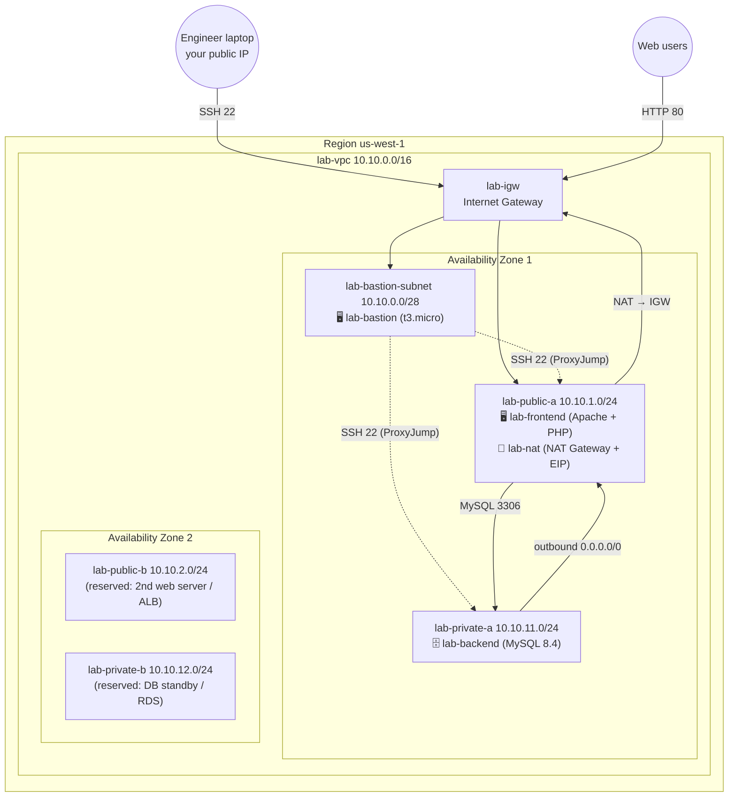
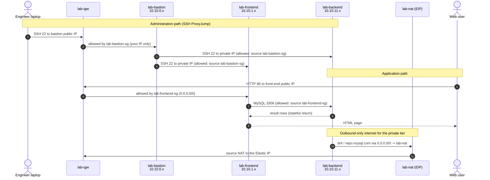

# Lab — Build a Secure VPC with a Bastion Host and a 2-Tier Web App (us-west-1)

> **Audience:** Cloud Engineer trainees (recent grads and IT professionals)
> **Level:** Associate · **Duration:** 3–4 hours · **Region:** `us-west-1` (N. California)
> **Method:** AWS Management Console for the network and EC2; shell scripts for the servers
> **Estimated cost:** about **US$0.15 per hour** while running (mostly the NAT Gateway). **Do the cleanup in Part 15.**

---

## Scenario

_Pacific Learning Co._ is launching its student-registration portal on AWS. As the new Cloud Engineer, you must build the network from scratch, following the company's security standards:

- No server is administered directly from the internet — **all SSH goes through a bastion host**.
- The **database must never have a public IP** and must be reachable **only from the web tier**.
- Private servers still need **outbound internet** for OS patches and packages.
- The design must leave room to grow to **two Availability Zones**.

---

## Learning objectives

By the end of this lab you will be able to:

1. Plan a VPC IP addressing scheme and carve it into subnets across Availability Zones
2. Explain what makes a subnet _public_, _private_, or a _bastion_ subnet (hint: route tables, not names)
3. Attach an Internet Gateway and route public subnets through it
4. Deploy a NAT Gateway and give private subnets outbound-only internet access
5. Design **security-group chaining** (bastion → servers, web → database)
6. Use **SSH ProxyJump** through a bastion host to manage private servers
7. Deploy a 2-tier application: **PHP front-end** (Apache) + **MySQL 8.4** back-end
8. Validate and troubleshoot connectivity layer by layer

---

## 1. Target architecture

### 1.0 Full project diagram

This diagram shows everything you will build: region, VPC, Availability Zones, subnets, gateways, route tables, instances, security-group rules and traffic paths. It displays in any Markdown viewer; widen the window if the lines wrap.

```text
   ┌────────────────────────────┐            ┌────────────────────────────┐
   │ Cloud engineer laptop      │            │ Web users (browser)        │
   │ ~/.ssh/config + ProxyJump  │            │ http://<frontend-public-ip>│
   └─────────────┬──────────────┘            └─────────────┬──────────────┘
                 │ SSH 22                                  │ HTTP 80
                 ▼                                         ▼
┌─ AWS Region us-west-1 (N. California) ─────────────────────────────────────────────────────────────────┐
│ ┌─ lab-vpc  10.10.0.0/16  (DNS hostnames enabled) ───────────────────────────────────────────────────┐ │
│ │             ┌─ lab-igw  Internet Gateway (attached to lab-vpc) ──────────┐                         │ │
│ │             │ IN  SSH 22 from your IP  -> lab-bastion                    │                         │ │
│ │             │ IN  HTTP 80 from anyone  -> lab-frontend                   │                         │ │
│ │             │ OUT lab-nat EIP / public IPs -> internet                   │                         │ │
│ │             └────────────────────────────────────────────────────────────┘                         │ │
│ │                                                                                                    │ │
│ │                                  │                                                                 │ │
│ │ ┌─ Availability Zone 1 ──────────────────────────────────┐  ┌─ Availability Zone 2 ──────────────┐ │ │
│ │ │ ┌─ lab-bastion-subnet  10.10.0.0/28  · PUBLIC ───────┐ │  │                                    │ │ │
│ │ │ │ lab-bastion   t3.micro · Amazon Linux 2023         │ │  │                                    │ │ │
│ │ │ │ sg lab-bastion-sg   IN 22   <- your IP /32         │ │  │                                    │ │ │
│ │ │ └────────────────────────────────────────────────────┘ │  │                                    │ │ │
│ │ │         │ SSH 22 via ProxyJump ─────┐ to front-end     │  │                                    │ │ │
│ │ │         │ to back-end               ▼ (private IP)     │  │                                    │ │ │
│ │ │ ┌─ lab-public-a  10.10.1.0/24  · PUBLIC ─────────────┐ │  │ ┌─ lab-public-b  10.10.2.0/24 ───┐ │ │ │
│ │ │ │ lab-frontend  t3.micro · Apache + PHP 8            │ │  │ │ PUBLIC · reserved              │ │ │ │
│ │ │ │ sg lab-frontend-sg  IN 80   <- 0.0.0.0/0           │ │  │ │ 2nd web server / ALB           │ │ │ │
│ │ │ │                     IN 22   <- lab-bastion-sg      │ │  │ │ (Extension Challenge A)        │ │ │ │
│ │ │ │                                                    │ │  │ └────────────────────────────────┘ │ │ │
│ │ │ │ lab-nat  NAT Gateway + Elastic IP                  │ │  │                                    │ │ │
│ │ │ └────────────────────────────────────────────────────┘ │  │                                    │ │ │
│ │ │         │ MySQL 3306        ▲ private default route    │  │                                    │ │ │
│ │ │         ▼                   │ 0.0.0.0/0 -> lab-nat     │  │                                    │ │ │
│ │ │ ┌─ lab-private-a  10.10.11.0/24  · PRIVATE ──────────┐ │  │                                    │ │ │
│ │ │ │ lab-backend   t3.small · MySQL 8.4 LTS             │ │  │                                    │ │ │
│ │ │ │ sg lab-backend-sg   IN 3306 <- lab-frontend-sg     │ │  │                                    │ │ │
│ │ │ │                     IN 22   <- lab-bastion-sg      │ │  │                                    │ │ │
│ │ │ │ no public IP                                       │ │  │ ┌─ lab-private-b  10.10.12.0/24 ─┐ │ │ │
│ │ │ └────────────────────────────────────────────────────┘ │  │ │ PRIVATE · reserved             │ │ │ │
│ │ │                                                        │  │ │ DB standby / RDS               │ │ │ │
│ │ │                                                        │  │ │ (Extension Challenge E)        │ │ │ │
│ │ │                                                        │  │ └────────────────────────────────┘ │ │ │
│ │ └────────────────────────────────────────────────────────┘  └────────────────────────────────────┘ │ │
│ │                                                                                                    │ │
│ │ ┌─ Route tables ─────────────────────────────────────────────────────────────────────────────────┐ │ │
│ │ │ lab-public-rt   10.10.0.0/16 -> local   0.0.0.0/0 -> lab-igw                                   │ │ │
│ │ │                 assoc: lab-bastion-subnet, lab-public-a, lab-public-b                          │ │ │
│ │ │ lab-private-rt  10.10.0.0/16 -> local   0.0.0.0/0 -> lab-nat                                   │ │ │
│ │ │                 assoc: lab-private-a, lab-private-b                                            │ │ │
│ │ │ main (unused)   10.10.0.0/16 -> local only (safe default)                                      │ │ │
│ │ └────────────────────────────────────────────────────────────────────────────────────────────────┘ │ │
│ └────────────────────────────────────────────────────────────────────────────────────────────────────┘ │
└────────────────────────────────────────────────────────────────────────────────────────────────────────┘
```

**Legend: the four traffic paths you will test**

| Path                | Flow                                                                                                       |
| ------------------- | ---------------------------------------------------------------------------------------------------------- |
| 🔐 Admin            | Laptop → IGW → `lab-bastion` (SSH 22) → ProxyJump → `lab-frontend` / `lab-backend` (SSH 22, private IPs)   |
| 🌐 Web              | Browser → IGW → `lab-frontend` (HTTP 80) → `lab-backend` (MySQL 3306)                                      |
| 📦 Patch / packages | `lab-backend` → `lab-private-rt` → `lab-nat` (public-a) → IGW → internet (repo.mysql.com, dnf repos)       |
| 🚫 Blocked          | Internet → `lab-backend` (no public IP, no route) · Bastion → MySQL 3306 (not allowed by `lab-backend-sg`) |

### 1.1 Architecture diagram (Mermaid)

Rendered automatically on GitHub, GitLab and in VS Code with a Mermaid preview extension.



### 1.2 IP addressing plan

| Name                 | Type             | CIDR            | AZ   | Usable IPs   | Purpose                                                |
| -------------------- | ---------------- | --------------- | ---- | ------------ | ------------------------------------------------------ |
| `lab-vpc`            | VPC              | `10.10.0.0/16`  | —    | 65,536 total | The whole network                                      |
| `lab-bastion-subnet` | Public (bastion) | `10.10.0.0/28`  | AZ 1 | **11**       | Bastion host only — deliberately tiny                  |
| `lab-public-a`       | Public           | `10.10.1.0/24`  | AZ 1 | 251          | Front-end server, NAT Gateway                          |
| `lab-public-b`       | Public           | `10.10.2.0/24`  | AZ 2 | 251          | Reserved for a second web server / ALB (extension)     |
| `lab-private-a`      | Private          | `10.10.11.0/24` | AZ 1 | 251          | MySQL back-end                                         |
| `lab-private-b`      | Private          | `10.10.12.0/24` | AZ 2 | 251          | Reserved for DB standby / RDS subnet group (extension) |

> 🧮 **Why 11 usable IPs in a /28?** A /28 has 16 addresses, and AWS reserves 5 in every subnet: network address, VPC router (+1), DNS (+2), future use (+3), and broadcast (last). 16 − 5 = **11**.

### 1.3 Routing plan

| Route table      | Associated subnets                                   | Routes                                         |
| ---------------- | ---------------------------------------------------- | ---------------------------------------------- |
| `lab-public-rt`  | `lab-bastion-subnet`, `lab-public-a`, `lab-public-b` | `10.10.0.0/16 → local` · `0.0.0.0/0 → lab-igw` |
| `lab-private-rt` | `lab-private-a`, `lab-private-b`                     | `10.10.0.0/16 → local` · `0.0.0.0/0 → lab-nat` |
| Main (default)   | _(none — left unused on purpose)_                    | `10.10.0.0/16 → local` only                    |

### 1.4 Security group plan (security-group chaining)

| Security group    | Inbound rule      | Source                   | Why                                |
| ----------------- | ----------------- | ------------------------ | ---------------------------------- |
| `lab-bastion-sg`  | SSH 22            | **My IP** (`x.x.x.x/32`) | Only you can reach the bastion     |
| `lab-frontend-sg` | HTTP 80           | `0.0.0.0/0`              | Public website                     |
| `lab-frontend-sg` | SSH 22            | **`lab-bastion-sg`**     | Admin only through the bastion     |
| `lab-backend-sg`  | MySQL/Aurora 3306 | **`lab-frontend-sg`**    | Only the web tier can query the DB |
| `lab-backend-sg`  | SSH 22            | **`lab-bastion-sg`**     | Admin only through the bastion     |

All three groups keep the default outbound rule (all traffic allowed). Security groups are **stateful**, so return traffic is allowed automatically.

### 1.5 Traffic-flow diagram



---

## 2. Prerequisites

- An AWS account with permission to create VPC and EC2 resources (avoid the root user)
- An **SSH client**: macOS/Linux Terminal, or Windows 10/11 PowerShell (OpenSSH is built in)
- A text editor to save the lab files (VS Code recommended)
- _(Recommended)_ An AWS Budget alert at US$10

### 2.1 Cost of this lab (approximate, us-west-1 — check AWS Pricing for current rates)

| Resource                                              | Approx. hourly cost                           |
| ----------------------------------------------------- | --------------------------------------------- |
| NAT Gateway                                           | ~$0.05 per hour, plus ~$0.05 per GB processed |
| 3 public IPv4 addresses (bastion, front-end, NAT EIP) | ~$0.005 per hour each                         |
| 2 × t3.micro + 1 × t3.small                           | ~$0.06 per hour                               |
| EBS gp3 (3 × 8 GB)                                    | cents per day                                 |

> ⚠️ The **NAT Gateway bills every hour, even when idle**. If you pause the lab overnight, delete it (Part 15) and recreate it the next day.

### 2.2 Lab worksheet

Copy this table into your notes and fill it in as you go. You will need these values later.

| Item                                         | Value |
| -------------------------------------------- | ----- |
| AZ 1 name (e.g. `us-west-1b`)                |       |
| AZ 2 name (e.g. `us-west-1c`)                |       |
| VPC ID                                       |       |
| NAT Gateway Elastic IP                       |       |
| Bastion **public** IP                        |       |
| Front-end **public** IP                      |       |
| Front-end **private** IP                     |       |
| Back-end **private** IP                      |       |
| MySQL `appuser` password (printed in Part 9) |       |

---

## 3. Prepare the lab files on your laptop

Create this folder structure on your laptop and paste each file's content from Parts 9 and 10 (every code block starts with a `File:` comment showing where it goes).

```
aws-net-lab/
├── backend/
│   ├── backend-mysql.sh      ← Part 9.1
│   └── seed.sql              ← Part 9.2
└── frontend/
    ├── frontend-setup.sh     ← Part 10.1
    ├── lib.php               ← Part 10.2
    ├── index.php             ← Part 10.3
    └── health.php            ← Part 10.4
```

> 💡 Save the files with **LF** line endings (in VS Code, click `CRLF` in the status bar and change it to `LF`). Windows CRLF line endings break bash scripts with errors like `$'\r': command not found`.

---

## Part 1 — Select the region and find your Availability Zones

1. Sign in to the AWS Management Console.
2. In the region selector (top right), choose **US West (N. California) `us-west-1`**.
3. Open **EC2 → Dashboard**. In the **Zones** panel, note the available AZs.

> 📌 **Important:** most accounts have only **two** AZs available in `us-west-1`, and the letters differ between accounts (yours may be `us-west-1a/us-west-1c` or `us-west-1b/us-west-1c`). AZ names are mapped per account; the **AZ ID** (e.g. `usw1-az1`) identifies the physical location. Write your two AZ names in the worksheet as **AZ 1** and **AZ 2**.

---

## Part 2 — Create the VPC

1. Open **VPC → Your VPCs → Create VPC**.
2. Choose **VPC only** (⚠️ not "VPC and more" — you are building every piece yourself).
3. Set:
   - **Name tag:** `lab-vpc`
   - **IPv4 CIDR block:** IPv4 CIDR manual input → `10.10.0.0/16`
   - **IPv6 CIDR block:** No IPv6 CIDR block
   - **Tenancy:** Default
4. Click **Create VPC**.
5. With `lab-vpc` selected: **Actions → Edit VPC settings** → tick **Enable DNS hostnames** (DNS resolution should already be enabled) → **Save**.

✅ **Checkpoint:** `lab-vpc` shows state _Available_ and CIDR `10.10.0.0/16`. Record the VPC ID.

> 🧠 **Discuss:** look at the **Route tables** page. AWS already created a _main route table_ for `lab-vpc` containing only the `local` route. Every subnet uses it unless you associate the subnet with another table.

---

## Part 3 — Create the five subnets

1. Open **VPC → Subnets → Create subnet**.
2. **VPC ID:** `lab-vpc`.
3. Fill in the first subnet, then click **Add new subnet** for each of the others, so all five are created in one go:

| Subnet name          | Availability Zone | IPv4 subnet CIDR block |
| -------------------- | ----------------- | ---------------------- |
| `lab-bastion-subnet` | AZ 1              | `10.10.0.0/28`         |
| `lab-public-a`       | AZ 1              | `10.10.1.0/24`         |
| `lab-public-b`       | AZ 2              | `10.10.2.0/24`         |
| `lab-private-a`      | AZ 1              | `10.10.11.0/24`        |
| `lab-private-b`      | AZ 2              | `10.10.12.0/24`        |

4. Click **Create subnet**.
5. Enable automatic public IPv4 on the **three public-facing subnets only**. For each of `lab-bastion-subnet`, `lab-public-a` and `lab-public-b`: select it → **Actions → Edit subnet settings** → tick **Enable auto-assign public IPv4 address** → **Save**.

✅ **Checkpoint:** five subnets exist. `lab-bastion-subnet` shows **11** available IPv4 addresses, and the /24 subnets show **251**.

> 🧠 **Discuss:** at this point **all five subnets are private**, even the ones named "public". Only a route to an Internet Gateway makes a subnet public; the name doesn't.

---

## Part 4 — Internet Gateway and public route table

### 4.1 Create and attach the Internet Gateway

1. **VPC → Internet gateways → Create internet gateway** → Name: `lab-igw` → **Create**.
2. The new IGW is _Detached_. Click **Actions → Attach to VPC** → select `lab-vpc` → **Attach internet gateway**.

> 🧠 An IGW attaches to the **VPC**, not to a subnet. A subnet becomes public when its **route table** has a route `0.0.0.0/0 → IGW`, which is what you configure next.

### 4.2 Create the public route table

1. **VPC → Route tables → Create route table**.
   - Name: `lab-public-rt` · VPC: `lab-vpc` → **Create route table**.
2. **Routes** tab → **Edit routes → Add route**:
   - Destination `0.0.0.0/0` → Target **Internet Gateway** → `lab-igw` → **Save changes**.
3. **Subnet associations** tab → **Edit subnet associations** → tick **`lab-bastion-subnet`, `lab-public-a`, `lab-public-b`** → **Save associations**.

✅ **Checkpoint:** `lab-public-rt` has 2 routes (`local` and `0.0.0.0/0 → igw-…`) and 3 explicit subnet associations.

---

## Part 5 — NAT Gateway and private route table

### 5.1 Create the NAT Gateway

1. **VPC → NAT gateways → Create NAT gateway**:
   - Name: `lab-nat`
   - **Subnet:** `lab-public-a` ← ⚠️ the NAT must live in a **public** subnet
   - **Connectivity type:** Public
   - _(If the console shows an availability-mode option, choose **Zonal** for this lab.)_
   - **Elastic IP allocation ID:** click **Allocate Elastic IP**
2. Click **Create NAT gateway**. Wait until the state is **Available** (1–3 minutes).
3. Record the NAT's Elastic IP in your worksheet.

### 5.2 Create the private route table

1. **Route tables → Create route table** → Name: `lab-private-rt` · VPC: `lab-vpc` → **Create**.
2. **Routes → Edit routes → Add route**: Destination `0.0.0.0/0` → Target **NAT Gateway** → `lab-nat` → **Save**.
3. **Subnet associations → Edit** → tick **`lab-private-a`, `lab-private-b`** → **Save**.
4. _(Housekeeping)_ Find the VPC's **main** route table (Main = Yes, no explicit associations) and rename it `lab-main-unused`. Leave it with only the `local` route. Any subnet you forget to associate will then be isolated, which is the safe default.

✅ **Checkpoint:**

| Route table       | Routes                   | Associations                |
| ----------------- | ------------------------ | --------------------------- |
| `lab-public-rt`   | local, `0.0.0.0/0 → igw` | bastion, public-a, public-b |
| `lab-private-rt`  | local, `0.0.0.0/0 → nat` | private-a, private-b        |
| `lab-main-unused` | local                    | none                        |

> 🧠 **Discuss:** in production you would create **one NAT Gateway per AZ** and a private route table per AZ, because a NAT Gateway is only redundant inside its own AZ. We use one NAT here to keep costs down. Extension Challenge B covers the HA design.

---

## Part 6 — Security groups

Open **VPC → Security groups** (or **EC2 → Security Groups**). Create the groups **in this order**, because later groups reference earlier ones.

### 6.1 `lab-bastion-sg`

- **Name:** `lab-bastion-sg` · **Description:** `SSH from admin IP only` · **VPC:** `lab-vpc`
- **Inbound:** Type **SSH**, Source **My IP**
- **Outbound:** leave the default (All traffic)

> If your IP changes (home vs campus), edit this rule. If you use a corporate VPN, "My IP" is the VPN's egress IP.

### 6.2 `lab-frontend-sg`

- **Name:** `lab-frontend-sg` · **Description:** `Web tier` · **VPC:** `lab-vpc`
- **Inbound:**
  - Type **HTTP**, Source **Anywhere-IPv4** (`0.0.0.0/0`)
  - Type **SSH**, Source **Custom** → start typing `lab-bastion-sg` and select the security group

### 6.3 `lab-backend-sg`

- **Name:** `lab-backend-sg` · **Description:** `Database tier` · **VPC:** `lab-vpc`
- **Inbound:**
  - Type **MYSQL/Aurora** (TCP 3306), Source **Custom** → `lab-frontend-sg`
  - Type **SSH**, Source **Custom** → `lab-bastion-sg`

✅ **Checkpoint:** in `lab-backend-sg`, the sources are **security group IDs (`sg-…`)**, not CIDR blocks.

> 🧠 **Why reference a security group instead of a CIDR?** The rule then follows the _role_ of the instance, not its IP address. If you add a second web server in `lab-public-b` and attach `lab-frontend-sg`, it can reach the database automatically, without editing any rule.

---

## Part 7 — Key pair and EC2 instances

### 7.1 Create a key pair

1. **EC2 → Key pairs → Create key pair**:
   - Name: `lab-net-key` · Type: **ED25519** · Format: **.pem**
2. The file downloads automatically. Move it into your SSH folder and restrict its permissions:

**macOS / Linux**

```bash
mkdir -p ~/.ssh && mv ~/Downloads/lab-net-key.pem ~/.ssh/
chmod 400 ~/.ssh/lab-net-key.pem
```

**Windows PowerShell**

```powershell
New-Item -ItemType Directory -Force "$env:USERPROFILE\.ssh" | Out-Null
Move-Item "$env:USERPROFILE\Downloads\lab-net-key.pem" "$env:USERPROFILE\.ssh\"
icacls "$env:USERPROFILE\.ssh\lab-net-key.pem" /inheritance:r /grant:r "$($env:USERNAME):(R)"
```

### 7.2 Launch the three instances

Use **EC2 → Instances → Launch instances** three times with the settings below. In **Network settings**, click **Edit** to choose the VPC, subnet and security group.

| Setting                          | `lab-bastion`                  | `lab-backend`                               | `lab-frontend`                 |
| -------------------------------- | ------------------------------ | ------------------------------------------- | ------------------------------ |
| AMI                              | Amazon Linux 2023 (64-bit x86) | Amazon Linux 2023 (64-bit x86)              | Amazon Linux 2023 (64-bit x86) |
| Instance type                    | `t3.micro`                     | **`t3.small`** (MySQL needs ~1 GB RAM free) | `t3.micro`                     |
| Key pair                         | `lab-net-key`                  | `lab-net-key`                               | `lab-net-key`                  |
| VPC                              | `lab-vpc`                      | `lab-vpc`                                   | `lab-vpc`                      |
| Subnet                           | `lab-bastion-subnet`           | **`lab-private-a`**                         | `lab-public-a`                 |
| Auto-assign public IP            | **Enable**                     | **Disable**                                 | **Enable**                     |
| Security group (select existing) | `lab-bastion-sg`               | `lab-backend-sg`                            | `lab-frontend-sg`              |
| Storage                          | 8 GiB gp3                      | 10 GiB gp3                                  | 8 GiB gp3                      |
| Advanced → Metadata version      | V2 only (token required)       | V2 only                                     | V2 only                        |

> Launch **`lab-backend` before `lab-frontend`** so the database is ready first.

✅ **Checkpoint:** all three instances are _Running_ with **2/2 status checks passed**. Fill in the worksheet:

- Bastion → public IPv4
- Front-end → public **and** private IPv4
- Back-end → private IPv4 (it has **no** public IP, which is correct)

---

## Part 8 — Connect through the bastion host (SSH ProxyJump)

### 8.1 Create an SSH config file

An SSH config file lets you type `ssh lab-backend`, and SSH hops through the bastion for you. Using `IdentityFile` per host avoids the common mistake where `ssh -J -i key` doesn't pass the key to the jump host.

Edit (or create) **`~/.ssh/config`** (Windows: `C:\Users\<you>\.ssh\config`) and add the block below, replacing the three IPs with your worksheet values.

```sshconfig
# ---- AWS Networking Lab ----
Host lab-bastion
    HostName <BASTION_PUBLIC_IP>
    User ec2-user
    IdentityFile ~/.ssh/lab-net-key.pem
    IdentitiesOnly yes

Host lab-frontend
    HostName <FRONTEND_PRIVATE_IP>
    User ec2-user
    IdentityFile ~/.ssh/lab-net-key.pem
    IdentitiesOnly yes
    ProxyJump lab-bastion

Host lab-backend
    HostName <BACKEND_PRIVATE_IP>
    User ec2-user
    IdentityFile ~/.ssh/lab-net-key.pem
    IdentitiesOnly yes
    ProxyJump lab-bastion
```

> 🧠 `lab-frontend` uses its **private** IP even though it has a public one. Port 22 on the front-end only accepts connections from `lab-bastion-sg`, so you must go through the bastion.

### 8.2 Test each hop

```bash
ssh lab-bastion      # type "yes" to accept the host key, then: exit
ssh lab-backend      # hops via the bastion; then: exit
ssh lab-frontend     # hops via the bastion; then: exit
```

### 8.3 Prepare the bastion with test tools

```bash
ssh lab-bastion
sudo dnf -y update
sudo dnf -y install nmap-ncat mariadb105   # nc for port tests, mysql client for later
exit
```

✅ **Checkpoint:** you can reach all three servers, and `ssh <frontend-public-ip>` from your laptop **times out** (port 22 is not open to the internet on that server).

---

## Part 9 — Back-end tier: install MySQL 8.4 and seed the database

### 9.1 Installation script

Amazon Linux 2023 doesn't include MySQL Community Server in its repositories, so the script adds Oracle's official **MySQL 8.4 LTS** repository for EL9, which is compatible with AL2023. If that repository is unreachable, it falls back to **MariaDB 10.5** from the Amazon repos (MySQL-compatible) and tells you it did.

The back-end reaches `repo.mysql.com` **through the NAT Gateway**. This step proves your private routing works.

```bash
#!/bin/bash
# File: backend/backend-mysql.sh
# Purpose : Install MySQL 8.4 LTS on Amazon Linux 2023, create the app database/user,
#           and seed it with sample data from seed.sql (same folder).
# Run     : sudo bash ~/backend/backend-mysql.sh
# Options : sudo APP_HOST_PATTERN='10.10.%' DB_APP_PASSWORD='...' bash backend-mysql.sh
set -euo pipefail

[[ $EUID -eq 0 ]] || { echo "Please run with sudo."; exit 1; }

SCRIPT_DIR="$(cd "$(dirname "$(readlink -f "$0")")" && pwd)"
SEED_FILE="${SCRIPT_DIR}/seed.sql"
DB_NAME="labapp"
DB_APP_USER="appuser"
APP_HOST_PATTERN="${APP_HOST_PATTERN:-10.10.%}"   # MySQL host pattern = the VPC CIDR
CRED_FILE="/root/lab-credentials.txt"

log()  { echo -e "\n\033[1;34m==> $*\033[0m"; }
warn() { echo -e "\033[1;33m[WARN] $*\033[0m"; }
rand() { python3 -c 'import secrets; print(secrets.token_hex(6))'; }

[[ -f "$SEED_FILE" ]] || { echo "seed.sql not found next to this script ($SEED_FILE)"; exit 1; }

# Re-use credentials if the script is run a second time
# shellcheck disable=SC1090
[[ -f "$CRED_FILE" ]] && source "$CRED_FILE"
# Passwords satisfy MySQL's validate_password MEDIUM policy (upper, lower, digit, special, >= 8)
MYSQL_ROOT_PASSWORD="${MYSQL_ROOT_PASSWORD:-Root#$(rand)Aa9}"
DB_APP_PASSWORD="${DB_APP_PASSWORD:-App#$(rand)Aa9}"

# Save the passwords BEFORE changing anything, so an interrupted run resumes with the same ones
( umask 077
  cat > "$CRED_FILE" <<EOF
MYSQL_ROOT_PASSWORD='${MYSQL_ROOT_PASSWORD}'
DB_APP_PASSWORD='${DB_APP_PASSWORD}'
EOF
)

# ---------------------------------------------------------------------------
log "1/6 Checking outbound internet access (via the NAT Gateway)"
if EGRESS_IP=$(curl -s --max-time 5 https://checkip.amazonaws.com); then
  echo "Outbound OK. Public egress IP seen by the internet: ${EGRESS_IP} (should be your NAT EIP)"
else
  echo "No outbound internet. Check lab-private-rt: 0.0.0.0/0 -> NAT Gateway, and the NAT is Available."
  exit 1
fi

# ---------------------------------------------------------------------------
log "2/6 Installing the database server"
ENGINE=""
if systemctl list-unit-files mysqld.service >/dev/null 2>&1 && rpm -q mysql-community-server >/dev/null 2>&1; then
  ENGINE="mysql"
elif rpm -q mariadb105-server >/dev/null 2>&1; then
  ENGINE="mariadb"
else
  dnf -y update
  cat > /etc/yum.repos.d/mysql-community.repo <<'EOF'
[mysql-8.4-lts-community]
name=MySQL 8.4 LTS Community Server
baseurl=https://repo.mysql.com/yum/mysql-8.4-community/el/9/$basearch/
enabled=1
gpgcheck=1
gpgkey=https://repo.mysql.com/RPM-GPG-KEY-mysql-2023
EOF
  if dnf -y install mysql-community-server; then
    ENGINE="mysql"
  else
    warn "MySQL repository install failed. Falling back to MariaDB 10.5 (MySQL-compatible)."
    rm -f /etc/yum.repos.d/mysql-community.repo
    dnf -y install mariadb105-server
    ENGINE="mariadb"
  fi
fi
echo "Engine: ${ENGINE}"

# ---------------------------------------------------------------------------
log "3/6 Starting the service"
if [[ "$ENGINE" == "mysql" ]]; then SERVICE="mysqld"; else SERVICE="mariadb"; fi
systemctl enable --now "$SERVICE"
sleep 3

# ---------------------------------------------------------------------------
log "4/6 Securing the root account"
if [[ "$ENGINE" == "mysql" ]]; then
  if mysql -uroot -p"${MYSQL_ROOT_PASSWORD}" -e "SELECT 1" >/dev/null 2>&1; then
    echo "Root password already set."
  else
    TMP_PW=$(grep 'temporary password' /var/log/mysqld.log | tail -1 | awk '{print $NF}')
    [[ -n "$TMP_PW" ]] || { echo "Cannot find the temporary root password in /var/log/mysqld.log"; exit 1; }
    if ! mysql -uroot -p"${TMP_PW}" --connect-expired-password \
         -e "ALTER USER 'root'@'localhost' IDENTIFIED BY '${MYSQL_ROOT_PASSWORD}';"; then
      echo "Could not log in as root with the saved or the temporary password."
      echo "The root password was probably changed by an earlier run. See Part 12 (troubleshooting)."
      exit 1
    fi
    echo "Temporary root password replaced."
  fi
  # Quote the password: in MySQL option files an unquoted '#' starts a comment
  ( umask 077
    cat > /root/.my.cnf <<EOF
[client]
user=root
password="${MYSQL_ROOT_PASSWORD}"
EOF
  )
else
  echo "MariaDB root uses unix_socket authentication (sudo mysql). No password needed."
fi

sql() {
  if [[ -f /root/.my.cnf ]]; then mysql --defaults-extra-file=/root/.my.cnf "$@"; else mysql "$@"; fi
}

# Remove anonymous users and the test database (what mysql_secure_installation does)
sql -e "DELETE FROM mysql.user WHERE User=''; DROP DATABASE IF EXISTS test; FLUSH PRIVILEGES;"

# ---------------------------------------------------------------------------
log "5/6 Creating database '${DB_NAME}' and user '${DB_APP_USER}'@'${APP_HOST_PATTERN}'"
sql <<SQL
CREATE DATABASE IF NOT EXISTS ${DB_NAME} CHARACTER SET utf8mb4 COLLATE utf8mb4_unicode_ci;
CREATE USER IF NOT EXISTS '${DB_APP_USER}'@'${APP_HOST_PATTERN}' IDENTIFIED BY '${DB_APP_PASSWORD}';
ALTER USER '${DB_APP_USER}'@'${APP_HOST_PATTERN}' IDENTIFIED BY '${DB_APP_PASSWORD}';
GRANT SELECT, INSERT, UPDATE, DELETE ON ${DB_NAME}.* TO '${DB_APP_USER}'@'${APP_HOST_PATTERN}';
FLUSH PRIVILEGES;
SQL

log "   Seeding sample data from seed.sql"
sql "${DB_NAME}" < "$SEED_FILE"

# ---------------------------------------------------------------------------
log "6/6 Verifying"
BIND=$(sql -N -e "SELECT @@bind_address;" 2>/dev/null || echo "unknown")
echo "bind_address = ${BIND}"
if [[ "$BIND" == "127.0.0.1" || "$BIND" == "localhost" ]]; then
  warn "MySQL listens on localhost only. Set bind-address=0.0.0.0 under [mysqld] and restart ${SERVICE}."
fi
ss -ltnp | grep -E ':3306\b' || warn "Nothing is listening on TCP 3306."
sql -t "${DB_NAME}" -e "SELECT 'courses' AS table_name, COUNT(*) AS row_count FROM courses
                        UNION ALL SELECT 'students', COUNT(*) FROM students
                        UNION ALL SELECT 'enrollments', COUNT(*) FROM enrollments;"

TOKEN=$(curl -s -X PUT http://169.254.169.254/latest/api/token -H "X-aws-ec2-metadata-token-ttl-seconds: 60")
PRIVATE_IP=$(curl -s -H "X-aws-ec2-metadata-token: $TOKEN" http://169.254.169.254/latest/meta-data/local-ipv4)

cat <<EOF

=====================================================================
 Back-end ready (${ENGINE})
   DB host (private IP) : ${PRIVATE_IP}
   Database             : ${DB_NAME}
   App user             : ${DB_APP_USER}@'${APP_HOST_PATTERN}'
   App password         : ${DB_APP_PASSWORD}
 Copy the private IP and app password into your lab worksheet.
 (Saved in ${CRED_FILE}. View it with: sudo cat ${CRED_FILE})
=====================================================================
EOF
```

### 9.2 Seed data

```sql
-- File: backend/seed.sql
-- Sample data for the Pacific Learning Co. student registry.
-- Re-runnable: it drops and recreates the tables.

SET FOREIGN_KEY_CHECKS = 0;
DROP VIEW  IF EXISTS v_course_stats;
DROP TABLE IF EXISTS enrollments;
DROP TABLE IF EXISTS students;
DROP TABLE IF EXISTS courses;
SET FOREIGN_KEY_CHECKS = 1;

CREATE TABLE courses (
  id     INT UNSIGNED AUTO_INCREMENT PRIMARY KEY,
  code   VARCHAR(20)  NOT NULL UNIQUE,
  title  VARCHAR(120) NOT NULL,
  track  VARCHAR(40)  NOT NULL,
  hours  SMALLINT UNSIGNED NOT NULL
) ENGINE=InnoDB DEFAULT CHARSET=utf8mb4 COLLATE=utf8mb4_unicode_ci;

CREATE TABLE students (
  id         INT UNSIGNED AUTO_INCREMENT PRIMARY KEY,
  full_name  VARCHAR(100) NOT NULL,
  email      VARCHAR(120) NOT NULL UNIQUE,
  city       VARCHAR(60)  NULL,
  created_at TIMESTAMP    NOT NULL DEFAULT CURRENT_TIMESTAMP
) ENGINE=InnoDB DEFAULT CHARSET=utf8mb4 COLLATE=utf8mb4_unicode_ci;

CREATE TABLE enrollments (
  student_id  INT UNSIGNED NOT NULL,
  course_id   INT UNSIGNED NOT NULL,
  status      ENUM('ENROLLED','COMPLETED','DROPPED') NOT NULL DEFAULT 'ENROLLED',
  enrolled_on DATE NOT NULL,
  PRIMARY KEY (student_id, course_id),
  CONSTRAINT fk_enr_student FOREIGN KEY (student_id) REFERENCES students(id) ON DELETE CASCADE,
  CONSTRAINT fk_enr_course  FOREIGN KEY (course_id)  REFERENCES courses(id)  ON DELETE CASCADE
) ENGINE=InnoDB DEFAULT CHARSET=utf8mb4 COLLATE=utf8mb4_unicode_ci;

INSERT INTO courses (code, title, track, hours) VALUES
  ('AWS-101', 'Cloud Foundations & Global Infrastructure', 'Foundations', 12),
  ('AWS-IAM', 'Identity & Access Management',              'Security',    10),
  ('AWS-NET', 'VPC Networking Deep Dive',                  'Networking',  16),
  ('AWS-CMP', 'EC2, Auto Scaling & Load Balancing',        'Compute',     14),
  ('AWS-STO', 'S3 & Storage Services',                     'Storage',     10),
  ('AWS-DB',  'RDS, Aurora & DynamoDB',                    'Database',    12),
  ('AWS-IAC', 'Infrastructure as Code with CloudFormation','Automation',  12),
  ('AWS-OPS', 'CloudWatch & CloudTrail Operations',        'Operations',   8);

INSERT INTO students (full_name, email, city, created_at) VALUES
  ('Amara Okafor',       'amara.okafor@example.com',      'Lagos',      '2026-09-01 09:15:00'),
  ('Jean-Pierre Mbuyi',  'jp.mbuyi@example.com',          'Kinshasa',   '2026-09-01 10:02:00'),
  ('Sofia Martinez',     'sofia.martinez@example.com',    'Toronto',    '2026-09-02 14:30:00'),
  ('Liam Chen',          'liam.chen@example.com',         'Vancouver',  '2026-09-03 08:45:00'),
  ('Fatou Diallo',       'fatou.diallo@example.com',      'Dakar',      '2026-09-03 16:20:00'),
  ('Noah Tremblay',      'noah.tremblay@example.com',     'Montréal',   '2026-09-04 11:05:00'),
  ('Priya Sharma',       'priya.sharma@example.com',      'Toronto',    '2026-09-05 13:40:00'),
  ('Grace Mukendi',      'grace.mukendi@example.com',     'Lubumbashi', '2026-09-06 09:55:00'),
  ('Ethan Brown',        'ethan.brown@example.com',       'Ottawa',     '2026-09-08 15:10:00'),
  ('Wanjiru Kamau',      'wanjiru.kamau@example.com',     'Nairobi',    '2026-09-09 07:30:00'),
  ('Lucas Dubois',       'lucas.dubois@example.com',      'Paris',      '2026-09-10 12:00:00'),
  ('Mei Tanaka',         'mei.tanaka@example.com',        'Calgary',    '2026-09-11 17:25:00');

INSERT INTO enrollments (student_id, course_id, status, enrolled_on) VALUES
  (1, 1, 'COMPLETED', '2026-09-02'), (1, 3, 'ENROLLED',  '2026-09-20'), (1, 2, 'ENROLLED',  '2026-09-21'),
  (2, 1, 'COMPLETED', '2026-09-02'), (2, 3, 'COMPLETED', '2026-09-15'), (2, 7, 'ENROLLED',  '2026-10-01'),
  (3, 1, 'COMPLETED', '2026-09-03'), (3, 4, 'ENROLLED',  '2026-09-22'),
  (4, 1, 'COMPLETED', '2026-09-04'), (4, 6, 'ENROLLED',  '2026-09-25'), (4, 5, 'DROPPED',   '2026-09-12'),
  (5, 1, 'ENROLLED',  '2026-09-04'), (5, 2, 'ENROLLED',  '2026-09-10'),
  (6, 1, 'COMPLETED', '2026-09-05'), (6, 3, 'ENROLLED',  '2026-09-23'), (6, 8, 'ENROLLED',  '2026-10-02'),
  (7, 2, 'COMPLETED', '2026-09-06'), (7, 7, 'ENROLLED',  '2026-09-28'),
  (8, 1, 'ENROLLED',  '2026-09-07'), (8, 3, 'ENROLLED',  '2026-09-24'),
  (9, 4, 'ENROLLED',  '2026-09-09'), (9, 8, 'COMPLETED', '2026-09-30'),
  (10, 1, 'COMPLETED','2026-09-10'), (10, 6, 'ENROLLED', '2026-09-26'),
  (11, 5, 'ENROLLED', '2026-09-11'), (11, 1, 'COMPLETED','2026-09-11'),
  (12, 3, 'ENROLLED', '2026-09-12'), (12, 4, 'ENROLLED', '2026-09-27');

-- A reporting view you can query during the lab
CREATE VIEW v_course_stats AS
SELECT c.code,
       c.title,
       COUNT(e.student_id)                      AS total_enrolled,
       COALESCE(SUM(e.status = 'COMPLETED'), 0) AS completed,
       COALESCE(SUM(e.status = 'DROPPED'),   0) AS dropped
FROM courses c
LEFT JOIN enrollments e ON e.course_id = c.id
GROUP BY c.id, c.code, c.title;
```

### 9.3 Copy the files to the back-end and run the script

From your **laptop**, inside the `aws-net-lab` folder:

```bash
scp -r backend lab-backend:~/        # scp travels through the bastion too (ProxyJump)
ssh lab-backend
sudo bash ~/backend/backend-mysql.sh
```

The script prints the back-end's private IP and the **`appuser` password**. Copy both into your worksheet.

### 9.4 Verify on the back-end

```bash
# Still on lab-backend
sudo mysql --defaults-extra-file=/root/.my.cnf labapp -t -e "SELECT * FROM v_course_stats;"
# (MariaDB fallback: sudo mysql labapp -t -e "SELECT * FROM v_course_stats;")

curl -s https://checkip.amazonaws.com    # → must equal your NAT Gateway's Elastic IP
exit
```

✅ **Checkpoint:** the view returns 8 courses, and the egress IP equals the **NAT EIP**. Your private server reaches the internet through the NAT but has no public address of its own.

---

## Part 10 — Front-end tier: Apache + PHP application

The front-end is a small **student registry**. It reads courses and students from MySQL, lets you register a new student, and shows **which instance, AZ and IPs served the page**. That makes the network path visible.

### 10.1 Setup script

```bash
#!/bin/bash
# File: frontend/frontend-setup.sh
# Purpose : Install Apache + PHP 8 on Amazon Linux 2023 and deploy the LabApp files
#           (lib.php, index.php, health.php) found in the same folder.
# Run     : sudo DB_HOST=<backend-private-ip> DB_PASSWORD='<appuser-password>' bash ~/frontend/frontend-setup.sh
set -euo pipefail

[[ $EUID -eq 0 ]] || { echo "Please run with sudo."; exit 1; }
: "${DB_HOST:?Set DB_HOST to the back-end PRIVATE IP (e.g. DB_HOST=10.10.11.25)}"
: "${DB_PASSWORD:?Set DB_PASSWORD to the appuser password printed by backend-mysql.sh}"
DB_PORT="${DB_PORT:-3306}"
DB_NAME="${DB_NAME:-labapp}"
DB_USER="${DB_USER:-appuser}"

SRC="$(cd "$(dirname "$(readlink -f "$0")")" && pwd)"
APP_DIR="/var/www/labapp"      # outside the web root: config + shared library
WEB_ROOT="/var/www/html"

log() { echo -e "\n\033[1;34m==> $*\033[0m"; }

for f in lib.php index.php health.php; do
  [[ -f "$SRC/$f" ]] || { echo "Missing $SRC/$f. Copy the whole frontend/ folder."; exit 1; }
done

log "1/5 Installing Apache, PHP-FPM, PHP MySQL driver and test tools"
dnf -y update
dnf -y install httpd php php-fpm php-mysqlnd nmap-ncat

log "2/5 Writing the database configuration (readable by root and the apache group only)"
mkdir -p "$APP_DIR"
cat > "$APP_DIR/config.php" <<EOF
<?php
// Generated by frontend-setup.sh. In production, store secrets in AWS Secrets Manager.
return [
    'host' => '${DB_HOST}',
    'port' => ${DB_PORT},
    'name' => '${DB_NAME}',
    'user' => '${DB_USER}',
    'pass' => '${DB_PASSWORD}',
];
EOF
chown root:apache "$APP_DIR/config.php"
chmod 640 "$APP_DIR/config.php"

log "3/5 Deploying the application"
install -o root -g apache -m 644 "$SRC/lib.php"    "$APP_DIR/lib.php"
install -o root -g apache -m 644 "$SRC/index.php"  "$WEB_ROOT/index.php"
install -o root -g apache -m 644 "$SRC/health.php" "$WEB_ROOT/health.php"
rm -f "$WEB_ROOT/index.html"

# SELinux is permissive by default on AL2023. If it is enforcing, allow DB and IMDS calls from PHP.
if command -v getenforce >/dev/null 2>&1 && [[ "$(getenforce)" == "Enforcing" ]]; then
  setsebool -P httpd_can_network_connect_db 1
  setsebool -P httpd_can_network_connect 1
fi

log "4/5 Starting PHP-FPM and Apache"
systemctl enable --now php-fpm httpd
systemctl restart php-fpm httpd

log "5/5 Self-tests"
echo "-- TCP test to MySQL ${DB_HOST}:${DB_PORT}"
if nc -z -w 3 "$DB_HOST" "$DB_PORT"; then
  echo "   OK: port ${DB_PORT} is reachable (routing + lab-backend-sg allow it)"
else
  echo "   FAIL: cannot reach ${DB_HOST}:${DB_PORT}. Check lab-backend-sg (3306 from lab-frontend-sg) and the DB service."
fi
echo "-- Application health check"
curl -s http://localhost/health.php || true
echo

TOKEN=$(curl -s -X PUT http://169.254.169.254/latest/api/token -H "X-aws-ec2-metadata-token-ttl-seconds: 60")
PUBLIC_IP=$(curl -s -H "X-aws-ec2-metadata-token: $TOKEN" http://169.254.169.254/latest/meta-data/public-ipv4 || true)
echo
echo "====================================================================="
echo " Front-end deployed. Open:  http://${PUBLIC_IP:-<frontend-public-ip>}/"
echo " Health endpoint:           http://${PUBLIC_IP:-<frontend-public-ip>}/health.php"
echo "====================================================================="
```

### 10.2 Shared library

```php
<?php
// File: frontend/lib.php
// Deployed to /var/www/labapp/lib.php (outside the web root).
declare(strict_types=1);

/** Database settings written by frontend-setup.sh */
function app_config(): array
{
    static $config = null;
    if ($config === null) {
        $config = require __DIR__ . '/config.php';
    }
    return $config;
}

/** Open a PDO connection to the MySQL back-end in the private subnet. */
function db(): PDO
{
    $c = app_config();
    $dsn = sprintf('mysql:host=%s;port=%d;dbname=%s;charset=utf8mb4', $c['host'], $c['port'], $c['name']);
    return new PDO($dsn, $c['user'], $c['pass'], [
        PDO::ATTR_ERRMODE            => PDO::ERRMODE_EXCEPTION,
        PDO::ATTR_DEFAULT_FETCH_MODE => PDO::FETCH_ASSOC,
        PDO::ATTR_TIMEOUT            => 3,   // seconds: fail fast if the network path is blocked
    ]);
}

/** Read EC2 instance metadata with IMDSv2 (session token). Returns 'n/a' off EC2. */
function imds(string $path): string
{
    static $token = null;
    if ($token === null) {
        $ctx = stream_context_create(['http' => [
            'method'  => 'PUT',
            'header'  => "X-aws-ec2-metadata-token-ttl-seconds: 300\r\n",
            'timeout' => 1,
        ]]);
        $token = @file_get_contents('http://169.254.169.254/latest/api/token', false, $ctx) ?: '';
    }
    if ($token === '') {
        return 'n/a';
    }
    $ctx = stream_context_create(['http' => [
        'header'  => "X-aws-ec2-metadata-token: {$token}\r\n",
        'timeout' => 1,
    ]]);
    $value = @file_get_contents("http://169.254.169.254/latest/meta-data/{$path}", false, $ctx);
    return $value === false ? 'n/a' : $value;
}

/** HTML-escape helper. */
function h(?string $value): string
{
    return htmlspecialchars($value ?? '', ENT_QUOTES, 'UTF-8');
}

/** Turn a PDO error into a networking hint for the lab. */
function network_hint(string $message): string
{
    $m = strtolower($message);
    if (str_contains($m, 'timed out') || str_contains($m, 'timeout')) {
        return 'Connection timed out: packets are being dropped. Check lab-backend-sg (3306 from lab-frontend-sg), NACLs, and the DB_HOST IP.';
    }
    if (str_contains($m, 'refused')) {
        return 'Connection refused: the network path works, but nothing listens on 3306. Is MySQL running and bound to 0.0.0.0?';
    }
    if (str_contains($m, 'access denied')) {
        return 'Access denied: the network is fine. Check the appuser password in /var/www/labapp/config.php and the MySQL host pattern (10.10.%).';
    }
    if (str_contains($m, 'unknown database')) {
        return 'Unknown database: run seed.sql on the back-end.';
    }
    return 'See the troubleshooting table in Part 12 of the lab guide.';
}
```

### 10.3 Main page

```php
<?php
// File: frontend/index.php
// Deployed to /var/www/html/index.php
declare(strict_types=1);
require '/var/www/labapp/lib.php';

// ---------- Handle the "register student" form (POST → redirect → GET) ----------
if ($_SERVER['REQUEST_METHOD'] === 'POST') {
    $name   = trim((string)($_POST['full_name'] ?? ''));
    $email  = trim((string)($_POST['email'] ?? ''));
    $city   = trim((string)($_POST['city'] ?? ''));
    $course = trim((string)($_POST['course_code'] ?? ''));

    if ($name === '' || !filter_var($email, FILTER_VALIDATE_EMAIL)) {
        $flash = ['error', 'A name and a valid email are required.'];
    } else {
        $pdo = null;
        try {
            $pdo = db();
            $pdo->beginTransaction();
            $stmt = $pdo->prepare('INSERT INTO students (full_name, email, city) VALUES (?, ?, ?)');
            $stmt->execute([$name, $email, $city !== '' ? $city : null]);
            $studentId = (int)$pdo->lastInsertId();
            if ($course !== '') {
                $stmt = $pdo->prepare(
                    "INSERT INTO enrollments (student_id, course_id, status, enrolled_on)
                     SELECT ?, id, 'ENROLLED', CURDATE() FROM courses WHERE code = ?"
                );
                $stmt->execute([$studentId, $course]);
            }
            $pdo->commit();
            $flash = ['ok', "Student {$name} registered (id {$studentId})."];
        } catch (PDOException $e) {
            if ($pdo instanceof PDO && $pdo->inTransaction()) {
                $pdo->rollBack();
            }
            $flash = ['error', $e->getCode() === '23000'
                ? 'That email address is already registered.'
                : 'Database error: ' . $e->getMessage()];
        }
    }
    header('Location: /?' . http_build_query(['type' => $flash[0], 'msg' => $flash[1]]), true, 303);
    exit;
}

// ---------- Read data for the page ----------
$error    = null;
$courses  = [];
$students = [];
$dbInfo   = ['version' => 'n/a', 'hostname' => 'n/a'];
$latency  = null;

$t0 = microtime(true);
try {
    $pdo = db();
    $dbInfo = $pdo->query('SELECT VERSION() AS version, @@hostname AS hostname')->fetch();
    $courses = $pdo->query(
        "SELECT c.code, c.title, c.track, c.hours,
                COUNT(e.student_id)                      AS enrolled,
                COALESCE(SUM(e.status = 'COMPLETED'), 0) AS completed
         FROM courses c
         LEFT JOIN enrollments e ON e.course_id = c.id
         GROUP BY c.id, c.code, c.title, c.track, c.hours
         ORDER BY c.code"
    )->fetchAll();
    $students = $pdo->query(
        "SELECT s.id, s.full_name, s.email, s.city,
                DATE_FORMAT(s.created_at, '%Y-%m-%d') AS joined,
                GROUP_CONCAT(c.code ORDER BY c.code SEPARATOR ', ') AS courses
         FROM students s
         LEFT JOIN enrollments e ON e.student_id = s.id
         LEFT JOIN courses c     ON c.id = e.course_id
         GROUP BY s.id, s.full_name, s.email, s.city, s.created_at
         ORDER BY s.id DESC
         LIMIT 50"
    )->fetchAll();
    $latency = round((microtime(true) - $t0) * 1000, 1);
} catch (PDOException $e) {
    $error = $e->getMessage();
}

$server = [
    'Front-end instance' => imds('instance-id'),
    'Availability Zone'  => imds('placement/availability-zone'),
    'Private IP'         => imds('local-ipv4'),
    'Public IP'          => imds('public-ipv4'),
    'DB host (private)'  => app_config()['host'],
    'DB server'          => $dbInfo['hostname'] . ' · ' . $dbInfo['version'],
    'DB round trip'      => $latency !== null ? "{$latency} ms" : 'n/a',
];
$flashType = $_GET['type'] ?? null;
$flashMsg  = $_GET['msg'] ?? null;
?>
<!doctype html>
<html lang="en">
<head>
<meta charset="utf-8">
<meta name="viewport" content="width=device-width, initial-scale=1">
<title>Pacific Learning Co. · Student Registry</title>
<style>
  :root { --bg:#f5f7fb; --card:#fff; --ink:#1d2433; --muted:#5b6475; --line:#e3e7ef;
          --brand:#ff9900; --navy:#232f3e; --ok:#1e7e34; --err:#b42318; }
  * { box-sizing: border-box; }
  body { margin:0; font-family: system-ui, -apple-system, "Segoe UI", Roboto, sans-serif; background:var(--bg); color:var(--ink); }
  header { background:var(--navy); color:#fff; padding:18px 24px; border-bottom:4px solid var(--brand); }
  header h1 { margin:0; font-size:1.35rem; } header p { margin:4px 0 0; color:#c9d1dc; font-size:.9rem; }
  main { max-width:1150px; margin:24px auto; padding:0 16px; display:grid; gap:20px; grid-template-columns: 2fr 1fr; }
  .card { background:var(--card); border:1px solid var(--line); border-radius:10px; padding:18px 20px; }
  .full { grid-column: 1 / -1; }
  h2 { font-size:1.05rem; margin:0 0 12px; }
  table { width:100%; border-collapse:collapse; font-size:.9rem; }
  th, td { text-align:left; padding:8px 6px; border-bottom:1px solid var(--line); }
  th { color:var(--muted); font-weight:600; font-size:.8rem; text-transform:uppercase; letter-spacing:.03em; }
  dl { display:grid; grid-template-columns: auto 1fr; gap:6px 12px; margin:0; font-size:.88rem; }
  dt { color:var(--muted); } dd { margin:0; font-family: ui-monospace, Menlo, Consolas, monospace; word-break:break-all; }
  form { display:grid; gap:10px; }
  input, select, button { font:inherit; padding:9px 10px; border:1px solid var(--line); border-radius:8px; }
  button { background:var(--brand); border-color:var(--brand); color:#111; font-weight:600; cursor:pointer; }
  .flash { padding:12px 14px; border-radius:8px; font-size:.92rem; }
  .flash.ok { background:#e8f5ec; color:var(--ok); } .flash.error { background:#fdecea; color:var(--err); }
  .badge { display:inline-block; padding:2px 8px; border-radius:999px; background:#eef2f8; font-size:.8rem; }
  code { background:#eef2f8; padding:1px 5px; border-radius:4px; }
  @media (max-width: 860px) { main { grid-template-columns: 1fr; } }
</style>
</head>
<body>
<header>
  <h1>Pacific Learning Co. · Student Registry</h1>
  <p>2-tier demo · Front-end (Apache + PHP, public subnet) → MySQL (private subnet) · AWS Networking Lab</p>
</header>
<main>

<?php if ($flashMsg): ?>
  <div class="flash <?= $flashType === 'ok' ? 'ok' : 'error' ?> full"><?= h($flashMsg) ?></div>
<?php endif; ?>

<?php if ($error): ?>
  <div class="card full">
    <div class="flash error"><strong>Cannot reach the database.</strong> <?= h($error) ?></div>
    <p><strong>Hint:</strong> <?= h(network_hint($error)) ?></p>
    <p>Test from the front-end: <code>nc -zv <?= h(app_config()['host']) ?> 3306</code></p>
  </div>
<?php endif; ?>

  <section class="card">
    <h2>Courses</h2>
    <table>
      <thead><tr><th>Code</th><th>Title</th><th>Track</th><th>Hours</th><th>Enrolled</th><th>Completed</th></tr></thead>
      <tbody>
      <?php foreach ($courses as $c): ?>
        <tr>
          <td><span class="badge"><?= h($c['code']) ?></span></td>
          <td><?= h($c['title']) ?></td>
          <td><?= h($c['track']) ?></td>
          <td><?= (int)$c['hours'] ?></td>
          <td><?= (int)$c['enrolled'] ?></td>
          <td><?= (int)$c['completed'] ?></td>
        </tr>
      <?php endforeach; ?>
      <?php if (!$courses): ?><tr><td colspan="6">No data.</td></tr><?php endif; ?>
      </tbody>
    </table>
  </section>

  <aside class="card">
    <h2>Served by</h2>
    <dl>
      <?php foreach ($server as $label => $value): ?>
        <dt><?= h($label) ?></dt><dd><?= h((string)$value) ?></dd>
      <?php endforeach; ?>
    </dl>
  </aside>

  <section class="card">
    <h2>Students (latest 50)</h2>
    <table>
      <thead><tr><th>#</th><th>Name</th><th>Email</th><th>City</th><th>Courses</th><th>Joined</th></tr></thead>
      <tbody>
      <?php foreach ($students as $s): ?>
        <tr>
          <td><?= (int)$s['id'] ?></td>
          <td><?= h($s['full_name']) ?></td>
          <td><?= h($s['email']) ?></td>
          <td><?= h($s['city']) ?></td>
          <td><?= h($s['courses']) ?></td>
          <td><?= h($s['joined']) ?></td>
        </tr>
      <?php endforeach; ?>
      <?php if (!$students): ?><tr><td colspan="6">No data.</td></tr><?php endif; ?>
      </tbody>
    </table>
  </section>

  <aside class="card">
    <h2>Register a student</h2>
    <form method="post" action="/">
      <input name="full_name" placeholder="Full name" required maxlength="100">
      <input name="email" type="email" placeholder="Email" required maxlength="120">
      <input name="city" placeholder="City" maxlength="60">
      <select name="course_code">
        <option value="">— Enrol in a course (optional) —</option>
        <?php foreach ($courses as $c): ?>
          <option value="<?= h($c['code']) ?>"><?= h($c['code'] . ' · ' . $c['title']) ?></option>
        <?php endforeach; ?>
      </select>
      <button type="submit">Register</button>
    </form>
    <p style="font-size:.82rem;color:var(--muted)">The write travels: browser → IGW → front-end (public subnet) → MySQL 3306 (private subnet).</p>
  </aside>

</main>
</body>
</html>
```

### 10.4 Health endpoint

```php
<?php
// File: frontend/health.php
// Deployed to /var/www/html/health.php. Returns 200 if the DB is reachable, 503 if not
// (ready to use as a load balancer health check in Extension Challenge A).
declare(strict_types=1);
require '/var/www/labapp/lib.php';

header('Content-Type: application/json');
header('Cache-Control: no-store');

$t0 = microtime(true);
try {
    $row = db()->query(
        'SELECT VERSION() AS version, @@hostname AS hostname, (SELECT COUNT(*) FROM students) AS students'
    )->fetch();
    echo json_encode([
        'status'      => 'ok',
        'db'          => 'reachable',
        'db_host'     => app_config()['host'],
        'db_hostname' => $row['hostname'],
        'db_version'  => $row['version'],
        'students'    => (int)$row['students'],
        'latency_ms'  => round((microtime(true) - $t0) * 1000, 1),
        'served_by'   => imds('instance-id'),
        'az'          => imds('placement/availability-zone'),
    ], JSON_PRETTY_PRINT | JSON_UNESCAPED_SLASHES);
} catch (Throwable $e) {
    http_response_code(503);
    echo json_encode([
        'status'  => 'degraded',
        'db'      => 'unreachable',
        'db_host' => app_config()['host'],
        'error'   => $e->getMessage(),
        'hint'    => network_hint($e->getMessage()),
    ], JSON_PRETTY_PRINT | JSON_UNESCAPED_SLASHES);
}
```

### 10.5 Copy the files to the front-end and run the script

From your **laptop**, inside `aws-net-lab`:

```bash
scp -r frontend lab-frontend:~/
ssh lab-frontend
sudo DB_HOST=<BACKEND_PRIVATE_IP> DB_PASSWORD='<APPUSER_PASSWORD>' bash ~/frontend/frontend-setup.sh
```

> 💡 Keep the **single quotes** around the password: it contains a `#`.

Then open **`http://<FRONTEND_PUBLIC_IP>/`** in your browser. Note that it's `http`, not `https`.

✅ **Checkpoint:**

- The page lists 8 courses and 12 students.
- The **Served by** panel shows the front-end's instance ID, AZ 1, its private IP `10.10.1.x`, and the DB host `10.10.11.x`.
- Registering a new student succeeds, and the student appears at the top of the list.
- `http://<FRONTEND_PUBLIC_IP>/health.php` returns `"status": "ok"`.

---

## Part 11 — Validation: prove the security design

Run every test and record the result. **A ❌ that is expected is a pass.**

| #   | From      | Command                                                       | Expected                         | Why                                                                             |
| --- | --------- | ------------------------------------------------------------- | -------------------------------- | ------------------------------------------------------------------------------- |
| 1   | Laptop    | `ssh lab-bastion`                                             | ✅ Connects                      | `lab-bastion-sg` allows 22 from your IP                                         |
| 2   | Laptop    | `ssh -i ~/.ssh/lab-net-key.pem ec2-user@<FRONTEND_PUBLIC_IP>` | ❌ Times out                     | Front-end SSH only from `lab-bastion-sg`                                        |
| 3   | Laptop    | Browser `http://<FRONTEND_PUBLIC_IP>/`                        | ✅ Page loads                    | HTTP 80 open to the world                                                       |
| 4   | Laptop    | `ping <BACKEND_PRIVATE_IP>`                                   | ❌ No route                      | Private IPs aren't routable from the internet                                   |
| 5   | Bastion   | `nc -zv -w3 <FRONTEND_PRIVATE_IP> 22`                         | ✅ Connected                     | SG chaining: bastion → front-end                                                |
| 6   | Bastion   | `nc -zv -w3 <BACKEND_PRIVATE_IP> 22`                          | ✅ Connected                     | SG chaining: bastion → back-end                                                 |
| 7   | Bastion   | `nc -zv -w3 <BACKEND_PRIVATE_IP> 3306`                        | ❌ Timed out                     | MySQL only from `lab-frontend-sg` (least privilege)                             |
| 8   | Front-end | `nc -zv -w3 <BACKEND_PRIVATE_IP> 3306`                        | ✅ Connected                     | Web tier → DB allowed                                                           |
| 9   | Back-end  | `curl -s https://checkip.amazonaws.com`                       | ✅ NAT EIP                       | Outbound internet via NAT                                                       |
| 10  | Back-end  | `curl -s -m5 http://<FRONTEND_PRIVATE_IP>`                    | ✅ HTML returned                 | `0.0.0.0/0` matches **every** IPv4 source, including private IPs inside the VPC |
| 11  | Front-end | `curl -s https://checkip.amazonaws.com`                       | ✅ Front-end's **own** public IP | Public subnet → IGW directly, **not** via NAT                                   |

> 🧠 **About test 10:** many trainees expect this to fail. "Anywhere-IPv4" (`0.0.0.0/0`) means _any source that can route to the instance_, including other servers inside the VPC. If the web tier should accept traffic only from a load balancer, reference the load balancer's security group instead (Extension Challenge A).

> 🧠 **Compare tests 9 and 11.** The back-end exits through the NAT's EIP, while the front-end uses its own public IP. Which route table each subnet uses decides which path the traffic takes.

---

## Part 12 — Troubleshooting guide

### 12.1 Read the error message: it tells you the layer

| Symptom                                               | Layer       | Most likely cause                                                                           |
| ----------------------------------------------------- | ----------- | ------------------------------------------------------------------------------------------- |
| **Connection timed out** (SSH, `nc`, PHP "timed out") | Network     | Security group or NACL dropping packets, missing route, wrong IP                            |
| **Connection refused**                                | Host        | The path works, but no process listens on the port (service stopped, or bound to 127.0.0.1) |
| **Access denied for user 'appuser'@'10.10.1.x'**      | Application | Wrong password, or MySQL user host pattern doesn't match the client IP                      |
| **Permission denied (publickey)**                     | SSH auth    | Wrong key or user (`ec2-user` on AL2023), key file permissions too open                     |
| **Could not resolve hostname lab-…**                  | Local       | Typo in `~/.ssh/config` or wrong file location                                              |

### 12.2 Common problems

| Problem                                                                             | Check                                                                                                                                                                                                                |
| ----------------------------------------------------------------------------------- | -------------------------------------------------------------------------------------------------------------------------------------------------------------------------------------------------------------------- |
| Can't SSH to the bastion                                                            | Bastion has a public IP? `lab-public-rt` associated with `lab-bastion-subnet`? Route `0.0.0.0/0 → igw`? `lab-bastion-sg` source = your **current** IP?                                                               |
| `ssh lab-backend` hangs                                                             | `lab-backend-sg` allows SSH from **`lab-bastion-sg`** (the SG, not a CIDR)? Correct private IP in `~/.ssh/config`?                                                                                                   |
| `backend-mysql.sh` fails at step 1 (no internet)                                    | NAT Gateway **Available** and in a **public** subnet? `lab-private-rt` has `0.0.0.0/0 → nat` and is associated with `lab-private-a`?                                                                                 |
| MySQL repo install fails                                                            | The script falls back to MariaDB automatically. You can also run `sudo dnf clean all` and try again                                                                                                                  |
| `backend-mysql.sh` stops at step 4 with "Access denied for user 'root'@'localhost'" | Root's password was changed by an earlier run whose credentials weren't saved. Recover it from `sudo cat /root/.my.cnf`, save it in `/root/lab-credentials.txt` as `MYSQL_ROOT_PASSWORD='…'`, then re-run the script |
| `syntax error near unexpected token 'newline'` … `<!DOCTYPE html>`                  | The script file is a downloaded **web page**, not the script. Copy it with `scp`, or download the _raw_ URL with `curl -fsSLO`                                                                                       |
| Web page shows "Cannot reach the database" (timeout)                                | `lab-backend-sg` inbound 3306 from **`lab-frontend-sg`**; correct `DB_HOST` in `/var/www/labapp/config.php`                                                                                                          |
| "Access denied"                                                                     | Password in `/var/www/labapp/config.php` matches `sudo cat /root/lab-credentials.txt` on the back-end                                                                                                                |
| Blank page / HTTP 500                                                               | `sudo tail -50 /var/log/php-fpm/www-error.log` and `sudo tail -50 /var/log/httpd/error_log`                                                                                                                          |
| Page loads over the IP but not on the next day                                      | You stopped/started the front-end, so its public IP changed (use an Elastic IP to keep it fixed)                                                                                                                     |

### 12.3 Useful commands

```bash
# On any instance
ip -br addr                     # interfaces and private IP
ip route                        # default gateway is the VPC router (subnet base + 1)
cat /etc/resolv.conf            # DNS server is the VPC resolver (VPC base + 2 = 10.10.0.2)

# On the back-end
sudo systemctl status mysqld    # or: mariadb
sudo ss -ltnp | grep 3306
sudo tail -50 /var/log/mysqld.log

# On the front-end
sudo systemctl status httpd php-fpm
curl -s localhost/health.php
```

---

## Part 13 — Break & fix exercises (instructor-led or self-study)

For each scenario: make the change, observe the symptom, explain it, then **revert it**.

| #   | Break it                                                                                                                  | Observe                                                                           | What you learn                                                                                   |
| --- | ------------------------------------------------------------------------------------------------------------------------- | --------------------------------------------------------------------------------- | ------------------------------------------------------------------------------------------------ |
| B1  | Remove the `0.0.0.0/0 → nat` route from `lab-private-rt`                                                                  | On the back-end, `sudo dnf check-update` hangs/fails; the web app **still works** | The NAT is only for _outbound_ internet; VPC-internal traffic uses the `local` route             |
| B2  | Delete the inbound 3306 rule from `lab-backend-sg`                                                                        | Web page shows **timeout** after ~3 s; `/health.php` returns 503                  | SGs **drop** silently, so you see a timeout, not a refusal                                       |
| B3  | On the back-end: `sudo systemctl stop mysqld`                                                                             | Web page shows **connection refused** immediately                                 | Refused = network OK, service down                                                               |
| B4  | Change `lab-bastion-sg` source to `0.0.0.0/0`, then open **EC2 → Security Groups** and **Trusted Advisor / Security Hub** | Security warnings appear                                                          | Why SSH must never be open to the world                                                          |
| B5  | Associate `lab-private-a` with `lab-public-rt`                                                                            | Back-end **still cannot** reach the internet                                      | A route to the IGW isn't enough: the instance also needs a **public IP**                         |
| B6  | Create a custom NACL for `lab-private-a` with only an inbound allow for 3306                                              | Web app breaks even though SGs are correct                                        | NACLs are **stateless**: return traffic on ephemeral ports 1024–65535 must be allowed explicitly |

---

## Part 14 — Extension challenges

### Challenge A — Load balancing across two AZs

1. Launch a second front-end in **`lab-public-b`** (AZ 2) using the same steps as Part 10.
2. Create an **Application Load Balancer** (`lab-alb`) in `lab-public-a` + `lab-public-b`, with a new SG `lab-alb-sg` allowing HTTP 80 from anywhere.
3. Target group `lab-web-tg` (instances, HTTP 80, health check path **`/health.php`**).
4. Change `lab-frontend-sg`: HTTP 80 source = **`lab-alb-sg`** only.
5. ✅ Refreshing the ALB DNS name alternates the **Availability Zone** in the "Served by" panel.

### Challenge B — Highly available NAT

Create `lab-nat-b` in `lab-public-b`, then a second route table `lab-private-rt-b` (`0.0.0.0/0 → lab-nat-b`) associated with `lab-private-b`. Explain why this removes a cross-AZ single point of failure.

### Challenge C — VPC Flow Logs

Enable Flow Logs on `lab-vpc` → CloudWatch Logs (`/lab/vpc-flow`). Repeat test 7 from Part 11 and find the **REJECT** record for port 3306 from the bastion's IP.

### Challenge D — Replace the bastion with Session Manager

Attach an IAM role with `AmazonSSMManagedInstanceCore` to both servers, connect with **Systems Manager → Session Manager**, then remove SSH from all SGs and terminate the bastion. Compare the security posture.

### Challenge E — Move the database to Amazon RDS

Create a DB subnet group with `lab-private-a` + `lab-private-b`, launch RDS for MySQL with `lab-backend-sg`, load `seed.sql`, and point `config.php` at the RDS endpoint.

---

## Part 15 — Cleanup (in this order)

> Dependencies block deletions. Follow the order exactly.

1. **EC2 → Instances:** select `lab-bastion`, `lab-frontend`, `lab-backend` (and any extra front-end) → **Instance state → Terminate**. Wait until they show _Terminated_.
2. _(If you did Challenge A)_ Delete the **load balancer**, then the **target group**.
3. **VPC → NAT gateways:** delete `lab-nat` (and `lab-nat-b`). Wait for _Deleted_ (~1–2 min).
4. **VPC → Elastic IPs:** **Release** the NAT's Elastic IP(s). ⚠️ Unreleased EIPs keep billing.
5. **Security groups:** delete `lab-backend-sg`, then `lab-frontend-sg` (and `lab-alb-sg`), then `lab-bastion-sg`. Groups referenced by other groups must be deleted last.
6. **Internet gateways:** select `lab-igw` → **Actions → Detach from VPC** → then **Delete**.
7. **Your VPCs:** select `lab-vpc` → **Actions → Delete VPC**. This removes the subnets, route tables and the default NACL/SG together.
8. **EC2 → Key pairs:** delete `lab-net-key`. Remove the `lab-*` block from `~/.ssh/config`.
9. _(If you did Challenge C)_ Delete the CloudWatch log group `/lab/vpc-flow`.

✅ **Final check:** VPC dashboard shows no `lab-*` resources in `us-west-1`, and **EC2 → Elastic IPs** is empty.

---

## Part 16 — Review questions

1. Your subnet is named `lab-public-a`, but instances in it can't reach the internet. Name three things to check.
2. Why must the NAT Gateway be placed in a public subnet and not in the private subnet it serves?
3. What is the advantage of using `lab-frontend-sg` as the source in `lab-backend-sg`, instead of `10.10.1.0/24`?
4. The bastion can SSH to the back-end but `nc -zv <backend> 3306` from the bastion times out. Is that a bug?
5. How many usable IP addresses does `lab-bastion-subnet` provide, and why?
6. The back-end runs `curl checkip.amazonaws.com`. Which IP does it see, and why?
7. What is the difference between a "connection timed out" and a "connection refused" error when testing MySQL?
8. Why does this design use a single NAT Gateway, and what would you change for production?
9. What does `ProxyJump` do, and why is it safer than copying your private key onto the bastion?
10. Why would a custom NACL that only allows inbound 3306 break the application, while a security group with the same rule does not?

<details>
<summary><b>Answers</b></summary>

1. (a) The subnet's route table has `0.0.0.0/0 → IGW` (and the IGW is attached to the VPC); (b) the instance has a public IPv4 or Elastic IP; (c) security group and NACL allow the traffic (outbound rules and, for NACLs, inbound ephemeral ports).
2. The NAT Gateway itself needs internet access through the IGW. It translates private source IPs to its Elastic IP, and only a public subnet routes to the IGW.
3. The rule follows the instance's _role_. Any instance with `lab-frontend-sg` (e.g. a second web server in `lab-public-b`, `10.10.2.0/24`) is allowed automatically, while any other instance in `10.10.1.0/24` (such as the NAT or a rogue host) is not.
4. No. It's by design: `lab-backend-sg` allows 3306 only from `lab-frontend-sg` (least privilege). The bastion is allowed only SSH.
5. **11**. A /28 has 16 addresses, minus 5 reserved by AWS (network, VPC router, DNS, future use, broadcast).
6. The NAT Gateway's **Elastic IP**. The private route table sends `0.0.0.0/0` to the NAT, which performs source NAT.
7. **Timed out** means packets are dropped (SG, NACL, routing, wrong IP). **Refused** means the host answered with a TCP reset: the network works, but nothing listens on the port.
8. To limit cost in a lab. A NAT Gateway is redundant only within one AZ, so production uses one NAT per AZ, each private subnet routing to the NAT in its own AZ.
9. `ProxyJump` opens an SSH tunnel through the bastion to the target. Authentication with the target happens from your laptop, so the private key **never leaves your machine** and nothing sensitive is stored on the bastion.
10. NACLs are **stateless**. The MySQL replies leave the back-end subnet towards the client's ephemeral port (1024–65535), and the reply traffic must be explicitly allowed outbound (and the front-end subnet's NACL must allow it inbound). Security groups are stateful and allow return traffic automatically.
</details>
