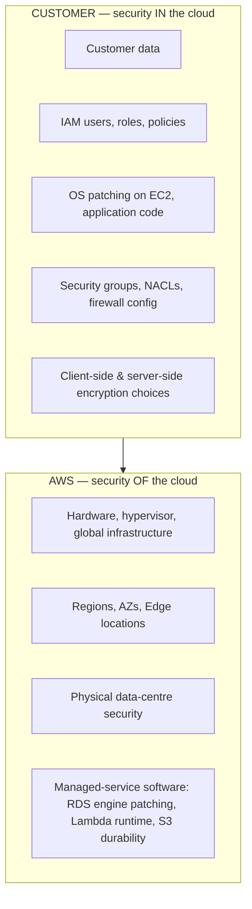
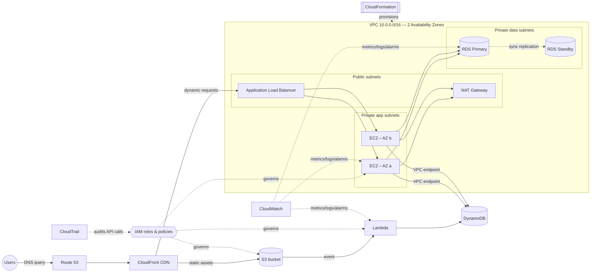

# AWS Core Services — Cloud Engineer Bootcamp

> **Audience:** recent graduates and IT professionals moving into a Cloud Engineer / Cloud Operations role
> **Level:** Foundational → Associate (aligned with AWS Certified Cloud Practitioner CLF-C02 and Solutions Architect – Associate SAA-C03)
> **Format:** instructor-led, one module per service, each with theory, architecture diagram, hands-on lab, certification tips and review questions

---

## 1. Why these 12 services?

After a decade of building AWS landing zones for large enterprises, the pattern is always the same: **90 % of production architectures are built from the same dozen building blocks.** Master these and you can read, operate and extend almost any AWS environment you are handed on day one.

| # | Service | Category | One-line purpose | Module |
|---|---------|----------|------------------|--------|
| 1 | **IAM** – Identity and Access Management | Security, Identity & Compliance | *Who* can do *what* on *which* resource | [IAM](Security-Identity-Compliance/IAM.md) |
| 2 | **VPC** – Virtual Private Cloud | Networking & Content Delivery | Your private, isolated network inside AWS | [VPC](Networking-Content-Delivery/VPC.md) |
| 3 | **EC2** – Elastic Compute Cloud | Compute | Resizable virtual servers | [EC2](Compute/EC2.md) |
| 4 | **S3** – Simple Storage Service | Storage | Virtually unlimited object storage | [S3](Storage/S3.md) |
| 5 | **RDS** – Relational Database Service | Database | Managed SQL databases | [RDS](Database/RDS.md) |
| 6 | **DynamoDB** | Database | Serverless NoSQL key-value / document database | [DynamoDB](Database/DynamoDB.md) |
| 7 | **Route 53** | Networking & Content Delivery | Highly available DNS + domain registration + health checks | [Route 53](Networking-Content-Delivery/Route53.md) |
| 8 | **CloudFront** | Networking & Content Delivery | Global Content Delivery Network (CDN) | [CloudFront](Networking-Content-Delivery/CloudFront.md) |
| 9 | **CloudFormation** | Management & Governance | Infrastructure as Code (IaC) | [CloudFormation](Management-Governance/CloudFormation.md) |
| 10 | **Lambda** | Compute | Run code without managing servers | [Lambda](Compute/Lambda.md) |
| 11 | **CloudWatch** | Management & Governance | Metrics, logs, alarms, dashboards | [CloudWatch](Management-Governance/CloudWatch.md) |
| 12 | **CloudTrail** | Management & Governance | Audit log of every API call | [CloudTrail](Management-Governance/CloudTrail.md) |

---

## 2. Repository structure

```
en/
├── AWS-core-services.md                 ← you are here
├── Compute/
│   ├── EC2.md
│   └── Lambda.md
├── Storage/
│   └── S3.md
├── Database/
│   ├── RDS.md
│   └── DynamoDB.md
├── Security-Identity-Compliance/
│   └── IAM.md
├── Networking-Content-Delivery/
│   ├── VPC.md
│   ├── Route53.md
│   └── CloudFront.md
└── Management-Governance/
    ├── CloudFormation.md
    ├── CloudWatch.md
    └── CloudTrail.md
```

Each module follows the same template:

1. **What it does** — the problem it solves
2. **Key components** — every building block you must be able to name and explain
3. **How it works** — Mermaid architecture diagram
4. **Pricing model** — what you pay for (concepts, not price lists)
5. **Best practices** — what I enforce on enterprise projects
6. **Hands-on lab** — console + AWS CLI
7. **Certification tips** — exam traps and numbers to memorize
8. **Review questions** — with answers

---

## 3. AWS foundational concepts (read before any module)

### 3.1 Global infrastructure

| Concept | Definition | Why it matters |
|---------|------------|----------------|
| **Region** | A geographic area (e.g. `ca-central-1` Montréal, `us-east-1` N. Virginia) containing multiple isolated Availability Zones | Data residency, latency, service availability, price |
| **Availability Zone (AZ)** | One or more discrete data centres with redundant power, networking and connectivity, physically separated from other AZs in the Region | Unit of **high availability** — always deploy across ≥ 2 AZs |
| **Local Zone** | AWS infrastructure placed close to large population centres | Single-digit ms latency for end users |
| **Wavelength Zone** | AWS infrastructure inside telecom 5G networks | Ultra-low latency mobile apps |
| **Edge Location / Point of Presence (PoP)** | Hundreds of sites worldwide used by CloudFront, Route 53, Global Accelerator, Shield | Caching and DNS close to users |
| **AWS Outposts** | AWS racks installed in your own data centre | Hybrid, data-residency workloads |

**Choosing a Region:** (1) compliance / data sovereignty, (2) latency to users, (3) service availability, (4) price.

### 3.2 Global vs Regional vs Zonal services

| Scope | Services in this course |
|-------|------------------------|
| **Global** | IAM, Route 53, CloudFront (and the WAF attached to it) |
| **Regional** | S3 (bucket lives in one Region, names are globally unique), DynamoDB, Lambda, CloudFormation, CloudWatch, CloudTrail (trails can be multi-Region), VPC |
| **Zonal (AZ)** | EC2 instance, EBS volume, subnet, RDS instance (Multi-AZ adds a standby in another AZ) |

### 3.3 Shared Responsibility Model



The line moves with the service type:

| Model | Example | You manage |
|-------|---------|-----------|
| IaaS | EC2 | OS, patches, runtime, app, data, network config |
| PaaS / managed | RDS | Schema, data, users, parameter choices, backups retention |
| Serverless | Lambda, DynamoDB, S3 | Code, data, IAM, configuration |

### 3.4 Ways to interact with AWS

| Interface | Use |
|-----------|-----|
| **AWS Management Console** | Learning, exploring, one-off tasks |
| **AWS CLI v2** | Scripting, automation (`aws s3 ls`) |
| **AWS SDKs** | Python (boto3), JavaScript, Java, Go, .NET… |
| **CloudShell** | Browser-based shell, pre-authenticated, CLI pre-installed |
| **Infrastructure as Code** | CloudFormation, AWS CDK, Terraform |

### 3.5 The Well-Architected Framework (6 pillars)

| Pillar | Key question |
|--------|--------------|
| Operational Excellence | Can we run and improve it safely? |
| Security | Is data and access protected at every layer? |
| Reliability | Does it recover from failure automatically? |
| Performance Efficiency | Are we using the right resource types and sizes? |
| Cost Optimization | Are we paying only for what delivers value? |
| Sustainability | Are we minimizing environmental impact? |

---

## 4. How the 12 services fit together

The canonical 3-tier web application you will build progressively during the bootcamp:



| Layer | Services | Role in the architecture |
|-------|----------|--------------------------|
| Edge | Route 53, CloudFront | Resolve the name, cache content close to users, absorb attacks |
| Network | VPC | Isolate tiers, control traffic flow |
| Compute | EC2, Lambda | Run the application (long-running vs event-driven) |
| Storage | S3 | Static assets, uploads, backups, logs, data lake |
| Data | RDS, DynamoDB | Relational transactions vs high-scale key-value access |
| Security | IAM | Least-privilege access for humans and workloads |
| Operations | CloudFormation, CloudWatch, CloudTrail | Provision repeatably, observe, audit |

---

## 5. Suggested bootcamp schedule (5 days × 6 h)

| Day | Morning | Afternoon | Lab deliverable |
|-----|---------|-----------|-----------------|
| 1 | Foundations, Shared Responsibility, account setup | **IAM** | Secured account: MFA, admin role, billing alarm |
| 2 | **VPC** | **EC2** | Custom VPC, bastion-less EC2 via SSM, web server behind ALB |
| 3 | **S3** | **RDS** + **DynamoDB** | Static site in S3, Multi-AZ RDS, DynamoDB table |
| 4 | **Route 53** + **CloudFront** | **Lambda** | Domain → CloudFront → S3; S3-triggered Lambda |
| 5 | **CloudWatch** + **CloudTrail** | **CloudFormation** capstone | Entire stack redeployed from one template |

---

## 6. Lab prerequisites

- An AWS account you own (Free Tier or a sandbox account from AWS Organizations)
- **Never use the root user for labs.** Enable MFA on root, then create an IAM Identity Center user or IAM admin user
- AWS CLI v2 installed and configured (`aws configure` or `aws configure sso`)
- A **billing alarm / AWS Budget** set at a low threshold (e.g. 10 USD) before Day 1
- Default lab Region for this course: `ca-central-1` (adjust to your location)
- Clean up after every lab — the last section of each lab lists the deletion steps

> ⚠️ **Cost warning:** NAT Gateways, RDS instances, Elastic IPs not attached, public IPv4 addresses and Load Balancers bill **per hour** even when idle. Delete them at the end of each lab.

---

## 7. Certification map

| Certification | Code | Relevance of this course |
|---------------|------|--------------------------|
| AWS Certified Cloud Practitioner | CLF-C02 | ~100 % of the core-service knowledge required |
| AWS Certified Solutions Architect – Associate | SAA-C03 | Core of domains: secure, resilient, high-performing, cost-optimized architectures |
| AWS Certified SysOps Administrator – Associate | SOA-C02 / successor | CloudWatch, CloudTrail, CloudFormation, EC2 operations |
| AWS Certified Developer – Associate | DVA-C02 | Lambda, DynamoDB, S3, IAM |

> Exam codes and blueprints are revised periodically — always confirm the current version on the AWS Certification website before booking.

---

## 8. Glossary (quick reference)

| Term | Meaning |
|------|---------|
| ARN | Amazon Resource Name — unique identifier, e.g. `arn:aws:s3:::my-bucket` |
| AMI | Amazon Machine Image — template used to launch EC2 instances |
| CIDR | Classless Inter-Domain Routing — IP range notation, e.g. `10.0.0.0/16` |
| ENI | Elastic Network Interface — virtual NIC attached to an instance |
| HA | High Availability — survives the loss of a component/AZ |
| IaC | Infrastructure as Code |
| KMS | Key Management Service — manages encryption keys |
| RPO / RTO | Recovery Point Objective (data loss tolerated) / Recovery Time Objective (downtime tolerated) |
| SLA | Service Level Agreement |
| TTL | Time To Live (DNS, cache) |
