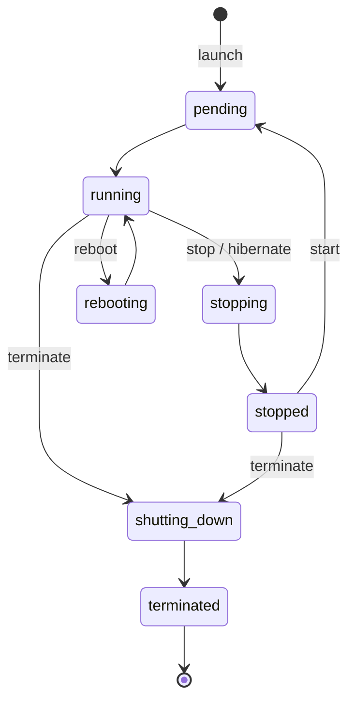
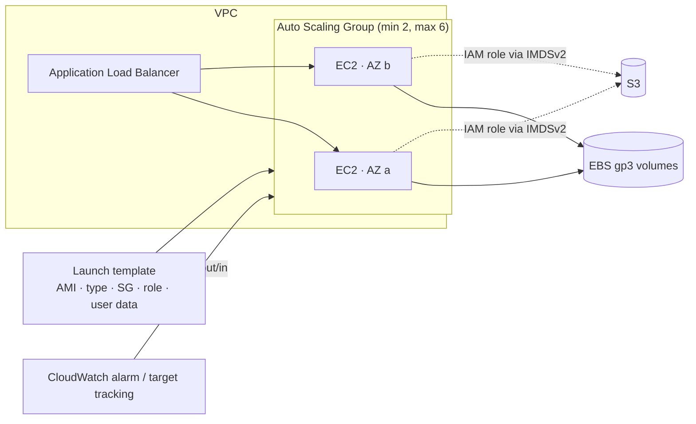

# EC2 — Elastic Compute Cloud

> **Category:** Compute · **Scope:** Instances are zonal (live in one AZ) · **Model:** IaaS
> [← Back to overview](../AWS-core-services.md)

---

## 1. What it does

Amazon EC2 provides **resizable virtual servers ("instances") in the cloud.** You choose the CPU/memory/network profile, the operating system, the storage and the network placement; AWS provides the physical hardware and hypervisor (the **AWS Nitro System**).

Key properties:
- Launch in minutes, pay per second (Linux/Windows) or per hour
- Scale vertically (change instance type) or horizontally (Auto Scaling)
- You are responsible for the **guest OS, patching, runtime and application** (Shared Responsibility)

---

## 2. Key components

### 2.1 Instance types
Naming convention: **`m7g.2xlarge`**

| Part | Meaning |
|------|---------|
| `m` | **Family** (general purpose) |
| `7` | **Generation** (higher = newer, usually better price/performance) |
| `g` | **Attributes**: `g` = AWS Graviton (ARM), `a` = AMD, `i` = Intel, `d` = local NVMe instance store, `n` = enhanced networking, `e` = extra memory/storage, `flex` = flexible baseline |
| `2xlarge` | **Size** (vCPU/memory scale) |

| Family | Optimized for | Examples | Typical workloads |
|--------|---------------|----------|-------------------|
| **General purpose** | Balance of CPU/memory/network | `t3`, `t4g` (burstable), `m7i`, `m7g`, `m8g` | Web servers, small DBs, dev/test |
| **Compute optimized** | High CPU-to-memory ratio | `c7g`, `c7i`, `c8g` | Batch, HPC, gaming servers, media encoding, ML inference |
| **Memory optimized** | Large RAM | `r7g`, `r7i`, `x2idn`, `u-*` (high memory) | In-memory caches, SAP HANA, large DBs, real-time analytics |
| **Storage optimized** | High local I/O | `i4i`, `i7ie`, `d3`, `im4gn` | NoSQL, data warehousing, OLTP, Elasticsearch |
| **Accelerated computing** | GPUs, custom chips | `p5`, `g6`, `inf2` (Inferentia), `trn1/trn2` (Trainium), `f2` (FPGA) | ML training/inference, graphics, video |
| **HPC** | Tightly coupled high-performance computing | `hpc7g`, `hpc7a` | CFD, weather simulation |

**Burstable (T family):** earn **CPU credits** when below baseline, spend them during bursts. `unlimited` mode (default for T3/T4g) allows sustained bursting at extra cost.

> **Graviton (ARM)** instances typically deliver up to ~40 % better price/performance — first choice for Linux workloads that support ARM.

### 2.2 AMI — Amazon Machine Image
- A **template** containing the root volume snapshot (OS + software), launch permissions and block device mapping.
- Sources: **AWS-provided** (Amazon Linux 2023, Ubuntu, Windows Server, RHEL…), **AWS Marketplace**, **community**, or **your own (custom/"golden") AMIs**.
- AMIs are **Regional** → copy them to another Region for DR (`copy-image`).
- Can be shared with specific accounts or an Organization.
- **EC2 Image Builder** automates building, patching and testing golden AMIs.

### 2.3 Key pairs
- Public key stored by AWS; you keep the private key (`.pem`/`.ppk`). Used for SSH (Linux) or decrypting the Windows admin password.
- Types: RSA or ED25519. AWS cannot recover a lost private key.
- **Better:** use **SSM Session Manager** or **EC2 Instance Connect** (temporary keys pushed via API) — no long-lived keys, no open port 22.

### 2.4 Storage options

| Storage | Type | Persistence | Scope | Best for |
|---------|------|-------------|-------|----------|
| **EBS (Elastic Block Store)** | Network block storage | Persists independently of the instance | **One AZ** | Root and data volumes, databases |
| **Instance store** | Physically attached NVMe/SSD | **Ephemeral** — lost on stop, hibernate, terminate or hardware failure (survives reboot) | Host | Caches, buffers, scratch, replicated data |
| **EFS** | Managed NFS (Linux) | Persistent | **Multi-AZ, Regional** | Shared files across many instances |
| **FSx** | Managed Windows File Server, Lustre, NetApp ONTAP, OpenZFS | Persistent | AZ / Multi-AZ | Windows shares (SMB), HPC |
| **S3** | Object storage (accessed via API) | Persistent | Regional | Not a filesystem — artifacts, backups |

**EBS volume types**

| Type | Category | Max IOPS / volume | Max throughput | Use case |
|------|----------|------------------|----------------|----------|
| **gp3** | General purpose SSD | 16,000 (newer limits may be higher) | 1,000 MiB/s | **Default choice** — 3,000 IOPS baseline independent of size |
| gp2 | General purpose SSD (legacy) | 16,000 (3 IOPS/GiB, burst) | 250 MiB/s | Legacy |
| **io2 Block Express** | Provisioned IOPS SSD | 256,000 | 4,000 MiB/s | Mission-critical DBs; supports **Multi-Attach** |
| io1 | Provisioned IOPS SSD | 64,000 | 1,000 MiB/s | Legacy PIOPS |
| **st1** | Throughput-optimized HDD | 500 | 500 MiB/s | Big data, log processing — **cannot be boot volume** |
| **sc1** | Cold HDD | 250 | 250 MiB/s | Infrequently accessed — lowest cost |

EBS features: **snapshots** (incremental, stored in S3, copyable across Regions), **encryption** with KMS (can be **enabled by default** per Region), **Fast Snapshot Restore**, **Snapshot Archive**, **Recycle Bin**, **Elastic Volumes** (resize/change type live), **Data Lifecycle Manager** (automated snapshot policies), `DeleteOnTermination` flag (default `true` for root, `false` for extra volumes).

### 2.5 User data & instance metadata
- **User data:** script executed **at first boot** (as root) via cloud-init — install packages, pull config. Max 16 KB.
  ```bash
  #!/bin/bash
  dnf -y install nginx
  systemctl enable --now nginx
  echo "<h1>$(hostname -f)</h1>" > /usr/share/nginx/html/index.html
  ```
- **Instance Metadata Service (IMDS):** `http://169.254.169.254/latest/meta-data/` — instance ID, AZ, IPs, **IAM role credentials**.
- **Enforce IMDSv2** (session-token based) to mitigate SSRF attacks:
  ```bash
  TOKEN=$(curl -sX PUT http://169.254.169.254/latest/api/token -H "X-aws-ec2-metadata-token-ttl-seconds: 21600")
  curl -sH "X-aws-ec2-metadata-token: $TOKEN" http://169.254.169.254/latest/meta-data/instance-id
  ```

### 2.6 Networking for EC2
| Component | Detail |
|-----------|--------|
| **ENI** | Primary network interface (eth0) + optional secondary ENIs; carries private IPs, SGs, MAC |
| **Private IP** | Always assigned from the subnet; persists through stop/start |
| **Public IPv4** | Dynamic — changes on stop/start; billed |
| **Elastic IP** | Static public IPv4; billed per hour |
| **Enhanced Networking (ENA)** | SR-IOV, up to 100–200+ Gbps on large instances |
| **EFA (Elastic Fabric Adapter)** | OS-bypass networking for HPC/ML (MPI, NCCL) |
| **Security Groups** | Stateful firewall at the ENI (see VPC module) |

### 2.7 Placement groups
| Strategy | Layout | Benefit | Limitation |
|----------|--------|---------|------------|
| **Cluster** | Packed close together in **one AZ** | Lowest latency, highest throughput (HPC) | AZ failure = all fail |
| **Spread** | Each instance on **distinct hardware/racks** | Max isolation for critical instances | **7 instances per AZ** per group |
| **Partition** | Groups of instances on separate partitions (racks) | Large distributed systems (HDFS, Cassandra, Kafka) | Up to 7 partitions per AZ |

### 2.8 Instance lifecycle

- **Stop:** EBS data kept, instance store lost, public IP released, no compute billing (EBS still billed).
- **Hibernate:** RAM saved to the encrypted EBS root volume → fast resume of in-memory state (max 60 days).
- **Terminate:** instance deleted; root EBS deleted by default.
- **Termination protection** and **stop protection** prevent accidental actions.

### 2.9 Purchasing options

| Option | Commitment | Discount vs On-Demand | Best for |
|--------|-----------|----------------------|----------|
| **On-Demand** | None | — | Short, unpredictable, dev/test |
| **Savings Plans** (Compute / EC2 Instance) | 1 or 3 years, **$/hour** commitment | Up to ~66–72 % | Steady usage; **Compute SP** also covers Fargate & Lambda and any Region/family |
| **Reserved Instances** (Standard / Convertible) | 1 or 3 years, specific instance attributes | Up to ~72 % | Steady-state (largely superseded by Savings Plans) |
| **Spot Instances** | None; AWS can **reclaim with a 2-minute warning** | Up to ~90 % | Fault-tolerant, stateless, batch, CI, containers |
| **Dedicated Hosts** | Physical server for you, on-demand or reserved | — | **BYOL** per-socket/per-core licensing, compliance |
| **Dedicated Instances** | Hardware not shared with other accounts | — | Compliance isolation |
| **On-Demand Capacity Reservations** | Reserve capacity in an AZ, no term | None (combine with SP) | Guarantee capacity for events/DR |
| **Capacity Blocks for ML** | Reserve GPU instances for a future time window | — | Short ML training jobs |

Payment options for RIs/SPs: **All Upfront** > Partial Upfront > No Upfront (more upfront = more discount).

### 2.10 Elastic Load Balancing (ELB)
| Type | Layer | Protocols | Key features |
|------|-------|-----------|--------------|
| **Application Load Balancer (ALB)** | 7 | HTTP, HTTPS, gRPC, WebSocket | Path/host/header/query routing, targets: instances, IPs, Lambda, containers; WAF integration; OIDC/Cognito auth |
| **Network Load Balancer (NLB)** | 4 | TCP, UDP, TLS | Millions req/s, ultra-low latency, **static IP / EIP per AZ**, PrivateLink endpoint services |
| **Gateway Load Balancer (GWLB)** | 3 | GENEVE (port 6081) | Insert third-party virtual appliances (firewalls, IDS) transparently |
| Classic Load Balancer | 4/7 | Legacy | Retire |

Concepts: **listeners**, **target groups**, **health checks**, cross-zone load balancing, connection draining (**deregistration delay**), **sticky sessions**, TLS termination with **ACM certificates**, SNI.

### 2.11 EC2 Auto Scaling
- **Auto Scaling Group (ASG):** min / desired / max capacity across multiple AZs; replaces unhealthy instances automatically.
- **Launch template:** versioned definition of AMI, type, SGs, key, user data, IAM profile (launch configurations are legacy).
- Scaling policies:
  | Policy | Behavior |
  |--------|----------|
  | **Target tracking** | Keep a metric at a target (e.g. average CPU = 50 %) — **recommended default** |
  | Step / simple scaling | Add/remove capacity based on CloudWatch alarm thresholds |
  | **Scheduled** | Known patterns (scale out every weekday at 08:00) |
  | **Predictive** | ML forecasts of daily/weekly cycles |
- Features: **health checks** (EC2 or ELB), **cooldown / warm-up**, **lifecycle hooks**, **warm pools**, **instance refresh**, **mixed instances policy** (On-Demand + Spot, multiple types).

### 2.12 Operations tooling
| Tool | Use |
|------|-----|
| **AWS Systems Manager (SSM)** | Session Manager (shell without SSH), Patch Manager, Run Command, Parameter Store, Inventory |
| **CloudWatch agent** | Memory, disk and custom metrics + OS logs (not collected by default!) |
| **AWS Compute Optimizer** | Right-sizing recommendations |
| **Status checks** | *System* (AWS host) / *Instance* (your OS) / *Attached EBS* — CloudWatch alarm action can **recover** or **reboot** |
| **AWS Backup** | Central backup policies for EBS/EC2 |

---

## 3. How it works



---

## 4. Pricing (concepts)
You pay for: **compute time** (per second for Linux/Windows, 60-second minimum), **EBS GB-month + provisioned IOPS/throughput**, **snapshots**, **public IPv4 addresses**, **data transfer out** and cross-AZ, **load balancer hours + LCUs**, licensing (Windows, RHEL, SQL Server).

---

## 5. Best practices

- [ ] Use **launch templates + Auto Scaling Groups** across ≥ 2 AZs even for a single instance (self-healing)
- [ ] Bake **golden AMIs** (Image Builder); keep user data small
- [ ] Attach **IAM roles**, enforce **IMDSv2**, never store keys on instances
- [ ] Access with **SSM Session Manager**; close port 22/3389
- [ ] **Encrypt EBS by default**; automate snapshots with **DLM** or **AWS Backup**
- [ ] Right-size with **Compute Optimizer**; prefer **Graviton** and **gp3**
- [ ] Cover baseline with **Savings Plans**, burst with On-Demand, batch with **Spot**
- [ ] Install the **CloudWatch agent** for memory/disk metrics
- [ ] Tag everything (`Environment`, `Owner`, `CostCenter`)

---

## 6. Hands-on lab — Highly available web tier

**Goal:** an ALB + ASG of 2 nginx instances in private subnets, managed via SSM.

1. **IAM:** create role `EC2-SSM` with `AmazonSSMManagedInstanceCore`.
2. **Launch template:**
   ```bash
   cat > userdata.sh <<'EOF'
   #!/bin/bash
   dnf -y install nginx
   TOKEN=$(curl -sX PUT http://169.254.169.254/latest/api/token -H "X-aws-ec2-metadata-token-ttl-seconds: 300")
   AZ=$(curl -sH "X-aws-ec2-metadata-token: $TOKEN" http://169.254.169.254/latest/meta-data/placement/availability-zone)
   echo "<h1>Hello from $AZ</h1>" > /usr/share/nginx/html/index.html
   systemctl enable --now nginx
   EOF

   AMI=$(aws ssm get-parameter --name /aws/service/ami-amazon-linux-latest/al2023-ami-kernel-default-arm64 --query Parameter.Value --output text)

   aws ec2 create-launch-template --launch-template-name web-lt --launch-template-data "{
     \"ImageId\":\"$AMI\",\"InstanceType\":\"t4g.micro\",
     \"IamInstanceProfile\":{\"Name\":\"EC2-SSM\"},
     \"SecurityGroupIds\":[\"$SG_APP\"],
     \"MetadataOptions\":{\"HttpTokens\":\"required\"},
     \"UserData\":\"$(base64 -w0 userdata.sh)\"}"
   ```
3. **Target group + ALB** (console: *EC2 → Load Balancers → Create ALB*) in the two public subnets, listener HTTP:80 → target group `web-tg` (health check `/`).
4. **ASG:**
   ```bash
   aws autoscaling create-auto-scaling-group --auto-scaling-group-name web-asg \
     --launch-template LaunchTemplateName=web-lt,Version='$Latest' \
     --min-size 2 --max-size 4 --desired-capacity 2 \
     --vpc-zone-identifier "$PRV_A,$PRV_B" \
     --target-group-arns $TG_ARN --health-check-type ELB --health-check-grace-period 120

   aws autoscaling put-scaling-policy --auto-scaling-group-name web-asg \
     --policy-name cpu50 --policy-type TargetTrackingScaling \
     --target-tracking-configuration '{"PredefinedMetricSpecification":{"PredefinedMetricType":"ASGAverageCPUUtilization"},"TargetValue":50}'
   ```
5. **Test:** refresh the ALB DNS name — the AZ alternates. **Terminate one instance** and watch the ASG replace it.
6. **Connect** via *Systems Manager → Session Manager* (no SSH key, no public IP).

**Cleanup:** delete ASG (force) → ALB → target group → launch template → NAT/VPC from the VPC lab.

---

## 7. Certification tips

- **Spot** = cheapest, interruptible (2-min notice) → fault-tolerant/batch only, never a single critical DB.
- Steady 24/7 for 1–3 years → **Savings Plans / Reserved Instances**. Flexible across families/Regions/Lambda/Fargate → **Compute Savings Plan**.
- BYOL per-core/per-socket licences → **Dedicated Hosts**.
- Guaranteed capacity in a specific AZ without long commitment → **On-Demand Capacity Reservation**.
- Lowest latency between nodes → **Cluster placement group**; critical isolated instances → **Spread** (max 7/AZ); Hadoop/Kafka/Cassandra → **Partition**.
- Instance store = **ephemeral**, highest IOPS; EBS = persistent, **AZ-bound** (move across AZ via snapshot).
- Shared file system for many Linux instances across AZs → **EFS**; Windows SMB → **FSx for Windows**.
- Memory/disk utilization are **not** default CloudWatch metrics → **CloudWatch agent**.
- Static IP for a load balancer → **NLB** (ALB has no static IP; put Global Accelerator in front if needed).
- Path-based or host-based routing → **ALB**.
- Same instance in same AZ, faster startup for in-memory apps → **Hibernate**.
- Instance can't retrieve role credentials after hardening → check **IMDSv2 hop limit** (containers need 2).

---

## 8. Review questions

1. Your batch analytics job can be interrupted and restarted. Which purchasing option minimizes cost?
2. What happens to data on an instance store volume when you stop the instance? When you reboot it?
3. How do you move an EBS volume from `ca-central-1a` to `ca-central-1b`?
4. Which load balancer supports routing `/api/*` and `/images/*` to different target groups?
5. Which Auto Scaling policy is recommended to keep average CPU at 50 %?
6. A company must use existing per-socket Windows Server licences. Which option?
7. Name two ways to connect to a Linux instance without opening port 22.
8. What is the maximum number of instances per AZ in a spread placement group?

<details>
<summary><b>Answers</b></summary>

1. **Spot Instances** (optionally in a mixed-instances ASG or EC2 Fleet).
2. **Stop:** data is lost. **Reboot:** data persists.
3. Create a **snapshot**, then create a new volume from it in `ca-central-1b`.
4. **Application Load Balancer** (path-based routing rules).
5. **Target tracking scaling** on `ASGAverageCPUUtilization` = 50.
6. **Dedicated Hosts.**
7. **SSM Session Manager**, **EC2 Instance Connect Endpoint** (or EC2 serial console).
8. **7**.
</details>
