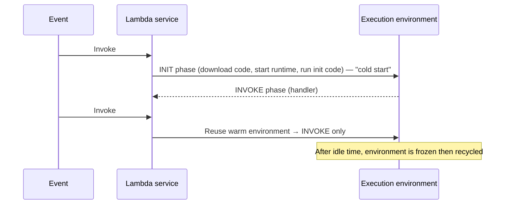
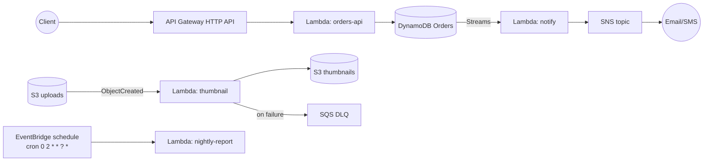

# AWS Lambda — Serverless Compute

> **Category:** Compute · **Scope:** Regional · **Model:** Serverless / Function-as-a-Service (FaaS)
> [← Back to overview](../AWS-core-services.md)

---

## 1. What it does

AWS Lambda **runs your code in response to events without provisioning or managing servers.** You upload a function; AWS handles capacity, scaling, patching of the runtime, high availability across AZs and logging.

- **Event-driven:** an S3 upload, an API request, a queue message, a schedule, a DynamoDB change…
- **Automatic scaling:** from zero to thousands of concurrent executions
- **Pay per use:** number of requests + duration (GB-seconds), billed per millisecond
- **No idle cost** (unless you use Provisioned Concurrency)

---

## 2. Key components

### 2.1 Function
The unit of deployment: code + configuration.

| Setting | Values / limits (verify current quotas in the docs) |
|---------|------------------------------------------------------|
| **Runtime** | Node.js, Python, Java, .NET, Ruby, custom runtime (`provided.al2023` for Go, Rust…), **container image** |
| **Architecture** | `x86_64` or `arm64` (Graviton — ~20 % cheaper per GB-s) |
| **Memory** | 128 MB → **10,240 MB**; **CPU scales proportionally with memory** (≈ 1 vCPU at 1,769 MB, up to 6 vCPU) |
| **Timeout** | 1 s → **900 s (15 minutes)** maximum |
| **Ephemeral storage `/tmp`** | 512 MB → **10,240 MB** |
| **Deployment package** | 50 MB zipped (direct upload), **250 MB unzipped** incl. layers; container image up to **10 GB** |
| **Environment variables** | 4 KB total, encryptable with KMS |
| **Invocation payload** | 6 MB synchronous; asynchronous is much smaller (historically 256 KB — check the current quota) |

### 2.2 Handler
The entry point called for each event:

```python
# app.py  — handler = app.lambda_handler
import json, os, boto3

s3 = boto3.client("s3")           # initialised once per execution environment (reused)
TABLE = os.environ["TABLE_NAME"]

def lambda_handler(event, context):
    for record in event["Records"]:
        bucket = record["s3"]["bucket"]["name"]
        key    = record["s3"]["object"]["key"]
        print(json.dumps({"bucket": bucket, "key": key,
                          "remaining_ms": context.get_remaining_time_in_millis()}))
    return {"statusCode": 200}
```
- `event`: the payload from the trigger
- `context`: request ID, function name, remaining time, memory limit

### 2.3 Execution role
An **IAM role** that Lambda assumes to call other AWS services (e.g. read S3, write DynamoDB, write logs). Minimum: `AWSLambdaBasicExecutionRole` (CloudWatch Logs).

### 2.4 Resource-based policy (function policy)
Defines **who may invoke** the function — e.g. allow `s3.amazonaws.com` from a specific bucket, `apigateway.amazonaws.com`, or another account.

### 2.5 Triggers / event sources & invocation models

| Invocation model | How | Retries | Examples |
|------------------|-----|---------|----------|
| **Synchronous** | Caller waits for the response | Caller's responsibility | API Gateway, ALB, Function URL, Cognito, `aws lambda invoke` |
| **Asynchronous** | Event queued internally, Lambda returns `202` | **2 automatic retries**; then **DLQ** (SQS/SNS) or **on-failure destination** | S3, SNS, EventBridge, CloudWatch Logs, SES |
| **Poll-based (Event Source Mapping)** | Lambda polls the source and invokes with **batches** | Depends on source; partial batch failure reporting | **SQS**, **Kinesis**, **DynamoDB Streams**, MSK/Kafka, Amazon MQ, DocumentDB |

### 2.6 Destinations
For asynchronous invocations (and ESM on-failure): send the **result** of a success or failure to **SQS, SNS, EventBridge, another Lambda, or S3** — richer than a DLQ (includes the response/error context).

### 2.7 Execution environment & cold starts



Reduce cold starts: smaller packages, initialize SDK clients **outside the handler**, choose lighter runtimes, **Provisioned Concurrency**, or **SnapStart** (Java, Python, .NET).

### 2.8 Concurrency
- **Concurrency** = number of requests being processed at the same time.
- Default **account limit: 1,000 concurrent executions per Region** (soft limit, can be raised).
- **Reserved concurrency:** guarantees *and caps* concurrency for one function (also used to throttle it to 0).
- **Provisioned concurrency:** pre-initialized environments → no cold start; billed while configured; can be auto-scaled.
- Throttled requests return **HTTP 429 / `TooManyRequestsException`**.

### 2.9 Versions & aliases
- **`$LATEST`**: mutable, current code.
- **Version**: immutable snapshot (`:1`, `:2`) with its own ARN.
- **Alias**: named pointer (`prod`, `dev`) to a version; supports **weighted routing** (e.g. 90 % v3 / 10 % v4) for **canary deployments** (with CodeDeploy).

### 2.10 Layers
ZIP archives of shared libraries, dependencies or custom runtimes, mounted under `/opt`. Up to **5 layers** per function; counted in the 250 MB unzipped limit.

### 2.11 Networking
- By default, Lambda runs in an AWS-managed VPC with **internet access** and access to public AWS endpoints.
- **VPC-enabled Lambda:** attach to your subnets + SG to reach private resources (RDS, ElastiCache). It then **loses internet access** unless the subnets route through a **NAT Gateway** (or uses VPC endpoints). Lambda uses Hyperplane ENIs (shared, created at configuration time).
- **RDS Proxy:** pools DB connections — essential when many concurrent Lambdas hit a relational DB.

### 2.12 Function URLs & API front doors
| Option | Use |
|--------|-----|
| **Function URL** | Dedicated HTTPS endpoint; auth `NONE` or `AWS_IAM`; simplest webhook |
| **Amazon API Gateway** (REST / HTTP / WebSocket) | Auth (Cognito, JWT, IAM, Lambda authorizers), throttling, usage plans, caching, custom domains |
| **ALB** | Lambda as a target behind an existing load balancer |

### 2.13 Observability
- **CloudWatch Logs** (`/aws/lambda/<function>`) — every `print`/`console.log`.
- **CloudWatch metrics:** Invocations, Duration, Errors, Throttles, ConcurrentExecutions, IteratorAge (streams), DeadLetterErrors.
- **AWS X-Ray** / OpenTelemetry for distributed tracing; **Lambda Insights** for system-level metrics.

### 2.14 Related serverless services
| Service | Role with Lambda |
|---------|------------------|
| **Amazon EventBridge** | Event bus & **scheduler** (cron/rate) |
| **AWS Step Functions** | Orchestrate multi-step workflows beyond 15 min, retries, human approval |
| **Amazon SQS / SNS** | Decoupling, fan-out, buffering |
| **AWS SAM / CDK / Serverless Framework** | IaC for serverless apps |
| **Lambda@Edge / CloudFront Functions** | Run code at CloudFront edge locations (see CloudFront module) |

---

## 3. Reference architectures



---

## 4. Pricing (concepts)
- **Requests:** per million invocations
- **Duration:** GB-seconds (memory × time), billed per **1 ms**; arm64 cheaper than x86
- **Provisioned Concurrency:** per GB-second configured + reduced duration price
- **Ephemeral storage** above 512 MB; data transfer; and the downstream services (API Gateway, NAT, logs)
- **Free Tier:** 1 M requests and 400,000 GB-seconds per month (always free tier)

> Tip: more memory = more CPU → often **faster and cheaper** overall. Use **AWS Lambda Power Tuning** to find the sweet spot.

---

## 5. Best practices

- [ ] One function = one purpose; keep handlers small
- [ ] **Least-privilege execution role** per function
- [ ] Initialize SDK clients and connections **outside the handler**
- [ ] Make handlers **idempotent** (events can be delivered more than once)
- [ ] Configure **DLQ / on-failure destinations** for async and **partial batch response** for SQS
- [ ] Store secrets in **Secrets Manager / Parameter Store**, not plain environment variables
- [ ] Use **arm64**, tune memory, set realistic **timeouts**
- [ ] Use **reserved concurrency** to protect downstream systems (e.g. a database)
- [ ] Use **RDS Proxy** for relational databases
- [ ] Deploy with **SAM/CDK/CloudFormation**, use **aliases + canary** deployments
- [ ] Structured JSON logging + X-Ray tracing; set log retention

---

## 6. Hands-on lab — S3-triggered image processor

**Goal:** when a file lands in `uploads/`, a Lambda writes its metadata to DynamoDB.

1. **Create resources**
   ```bash
   BUCKET=lab-uploads-$RANDOM
   aws s3 mb s3://$BUCKET
   aws dynamodb create-table --table-name FileIndex \
     --attribute-definitions AttributeName=pk,AttributeType=S \
     --key-schema AttributeName=pk,KeyType=HASH --billing-mode PAY_PER_REQUEST
   ```
2. **Execution role** `lambda-fileindex-role`: trust `lambda.amazonaws.com`; attach `AWSLambdaBasicExecutionRole` + inline policy allowing `dynamodb:PutItem` on `FileIndex` and `s3:GetObject` on the bucket.
3. **Code** `app.py`:
   ```python
   import boto3, os, urllib.parse
   ddb = boto3.resource("dynamodb").Table(os.environ["TABLE"])
   def lambda_handler(event, context):
       for r in event["Records"]:
           key = urllib.parse.unquote_plus(r["s3"]["object"]["key"])
           ddb.put_item(Item={"pk": key,
                              "bucket": r["s3"]["bucket"]["name"],
                              "size": r["s3"]["object"].get("size", 0),
                              "eventTime": r["eventTime"]})
       return {"processed": len(event["Records"])}
   ```
4. **Deploy**
   ```bash
   zip fn.zip app.py
   aws lambda create-function --function-name file-indexer \
     --runtime python3.12 --architectures arm64 --handler app.lambda_handler \
     --role arn:aws:iam::<ACCOUNT_ID>:role/lambda-fileindex-role \
     --zip-file fileb://fn.zip --timeout 30 --memory-size 256 \
     --environment Variables={TABLE=FileIndex}

   aws lambda add-permission --function-name file-indexer --statement-id s3invoke \
     --action lambda:InvokeFunction --principal s3.amazonaws.com \
     --source-arn arn:aws:s3:::$BUCKET
   ```
5. **Configure S3 event notification** (console: *Bucket → Properties → Event notifications*, prefix `uploads/`, event `All object create events`, destination the function).
6. **Test**
   ```bash
   echo hello > a.txt && aws s3 cp a.txt s3://$BUCKET/uploads/a.txt
   aws dynamodb scan --table-name FileIndex
   aws logs tail /aws/lambda/file-indexer --follow
   ```
7. **Bonus:** publish version 1, create alias `prod`, and configure an EventBridge schedule to invoke another function every 5 minutes.

**Cleanup:** delete function, log group, table, empty and delete the bucket, delete the role.

> ⚠️ **Never** have a function triggered by a bucket write to the *same prefix* in that bucket → infinite recursive loop (Lambda has recursive-loop detection for some sources, but don't rely on it).

---

## 7. Certification tips

- Max **15 minutes** runtime → longer jobs: **Step Functions**, **ECS/Fargate**, **AWS Batch**, or EC2.
- Max memory **10 GB**; CPU is allocated proportionally to memory.
- "Serverless + cron job" → **EventBridge Scheduler + Lambda**.
- "Run code at the edge to modify HTTP headers" → **CloudFront Functions** (lightweight) or **Lambda@Edge** (heavier, network access).
- Lambda in a VPC needs a **NAT Gateway** to reach the internet.
- Too many DB connections from Lambda → **RDS Proxy**.
- Avoid cold starts → **Provisioned Concurrency** (or SnapStart).
- Protect a downstream system / limit a function → **Reserved concurrency**.
- Async failures captured → **DLQ** or **Destinations**; SQS poison messages → SQS **redrive policy** DLQ.
- Decouple a sudden traffic spike → put **SQS** in front of Lambda.
- Lambda **scales automatically**, but within account concurrency quotas — request an increase for big launches.

---

## 8. Review questions

1. A function processes video files and takes 25 minutes. What should you do?
2. What does increasing a function's memory setting also increase?
3. Which invocation type does S3 use, and how many retries does Lambda perform on failure?
4. Your Lambda in a private subnet cannot call a third-party API. Why, and how do you fix it?
5. What is the difference between reserved concurrency and provisioned concurrency?
6. How do you shift 10 % of traffic to a new version?
7. Where are Lambda logs stored by default?
8. Which service runs scheduled Lambda invocations?

<details>
<summary><b>Answers</b></summary>

1. Lambda's max is 15 min → use **ECS on Fargate / AWS Batch**, or split the work and orchestrate with **Step Functions**.
2. **CPU** (and network bandwidth) proportionally.
3. **Asynchronous**; **2 retries**, then DLQ / on-failure destination if configured.
4. VPC-attached Lambdas have no public IP; route the subnet's `0.0.0.0/0` to a **NAT Gateway**.
5. **Reserved** guarantees and caps the number of concurrent executions (no cost); **provisioned** keeps pre-warmed environments ready to avoid cold starts (billed).
6. Create an **alias** with **weighted routing** (90 % v1 / 10 % v2), typically via **CodeDeploy** canary.
7. **CloudWatch Logs**, log group `/aws/lambda/<function-name>`.
8. **Amazon EventBridge** (rules or EventBridge Scheduler).
</details>
