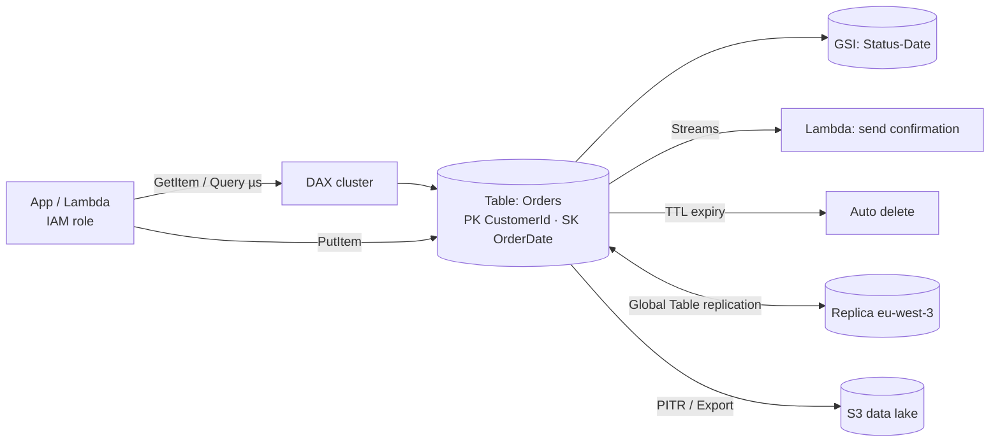

# Amazon DynamoDB — Serverless NoSQL Database

> **Category:** Database · **Scope:** Regional (Global Tables for multi-Region) · **Model:** Fully managed, serverless key-value & document database
> [← Back to overview](../AWS-core-services.md)

---

## 1. What it does

DynamoDB is a **fully managed, serverless NoSQL database** delivering **single-digit millisecond performance at any scale.** There are no servers, no versions to patch and no storage to provision; data is automatically replicated across **3 AZs**.

- Key-value and document data model (JSON-like items)
- Virtually unlimited throughput and storage
- Availability SLA 99.99 % (99.999 % with Global Tables)
- Ideal for: user profiles, shopping carts, session stores, gaming leaderboards, IoT, serverless back-ends, high-traffic e-commerce

> DynamoDB is **not** for complex joins, ad-hoc analytical queries or multi-table relational integrity → use RDS/Aurora or Redshift/Athena.

---

## 2. Key components

### 2.1 Tables, items and attributes
| Concept | Relational equivalent | Notes |
|---------|----------------------|-------|
| **Table** | Table | Collection of items; **schemaless** except the primary key |
| **Item** | Row | Max **400 KB** per item (incl. attribute names) |
| **Attribute** | Column | Scalar (String, Number, Binary, Boolean, Null), Document (List, Map), Set (String/Number/Binary set) |

### 2.2 Primary key
| Type | Composition | Example |
|------|-------------|---------|
| **Simple (partition key only)** | `PK` — must be unique | `UserId` |
| **Composite** | **Partition key + sort key** — the combination must be unique | `CustomerId` + `OrderDate` |

- The **partition key** is hashed to choose the physical **partition** → choose a **high-cardinality** key to spread load evenly and avoid **hot partitions**.
- The **sort key** orders items within a partition and enables range queries (`begins_with`, `between`, `>`, `<`).

### 2.3 Partitions (how it scales)
- Data is split into partitions (each ~10 GB, up to 3,000 RCU / 1,000 WCU per partition).
- DynamoDB splits partitions automatically; **adaptive capacity** shifts throughput toward hot keys, but a single item/key still has per-partition limits.

### 2.4 Capacity modes

| Mode | How you pay | When |
|------|-------------|------|
| **On-demand** | Per read/write request | Unknown, spiky or new workloads; scales instantly; **default recommendation for most new tables** |
| **Provisioned** | RCU/WCU per hour (+ optional **auto scaling**, **reserved capacity**) | Predictable traffic, cost optimization at steady scale |

- Switch between modes (limited number of times per day).
- **Capacity units:**
  | Unit | Definition |
  |------|-----------|
  | **1 RCU** | 1 **strongly consistent** read/s **or** 2 **eventually consistent** reads/s of up to **4 KB** |
  | **1 WCU** | 1 write/s of up to **1 KB** |
  | Transactional | 2× the units (reads and writes) |
- Example: 10 strongly consistent reads/s of 6 KB items → each read rounds up to 8 KB = 2 RCU → **20 RCU**. Eventually consistent → **10 RCU**.
- Exceeding provisioned capacity → **`ProvisionedThroughputExceededException`** (throttling) — SDKs retry with exponential backoff.

### 2.5 Read consistency
| Model | Behavior | Cost |
|-------|----------|------|
| **Eventually consistent** (default) | May not reflect a write from the last ~second | 0.5 RCU per 4 KB |
| **Strongly consistent** | Returns the latest committed write (not supported on GSIs or cross-Region replicas) | 1 RCU per 4 KB |
| **Transactional** | ACID across up to 100 items / multiple tables (`TransactWriteItems`, `TransactGetItems`) | 2× |

### 2.6 Secondary indexes
| | **Local Secondary Index (LSI)** | **Global Secondary Index (GSI)** |
|---|------------------------------|--------------------------------|
| Key | **Same partition key**, different sort key | **Any** partition key and sort key |
| Creation | **Only at table creation** | Anytime |
| Limit | 5 per table | 20 per table (default) |
| Consistency | Eventual or strong | **Eventual only** |
| Capacity | Shares table's capacity | **Own** capacity (provisioned mode) — a throttled GSI can throttle table writes |
| Size limit | 10 GB per partition-key value (item collection) | None |

**Projections:** `KEYS_ONLY`, `INCLUDE` (selected attributes), `ALL`.

### 2.7 Data access operations
| Operation | Description | Efficiency |
|-----------|-------------|-----------|
| `GetItem` / `BatchGetItem` | Read by full primary key (batch up to 100 items) | ✅ Best |
| `Query` | Items with one partition key, optional sort-key condition | ✅ Efficient |
| `Scan` | Reads **the entire table**, then filters | ❌ Expensive — avoid in production paths (use parallel scan for exports) |
| `PutItem` / `UpdateItem` / `DeleteItem` | Writes; **conditional expressions** for optimistic locking | |
| `BatchWriteItem` | Up to 25 puts/deletes | |
| **PartiQL** | SQL-compatible syntax | |

Pagination: results are limited to **1 MB** per call → follow `LastEvaluatedKey`. **Filter expressions** are applied *after* reading, so they don't reduce consumed capacity. **Projection expressions** limit returned attributes.

### 2.8 DynamoDB Streams
- Time-ordered log of **item-level changes** (insert/modify/remove) retained **24 hours**.
- View types: `KEYS_ONLY`, `NEW_IMAGE`, `OLD_IMAGE`, `NEW_AND_OLD_IMAGES`.
- Consumers: **Lambda** (event source mapping), Kinesis Client Library. Use cases: triggers, audit, replication, materialized views, notifications.
- Alternative: **Kinesis Data Streams for DynamoDB** (longer retention, more consumers).

### 2.9 Time To Live (TTL)
- Designate a numeric attribute holding an **epoch timestamp**; expired items are **deleted automatically at no cost** (usually within days of expiry).
- Use for sessions, temporary tokens, old events. Deletions appear in Streams.

### 2.10 Global Tables
- **Multi-Region, multi-active** replication — read and write in any replica Region.
- Typically sub-second replication; **last-writer-wins** conflict resolution (multi-Region strong consistency is available as an option in newer versions).
- Requires Streams (handled automatically) — use for global apps and Regional DR.

### 2.11 DAX — DynamoDB Accelerator
- **In-memory, write-through cache** for DynamoDB → **microsecond** reads.
- API-compatible (swap the client), runs in your VPC as a cluster.
- Best for read-heavy, repeated key access (hot items); not for strongly consistent reads or write-heavy loads.

### 2.12 Backup & recovery
| Feature | Detail |
|---------|--------|
| **On-demand backups** | Full backups with no performance impact, kept until deleted |
| **Point-in-Time Recovery (PITR)** | Continuous backups; restore to any second in the last **35 days** (configurable 1–35) → restores into a **new table** |
| **AWS Backup** | Policies, cross-Region/account copies, cold storage |
| **Export to S3** | Full or incremental export (from PITR) without consuming capacity — for Athena/analytics |
| **Import from S3** | Bulk load CSV / DynamoDB JSON / Ion into a new table |
| **Deletion protection** | Prevents accidental table deletion |

### 2.13 Security
- **IAM** for all access — fine-grained control with conditions like `dynamodb:LeadingKeys` (users can access only items whose partition key = their user ID).
- **Resource-based policies** on tables/streams for cross-account access.
- **Encryption at rest** always on: AWS owned key (default), AWS managed key, or **customer managed KMS key**.
- **VPC gateway endpoint** (free) or interface endpoint for private access.
- **CloudTrail** logs control-plane events; data-plane events optional.

### 2.14 Table classes
- **Standard** (default) and **Standard-Infrequent Access (Standard-IA)** — lower storage cost, higher request cost, for tables where storage dominates.

### 2.15 Data modelling principles
- **Start from access patterns**, not entities — list every query first.
- **Single-table design:** store multiple entity types in one table using generic keys (`PK = CUSTOMER#123`, `SK = ORDER#2026-10-17`) to fetch related data in one `Query`.
- **Denormalize** and duplicate data; avoid joins.
- Use **GSIs** for alternative access patterns; **sparse indexes** to index only some items.
- **Write sharding** (random suffix on PK) for extreme write hot spots.

Example single-table layout:
| PK | SK | Attributes |
|----|----|-----------|
| `CUSTOMER#123` | `PROFILE` | name, email |
| `CUSTOMER#123` | `ORDER#2026-10-01#A17` | total, status |
| `CUSTOMER#123` | `ORDER#2026-10-15#B42` | total, status |
| `PRODUCT#987` | `METADATA` | title, price |

`Query PK = CUSTOMER#123 AND begins_with(SK, "ORDER#2026-10")` → all October orders in one call.

---

## 3. How it works



---

## 4. Pricing (concepts)
- **On-demand:** per million read / write request units
- **Provisioned:** per RCU/WCU-hour (+ reserved capacity discounts)
- **Storage** per GB-month (first 25 GB free tier), Standard vs Standard-IA
- **Extras:** PITR, on-demand backups, restores, Global Tables replicated writes, Streams reads (free for Lambda triggers), DAX node hours, export to S3, data transfer

---

## 5. Best practices

- [ ] Design keys from **access patterns**; high-cardinality partition keys
- [ ] Prefer `Query`/`GetItem`; avoid `Scan` on hot paths
- [ ] Start with **on-demand**; move to provisioned + auto scaling when traffic is predictable
- [ ] Keep items small; store large blobs in **S3** and keep the pointer in DynamoDB
- [ ] Use **conditional writes** for optimistic concurrency and idempotency
- [ ] Enable **PITR** and **deletion protection** on production tables
- [ ] Use **TTL** to purge temporary data for free
- [ ] Least-privilege IAM with `dynamodb:LeadingKeys` for multi-tenant data
- [ ] Access from VPC via **gateway endpoint**
- [ ] Monitor `ThrottledRequests`, `ConsumedRead/WriteCapacityUnits`, `SuccessfulRequestLatency` in CloudWatch; use **CloudWatch Contributor Insights** to find hot keys

---

## 6. Hands-on lab — Orders table with GSI, TTL and Streams

```bash
# 1. Create table (on-demand) with a GSI
aws dynamodb create-table --table-name Orders \
  --attribute-definitions AttributeName=CustomerId,AttributeType=S \
      AttributeName=OrderDate,AttributeType=S AttributeName=Status,AttributeType=S \
  --key-schema AttributeName=CustomerId,KeyType=HASH AttributeName=OrderDate,KeyType=RANGE \
  --billing-mode PAY_PER_REQUEST \
  --global-secondary-indexes '[{"IndexName":"StatusDate","KeySchema":[{"AttributeName":"Status","KeyType":"HASH"},{"AttributeName":"OrderDate","KeyType":"RANGE"}],"Projection":{"ProjectionType":"ALL"}}]' \
  --stream-specification StreamEnabled=true,StreamViewType=NEW_AND_OLD_IMAGES
aws dynamodb wait table-exists --table-name Orders

# 2. Enable PITR and TTL
aws dynamodb update-continuous-backups --table-name Orders \
  --point-in-time-recovery-specification PointInTimeRecoveryEnabled=true
aws dynamodb update-time-to-live --table-name Orders \
  --time-to-live-specification Enabled=true,AttributeName=ExpiresAt

# 3. Insert items
aws dynamodb put-item --table-name Orders --item '{
  "CustomerId":{"S":"C-100"},"OrderDate":{"S":"2026-10-15"},
  "Status":{"S":"SHIPPED"},"Total":{"N":"129.99"}}'
aws dynamodb put-item --table-name Orders --item '{
  "CustomerId":{"S":"C-100"},"OrderDate":{"S":"2026-10-17"},
  "Status":{"S":"PENDING"},"Total":{"N":"42.00"},
  "ExpiresAt":{"N":"'$(( $(date +%s) + 3600 ))'"}}'

# 4. Conditional write (fails if the order already exists)
aws dynamodb put-item --table-name Orders --item '{"CustomerId":{"S":"C-100"},"OrderDate":{"S":"2026-10-17"},"Status":{"S":"PENDING"}}' \
  --condition-expression "attribute_not_exists(CustomerId)"

# 5. Query vs Scan
aws dynamodb query --table-name Orders \
  --key-condition-expression "CustomerId = :c AND begins_with(OrderDate, :m)" \
  --expression-attribute-values '{":c":{"S":"C-100"},":m":{"S":"2026-10"}}' \
  --return-consumed-capacity TOTAL
aws dynamodb query --table-name Orders --index-name StatusDate \
  --key-condition-expression "#s = :s" --expression-attribute-names '{"#s":"Status"}' \
  --expression-attribute-values '{":s":{"S":"PENDING"}}'
aws dynamodb scan --table-name Orders --return-consumed-capacity TOTAL
```

6. **Bonus:** connect the stream to a Lambda (event source mapping) that logs every `MODIFY` event; update an order status and inspect CloudWatch Logs.

**Cleanup:** `aws dynamodb delete-table --table-name Orders`.

---

## 7. Certification tips

- "Serverless, single-digit ms, massive scale, key-value" → **DynamoDB**.
- "Microsecond read latency" → **DAX** (vs ElastiCache for generic caching).
- "Multi-Region active-active" → **Global Tables**.
- "Automatically delete expired sessions at no cost" → **TTL**.
- "React to item changes" → **DynamoDB Streams + Lambda**.
- Unpredictable traffic → **on-demand**; steady → **provisioned + auto scaling**.
- **LSI must be created at table creation**; GSI any time; GSIs are **eventually consistent** only.
- RCU = 4 KB (strong 1, eventual ½); WCU = 1 KB; transactions ×2.
- Item max **400 KB** → store large objects in S3.
- Avoid `Scan`; use `Query` with good keys.
- Hot partition / throttling → better partition key design, write sharding, DAX for reads.
- Backup restore (PITR / on-demand) → **new table**. PITR window **35 days**.
- Fine-grained per-user row access → IAM condition **`dynamodb:LeadingKeys`**.

---

## 8. Review questions

1. How many RCUs are needed for 50 eventually consistent reads per second of 10 KB items?
2. Can you add an LSI to an existing table?
3. Which feature gives microsecond latency for read-heavy workloads?
4. What's the maximum size of an item?
5. A gaming company needs users in Europe and North America to write locally with automatic replication. Which feature?
6. Why is a `Scan` with a filter still expensive?
7. How do you implement "insert only if not already present"?
8. What happens to items after their TTL timestamp passes?

<details>
<summary><b>Answers</b></summary>

1. 10 KB → rounds up to 12 KB = 3 units per strongly consistent read; eventually consistent = 1.5 RCU per read × 50 = **75 RCU**.
2. **No** — LSIs can only be defined at table creation (create a GSI instead).
3. **DAX (DynamoDB Accelerator).**
4. **400 KB.**
5. **DynamoDB Global Tables.**
6. Filters are applied **after** items are read, so capacity is consumed for the whole scanned data.
7. A **conditional write** with `attribute_not_exists(<partition key>)`.
8. They are **deleted automatically in the background** (typically within a few days), at no write cost; deletions appear in Streams.
</details>
