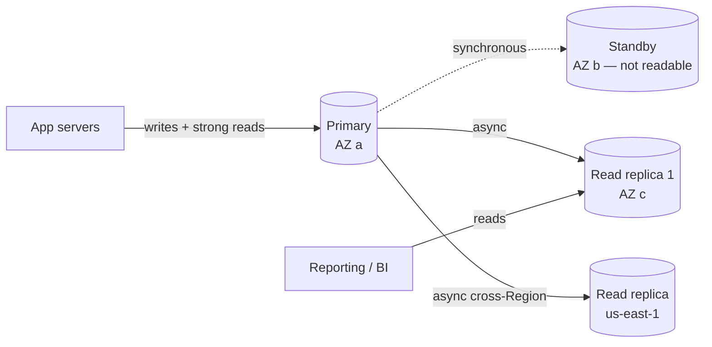
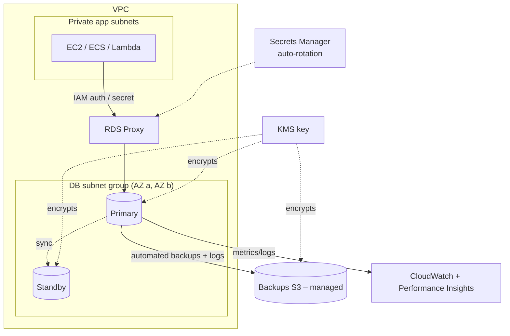

# Amazon RDS — Relational Database Service

> **Category:** Database · **Scope:** Regional (instances live in AZs) · **Model:** Managed relational database (PaaS)
> [← Back to overview](../AWS-core-services.md)

---

## 1. What it does

Amazon RDS lets you **set up, operate and scale relational (SQL) databases** without managing hardware, OS installation, database installation, patching or backups yourself.

**AWS manages:** hardware, OS, DB engine installation and minor-version patching, automated backups, Multi-AZ failover, monitoring integration.
**You manage:** schema, queries, indexes, users/grants, parameter choices, capacity sizing, and network/security configuration.

> You **cannot SSH** into a standard RDS instance. Need OS access? → **RDS Custom** (Oracle / SQL Server) or self-managed DB on EC2.

---

## 2. Key components

### 2.1 Database engines
| Engine | Notes |
|--------|-------|
| **Amazon Aurora MySQL / PostgreSQL** | AWS cloud-native engine — up to 5× MySQL / 3× PostgreSQL throughput, storage auto-grows to 128 TiB, 6 copies across 3 AZs |
| **MySQL** | Community edition |
| **PostgreSQL** | Community edition, wide extension support |
| **MariaDB** | MySQL fork |
| **Oracle** | License Included (SE2) or **BYOL** |
| **Microsoft SQL Server** | Express, Web, Standard, Enterprise (License Included) |
| **IBM Db2** | BYOL or License Included |

### 2.2 DB instance & instance classes
- A DB instance = an isolated database environment with compute + storage, identified by an **endpoint** (`mydb.abc123.ca-central-1.rds.amazonaws.com:5432`).
- Instance classes: **`db.t4g/t3`** (burstable, dev/test), **`db.m7g/m6i`** (general purpose), **`db.r7g/r6i`/`db.x2`** (memory optimized, production OLTP).
- Scaling compute = **modify instance class** (brief downtime; with Multi-AZ, a failover keeps it short).

### 2.3 Storage
| Type | Use |
|------|-----|
| **gp3** | General purpose SSD — default; baseline IOPS/throughput, configurable |
| **io2 Block Express / io1** | Provisioned IOPS for I/O-intensive production |
| Magnetic | Legacy — avoid |

- **Storage autoscaling:** set a *maximum storage threshold*; RDS grows storage automatically when free space is low (no downtime).
- Storage size can be **increased, not decreased.**

### 2.4 DB subnet group
- A collection of **private subnets in at least 2 AZs** where RDS can place instances.
- Required to launch RDS in a VPC; drives where primary and standby land.

### 2.5 Security
| Layer | Mechanism |
|-------|-----------|
| **Network** | Private subnets; **security group** allowing the DB port only from the app SG; `PubliclyAccessible = false` |
| **Authentication** | Master user + DB users; **IAM database authentication** (MySQL/PostgreSQL — 15-min tokens); **Kerberos/AD** for SQL Server, Oracle, MySQL, PostgreSQL |
| **Secrets** | **AWS Secrets Manager** integration — RDS can manage and **automatically rotate** the master password |
| **Encryption at rest** | **AWS KMS**, must be chosen **at creation**; covers storage, backups, snapshots, replicas, logs |
| **Encryption in transit** | SSL/TLS; force with parameter `rds.force_ssl=1` (PostgreSQL/SQL Server) or `require_secure_transport` (MySQL) |
| **Auditing** | Engine audit logs → CloudWatch Logs; **Database Activity Streams** (Aurora, Oracle, SQL Server) |

> To encrypt an existing **unencrypted** DB: take a snapshot → **copy snapshot with encryption** → restore a new instance from the encrypted copy.

### 2.6 Multi-AZ deployments (High Availability)

| Option | How it works | Failover | Readable standby |
|--------|-------------|----------|------------------|
| **Multi-AZ DB instance** | One **standby** in another AZ, **synchronous** replication | Automatic, typically **60–120 s**, DNS endpoint flips | ❌ No |
| **Multi-AZ DB cluster** (MySQL, PostgreSQL) | 1 writer + **2 readable standbys** in 3 AZs, semi-synchronous | Typically **< 35 s** | ✅ Yes (reader endpoint) |
| **Aurora** | Storage replicated 6× across 3 AZs; up to 15 replicas | Typically **< 30 s** | ✅ Yes |

Failover triggers: AZ outage, primary failure, instance class change, OS patching, manual **reboot with failover**.
Multi-AZ = **availability**, **not** read scaling (for the DB instance option).

### 2.7 Read replicas (Read scaling)
- **Asynchronous** replication from the primary → **eventually consistent** reads.
- Up to **15 read replicas** (MySQL, MariaDB, PostgreSQL, Aurora); fewer for Oracle/SQL Server (check quotas).
- Can be **in-AZ, cross-AZ or cross-Region** (cross-Region = DR + local reads; incurs data transfer).
- Each replica has its **own endpoint** → the application must send reads to it.
- Can be **promoted** to a standalone DB (manual DR, breaks replication).
- A replica can itself be Multi-AZ.
- Requires **automated backups enabled** on the source.



| | Multi-AZ (instance) | Read replica |
|---|---------------------|--------------|
| Purpose | High availability | Read scalability, DR (cross-Region) |
| Replication | Synchronous | Asynchronous |
| Readable | No | Yes |
| Failover | Automatic | Manual promotion |
| Scope | Same Region | Same or other Region |

### 2.8 Backups & recovery
| Feature | Detail |
|---------|--------|
| **Automated backups** | Daily snapshot during **backup window** + **transaction logs every 5 min**; retention **0–35 days** (0 disables) |
| **Point-in-Time Recovery (PITR)** | Restore to any second within retention (typically up to the last ~5 minutes) — **creates a NEW instance** with a new endpoint |
| **Manual snapshots** | User-initiated, **kept until you delete them**; copy cross-Region/cross-account; share |
| **Final snapshot** | Prompted on deletion |
| **AWS Backup** | Centralized policies, cross-account/cross-Region copies, vault lock |
| **Cross-Region automated backup replication** | DR copy of snapshots and logs |

### 2.9 Parameter groups & option groups
- **DB parameter group:** engine configuration (e.g. `max_connections`, `rds.force_ssl`). *Dynamic* parameters apply immediately; *static* require **reboot**. The default group can't be modified → create a custom one.
- **Option group:** engine features/add-ons (Oracle TDE, SQL Server native backup to S3, MySQL memcached plugin).

### 2.10 Maintenance & upgrades
- **Maintenance window** (weekly, 30 min) for OS and minor engine patches; Multi-AZ applies to standby first then fails over.
- **Auto minor version upgrade** option; **major version upgrades** are manual.
- **Blue/Green Deployments:** create a synchronized staging (green) copy, upgrade/test, then **switch over in typically under a minute** — safest way to do major upgrades or schema changes.

### 2.11 RDS Proxy
- Fully managed **connection pooler** in front of RDS/Aurora.
- Reduces connection storms (Lambda, autoscaling apps), **reduces failover time by up to 66 %**, enforces IAM auth + Secrets Manager.
- Accessible **only from inside the VPC.**

### 2.12 Monitoring
| Tool | What it shows |
|------|---------------|
| **CloudWatch metrics** | CPUUtilization, FreeableMemory, FreeStorageSpace, DatabaseConnections, Read/WriteIOPS, ReplicaLag |
| **Enhanced Monitoring** | OS-level metrics (per process) every 1–60 s |
| **Performance Insights / CloudWatch Database Insights** | DB load by wait event, top SQL — find slow queries |
| **Event subscriptions** | SNS notifications on failover, backups, low storage |
| **Log exports** | Error, slow query, general, audit logs → CloudWatch Logs |

### 2.13 Aurora highlights (exam favourite)
| Feature | Detail |
|---------|--------|
| Storage | Shared cluster volume, auto-grows in 10 GB increments up to 128 TiB, 6 copies / 3 AZs, self-healing |
| Endpoints | **Writer (cluster)** endpoint, **reader** endpoint (load-balanced across replicas), custom & instance endpoints |
| Replicas | Up to 15, replica lag typically < 100 ms, any can become writer |
| **Aurora Serverless v2** | Capacity in fine-grained ACUs, scales in seconds — variable/unpredictable workloads; can scale to zero |
| **Aurora Global Database** | 1 primary Region + several read-only secondary Regions (5 historically; check the current quota), replication lag typically < 1 s, **RPO ~1 s, RTO < 1 min** for Regional DR |
| **Backtrack** (Aurora MySQL) | Rewind DB in place to a point in time without restore |
| **Cloning** | Copy-on-write fast clones for test environments |
| **Aurora I/O-Optimized** | Predictable pricing for I/O-heavy workloads |
| **Aurora DSQL** | Newer serverless distributed SQL, active-active multi-Region |

---

## 3. Reference architecture



---

## 4. Pricing (concepts)
Instance hours (by class, Single-AZ vs **Multi-AZ ≈ 2×**), storage GB-month + provisioned IOPS, backup storage beyond 100 % of DB size, snapshot export, data transfer (cross-AZ replication for read replicas, cross-Region), RDS Proxy (per vCPU/ACU), Performance Insights long retention, licences (License Included). **Reserved Instances** for RDS give up to ~69 % discount; **Database Savings Plans** may also apply — check current offers.

---

## 5. Best practices

- [ ] **Private subnets**, `PubliclyAccessible=false`, SG referencing the app SG only
- [ ] **Encrypt at creation** with KMS; force TLS in transit
- [ ] Store credentials in **Secrets Manager** with rotation; use **IAM auth** where supported
- [ ] **Multi-AZ** for every production database
- [ ] Automated backups with adequate retention (7–35 days) + **cross-Region copies** for DR
- [ ] **Read replicas** or Aurora readers for read-heavy workloads; cache with **ElastiCache**
- [ ] **RDS Proxy** for Lambda/serverless or bursty connection patterns
- [ ] Enable **Performance Insights**, Enhanced Monitoring, log exports, and alarms on storage/CPU/connections
- [ ] Use **Blue/Green Deployments** for major upgrades
- [ ] Enable **deletion protection**

---

## 6. Hands-on lab — Multi-AZ PostgreSQL with Secrets Manager

```bash
# 1. DB subnet group — create two private DB subnets first (same commands as the VPC lab)
DB_A=$(aws ec2 create-subnet --vpc-id $VPC_ID --cidr-block 10.0.21.0/24 --availability-zone ${REGION}a --query Subnet.SubnetId --output text)
DB_B=$(aws ec2 create-subnet --vpc-id $VPC_ID --cidr-block 10.0.22.0/24 --availability-zone ${REGION}b --query Subnet.SubnetId --output text)
aws rds create-db-subnet-group --db-subnet-group-name lab-db-subnets \
  --db-subnet-group-description "lab" --subnet-ids $DB_A $DB_B

# 2. SG allowing 5432 only from the app SG
SG_DB=$(aws ec2 create-security-group --group-name sg-db --description db --vpc-id $VPC_ID --query GroupId --output text)
aws ec2 authorize-security-group-ingress --group-id $SG_DB --protocol tcp --port 5432 --source-group $SG_APP

# 3. Create the database (password managed in Secrets Manager)
aws rds create-db-instance --db-instance-identifier lab-pg \
  --engine postgres --db-instance-class db.t4g.micro \
  --allocated-storage 20 --max-allocated-storage 100 --storage-type gp3 \
  --master-username dbadmin --manage-master-user-password \
  --db-subnet-group-name lab-db-subnets --vpc-security-group-ids $SG_DB \
  --no-publicly-accessible --storage-encrypted --multi-az \
  --backup-retention-period 7 --enable-performance-insights \
  --deletion-protection
aws rds wait db-instance-available --db-instance-identifier lab-pg
```

4. **Connect** from an EC2 instance in the app subnet (via SSM):
   ```bash
   SECRET_ARN=$(aws rds describe-db-instances --db-instance-identifier lab-pg --query 'DBInstances[0].MasterUserSecret.SecretArn' --output text)
   PW=$(aws secretsmanager get-secret-value --secret-id $SECRET_ARN --query SecretString --output text | jq -r .password)
   ENDPOINT=$(aws rds describe-db-instances --db-instance-identifier lab-pg --query 'DBInstances[0].Endpoint.Address' --output text)
   PGPASSWORD=$PW psql "host=$ENDPOINT user=dbadmin dbname=postgres sslmode=require" -c "select version();"
   ```
5. **Test failover:** `aws rds reboot-db-instance --db-instance-identifier lab-pg --force-failover` — re-run the query; note the AZ change and the brief interruption.
6. **Create a read replica:** `aws rds create-db-instance-read-replica --db-instance-identifier lab-pg-ro --source-db-instance-identifier lab-pg`.
7. **PITR:** restore to a time 10 minutes ago → observe a **new** endpoint.

**Cleanup:** disable deletion protection (`modify-db-instance --no-deletion-protection`), delete replica, then delete the instance (`--skip-final-snapshot` for lab), subnet group, SG.

---

## 7. Certification tips

- **Multi-AZ = HA (synchronous, automatic failover)**; **Read Replicas = scale reads (asynchronous)**.
- "Disaster recovery to another Region with minimal RPO" → **cross-Region read replica** or **Aurora Global Database** (RPO ~1 s, RTO < 1 min).
- Backups retention max **35 days**; longer → **manual snapshots** or **AWS Backup**.
- Restore (PITR or snapshot) always creates a **new DB instance / endpoint**.
- Encryption must be set at creation; to encrypt an existing DB → **snapshot → encrypted copy → restore**. Read replicas of an encrypted DB are encrypted; you can't have an unencrypted replica of an encrypted primary.
- Many short-lived Lambda connections → **RDS Proxy**.
- Need OS/root access to the DB host → **RDS Custom** or **EC2**.
- Unpredictable or intermittent workloads → **Aurora Serverless v2**.
- Read-heavy with repeated queries → **ElastiCache** in front of RDS (or read replicas).
- Storage runs out unexpectedly → enable **storage autoscaling**.
- Static parameter changed but not applied → **reboot** required.
- Rotate DB passwords automatically → **Secrets Manager**.

---

## 8. Review questions

1. Your reporting queries slow down the production OLTP database. What should you add?
2. The primary instance's AZ fails. What happens with a Multi-AZ DB instance deployment?
3. Can you read from the standby of a Multi-AZ DB instance deployment?
4. How do you encrypt an existing unencrypted RDS instance?
5. What is the maximum automated backup retention period?
6. Which service reduces failover time and manages connection pooling?
7. Which Aurora feature provides cross-Region DR with sub-second replication lag?
8. After PITR, why does the application still connect to the old data?

<details>
<summary><b>Answers</b></summary>

1. A **read replica** (or Aurora reader) and point reporting tools to its endpoint.
2. RDS automatically **fails over** to the synchronous standby in another AZ and updates the **DNS endpoint**; typically 1–2 minutes.
3. **No** (only Multi-AZ **DB cluster** and Aurora provide readable standbys).
4. Snapshot → **copy the snapshot with KMS encryption** → restore a new encrypted instance → switch the application.
5. **35 days.**
6. **RDS Proxy.**
7. **Aurora Global Database.**
8. PITR creates a **new instance with a new endpoint** — the app must be repointed (or the old instance renamed and the new one given its identifier).
</details>
