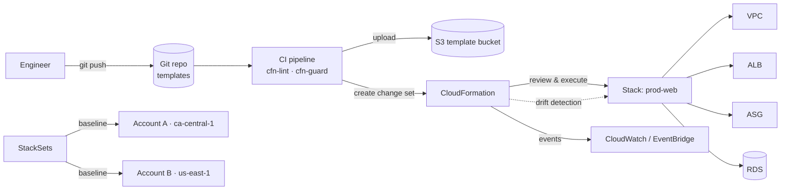
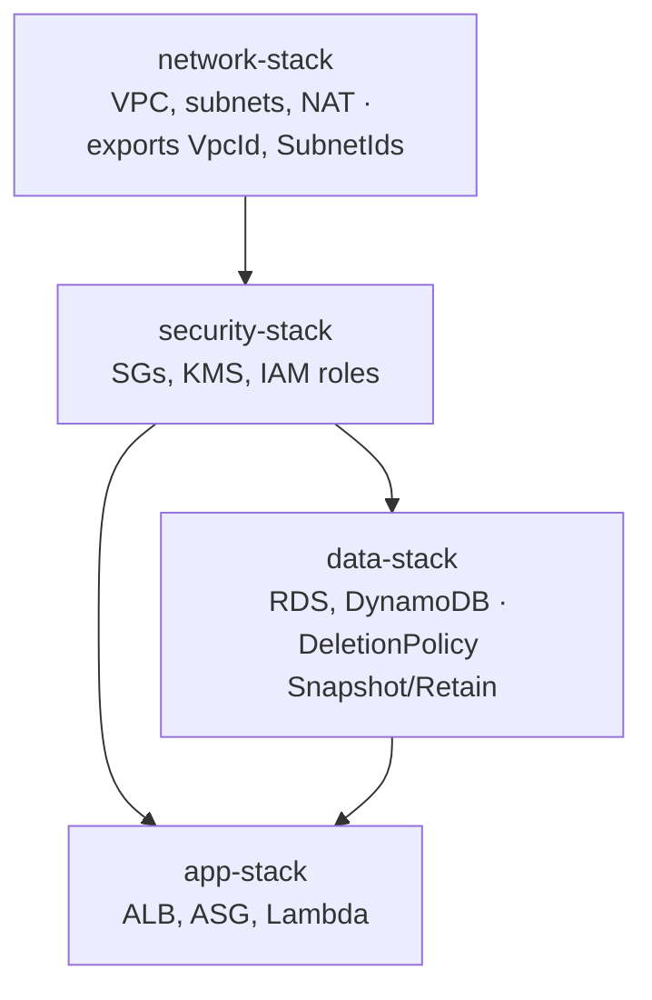

# AWS CloudFormation — Infrastructure as Code

> **Category:** Management & Governance · **Scope:** Regional (StackSets for multi-account/multi-Region) · **Cost:** Free for AWS resource types
> [← Back to overview](../AWS-core-services.md)

---

## 1. What it does

CloudFormation lets you **model, provision and manage AWS (and third-party) resources declaratively** with templates written in **YAML or JSON**. You describe the *desired state*; CloudFormation works out dependencies, creation order, updates and rollbacks.

Why every Cloud Engineer must master it (or an equivalent IaC tool):
- **Repeatability:** identical dev / test / prod environments
- **Version control & code review** of infrastructure (Git, pull requests)
- **Automated rollback** on failure
- **Drift detection** against manual changes
- **Cost visibility:** estimate, tag and delete an entire environment in one operation
- Foundation for **AWS CDK** and **AWS SAM**, which synthesize CloudFormation templates

---

## 2. Key components

### 2.1 Template
A text file describing resources. Anatomy:

```yaml
AWSTemplateFormatVersion: "2010-09-09"
Description: Web tier with S3 bucket and EC2 instance
Transform: AWS::Serverless-2016-10-31   # optional macros (SAM, AWS::Include, AWS::LanguageExtensions)

Metadata:            # UI grouping for parameters, cfn-init config
  AWS::CloudFormation::Interface: {}

Parameters:          # inputs at deploy time
  Environment:
    Type: String
    AllowedValues: [dev, test, prod]
    Default: dev
  InstanceType:
    Type: String
    Default: t4g.micro
  LatestAmiId:
    Type: AWS::SSM::Parameter::Value<AWS::EC2::Image::Id>
    Default: /aws/service/ami-amazon-linux-latest/al2023-ami-kernel-default-arm64

Mappings:            # static lookup tables
  EnvConfig:
    dev:  { Retention: 7 }
    prod: { Retention: 35 }

Conditions:          # create resources conditionally
  IsProd: !Equals [!Ref Environment, prod]

Rules:               # validate parameter combinations
  ProdNeedsBiggerInstance:
    RuleCondition: !Equals [!Ref Environment, prod]
    Assertions:
      - Assert: !Not [!Equals [!Ref InstanceType, t4g.micro]]

Resources:           # the ONLY mandatory section
  AssetsBucket:
    Type: AWS::S3::Bucket
    DeletionPolicy: Retain
    UpdateReplacePolicy: Retain
    Properties:
      VersioningConfiguration:
        Status: !If [IsProd, Enabled, Suspended]
      Tags:
        - Key: Environment
          Value: !Ref Environment

Outputs:             # values to display or export
  BucketName:
    Value: !Ref AssetsBucket
    Export:
      Name: !Sub "${AWS::StackName}-BucketName"
```

| Section | Required | Purpose |
|---------|----------|---------|
| `AWSTemplateFormatVersion` | No | Template version (`2010-09-09`) |
| `Description` | No | Free text |
| `Metadata` | No | Extra info (parameter groups in console, `cfn-init` config) |
| `Parameters` | No | Runtime inputs (types: String, Number, List, `AWS::EC2::KeyPair::KeyName`, SSM parameter types…) |
| `Mappings` | No | Static key/value lookups (e.g. per-Region/per-env values) |
| `Conditions` | No | Boolean logic for optional resources/properties |
| `Rules` | No | Parameter validation |
| `Transform` | No | Macros: **SAM**, `AWS::Include`, `AWS::LanguageExtensions` (e.g. `Fn::ForEach`) |
| **`Resources`** | **Yes** | AWS resources to create (logical ID + `Type` + `Properties`) |
| `Outputs` | No | Return values, cross-stack **exports** |

### 2.2 Intrinsic functions & pseudo parameters

| Function | Purpose | Example |
|----------|---------|---------|
| `!Ref` | Parameter value or resource's default ID | `!Ref AssetsBucket` → bucket name |
| `!GetAtt` | Resource attribute | `!GetAtt AssetsBucket.Arn` |
| `!Sub` | String substitution | `!Sub "arn:aws:s3:::${AssetsBucket}/*"` |
| `!Join` | Join list with delimiter | `!Join [",", [a, b]]` |
| `!Select` / `!Split` | List manipulation | `!Select [0, !GetAZs ""]` |
| `!GetAZs` | AZ list of the Region | |
| `!FindInMap` | Read from Mappings | `!FindInMap [EnvConfig, !Ref Environment, Retention]` |
| `!ImportValue` | Read another stack's export | `!ImportValue network-VpcId` |
| `!If`, `!Equals`, `!And`, `!Or`, `!Not` | Conditional logic | |
| `!Cidr` | Generate subnet CIDRs | `!Cidr [!GetAtt VPC.CidrBlock, 6, 8]` |
| `!Base64` | Encode user data | |

**Pseudo parameters:** `AWS::Region`, `AWS::AccountId`, `AWS::StackName`, `AWS::StackId`, `AWS::Partition`, `AWS::URLSuffix`, `AWS::NoValue` (removes a property).

**Dynamic references:** pull secrets at deploy time without exposing them in the template:
`{{resolve:ssm:/app/db/name}}`, `{{resolve:secretsmanager:prod/db:SecretString:password}}`.

### 2.3 Stack
- A **deployed instance** of a template — the unit you create, update and delete together.
- Stack status examples: `CREATE_IN_PROGRESS`, `CREATE_COMPLETE`, `UPDATE_ROLLBACK_COMPLETE`, `ROLLBACK_FAILED`, `DELETE_COMPLETE`.
- **Stack events** = step-by-step log for troubleshooting.
- Resources are created in **parallel** where possible; explicit order with `DependsOn`.

### 2.4 Change sets
- **Preview** what an update will do (*Add / Modify / Remove* and whether a resource will be **replaced**) before executing.
- Update behaviours per property: **No interruption**, **Some interruption**, **Replacement** (new physical resource — e.g. changing an RDS identifier or an EC2 AMI).
- Mandatory practice in production pipelines.

### 2.5 Rollback & stack protection
| Feature | Purpose |
|---------|---------|
| **Automatic rollback** | On failure, revert to last known good state (can be disabled to debug: *preserve successfully provisioned resources*) |
| **Rollback triggers** | Roll back if a CloudWatch alarm fires during/after the update (monitoring period) |
| **Termination protection** | Prevent stack deletion |
| **Stack policy** | JSON preventing updates to critical resources (e.g. production DB) |
| **`DeletionPolicy`** | `Delete` (default), **`Retain`**, **`Snapshot`** (RDS, EBS, ElastiCache, Redshift…) |
| **`UpdateReplacePolicy`** | Same options when a resource is replaced during update |
| `ContinueUpdateRollback` | Recover a stack stuck in `UPDATE_ROLLBACK_FAILED` |

### 2.6 Nested stacks vs cross-stack references
| | **Nested stacks** | **Cross-stack references** |
|---|-------------------|---------------------------|
| How | `AWS::CloudFormation::Stack` resource pointing to a child template in S3 | `Outputs` with `Export` + `!ImportValue` |
| Lifecycle | Child stacks managed **with** the parent | **Independent** stacks |
| Use | Reusable components (a standard ALB, a standard SG) | Shared layers with different lifecycles (network stack → app stacks) |
| Constraint | — | You can't delete/modify an export while it's imported |

### 2.7 StackSets
- Deploy one template to **multiple accounts and Regions** in a single operation.
- **Self-managed** permissions (admin/execution roles) or **service-managed** with **AWS Organizations** (auto-deploy to new accounts in an OU).
- Use cases: org-wide CloudTrail, Config rules, IAM roles, guardrails, baseline VPCs.

### 2.8 Drift detection
- Compare actual resource configuration with the template → `IN_SYNC`, `MODIFIED`, `DELETED`, `NOT_CHECKED`.
- Detects console "click-ops" changes; remediate by updating the template or using **resource import** / re-deploy.

### 2.9 Resource import & refactoring
- **Import** existing resources (created manually) into a stack.
- **Stack refactoring:** move resources between stacks or rename logical IDs without recreation.
- **IaC generator:** scan an account and generate a template from existing resources.

### 2.10 Helper scripts & signals (EC2 bootstrapping)
| Helper | Role |
|--------|------|
| `cfn-init` | Read `AWS::CloudFormation::Init` metadata → install packages, files, services |
| `cfn-signal` | Signal success/failure to a **CreationPolicy** / **WaitCondition** |
| `cfn-hup` | Daemon detecting metadata changes and re-applying config |
| `cfn-get-metadata` | Retrieve metadata |

`CreationPolicy` with `ResourceSignal` makes the stack **wait** until the instance reports healthy (e.g. 2 signals within 15 minutes). `UpdatePolicy` controls **Auto Scaling rolling/replacing updates**.

### 2.11 Custom resources, modules & registry
- **Custom resources** (`Custom::Name`) backed by Lambda or SNS — run logic CloudFormation doesn't support (e.g. empty an S3 bucket before deletion, look up a value).
- **CloudFormation Registry:** resource types from AWS, third parties (Datadog, MongoDB Atlas…) and your own private types.
- **Modules:** reusable groups of resources with best practices baked in.
- **Hooks:** proactive compliance checks run **before** provisioning (e.g. block unencrypted buckets) — Guard rules, Lambda, or managed controls.
- **CloudFormation Guard (cfn-guard)** and **cfn-lint**: policy-as-code and template linting in CI.

### 2.12 Service role & permissions
- By default CloudFormation uses the caller's permissions. A **service role** (`--role-arn`) lets developers deploy stacks without having direct permissions on underlying resources (with `iam:PassRole`).
- **Capabilities** must be acknowledged for templates that create IAM resources: `CAPABILITY_IAM`, `CAPABILITY_NAMED_IAM`, `CAPABILITY_AUTO_EXPAND` (macros/nested).

### 2.13 Ecosystem
| Tool | Description |
|------|-------------|
| **AWS CDK** | Define infrastructure in TypeScript/Python/Java/C#/Go → synthesizes CloudFormation |
| **AWS SAM** | Simplified syntax for serverless (Lambda, API Gateway, DynamoDB) + local testing CLI |
| **Git sync** | Deploy stacks automatically from a Git repository |
| **AWS Service Catalog** | Publish approved CloudFormation products for self-service |
| **Terraform** | Popular multi-cloud alternative (HashiCorp/IBM) — concepts transfer directly |

---

## 3. How it works



Layered stacks in enterprises:


---

## 4. Pricing
**No charge** for CloudFormation itself with AWS resource types — you pay for the resources created. Third-party/private registry resource types and Hooks are billed per handler operation beyond a free allowance.

---

## 5. Best practices

- [ ] **Everything as code** — no manual production changes; detect drift regularly
- [ ] Store templates in **Git**, lint (**cfn-lint**) and policy-check (**cfn-guard**/Hooks) in CI
- [ ] Always deploy updates via **change sets**; review *Replacement = True* carefully
- [ ] Split by lifecycle: network / security / data / application stacks
- [ ] Protect stateful resources: `DeletionPolicy: Retain` or `Snapshot`, **termination protection**, **stack policies**
- [ ] Use **parameters + SSM parameter types** instead of hard-coding AMI IDs, account IDs, Regions
- [ ] Never put secrets in templates → **dynamic references** to Secrets Manager / SSM
- [ ] Don't hard-code physical names unless required (prevents replacement conflicts)
- [ ] Use **StackSets** with Organizations for account baselines
- [ ] Use **rollback triggers** with CloudWatch alarms for production

---

## 6. Hands-on lab — Deploy, update with change set, detect drift

**`lab-stack.yaml`:**
```yaml
AWSTemplateFormatVersion: "2010-09-09"
Description: CloudFormation lab — VPC, public subnet, SG, EC2 web server
Parameters:
  Environment: { Type: String, AllowedValues: [dev, prod], Default: dev }
  InstanceType: { Type: String, Default: t4g.micro }
  LatestAmiId:
    Type: AWS::SSM::Parameter::Value<AWS::EC2::Image::Id>
    Default: /aws/service/ami-amazon-linux-latest/al2023-ami-kernel-default-arm64
Resources:
  VPC:
    Type: AWS::EC2::VPC
    Properties:
      CidrBlock: 10.20.0.0/16
      EnableDnsHostnames: true
      Tags: [{ Key: Name, Value: !Sub "${Environment}-cfn-vpc" }]
  IGW: { Type: AWS::EC2::InternetGateway }
  IGWAttach:
    Type: AWS::EC2::VPCGatewayAttachment
    Properties: { VpcId: !Ref VPC, InternetGatewayId: !Ref IGW }
  PublicSubnet:
    Type: AWS::EC2::Subnet
    Properties:
      VpcId: !Ref VPC
      CidrBlock: !Select [0, !Cidr [!GetAtt VPC.CidrBlock, 4, 8]]
      AvailabilityZone: !Select [0, !GetAZs ""]
      MapPublicIpOnLaunch: true
  PublicRT: { Type: AWS::EC2::RouteTable, Properties: { VpcId: !Ref VPC } }
  DefaultRoute:
    Type: AWS::EC2::Route
    DependsOn: IGWAttach
    Properties: { RouteTableId: !Ref PublicRT, DestinationCidrBlock: 0.0.0.0/0, GatewayId: !Ref IGW }
  SubnetRTAssoc:
    Type: AWS::EC2::SubnetRouteTableAssociation
    Properties: { SubnetId: !Ref PublicSubnet, RouteTableId: !Ref PublicRT }
  WebSG:
    Type: AWS::EC2::SecurityGroup
    Properties:
      GroupDescription: HTTP in
      VpcId: !Ref VPC
      SecurityGroupIngress:
        - { IpProtocol: tcp, FromPort: 80, ToPort: 80, CidrIp: 0.0.0.0/0 }
  WebServer:
    Type: AWS::EC2::Instance
    CreationPolicy: { ResourceSignal: { Count: 1, Timeout: PT10M } }
    Properties:
      ImageId: !Ref LatestAmiId
      InstanceType: !Ref InstanceType
      SubnetId: !Ref PublicSubnet
      SecurityGroupIds: [!Ref WebSG]
      MetadataOptions: { HttpTokens: required }
      UserData:
        Fn::Base64: !Sub |
          #!/bin/bash
          dnf -y install nginx aws-cfn-bootstrap
          echo "<h1>${Environment} — deployed by CloudFormation</h1>" > /usr/share/nginx/html/index.html
          systemctl enable --now nginx
          /opt/aws/bin/cfn-signal -e $? --stack ${AWS::StackName} --resource WebServer --region ${AWS::Region}
Outputs:
  WebURL:
    Value: !Sub "http://${WebServer.PublicDnsName}"
  VpcId:
    Value: !Ref VPC
    Export: { Name: !Sub "${AWS::StackName}-VpcId" }
```

```bash
# 1. Validate & deploy
aws cloudformation validate-template --template-body file://lab-stack.yaml
aws cloudformation deploy --stack-name cfn-lab --template-file lab-stack.yaml \
  --parameter-overrides Environment=dev
aws cloudformation describe-stacks --stack-name cfn-lab --query 'Stacks[0].Outputs'

# 2. Change set: change the instance type and inspect the impact
aws cloudformation create-change-set --stack-name cfn-lab --change-set-name resize \
  --use-previous-template --parameters ParameterKey=Environment,UsePreviousValue=true \
  ParameterKey=InstanceType,ParameterValue=t4g.small ParameterKey=LatestAmiId,UsePreviousValue=true
aws cloudformation describe-change-set --stack-name cfn-lab --change-set-name resize \
  --query 'Changes[].ResourceChange.[LogicalResourceId,Action,Replacement]'
aws cloudformation execute-change-set --stack-name cfn-lab --change-set-name resize

# 3. Drift: manually add port 22 to the SG in the console, then
aws cloudformation detect-stack-drift --stack-name cfn-lab
aws cloudformation describe-stack-resource-drifts --stack-name cfn-lab \
  --stack-resource-drift-status-filters MODIFIED

# 4. Break it: set an invalid CIDR in the template and redeploy → observe automatic rollback in Events
```

**Cleanup:** `aws cloudformation delete-stack --stack-name cfn-lab` — one command removes everything.

**Capstone (Day 5):** convert the VPC + EC2/ALB + RDS + S3 labs into layered stacks (network → data → app) using exports and redeploy the full platform in a new Region.

---

## 7. Certification tips

- Repeatable environments / "infrastructure as code" on AWS → **CloudFormation** (or CDK/SAM which generate it).
- Preview changes before updating → **change sets**.
- Deploy across **multiple accounts and Regions** → **StackSets**.
- Detect manual changes → **drift detection**.
- Keep the DB/bucket when deleting the stack → **`DeletionPolicy: Retain` / `Snapshot`**.
- Share VPC ID between stacks → **Outputs + Export / `Fn::ImportValue`**; reusable components → **nested stacks**.
- Wait for app bootstrap before marking the instance created → **CreationPolicy + cfn-signal**.
- Resource not supported or custom logic → **custom resource (Lambda)**.
- Template creates IAM roles → must specify **`CAPABILITY_IAM` / `CAPABILITY_NAMED_IAM`**.
- Secrets in templates → **dynamic references** (Secrets Manager / SSM).
- `Resources` is the **only mandatory section**.

---

## 8. Review questions

1. What is the only required section of a template?
2. Your update would replace the production RDS instance. How would you have known beforehand?
3. How do you ensure an S3 bucket survives stack deletion?
4. Difference between nested stacks and cross-stack references?
5. A security team must deploy a CloudTrail configuration to every account in the organization, including future ones. What do you use?
6. How do you pass an AMI ID that is always the latest Amazon Linux without editing the template?
7. Someone changed a security group in the console. How do you detect it?
8. A stack is stuck in `UPDATE_ROLLBACK_FAILED`. What can you do?

<details>
<summary><b>Answers</b></summary>

1. **`Resources`.**
2. Create a **change set** and check `Replacement: True` for the DB resource.
3. `DeletionPolicy: Retain` (and `UpdateReplacePolicy: Retain`).
4. **Nested stacks** are child stacks managed as part of a parent (reuse); **cross-stack references** share outputs between independent stacks with their own lifecycles (`Export`/`ImportValue`).
5. **StackSets** with **service-managed permissions** (AWS Organizations) and **automatic deployment** to an OU.
6. A parameter of type **`AWS::SSM::Parameter::Value<AWS::EC2::Image::Id>`** pointing to the public SSM parameter for the latest AMI.
7. **Drift detection.**
8. Fix the underlying cause, then **continue update rollback** (`ContinueUpdateRollback`), optionally skipping problematic resources.
</details>
