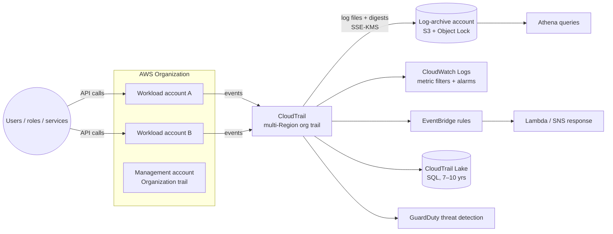

# AWS CloudTrail — API Activity Auditing

> **Category:** Management & Governance (also Security & Compliance) · **Scope:** Regional, with multi-Region and organization trails
> [← Back to overview](../AWS-core-services.md)

---

## 1. What it does

CloudTrail **records every API call and account activity** made in your AWS environment — through the console, CLI, SDKs or by AWS services on your behalf — so you can answer:

> **Who did what, when, from where, on which resource, and was it allowed?**

Used for:
- **Security investigations** (who deleted the bucket? who opened port 22?)
- **Compliance & audit** (PCI DSS, SOC 2, HIPAA, ISO 27001, OSFI B-13)
- **Operational troubleshooting** (which change broke production?)
- **Automated response** (alert when root signs in, when CloudTrail is stopped)

CloudTrail is **enabled by default** for every account: **Event history** keeps **90 days of management events** for free.

---

## 2. Key components

### 2.1 Events
Each event is a JSON record:

```json
{
  "eventVersion": "1.10",
  "userIdentity": {
    "type": "AssumedRole",
    "arn": "arn:aws:sts::111122223333:assumed-role/DevOps/alice",
    "accountId": "111122223333",
    "sessionContext": { "attributes": { "mfaAuthenticated": "true" } }
  },
  "eventTime": "2026-10-17T13:02:11Z",
  "eventSource": "ec2.amazonaws.com",
  "eventName": "AuthorizeSecurityGroupIngress",
  "awsRegion": "ca-central-1",
  "sourceIPAddress": "203.0.113.25",
  "userAgent": "aws-cli/2.x",
  "requestParameters": {
    "groupId": "sg-0abc123",
    "ipPermissions": { "items": [{ "ipProtocol": "tcp", "fromPort": 22, "toPort": 22,
      "ipRanges": { "items": [{ "cidrIp": "0.0.0.0/0" }] } }] }
  },
  "responseElements": { "_return": true },
  "errorCode": null,
  "readOnly": false,
  "eventType": "AwsApiCall",
  "managementEvent": true,
  "eventCategory": "Management"
}
```

Key fields: `userIdentity` (who), `eventTime` (when), `eventSource` + `eventName` (what), `awsRegion`, `sourceIPAddress` (from where), `requestParameters` / `responseElements` (details), `errorCode` (`AccessDenied` = failed attempt).

### 2.2 Event types

| Type | What is recorded | Default | Examples |
|------|-----------------|---------|----------|
| **Management events** (control plane) | Operations that create/modify/delete/configure resources; also console sign-in | ✅ **Logged by default** (event history; trails log them by default) | `CreateBucket`, `RunInstances`, `AttachRolePolicy`, `ConsoleLogin`, `CreateTrail` |
| **Data events** (data plane) | High-volume operations **on or within** a resource | ❌ **Not logged by default** (extra cost) | S3 `GetObject`/`PutObject`/`DeleteObject`, Lambda `Invoke`, DynamoDB item-level ops, SNS publish, Secrets Manager `GetSecretValue`… |
| **Network activity events** | API calls made **through VPC endpoints** (incl. denied by endpoint policy) | ❌ Opt-in | Detect data exfiltration attempts via VPC endpoints |
| **Insights events** | **Unusual activity** in API call **volume** or **error rate** vs baseline | ❌ Opt-in (extra cost) | Burst of `TerminateInstances`, spike in `AccessDenied` |

Management events can be filtered into **Read** (`Describe*`, `List*`, `Get*`) and **Write** events. You can also exclude high-volume sources (e.g. AWS KMS, RDS Data API).

### 2.3 Event history
- Console view of the last **90 days of management events** in the current Region, **free**, no setup.
- Searchable by user name, event name, resource type/name, event source, access key.
- Can't be customized or extended → create a **trail** or **Lake event data store** for long-term retention.

### 2.4 Trails
A **trail** delivers events continuously to an **S3 bucket** (and optionally CloudWatch Logs / EventBridge).

| Setting | Detail |
|---------|--------|
| **Multi-Region trail** | Default and **recommended** — captures all Regions, including new ones |
| **Organization trail** | Created in the management (or delegated admin) account; logs **every account** in AWS Organizations; member accounts can't modify/delete it |
| **S3 delivery** | Log files delivered typically within ~5 minutes (not real time); path `AWSLogs/<account>/CloudTrail/<region>/YYYY/MM/DD/` |
| **SSE-KMS encryption** | Optional customer-managed KMS key (default is SSE-S3) |
| **Log file integrity validation** | SHA-256 hashing + RSA-signed **digest files** every hour → prove logs weren't altered or deleted (`aws cloudtrail validate-logs`) |
| **SNS notification** | On each log file delivery |
| **CloudWatch Logs integration** | Real-time-ish search, **metric filters** and **alarms** |
| **Event selectors / advanced event selectors** | Choose which management/data events to log, filter by resource ARN, event name, read-only, etc. |
| Free copy | The **first copy of management events** delivered to S3 per Region is free; extra copies and data events are billed |

### 2.5 CloudTrail Lake
- Managed **data lake** that ingests, stores (immutable) and lets you **query events with SQL** — no S3/Athena pipeline to build.
- **Event data stores** with retention up to **10 years** (pricing options: one-year extendable or seven-year retention).
- Can ingest: CloudTrail events, **AWS Config configuration items**, **Audit Manager evidence**, and **non-AWS events** (integrations from partners or your own apps).
- **Lake dashboards** and **natural-language query generation**.
- Example query:
  ```sql
  SELECT eventTime, userIdentity.arn, sourceIPAddress, eventName
  FROM <event-data-store-id>
  WHERE eventName IN ('DeleteBucket','DeleteTrail','StopLogging','PutBucketPolicy')
    AND eventTime > '2026-10-01 00:00:00'
  ORDER BY eventTime DESC
  ```

### 2.6 CloudTrail Insights
- Learns a **baseline** of normal write-API call rates and error rates; raises an **Insights event** when activity deviates (e.g. a script suddenly deleting resources, a compromised key generating `AccessDenied` errors).
- Delivered to the trail's S3 bucket / event data store, visible in the console, can trigger EventBridge.

### 2.7 Integration with EventBridge (near real-time reaction)
- Management events (and data events if logged) are emitted to **Amazon EventBridge** as `AWS API Call via CloudTrail`.
- Build rules such as: *if `eventName = StopLogging` or `DeleteTrail` → Lambda re-enables logging + SNS alert to security team*.

```json
{
  "source": ["aws.cloudtrail"],
  "detail-type": ["AWS API Call via CloudTrail"],
  "detail": { "eventName": ["StopLogging", "DeleteTrail", "UpdateTrail"] }
}
```

### 2.8 Securing the audit trail itself
| Control | Purpose |
|---------|---------|
| **Dedicated log-archive account** | Store logs outside the workload accounts (AWS Control Tower pattern) |
| **S3 bucket policy** | Only CloudTrail service can write; deny deletes |
| **S3 Object Lock / MFA Delete / versioning** | Immutability |
| **SSE-KMS** with restricted key policy | Only auditors can decrypt |
| **Log file integrity validation** | Tamper evidence |
| **SCP** | Deny `cloudtrail:StopLogging`, `DeleteTrail`, `UpdateTrail` for everyone except a break-glass role |
| **Lifecycle rules** | Move old logs to Glacier / Deep Archive for long retention |

### 2.9 Related governance services (know the difference)
| Service | Question it answers |
|---------|--------------------|
| **CloudTrail** | **Who** made **which API call**, when? |
| **AWS Config** | What did my **resource configuration** look like over time, and is it **compliant** with rules? |
| **CloudWatch** | How are my resources **performing**? |
| **Amazon GuardDuty** | Is there a **threat**? (analyzes CloudTrail, VPC Flow Logs, DNS logs with ML) |
| **AWS Security Hub** | Centralized security findings & posture scoring |
| **Amazon Detective** | Investigate and visualize the root cause of findings |
| **IAM Access Analyzer** | Generate least-privilege policies **from CloudTrail activity** |
| **AWS Audit Manager** | Collect evidence for audits (frameworks like PCI, HIPAA) |
| **Amazon Athena** | SQL over CloudTrail logs stored in S3 (alternative to Lake) |

---

## 3. How it works



---

## 4. Pricing (concepts)
- **Free:** 90-day event history; **first copy of management events** per Region delivered to S3 by a trail
- **Billed:** additional copies of management events, **data events** (per 100,000 events), **network activity events**, **Insights** events analyzed, **CloudTrail Lake** ingestion + retention + query scanned
- **Indirect costs:** S3 storage, KMS requests, CloudWatch Logs ingestion

---

## 5. Best practices

- [ ] Create a **multi-Region organization trail** to a **central log-archive account**
- [ ] Enable **log file integrity validation** and **SSE-KMS** encryption
- [ ] Protect the bucket: versioning, **Object Lock**, restrictive bucket policy, lifecycle to Glacier
- [ ] Use **SCPs** to prevent stopping/deleting trails
- [ ] Send to **CloudWatch Logs** and alarm on critical events: root login, `ConsoleLogin` failures, IAM policy changes, SG changes, NACL/route changes, CloudTrail/Config changes, KMS key deletion (CIS AWS Foundations Benchmark controls)
- [ ] Enable **data events** selectively (sensitive S3 buckets, Lambda, Secrets)
- [ ] Enable **CloudTrail Insights** on production accounts
- [ ] Enable **GuardDuty** — it consumes CloudTrail automatically
- [ ] Use **CloudTrail Lake** or **Athena** for investigations; keep logs ≥ 1 year (often 7 for regulated industries)

---

## 6. Hands-on lab — Audit trail with alerting

1. **Explore Event history** (no setup): *CloudTrail → Event history* → filter `Event name = RunInstances` or `User name = <you>`; open the JSON of a `ConsoleLogin` event.

2. **Create a multi-Region trail with CloudWatch Logs:**
   ```bash
   ACCOUNT=$(aws sts get-caller-identity --query Account --output text)
   BUCKET=lab-cloudtrail-$ACCOUNT
   aws s3 mb s3://$BUCKET --region ca-central-1
   cat > ct-bucket-policy.json <<EOF
   {"Version":"2012-10-17","Statement":[
    {"Sid":"AclCheck","Effect":"Allow","Principal":{"Service":"cloudtrail.amazonaws.com"},
     "Action":"s3:GetBucketAcl","Resource":"arn:aws:s3:::$BUCKET"},
    {"Sid":"Write","Effect":"Allow","Principal":{"Service":"cloudtrail.amazonaws.com"},
     "Action":"s3:PutObject","Resource":"arn:aws:s3:::$BUCKET/AWSLogs/$ACCOUNT/*",
     "Condition":{"StringEquals":{"s3:x-amz-acl":"bucket-owner-full-control"}}}]}
   EOF
   aws s3api put-bucket-policy --bucket $BUCKET --policy file://ct-bucket-policy.json

   aws cloudtrail create-trail --name lab-trail --s3-bucket-name $BUCKET \
     --is-multi-region-trail --enable-log-file-validation
   aws cloudtrail start-logging --name lab-trail
   ```
   In the console, edit the trail → enable **CloudWatch Logs** (new log group `CloudTrail/lab`, new role).

3. **Data events for one bucket** (advanced selectors):
   ```bash
   aws cloudtrail put-event-selectors --trail-name lab-trail --advanced-event-selectors '[
     {"Name":"Mgmt","FieldSelectors":[{"Field":"eventCategory","Equals":["Management"]}]},
     {"Name":"S3 data - sensitive bucket","FieldSelectors":[
       {"Field":"eventCategory","Equals":["Data"]},
       {"Field":"resources.type","Equals":["AWS::S3::Object"]},
       {"Field":"resources.ARN","StartsWith":["arn:aws:s3:::lab-site-"]}]}]'
   ```

4. **Alarm on security-group changes (CIS control):**
   ```bash
   aws logs put-metric-filter --log-group-name CloudTrail/lab --filter-name SGChanges \
     --filter-pattern '{ ($.eventName = AuthorizeSecurityGroupIngress) || ($.eventName = AuthorizeSecurityGroupEgress) || ($.eventName = RevokeSecurityGroupIngress) || ($.eventName = CreateSecurityGroup) || ($.eventName = DeleteSecurityGroup) }' \
     --metric-transformations metricName=SecurityGroupEventCount,metricNamespace=CISBenchmark,metricValue=1
   aws cloudwatch put-metric-alarm --alarm-name sg-changed --namespace CISBenchmark \
     --metric-name SecurityGroupEventCount --statistic Sum --period 300 --evaluation-periods 1 \
     --threshold 1 --comparison-operator GreaterThanOrEqualToThreshold --alarm-actions $TOPIC
   ```
   Open port 22 on a lab SG → receive the alert within minutes.

5. **EventBridge rule** that alerts on `StopLogging` / `DeleteTrail` (pattern in §2.7) → SNS.

6. **Investigate:** after ~15 min, validate integrity and search with Athena or Lake:
   ```bash
   aws cloudtrail validate-logs --trail-arn arn:aws:cloudtrail:ca-central-1:$ACCOUNT:trail/lab-trail \
     --start-time $(date -u -d '-1 hour' +%Y-%m-%dT%H:%M:%SZ)
   ```

**Cleanup:** stop logging and delete the trail, delete alarm/metric filter/log group/EventBridge rule, empty and delete the bucket.

---

## 7. Certification tips

- "**Who** deleted / modified resource X?" → **CloudTrail**. "What was the **configuration** of X last week / is it compliant?" → **AWS Config**. "Is X **performing**?" → **CloudWatch**.
- Event history = **90 days**, management events only, free. Longer retention → **trail to S3** or **CloudTrail Lake**.
- **Data events are not logged by default** (S3 object-level, Lambda invoke, DynamoDB items).
- Log all accounts in an Organization → **organization trail**; all Regions → **multi-Region trail**.
- Prove logs weren't tampered with → **log file integrity validation**.
- Detect unusual API activity volume/errors → **CloudTrail Insights**.
- React to an API call within seconds → **EventBridge rule** on CloudTrail events.
- Query audit events with SQL without building a pipeline → **CloudTrail Lake** (or Athena on S3 logs).
- Threat detection based on CloudTrail → **GuardDuty**.
- CloudTrail delivery to S3 is **not real time** (typically within ~5 min).

---

## 8. Review questions

1. An S3 object was deleted yesterday. Event history shows nothing. Why?
2. What's the free retention of CloudTrail event history?
3. How do you capture CloudTrail events from every account in your organization, including future accounts?
4. How do you demonstrate to an auditor that the log files were not modified?
5. Which feature detects a sudden spike in `DeleteObject` or `TerminateInstances` calls?
6. You need to alert the security team within a minute when someone disables CloudTrail. What do you build?
7. Which service would tell you that a security group allowed 0.0.0.0/0 on port 22 last Tuesday, and whether that violated a rule?
8. How do you prevent account administrators from stopping the organization trail?

<details>
<summary><b>Answers</b></summary>

1. `DeleteObject` is a **data event**, not logged by default — enable **S3 data events** on a trail/event data store.
2. **90 days** (management events).
3. An **organization trail** (multi-Region) from the management or delegated-admin account.
4. **Log file integrity validation** (digest files) + `aws cloudtrail validate-logs`.
5. **CloudTrail Insights.**
6. An **EventBridge rule** matching `StopLogging`/`DeleteTrail`/`UpdateTrail` → **SNS** (and optionally Lambda to re-enable logging).
7. **AWS Config** (configuration history + Config rules); CloudTrail shows who made the change.
8. Organization trails can't be modified from member accounts; add an **SCP** denying `cloudtrail:StopLogging`, `DeleteTrail`, `UpdateTrail`.
</details>
