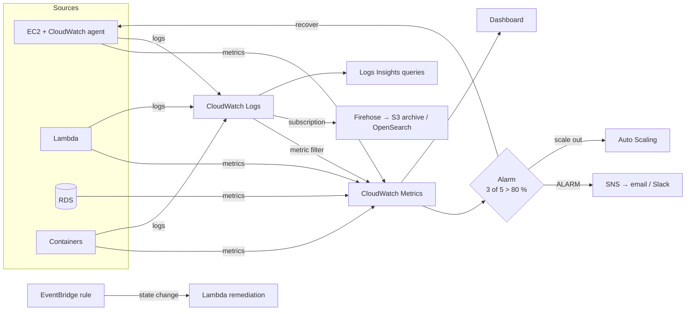

# Amazon CloudWatch — Monitoring & Observability

> **Category:** Management & Governance · **Scope:** Regional (cross-account / cross-Region dashboards & observability supported)
> [← Back to overview](../AWS-core-services.md)

---

## 1. What it does

Amazon CloudWatch **collects and visualizes metrics, logs, traces and events** from AWS resources, applications and on-premises servers, and **acts on them** with alarms and automation.

It answers operational questions:
- *Is my system healthy right now?* → **metrics, dashboards**
- *Wake me up when something breaks* → **alarms**
- *What happened and why?* → **logs, Logs Insights, traces**
- *What do users experience?* → **Synthetics, RUM, Application Signals**

> **CloudWatch vs CloudTrail:** CloudWatch = *performance & operational health* ("how is it running?"). CloudTrail = *API audit* ("who did what?").

---

## 2. Key components

### 2.1 Metrics
A **time-ordered set of data points** identified by:

| Element | Example |
|---------|---------|
| **Namespace** | `AWS/EC2`, `AWS/RDS`, `AWS/Lambda`, `MyApp/Orders` |
| **Metric name** | `CPUUtilization`, `Invocations`, `OrdersPlaced` |
| **Dimensions** | Key/value pairs (up to 30) — `InstanceId=i-0abc`, `AutoScalingGroupName=web-asg` |
| **Timestamp, value, unit** | `2026-10-17T12:00Z, 73.5, Percent` |
| **Statistic** | `Average`, `Sum`, `Minimum`, `Maximum`, `SampleCount`, percentiles `p90`, `p99`, trimmed mean |
| **Period** | Aggregation window: 1 s, 5 s, 10 s, 30 s, 60 s or multiples |

**Resolution & retention**
| Data point period | Retention |
|-------------------|-----------|
| < 60 s (high resolution) | 3 hours |
| 60 s | 15 days |
| 300 s (5 min) | 63 days |
| 3,600 s (1 h) | **455 days (15 months)** |

**Basic vs detailed monitoring (EC2):** basic = **5-minute** metrics (free); **detailed = 1-minute** (paid).

**EC2 default metrics:** CPUUtilization, NetworkIn/Out, DiskRead/Write (instance store), **StatusCheckFailed** (system/instance/EBS), CPU credit metrics.
**NOT collected by default:** **memory utilization, disk space usage, swap, process-level** metrics → install the **CloudWatch agent**.

**Custom metrics:** publish your own with `PutMetricData` (standard 1-min or **high-resolution 1 s**), or the **Embedded Metric Format (EMF)** in logs (no API calls, ideal for Lambda).

**Metric math:** compute new series from existing ones (`m1/m2*100` error rate, `SUM(METRICS())`).

### 2.2 CloudWatch agent (unified)
- Runs on EC2, on-premises servers, and containers (Linux, Windows, macOS).
- Collects **system-level metrics** (memory, disk, netstat, processes via procstat), **custom StatsD/collectd metrics**, and **log files**.
- Configuration stored in **SSM Parameter Store**, installed via **Systems Manager**.
- Requires an IAM role with `CloudWatchAgentServerPolicy`.

### 2.3 Alarms
Watch a **single metric**, a **metric math expression** or an **anomaly detection band** and change state:

| State | Meaning |
|-------|---------|
| `OK` | Within threshold |
| `ALARM` | Breached threshold |
| `INSUFFICIENT_DATA` | Not enough data yet / metric missing |

Configuration: threshold, comparison operator, **period**, **evaluation periods**, **datapoints to alarm** (e.g. 3 of 5 — "M out of N" to reduce noise), **missing data treatment** (`missing`, `notBreaching`, `breaching`, `ignore`).

**Alarm actions:**
| Action | Example |
|--------|---------|
| **SNS notification** | Email, SMS, Slack/Chatbot, PagerDuty |
| **EC2 action** | **Stop, terminate, reboot, recover** an instance (e.g. recover on `StatusCheckFailed_System`) |
| **Auto Scaling** | Step/simple scaling policies (target tracking creates its own alarms) |
| **Systems Manager** | Create OpsItem / incident in Incident Manager |
| **Lambda** | Invoke a function directly (newer) |

**Composite alarms:** combine alarms with `AND`/`OR`/`NOT` → reduce alert fatigue (page only when *high CPU AND high latency*).
**Anomaly detection:** ML band based on historical patterns (daily/weekly seasonality) instead of a static threshold.

### 2.4 Dashboards
- Customizable home pages with graphs, numbers, gauges, logs tables, alarms status, text (Markdown).
- **Cross-account and cross-Region** in one dashboard; shareable publicly or with SSO users.
- **Automatic dashboards** per service; dashboard variables; up to 3 free dashboards (50 metrics) in free tier.

### 2.5 CloudWatch Logs
| Concept | Description |
|---------|-------------|
| **Log group** | Container for logs of one app/service, e.g. `/aws/lambda/orders-api`; carries **retention**, **KMS encryption**, **data protection** settings |
| **Log stream** | Sequence of events from one source (one instance, one Lambda environment) |
| **Log event** | Timestamp + raw message (≤ 256 KB) |
| **Retention** | 1 day → 10 years, or **Never expire (default!)** → set a retention to control cost |
| **Log classes** | **Standard** vs **Infrequent Access** (cheaper ingestion, fewer features) |

**Sources:** Lambda (automatic), ECS/EKS (awslogs, Fluent Bit), EC2 (CloudWatch agent), API Gateway, VPC Flow Logs, Route 53 Resolver query logs, CloudTrail, RDS log exports, Elastic Beanstalk…

**Features**
| Feature | Purpose |
|---------|---------|
| **Logs Insights** | Interactive query language (also SQL/OpenSearch PPL) for searching and aggregating logs |
| **Metric filters** | Turn log patterns into metrics (e.g. count `ERROR` lines → alarm) |
| **Subscription filters** | Stream logs in near real time to **Lambda, Kinesis Data Streams, Firehose, OpenSearch** — also cross-account for centralized logging |
| **Export to S3** | Batch export (up to 12 h delay) — for archiving prefer subscription/Firehose |
| **Live Tail** | Real-time streaming view in the console/CLI |
| **Data protection policies** | Detect and **mask sensitive data** (PII, credentials) |
| **Anomaly detection & pattern analysis** | ML detection of unusual log patterns |
| **Field indexes, centralized log management** | Faster queries, org-wide collection |

Logs Insights example — top 10 slowest Lambda invocations:
```
fields @timestamp, @requestId, @duration
| filter @type = "REPORT"
| sort @duration desc
| limit 10
```

Errors per 5 minutes:
```
fields @timestamp, @message
| filter @message like /ERROR/
| stats count(*) as errors by bin(5m)
```

### 2.6 Events → Amazon EventBridge
- The former **CloudWatch Events** is now **Amazon EventBridge** (same API, more features).
- **Rules** match events (e.g. *EC2 instance state change to stopped*, *GuardDuty finding*, *CloudTrail API call*) or run on **schedules** (cron/rate) → targets: Lambda, SNS, SQS, Step Functions, SSM Automation, ECS tasks…
- **EventBridge Scheduler** for millions of one-off or recurring schedules.

### 2.7 Application & user-experience monitoring
| Feature | Purpose |
|---------|---------|
| **CloudWatch Synthetics (canaries)** | Scripted Node.js/Python (Puppeteer/Selenium/Playwright) tests of endpoints/UI flows on a schedule — catch outages before users |
| **CloudWatch RUM** | Real User Monitoring — browser performance, JS errors, sessions |
| **Application Signals** | APM: auto-instrumented service maps, SLOs, latency/error/fault metrics (OpenTelemetry) |
| **AWS X-Ray / CloudWatch traces** | Distributed tracing across microservices |
| **ServiceLens / Service Map** | Correlated view of metrics, logs, traces |
| **Internet Monitor** | Internet-side availability/performance for your users |
| **Network Flow Monitor** | Network performance between workloads |
| **Evidently** (feature flags) | Being retired — use AWS AppConfig |

### 2.8 Insights (curated monitoring)
| Insight | For |
|---------|-----|
| **Container Insights** | ECS, EKS, Kubernetes — cluster/node/pod/container metrics & logs |
| **Lambda Insights** | Lambda system metrics (memory, CPU, cold starts) |
| **Database Insights** | RDS/Aurora fleet monitoring (incl. Performance Insights) |
| **Contributor Insights** | Top-N contributors from logs (top talkers IPs, hot DynamoDB keys) |
| **Application Insights** | Auto-configured monitoring for .NET, SQL Server, SAP… |

### 2.9 Cross-account observability
- Link **source accounts** to a central **monitoring account** (via **Observability Access Manager** sinks) to search metrics, logs, traces across an Organization.

### 2.10 Other integrations
- **Metric Streams:** continuous near-real-time stream of metrics to Firehose → S3, Datadog, Splunk, New Relic…
- **CloudWatch Investigations** (AI-assisted root-cause analysis) and **Amazon Q** natural-language queries.
- **Amazon Managed Service for Prometheus / Managed Grafana** for open-source stacks.

---

## 3. How it works



---

## 4. Pricing (concepts)
Free tier: basic monitoring metrics, 10 custom metrics, 10 alarms, 3 dashboards, 5 GB logs (ingestion + archive), 1M API requests. Beyond: **custom metrics** per metric-month, **detailed monitoring**, **API requests** (`GetMetricData`, `PutMetricData`), **alarms** per alarm-metric (high-resolution and anomaly detection cost more), **dashboards** per month, **logs ingestion per GB** (largest cost driver), **logs storage per GB-month**, Logs Insights per GB scanned, vended logs, Synthetics canary runs, RUM events, Container/Lambda Insights.

> Cost tips: set **log retention**, avoid DEBUG logs in production, use **Infrequent Access** log class, filter before ingestion, prefer EMF over many `PutMetricData` calls.

---

## 5. Best practices

- [ ] Define **SLIs/SLOs** and alarm on user-impacting symptoms (latency, errors) — not only CPU
- [ ] Install the **CloudWatch agent** (via SSM) for memory/disk on every EC2
- [ ] Use **M-out-of-N** datapoints, **composite alarms** and **anomaly detection** to reduce noise
- [ ] Route alarms to **SNS** → on-call tools; tag alarms with owner/runbook link
- [ ] **Set retention** on every log group; encrypt sensitive logs with KMS; enable **data protection** masking
- [ ] Use **structured JSON logs** → easier Logs Insights queries
- [ ] Centralize logs and metrics in a **monitoring account** (cross-account observability)
- [ ] Add **Synthetics canaries** for critical user journeys
- [ ] Automate remediation with **EventBridge + Lambda / SSM Automation**
- [ ] Create dashboards as code (CloudFormation/CDK)

---

## 6. Hands-on lab — Agent, alarm, metric filter, Logs Insights

1. **Install the CloudWatch agent** on the lab EC2 instance (role with `CloudWatchAgentServerPolicy` + `AmazonSSMManagedInstanceCore`):
   *Systems Manager → Run Command → `AWS-ConfigureAWSPackage` (name `AmazonCloudWatchAgent`)*, then configure with this JSON stored in SSM Parameter Store `AmazonCloudWatch-linux`:
   ```json
   {
     "metrics": {
       "namespace": "Lab/EC2",
       "append_dimensions": { "InstanceId": "${aws:InstanceId}" },
       "metrics_collected": {
         "mem":  { "measurement": ["mem_used_percent"] },
         "disk": { "measurement": ["used_percent"], "resources": ["/"] }
       }
     },
     "logs": { "logs_collected": { "files": { "collect_list": [
       { "file_path": "/var/log/nginx/access.log", "log_group_name": "/lab/nginx/access",
         "log_stream_name": "{instance_id}", "retention_in_days": 7 }
     ]}}}
   }
   ```
   Run `AmazonCloudWatch-ManageAgent` with action `configure`, source `ssm:AmazonCloudWatch-linux`.

2. **SNS topic + CPU alarm:**
   ```bash
   TOPIC=$(aws sns create-topic --name lab-alerts --query TopicArn --output text)
   aws sns subscribe --topic-arn $TOPIC --protocol email --notification-endpoint you@example.com

   aws cloudwatch put-metric-alarm --alarm-name lab-high-cpu \
     --namespace AWS/EC2 --metric-name CPUUtilization --dimensions Name=InstanceId,Value=$INSTANCE_ID \
     --statistic Average --period 60 --evaluation-periods 5 --datapoints-to-alarm 3 \
     --threshold 70 --comparison-operator GreaterThanThreshold \
     --treat-missing-data notBreaching --alarm-actions $TOPIC --ok-actions $TOPIC
   ```
3. **Generate load** (via Session Manager): `sudo dnf -y install stress-ng && stress-ng --cpu 2 --timeout 600` → receive the ALARM email.

4. **Metric filter on 404s + alarm:**
   ```bash
   aws logs put-metric-filter --log-group-name /lab/nginx/access --filter-name http404 \
     --filter-pattern '[ip, id, user, timestamp, request, status_code=404, size, ...]' \
     --metric-transformations metricName=Http404Count,metricNamespace=Lab/Web,metricValue=1,defaultValue=0
   for i in $(seq 1 50); do curl -s http://<instance>/nope > /dev/null; done
   ```
5. **Logs Insights:** select `/lab/nginx/access` and run
   ```
   fields @timestamp, @message
   | parse @message '* - - [*] "* * *" * *' as ip, ts, method, path, proto, status, bytes
   | stats count(*) as hits by status
   | sort hits desc
   ```
6. **Dashboard:** create `Lab-Ops` with CPU, `mem_used_percent`, `Http404Count`, and the alarm status widget.
7. **EventBridge rule:** notify SNS when any EC2 instance enters `stopped` state.

**Cleanup:** delete alarms, dashboard, metric filter, log groups, SNS topic, EventBridge rule.

---

## 7. Certification tips

- EC2 **memory / disk usage** → **CloudWatch agent** (custom metrics), not available by default.
- Default EC2 monitoring period: **5 min**; detailed: **1 min**; high-resolution custom metrics: **1 s**.
- Automatically recover an instance on host failure → alarm on **`StatusCheckFailed_System`** with **recover** action.
- Turn log content into an alarm → **metric filter** → alarm.
- Real-time log processing / centralization → **subscription filter** (Lambda, Kinesis, Firehose).
- Logs never expire by default → **set retention**.
- Scheduled tasks / react to state changes → **EventBridge** (formerly CloudWatch Events).
- Reduce false alarms → **composite alarms**, **M of N datapoints**, **anomaly detection**.
- Monitor website availability from outside → **Synthetics canaries**; real user performance → **RUM**.
- ECS/EKS metrics → **Container Insights**.
- "Who deleted the resource?" → that's **CloudTrail**, not CloudWatch.
- Metrics retained up to **15 months**.

---

## 8. Review questions

1. Which EC2 metrics require the CloudWatch agent?
2. How do you get notified when the word `Exception` appears more than 10 times in 5 minutes in an application log?
3. What is the difference between basic and detailed monitoring?
4. An alarm flaps every few minutes because of short spikes. Name two ways to fix it.
5. How long are 1-minute data points retained?
6. How can you send all application logs in near real time to a central OpenSearch cluster?
7. Which service replaced CloudWatch Events?
8. How do you detect that your login page is broken before customers call?

<details>
<summary><b>Answers</b></summary>

1. **Memory utilization, disk space utilization, swap, process-level metrics** (OS-level metrics).
2. **Metric filter** on the log group for `Exception` → custom metric → **alarm** (Sum > 10 over 5 min) → **SNS**.
3. Basic: **5-minute** metrics, free. Detailed: **1-minute** metrics, paid.
4. Use **M-out-of-N datapoints to alarm** / longer evaluation periods, **composite alarms**, or **anomaly detection** bands.
5. **15 days** (then aggregated to 5-minute for 63 days and 1-hour for 15 months).
6. A **subscription filter** to Firehose (or Lambda) delivering to **OpenSearch**.
7. **Amazon EventBridge.**
8. A **CloudWatch Synthetics canary** running the login flow on a schedule with an alarm on failure.
</details>
