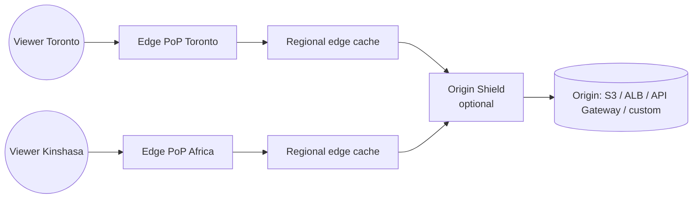
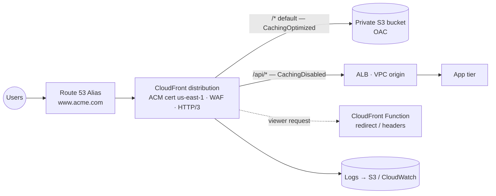

# Amazon CloudFront — Content Delivery Network (CDN)

> **Category:** Networking & Content Delivery · **Scope:** Global (configuration), served from hundreds of edge locations
> [← Back to overview](../AWS-core-services.md)

---

## 1. What it does

CloudFront is AWS's **global Content Delivery Network.** It caches and delivers static and dynamic content (web pages, images, video, APIs, software downloads) from **edge locations close to your users**, reducing latency and offloading your origin.

Benefits:
- **Performance:** content served from the nearest Point of Presence (PoP); persistent optimized connections back to the origin over the AWS backbone
- **Security:** TLS everywhere, **AWS Shield Standard** DDoS protection included, **AWS WAF** integration, origin hiding
- **Cost:** data transfer from AWS origins to CloudFront is free; CloudFront egress is often cheaper than direct S3/EC2 egress
- **Programmability:** run code at the edge (CloudFront Functions, Lambda@Edge)

---

## 2. Key components

### 2.1 Distribution
- The CloudFront configuration object, with a domain such as `d111abcdef8.cloudfront.net`.
- Add **alternate domain names (CNAMEs)** such as `www.acme.com` — requires an **ACM certificate in `us-east-1`** and a Route 53 **Alias** record.
- Settings: price class, HTTP versions (HTTP/2, **HTTP/3**), IPv6, default root object (`index.html`), logging, WAF web ACL, geo-restrictions.
- **Multi-tenant distributions / SaaS Manager** (newer) for serving many customer domains from one configuration.

### 2.2 Edge network
| Component | Role |
|-----------|------|
| **Edge locations (PoPs)** | Hundreds of sites worldwide that cache and serve content to viewers |
| **Regional edge caches (RECs)** | Larger mid-tier caches between PoPs and origin — keep less-popular content longer |
| **Origin Shield** | Optional **additional centralized caching layer** in one Region in front of the origin → higher cache-hit ratio, less origin load |
| **Embedded PoPs** | Caches inside ISP networks for very large events |



### 2.3 Origins
| Origin type | Notes |
|-------------|-------|
| **S3 bucket (REST endpoint)** | Keep bucket **private**; access via **Origin Access Control (OAC)** — successor to legacy **Origin Access Identity (OAI)**; supports SSE-KMS |
| **S3 static website endpoint** | Custom origin (HTTP only to origin); needed for S3 website redirects |
| **Application Load Balancer / EC2** | Custom origin; can be **VPC origin** (private ALB/NLB/EC2 in private subnets — no public exposure) |
| **API Gateway, Lambda Function URL** | Dynamic APIs at the edge |
| **MediaStore / MediaPackage** | Video streaming |
| **Any HTTP server** | On-premises or other clouds |

**Origin groups:** primary + secondary origin for **origin failover** on specified HTTP status codes (e.g. 500, 502, 503, 504) — GET/HEAD/OPTIONS requests.

Protecting custom origins: allow only the **CloudFront managed prefix list** in the ALB security group + require a **secret custom header** checked by the ALB/WAF — or use **VPC origins**.

### 2.4 Cache behaviors
Rules matched by **path pattern** (in order), each with its own origin and settings:

| Path pattern | Origin | Example settings |
|--------------|--------|------------------|
| `/api/*` | ALB | CachingDisabled policy, forward all headers/cookies, allow POST/PUT/DELETE |
| `/images/*` | S3 | CachingOptimized policy, long TTL, compression |
| `Default (*)` | S3 | `index.html` SPA |

Each behavior defines: **viewer protocol policy** (HTTP and HTTPS / redirect HTTP→HTTPS / HTTPS only), allowed HTTP methods, **cache policy**, **origin request policy**, **response headers policy**, compression (Gzip/Brotli), **signed URL/cookie requirement**, **function associations**.

### 2.5 Caching — policies and TTLs
- **Cache key** = what makes an object unique in cache: by default URL path; optionally selected **query strings, headers, cookies**. Fewer elements → **higher cache-hit ratio**.
- **Cache policy:** cache key + TTLs (min / default / max). Managed policies: `CachingOptimized`, `CachingDisabled`, `UseOriginCacheControlHeaders`…
- **Origin request policy:** values sent to the origin **without** being part of the cache key (e.g. `User-Agent` for logging).
- **Response headers policy:** add security headers (HSTS, CSP, X-Frame-Options), CORS headers.
- Origin `Cache-Control: max-age` / `Expires` headers are honored within min/max TTL bounds. Default TTL = 24 h.

**Invalidations:** remove objects from edge caches before TTL expiry (`/images/*` or `/*`). First 1,000 paths/month free, then charged. **Better practice:** **versioned file names** (`app.3f9a1c.js`) — no invalidation needed and no stale content.

### 2.6 Security features
| Feature | Purpose |
|---------|---------|
| **HTTPS / TLS** | Viewer certificates from **ACM (us-east-1)**, **SNI** (free) or dedicated IP (legacy, costly); security policy (min TLS version) |
| **Origin Access Control (OAC)** | Only CloudFront can read the private S3 bucket (SigV4 signed requests) |
| **Signed URLs** | Restrict access to **one file** (e.g. a paid download), expiry, optional IP range |
| **Signed cookies** | Restrict access to **multiple files** (e.g. a whole premium video library) without changing URLs |
| Trusted key groups | Public keys used to verify signed URLs/cookies (preferred over legacy root-account key pairs) |
| **Geographic restrictions** | Allow-list / block-list of countries (licensing, sanctions) |
| **AWS WAF** | Web ACLs at the edge: managed rule groups (OWASP, SQLi, XSS, bad bots), rate-based rules, IP sets, geo-match |
| **AWS Shield Standard** | Automatic L3/L4 DDoS protection (free); **Shield Advanced** for enhanced protection, 24/7 DRT, cost protection |
| **Field-level encryption** | Encrypt specific POST fields at the edge |
| **Real-time / standard logs** | Access logs to S3 / CloudWatch Logs / Kinesis Data Streams |

**Signed URL vs S3 pre-signed URL:** CloudFront signed URLs work through the CDN, for any origin, with caching; S3 pre-signed URLs go directly to S3 with the signer's IAM permissions.

### 2.7 Edge compute
| | **CloudFront Functions** | **Lambda@Edge** |
|---|--------------------------|-----------------|
| Runtime | JavaScript (lightweight) | Node.js, Python |
| Where it runs | **All edge locations (PoPs)** | **Regional edge caches** |
| Triggers | Viewer request, viewer response | Viewer request/response **+ origin request/response** |
| Max execution time | < 1 ms | 5 s (viewer) / 30 s (origin) |
| Network / body access | ❌ No network, no body | ✅ Network calls, request body |
| Scale & cost | Millions req/s, ~1/6 of Lambda@Edge price | Thousands req/s |
| Use cases | Header manipulation, URL rewrites/redirects, cache-key normalization, simple JWT validation, A/B cookies | Auth with external IdP, dynamic origin selection, image resizing, SEO rendering |

**CloudFront KeyValueStore:** low-latency key-value data readable from CloudFront Functions (redirect maps, feature flags).

### 2.8 Price classes
| Price class | Edge locations used |
|-------------|--------------------|
| **All** | All Regions — best performance |
| **200** | Most Regions, excludes the most expensive |
| **100** | Only least-expensive Regions (North America, Europe) |

### 2.9 Other features
- **Continuous deployment:** staging distribution receives a % of traffic or header-based traffic for testing config changes before promotion.
- **Custom error pages** (e.g. return `/index.html` with 200 for 403/404 → single-page apps).
- **Compression** (Gzip, Brotli), **range requests**, **WebSockets**, **gRPC**.
- **CloudFront flat-rate pricing plans** (newer) bundling CDN, WAF, DDoS protection — verify availability.

### 2.10 CloudFront vs alternatives
| Need | Service |
|------|---------|
| Cache HTTP(S) content at edge | **CloudFront** |
| Improve **non-HTTP (TCP/UDP)** performance, **static anycast IPs**, fast Regional failover | **AWS Global Accelerator** (no caching) |
| Replicate S3 data to another Region | S3 Cross-Region Replication (not a CDN) |

---

## 3. Reference architecture — Secure static site + API



---

## 4. Pricing (concepts)
Data transfer out to viewers (varies by geography), HTTP/HTTPS requests (per 10,000), invalidation paths beyond the free quota, Origin Shield requests, CloudFront Functions / Lambda@Edge invocations and duration, real-time logs, field-level encryption, dedicated-IP custom SSL. **Free:** data transfer from AWS origins to CloudFront, ACM certificates, Shield Standard. **Always-free tier** includes a monthly allowance of data transfer and requests. Savings via **CloudFront Security Savings Bundle** or private pricing for large commitments.

---

## 5. Best practices

- [ ] Keep S3 origins **private** with **OAC**; never make the bucket public
- [ ] Restrict custom origins (prefix list + secret header, or **VPC origins**)
- [ ] **Redirect HTTP → HTTPS**, TLS 1.2+ security policy, add security headers via response headers policy
- [ ] Attach **AWS WAF** with managed rules + rate limiting
- [ ] Minimize the cache key; use **versioned asset names** instead of invalidations
- [ ] Separate cache behaviors for static vs dynamic paths
- [ ] Enable **Origin Shield** for origins serving many PoPs/viewers
- [ ] Use **origin groups** for failover
- [ ] Prefer **CloudFront Functions** for simple edge logic
- [ ] Enable logging and monitor `CacheHitRate`, `4xxErrorRate`, `5xxErrorRate`, `OriginLatency`

---

## 6. Hands-on lab — Private S3 site behind CloudFront with OAC

**Prerequisite:** private bucket from the [S3 lab](../Storage/S3.md) containing `index.html` (Block Public Access ON).

1. **Console:** *CloudFront → Create distribution*
   - Origin domain: select your S3 bucket (REST endpoint, **not** the website endpoint)
   - Origin access: **Origin access control settings (recommended)** → *Create new OAC*
   - Viewer protocol policy: **Redirect HTTP to HTTPS**
   - Cache policy: **CachingOptimized**
   - Default root object: `index.html`
   - WAF: enable security protections (optional in lab)
2. **Copy the generated bucket policy** and apply it:
   ```json
   {
     "Version": "2012-10-17",
     "Statement": [{
       "Sid": "AllowCloudFrontOAC",
       "Effect": "Allow",
       "Principal": { "Service": "cloudfront.amazonaws.com" },
       "Action": "s3:GetObject",
       "Resource": "arn:aws:s3:::<BUCKET>/*",
       "Condition": { "StringEquals": {
         "AWS:SourceArn": "arn:aws:cloudfront::<ACCOUNT_ID>:distribution/<DIST_ID>" } }
     }]
   }
   ```
3. Wait for status **Deployed**, then:
   ```bash
   curl -I https://<dist>.cloudfront.net/            # 200, header x-cache: Miss from cloudfront
   curl -I https://<dist>.cloudfront.net/            # x-cache: Hit from cloudfront
   curl -I https://<BUCKET>.s3.ca-central-1.amazonaws.com/index.html   # 403 — bucket stays private
   ```
4. **Update content** → still old version (cached). Run an invalidation:
   ```bash
   aws cloudfront create-invalidation --distribution-id <DIST_ID> --paths "/index.html"
   ```
5. **CloudFront Function** (viewer request) — add security redirect `/old → /`:
   ```javascript
   function handler(event) {
     var req = event.request;
     if (req.uri === '/old') {
       return { statusCode: 301, statusDescription: 'Moved Permanently',
                headers: { location: { value: '/' } } };
     }
     return req;
   }
   ```
6. **Optional:** custom domain — request an ACM certificate in **us-east-1**, add `www.yourdomain` as alternate domain, create Route 53 **Alias** to the distribution.

**Cleanup:** disable the distribution → wait → delete; delete function, OAC, certificate if unused.

---

## 7. Certification tips

- Global users + static content latency → **CloudFront** (caching). Non-HTTP / static IP / no caching → **Global Accelerator**.
- Restrict S3 to CloudFront only → **OAC** (OAI is legacy).
- Paid content: one file → **signed URL**; many files → **signed cookies**.
- Block countries → **geographic restrictions** (or WAF geo-match for finer rules).
- Custom domain HTTPS on CloudFront → **ACM certificate in `us-east-1`**.
- Protection from SQL injection/XSS at edge → **AWS WAF** on CloudFront; DDoS → **Shield** (Standard free, Advanced paid).
- Origin failover → **origin groups**.
- Lightweight header/URL manipulation at massive scale → **CloudFront Functions**; network calls / origin events → **Lambda@Edge**.
- Reduce load on origin across many Regions → **Origin Shield**.
- Content updated but users see old version → **invalidation** or versioned file names / lower TTL.
- Reduce cost by limiting edge locations → **price class**.

---

## 8. Review questions

1. Which certificate Region is required for a custom domain on CloudFront?
2. How do you ensure users cannot bypass CloudFront and read the S3 bucket directly?
3. A video platform must restrict access to an entire premium catalogue. Signed URLs or signed cookies?
4. What is the difference between CloudFront Functions and Lambda@Edge regarding trigger points?
5. Users in Asia report slow access, but your price class is 100. Why?
6. Why does adding all headers to the cache key hurt performance?
7. What feature lets CloudFront switch to a backup origin when the primary returns 503?
8. A gaming company needs static IPs and fast failover for UDP traffic. CloudFront or Global Accelerator?

<details>
<summary><b>Answers</b></summary>

1. **us-east-1 (N. Virginia)** ACM certificate.
2. Keep the bucket private, configure **OAC**, and a bucket policy allowing only the CloudFront service principal with `AWS:SourceArn` = the distribution.
3. **Signed cookies** (many files).
4. CloudFront Functions: **viewer request/response** only. Lambda@Edge: viewer **and origin** request/response.
5. Price class 100 serves only from North America/Europe edges — Asian viewers are served from distant locations → use **Price class All** (or 200).
6. Each header variation creates a separate cache entry → **lower cache-hit ratio**, more origin requests.
7. **Origin groups** (origin failover).
8. **Global Accelerator.**
</details>
