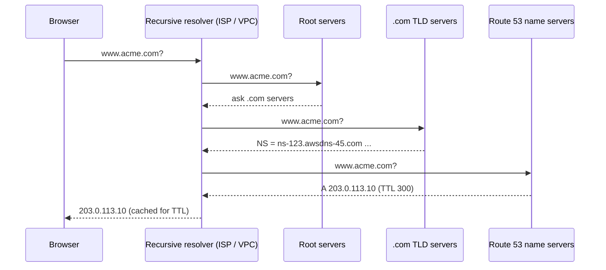
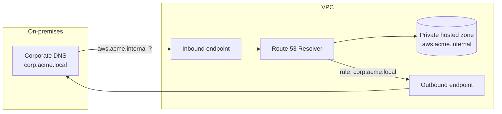
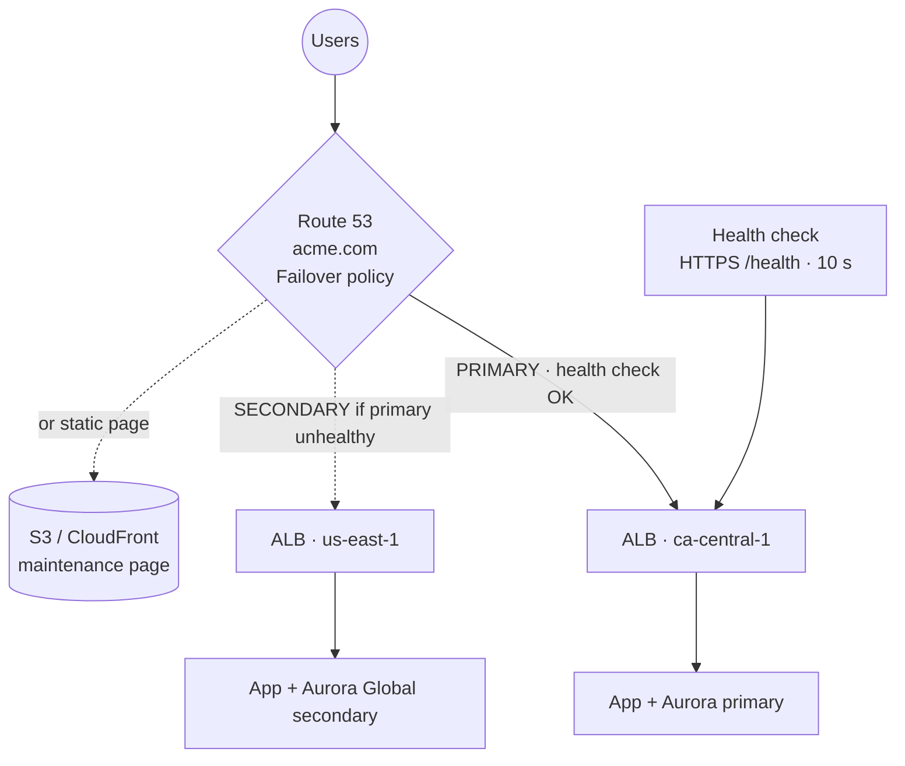

# Amazon Route 53 — DNS, Domain Registration & Health Checks

> **Category:** Networking & Content Delivery · **Scope:** Global · **SLA:** 100 % availability (the only AWS service with a 100 % SLA)
> [← Back to overview](../AWS-core-services.md)

---

## 1. What it does

Route 53 is AWS's **highly available, scalable Domain Name System (DNS) service.** The name refers to TCP/UDP **port 53**, used by DNS. It provides four functions:

1. **Domain registration** — buy and renew domain names (`.com`, `.ca`, `.cd`…)
2. **Authoritative DNS** — answer queries for your domains (public and private)
3. **Health checking** — monitor endpoints and route away from unhealthy ones
4. **Traffic management** — routing policies (latency, geolocation, weighted, failover…)

Plus **Route 53 Resolver** for DNS inside VPCs and hybrid networks.

---

## 2. DNS fundamentals (quick refresher)



| Term | Meaning |
|------|---------|
| **FQDN** | Fully qualified domain name, e.g. `api.eu.acme.com.` |
| **TLD** | Top-level domain (`.com`, `.ca`, `.org`) |
| **Zone apex / root domain** | `acme.com` itself (no subdomain) |
| **TTL** | Seconds a resolver caches a record — high TTL = fewer queries, slower changes |
| **Authoritative name server** | Server holding the actual records for the zone |

---

## 3. Key components

### 3.1 Domain registration
- Register or **transfer** domains; Route 53 acts as registrar (or via its partner registrars).
- Automatic creation of a public hosted zone; auto-renew; WHOIS privacy protection for supported TLDs; **domain lock** to prevent unauthorized transfers.
- You can use Route 53 DNS with a domain registered elsewhere — just update the **NS records at the registrar**.

### 3.2 Hosted zones
| Type | Answers queries from | Use |
|------|---------------------|-----|
| **Public hosted zone** | The internet | `acme.com` website, APIs |
| **Private hosted zone** | One or more **associated VPCs** (even cross-account) | Internal names `db.internal.acme.com`; requires `enableDnsSupport` + `enableDnsHostnames` |

- Each public hosted zone gets **4 name servers** (delegation set) across different TLDs.
- **Split-horizon DNS:** same domain name in a public and a private zone → different answers inside vs outside the VPC.
- Billed per hosted zone per month + per query.

### 3.3 Record types

| Type | Purpose | Example |
|------|---------|---------|
| **A** | Name → IPv4 | `www → 203.0.113.10` |
| **AAAA** | Name → IPv6 | `www → 2001:db8::10` |
| **CNAME** | Name → another name (**not allowed at zone apex**) | `blog → acme.wordpress.com` |
| **Alias** (Route 53 extension) | Name → AWS resource, **allowed at zone apex**, free queries, auto-tracks IP changes | `acme.com → d111.cloudfront.net` |
| **MX** | Mail servers with priority | `10 mail.acme.com` |
| **TXT** | Text — SPF, DKIM, domain verification | `"v=spf1 include:amazonses.com ~all"` |
| **NS** | Name servers for the zone / delegation of a subdomain | |
| **SOA** | Start of Authority — zone metadata | |
| **SRV** | Service location (host + port) | VoIP, AD |
| **CAA** | Which CAs may issue certificates | `0 issue "amazon.com"` |
| **PTR** | Reverse DNS (IP → name) | |
| **DS** | DNSSEC delegation signer | |
| **HTTPS / SVCB** | Service binding records (HTTP/3 hints) | |

### 3.4 Alias records vs CNAME

| | **Alias** | **CNAME** |
|---|-----------|-----------|
| Zone apex (`acme.com`) | ✅ Yes | ❌ No |
| Targets | AWS resources: **CloudFront, ELB (ALB/NLB), S3 website, API Gateway, VPC interface endpoint, Global Accelerator, Elastic Beanstalk, another record in the same zone** | Any DNS name |
| Query cost | **Free** for alias to AWS resources | Charged |
| TTL | Set by AWS (inherits target) | You set |
| **Cannot target** | **EC2 instance DNS name** | — |

> Always prefer **Alias** for AWS resources.

### 3.5 Routing policies

| Policy | How it answers | Health checks | Typical use |
|--------|---------------|---------------|-------------|
| **Simple** | One record, may contain multiple values (client picks randomly) | ❌ Not with health checks | Single resource |
| **Weighted** | Distributes by relative weight (e.g. 90/10); weight 0 stops traffic | ✅ | Canary/blue-green, A/B testing |
| **Latency-based** | Region with the **lowest measured latency** to the user | ✅ | Global multi-Region apps |
| **Failover** (active-passive) | **Primary** while healthy, otherwise **secondary** | ✅ **Required on primary** | DR: primary Region → standby Region / S3 maintenance page |
| **Geolocation** | Based on the user's **continent / country / US state**; define a **default** record | ✅ | Content localization, legal restrictions, licensing |
| **Geoproximity** | Based on geographic distance with **bias** to expand/shrink regions (via Traffic Flow) | ✅ | Shift load between Regions |
| **IP-based** | Based on the client's **source CIDR** | ✅ | ISP-specific routing, cost optimization |
| **Multivalue answer** | Returns up to **8 healthy** records randomly | ✅ | Simple client-side load distribution (not a replacement for ELB) |

**Traffic Flow** — visual editor to build complex nested policies (e.g. latency → then weighted → then failover), saved as versioned **traffic policies**.

### 3.6 Health checks
| Type | Monitors |
|------|----------|
| **Endpoint** | IP or domain via HTTP, HTTPS or TCP; optional **string matching** in the first 5,120 bytes of the response |
| **Calculated** | Combine up to 256 child health checks with AND/OR/at-least-N logic |
| **CloudWatch alarm** | Health = alarm state → monitor **private resources** (health checkers are on the internet and cannot reach private IPs directly) |

- ~15 global health checkers; endpoint healthy if > 18 % of checkers report healthy.
- Interval **30 s** (standard) or **10 s** (fast, extra cost); failure threshold default 3.
- Health checkers' IP ranges must be **allowed in your SG/firewall**.
- Can publish CloudWatch metrics and trigger SNS alarms.

### 3.7 Route 53 Resolver (VPC DNS)
- Every VPC has the **Amazon-provided DNS** (VPC CIDR + 2) answering for public names, private hosted zones and EC2 internal names.
- **Inbound endpoint:** on-premises DNS servers forward queries **into AWS** (resolve private hosted zones from on-premises).
- **Outbound endpoint + forwarding rules:** AWS resources forward specific domains (e.g. `corp.acme.local`) **to on-premises DNS**.
- Rules can be shared across accounts with **AWS RAM**.
- **Resolver DNS Firewall:** block/allow domain lists for outbound DNS (stop data exfiltration, malware domains).
- **Resolver query logging** to CloudWatch Logs, S3 or Firehose.
- **Route 53 Profiles:** share DNS configuration (PHZs, rules, firewall) across many VPCs/accounts.



### 3.8 DNSSEC
- **DNSSEC signing** for public hosted zones (protects against spoofing / cache poisoning) using a KMS asymmetric key (must be in `us-east-1`); establish the chain of trust with a **DS record** at the parent zone.
- **DNSSEC validation** can be enabled on Route 53 Resolver for VPCs.

### 3.9 Application Recovery Controller (ARC)
For multi-Region / multi-AZ applications: **readiness checks**, **routing controls** (on/off switches backed by highly available data planes) and **zonal shift** to move traffic away from an impaired AZ — used in enterprise DR runbooks.

---

## 4. Reference architecture — Multi-Region failover



---

## 5. Pricing (concepts)
Hosted zones per month; standard and latency/geo/IP queries per million (geo/latency cost more); **Alias queries to AWS resources are free**; health checks per month (AWS endpoints cheaper; HTTPS, string matching, fast interval cost extra); domain registration per year (TLD-dependent); Resolver endpoints per ENI-hour + per query; DNS Firewall per domain/query; Traffic Flow per policy record.

---

## 6. Best practices

- [ ] Use **Alias** records for all AWS endpoints (including the zone apex)
- [ ] Choose TTLs deliberately: lower (60 s) **before** migrations/failovers, higher (300–86,400 s) for stable records
- [ ] Attach **health checks** to every failover/latency/weighted record that fronts critical endpoints
- [ ] Use **private hosted zones** for internal service names; avoid hard-coded IPs
- [ ] Enable **domain lock**, auto-renew and **DNSSEC** for important public domains
- [ ] Use **Resolver endpoints + RAM-shared rules** for hybrid DNS in a hub VPC
- [ ] Enable **query logging** and **DNS Firewall** in regulated environments
- [ ] Manage records as code (CloudFormation/Terraform), not by hand

---

## 7. Hands-on lab — Weighted & failover routing

> Requires a domain registered in Route 53 or delegated to it (any cheap TLD). Alternatively, practice with a **private hosted zone** associated to your lab VPC.

1. **Create a hosted zone** (if you don't have one):
   ```bash
   aws route53 create-hosted-zone --name lab.example.com --caller-reference $(date +%s)
   ZONE_ID=<returned Id>
   ```
2. **Weighted records** — two web servers (EC2 public IPs or two ALBs):
   ```bash
   cat > weighted.json <<'EOF'
   {"Changes":[
    {"Action":"UPSERT","ResourceRecordSet":{"Name":"app.lab.example.com","Type":"A",
      "SetIdentifier":"blue","Weight":90,"TTL":60,
      "ResourceRecords":[{"Value":"203.0.113.10"}]}},
    {"Action":"UPSERT","ResourceRecordSet":{"Name":"app.lab.example.com","Type":"A",
      "SetIdentifier":"green","Weight":10,"TTL":60,
      "ResourceRecords":[{"Value":"203.0.113.20"}]}}
   ]}
   EOF
   aws route53 change-resource-record-sets --hosted-zone-id $ZONE_ID --change-batch file://weighted.json
   for i in $(seq 1 20); do dig +short app.lab.example.com @<one-of-your-NS>; done | sort | uniq -c
   ```
3. **Health check + failover:**
   ```bash
   HC=$(aws route53 create-health-check --caller-reference hc-$(date +%s) \
     --health-check-config IPAddress=203.0.113.10,Port=80,Type=HTTP,ResourcePath=/,RequestInterval=30,FailureThreshold=3 \
     --query HealthCheck.Id --output text)
   ```
   Create `www` as **Failover PRIMARY** (with `HealthCheckId=$HC`) → server 1, and **SECONDARY** → server 2 (or an S3 website alias).
4. **Simulate failure:** stop nginx on server 1 → after ~90 s the health check fails → `dig` returns server 2.
5. **Alias to CloudFront/ALB:** create an `A` record, **Alias = Yes**, pick the distribution — note the apex works.

**Cleanup:** delete records (except NS/SOA), health checks, then the hosted zone.

---

## 8. Certification tips

- Map the **zone apex** to an AWS resource → **Alias** (CNAME not allowed at apex). Alias **cannot** point to an EC2 DNS name.
- Lowest latency for global users → **Latency-based routing**.
- Serve content by user's country / legal restrictions → **Geolocation** (+ a **default** record).
- Shift traffic gradually between Regions using bias → **Geoproximity** (Traffic Flow).
- Active-passive DR → **Failover routing + health checks**.
- Blue/green or canary at DNS level → **Weighted routing**.
- Return multiple healthy IPs → **Multivalue answer** (up to 8).
- Monitor a private resource → health check on a **CloudWatch alarm**.
- Resolve on-premises names from a VPC → **Resolver outbound endpoint + forwarding rule**; resolve AWS private zones from on-premises → **inbound endpoint**.
- DNS changes not visible yet → **TTL** caching.
- Route 53 is **global** and has a **100 % availability SLA**.

---

## 9. Review questions

1. Why can't you create a CNAME for `acme.com` pointing to an ALB, and what should you use?
2. Which routing policy sends European users to an EU-hosted French site and others to the default site?
3. How do you route traffic to a standby Region only when the primary is unhealthy?
4. Your health check reports an EC2 web server as unhealthy, but the site works from your laptop. What might be wrong?
5. On-premises servers must resolve `db.aws.acme.internal` (a private hosted zone). What do you configure?
6. What is the difference between latency-based and geolocation routing?
7. You plan a migration next week. What should you do with the TTL of the affected records now?
8. Which record type would you use to prove domain ownership to a SaaS provider?

<details>
<summary><b>Answers</b></summary>

1. The DNS standard forbids CNAME at the zone apex — use an **Alias A/AAAA record** pointing to the ALB.
2. **Geolocation routing** with a Europe (continent) record and a **default** record.
3. **Failover routing**: primary record with a **health check**, secondary record in the standby Region.
4. The **security group / NACL / firewall** doesn't allow the **Route 53 health checker IP ranges** (or the string-matching/path is wrong).
5. A **Route 53 Resolver inbound endpoint** in the VPC; configure on-premises DNS to **forward** that domain to the endpoint IPs.
6. **Latency** picks the Region with the best measured network latency; **geolocation** picks based on the user's geographic location regardless of latency.
7. **Lower the TTL** (e.g. 60 s) well in advance so cached records expire quickly during the cut-over.
8. A **TXT** record.
</details>
