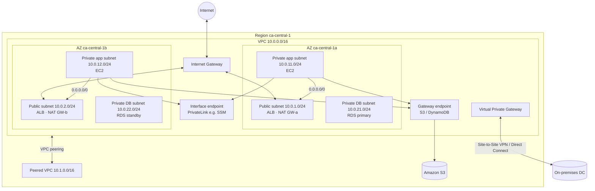
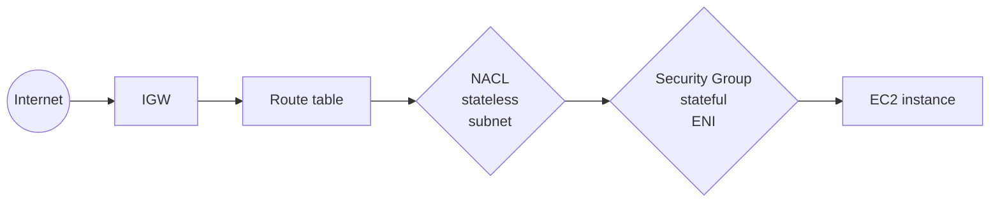

# VPC — Virtual Private Cloud

> **Category:** Networking & Content Delivery · **Scope:** Regional (spans all AZs of a Region) · **Cost:** VPC itself is free; some components bill hourly
> [← Back to overview](../AWS-core-services.md)

---

## 1. What it does

A VPC is a **logically isolated virtual network** that you define inside an AWS Region. You control:

- the **IP address range** (IPv4 CIDR, optional IPv6)
- how the network is divided into **subnets** across Availability Zones
- **routing** between subnets, to the internet, to on-premises and to other VPCs
- **security** at the instance level (Security Groups) and subnet level (Network ACLs)

Think of it as your own data-centre network, but software-defined, created in seconds, and spanning multiple physical data centres (AZs).

Every Region comes with a **default VPC** (`172.31.0.0/16`, one public `/20` subnet per AZ, an Internet Gateway attached). It is convenient for labs — **production workloads should always use a custom VPC.**

---

## 2. Reference architecture



---

## 3. Key components

### 3.1 VPC & CIDR blocks
| Item | Detail |
|------|--------|
| IPv4 CIDR size | Between **/16** (65,536 addresses) and **/28** (16 addresses) |
| Recommended ranges | RFC 1918 private ranges: `10.0.0.0/8`, `172.16.0.0/12`, `192.168.0.0/16` |
| Secondary CIDRs | You can add secondary IPv4 CIDR blocks later (limits apply) |
| IPv6 | Optional `/56` block, Amazon-provided or BYOIP — all IPv6 addresses are globally routable |
| Planning rule | **Never overlap** with on-premises or other VPCs you may peer/connect with — overlapping CIDRs cannot be routed |
| IPAM | **VPC IP Address Manager** centrally plans and allocates non-overlapping CIDRs across accounts |
| Tenancy | `default` (shared hardware) or `dedicated` (single-tenant hardware, costly) |

### 3.2 Subnet
A **range of IP addresses within the VPC, tied to exactly one Availability Zone.**

- **Public subnet:** its route table has a route `0.0.0.0/0 → Internet Gateway`.
- **Private subnet:** no direct route to an IGW; outbound internet (if needed) goes through a NAT.
- **VPN-only / isolated subnet:** routes only to a VGW/TGW or nowhere outside the VPC.
- **5 IP addresses are reserved** in every subnet. For `10.0.1.0/24`:
  | Address | Reserved for |
  |---------|-------------|
  | `10.0.1.0` | Network address |
  | `10.0.1.1` | VPC router |
  | `10.0.1.2` | Amazon-provided DNS (VPC base + 2) |
  | `10.0.1.3` | Reserved for future use |
  | `10.0.1.255` | Broadcast (not supported, but reserved) |
  → A `/24` gives **251** usable addresses; a `/28` gives **11**.
- Settings: *auto-assign public IPv4*, *auto-assign IPv6*, resource-based DNS names.
- Design pattern: **one subnet per tier per AZ** (public, app, data) × at least **2 AZs**.

### 3.3 Router (implicit VPC router) & Route Tables
- Every VPC has an **implicit router** — you never see it as a resource; you control it through **route tables**. It lives at subnet base + 1.
- **Main route table:** created with the VPC; used by any subnet not explicitly associated with another table. Keep it private (no IGW route).
- **Custom route tables:** associate each subnet with **exactly one** route table (a route table can serve many subnets).
- **Local route** (`10.0.0.0/16 → local`) is always present and cannot be deleted → all subnets in a VPC can reach each other by default.
- **Longest prefix match:** the most specific route wins (`10.1.2.0/24` beats `10.1.0.0/16` beats `0.0.0.0/0`).
- **Gateway route tables** (edge association): attached to an IGW or VGW to steer inbound traffic through a security appliance.

| Destination | Target | Meaning |
|-------------|--------|---------|
| `10.0.0.0/16` | `local` | Intra-VPC traffic |
| `0.0.0.0/0` | `igw-xxxx` | Internet (public subnet) |
| `0.0.0.0/0` | `nat-xxxx` | Internet egress (private subnet) |
| `10.1.0.0/16` | `pcx-xxxx` | Peered VPC |
| `pl-xxxx` (S3 prefix list) | `vpce-xxxx` | Gateway endpoint |
| `192.168.0.0/16` | `vgw-xxxx` / `tgw-xxxx` | On-premises |

### 3.4 Internet Gateway (IGW)
- Horizontally scaled, redundant, highly available VPC component that allows communication between the VPC and the internet. **No bandwidth constraint, no availability risk, no hourly charge.**
- **One IGW per VPC**; one VPC per IGW.
- Performs **1:1 NAT** between an instance's private IP and its **public IPv4 / Elastic IP**.
- For an instance to be reachable from the internet you need **all four**: IGW attached → route `0.0.0.0/0 → IGW` → public IP / EIP on the instance → SG and NACL allowing the traffic.

### 3.5 Egress-only Internet Gateway
- IPv6 equivalent of a NAT: allows **outbound-only** IPv6 traffic from instances, blocks connections initiated from the internet. Stateful.

### 3.6 Elastic IP (EIP) and public IPv4
- **Public IPv4** auto-assigned to an instance changes when it stops/starts.
- **Elastic IP** = static public IPv4 you own in the account until released; remap it to another instance in seconds.
- AWS charges for **all public IPv4 addresses** (in-use or idle) per hour → prefer IPv6, load balancers, or private connectivity.

### 3.7 NAT Gateway
Managed service that lets instances in **private subnets** initiate **outbound** IPv4 connections (patches, APIs) while blocking inbound connections from the internet.

| Property | Detail |
|----------|--------|
| Placement | Created **in a public subnet** (public NAT) with an Elastic IP |
| Availability | Redundant **within one AZ** → for HA create **one NAT Gateway per AZ** and route each private subnet to the NAT in its own AZ |
| Regional NAT Gateway | Newer option that spans AZs automatically — check availability in your Region |
| Bandwidth | Scales automatically (starts at 5 Gbps, up to 100 Gbps) |
| Security groups | **Cannot** be associated with a NAT Gateway — control traffic with NACLs and instance SGs |
| Private NAT Gateway | No EIP; used to route between overlapping/private networks via TGW/VGW |
| Pricing | Per hour **+ per GB processed** — a frequent source of surprise bills |
| Port forwarding / bastion | **Not supported** |

### 3.8 NAT Instance (legacy)
An EC2 instance launched from a NAT-configured AMI performing the same role.

| | NAT Gateway | NAT Instance |
|---|-------------|--------------|
| Management | Fully managed by AWS | You patch, scale, fail-over |
| Availability | HA inside an AZ | Single instance — scripts/ASG for failover |
| Bandwidth | Up to 100 Gbps | Depends on instance type |
| Security groups | Not supported | Supported |
| Bastion / port forwarding | No | Yes |
| **Source/destination check** | N/A | **Must be disabled** on the instance |
| Cost | Higher at small scale | Can be cheaper for tiny/lab workloads (e.g. small Graviton instance) |

> Exam answer: **NAT Gateway** unless the question explicitly asks to minimize cost for a tiny workload or requires port forwarding / SG on the NAT.

### 3.9 Security Group (SG)
A **stateful virtual firewall attached to an Elastic Network Interface (ENI)** — effectively at the instance level.

| Property | Detail |
|----------|--------|
| Rules | **Allow only** — no deny rules |
| Statefulness | **Stateful**: return traffic is automatically allowed regardless of rules |
| Default for new SG | All **inbound denied**, all **outbound allowed** |
| Evaluation | All rules evaluated together (no order) |
| Sources | CIDR, prefix list, or **another security group ID** (SG referencing — the key pattern for tiered apps) |
| Scope | One VPC; an ENI can have up to 5 SGs by default (adjustable) |
| Changes | Applied immediately |

Tiered example:
| SG | Inbound rule |
|----|--------------|
| `sg-alb` | TCP 443 from `0.0.0.0/0` |
| `sg-app` | TCP 8080 from **`sg-alb`** |
| `sg-db` | TCP 5432 from **`sg-app`** |

### 3.10 Network ACL (NACL)
A **stateless firewall at the subnet boundary.**

| Property | Detail |
|----------|--------|
| Rules | **Allow and Deny** |
| Statefulness | **Stateless**: return traffic must be explicitly allowed (ephemeral ports `1024–65535`) |
| Evaluation | **In order, lowest rule number first; first match wins**; final `*` rule denies |
| Default NACL | Allows **all** inbound and outbound |
| Custom NACL | Denies **all** until you add rules |
| Association | One subnet ↔ one NACL; one NACL ↔ many subnets |
| Typical use | Block a malicious IP/CIDR, add a coarse subnet-level guardrail |

### 3.11 Security Group vs NACL

| | Security Group | Network ACL |
|---|----------------|-------------|
| Level | ENI / instance | Subnet |
| State | Stateful | Stateless |
| Rules | Allow only | Allow + Deny |
| Order | All rules evaluated | Numbered, first match |
| Default (custom) | Deny in, allow out | Deny all |
| Reference other SGs | Yes | No (CIDR only) |
| Block a specific IP | ❌ Not possible | ✅ Deny rule |



### 3.12 VPC Peering
A **private, one-to-one network connection** between two VPCs (same or different accounts, same or different Regions) using the AWS backbone.

- **Non-transitive:** if A↔B and B↔C, A cannot reach C through B → you need A↔C.
- **No overlapping CIDRs.**
- No edge-to-edge routing (A cannot use B's IGW, NAT, VPN or Direct Connect).
- Must **update route tables on both sides** and allow traffic in SGs (you can reference a peer VPC's SG in the same Region).
- No hourly charge; data transfer across AZs/Regions is billed.
- Scaling problem: full mesh of *n* VPCs = n(n−1)/2 connections → use **Transit Gateway** beyond a handful of VPCs.

### 3.13 VPC Endpoints
Private connectivity from your VPC to AWS services (or third-party services) **without an IGW, NAT, VPN or public IP** — traffic stays on the AWS network.

| | **Gateway endpoint** | **Interface endpoint (AWS PrivateLink)** |
|---|----------------------|------------------------------------------|
| Services | **S3 and DynamoDB only** | Most AWS services (SSM, SQS, SNS, KMS, ECR, CloudWatch, STS…), S3, partner & your own services |
| Mechanism | Target in **route table** (prefix list) | **ENI with private IP** in your subnet(s) |
| Security | **Endpoint policy** | Endpoint policy **+ security group** |
| DNS | Uses public service names | Private DNS names resolve to the ENI IPs |
| Reach from on-premises / peered VPC | ❌ No | ✅ Yes |
| Cost | **Free** | Per hour per AZ + per GB |

Other endpoint types: **Gateway Load Balancer endpoint** (insert third-party firewalls inline), **Resource / service-network endpoints** (VPC Lattice).

Common S3 bucket policy pattern: deny unless `aws:SourceVpce = vpce-xxxx` → data reachable only through your private network.

### 3.14 Hybrid & multi-VPC connectivity
| Component | Purpose |
|-----------|---------|
| **Virtual Private Gateway (VGW)** | AWS-side anchor of a Site-to-Site VPN or Direct Connect, attached to one VPC |
| **Customer Gateway (CGW)** | Resource representing your on-premises VPN device/IP |
| **Site-to-Site VPN** | Two IPsec tunnels over the internet, fast to set up, up to ~1.25 Gbps per tunnel |
| **AWS Client VPN** | Managed OpenVPN-based remote access for users |
| **AWS Direct Connect (DX)** | Dedicated private fibre (1/10/100 Gbps, or hosted lower speeds); consistent latency; weeks to provision; not encrypted by default (use MACsec or VPN over DX) |
| **Transit Gateway (TGW)** | Regional **hub-and-spoke router** connecting thousands of VPCs, VPNs and DX — **transitive**, with its own route tables for segmentation; inter-Region peering |
| **AWS Cloud WAN** | Global managed WAN built on TGW concepts |
| **VPC Lattice** | Application-layer service-to-service connectivity across VPCs/accounts |

### 3.15 DNS in the VPC
- **Amazon Route 53 Resolver** at VPC base + 2 (`169.254.169.253` also works).
- VPC attributes: `enableDnsSupport` and `enableDnsHostnames` — **both must be true** for private hosted zones and interface endpoint private DNS.
- **Resolver endpoints** (inbound/outbound) for hybrid DNS with on-premises.
- **DHCP option set:** domain name, DNS servers, NTP servers for the VPC.

### 3.16 VPC Flow Logs
- Capture **IP traffic metadata** (not packet content) at the VPC, subnet or ENI level.
- Destinations: **CloudWatch Logs**, **S3**, or **Kinesis Data Firehose**.
- Fields: srcaddr, dstaddr, srcport, dstport, protocol, packets, bytes, **action (ACCEPT/REJECT)**, log-status…
- Troubleshooting rule: inbound ACCEPT + outbound REJECT → **NACL** problem (stateless); inbound REJECT → SG or NACL.
- Not captured: traffic to Amazon DNS, IMDS (`169.254.169.254`), DHCP, Windows license activation.
- **Traffic Mirroring** copies actual packets for deep inspection (IDS).
- **Reachability Analyzer** tests path connectivity between two resources without sending packets.

### 3.17 Other components worth knowing
| Component | Purpose |
|-----------|---------|
| **Elastic Network Interface (ENI)** | Virtual NIC: private IPs, public IP, MAC, SGs; can be moved between instances in the same AZ |
| **Prefix lists** | Named sets of CIDRs reusable in SGs and route tables |
| **Bastion host** | Hardened jump server in a public subnet — **prefer SSM Session Manager or EC2 Instance Connect Endpoint** (no open SSH port) |
| **AWS Network Firewall** | Managed stateful IDS/IPS firewall for the VPC |
| **Block Public Access for VPC** | Account-level control to block internet traffic to/from VPCs |

---

## 4. Pricing (concepts)
| Free | Billed |
|------|--------|
| VPC, subnets, route tables, IGW, SGs, NACLs, VPC peering connection, gateway endpoints | NAT Gateway (hour + GB), public IPv4 addresses, interface endpoints (hour + GB), Transit Gateway (attachment hour + GB), VPN connection hour, Direct Connect port hour, Flow Logs ingestion, cross-AZ / cross-Region data transfer |

---

## 5. Best practices

- [ ] Plan CIDRs with **IPAM**; size VPCs generously (`/16`) and avoid overlap with on-premises
- [ ] Deploy every tier in **at least 2 AZs** (3 for critical workloads)
- [ ] Put **only load balancers and NAT** in public subnets; workloads and databases in private subnets
- [ ] One **NAT Gateway per AZ** for production HA
- [ ] Use **gateway endpoints for S3/DynamoDB** (free, reduces NAT cost)
- [ ] Use **SG referencing** between tiers instead of CIDRs
- [ ] Use **SSM Session Manager** instead of bastions and port 22
- [ ] Enable **VPC Flow Logs** to S3 or CloudWatch Logs
- [ ] Use **Transit Gateway** when you have more than a few VPCs
- [ ] Keep the **main route table private**; associate subnets explicitly

---

## 6. Hands-on lab — Build a 2-AZ VPC from scratch

**Goal:** VPC with public + private subnets in 2 AZs, IGW, NAT Gateway, S3 gateway endpoint, and SGs.

```bash
REGION=ca-central-1
VPC_ID=$(aws ec2 create-vpc --cidr-block 10.0.0.0/16 \
  --tag-specifications 'ResourceType=vpc,Tags=[{Key=Name,Value=lab-vpc}]' \
  --query Vpc.VpcId --output text)
aws ec2 modify-vpc-attribute --vpc-id $VPC_ID --enable-dns-hostnames

# Subnets
PUB_A=$(aws ec2 create-subnet --vpc-id $VPC_ID --cidr-block 10.0.1.0/24 --availability-zone ${REGION}a --query Subnet.SubnetId --output text)
PUB_B=$(aws ec2 create-subnet --vpc-id $VPC_ID --cidr-block 10.0.2.0/24 --availability-zone ${REGION}b --query Subnet.SubnetId --output text)
PRV_A=$(aws ec2 create-subnet --vpc-id $VPC_ID --cidr-block 10.0.11.0/24 --availability-zone ${REGION}a --query Subnet.SubnetId --output text)
PRV_B=$(aws ec2 create-subnet --vpc-id $VPC_ID --cidr-block 10.0.12.0/24 --availability-zone ${REGION}b --query Subnet.SubnetId --output text)

# Internet Gateway + public route table
IGW=$(aws ec2 create-internet-gateway --query InternetGateway.InternetGatewayId --output text)
aws ec2 attach-internet-gateway --internet-gateway-id $IGW --vpc-id $VPC_ID
PUB_RT=$(aws ec2 create-route-table --vpc-id $VPC_ID --query RouteTable.RouteTableId --output text)
aws ec2 create-route --route-table-id $PUB_RT --destination-cidr-block 0.0.0.0/0 --gateway-id $IGW
aws ec2 associate-route-table --route-table-id $PUB_RT --subnet-id $PUB_A
aws ec2 associate-route-table --route-table-id $PUB_RT --subnet-id $PUB_B

# NAT Gateway (single, for lab cost) + private route table
EIP=$(aws ec2 allocate-address --domain vpc --query AllocationId --output text)
NAT=$(aws ec2 create-nat-gateway --subnet-id $PUB_A --allocation-id $EIP --query NatGateway.NatGatewayId --output text)
aws ec2 wait nat-gateway-available --nat-gateway-ids $NAT
PRV_RT=$(aws ec2 create-route-table --vpc-id $VPC_ID --query RouteTable.RouteTableId --output text)
aws ec2 create-route --route-table-id $PRV_RT --destination-cidr-block 0.0.0.0/0 --nat-gateway-id $NAT
aws ec2 associate-route-table --route-table-id $PRV_RT --subnet-id $PRV_A
aws ec2 associate-route-table --route-table-id $PRV_RT --subnet-id $PRV_B

# S3 gateway endpoint on the private route table
aws ec2 create-vpc-endpoint --vpc-id $VPC_ID --service-name com.amazonaws.$REGION.s3 \
  --route-table-ids $PRV_RT

# Security groups with SG referencing
SG_WEB=$(aws ec2 create-security-group --group-name sg-web --description "web" --vpc-id $VPC_ID --query GroupId --output text)
aws ec2 authorize-security-group-ingress --group-id $SG_WEB --protocol tcp --port 80 --cidr 0.0.0.0/0
SG_APP=$(aws ec2 create-security-group --group-name sg-app --description "app" --vpc-id $VPC_ID --query GroupId --output text)
aws ec2 authorize-security-group-ingress --group-id $SG_APP --protocol tcp --port 8080 --source-group $SG_WEB
```

**Validate:** launch an instance in `PRV_A` with SSM role → `curl https://aws.amazon.com` works (via NAT), `aws s3 ls` works (via endpoint), the instance has no public IP. Enable Flow Logs and observe REJECT records.

**Cleanup order:** instances → NAT Gateway (wait for deletion) → release EIP → endpoint → detach/delete IGW → subnets → route tables → SGs → VPC.

---

## 7. Certification tips

- Instance in a public subnet can't reach the internet? Check: IGW attached, route `0.0.0.0/0 → IGW`, **public IP/EIP**, SG outbound, **NACL inbound ephemeral ports**.
- Private instances need patches from the internet → **NAT Gateway in a public subnet**; for HA, **one per AZ**.
- "Block a specific malicious IP" → **NACL deny rule** (SGs cannot deny).
- "Stateful" → SG; "stateless" → NACL.
- Access S3/DynamoDB privately and cheaply → **gateway endpoint**. Any other service privately → **interface endpoint (PrivateLink)**.
- Expose your service privately to hundreds of consumer VPCs/accounts → **PrivateLink (NLB + endpoint service)**, not peering.
- Peering is **non-transitive** and requires **non-overlapping CIDRs** → many VPCs = **Transit Gateway**.
- Dedicated consistent bandwidth to on-premises → **Direct Connect**; quick/cheap encrypted → **Site-to-Site VPN**; resilient design → DX + VPN backup.
- 5 reserved IPs per subnet → a `/28` has **11** usable addresses.
- VPC size **/16 to /28**; a subnet lives in **one AZ**.
- NAT instance requires **disabling source/destination check**.

---

## 8. Review questions

1. How many usable IP addresses does a `10.0.5.0/26` subnet provide?
2. Your private EC2 instances download large amounts of data from S3 and the NAT Gateway bill is high. What is the fix?
3. VPC A is peered with B, and B is peered with C. Can A reach C?
4. Flow Logs show inbound ACCEPT but outbound REJECT for the same flow. Which component is misconfigured?
5. What four things are required for an EC2 instance to be reachable from the internet?
6. Why should production use one NAT Gateway per AZ?
7. Which endpoint type can be reached from on-premises over Direct Connect: gateway or interface?
8. What is the difference between an Internet Gateway and an Egress-only Internet Gateway?

<details>
<summary><b>Answers</b></summary>

1. A `/26` = 64 addresses − 5 reserved = **59**.
2. Add an **S3 gateway endpoint** to the private route tables — free, and traffic bypasses the NAT.
3. **No** — peering is non-transitive. Create A↔C peering or use a Transit Gateway.
4. The **NACL** (stateless) — the outbound rule for ephemeral return ports is missing.
5. IGW attached to the VPC, a route `0.0.0.0/0 → IGW` in the subnet's route table, a public IPv4/Elastic IP (or IPv6), SG and NACL rules allowing the traffic.
6. A NAT Gateway is redundant only **within its AZ**; if that AZ fails, private subnets in other AZs routed to it lose internet access. Per-AZ NATs also avoid cross-AZ data charges.
7. **Interface endpoint** (PrivateLink).
8. IGW provides bidirectional internet access (IPv4/IPv6); the **egress-only IGW** allows only outbound-initiated **IPv6** traffic.
</details>
