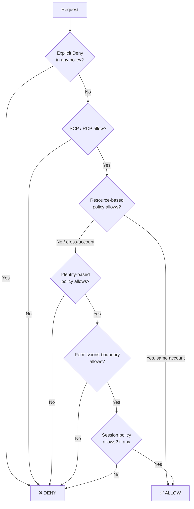
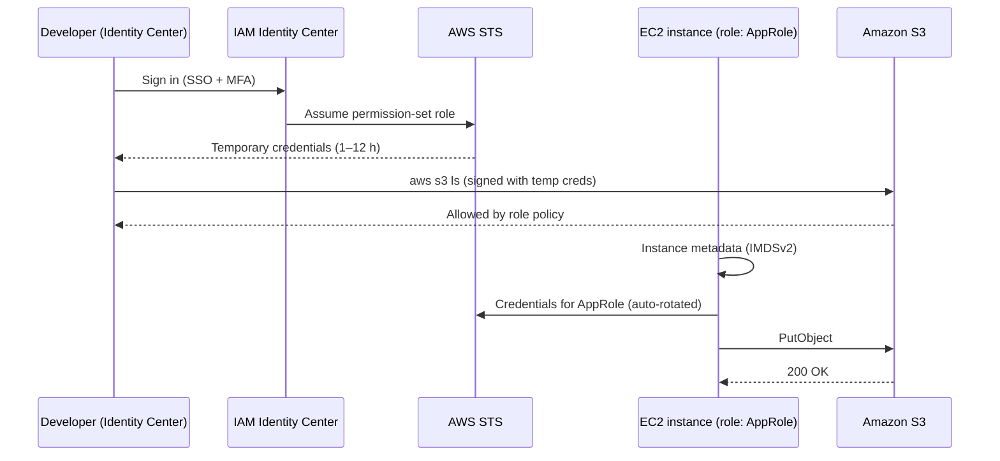

# IAM — Identity and Access Management

> **Category:** Security, Identity & Compliance · **Scope:** Global · **Cost:** Free
> [← Back to overview](../AWS-core-services.md)

---

## 1. What it does

IAM is the **authentication and authorization layer of AWS**. Every API call — from the console, CLI, SDK or another AWS service — is evaluated by IAM to answer one question:

> **Is this principal allowed to perform this action on this resource under these conditions?**

- **Authentication (AuthN):** proving *who* you are (password + MFA, access keys, temporary credentials)
- **Authorization (AuthZ):** deciding *what* you can do (policies)

IAM is global (not tied to a Region), eventually consistent, and **free** — you pay only for the resources your identities use.

---

## 2. Key components

### 2.1 Root user
- The identity created with the account (email + password). Has **unrestricted** access that cannot be limited by IAM policies (only by Organizations SCPs in member accounts).
- **Use only for root-only tasks:** change account settings/email, close the account, restore IAM admin access, change support plan, some billing settings, configure S3 MFA Delete.
- **Enforce:** hardware/virtual MFA, no access keys, strong password, secured email.

### 2.2 IAM Users
- A long-term identity representing a person or (legacy) an application.
- Credentials: **console password** and/or **access keys** (Access Key ID + Secret Access Key) for programmatic access — maximum 2 access keys per user.
- **Modern best practice:** humans should sign in through **IAM Identity Center** (federation/SSO) with temporary credentials instead of IAM users. Applications should use **roles**, never long-term keys.

### 2.3 IAM Groups
- A collection of users. Policies attached to a group apply to all its members.
- Groups **cannot be nested** and are **not principals** (you cannot reference a group in a resource-based policy's `Principal`).
- A user can belong to up to 10 groups.

### 2.4 IAM Roles
- An identity with permissions but **no long-term credentials**. Whoever *assumes* the role receives **temporary credentials** from **AWS STS** (Security Token Service), valid 15 min to 12 h.
- Two policies define a role:
  - **Trust policy** — *who* may assume it (`Principal`: a service, an account, a federated identity)
  - **Permissions policy** — *what* the role can do
- Typical uses:
  | Use case | Trusted principal |
  |----------|-------------------|
  | EC2 instance accessing S3 | `ec2.amazonaws.com` (via **instance profile**) |
  | Lambda writing to DynamoDB | `lambda.amazonaws.com` (execution role) |
  | Cross-account access | Another AWS account ID |
  | Workforce SSO / SAML / OIDC | Identity provider |
  | GitHub Actions deploying to AWS | GitHub OIDC provider |
- **Service-linked roles** are predefined roles owned by an AWS service (e.g. `AWSServiceRoleForAutoScaling`).

### 2.5 Policies (JSON documents)

```json
{
  "Version": "2012-10-17",
  "Statement": [
    {
      "Sid": "ReadOnlyReportsBucket",
      "Effect": "Allow",
      "Action": ["s3:GetObject", "s3:ListBucket"],
      "Resource": [
        "arn:aws:s3:::acme-reports",
        "arn:aws:s3:::acme-reports/*"
      ],
      "Condition": {
        "IpAddress": { "aws:SourceIp": "203.0.113.0/24" },
        "Bool": { "aws:MultiFactorAuthPresent": "true" }
      }
    }
  ]
}
```

| Element | Meaning |
|---------|---------|
| `Version` | Policy language version — always `2012-10-17` |
| `Sid` | Optional statement identifier |
| `Effect` | `Allow` or `Deny` |
| `Principal` | *Who* — only in resource-based and trust policies |
| `Action` / `NotAction` | API operations, e.g. `ec2:StartInstances`, wildcards allowed |
| `Resource` / `NotResource` | ARNs the statement applies to |
| `Condition` | Optional context checks (IP, MFA, tags, time, VPC endpoint, Org ID…) |

### 2.6 Policy types

| Type | Attached to | Purpose |
|------|-------------|---------|
| **AWS managed policy** | Users/groups/roles | Maintained by AWS (e.g. `ReadOnlyAccess`, `AmazonS3ReadOnlyAccess`) |
| **Customer managed policy** | Users/groups/roles | Your reusable, versioned policies — **preferred** |
| **Inline policy** | One identity only | Strict 1:1 relationship; deleted with the identity |
| **Resource-based policy** | A resource (S3 bucket, KMS key, SQS queue, Lambda function, role trust policy) | Grants access to principals, incl. other accounts |
| **Permissions boundary** | User or role | **Maximum** permissions an identity can ever have — used for delegated administration |
| **Service Control Policy (SCP)** | AWS Organizations OU/account | Guardrail: maximum permissions for every identity in member accounts (incl. root) |
| **Resource Control Policy (RCP)** | AWS Organizations | Guardrail on the maximum permissions of resources in member accounts |
| **Session policy** | An assumed-role / federated session | Further restricts a single session |
| **ACLs** | S3, VPC | Legacy cross-account mechanism — avoid for S3 |

### 2.7 Policy evaluation logic



**Three rules to remember:**
1. Everything is **implicitly denied** by default.
2. An **explicit Allow** overrides the implicit deny.
3. An **explicit Deny always wins.**

Cross-account access requires **both** sides: the identity policy in account A *and* the resource policy (or role trust policy) in account B.

### 2.8 Multi-Factor Authentication (MFA)
- Supported: **FIDO2 passkeys / security keys**, virtual authenticator apps (TOTP), hardware TOTP tokens.
- Up to 8 MFA devices per root or IAM user.
- Enforce with the condition `aws:MultiFactorAuthPresent`.

### 2.9 AWS STS — Security Token Service
| API | Use |
|-----|-----|
| `AssumeRole` | Assume a role in the same or another account |
| `AssumeRoleWithSAML` | Federation via SAML 2.0 IdP (AD FS, Okta, Entra ID) |
| `AssumeRoleWithWebIdentity` | OIDC (Cognito, Google, GitHub Actions, EKS IRSA) |
| `GetSessionToken` | Temporary credentials for a user, typically with MFA |
| `GetCallerIdentity` | "Who am I?" — great for debugging (`aws sts get-caller-identity`) |

### 2.10 IAM Identity Center (formerly AWS SSO)
- Central workforce access to **multiple accounts** of an AWS Organization and business apps.
- Identity source: built-in directory, Active Directory, or external IdP (Entra ID, Okta, Google Workspace) via SAML + SCIM.
- **Permission sets** = templates of policies provisioned as roles in each target account.

### 2.11 Security & audit tools
| Tool | What it shows |
|------|---------------|
| **Credential report** | Account-level CSV of all users and status of passwords, keys, MFA |
| **Access Advisor / last accessed** | Services a principal used and when → remove unused permissions |
| **IAM Access Analyzer** | External access findings, unused access, **policy validation**, policy generation from CloudTrail activity |
| **IAM Policy Simulator** | Test whether a policy allows an action |
| **Password policy** | Length, complexity, rotation, reuse prevention for IAM users |

### 2.12 ABAC — Attribute-Based Access Control
Grant access based on **tags** instead of listing resources:

```json
"Condition": {
  "StringEquals": { "aws:ResourceTag/Project": "${aws:PrincipalTag/Project}" }
}
```
A developer tagged `Project=Phoenix` can only manage resources tagged `Project=Phoenix`. Scales far better than RBAC in large organizations.

---

## 3. How it works



---

## 4. Pricing
IAM, STS, IAM Identity Center and IAM Access Analyzer's external-access analysis are **free**. Some advanced Access Analyzer features (e.g. unused-access analysis, custom policy checks) are billed.

---

## 5. Best practices (enterprise checklist)

- [ ] Lock down the **root user**: MFA, no access keys, use only for root-only tasks
- [ ] Use **IAM Identity Center** + federation for humans → temporary credentials only
- [ ] Use **roles** for workloads (EC2 instance profiles, Lambda execution roles, ECS task roles, OIDC for CI/CD)
- [ ] Apply **least privilege**; start from AWS managed policies, then refine with Access Analyzer policy generation
- [ ] Prefer **customer managed** over inline policies
- [ ] Require **MFA** for privileged actions
- [ ] Rotate and eventually eliminate **access keys**; never commit them to Git
- [ ] Use **permissions boundaries** when delegating role creation to developers
- [ ] Use **SCPs** for organization-wide guardrails (deny leaving the Org, deny disabling CloudTrail, restrict Regions)
- [ ] Review the **credential report** and **last-accessed** data quarterly
- [ ] Enforce **IMDSv2** on EC2 to protect role credentials from SSRF

---

## 6. Hands-on lab — Secure an account and use roles

**Goal:** create an admin group, a least-privilege user, and an EC2 role to read S3.

### Step 1 — Protect root
1. Sign in as root → *Security credentials* → **Assign MFA device**.
2. Confirm there are **no** root access keys.

### Step 2 — Create a group and user (CLI)
```bash
aws iam create-group --group-name Admins
aws iam attach-group-policy --group-name Admins \
  --policy-arn arn:aws:iam::aws:policy/AdministratorAccess

aws iam create-user --user-name alice
aws iam add-user-to-group --user-name alice --group-name Admins
aws iam create-login-profile --user-name alice \
  --password 'Ch@ngeMe-Now-2026!' --password-reset-required
```

### Step 3 — Set an account password policy
```bash
aws iam update-account-password-policy \
  --minimum-password-length 14 --require-symbols --require-numbers \
  --require-uppercase-characters --require-lowercase-characters \
  --password-reuse-prevention 12 --max-password-age 90
```

### Step 4 — Create a role for EC2 to read S3
```bash
cat > trust-ec2.json <<'EOF'
{
  "Version": "2012-10-17",
  "Statement": [{
    "Effect": "Allow",
    "Principal": { "Service": "ec2.amazonaws.com" },
    "Action": "sts:AssumeRole"
  }]
}
EOF

aws iam create-role --role-name EC2-S3-ReadOnly \
  --assume-role-policy-document file://trust-ec2.json
aws iam attach-role-policy --role-name EC2-S3-ReadOnly \
  --policy-arn arn:aws:iam::aws:policy/AmazonS3ReadOnlyAccess

aws iam create-instance-profile --instance-profile-name EC2-S3-ReadOnly
aws iam add-role-to-instance-profile \
  --instance-profile-name EC2-S3-ReadOnly --role-name EC2-S3-ReadOnly
```

### Step 5 — Verify
```bash
aws sts get-caller-identity
aws iam generate-credential-report && aws iam get-credential-report \
  --query Content --output text | base64 -d | head
```
Use the **IAM Policy Simulator** to test `s3:PutObject` for the role → expect *implicitDeny*.

### Cleanup
```bash
aws iam remove-role-from-instance-profile --instance-profile-name EC2-S3-ReadOnly --role-name EC2-S3-ReadOnly
aws iam delete-instance-profile --instance-profile-name EC2-S3-ReadOnly
aws iam detach-role-policy --role-name EC2-S3-ReadOnly --policy-arn arn:aws:iam::aws:policy/AmazonS3ReadOnlyAccess
aws iam delete-role --role-name EC2-S3-ReadOnly
```

---

## 7. Certification tips

- **Explicit Deny > Allow > implicit deny** — the most tested IAM concept.
- "An application on EC2 needs to access S3" → **IAM role / instance profile**, never access keys on the instance.
- "Grant access to users from another AWS account" → **cross-account role** (or resource-based policy).
- "Thousands of corporate users / existing Active Directory" → **IAM Identity Center** or SAML federation, not IAM users.
- "Mobile app users need access to S3/DynamoDB" → **Amazon Cognito** identity pools (web identity federation).
- "Limit the maximum permissions developers can grant" → **permissions boundary**.
- "Prevent any account in the Organization from using a Region / disabling CloudTrail" → **SCP**.
- SCPs **do not grant** permissions; they only filter.
- Groups cannot be nested and cannot be a `Principal`.
- IAM is **global**; credentials are **eventually consistent** (changes may take seconds to propagate).
- Audit "who has access to what": **credential report** (account), **Access Advisor** (per principal), **Access Analyzer** (external sharing).

---

## 8. Review questions

1. A Lambda function must write items to a DynamoDB table. What is the most secure way to grant access?
2. A user has `s3:*` Allow in an identity policy, but the bucket policy contains an explicit Deny for that user. What happens?
3. What is the difference between a trust policy and a permissions policy?
4. Name three tasks only the root user can perform.
5. Which feature lets a central security team cap what developer-created roles can do?
6. What STS API does GitHub Actions use to deploy to AWS without stored keys?
7. Can an SCP grant permissions to an IAM user in a member account?
8. How would you find IAM permissions that haven't been used in 90 days?

<details>
<summary><b>Answers</b></summary>

1. Attach an **execution role** to the function with a least-privilege policy (`dynamodb:PutItem` on that table ARN only).
2. **Denied** — an explicit Deny always wins.
3. The **trust policy** defines *who can assume* the role; the **permissions policy** defines *what the role can do* once assumed.
4. Any three of: change account email/name/root password, close the account, change the support plan, restore IAM permissions when locked out, enable S3 MFA Delete, register as a seller in the Reserved Instance Marketplace.
5. **Permissions boundaries** (at the organization level, SCPs).
6. `AssumeRoleWithWebIdentity` (OIDC federation).
7. **No.** SCPs only define the maximum available permissions; an identity policy must still allow the action.
8. **IAM Access Advisor / last-accessed information** and **IAM Access Analyzer unused-access findings**.
</details>
