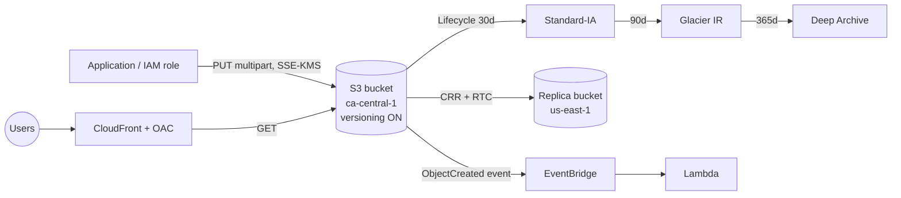

# Amazon S3 — Simple Storage Service

> **Category:** Storage · **Scope:** Regional bucket, globally unique name · **Model:** Object storage, serverless
> [← Back to overview](../AWS-core-services.md)

---

## 1. What it does

Amazon S3 stores **any amount of data as objects** inside **buckets**, accessible over HTTPS APIs from anywhere.

- **Durability:** designed for **99.999999999 % (11 nines)** — data is redundantly stored across **≥ 3 AZs** (except One Zone classes)
- **Availability:** 99.99 % design for S3 Standard
- **Scale:** unlimited total storage; single object up to **5 TB**
- **Strong read-after-write consistency** for all PUT/DELETE operations and LIST
- Not a file system or block device: no in-place partial edits — you replace whole objects

Typical uses: static websites, media, backups & archives, data lakes, log storage, software artifacts, ML datasets.

---

## 2. Key components

### 2.1 Bucket
- Container for objects; created in **one Region**; name **globally unique**, 3–63 chars, lowercase, DNS-compliant.
- Default quota: 10,000 general purpose buckets per account (adjustable).
- **Bucket types:**
  | Type | Description |
  |------|-------------|
  | **General purpose** | Standard bucket, all storage classes except Express One Zone |
  | **Directory bucket** | For **S3 Express One Zone** — single-AZ, single-digit-ms latency, hierarchical namespace |
  | **Table bucket** | **S3 Tables** — managed Apache Iceberg tables for analytics |
  | **Vector bucket** | **S3 Vectors** — store and query vector embeddings (newer feature) |

### 2.2 Object
| Part | Description |
|------|-------------|
| **Key** | Full name/path, e.g. `invoices/2026/10/inv-001.pdf` — "folders" are just key prefixes |
| **Value** | The data (0 B → 5 TB) |
| **Version ID** | When versioning is enabled |
| **Metadata** | System (Content-Type, Last-Modified) + user-defined `x-amz-meta-*` |
| **Tags** | Up to 10 key/value pairs — used by lifecycle, IAM ABAC, cost allocation |

**Uploads:** single `PUT` up to **5 GB**; **multipart upload recommended > 100 MB, required > 5 GB** (parallel parts, resume on failure). **S3 Transfer Acceleration** uses CloudFront edges to speed long-distance uploads.

### 2.3 Storage classes

| Class | Availability design | AZs | Min. storage duration | Retrieval | Use case |
|-------|--------------------|-----|----------------------|-----------|----------|
| **S3 Standard** | 99.99 % | ≥ 3 | — | ms | Frequently accessed data |
| **S3 Intelligent-Tiering** | 99.9 % | ≥ 3 | — | ms (archive tiers optional) | Unknown/changing patterns — auto-moves between tiers, small monitoring fee, **no retrieval fee** |
| **S3 Express One Zone** | 99.95 % | 1 | — (1 h billing granularity) | single-digit ms | High-performance, latency-sensitive (ML training, analytics) |
| **S3 Standard-IA** (Infrequent Access) | 99.9 % | ≥ 3 | 30 days | ms, **per-GB retrieval fee** | Backups, DR copies accessed monthly |
| **S3 One Zone-IA** | 99.5 % | **1** | 30 days | ms, retrieval fee | Re-creatable data, secondary copies |
| **S3 Glacier Instant Retrieval** | 99.9 % | ≥ 3 | 90 days | **ms** | Archive accessed quarterly (medical images, news assets) |
| **S3 Glacier Flexible Retrieval** | 99.99 % | ≥ 3 | 90 days | Expedited 1–5 min · Standard 3–5 h · Bulk 5–12 h | Archives, rarely accessed |
| **S3 Glacier Deep Archive** | 99.99 % | ≥ 3 | 180 days | Standard ≤ 12 h · Bulk ≤ 48 h | Compliance archives 7–10+ years — **lowest cost** |

All classes share **11 nines durability** (One Zone classes lose data if the AZ is destroyed).

### 2.4 Lifecycle rules
Automate **transitions** and **expiration** by prefix or tag:

```json
{
  "Rules": [{
    "ID": "logs-tiering",
    "Filter": { "Prefix": "logs/" },
    "Status": "Enabled",
    "Transitions": [
      { "Days": 30,  "StorageClass": "STANDARD_IA" },
      { "Days": 90,  "StorageClass": "GLACIER_IR" },
      { "Days": 365, "StorageClass": "DEEP_ARCHIVE" }
    ],
    "Expiration": { "Days": 2555 },
    "NoncurrentVersionExpiration": { "NoncurrentDays": 30 },
    "AbortIncompleteMultipartUpload": { "DaysAfterInitiation": 7 }
  }]
}
```
**S3 Storage Lens** and **Storage Class Analysis** help decide when to transition.

### 2.5 Versioning
- Bucket states: *Unversioned* (default) → *Enabled* → *Suspended* (cannot return to unversioned).
- Protects against **accidental overwrite and deletion**: a DELETE adds a **delete marker**; previous versions remain recoverable.
- Required for **replication** and **Object Lock**.
- **MFA Delete** (root user, CLI only) requires MFA to permanently delete versions or change versioning state.

### 2.6 Replication
| Type | Description |
|------|-------------|
| **CRR — Cross-Region Replication** | Compliance, lower latency in another Region, DR |
| **SRR — Same-Region Replication** | Log aggregation, prod → test copies, separate account ownership |
- Requires **versioning on source and destination** and an IAM role.
- Replicates **new objects** after enabling; use **S3 Batch Replication** for existing objects.
- **Replication Time Control (RTC):** 99.99 % of objects replicated within **15 minutes** (SLA).
- Delete markers optionally replicated; **chaining is not transitive** (A→B→C requires explicit rules).

### 2.7 Security & access control

| Mechanism | Scope | Notes |
|-----------|-------|-------|
| **IAM identity policies** | Users/roles in your account | Preferred for internal access |
| **Bucket policy** | Resource-based JSON on the bucket | Cross-account access, enforce TLS/encryption, restrict by VPC endpoint / IP / Org |
| **Block Public Access** | Account and bucket level | **Enabled by default** — keep it on unless you truly host public content |
| **Object Ownership** | Bucket | **"Bucket owner enforced"** (default) **disables ACLs** — recommended |
| **ACLs** | Bucket/object | Legacy — avoid |
| **Access Points** | Named network endpoints with their own policy | Simplify shared datasets for many teams; can be VPC-only |
| **Multi-Region Access Points** | Global endpoint routing to the nearest replica | Active-active multi-Region apps |
| **Pre-signed URLs** | Temporary GET/PUT for one object | Let users upload/download without AWS credentials (expiry up to 7 days with SigV4 user creds) |
| **S3 Object Lambda** | Transform data on GET (redact PII, resize) | |

Example bucket policy — enforce HTTPS and access only via a VPC endpoint:
```json
{
  "Version": "2012-10-17",
  "Statement": [
    { "Sid": "DenyInsecureTransport", "Effect": "Deny", "Principal": "*",
      "Action": "s3:*",
      "Resource": ["arn:aws:s3:::acme-data", "arn:aws:s3:::acme-data/*"],
      "Condition": { "Bool": { "aws:SecureTransport": "false" } } },
    { "Sid": "DenyOutsideVpce", "Effect": "Deny", "Principal": "*",
      "Action": "s3:*",
      "Resource": ["arn:aws:s3:::acme-data", "arn:aws:s3:::acme-data/*"],
      "Condition": { "StringNotEquals": { "aws:SourceVpce": "vpce-0abc123" } } }
  ]
}
```

### 2.8 Encryption
| Option | Key management | Notes |
|--------|----------------|-------|
| **SSE-S3** | AWS-owned keys (AES-256) | **Default for all new objects** since Jan 2023 |
| **SSE-KMS** | AWS KMS key (AWS managed or customer managed) | Audit in CloudTrail, key policies, rotation; KMS request quotas → enable **S3 Bucket Keys** to reduce cost/calls |
| **DSSE-KMS** | Dual-layer encryption with KMS | Compliance requiring two layers |
| **SSE-C** | Customer-provided key sent with each request | AWS doesn't store the key; HTTPS mandatory |
| **Client-side encryption** | Encrypt before upload | You manage everything |
| **In transit** | TLS (HTTPS) | Enforce with `aws:SecureTransport` |

### 2.9 Object Lock & Glacier Vault Lock (WORM)
- **Object Lock** (requires versioning): Write-Once-Read-Many retention.
  - **Governance mode:** users with special permission can override.
  - **Compliance mode:** **nobody, not even root**, can delete/shorten until retention expires.
  - **Legal hold:** indefinite hold independent of retention period.
- Used for SEC 17a-4, FINRA, healthcare and ransomware protection.

### 2.10 Event notifications
Trigger on `ObjectCreated`, `ObjectRemoved`, `ObjectRestore`, `Replication`, etc. → **Lambda, SQS, SNS** directly, or **Amazon EventBridge** (advanced filtering, many targets, archive/replay).

### 2.11 Static website hosting
- Enable on the bucket, set `index.html` / `error.html`; endpoint `http://<bucket>.s3-website-<region>.amazonaws.com` (**HTTP only**).
- **Production pattern:** keep the bucket **private** and serve through **CloudFront with Origin Access Control (OAC)** for HTTPS, caching and custom domains.

### 2.12 Performance
- At least **3,500 PUT/COPY/POST/DELETE** and **5,500 GET/HEAD requests per second per prefix** — parallelize across prefixes for more.
- **Multipart upload**, **byte-range fetches** (parallel downloads), **Transfer Acceleration**, **S3 Express One Zone** for latency-critical workloads.
- **S3 Select** (SQL on a single CSV/JSON/Parquet object — legacy, new customers should use **Athena**).

### 2.13 Management & analytics features
| Feature | Purpose |
|---------|---------|
| **S3 Inventory** | Scheduled CSV/Parquet report of objects and their metadata/encryption |
| **S3 Batch Operations** | Run one action on billions of objects (copy, tag, restore, invoke Lambda) |
| **S3 Storage Lens** | Organization-wide usage and activity dashboards |
| **Server access logs / CloudTrail data events** | Who accessed which object |
| **Requester Pays** | The requester pays request & transfer costs |
| **CORS** | Allow browsers from other origins to call the bucket |
| **S3 Metadata** | Queryable object metadata tables |
| **Mountpoint for Amazon S3** | Mount a bucket as a file system (read-heavy workloads) |

### 2.14 Data transfer & hybrid
**AWS DataSync** (online migration), **AWS Snowball** (offline petabyte transfer), **AWS Storage Gateway** (S3 File Gateway: NFS/SMB backed by S3), **AWS Transfer Family** (SFTP/FTPS into S3).

---

## 3. How it works



---

## 4. Pricing (concepts)
You pay for: **storage GB-month** (by class), **requests** (PUT/COPY/LIST cost more than GET), **retrievals** (IA/Glacier), **data transfer out** to the internet (inbound is free; transfer to CloudFront is free), **replication**, management features (Inventory, Intelligent-Tiering monitoring, Storage Lens advanced), and **minimum duration / minimum object size** charges (128 KB minimum billable size for IA classes).

---

## 5. Best practices

- [ ] Keep **Block Public Access ON** and **ACLs disabled** (Bucket owner enforced)
- [ ] Grant access with IAM roles + bucket policies; use **pre-signed URLs** for end users
- [ ] **Enforce TLS** and default encryption; use **SSE-KMS + Bucket Keys** for sensitive data
- [ ] Enable **versioning** on important buckets; protect with **MFA Delete** or **Object Lock**
- [ ] Add **lifecycle rules** (including aborting incomplete multipart uploads and expiring noncurrent versions)
- [ ] Use **Intelligent-Tiering** when access patterns are unknown
- [ ] Serve web content via **CloudFront + OAC**
- [ ] Access from VPC through a **gateway endpoint**
- [ ] Log access (**CloudTrail data events** or server access logs) for sensitive buckets
- [ ] Replicate critical data cross-Region (and cross-account) for DR and ransomware resilience

---

## 6. Hands-on lab — Secure static website with versioning & lifecycle

```bash
REGION=ca-central-1
BUCKET=lab-site-$(date +%s)
aws s3api create-bucket --bucket $BUCKET --region $REGION \
  --create-bucket-configuration LocationConstraint=$REGION

# 1. Versioning
aws s3api put-bucket-versioning --bucket $BUCKET --versioning-configuration Status=Enabled

# 2. Upload content
echo '<h1>Hello S3 v1</h1>' > index.html
aws s3 cp index.html s3://$BUCKET/index.html --content-type text/html
echo '<h1>Hello S3 v2</h1>' > index.html
aws s3 cp index.html s3://$BUCKET/index.html --content-type text/html
aws s3api list-object-versions --bucket $BUCKET --prefix index.html

# 3. Delete and recover
aws s3 rm s3://$BUCKET/index.html            # creates a delete marker
aws s3api list-object-versions --bucket $BUCKET --prefix index.html \
  --query 'DeleteMarkers[0].VersionId' --output text
aws s3api delete-object --bucket $BUCKET --key index.html --version-id <DELETE_MARKER_ID>  # restores

# 4. Lifecycle
aws s3api put-bucket-lifecycle-configuration --bucket $BUCKET \
  --lifecycle-configuration file://lifecycle.json   # use the JSON from §2.4

# 5. Pre-signed URL valid 10 minutes
aws s3 presign s3://$BUCKET/index.html --expires-in 600
```

6. **Serve privately via CloudFront:** continue in the [CloudFront lab](../Networking-Content-Delivery/CloudFront.md) — the bucket stays private, CloudFront accesses it with **OAC**.

**Cleanup:** delete all object versions and delete markers (console *Empty bucket*), then `aws s3 rb s3://$BUCKET`.

---

## 7. Certification tips

- Durability **11 nines** for all classes; availability differs.
- Unknown/unpredictable access → **Intelligent-Tiering**. Archive with **millisecond** retrieval → **Glacier Instant Retrieval**. Cheapest, 12–48 h → **Deep Archive**.
- Re-creatable data at lowest cost with ms access → **One Zone-IA**.
- Minimum durations: **30 days** (IA), **90 days** (Glacier IR / Flexible), **180 days** (Deep Archive).
- Protect against accidental deletion → **versioning + MFA Delete**. Regulatory WORM → **Object Lock compliance mode**.
- Give a user temporary access to one object → **pre-signed URL**.
- Upload large files faster over long distances → **Transfer Acceleration**; large files in general → **multipart upload** (> 100 MB).
- Replication requires **versioning on both buckets**; existing objects → **Batch Replication**.
- Website must be HTTPS + custom domain → **CloudFront** in front of S3 (S3 website endpoint is HTTP only).
- Restrict bucket so only CloudFront can read it → **Origin Access Control (OAC)**.
- High KMS cost/throttling with SSE-KMS → enable **S3 Bucket Keys**.
- Default encryption: **SSE-S3** is applied automatically to new objects.
- 3,500 writes / 5,500 reads **per second per prefix**.

---

## 8. Review questions

1. A company must keep audit logs for 7 years, rarely read them and must retrieve within 48 h. Cheapest option?
2. What happens when you delete an object in a versioned bucket without specifying a version ID?
3. Which two prerequisites are needed for Cross-Region Replication?
4. How can a mobile app user upload directly to a private bucket without AWS credentials?
5. What is the difference between Governance and Compliance mode in Object Lock?
6. Why should you add `AbortIncompleteMultipartUpload` to a lifecycle rule?
7. Which storage class stores data in a single AZ with the lowest latency?
8. How do you ensure objects can only be uploaded over HTTPS?

<details>
<summary><b>Answers</b></summary>

1. **S3 Glacier Deep Archive** (with a lifecycle rule, plus Object Lock if immutability is required).
2. S3 inserts a **delete marker**; the object disappears from listings but previous versions are recoverable by deleting the marker.
3. **Versioning enabled on source and destination** buckets, and an **IAM role** granting S3 permission to replicate (plus KMS permissions if encrypted).
4. The backend generates a **pre-signed PUT URL** (or use Cognito-issued temporary credentials).
5. **Governance:** privileged users with `s3:BypassGovernanceRetention` can override. **Compliance:** no one, including root, can delete or shorten retention.
6. Incomplete multipart uploads keep parts stored — and **billed** — indefinitely and invisibly.
7. **S3 Express One Zone** (directory bucket).
8. A bucket policy **Deny** when `aws:SecureTransport = false`.
</details>
