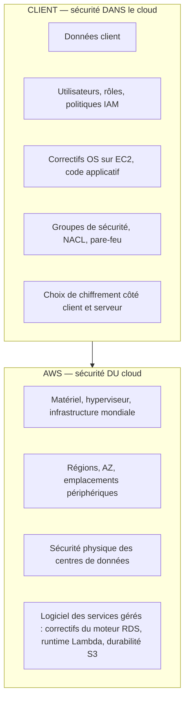
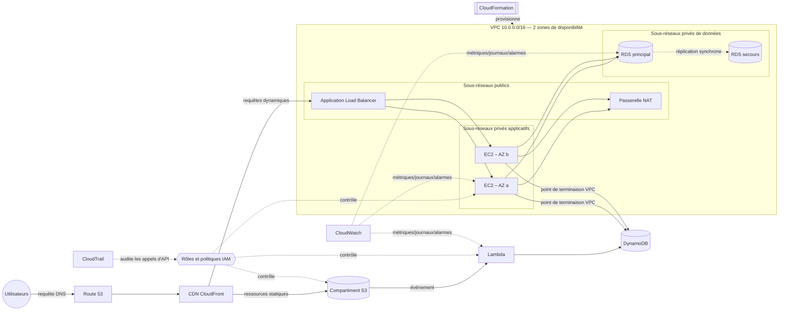

# Services fondamentaux AWS — Formation Ingénieur·e Cloud

> **Public cible :** jeunes diplômé·e·s et professionnel·le·s des TI qui se réorientent vers un poste d'Ingénieur·e Cloud / Opérations Cloud
> **Niveau :** Fondamental → Associé (aligné sur AWS Certified Cloud Practitioner CLF-C02 et Solutions Architect – Associate SAA-C03)
> **Format :** formation animée par un formateur, un module par service, chacun avec théorie, diagramme d'architecture, laboratoire pratique, conseils de certification et questions de révision

---

## 1. Pourquoi ces 12 services ?

Après une décennie à construire des *landing zones* AWS pour de grandes entreprises, le constat est toujours le même : **90 % des architectures de production reposent sur la même douzaine de briques.** Maîtrisez-les et vous pourrez lire, exploiter et faire évoluer presque n'importe quel environnement AWS dès votre premier jour.

| # | Service | Catégorie | Rôle en une phrase | Module |
|---|---------|-----------|--------------------|--------|
| 1 | **IAM** – Identity and Access Management | Sécurité, identité et conformité | *Qui* peut faire *quoi* sur *quelle* ressource | [IAM](Securite-Identite-Conformite/IAM.md) |
| 2 | **VPC** – Virtual Private Cloud | Réseau et diffusion de contenu | Votre réseau privé et isolé dans AWS | [VPC](Reseau-Diffusion-de-contenu/VPC.md) |
| 3 | **EC2** – Elastic Compute Cloud | Calcul | Serveurs virtuels redimensionnables | [EC2](Calcul/EC2.md) |
| 4 | **S3** – Simple Storage Service | Stockage | Stockage d'objets pratiquement illimité | [S3](Stockage/S3.md) |
| 5 | **RDS** – Relational Database Service | Bases de données | Bases SQL gérées | [RDS](Bases-de-donnees/RDS.md) |
| 6 | **DynamoDB** | Bases de données | Base NoSQL clé-valeur / document sans serveur | [DynamoDB](Bases-de-donnees/DynamoDB.md) |
| 7 | **Route 53** | Réseau et diffusion de contenu | DNS hautement disponible + enregistrement de domaines + vérifications de santé | [Route 53](Reseau-Diffusion-de-contenu/Route53.md) |
| 8 | **CloudFront** | Réseau et diffusion de contenu | Réseau mondial de diffusion de contenu (CDN) | [CloudFront](Reseau-Diffusion-de-contenu/CloudFront.md) |
| 9 | **CloudFormation** | Gestion et gouvernance | Infrastructure en tant que code (IaC) | [CloudFormation](Gestion-Gouvernance/CloudFormation.md) |
| 10 | **Lambda** | Calcul | Exécuter du code sans gérer de serveurs | [Lambda](Calcul/Lambda.md) |
| 11 | **CloudWatch** | Gestion et gouvernance | Métriques, journaux, alarmes, tableaux de bord | [CloudWatch](Gestion-Gouvernance/CloudWatch.md) |
| 12 | **CloudTrail** | Gestion et gouvernance | Journal d'audit de chaque appel d'API | [CloudTrail](Gestion-Gouvernance/CloudTrail.md) |

---

## 2. Structure du dépôt

```
fr/
├── AWS-core-services.md                 ← vous êtes ici
├── Calcul/
│   ├── EC2.md
│   └── Lambda.md
├── Stockage/
│   └── S3.md
├── Bases-de-donnees/
│   ├── RDS.md
│   └── DynamoDB.md
├── Securite-Identite-Conformite/
│   └── IAM.md
├── Reseau-Diffusion-de-contenu/
│   ├── VPC.md
│   ├── Route53.md
│   └── CloudFront.md
└── Gestion-Gouvernance/
    ├── CloudFormation.md
    ├── CloudWatch.md
    └── CloudTrail.md
```

Chaque module suit le même gabarit :

1. **À quoi ça sert** — le problème résolu
2. **Composants clés** — chaque brique que vous devez savoir nommer et expliquer
3. **Fonctionnement** — diagramme d'architecture Mermaid
4. **Modèle de tarification** — ce que vous payez (concepts, pas de grille tarifaire)
5. **Bonnes pratiques** — ce que j'impose sur les projets d'entreprise
6. **Laboratoire pratique** — console + AWS CLI
7. **Conseils de certification** — pièges d'examen et chiffres à mémoriser
8. **Questions de révision** — avec réponses

> 💡 Les commandes, noms d'API et paramètres restent en anglais, comme dans la console et la CLI AWS. Les termes AWS sont donnés en français avec l'équivalent anglais entre parenthèses lorsque c'est utile.

---

## 3. Concepts fondamentaux AWS (à lire avant tout module)

### 3.1 Infrastructure mondiale

| Concept | Définition | Pourquoi c'est important |
|---------|------------|--------------------------|
| **Région** | Zone géographique (ex. `ca-central-1` Montréal, `us-east-1` Virginie du Nord) contenant plusieurs zones de disponibilité isolées | Résidence des données, latence, disponibilité des services, prix |
| **Zone de disponibilité (AZ)** | Un ou plusieurs centres de données distincts avec alimentation, réseau et connectivité redondants, physiquement séparés des autres AZ de la Région | Unité de **haute disponibilité** — toujours déployer sur ≥ 2 AZ |
| **Local Zone** | Infrastructure AWS placée près des grands centres urbains | Latence de quelques millisecondes pour les utilisateurs |
| **Wavelength Zone** | Infrastructure AWS intégrée aux réseaux 5G des opérateurs | Applications mobiles à ultra-faible latence |
| **Emplacement périphérique (Edge Location / PoP)** | Des centaines de sites utilisés par CloudFront, Route 53, Global Accelerator, Shield | Cache et DNS au plus près des utilisateurs |
| **AWS Outposts** | Baies AWS installées dans votre propre centre de données | Charges hybrides, exigences de résidence des données |

**Choisir une Région :** (1) conformité / souveraineté des données, (2) latence vers les utilisateurs, (3) disponibilité des services, (4) prix.

### 3.2 Services mondiaux, régionaux et zonaux

| Portée | Services de ce cours |
|--------|----------------------|
| **Mondiale** | IAM, Route 53, CloudFront (et le WAF qui y est associé) |
| **Régionale** | S3 (le compartiment vit dans une Région, mais les noms sont uniques au monde), DynamoDB, Lambda, CloudFormation, CloudWatch, CloudTrail (les journaux de suivi peuvent être multi-Régions), VPC |
| **Zonale (AZ)** | Instance EC2, volume EBS, sous-réseau, instance RDS (le Multi-AZ ajoute une instance de secours dans une autre AZ) |

### 3.3 Modèle de responsabilité partagée



La frontière se déplace selon le type de service :

| Modèle | Exemple | Vous gérez |
|--------|---------|-----------|
| IaaS | EC2 | OS, correctifs, runtime, application, données, configuration réseau |
| PaaS / géré | RDS | Schéma, données, utilisateurs, paramètres, rétention des sauvegardes |
| Sans serveur | Lambda, DynamoDB, S3 | Code, données, IAM, configuration |

### 3.4 Interagir avec AWS

| Interface | Usage |
|-----------|-------|
| **Console de gestion AWS** | Apprentissage, exploration, tâches ponctuelles |
| **AWS CLI v2** | Scripts, automatisation (`aws s3 ls`) |
| **SDK AWS** | Python (boto3), JavaScript, Java, Go, .NET… |
| **CloudShell** | Terminal dans le navigateur, déjà authentifié, CLI préinstallée |
| **Infrastructure en tant que code** | CloudFormation, AWS CDK, Terraform |

### 3.5 Le cadre Well-Architected (6 piliers)

| Pilier | Question clé |
|--------|--------------|
| Excellence opérationnelle | Pouvons-nous l'exploiter et l'améliorer en toute sécurité ? |
| Sécurité | Les données et les accès sont-ils protégés à chaque couche ? |
| Fiabilité | Le système se rétablit-il automatiquement après une panne ? |
| Efficacité des performances | Utilisons-nous les bons types et tailles de ressources ? |
| Optimisation des coûts | Payons-nous uniquement pour ce qui apporte de la valeur ? |
| Durabilité | Minimisons-nous l'impact environnemental ? |

---

## 4. Comment les 12 services s'articulent

L'application web 3-tiers de référence que vous construirez progressivement pendant la formation :



| Couche | Services | Rôle dans l'architecture |
|--------|----------|--------------------------|
| Périphérie | Route 53, CloudFront | Résoudre le nom, mettre le contenu en cache près des utilisateurs, absorber les attaques |
| Réseau | VPC | Isoler les tiers, contrôler les flux |
| Calcul | EC2, Lambda | Exécuter l'application (longue durée vs événementiel) |
| Stockage | S3 | Ressources statiques, téléversements, sauvegardes, journaux, lac de données |
| Données | RDS, DynamoDB | Transactions relationnelles vs accès clé-valeur à grande échelle |
| Sécurité | IAM | Moindre privilège pour les humains et les charges de travail |
| Exploitation | CloudFormation, CloudWatch, CloudTrail | Provisionner de façon reproductible, observer, auditer |

---

## 5. Calendrier suggéré (5 jours × 6 h)

| Jour | Matin | Après-midi | Livrable du laboratoire |
|------|-------|------------|-------------------------|
| 1 | Fondamentaux, responsabilité partagée, configuration du compte | **IAM** | Compte sécurisé : MFA, rôle admin, alarme de facturation |
| 2 | **VPC** | **EC2** | VPC personnalisé, EC2 sans bastion via SSM, serveur web derrière un ALB |
| 3 | **S3** | **RDS** + **DynamoDB** | Site statique sur S3, RDS Multi-AZ, table DynamoDB |
| 4 | **Route 53** + **CloudFront** | **Lambda** | Domaine → CloudFront → S3 ; Lambda déclenchée par S3 |
| 5 | **CloudWatch** + **CloudTrail** | Projet final **CloudFormation** | Pile complète redéployée à partir d'un seul modèle |

---

## 6. Prérequis des laboratoires

- Un compte AWS personnel (offre gratuite ou compte bac à sable issu d'AWS Organizations)
- **N'utilisez jamais l'utilisateur racine (root) pour les labs.** Activez la MFA sur root, puis créez un utilisateur IAM Identity Center ou un utilisateur IAM administrateur
- AWS CLI v2 installée et configurée (`aws configure` ou `aws configure sso`)
- Une **alarme de facturation / AWS Budget** à un seuil bas (ex. 10 USD) avant le jour 1
- Région par défaut pour ce cours : `ca-central-1` (à adapter selon votre localisation)
- Nettoyez après chaque lab — la dernière section de chaque lab liste les étapes de suppression

> ⚠️ **Attention aux coûts :** les passerelles NAT, les instances RDS, les adresses IP élastiques non attachées, les adresses IPv4 publiques et les équilibreurs de charge sont facturés **à l'heure**, même inactifs. Supprimez-les à la fin de chaque lab.

---

## 7. Correspondance avec les certifications

| Certification | Code | Pertinence de ce cours |
|---------------|------|------------------------|
| AWS Certified Cloud Practitioner | CLF-C02 | ~100 % des connaissances requises sur les services fondamentaux |
| AWS Certified Solutions Architect – Associate | SAA-C03 | Cœur des domaines : architectures sécurisées, résilientes, performantes et optimisées en coûts |
| AWS Certified SysOps Administrator – Associate | SOA-C02 / successeur | CloudWatch, CloudTrail, CloudFormation, exploitation EC2 |
| AWS Certified Developer – Associate | DVA-C02 | Lambda, DynamoDB, S3, IAM |

> Les codes et référentiels d'examen sont révisés périodiquement — vérifiez toujours la version en vigueur sur le site AWS Certification avant de vous inscrire.

---

## 8. Glossaire (référence rapide)

| Terme | Signification |
|-------|---------------|
| ARN | Amazon Resource Name — identifiant unique, ex. `arn:aws:s3:::mon-compartiment` |
| AMI | Amazon Machine Image — modèle servant à lancer des instances EC2 |
| CIDR | Classless Inter-Domain Routing — notation de plage IP, ex. `10.0.0.0/16` |
| ENI | Elastic Network Interface — carte réseau virtuelle attachée à une instance |
| HA | Haute disponibilité — résiste à la perte d'un composant ou d'une AZ |
| IaC | Infrastructure en tant que code |
| KMS | Key Management Service — gestion des clés de chiffrement |
| RPO / RTO | Objectif de point de reprise (perte de données tolérée) / Objectif de temps de reprise (interruption tolérée) |
| SLA | Accord de niveau de service |
| TTL | Durée de vie (DNS, cache) |
