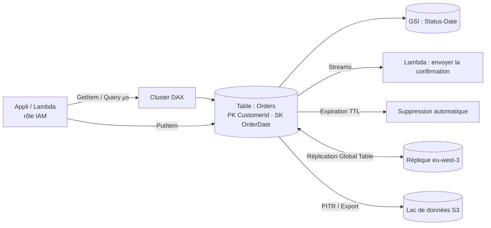

# Amazon DynamoDB — Base de données NoSQL sans serveur

> **Catégorie :** Bases de données · **Portée :** Régionale (Global Tables pour le multi-Régions) · **Modèle :** base clé-valeur et document entièrement gérée, sans serveur
> [← Retour à la présentation](../AWS-core-services.md)

---

## 1. À quoi ça sert

DynamoDB est une **base de données NoSQL entièrement gérée et sans serveur** offrant des **performances de l'ordre de quelques millisecondes à n'importe quelle échelle.** Pas de serveurs, pas de versions à corriger, pas de stockage à provisionner ; les données sont répliquées automatiquement sur **3 AZ**.

- Modèle de données clé-valeur et document (éléments de type JSON)
- Débit et stockage pratiquement illimités
- SLA de disponibilité de 99,99 % (99,999 % avec Global Tables)
- Idéale pour : profils utilisateurs, paniers d'achat, sessions, classements de jeux, IoT, back-ends sans serveur, commerce électronique à fort trafic

> DynamoDB n'est **pas** conçue pour les jointures complexes, les requêtes analytiques ad hoc ou l'intégrité relationnelle multi-tables → utilisez RDS/Aurora ou Redshift/Athena.

---

## 2. Composants clés

### 2.1 Tables, éléments et attributs
| Concept | Équivalent relationnel | Remarques |
|---------|-----------------------|-----------|
| **Table** | Table | Collection d'éléments ; **sans schéma** hormis la clé primaire |
| **Élément (item)** | Ligne | **400 Ko** max par élément (noms d'attributs inclus) |
| **Attribut** | Colonne | Scalaire (String, Number, Binary, Boolean, Null), document (List, Map), ensemble (String/Number/Binary set) |

### 2.2 Clé primaire
| Type | Composition | Exemple |
|------|-------------|---------|
| **Simple (clé de partition seule)** | `PK` — doit être unique | `UserId` |
| **Composite** | **Clé de partition + clé de tri** — la combinaison doit être unique | `CustomerId` + `OrderDate` |

- La **clé de partition** est hachée pour choisir la **partition** physique → choisissez une clé à **forte cardinalité** pour répartir la charge et éviter les **partitions chaudes**.
- La **clé de tri** ordonne les éléments d'une partition et permet les requêtes par plage (`begins_with`, `between`, `>`, `<`).

### 2.3 Partitions (comment ça passe à l'échelle)
- Les données sont réparties en partitions (~10 Go chacune, jusqu'à 3 000 RCU / 1 000 WCU par partition).
- DynamoDB divise automatiquement les partitions ; la **capacité adaptative** oriente le débit vers les clés chaudes, mais un élément/une clé reste soumis aux limites par partition.

### 2.4 Modes de capacité

| Mode | Facturation | Quand |
|------|-------------|-------|
| **À la demande (on-demand)** | Par requête de lecture/écriture | Charges inconnues, en pics ou nouvelles ; mise à l'échelle instantanée ; **recommandation par défaut pour la plupart des nouvelles tables** |
| **Provisionné** | RCU/WCU par heure (+ **mise à l'échelle automatique**, **capacité réservée** en option) | Trafic prévisible, optimisation des coûts à échelle stable |

- Passage d'un mode à l'autre possible (nombre limité de fois par jour).
- **Unités de capacité :**
  | Unité | Définition |
  |-------|-----------|
  | **1 RCU** | 1 lecture **fortement cohérente**/s **ou** 2 lectures **à cohérence éventuelle**/s d'au plus **4 Ko** |
  | **1 WCU** | 1 écriture/s d'au plus **1 Ko** |
  | Transactionnel | 2× les unités (lectures et écritures) |
- Exemple : 10 lectures fortement cohérentes/s d'éléments de 6 Ko → chaque lecture est arrondie à 8 Ko = 2 RCU → **20 RCU**. Cohérence éventuelle → **10 RCU**.
- Dépassement de la capacité provisionnée → **`ProvisionedThroughputExceededException`** (limitation) — les SDK réessaient avec temporisation exponentielle.

### 2.5 Cohérence des lectures
| Modèle | Comportement | Coût |
|--------|-------------|------|
| **Cohérence éventuelle** (par défaut) | Peut ne pas refléter une écriture de la dernière seconde | 0,5 RCU par 4 Ko |
| **Cohérence forte** | Renvoie la dernière écriture validée (non prise en charge sur les GSI ni les réplicas inter-Régions) | 1 RCU par 4 Ko |
| **Transactionnelle** | ACID sur jusqu'à 100 éléments / plusieurs tables (`TransactWriteItems`, `TransactGetItems`) | 2× |

### 2.6 Index secondaires
| | **Index secondaire local (LSI)** | **Index secondaire global (GSI)** |
|---|---------------------------------|----------------------------------|
| Clé | **Même clé de partition**, clé de tri différente | **N'importe quelle** clé de partition et de tri |
| Création | **Uniquement à la création de la table** | À tout moment |
| Limite | 5 par table | 20 par table (par défaut) |
| Cohérence | Éventuelle ou forte | **Éventuelle uniquement** |
| Capacité | Partage celle de la table | **Propre** capacité (mode provisionné) — un GSI limité peut limiter les écritures de la table |
| Taille | 10 Go par valeur de clé de partition (collection d'éléments) | Aucune |

**Projections :** `KEYS_ONLY`, `INCLUDE` (attributs choisis), `ALL`.

### 2.7 Opérations d'accès aux données
| Opération | Description | Efficacité |
|-----------|-------------|-----------|
| `GetItem` / `BatchGetItem` | Lecture par clé primaire complète (lots de 100 éléments max) | ✅ Optimale |
| `Query` | Éléments d'une clé de partition, condition facultative sur la clé de tri | ✅ Efficace |
| `Scan` | Lit **toute la table**, puis filtre | ❌ Coûteux — à éviter en production (scan parallèle pour les exports) |
| `PutItem` / `UpdateItem` / `DeleteItem` | Écritures ; **expressions conditionnelles** pour le verrouillage optimiste | |
| `BatchWriteItem` | Jusqu'à 25 insertions/suppressions | |
| **PartiQL** | Syntaxe compatible SQL | |

Pagination : résultats limités à **1 Mo** par appel → suivre `LastEvaluatedKey`. Les **expressions de filtre** s'appliquent *après* la lecture et ne réduisent donc pas la capacité consommée. Les **expressions de projection** limitent les attributs renvoyés.

### 2.8 DynamoDB Streams
- Journal chronologique des **modifications au niveau des éléments** (insertion/modification/suppression) conservé **24 heures**.
- Types de vue : `KEYS_ONLY`, `NEW_IMAGE`, `OLD_IMAGE`, `NEW_AND_OLD_IMAGES`.
- Consommateurs : **Lambda** (mappage de source d'événements), Kinesis Client Library. Usages : déclencheurs, audit, réplication, vues matérialisées, notifications.
- Alternative : **Kinesis Data Streams for DynamoDB** (rétention plus longue, plus de consommateurs).

### 2.9 Durée de vie (TTL)
- Désignez un attribut numérique contenant un **horodatage epoch** ; les éléments expirés sont **supprimés automatiquement sans frais** (généralement dans les jours qui suivent l'expiration).
- Pour les sessions, jetons temporaires, anciens événements. Les suppressions apparaissent dans Streams.

### 2.10 Global Tables
- Réplication **multi-Régions, multi-active** — lecture et écriture dans n'importe quelle Région réplique.
- Réplication généralement inférieure à la seconde ; résolution des conflits **« le dernier écrivain gagne »** (une cohérence forte multi-Régions est disponible en option dans les versions récentes).
- Repose sur Streams (géré automatiquement) — pour les applications mondiales et la DR régionale.

### 2.11 DAX — DynamoDB Accelerator
- **Cache en mémoire à écriture immédiate (write-through)** pour DynamoDB → lectures en **microsecondes**.
- Compatible avec l'API (on change le client), s'exécute dans votre VPC sous forme de cluster.
- Idéal pour la lecture intensive et répétée de mêmes clés (éléments chauds) ; pas pour les lectures fortement cohérentes ni les charges à forte écriture.

### 2.12 Sauvegarde et restauration
| Fonction | Détail |
|----------|--------|
| **Sauvegardes à la demande** | Sauvegardes complètes sans impact sur les performances, conservées jusqu'à leur suppression |
| **Restauration à un instant donné (PITR)** | Sauvegardes continues ; restauration à n'importe quelle seconde des **35 derniers jours** (configurable 1–35) → dans une **nouvelle table** |
| **AWS Backup** | Politiques, copies inter-Régions/inter-comptes, stockage à froid |
| **Exportation vers S3** | Export complet ou incrémentiel (depuis PITR) sans consommer de capacité — pour Athena/l'analytique |
| **Importation depuis S3** | Chargement massif CSV / DynamoDB JSON / Ion dans une nouvelle table |
| **Protection contre la suppression** | Empêche la suppression accidentelle d'une table |

### 2.13 Sécurité
- **IAM** pour tous les accès — contrôle fin avec des conditions comme `dynamodb:LeadingKeys` (un utilisateur n'accède qu'aux éléments dont la clé de partition = son ID).
- **Politiques basées sur les ressources** sur les tables/flux pour l'accès inter-comptes.
- **Chiffrement au repos** toujours actif : clé détenue par AWS (par défaut), clé gérée par AWS ou **clé KMS gérée par le client**.
- **Point de terminaison de passerelle VPC** (gratuit) ou d'interface pour l'accès privé.
- **CloudTrail** journalise les événements du plan de contrôle ; les événements du plan de données sont facultatifs.

### 2.14 Classes de tables
- **Standard** (par défaut) et **Standard-Infrequent Access (Standard-IA)** — stockage moins cher, requêtes plus chères, pour les tables où le stockage domine.

### 2.15 Principes de modélisation des données
- **Partir des modèles d'accès**, pas des entités — listez toutes les requêtes d'abord.
- **Conception à table unique :** stocker plusieurs types d'entités dans une table avec des clés génériques (`PK = CUSTOMER#123`, `SK = ORDER#2026-10-17`) pour récupérer des données liées en une seule `Query`.
- **Dénormaliser** et dupliquer les données ; éviter les jointures.
- Utiliser des **GSI** pour les modèles d'accès alternatifs ; des **index clairsemés** pour n'indexer qu'une partie des éléments.
- **Fragmentation des écritures** (suffixe aléatoire sur la PK) pour les points chauds d'écriture extrêmes.

Exemple de conception à table unique :
| PK | SK | Attributs |
|----|----|-----------|
| `CUSTOMER#123` | `PROFILE` | nom, courriel |
| `CUSTOMER#123` | `ORDER#2026-10-01#A17` | total, statut |
| `CUSTOMER#123` | `ORDER#2026-10-15#B42` | total, statut |
| `PRODUCT#987` | `METADATA` | titre, prix |

`Query PK = CUSTOMER#123 AND begins_with(SK, "ORDER#2026-10")` → toutes les commandes d'octobre en un seul appel.

---

## 3. Fonctionnement



---

## 4. Tarification (concepts)
- **À la demande :** par million d'unités de requête de lecture / d'écriture
- **Provisionné :** par RCU/WCU-heure (+ réductions de capacité réservée)
- **Stockage** par Go-mois (25 premiers Go dans l'offre gratuite), Standard vs Standard-IA
- **Extras :** PITR, sauvegardes à la demande, restaurations, écritures répliquées des Global Tables, lectures de Streams (gratuites pour les déclencheurs Lambda), heures de nœud DAX, export vers S3, transfert de données

---

## 5. Bonnes pratiques

- [ ] Concevoir les clés à partir des **modèles d'accès** ; clés de partition à forte cardinalité
- [ ] Privilégier `Query`/`GetItem` ; éviter `Scan` sur les chemins critiques
- [ ] Commencer en **à la demande** ; passer en provisionné + mise à l'échelle automatique quand le trafic est prévisible
- [ ] Garder des éléments petits ; stocker les gros objets dans **S3** et conserver le pointeur dans DynamoDB
- [ ] Utiliser des **écritures conditionnelles** pour la concurrence optimiste et l'idempotence
- [ ] Activer **PITR** et la **protection contre la suppression** sur les tables de production
- [ ] Utiliser le **TTL** pour purger gratuitement les données temporaires
- [ ] IAM de moindre privilège avec `dynamodb:LeadingKeys` pour les données multi-locataires
- [ ] Accéder depuis le VPC via un **point de terminaison de passerelle**
- [ ] Surveiller `ThrottledRequests`, `ConsumedRead/WriteCapacityUnits`, `SuccessfulRequestLatency` dans CloudWatch ; utiliser **CloudWatch Contributor Insights** pour repérer les clés chaudes

---

## 6. Laboratoire pratique — Table de commandes avec GSI, TTL et Streams

```bash
# 1. Créer la table (à la demande) avec un GSI
aws dynamodb create-table --table-name Orders \
  --attribute-definitions AttributeName=CustomerId,AttributeType=S \
      AttributeName=OrderDate,AttributeType=S AttributeName=Status,AttributeType=S \
  --key-schema AttributeName=CustomerId,KeyType=HASH AttributeName=OrderDate,KeyType=RANGE \
  --billing-mode PAY_PER_REQUEST \
  --global-secondary-indexes '[{"IndexName":"StatusDate","KeySchema":[{"AttributeName":"Status","KeyType":"HASH"},{"AttributeName":"OrderDate","KeyType":"RANGE"}],"Projection":{"ProjectionType":"ALL"}}]' \
  --stream-specification StreamEnabled=true,StreamViewType=NEW_AND_OLD_IMAGES
aws dynamodb wait table-exists --table-name Orders

# 2. Activer PITR et TTL
aws dynamodb update-continuous-backups --table-name Orders \
  --point-in-time-recovery-specification PointInTimeRecoveryEnabled=true
aws dynamodb update-time-to-live --table-name Orders \
  --time-to-live-specification Enabled=true,AttributeName=ExpiresAt

# 3. Insérer des éléments
aws dynamodb put-item --table-name Orders --item '{
  "CustomerId":{"S":"C-100"},"OrderDate":{"S":"2026-10-15"},
  "Status":{"S":"SHIPPED"},"Total":{"N":"129.99"}}'
aws dynamodb put-item --table-name Orders --item '{
  "CustomerId":{"S":"C-100"},"OrderDate":{"S":"2026-10-17"},
  "Status":{"S":"PENDING"},"Total":{"N":"42.00"},
  "ExpiresAt":{"N":"'$(( $(date +%s) + 3600 ))'"}}'

# 4. Écriture conditionnelle (échoue si la commande existe déjà)
aws dynamodb put-item --table-name Orders --item '{"CustomerId":{"S":"C-100"},"OrderDate":{"S":"2026-10-17"},"Status":{"S":"PENDING"}}' \
  --condition-expression "attribute_not_exists(CustomerId)"

# 5. Query vs Scan
aws dynamodb query --table-name Orders \
  --key-condition-expression "CustomerId = :c AND begins_with(OrderDate, :m)" \
  --expression-attribute-values '{":c":{"S":"C-100"},":m":{"S":"2026-10"}}' \
  --return-consumed-capacity TOTAL
aws dynamodb query --table-name Orders --index-name StatusDate \
  --key-condition-expression "#s = :s" --expression-attribute-names '{"#s":"Status"}' \
  --expression-attribute-values '{":s":{"S":"PENDING"}}'
aws dynamodb scan --table-name Orders --return-consumed-capacity TOTAL
```

6. **Bonus :** connecter le flux à une Lambda (mappage de source d'événements) qui journalise chaque événement `MODIFY` ; modifier le statut d'une commande et inspecter CloudWatch Logs.

**Nettoyage :** `aws dynamodb delete-table --table-name Orders`.

---

## 7. Conseils de certification

- « Sans serveur, quelques ms, échelle massive, clé-valeur » → **DynamoDB**.
- « Latence de lecture en microsecondes » → **DAX** (vs ElastiCache pour le cache générique).
- « Multi-Régions actif-actif » → **Global Tables**.
- « Supprimer automatiquement les sessions expirées sans frais » → **TTL**.
- « Réagir aux modifications des éléments » → **DynamoDB Streams + Lambda**.
- Trafic imprévisible → **à la demande** ; stable → **provisionné + mise à l'échelle automatique**.
- **Le LSI se crée à la création de la table** ; le GSI à tout moment ; les GSI sont **à cohérence éventuelle** uniquement.
- RCU = 4 Ko (forte 1, éventuelle ½) ; WCU = 1 Ko ; transactions ×2.
- Élément max **400 Ko** → stocker les gros objets dans S3.
- Éviter `Scan` ; utiliser `Query` avec de bonnes clés.
- Partition chaude / limitation → meilleure conception de la clé de partition, fragmentation des écritures, DAX pour les lectures.
- Restauration (PITR / à la demande) → **nouvelle table**. Fenêtre PITR de **35 jours**.
- Accès fin par utilisateur au niveau des lignes → condition IAM **`dynamodb:LeadingKeys`**.

---

## 8. Questions de révision

1. Combien de RCU faut-il pour 50 lectures à cohérence éventuelle par seconde d'éléments de 10 Ko ?
2. Peut-on ajouter un LSI à une table existante ?
3. Quelle fonction offre une latence en microsecondes pour les charges à lecture intensive ?
4. Quelle est la taille maximale d'un élément ?
5. Une entreprise de jeux veut que ses joueurs en Europe et en Amérique du Nord écrivent localement avec réplication automatique. Quelle fonction ?
6. Pourquoi un `Scan` avec filtre reste-t-il coûteux ?
7. Comment implémenter « insérer seulement si l'élément n'existe pas déjà » ?
8. Qu'advient-il des éléments une fois leur horodatage TTL dépassé ?

<details>
<summary><b>Réponses</b></summary>

1. 10 Ko → arrondi à 12 Ko = 3 unités par lecture fortement cohérente ; en cohérence éventuelle = 1,5 RCU par lecture × 50 = **75 RCU**.
2. **Non** — les LSI ne peuvent être définis qu'à la création de la table (créez plutôt un GSI).
3. **DAX (DynamoDB Accelerator).**
4. **400 Ko.**
5. **DynamoDB Global Tables.**
6. Les filtres s'appliquent **après** la lecture des éléments : la capacité est consommée pour toutes les données parcourues.
7. Une **écriture conditionnelle** avec `attribute_not_exists(<clé de partition>)`.
8. Ils sont **supprimés automatiquement en arrière-plan** (généralement en quelques jours), sans coût d'écriture ; les suppressions apparaissent dans Streams.
</details>
