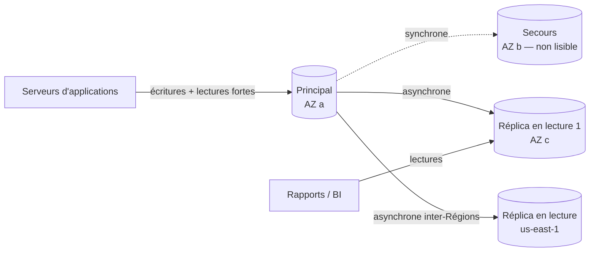
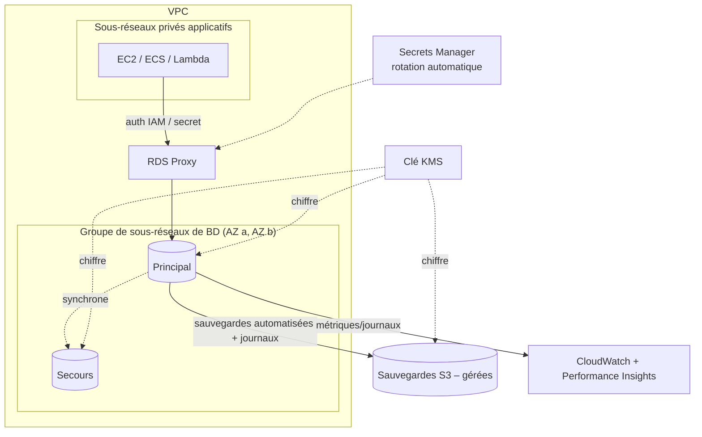

# Amazon RDS — Service de bases de données relationnelles (Relational Database Service)

> **Catégorie :** Bases de données · **Portée :** Régionale (les instances résident dans des AZ) · **Modèle :** base relationnelle gérée (PaaS)
> [← Retour à la présentation](../AWS-core-services.md)

---

## 1. À quoi ça sert

Amazon RDS permet de **mettre en place, exploiter et faire évoluer des bases de données relationnelles (SQL)** sans gérer vous-même le matériel, l'installation de l'OS et du moteur, les correctifs ou les sauvegardes.

**AWS gère :** le matériel, l'OS, l'installation du moteur et les correctifs de versions mineures, les sauvegardes automatisées, le basculement Multi-AZ, l'intégration à la surveillance.
**Vous gérez :** le schéma, les requêtes, les index, les utilisateurs/droits, les choix de paramètres, le dimensionnement et la configuration réseau/sécurité.

> Vous **ne pouvez pas vous connecter en SSH** à une instance RDS standard. Besoin d'accès à l'OS ? → **RDS Custom** (Oracle / SQL Server) ou base autogérée sur EC2.

---

## 2. Composants clés

### 2.1 Moteurs de base de données
| Moteur | Remarques |
|--------|-----------|
| **Amazon Aurora MySQL / PostgreSQL** | Moteur cloud natif d'AWS — jusqu'à 5× le débit de MySQL / 3× celui de PostgreSQL, stockage auto-extensible jusqu'à 128 Tio, 6 copies sur 3 AZ |
| **MySQL** | Édition communautaire |
| **PostgreSQL** | Édition communautaire, large prise en charge des extensions |
| **MariaDB** | Dérivé de MySQL |
| **Oracle** | Licence incluse (SE2) ou **BYOL** |
| **Microsoft SQL Server** | Express, Web, Standard, Enterprise (licence incluse) |
| **IBM Db2** | BYOL ou licence incluse |

### 2.2 Instance de BD et classes d'instances
- Une instance de BD = un environnement de base isolé avec calcul + stockage, identifié par un **point de terminaison** (`mabd.abc123.ca-central-1.rds.amazonaws.com:5432`).
- Classes d'instances : **`db.t4g/t3`** (extensibles, dev/test), **`db.m7g/m6i`** (usage général), **`db.r7g/r6i`/`db.x2`** (mémoire optimisée, OLTP de production).
- Augmenter le calcul = **modifier la classe d'instance** (courte interruption ; en Multi-AZ, un basculement la réduit).

### 2.3 Stockage
| Type | Usage |
|------|-------|
| **gp3** | SSD usage général — par défaut ; IOPS/débit de base configurables |
| **io2 Block Express / io1** | IOPS provisionnées pour la production à forte intensité d'E/S |
| Magnétique | Héritage — à éviter |

- **Mise à l'échelle automatique du stockage :** fixez un *seuil de stockage maximal* ; RDS augmente le stockage automatiquement quand l'espace libre diminue (sans interruption).
- La taille du stockage peut être **augmentée, pas diminuée.**

### 2.4 Groupe de sous-réseaux de BD (DB subnet group)
- Ensemble de **sous-réseaux privés répartis sur au moins 2 AZ** dans lesquels RDS peut placer les instances.
- Requis pour lancer RDS dans un VPC ; détermine où atterrissent le principal et le secours.

### 2.5 Sécurité
| Couche | Mécanisme |
|--------|-----------|
| **Réseau** | Sous-réseaux privés ; **groupe de sécurité** n'autorisant le port de la BD que depuis le SG applicatif ; `PubliclyAccessible = false` |
| **Authentification** | Utilisateur maître + utilisateurs de BD ; **authentification IAM de base de données** (MySQL/PostgreSQL — jetons de 15 min) ; **Kerberos/AD** pour SQL Server, Oracle, MySQL, PostgreSQL |
| **Secrets** | Intégration **AWS Secrets Manager** — RDS peut gérer et **faire tourner automatiquement** le mot de passe maître |
| **Chiffrement au repos** | **AWS KMS**, à choisir **à la création** ; couvre stockage, sauvegardes, instantanés, réplicas, journaux |
| **Chiffrement en transit** | SSL/TLS ; à imposer avec le paramètre `rds.force_ssl=1` (PostgreSQL/SQL Server) ou `require_secure_transport` (MySQL) |
| **Audit** | Journaux d'audit du moteur → CloudWatch Logs ; **Database Activity Streams** (Aurora, Oracle, SQL Server) |

> Pour chiffrer une BD existante **non chiffrée** : prendre un instantané → **copier l'instantané avec chiffrement** → restaurer une nouvelle instance à partir de la copie chiffrée.

### 2.6 Déploiements Multi-AZ (haute disponibilité)

| Option | Fonctionnement | Basculement | Secours lisible |
|--------|----------------|-------------|-----------------|
| **Instance de BD Multi-AZ** | Une instance de **secours** dans une autre AZ, réplication **synchrone** | Automatique, généralement **60–120 s**, le point de terminaison DNS bascule | ❌ Non |
| **Cluster de BD Multi-AZ** (MySQL, PostgreSQL) | 1 instance d'écriture + **2 secours lisibles** sur 3 AZ, semi-synchrone | Généralement **< 35 s** | ✅ Oui (point de terminaison lecteur) |
| **Aurora** | Stockage répliqué 6× sur 3 AZ ; jusqu'à 15 réplicas | Généralement **< 30 s** | ✅ Oui |

Déclencheurs de basculement : panne d'AZ, défaillance du principal, changement de classe d'instance, correctifs de l'OS, **redémarrage avec basculement** manuel.
Multi-AZ = **disponibilité**, **pas** mise à l'échelle des lectures (pour l'option instance de BD).

### 2.7 Réplicas en lecture (mise à l'échelle des lectures)
- Réplication **asynchrone** depuis le principal → lectures **à cohérence éventuelle**.
- Jusqu'à **15 réplicas en lecture** (MySQL, MariaDB, PostgreSQL, Aurora) ; moins pour Oracle/SQL Server (vérifiez les quotas).
- Peuvent être **dans la même AZ, dans une autre AZ ou dans une autre Région** (inter-Régions = DR + lectures locales ; transfert de données facturé).
- Chaque réplica a son **propre point de terminaison** → l'application doit y diriger les lectures.
- Peut être **promu** en BD autonome (DR manuelle, rompt la réplication).
- Un réplica peut lui-même être Multi-AZ.
- Exige que les **sauvegardes automatisées soient activées** sur la source.



| | Multi-AZ (instance) | Réplica en lecture |
|---|---------------------|--------------------|
| Objectif | Haute disponibilité | Évolutivité des lectures, DR (inter-Régions) |
| Réplication | Synchrone | Asynchrone |
| Lisible | Non | Oui |
| Basculement | Automatique | Promotion manuelle |
| Portée | Même Région | Même Région ou autre |

### 2.8 Sauvegardes et restauration
| Fonction | Détail |
|----------|--------|
| **Sauvegardes automatisées** | Instantané quotidien pendant la **fenêtre de sauvegarde** + **journaux de transactions toutes les 5 min** ; rétention de **0 à 35 jours** (0 désactive) |
| **Restauration à un instant donné (PITR)** | Restaurer à n'importe quelle seconde de la période de rétention (généralement jusqu'aux ~5 dernières minutes) — **crée une NOUVELLE instance** avec un nouveau point de terminaison |
| **Instantanés manuels** | Déclenchés par l'utilisateur, **conservés jusqu'à leur suppression** ; copiables entre Régions/comptes ; partageables |
| **Instantané final** | Proposé lors de la suppression |
| **AWS Backup** | Politiques centralisées, copies inter-comptes/inter-Régions, verrouillage de coffre |
| **Réplication inter-Régions des sauvegardes automatisées** | Copie DR des instantanés et journaux |

### 2.9 Groupes de paramètres et groupes d'options
- **Groupe de paramètres de BD :** configuration du moteur (ex. `max_connections`, `rds.force_ssl`). Les paramètres *dynamiques* s'appliquent immédiatement ; les *statiques* exigent un **redémarrage**. Le groupe par défaut n'est pas modifiable → créez-en un personnalisé.
- **Groupe d'options :** fonctions/modules complémentaires du moteur (Oracle TDE, sauvegarde native SQL Server vers S3, plugin memcached MySQL).

### 2.10 Maintenance et mises à niveau
- **Fenêtre de maintenance** (hebdomadaire, 30 min) pour l'OS et les correctifs mineurs du moteur ; en Multi-AZ, appliqués d'abord au secours puis basculement.
- Option de **mise à niveau automatique des versions mineures** ; les **mises à niveau majeures** sont manuelles.
- **Déploiements bleu/vert :** créez une copie de préproduction synchronisée (verte), mettez à niveau/testez, puis **basculez généralement en moins d'une minute** — la méthode la plus sûre pour les mises à niveau majeures ou les changements de schéma.

### 2.11 RDS Proxy
- **Mutualisateur de connexions** entièrement géré devant RDS/Aurora.
- Réduit les tempêtes de connexions (Lambda, applications à mise à l'échelle automatique), **réduit le temps de basculement jusqu'à 66 %**, impose l'authentification IAM + Secrets Manager.
- Accessible **uniquement depuis l'intérieur du VPC.**

### 2.12 Surveillance
| Outil | Ce qu'il montre |
|-------|-----------------|
| **Métriques CloudWatch** | CPUUtilization, FreeableMemory, FreeStorageSpace, DatabaseConnections, Read/WriteIOPS, ReplicaLag |
| **Surveillance améliorée (Enhanced Monitoring)** | Métriques au niveau de l'OS (par processus) toutes les 1 à 60 s |
| **Performance Insights / CloudWatch Database Insights** | Charge de la BD par événement d'attente, principales requêtes SQL — trouver les requêtes lentes |
| **Abonnements aux événements** | Notifications SNS lors d'un basculement, d'une sauvegarde, d'un stockage faible |
| **Exportation des journaux** | Journaux d'erreurs, requêtes lentes, général, audit → CloudWatch Logs |

### 2.13 Points forts d'Aurora (favori de l'examen)
| Fonction | Détail |
|----------|--------|
| Stockage | Volume de cluster partagé, croissance automatique par paliers de 10 Go jusqu'à 128 Tio, 6 copies / 3 AZ, auto-réparation |
| Points de terminaison | **Écriture (cluster)**, **lecteur** (équilibré entre réplicas), personnalisés et d'instance |
| Réplicas | Jusqu'à 15, latence de réplication généralement < 100 ms, chacun peut devenir l'instance d'écriture |
| **Aurora Serverless v2** | Capacité en ACU fines, mise à l'échelle en secondes — charges variables/imprévisibles ; peut descendre à zéro |
| **Aurora Global Database** | 1 Région principale + plusieurs Régions secondaires en lecture seule (5 historiquement ; vérifiez le quota actuel), latence de réplication généralement < 1 s, **RPO ~1 s, RTO < 1 min** pour la DR régionale |
| **Backtrack** (Aurora MySQL) | Rembobiner la BD sur place à un instant donné sans restauration |
| **Clonage** | Clones rapides par copie à l'écriture pour les environnements de test |
| **Aurora I/O-Optimized** | Tarification prévisible pour les charges à forte intensité d'E/S |
| **Aurora DSQL** | SQL distribué sans serveur plus récent, actif-actif multi-Régions |

---

## 3. Architecture de référence



---

## 4. Tarification (concepts)
Heures d'instance (par classe, mono-AZ vs **Multi-AZ ≈ 2×**), Go-mois de stockage + IOPS provisionnées, stockage de sauvegarde au-delà de 100 % de la taille de la BD, exportation d'instantanés, transfert de données (réplication inter-AZ pour les réplicas, inter-Régions), RDS Proxy (par vCPU/ACU), rétention longue de Performance Insights, licences (licence incluse). Les **instances réservées** RDS offrent jusqu'à ~69 % de réduction ; des **Database Savings Plans** peuvent aussi s'appliquer — vérifiez les offres actuelles.

---

## 5. Bonnes pratiques

- [ ] **Sous-réseaux privés**, `PubliclyAccessible=false`, SG ne référençant que le SG applicatif
- [ ] **Chiffrer dès la création** avec KMS ; imposer TLS en transit
- [ ] Stocker les identifiants dans **Secrets Manager** avec rotation ; utiliser l'**authentification IAM** lorsqu'elle est prise en charge
- [ ] **Multi-AZ** pour toute base de données de production
- [ ] Sauvegardes automatisées avec une rétention adaptée (7–35 jours) + **copies inter-Régions** pour la DR
- [ ] **Réplicas en lecture** ou lecteurs Aurora pour les charges à forte lecture ; cache avec **ElastiCache**
- [ ] **RDS Proxy** pour Lambda/sans serveur ou des connexions en rafales
- [ ] Activer **Performance Insights**, la surveillance améliorée, l'export des journaux et des alarmes sur stockage/CPU/connexions
- [ ] Utiliser les **déploiements bleu/vert** pour les mises à niveau majeures
- [ ] Activer la **protection contre la suppression**

---

## 6. Laboratoire pratique — PostgreSQL Multi-AZ avec Secrets Manager

```bash
# 1. Groupe de sous-réseaux de BD — créer d'abord deux sous-réseaux privés (mêmes commandes que le lab VPC)
DB_A=$(aws ec2 create-subnet --vpc-id $VPC_ID --cidr-block 10.0.21.0/24 --availability-zone ${REGION}a --query Subnet.SubnetId --output text)
DB_B=$(aws ec2 create-subnet --vpc-id $VPC_ID --cidr-block 10.0.22.0/24 --availability-zone ${REGION}b --query Subnet.SubnetId --output text)
aws rds create-db-subnet-group --db-subnet-group-name lab-db-subnets \
  --db-subnet-group-description "lab" --subnet-ids $DB_A $DB_B

# 2. SG autorisant 5432 uniquement depuis le SG applicatif
SG_DB=$(aws ec2 create-security-group --group-name sg-db --description db --vpc-id $VPC_ID --query GroupId --output text)
aws ec2 authorize-security-group-ingress --group-id $SG_DB --protocol tcp --port 5432 --source-group $SG_APP

# 3. Créer la base (mot de passe géré dans Secrets Manager)
aws rds create-db-instance --db-instance-identifier lab-pg \
  --engine postgres --db-instance-class db.t4g.micro \
  --allocated-storage 20 --max-allocated-storage 100 --storage-type gp3 \
  --master-username dbadmin --manage-master-user-password \
  --db-subnet-group-name lab-db-subnets --vpc-security-group-ids $SG_DB \
  --no-publicly-accessible --storage-encrypted --multi-az \
  --backup-retention-period 7 --enable-performance-insights \
  --deletion-protection
aws rds wait db-instance-available --db-instance-identifier lab-pg
```

4. **Se connecter** depuis une instance EC2 du sous-réseau applicatif (via SSM) :
   ```bash
   SECRET_ARN=$(aws rds describe-db-instances --db-instance-identifier lab-pg --query 'DBInstances[0].MasterUserSecret.SecretArn' --output text)
   PW=$(aws secretsmanager get-secret-value --secret-id $SECRET_ARN --query SecretString --output text | jq -r .password)
   ENDPOINT=$(aws rds describe-db-instances --db-instance-identifier lab-pg --query 'DBInstances[0].Endpoint.Address' --output text)
   PGPASSWORD=$PW psql "host=$ENDPOINT user=dbadmin dbname=postgres sslmode=require" -c "select version();"
   ```
5. **Tester le basculement :** `aws rds reboot-db-instance --db-instance-identifier lab-pg --force-failover` — relancez la requête ; notez le changement d'AZ et la brève interruption.
6. **Créer un réplica en lecture :** `aws rds create-db-instance-read-replica --db-instance-identifier lab-pg-ro --source-db-instance-identifier lab-pg`.
7. **PITR :** restaurer à un instant situé 10 minutes plus tôt → observer un **nouveau** point de terminaison.

**Nettoyage :** désactiver la protection contre la suppression (`modify-db-instance --no-deletion-protection`), supprimer le réplica, puis l'instance (`--skip-final-snapshot` pour le lab), le groupe de sous-réseaux, le SG.

---

## 7. Conseils de certification

- **Multi-AZ = HA (synchrone, basculement automatique)** ; **réplicas en lecture = mise à l'échelle des lectures (asynchrone)**.
- « Reprise après sinistre vers une autre Région avec un RPO minimal » → **réplica en lecture inter-Régions** ou **Aurora Global Database** (RPO ~1 s, RTO < 1 min).
- Rétention maximale des sauvegardes : **35 jours** ; au-delà → **instantanés manuels** ou **AWS Backup**.
- Une restauration (PITR ou instantané) crée toujours une **nouvelle instance / un nouveau point de terminaison**.
- Le chiffrement se définit à la création ; pour chiffrer une BD existante → **instantané → copie chiffrée → restauration**. Les réplicas d'une BD chiffrée sont chiffrés ; impossible d'avoir un réplica non chiffré d'un principal chiffré.
- Nombreuses connexions Lambda de courte durée → **RDS Proxy**.
- Besoin d'accès OS/root à l'hôte de la BD → **RDS Custom** ou **EC2**.
- Charges imprévisibles ou intermittentes → **Aurora Serverless v2**.
- Forte lecture avec requêtes répétées → **ElastiCache** devant RDS (ou réplicas en lecture).
- Stockage saturé de façon inattendue → activer la **mise à l'échelle automatique du stockage**.
- Paramètre statique modifié mais non appliqué → **redémarrage** requis.
- Rotation automatique des mots de passe BD → **Secrets Manager**.

---

## 8. Questions de révision

1. Vos requêtes de rapport ralentissent la base OLTP de production. Que faut-il ajouter ?
2. L'AZ de l'instance principale tombe en panne. Que se passe-t-il avec un déploiement d'instance de BD Multi-AZ ?
3. Peut-on lire depuis le secours d'un déploiement d'instance de BD Multi-AZ ?
4. Comment chiffrer une instance RDS existante non chiffrée ?
5. Quelle est la période maximale de rétention des sauvegardes automatisées ?
6. Quel service réduit le temps de basculement et gère la mutualisation des connexions ?
7. Quelle fonction d'Aurora fournit une DR inter-Régions avec une latence de réplication inférieure à la seconde ?
8. Après une PITR, pourquoi l'application se connecte-t-elle toujours aux anciennes données ?

<details>
<summary><b>Réponses</b></summary>

1. Un **réplica en lecture** (ou un lecteur Aurora), et diriger les outils de rapport vers son point de terminaison.
2. RDS **bascule automatiquement** vers le secours synchrone d'une autre AZ et met à jour le **point de terminaison DNS** ; généralement 1–2 minutes.
3. **Non** (seuls le **cluster de BD** Multi-AZ et Aurora offrent des secours lisibles).
4. Instantané → **copier l'instantané avec chiffrement KMS** → restaurer une nouvelle instance chiffrée → basculer l'application.
5. **35 jours.**
6. **RDS Proxy.**
7. **Aurora Global Database.**
8. La PITR crée une **nouvelle instance avec un nouveau point de terminaison** — il faut repointer l'application (ou renommer l'ancienne instance et attribuer son identifiant à la nouvelle).
</details>
