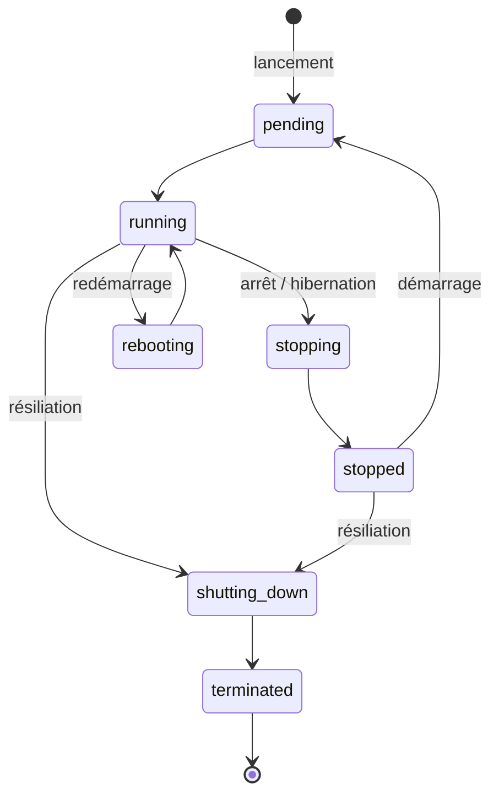
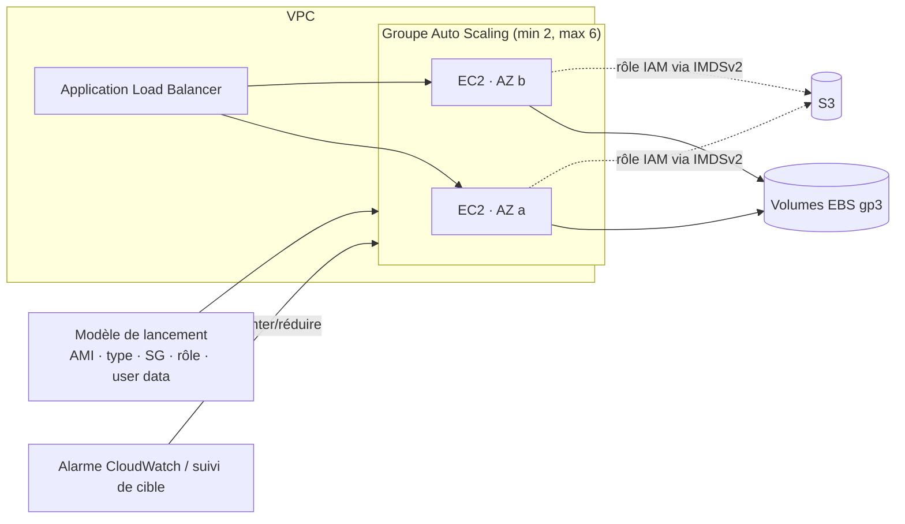

# EC2 — Elastic Compute Cloud

> **Catégorie :** Calcul · **Portée :** les instances sont zonales (dans une seule AZ) · **Modèle :** IaaS
> [← Retour à la présentation](../AWS-core-services.md)

---

## 1. À quoi ça sert

Amazon EC2 fournit des **serveurs virtuels (« instances ») redimensionnables dans le cloud.** Vous choisissez le profil processeur/mémoire/réseau, le système d'exploitation, le stockage et l'emplacement réseau ; AWS fournit le matériel physique et l'hyperviseur (le **système AWS Nitro**).

Caractéristiques clés :
- Lancement en quelques minutes, facturation à la seconde (Linux/Windows) ou à l'heure
- Mise à l'échelle verticale (changer de type d'instance) ou horizontale (Auto Scaling)
- Vous êtes responsable du **système invité, des correctifs, du runtime et de l'application** (responsabilité partagée)

---

## 2. Composants clés

### 2.1 Types d'instances
Convention de nommage : **`m7g.2xlarge`**

| Partie | Signification |
|--------|---------------|
| `m` | **Famille** (usage général) |
| `7` | **Génération** (plus élevée = plus récente, généralement meilleur rapport prix/performance) |
| `g` | **Attributs** : `g` = AWS Graviton (ARM), `a` = AMD, `i` = Intel, `d` = stockage d'instance NVMe local, `n` = réseau amélioré, `e` = mémoire/stockage supplémentaire, `flex` = ligne de base flexible |
| `2xlarge` | **Taille** (échelle vCPU/mémoire) |

| Famille | Optimisée pour | Exemples | Charges typiques |
|---------|----------------|----------|------------------|
| **Usage général** | Équilibre CPU/mémoire/réseau | `t3`, `t4g` (extensibles), `m7i`, `m7g`, `m8g` | Serveurs web, petites BD, dev/test |
| **Calcul optimisé** | Ratio CPU/mémoire élevé | `c7g`, `c7i`, `c8g` | Traitement par lots, HPC, serveurs de jeu, encodage média, inférence ML |
| **Mémoire optimisée** | Grande RAM | `r7g`, `r7i`, `x2idn`, `u-*` (très haute mémoire) | Caches en mémoire, SAP HANA, grandes BD, analytique temps réel |
| **Stockage optimisé** | E/S locales élevées | `i4i`, `i7ie`, `d3`, `im4gn` | NoSQL, entrepôts de données, OLTP, Elasticsearch |
| **Calcul accéléré** | GPU, puces dédiées | `p5`, `g6`, `inf2` (Inferentia), `trn1/trn2` (Trainium), `f2` (FPGA) | Entraînement/inférence ML, graphisme, vidéo |
| **HPC** | Calcul haute performance fortement couplé | `hpc7g`, `hpc7a` | Mécanique des fluides, simulation météo |

**Instances extensibles (famille T) :** accumulent des **crédits CPU** sous la ligne de base et les dépensent lors des pics. Le mode `unlimited` (par défaut pour T3/T4g) permet des pics prolongés moyennant un coût supplémentaire.

> Les instances **Graviton (ARM)** offrent généralement jusqu'à ~40 % de meilleur rapport prix/performance — premier choix pour les charges Linux compatibles ARM.

### 2.2 AMI — Amazon Machine Image
- **Modèle** contenant l'instantané du volume racine (OS + logiciels), les permissions de lancement et le mappage des périphériques de blocs.
- Sources : **fournies par AWS** (Amazon Linux 2023, Ubuntu, Windows Server, RHEL…), **AWS Marketplace**, **communauté**, ou **vos propres AMI (personnalisées / « dorées »)**.
- Les AMI sont **régionales** → copiez-les dans une autre Région pour la reprise après sinistre (`copy-image`).
- Partageables avec des comptes précis ou une Organisation.
- **EC2 Image Builder** automatise la création, l'application de correctifs et les tests des AMI dorées.

### 2.3 Paires de clés
- AWS stocke la clé publique ; vous conservez la clé privée (`.pem`/`.ppk`). Sert pour SSH (Linux) ou pour déchiffrer le mot de passe administrateur Windows.
- Types : RSA ou ED25519. AWS ne peut pas récupérer une clé privée perdue.
- **Mieux :** utilisez **SSM Session Manager** ou **EC2 Instance Connect** (clés temporaires poussées par API) — pas de clés à long terme, pas de port 22 ouvert.

### 2.4 Options de stockage

| Stockage | Type | Persistance | Portée | Idéal pour |
|----------|------|-------------|--------|------------|
| **EBS (Elastic Block Store)** | Stockage bloc réseau | Persiste indépendamment de l'instance | **Une AZ** | Volumes racine et de données, bases de données |
| **Stockage d'instance (instance store)** | NVMe/SSD physiquement attaché | **Éphémère** — perdu à l'arrêt, l'hibernation, la résiliation ou une panne matérielle (survit au redémarrage) | Hôte | Caches, tampons, espace temporaire, données répliquées |
| **EFS** | NFS géré (Linux) | Persistant | **Multi-AZ, régional** | Fichiers partagés entre plusieurs instances |
| **FSx** | Windows File Server, Lustre, NetApp ONTAP, OpenZFS gérés | Persistant | AZ / Multi-AZ | Partages Windows (SMB), HPC |
| **S3** | Stockage d'objets (via API) | Persistant | Régional | Pas un système de fichiers — artefacts, sauvegardes |

**Types de volumes EBS**

| Type | Catégorie | IOPS max / volume | Débit max | Cas d'usage |
|------|-----------|------------------|-----------|-------------|
| **gp3** | SSD usage général | 16 000 (les limites récentes peuvent être plus élevées) | 1 000 Mio/s | **Choix par défaut** — 3 000 IOPS de base indépendamment de la taille |
| gp2 | SSD usage général (héritage) | 16 000 (3 IOPS/Gio, rafales) | 250 Mio/s | Héritage |
| **io2 Block Express** | SSD IOPS provisionnées | 256 000 | 4 000 Mio/s | BD critiques ; prend en charge le **Multi-Attach** |
| io1 | SSD IOPS provisionnées | 64 000 | 1 000 Mio/s | Héritage |
| **st1** | HDD optimisé débit | 500 | 500 Mio/s | Big data, traitement de journaux — **ne peut pas servir de volume de démarrage** |
| **sc1** | HDD froid | 250 | 250 Mio/s | Données rarement consultées — coût le plus bas |

Fonctionnalités EBS : **instantanés** (incrémentiels, stockés dans S3, copiables entre Régions), **chiffrement** KMS (activable **par défaut** par Région), **Fast Snapshot Restore**, **archivage d'instantanés**, **corbeille (Recycle Bin)**, **Elastic Volumes** (redimensionner/changer de type à chaud), **Data Lifecycle Manager** (politiques d'instantanés automatisées), indicateur `DeleteOnTermination` (`true` par défaut pour la racine, `false` pour les volumes supplémentaires).

### 2.5 Données utilisateur et métadonnées d'instance
- **Données utilisateur (user data) :** script exécuté **au premier démarrage** (en root) via cloud-init — installer des paquets, récupérer une configuration. Max 16 Ko.
  ```bash
  #!/bin/bash
  dnf -y install nginx
  systemctl enable --now nginx
  echo "<h1>$(hostname -f)</h1>" > /usr/share/nginx/html/index.html
  ```
- **Service de métadonnées d'instance (IMDS) :** `http://169.254.169.254/latest/meta-data/` — ID d'instance, AZ, IP, **identifiants du rôle IAM**.
- **Imposer IMDSv2** (basé sur un jeton de session) pour contrer les attaques SSRF :
  ```bash
  TOKEN=$(curl -sX PUT http://169.254.169.254/latest/api/token -H "X-aws-ec2-metadata-token-ttl-seconds: 21600")
  curl -sH "X-aws-ec2-metadata-token: $TOKEN" http://169.254.169.254/latest/meta-data/instance-id
  ```

### 2.6 Réseau pour EC2
| Composant | Détail |
|-----------|--------|
| **ENI** | Interface réseau principale (eth0) + ENI secondaires facultatives ; porte les IP privées, SG, MAC |
| **IP privée** | Toujours attribuée depuis le sous-réseau ; conservée lors des arrêts/démarrages |
| **IPv4 publique** | Dynamique — change à l'arrêt/démarrage ; facturée |
| **IP élastique** | IPv4 publique statique ; facturée à l'heure |
| **Réseau amélioré (ENA)** | SR-IOV, jusqu'à 100–200+ Gbit/s sur les grandes instances |
| **EFA (Elastic Fabric Adapter)** | Réseau contournant l'OS pour HPC/ML (MPI, NCCL) |
| **Groupes de sécurité** | Pare-feu avec état au niveau de l'ENI (voir module VPC) |

### 2.7 Groupes de placement
| Stratégie | Disposition | Avantage | Limite |
|-----------|-------------|----------|--------|
| **Cluster** | Regroupées dans **une seule AZ** | Latence minimale, débit maximal (HPC) | Panne de l'AZ = tout tombe |
| **Spread (répartition)** | Chaque instance sur du **matériel/des baies distincts** | Isolation maximale des instances critiques | **7 instances par AZ** par groupe |
| **Partition** | Groupes d'instances sur des partitions (baies) séparées | Grands systèmes distribués (HDFS, Cassandra, Kafka) | Jusqu'à 7 partitions par AZ |

### 2.8 Cycle de vie d'une instance

- **Arrêt (stop) :** données EBS conservées, stockage d'instance perdu, IP publique libérée, pas de facturation du calcul (EBS toujours facturé).
- **Hibernation :** la RAM est sauvegardée sur le volume racine EBS chiffré → reprise rapide de l'état en mémoire (60 jours max).
- **Résiliation (terminate) :** instance supprimée ; volume EBS racine supprimé par défaut.
- La **protection contre la résiliation** et la **protection contre l'arrêt** évitent les erreurs.

### 2.9 Options d'achat

| Option | Engagement | Réduction vs à la demande | Idéal pour |
|--------|-----------|--------------------------|------------|
| **À la demande (On-Demand)** | Aucun | — | Charges courtes, imprévisibles, dev/test |
| **Savings Plans** (Compute / EC2 Instance) | 1 ou 3 ans, engagement en **$/heure** | Jusqu'à ~66–72 % | Usage stable ; le **Compute SP** couvre aussi Fargate et Lambda, toute Région/famille |
| **Instances réservées** (Standard / Convertibles) | 1 ou 3 ans, attributs d'instance précis | Jusqu'à ~72 % | Régime stable (largement remplacées par les Savings Plans) |
| **Instances Spot** | Aucun ; AWS peut **récupérer l'instance avec un préavis de 2 minutes** | Jusqu'à ~90 % | Charges tolérantes aux pannes, sans état, lots, CI, conteneurs |
| **Hôtes dédiés** | Serveur physique pour vous, à la demande ou réservé | — | Licences **BYOL** par socket/cœur, conformité |
| **Instances dédiées** | Matériel non partagé avec d'autres comptes | — | Isolation pour conformité |
| **Réservations de capacité à la demande** | Capacité réservée dans une AZ, sans durée | Aucune (combinable avec SP) | Garantir la capacité (événements, reprise après sinistre) |
| **Capacity Blocks for ML** | Réserver des instances GPU pour une plage future | — | Entraînements ML courts |

Options de paiement RI/SP : **tout payé d'avance** > partiellement d'avance > rien d'avance (plus d'avance = plus de réduction).

### 2.10 Elastic Load Balancing (ELB)
| Type | Couche | Protocoles | Fonctionnalités clés |
|------|--------|-----------|----------------------|
| **Application Load Balancer (ALB)** | 7 | HTTP, HTTPS, gRPC, WebSocket | Routage par chemin/hôte/en-tête/requête ; cibles : instances, IP, Lambda, conteneurs ; intégration WAF ; authentification OIDC/Cognito |
| **Network Load Balancer (NLB)** | 4 | TCP, UDP, TLS | Millions de req/s, latence ultra-faible, **IP statique / EIP par AZ**, services de point de terminaison PrivateLink |
| **Gateway Load Balancer (GWLB)** | 3 | GENEVE (port 6081) | Insérer de façon transparente des appliances virtuelles tierces (pare-feu, IDS) |
| Classic Load Balancer | 4/7 | Héritage | À retirer |

Concepts : **écouteurs (listeners)**, **groupes cibles**, **vérifications de santé**, équilibrage inter-zones, vidage des connexions (**délai de désenregistrement**), **sessions persistantes (sticky)**, terminaison TLS avec **certificats ACM**, SNI.

### 2.11 EC2 Auto Scaling
- **Groupe Auto Scaling (ASG) :** capacité min / souhaitée / max sur plusieurs AZ ; remplace automatiquement les instances défaillantes.
- **Modèle de lancement (launch template) :** définition versionnée de l'AMI, du type, des SG, de la clé, des données utilisateur, du profil IAM (les configurations de lancement sont héritées).
- Politiques de mise à l'échelle :
  | Politique | Comportement |
  |-----------|-------------|
  | **Suivi de cible (target tracking)** | Maintenir une métrique à une valeur cible (ex. CPU moyen = 50 %) — **choix recommandé par défaut** |
  | Par paliers / simple | Ajouter/retirer de la capacité selon des seuils d'alarme CloudWatch |
  | **Planifiée** | Motifs connus (augmenter chaque jour ouvrable à 8 h) |
  | **Prédictive** | Prévisions ML des cycles quotidiens/hebdomadaires |
- Fonctionnalités : **vérifications de santé** (EC2 ou ELB), **temps de récupération / préchauffage**, **hooks de cycle de vie**, **warm pools**, **actualisation des instances**, **politique d'instances mixtes** (à la demande + Spot, plusieurs types).

### 2.12 Outils d'exploitation
| Outil | Usage |
|-------|-------|
| **AWS Systems Manager (SSM)** | Session Manager (shell sans SSH), Patch Manager, Run Command, Parameter Store, Inventory |
| **Agent CloudWatch** | Mémoire, disque, métriques personnalisées + journaux OS (non collectés par défaut !) |
| **AWS Compute Optimizer** | Recommandations de dimensionnement |
| **Vérifications d'état** | *Système* (hôte AWS) / *Instance* (votre OS) / *EBS attaché* — l'action d'alarme CloudWatch peut **récupérer** ou **redémarrer** |
| **AWS Backup** | Politiques de sauvegarde centralisées pour EBS/EC2 |

---

## 3. Fonctionnement



---

## 4. Tarification (concepts)
Vous payez : le **temps de calcul** (à la seconde pour Linux/Windows, minimum 60 s), les **Go-mois EBS + IOPS/débit provisionnés**, les **instantanés**, les **adresses IPv4 publiques**, le **transfert de données sortant** et inter-AZ, les **heures d'équilibreur de charge + LCU**, les licences (Windows, RHEL, SQL Server).

---

## 5. Bonnes pratiques

- [ ] Utiliser **modèles de lancement + groupes Auto Scaling** sur ≥ 2 AZ, même pour une seule instance (auto-réparation)
- [ ] Construire des **AMI dorées** (Image Builder) ; garder les données utilisateur légères
- [ ] Attacher des **rôles IAM**, imposer **IMDSv2**, ne jamais stocker de clés sur les instances
- [ ] Se connecter via **SSM Session Manager** ; fermer les ports 22/3389
- [ ] **Chiffrer EBS par défaut** ; automatiser les instantanés avec **DLM** ou **AWS Backup**
- [ ] Dimensionner avec **Compute Optimizer** ; privilégier **Graviton** et **gp3**
- [ ] Couvrir la base avec des **Savings Plans**, les pics à la demande, les lots en **Spot**
- [ ] Installer l'**agent CloudWatch** pour les métriques mémoire/disque
- [ ] Baliser toutes les ressources (`Environment`, `Owner`, `CostCenter`)

---

## 6. Laboratoire pratique — Tier web hautement disponible

**Objectif :** un ALB + un ASG de 2 instances nginx dans des sous-réseaux privés, gérées via SSM.

1. **IAM :** créer le rôle `EC2-SSM` avec `AmazonSSMManagedInstanceCore`.
2. **Modèle de lancement :**
   ```bash
   cat > userdata.sh <<'EOF'
   #!/bin/bash
   dnf -y install nginx
   TOKEN=$(curl -sX PUT http://169.254.169.254/latest/api/token -H "X-aws-ec2-metadata-token-ttl-seconds: 300")
   AZ=$(curl -sH "X-aws-ec2-metadata-token: $TOKEN" http://169.254.169.254/latest/meta-data/placement/availability-zone)
   echo "<h1>Bonjour depuis $AZ</h1>" > /usr/share/nginx/html/index.html
   systemctl enable --now nginx
   EOF

   AMI=$(aws ssm get-parameter --name /aws/service/ami-amazon-linux-latest/al2023-ami-kernel-default-arm64 --query Parameter.Value --output text)

   aws ec2 create-launch-template --launch-template-name web-lt --launch-template-data "{
     \"ImageId\":\"$AMI\",\"InstanceType\":\"t4g.micro\",
     \"IamInstanceProfile\":{\"Name\":\"EC2-SSM\"},
     \"SecurityGroupIds\":[\"$SG_APP\"],
     \"MetadataOptions\":{\"HttpTokens\":\"required\"},
     \"UserData\":\"$(base64 -w0 userdata.sh)\"}"
   ```
3. **Groupe cible + ALB** (console : *EC2 → Équilibreurs de charge → Créer un ALB*) dans les deux sous-réseaux publics, écouteur HTTP:80 → groupe cible `web-tg` (vérification de santé `/`).
4. **ASG :**
   ```bash
   aws autoscaling create-auto-scaling-group --auto-scaling-group-name web-asg \
     --launch-template LaunchTemplateName=web-lt,Version='$Latest' \
     --min-size 2 --max-size 4 --desired-capacity 2 \
     --vpc-zone-identifier "$PRV_A,$PRV_B" \
     --target-group-arns $TG_ARN --health-check-type ELB --health-check-grace-period 120

   aws autoscaling put-scaling-policy --auto-scaling-group-name web-asg \
     --policy-name cpu50 --policy-type TargetTrackingScaling \
     --target-tracking-configuration '{"PredefinedMetricSpecification":{"PredefinedMetricType":"ASGAverageCPUUtilization"},"TargetValue":50}'
   ```
5. **Test :** rafraîchissez le nom DNS de l'ALB — l'AZ alterne. **Résiliez une instance** et observez l'ASG la remplacer.
6. **Connexion** via *Systems Manager → Session Manager* (sans clé SSH, sans IP publique).

**Nettoyage :** supprimer l'ASG (forcer) → ALB → groupe cible → modèle de lancement → NAT/VPC du lab VPC.

---

## 7. Conseils de certification

- **Spot** = le moins cher, interruptible (préavis de 2 min) → charges tolérantes aux pannes/lots uniquement, jamais une BD critique unique.
- Usage stable 24/7 sur 1–3 ans → **Savings Plans / instances réservées**. Flexibilité entre familles/Régions/Lambda/Fargate → **Compute Savings Plan**.
- Licences BYOL par cœur/socket → **hôtes dédiés**.
- Capacité garantie dans une AZ précise sans long engagement → **réservation de capacité à la demande**.
- Latence minimale entre nœuds → **groupe de placement cluster** ; instances critiques isolées → **spread** (7 max/AZ) ; Hadoop/Kafka/Cassandra → **partition**.
- Stockage d'instance = **éphémère**, IOPS les plus élevées ; EBS = persistant, **lié à une AZ** (déplacement via instantané).
- Système de fichiers partagé entre de nombreuses instances Linux multi-AZ → **EFS** ; SMB Windows → **FSx for Windows**.
- L'utilisation mémoire/disque n'est **pas** une métrique CloudWatch par défaut → **agent CloudWatch**.
- IP statique pour un équilibreur de charge → **NLB** (l'ALB n'a pas d'IP statique ; ajoutez Global Accelerator au besoin).
- Routage par chemin ou par hôte → **ALB**.
- Même instance, même AZ, démarrage plus rapide pour les applis en mémoire → **hibernation**.
- L'instance ne récupère plus les identifiants de rôle après durcissement → vérifiez la **limite de sauts IMDSv2** (les conteneurs ont besoin de 2).

---

## 8. Questions de révision

1. Votre traitement analytique par lots peut être interrompu et relancé. Quelle option d'achat minimise les coûts ?
2. Qu'advient-il des données d'un volume de stockage d'instance quand vous arrêtez l'instance ? Quand vous la redémarrez ?
3. Comment déplacer un volume EBS de `ca-central-1a` vers `ca-central-1b` ?
4. Quel équilibreur de charge permet de router `/api/*` et `/images/*` vers des groupes cibles différents ?
5. Quelle politique Auto Scaling est recommandée pour maintenir le CPU moyen à 50 % ?
6. Une entreprise doit utiliser ses licences Windows Server existantes facturées par socket. Quelle option ?
7. Nommez deux façons de se connecter à une instance Linux sans ouvrir le port 22.
8. Quel est le nombre maximal d'instances par AZ dans un groupe de placement spread ?

<details>
<summary><b>Réponses</b></summary>

1. **Instances Spot** (éventuellement dans un ASG à instances mixtes ou une EC2 Fleet).
2. **Arrêt :** données perdues. **Redémarrage :** données conservées.
3. Créer un **instantané**, puis créer un nouveau volume à partir de celui-ci dans `ca-central-1b`.
4. **Application Load Balancer** (règles de routage par chemin).
5. **Suivi de cible** sur `ASGAverageCPUUtilization` = 50.
6. **Hôtes dédiés.**
7. **SSM Session Manager**, **EC2 Instance Connect Endpoint** (ou la console série EC2).
8. **7**.
</details>
