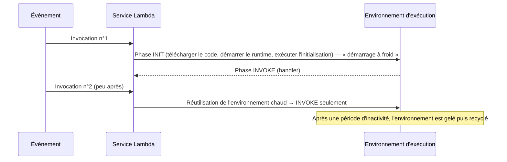
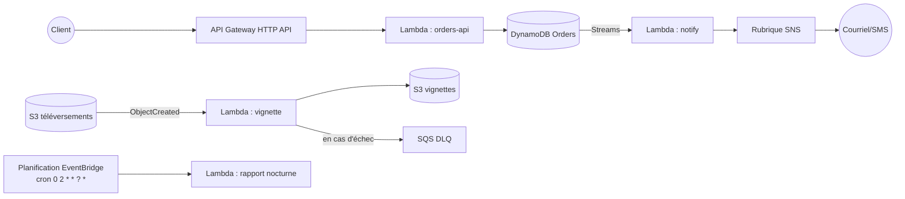

# AWS Lambda — Calcul sans serveur

> **Catégorie :** Calcul · **Portée :** Régionale · **Modèle :** Sans serveur / Fonction en tant que service (FaaS)
> [← Retour à la présentation](../AWS-core-services.md)

---

## 1. À quoi ça sert

AWS Lambda **exécute votre code en réponse à des événements sans provisionner ni gérer de serveurs.** Vous téléversez une fonction ; AWS gère la capacité, la mise à l'échelle, les correctifs du runtime, la haute disponibilité multi-AZ et la journalisation.

- **Piloté par les événements :** un dépôt dans S3, une requête d'API, un message de file, une planification, une modification DynamoDB…
- **Mise à l'échelle automatique :** de zéro à des milliers d'exécutions simultanées
- **Paiement à l'usage :** nombre de requêtes + durée (Go-secondes), facturée à la milliseconde
- **Aucun coût au repos** (sauf avec la concurrence provisionnée)

---

## 2. Composants clés

### 2.1 Fonction
L'unité de déploiement : code + configuration.

| Paramètre | Valeurs / limites (vérifiez les quotas actuels dans la documentation) |
|-----------|-----------------------------------------------------------------------|
| **Runtime** | Node.js, Python, Java, .NET, Ruby, runtime personnalisé (`provided.al2023` pour Go, Rust…), **image de conteneur** |
| **Architecture** | `x86_64` ou `arm64` (Graviton — ~20 % moins cher par Go-s) |
| **Mémoire** | 128 Mo → **10 240 Mo** ; **le CPU augmente proportionnellement à la mémoire** (≈ 1 vCPU à 1 769 Mo, jusqu'à 6 vCPU) |
| **Délai d'expiration** | 1 s → **900 s (15 minutes)** maximum |
| **Stockage éphémère `/tmp`** | 512 Mo → **10 240 Mo** |
| **Paquet de déploiement** | 50 Mo zippé (téléversement direct), **250 Mo décompressé** couches incluses ; image de conteneur jusqu'à **10 Go** |
| **Variables d'environnement** | 4 Ko au total, chiffrables avec KMS |
| **Charge utile d'invocation** | 6 Mo en synchrone ; beaucoup plus petite en asynchrone (historiquement 256 Ko — vérifiez le quota actuel) |

### 2.2 Gestionnaire (handler)
Le point d'entrée appelé pour chaque événement :

```python
# app.py  — handler = app.lambda_handler
import json, os, boto3

s3 = boto3.client("s3")           # initialisé une fois par environnement d'exécution (réutilisé)
TABLE = os.environ["TABLE_NAME"]

def lambda_handler(event, context):
    for record in event["Records"]:
        bucket = record["s3"]["bucket"]["name"]
        key    = record["s3"]["object"]["key"]
        print(json.dumps({"bucket": bucket, "key": key,
                          "remaining_ms": context.get_remaining_time_in_millis()}))
    return {"statusCode": 200}
```
- `event` : la charge utile du déclencheur
- `context` : ID de requête, nom de la fonction, temps restant, limite mémoire

### 2.3 Rôle d'exécution
Un **rôle IAM** que Lambda assume pour appeler d'autres services AWS (ex. lire S3, écrire dans DynamoDB, écrire des journaux). Minimum : `AWSLambdaBasicExecutionRole` (CloudWatch Logs).

### 2.4 Politique basée sur les ressources (politique de fonction)
Définit **qui peut invoquer** la fonction — ex. autoriser `s3.amazonaws.com` depuis un compartiment précis, `apigateway.amazonaws.com` ou un autre compte.

### 2.5 Déclencheurs / sources d'événements et modèles d'invocation

| Modèle d'invocation | Fonctionnement | Nouvelles tentatives | Exemples |
|---------------------|----------------|----------------------|----------|
| **Synchrone** | L'appelant attend la réponse | Responsabilité de l'appelant | API Gateway, ALB, URL de fonction, Cognito, `aws lambda invoke` |
| **Asynchrone** | Événement mis en file en interne, Lambda renvoie `202` | **2 nouvelles tentatives automatiques** ; puis **DLQ** (SQS/SNS) ou **destination en cas d'échec** | S3, SNS, EventBridge, CloudWatch Logs, SES |
| **Par interrogation (mappage de source d'événements)** | Lambda interroge la source et invoque par **lots** | Selon la source ; signalement d'échec partiel des lots | **SQS**, **Kinesis**, **DynamoDB Streams**, MSK/Kafka, Amazon MQ, DocumentDB |

### 2.6 Destinations
Pour les invocations asynchrones (et l'échec des mappages de sources) : envoyer le **résultat** d'un succès ou d'un échec vers **SQS, SNS, EventBridge, une autre Lambda ou S3** — plus riche qu'une DLQ (inclut la réponse/le contexte d'erreur).

### 2.7 Environnement d'exécution et démarrages à froid



Réduire les démarrages à froid : paquets plus petits, initialiser les clients SDK **hors du handler**, runtimes plus légers, **concurrence provisionnée** ou **SnapStart** (Java, Python, .NET).

### 2.8 Concurrence
- **Concurrence** = nombre de requêtes traitées au même moment.
- **Limite par défaut du compte : 1 000 exécutions simultanées par Région** (limite ajustable).
- **Concurrence réservée :** garantit *et plafonne* la concurrence d'une fonction (permet aussi de la bloquer à 0).
- **Concurrence provisionnée :** environnements pré-initialisés → pas de démarrage à froid ; facturée tant qu'elle est configurée ; peut être mise à l'échelle automatiquement.
- Les requêtes limitées renvoient **HTTP 429 / `TooManyRequestsException`**.

### 2.9 Versions et alias
- **`$LATEST`** : code courant, modifiable.
- **Version** : instantané immuable (`:1`, `:2`) avec son propre ARN.
- **Alias** : pointeur nommé (`prod`, `dev`) vers une version ; prend en charge le **routage pondéré** (ex. 90 % v3 / 10 % v4) pour les **déploiements canari** (avec CodeDeploy).

### 2.10 Couches (layers)
Archives ZIP de bibliothèques partagées, dépendances ou runtimes personnalisés, montées sous `/opt`. Jusqu'à **5 couches** par fonction ; comptées dans la limite de 250 Mo décompressés.

### 2.11 Réseau
- Par défaut, Lambda s'exécute dans un VPC géré par AWS avec **accès Internet** et accès aux points de terminaison publics AWS.
- **Lambda attachée à un VPC :** attachez-la à vos sous-réseaux + SG pour joindre des ressources privées (RDS, ElastiCache). Elle **perd alors l'accès Internet**, sauf si les sous-réseaux passent par une **passerelle NAT** (ou utilisent des points de terminaison VPC). Lambda utilise des ENI Hyperplane (partagées, créées lors de la configuration).
- **RDS Proxy :** mutualise les connexions BD — essentiel quand de nombreuses Lambda simultanées sollicitent une BD relationnelle.

### 2.12 URL de fonction et points d'entrée d'API
| Option | Usage |
|--------|-------|
| **URL de fonction** | Point de terminaison HTTPS dédié ; authentification `NONE` ou `AWS_IAM` ; le webhook le plus simple |
| **Amazon API Gateway** (REST / HTTP / WebSocket) | Authentification (Cognito, JWT, IAM, autorisateurs Lambda), limitation, plans d'utilisation, cache, domaines personnalisés |
| **ALB** | Lambda comme cible derrière un équilibreur existant |

### 2.13 Observabilité
- **CloudWatch Logs** (`/aws/lambda/<fonction>`) — chaque `print`/`console.log`.
- **Métriques CloudWatch :** Invocations, Duration, Errors, Throttles, ConcurrentExecutions, IteratorAge (flux), DeadLetterErrors.
- **AWS X-Ray** / OpenTelemetry pour le traçage distribué ; **Lambda Insights** pour les métriques système.

### 2.14 Services sans serveur associés
| Service | Rôle avec Lambda |
|---------|------------------|
| **Amazon EventBridge** | Bus d'événements et **planificateur** (cron/rate) |
| **AWS Step Functions** | Orchestrer des flux multi-étapes au-delà de 15 min, nouvelles tentatives, approbation humaine |
| **Amazon SQS / SNS** | Découplage, diffusion (fan-out), mise en tampon |
| **AWS SAM / CDK / Serverless Framework** | IaC pour applications sans serveur |
| **Lambda@Edge / CloudFront Functions** | Exécuter du code aux emplacements périphériques CloudFront (voir module CloudFront) |

---

## 3. Architectures de référence



---

## 4. Tarification (concepts)
- **Requêtes :** par million d'invocations
- **Durée :** Go-secondes (mémoire × temps), facturée par **1 ms** ; arm64 moins cher que x86
- **Concurrence provisionnée :** par Go-seconde configurée + prix de durée réduit
- **Stockage éphémère** au-delà de 512 Mo ; transfert de données ; et les services en aval (API Gateway, NAT, journaux)
- **Offre gratuite :** 1 M de requêtes et 400 000 Go-secondes par mois (offre gratuite permanente)

> Astuce : plus de mémoire = plus de CPU → souvent **plus rapide et moins cher** au total. Utilisez **AWS Lambda Power Tuning** pour trouver le bon réglage.

---

## 5. Bonnes pratiques

- [ ] Une fonction = un objectif ; des handlers courts
- [ ] **Rôle d'exécution de moindre privilège** par fonction
- [ ] Initialiser les clients SDK et connexions **hors du handler**
- [ ] Rendre les handlers **idempotents** (un événement peut être livré plusieurs fois)
- [ ] Configurer **DLQ / destinations en cas d'échec** pour l'asynchrone et la **réponse de lot partielle** pour SQS
- [ ] Stocker les secrets dans **Secrets Manager / Parameter Store**, pas en variables d'environnement en clair
- [ ] Utiliser **arm64**, ajuster la mémoire, fixer des **délais d'expiration** réalistes
- [ ] Utiliser la **concurrence réservée** pour protéger les systèmes en aval (ex. une base de données)
- [ ] Utiliser **RDS Proxy** pour les bases relationnelles
- [ ] Déployer avec **SAM/CDK/CloudFormation**, utiliser **alias + déploiements canari**
- [ ] Journalisation JSON structurée + traçage X-Ray ; définir la rétention des journaux

---

## 6. Laboratoire pratique — Traitement de fichiers déclenché par S3

**Objectif :** quand un fichier arrive dans `uploads/`, une Lambda écrit ses métadonnées dans DynamoDB.

1. **Créer les ressources**
   ```bash
   BUCKET=lab-uploads-$RANDOM
   aws s3 mb s3://$BUCKET
   aws dynamodb create-table --table-name FileIndex \
     --attribute-definitions AttributeName=pk,AttributeType=S \
     --key-schema AttributeName=pk,KeyType=HASH --billing-mode PAY_PER_REQUEST
   ```
2. **Rôle d'exécution** `lambda-fileindex-role` : approbation de `lambda.amazonaws.com` ; attacher `AWSLambdaBasicExecutionRole` + une politique en ligne autorisant `dynamodb:PutItem` sur `FileIndex` et `s3:GetObject` sur le compartiment.
3. **Code** `app.py` :
   ```python
   import boto3, os, urllib.parse
   ddb = boto3.resource("dynamodb").Table(os.environ["TABLE"])
   def lambda_handler(event, context):
       for r in event["Records"]:
           key = urllib.parse.unquote_plus(r["s3"]["object"]["key"])
           ddb.put_item(Item={"pk": key,
                              "bucket": r["s3"]["bucket"]["name"],
                              "size": r["s3"]["object"].get("size", 0),
                              "eventTime": r["eventTime"]})
       return {"processed": len(event["Records"])}
   ```
4. **Déployer**
   ```bash
   zip fn.zip app.py
   aws lambda create-function --function-name file-indexer \
     --runtime python3.12 --architectures arm64 --handler app.lambda_handler \
     --role arn:aws:iam::<ACCOUNT_ID>:role/lambda-fileindex-role \
     --zip-file fileb://fn.zip --timeout 30 --memory-size 256 \
     --environment Variables={TABLE=FileIndex}

   aws lambda add-permission --function-name file-indexer --statement-id s3invoke \
     --action lambda:InvokeFunction --principal s3.amazonaws.com \
     --source-arn arn:aws:s3:::$BUCKET
   ```
5. **Configurer la notification d'événement S3** (console : *Compartiment → Propriétés → Notifications d'événements*, préfixe `uploads/`, événement *Tous les événements de création d'objet*, destination la fonction).
6. **Tester**
   ```bash
   echo bonjour > a.txt && aws s3 cp a.txt s3://$BUCKET/uploads/a.txt
   aws dynamodb scan --table-name FileIndex
   aws logs tail /aws/lambda/file-indexer --follow
   ```
7. **Bonus :** publier la version 1, créer l'alias `prod`, et configurer une planification EventBridge pour invoquer une autre fonction toutes les 5 minutes.

**Nettoyage :** supprimer la fonction, le groupe de journaux, la table, vider et supprimer le compartiment, supprimer le rôle.

> ⚠️ **Ne jamais** déclencher une fonction par une écriture dans un compartiment si elle écrit dans *le même préfixe* de ce compartiment → boucle récursive infinie (Lambda détecte certaines boucles récursives, mais ne comptez pas dessus).

---

## 7. Conseils de certification

- Exécution maximale de **15 minutes** → tâches plus longues : **Step Functions**, **ECS/Fargate**, **AWS Batch** ou EC2.
- Mémoire maximale **10 Go** ; le CPU est alloué proportionnellement à la mémoire.
- « Sans serveur + tâche cron » → **EventBridge Scheduler + Lambda**.
- « Exécuter du code en périphérie pour modifier des en-têtes HTTP » → **CloudFront Functions** (léger) ou **Lambda@Edge** (plus lourd, accès réseau).
- Une Lambda dans un VPC a besoin d'une **passerelle NAT** pour accéder à Internet.
- Trop de connexions BD depuis Lambda → **RDS Proxy**.
- Éviter les démarrages à froid → **concurrence provisionnée** (ou SnapStart).
- Protéger un système en aval / limiter une fonction → **concurrence réservée**.
- Capturer les échecs asynchrones → **DLQ** ou **Destinations** ; messages SQS empoisonnés → DLQ via la **politique de redirection** SQS.
- Absorber un pic de trafic soudain → placer **SQS** devant Lambda.
- Lambda **se met à l'échelle automatiquement**, mais dans les quotas de concurrence du compte — demandez une augmentation avant un grand lancement.

---

## 8. Questions de révision

1. Une fonction traite des fichiers vidéo et prend 25 minutes. Que faire ?
2. Qu'augmente-t-on aussi en augmentant la mémoire d'une fonction ?
3. Quel type d'invocation S3 utilise-t-il, et combien de nouvelles tentatives Lambda effectue-t-il en cas d'échec ?
4. Votre Lambda dans un sous-réseau privé ne peut pas appeler une API tierce. Pourquoi, et comment corriger ?
5. Quelle est la différence entre concurrence réservée et concurrence provisionnée ?
6. Comment envoyer 10 % du trafic vers une nouvelle version ?
7. Où sont stockés les journaux Lambda par défaut ?
8. Quel service exécute des invocations Lambda planifiées ?

<details>
<summary><b>Réponses</b></summary>

1. Le maximum de Lambda est 15 min → utiliser **ECS sur Fargate / AWS Batch**, ou découper le travail et l'orchestrer avec **Step Functions**.
2. Le **CPU** (et la bande passante réseau), proportionnellement.
3. **Asynchrone** ; **2 nouvelles tentatives**, puis DLQ / destination en cas d'échec si configurée.
4. Les Lambda attachées à un VPC n'ont pas d'IP publique ; routez le `0.0.0.0/0` du sous-réseau vers une **passerelle NAT**.
5. La **réservée** garantit et plafonne le nombre d'exécutions simultanées (sans coût) ; la **provisionnée** maintient des environnements préchauffés pour éviter les démarrages à froid (facturée).
6. Créer un **alias** avec **routage pondéré** (90 % v1 / 10 % v2), généralement via un déploiement canari **CodeDeploy**.
7. Dans **CloudWatch Logs**, groupe `/aws/lambda/<nom-de-la-fonction>`.
8. **Amazon EventBridge** (règles ou EventBridge Scheduler).
</details>
