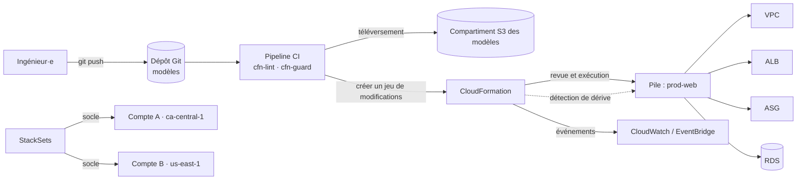
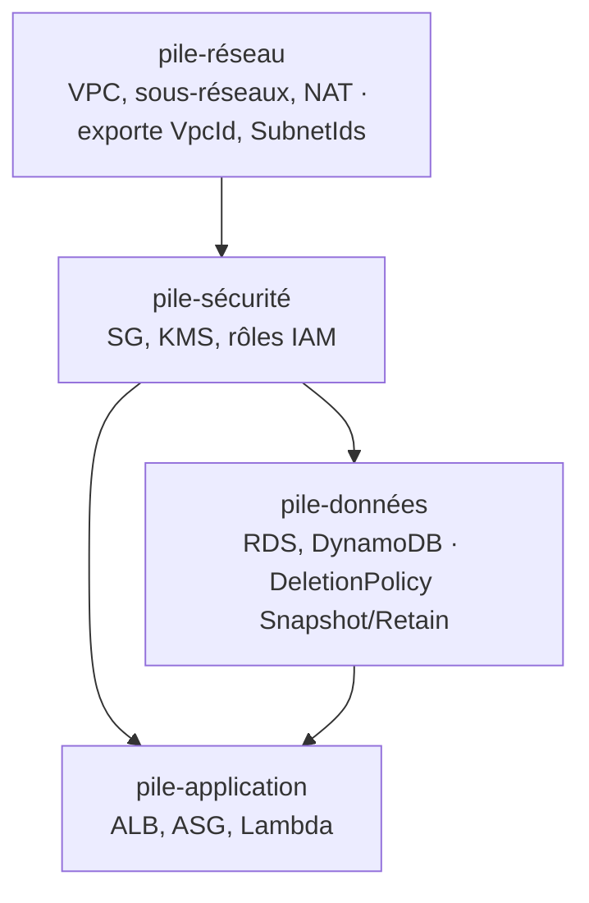

# AWS CloudFormation — Infrastructure en tant que code

> **Catégorie :** Gestion et gouvernance · **Portée :** Régionale (StackSets pour le multi-comptes/multi-Régions) · **Coût :** gratuit pour les types de ressources AWS
> [← Retour à la présentation](../AWS-core-services.md)

---

## 1. À quoi ça sert

CloudFormation permet de **modéliser, provisionner et gérer des ressources AWS (et tierces) de façon déclarative** à l'aide de modèles écrits en **YAML ou JSON**. Vous décrivez l'*état souhaité* ; CloudFormation détermine les dépendances, l'ordre de création, les mises à jour et les retours arrière.

Pourquoi tout·e ingénieur·e cloud doit le maîtriser (ou un outil IaC équivalent) :
- **Reproductibilité :** environnements dev / test / prod identiques
- **Contrôle de version et revue de code** de l'infrastructure (Git, demandes de fusion)
- **Retour arrière automatique** en cas d'échec
- **Détection de dérive** par rapport aux modifications manuelles
- **Visibilité des coûts :** estimer, baliser et supprimer tout un environnement en une seule opération
- Fondation d'**AWS CDK** et d'**AWS SAM**, qui génèrent des modèles CloudFormation

---

## 2. Composants clés

### 2.1 Modèle (template)
Un fichier texte décrivant les ressources. Anatomie :

```yaml
AWSTemplateFormatVersion: "2010-09-09"
Description: Tier web avec compartiment S3 et instance EC2
Transform: AWS::Serverless-2016-10-31   # macros facultatives (SAM, AWS::Include, AWS::LanguageExtensions)

Metadata:            # regroupement des paramètres dans la console, config cfn-init
  AWS::CloudFormation::Interface: {}

Parameters:          # entrées au moment du déploiement
  Environment:
    Type: String
    AllowedValues: [dev, test, prod]
    Default: dev
  InstanceType:
    Type: String
    Default: t4g.micro
  LatestAmiId:
    Type: AWS::SSM::Parameter::Value<AWS::EC2::Image::Id>
    Default: /aws/service/ami-amazon-linux-latest/al2023-ami-kernel-default-arm64

Mappings:            # tables de correspondance statiques
  EnvConfig:
    dev:  { Retention: 7 }
    prod: { Retention: 35 }

Conditions:          # création conditionnelle de ressources
  IsProd: !Equals [!Ref Environment, prod]

Rules:               # valider des combinaisons de paramètres
  ProdNeedsBiggerInstance:
    RuleCondition: !Equals [!Ref Environment, prod]
    Assertions:
      - Assert: !Not [!Equals [!Ref InstanceType, t4g.micro]]

Resources:           # la SEULE section obligatoire
  AssetsBucket:
    Type: AWS::S3::Bucket
    DeletionPolicy: Retain
    UpdateReplacePolicy: Retain
    Properties:
      VersioningConfiguration:
        Status: !If [IsProd, Enabled, Suspended]
      Tags:
        - Key: Environment
          Value: !Ref Environment

Outputs:             # valeurs à afficher ou à exporter
  BucketName:
    Value: !Ref AssetsBucket
    Export:
      Name: !Sub "${AWS::StackName}-BucketName"
```

| Section | Obligatoire | Rôle |
|---------|-------------|------|
| `AWSTemplateFormatVersion` | Non | Version du modèle (`2010-09-09`) |
| `Description` | Non | Texte libre |
| `Metadata` | Non | Informations supplémentaires (groupes de paramètres dans la console, config `cfn-init`) |
| `Parameters` | Non | Entrées à l'exécution (types : String, Number, List, `AWS::EC2::KeyPair::KeyName`, types de paramètres SSM…) |
| `Mappings` | Non | Correspondances clé/valeur statiques (ex. valeurs par Région/par environnement) |
| `Conditions` | Non | Logique booléenne pour ressources/propriétés facultatives |
| `Rules` | Non | Validation des paramètres |
| `Transform` | Non | Macros : **SAM**, `AWS::Include`, `AWS::LanguageExtensions` (ex. `Fn::ForEach`) |
| **`Resources`** | **Oui** | Ressources AWS à créer (ID logique + `Type` + `Properties`) |
| `Outputs` | Non | Valeurs de retour, **exportations** inter-piles |

### 2.2 Fonctions intrinsèques et pseudo-paramètres

| Fonction | Rôle | Exemple |
|----------|------|---------|
| `!Ref` | Valeur d'un paramètre ou ID par défaut d'une ressource | `!Ref AssetsBucket` → nom du compartiment |
| `!GetAtt` | Attribut d'une ressource | `!GetAtt AssetsBucket.Arn` |
| `!Sub` | Substitution de chaîne | `!Sub "arn:aws:s3:::${AssetsBucket}/*"` |
| `!Join` | Joindre une liste avec un séparateur | `!Join [",", [a, b]]` |
| `!Select` / `!Split` | Manipulation de listes | `!Select [0, !GetAZs ""]` |
| `!GetAZs` | Liste des AZ de la Région | |
| `!FindInMap` | Lire dans Mappings | `!FindInMap [EnvConfig, !Ref Environment, Retention]` |
| `!ImportValue` | Lire l'exportation d'une autre pile | `!ImportValue network-VpcId` |
| `!If`, `!Equals`, `!And`, `!Or`, `!Not` | Logique conditionnelle | |
| `!Cidr` | Générer des CIDR de sous-réseaux | `!Cidr [!GetAtt VPC.CidrBlock, 6, 8]` |
| `!Base64` | Encoder les données utilisateur | |

**Pseudo-paramètres :** `AWS::Region`, `AWS::AccountId`, `AWS::StackName`, `AWS::StackId`, `AWS::Partition`, `AWS::URLSuffix`, `AWS::NoValue` (supprime une propriété).

**Références dynamiques :** récupérer des secrets au déploiement sans les exposer dans le modèle :
`{{resolve:ssm:/app/db/name}}`, `{{resolve:secretsmanager:prod/db:SecretString:password}}`.

### 2.3 Pile (stack)
- Une **instance déployée** d'un modèle — l'unité que l'on crée, met à jour et supprime d'un bloc.
- Exemples d'états : `CREATE_IN_PROGRESS`, `CREATE_COMPLETE`, `UPDATE_ROLLBACK_COMPLETE`, `ROLLBACK_FAILED`, `DELETE_COMPLETE`.
- Les **événements de la pile** = journal étape par étape pour le dépannage.
- Les ressources sont créées **en parallèle** lorsque c'est possible ; ordre explicite avec `DependsOn`.

### 2.4 Jeux de modifications (change sets)
- **Prévisualiser** l'effet d'une mise à jour (*Ajout / Modification / Suppression* et si une ressource sera **remplacée**) avant de l'exécuter.
- Comportements de mise à jour par propriété : **sans interruption**, **avec interruption partielle**, **remplacement** (nouvelle ressource physique — ex. changer l'identifiant d'une RDS ou l'AMI d'une EC2).
- Pratique obligatoire dans les pipelines de production.

### 2.5 Retour arrière et protection des piles
| Fonction | Objectif |
|----------|----------|
| **Retour arrière automatique** | En cas d'échec, revenir au dernier état stable (désactivable pour déboguer : *conserver les ressources provisionnées avec succès*) |
| **Déclencheurs de retour arrière** | Revenir en arrière si une alarme CloudWatch se déclenche pendant/après la mise à jour (période de surveillance) |
| **Protection contre la résiliation** | Empêcher la suppression de la pile |
| **Politique de pile** | JSON empêchant la mise à jour de ressources critiques (ex. BD de production) |
| **`DeletionPolicy`** | `Delete` (par défaut), **`Retain`**, **`Snapshot`** (RDS, EBS, ElastiCache, Redshift…) |
| **`UpdateReplacePolicy`** | Mêmes options quand une ressource est remplacée lors d'une mise à jour |
| `ContinueUpdateRollback` | Récupérer une pile bloquée en `UPDATE_ROLLBACK_FAILED` |

### 2.6 Piles imbriquées vs références inter-piles
| | **Piles imbriquées** | **Références inter-piles** |
|---|---------------------|----------------------------|
| Fonctionnement | Ressource `AWS::CloudFormation::Stack` pointant vers un modèle enfant dans S3 | `Outputs` avec `Export` + `!ImportValue` |
| Cycle de vie | Piles enfants gérées **avec** la pile parente | Piles **indépendantes** |
| Usage | Composants réutilisables (un ALB standard, un SG standard) | Couches partagées avec des cycles de vie différents (pile réseau → piles applicatives) |
| Contrainte | — | Impossible de supprimer/modifier une exportation tant qu'elle est importée |

### 2.7 StackSets
- Déployer un modèle dans **plusieurs comptes et Régions** en une seule opération.
- Permissions **autogérées** (rôles admin/exécution) ou **gérées par le service** avec **AWS Organizations** (déploiement automatique dans les nouveaux comptes d'une UO).
- Usages : CloudTrail à l'échelle de l'organisation, règles Config, rôles IAM, garde-fous, VPC de base.

### 2.8 Détection de dérive (drift)
- Compare la configuration réelle des ressources au modèle → `IN_SYNC`, `MODIFIED`, `DELETED`, `NOT_CHECKED`.
- Détecte les modifications « à la souris » dans la console ; corrigez en mettant à jour le modèle ou par **importation de ressources** / redéploiement.

### 2.9 Importation et refactorisation de ressources
- **Importer** des ressources existantes (créées manuellement) dans une pile.
- **Refactorisation de piles :** déplacer des ressources entre piles ou renommer des ID logiques sans recréation.
- **Générateur IaC :** analyser un compte et générer un modèle à partir des ressources existantes.

### 2.10 Scripts d'assistance et signaux (amorçage EC2)
| Assistant | Rôle |
|-----------|------|
| `cfn-init` | Lit les métadonnées `AWS::CloudFormation::Init` → installe paquets, fichiers, services |
| `cfn-signal` | Signale un succès/échec à une **CreationPolicy** / **WaitCondition** |
| `cfn-hup` | Démon qui détecte les changements de métadonnées et réapplique la configuration |
| `cfn-get-metadata` | Récupère les métadonnées |

Une `CreationPolicy` avec `ResourceSignal` fait **attendre** la pile jusqu'à ce que l'instance se déclare saine (ex. 2 signaux en 15 minutes). `UpdatePolicy` contrôle les **mises à jour progressives/par remplacement de l'Auto Scaling**.

### 2.11 Ressources personnalisées, modules et registre
- **Ressources personnalisées** (`Custom::Nom`) adossées à Lambda ou SNS — exécuter une logique que CloudFormation ne prend pas en charge (ex. vider un compartiment S3 avant suppression, rechercher une valeur).
- **Registre CloudFormation :** types de ressources d'AWS, de tiers (Datadog, MongoDB Atlas…) et vos propres types privés.
- **Modules :** groupes de ressources réutilisables intégrant les bonnes pratiques.
- **Hooks :** contrôles de conformité proactifs exécutés **avant** le provisionnement (ex. bloquer les compartiments non chiffrés) — règles Guard, Lambda ou contrôles gérés.
- **CloudFormation Guard (cfn-guard)** et **cfn-lint** : politique en tant que code et analyse des modèles dans la CI.

### 2.12 Rôle de service et permissions
- Par défaut, CloudFormation utilise les permissions de l'appelant. Un **rôle de service** (`--role-arn`) permet aux développeurs de déployer des piles sans permissions directes sur les ressources sous-jacentes (avec `iam:PassRole`).
- Des **capacités** doivent être reconnues pour les modèles qui créent des ressources IAM : `CAPABILITY_IAM`, `CAPABILITY_NAMED_IAM`, `CAPABILITY_AUTO_EXPAND` (macros/imbriquées).

### 2.13 Écosystème
| Outil | Description |
|-------|-------------|
| **AWS CDK** | Définir l'infrastructure en TypeScript/Python/Java/C#/Go → génère du CloudFormation |
| **AWS SAM** | Syntaxe simplifiée pour le sans-serveur (Lambda, API Gateway, DynamoDB) + CLI de test local |
| **Git sync** | Déployer automatiquement les piles depuis un dépôt Git |
| **AWS Service Catalog** | Publier des produits CloudFormation approuvés en libre-service |
| **Terraform** | Alternative multicloud populaire (HashiCorp/IBM) — les concepts se transposent directement |

---

## 3. Fonctionnement



Piles en couches en entreprise :


---

## 4. Tarification
**Aucun frais** pour CloudFormation lui-même avec les types de ressources AWS — vous payez les ressources créées. Les types de ressources tiers/privés du registre et les Hooks sont facturés par opération de gestionnaire au-delà d'un quota gratuit.

---

## 5. Bonnes pratiques

- [ ] **Tout en code** — aucune modification manuelle en production ; détecter régulièrement la dérive
- [ ] Stocker les modèles dans **Git**, les analyser (**cfn-lint**) et contrôler les politiques (**cfn-guard**/Hooks) dans la CI
- [ ] Toujours déployer les mises à jour via des **jeux de modifications** ; examiner attentivement *Replacement = True*
- [ ] Découper par cycle de vie : piles réseau / sécurité / données / application
- [ ] Protéger les ressources avec état : `DeletionPolicy: Retain` ou `Snapshot`, **protection contre la résiliation**, **politiques de pile**
- [ ] Utiliser des **paramètres + types de paramètres SSM** plutôt que de coder en dur les ID d'AMI, de compte, de Région
- [ ] Jamais de secrets dans les modèles → **références dynamiques** vers Secrets Manager / SSM
- [ ] Ne pas coder en dur les noms physiques sauf nécessité (évite les conflits lors d'un remplacement)
- [ ] Utiliser **StackSets** avec Organizations pour le socle des comptes
- [ ] Utiliser des **déclencheurs de retour arrière** avec des alarmes CloudWatch en production

---

## 6. Laboratoire pratique — Déployer, mettre à jour avec un jeu de modifications, détecter la dérive

**`lab-stack.yaml` :**
```yaml
AWSTemplateFormatVersion: "2010-09-09"
Description: Lab CloudFormation — VPC, sous-réseau public, SG, serveur web EC2
Parameters:
  Environment: { Type: String, AllowedValues: [dev, prod], Default: dev }
  InstanceType: { Type: String, Default: t4g.micro }
  LatestAmiId:
    Type: AWS::SSM::Parameter::Value<AWS::EC2::Image::Id>
    Default: /aws/service/ami-amazon-linux-latest/al2023-ami-kernel-default-arm64
Resources:
  VPC:
    Type: AWS::EC2::VPC
    Properties:
      CidrBlock: 10.20.0.0/16
      EnableDnsHostnames: true
      Tags: [{ Key: Name, Value: !Sub "${Environment}-cfn-vpc" }]
  IGW: { Type: AWS::EC2::InternetGateway }
  IGWAttach:
    Type: AWS::EC2::VPCGatewayAttachment
    Properties: { VpcId: !Ref VPC, InternetGatewayId: !Ref IGW }
  PublicSubnet:
    Type: AWS::EC2::Subnet
    Properties:
      VpcId: !Ref VPC
      CidrBlock: !Select [0, !Cidr [!GetAtt VPC.CidrBlock, 4, 8]]
      AvailabilityZone: !Select [0, !GetAZs ""]
      MapPublicIpOnLaunch: true
  PublicRT: { Type: AWS::EC2::RouteTable, Properties: { VpcId: !Ref VPC } }
  DefaultRoute:
    Type: AWS::EC2::Route
    DependsOn: IGWAttach
    Properties: { RouteTableId: !Ref PublicRT, DestinationCidrBlock: 0.0.0.0/0, GatewayId: !Ref IGW }
  SubnetRTAssoc:
    Type: AWS::EC2::SubnetRouteTableAssociation
    Properties: { SubnetId: !Ref PublicSubnet, RouteTableId: !Ref PublicRT }
  WebSG:
    Type: AWS::EC2::SecurityGroup
    Properties:
      GroupDescription: HTTP in
      VpcId: !Ref VPC
      SecurityGroupIngress:
        - { IpProtocol: tcp, FromPort: 80, ToPort: 80, CidrIp: 0.0.0.0/0 }
  WebServer:
    Type: AWS::EC2::Instance
    CreationPolicy: { ResourceSignal: { Count: 1, Timeout: PT10M } }
    Properties:
      ImageId: !Ref LatestAmiId
      InstanceType: !Ref InstanceType
      SubnetId: !Ref PublicSubnet
      SecurityGroupIds: [!Ref WebSG]
      MetadataOptions: { HttpTokens: required }
      UserData:
        Fn::Base64: !Sub |
          #!/bin/bash
          dnf -y install nginx aws-cfn-bootstrap
          echo "<h1>${Environment} — déployé par CloudFormation</h1>" > /usr/share/nginx/html/index.html
          systemctl enable --now nginx
          /opt/aws/bin/cfn-signal -e $? --stack ${AWS::StackName} --resource WebServer --region ${AWS::Region}
Outputs:
  WebURL:
    Value: !Sub "http://${WebServer.PublicDnsName}"
  VpcId:
    Value: !Ref VPC
    Export: { Name: !Sub "${AWS::StackName}-VpcId" }
```

```bash
# 1. Valider et déployer
aws cloudformation validate-template --template-body file://lab-stack.yaml
aws cloudformation deploy --stack-name cfn-lab --template-file lab-stack.yaml \
  --parameter-overrides Environment=dev
aws cloudformation describe-stacks --stack-name cfn-lab --query 'Stacks[0].Outputs'

# 2. Jeu de modifications : changer le type d'instance et examiner l'impact
aws cloudformation create-change-set --stack-name cfn-lab --change-set-name resize \
  --use-previous-template --parameters ParameterKey=Environment,UsePreviousValue=true \
  ParameterKey=InstanceType,ParameterValue=t4g.small ParameterKey=LatestAmiId,UsePreviousValue=true
aws cloudformation describe-change-set --stack-name cfn-lab --change-set-name resize \
  --query 'Changes[].ResourceChange.[LogicalResourceId,Action,Replacement]'
aws cloudformation execute-change-set --stack-name cfn-lab --change-set-name resize

# 3. Dérive : ajoutez manuellement le port 22 au SG dans la console, puis
aws cloudformation detect-stack-drift --stack-name cfn-lab
aws cloudformation describe-stack-resource-drifts --stack-name cfn-lab \
  --stack-resource-drift-status-filters MODIFIED

# 4. Provoquer un échec : mettez un CIDR invalide dans le modèle et redéployez → observez le retour arrière automatique dans les événements
```

**Nettoyage :** `aws cloudformation delete-stack --stack-name cfn-lab` — une seule commande supprime tout.

**Projet final (jour 5) :** convertir les labs VPC + EC2/ALB + RDS + S3 en piles en couches (réseau → données → application) à l'aide d'exportations, puis redéployer toute la plateforme dans une nouvelle Région.

---

## 7. Conseils de certification

- Environnements reproductibles / « infrastructure en tant que code » sur AWS → **CloudFormation** (ou CDK/SAM qui en génèrent).
- Prévisualiser les changements avant une mise à jour → **jeux de modifications**.
- Déployer dans **plusieurs comptes et Régions** → **StackSets**.
- Détecter les modifications manuelles → **détection de dérive**.
- Conserver la BD/le compartiment à la suppression de la pile → **`DeletionPolicy: Retain` / `Snapshot`**.
- Partager l'ID du VPC entre piles → **Outputs + Export / `Fn::ImportValue`** ; composants réutilisables → **piles imbriquées**.
- Attendre l'amorçage de l'application avant de considérer l'instance comme créée → **CreationPolicy + cfn-signal**.
- Ressource non prise en charge ou logique personnalisée → **ressource personnalisée (Lambda)**.
- Le modèle crée des rôles IAM → spécifier **`CAPABILITY_IAM` / `CAPABILITY_NAMED_IAM`**.
- Secrets dans les modèles → **références dynamiques** (Secrets Manager / SSM).
- `Resources` est la **seule section obligatoire**.

---

## 8. Questions de révision

1. Quelle est la seule section obligatoire d'un modèle ?
2. Votre mise à jour allait remplacer l'instance RDS de production. Comment l'auriez-vous su à l'avance ?
3. Comment garantir qu'un compartiment S3 survive à la suppression de la pile ?
4. Différence entre piles imbriquées et références inter-piles ?
5. Une équipe de sécurité doit déployer une configuration CloudTrail dans chaque compte de l'organisation, y compris les futurs. Qu'utiliser ?
6. Comment passer un ID d'AMI correspondant toujours au dernier Amazon Linux sans modifier le modèle ?
7. Quelqu'un a modifié un groupe de sécurité dans la console. Comment le détecter ?
8. Une pile est bloquée en `UPDATE_ROLLBACK_FAILED`. Que pouvez-vous faire ?

<details>
<summary><b>Réponses</b></summary>

1. **`Resources`.**
2. Créer un **jeu de modifications** et vérifier `Replacement: True` pour la ressource BD.
3. `DeletionPolicy: Retain` (et `UpdateReplacePolicy: Retain`).
4. Les **piles imbriquées** sont des piles enfants gérées au sein d'une pile parente (réutilisation) ; les **références inter-piles** partagent des sorties entre piles indépendantes ayant leur propre cycle de vie (`Export`/`ImportValue`).
5. **StackSets** avec **permissions gérées par le service** (AWS Organizations) et **déploiement automatique** sur une UO.
6. Un paramètre de type **`AWS::SSM::Parameter::Value<AWS::EC2::Image::Id>`** pointant vers le paramètre SSM public de la dernière AMI.
7. **Détection de dérive.**
8. Corriger la cause sous-jacente, puis **poursuivre le retour arrière** (`ContinueUpdateRollback`), en ignorant éventuellement les ressources problématiques.
</details>
