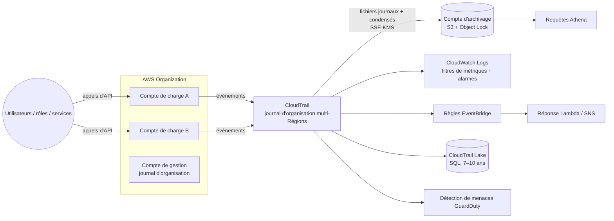

# AWS CloudTrail — Audit de l'activité des API

> **Catégorie :** Gestion et gouvernance (aussi sécurité et conformité) · **Portée :** Régionale, avec journaux de suivi multi-Régions et d'organisation
> [← Retour à la présentation](../AWS-core-services.md)

---

## 1. À quoi ça sert

CloudTrail **enregistre chaque appel d'API et chaque activité du compte** dans votre environnement AWS — via la console, la CLI, les SDK ou par des services AWS agissant en votre nom — afin de répondre à :

> **Qui a fait quoi, quand, d'où, sur quelle ressource, et était-ce autorisé ?**

Usages :
- **Enquêtes de sécurité** (qui a supprimé le compartiment ? qui a ouvert le port 22 ?)
- **Conformité et audit** (PCI DSS, SOC 2, HIPAA, ISO 27001, BSIF B-13)
- **Dépannage opérationnel** (quel changement a cassé la production ?)
- **Réponse automatisée** (alerter quand root se connecte, quand CloudTrail est arrêté)

CloudTrail est **activé par défaut** pour chaque compte : l'**historique des événements** conserve **90 jours d'événements de gestion** gratuitement.

---

## 2. Composants clés

### 2.1 Événements
Chaque événement est un enregistrement JSON :

```json
{
  "eventVersion": "1.10",
  "userIdentity": {
    "type": "AssumedRole",
    "arn": "arn:aws:sts::111122223333:assumed-role/DevOps/alice",
    "accountId": "111122223333",
    "sessionContext": { "attributes": { "mfaAuthenticated": "true" } }
  },
  "eventTime": "2026-10-17T13:02:11Z",
  "eventSource": "ec2.amazonaws.com",
  "eventName": "AuthorizeSecurityGroupIngress",
  "awsRegion": "ca-central-1",
  "sourceIPAddress": "203.0.113.25",
  "userAgent": "aws-cli/2.x",
  "requestParameters": {
    "groupId": "sg-0abc123",
    "ipPermissions": { "items": [{ "ipProtocol": "tcp", "fromPort": 22, "toPort": 22,
      "ipRanges": { "items": [{ "cidrIp": "0.0.0.0/0" }] } }] }
  },
  "responseElements": { "_return": true },
  "errorCode": null,
  "readOnly": false,
  "eventType": "AwsApiCall",
  "managementEvent": true,
  "eventCategory": "Management"
}
```

Champs clés : `userIdentity` (qui), `eventTime` (quand), `eventSource` + `eventName` (quoi), `awsRegion`, `sourceIPAddress` (d'où), `requestParameters` / `responseElements` (détails), `errorCode` (`AccessDenied` = tentative échouée).

### 2.2 Types d'événements

| Type | Ce qui est enregistré | Par défaut | Exemples |
|------|----------------------|-----------|----------|
| **Événements de gestion** (plan de contrôle) | Opérations qui créent/modifient/suppriment/configurent des ressources ; aussi la connexion à la console | ✅ **Journalisés par défaut** (historique des événements ; les journaux de suivi les incluent par défaut) | `CreateBucket`, `RunInstances`, `AttachRolePolicy`, `ConsoleLogin`, `CreateTrail` |
| **Événements de données** (plan de données) | Opérations à fort volume **sur ou dans** une ressource | ❌ **Non journalisés par défaut** (coût supplémentaire) | S3 `GetObject`/`PutObject`/`DeleteObject`, Lambda `Invoke`, opérations sur les éléments DynamoDB, publication SNS, Secrets Manager `GetSecretValue`… |
| **Événements d'activité réseau** | Appels d'API passant **par des points de terminaison VPC** (y compris ceux refusés par la politique du point de terminaison) | ❌ À activer | Détecter des tentatives d'exfiltration via les points de terminaison VPC |
| **Événements Insights** | **Activité inhabituelle** dans le **volume** d'appels d'API ou le **taux d'erreurs** par rapport à la référence | ❌ À activer (coût supplémentaire) | Rafale de `TerminateInstances`, pic de `AccessDenied` |

Les événements de gestion peuvent être filtrés en **lecture** (`Describe*`, `List*`, `Get*`) et **écriture**. Vous pouvez aussi exclure des sources à fort volume (ex. AWS KMS, RDS Data API).

### 2.3 Historique des événements (Event history)
- Vue console des **90 derniers jours d'événements de gestion** de la Région courante, **gratuite**, sans configuration.
- Recherche par nom d'utilisateur, nom d'événement, type/nom de ressource, source d'événement, clé d'accès.
- Non personnalisable ni prolongeable → créez un **journal de suivi (trail)** ou un **magasin de données d'événements Lake** pour une rétention longue.

### 2.4 Journaux de suivi (trails)
Un **journal de suivi** livre en continu les événements vers un **compartiment S3** (et éventuellement CloudWatch Logs / EventBridge).

| Paramètre | Détail |
|-----------|--------|
| **Journal multi-Régions** | Par défaut et **recommandé** — couvre toutes les Régions, y compris les nouvelles |
| **Journal d'organisation** | Créé dans le compte de gestion (ou administrateur délégué) ; journalise **tous les comptes** d'AWS Organizations ; les comptes membres ne peuvent ni le modifier ni le supprimer |
| **Livraison S3** | Fichiers livrés généralement en ~5 minutes (pas en temps réel) ; chemin `AWSLogs/<compte>/CloudTrail/<region>/AAAA/MM/JJ/` |
| **Chiffrement SSE-KMS** | Clé KMS gérée par le client facultative (SSE-S3 par défaut) |
| **Validation de l'intégrité des fichiers journaux** | Hachage SHA-256 + **fichiers de condensé** signés RSA chaque heure → prouver que les journaux n'ont été ni modifiés ni supprimés (`aws cloudtrail validate-logs`) |
| **Notification SNS** | À chaque livraison de fichier |
| **Intégration CloudWatch Logs** | Recherche quasi temps réel, **filtres de métriques** et **alarmes** |
| **Sélecteurs d'événements / avancés** | Choisir les événements de gestion/données à journaliser, filtrer par ARN de ressource, nom d'événement, lecture seule, etc. |
| Copie gratuite | La **première copie des événements de gestion** livrée à S3 par Région est gratuite ; les copies supplémentaires et les événements de données sont facturés |

### 2.5 CloudTrail Lake
- **Lac de données** géré qui ingère, stocke (de façon immuable) et permet d'**interroger les événements en SQL** — sans pipeline S3/Athena à construire.
- **Magasins de données d'événements** avec une rétention jusqu'à **10 ans** (options tarifaires : un an prolongeable ou sept ans).
- Peut ingérer : événements CloudTrail, **éléments de configuration AWS Config**, **preuves Audit Manager** et **événements non AWS** (intégrations de partenaires ou de vos applications).
- **Tableaux de bord Lake** et **génération de requêtes en langage naturel**.
- Exemple de requête :
  ```sql
  SELECT eventTime, userIdentity.arn, sourceIPAddress, eventName
  FROM <event-data-store-id>
  WHERE eventName IN ('DeleteBucket','DeleteTrail','StopLogging','PutBucketPolicy')
    AND eventTime > '2026-10-01 00:00:00'
  ORDER BY eventTime DESC
  ```

### 2.6 CloudTrail Insights
- Apprend une **référence** des volumes normaux d'appels d'API d'écriture et des taux d'erreurs ; génère un **événement Insights** en cas d'écart (ex. un script qui supprime soudain des ressources, une clé compromise qui génère des erreurs `AccessDenied`).
- Livrés dans le compartiment S3 du journal / le magasin de données d'événements, visibles dans la console, peuvent déclencher EventBridge.

### 2.7 Intégration avec EventBridge (réaction quasi temps réel)
- Les événements de gestion (et de données s'ils sont journalisés) sont émis vers **Amazon EventBridge** sous le type `AWS API Call via CloudTrail`.
- Construisez des règles comme : *si `eventName = StopLogging` ou `DeleteTrail` → Lambda réactive la journalisation + alerte SNS à l'équipe de sécurité*.

```json
{
  "source": ["aws.cloudtrail"],
  "detail-type": ["AWS API Call via CloudTrail"],
  "detail": { "eventName": ["StopLogging", "DeleteTrail", "UpdateTrail"] }
}
```

### 2.8 Sécuriser la piste d'audit elle-même
| Contrôle | Objectif |
|----------|----------|
| **Compte dédié d'archivage des journaux** | Stocker les journaux hors des comptes de charges de travail (modèle AWS Control Tower) |
| **Politique de compartiment S3** | Seul le service CloudTrail peut écrire ; suppressions refusées |
| **S3 Object Lock / MFA Delete / versionnement** | Immuabilité |
| **SSE-KMS** avec politique de clé restrictive | Seuls les auditeurs peuvent déchiffrer |
| **Validation de l'intégrité des fichiers journaux** | Preuve d'absence d'altération |
| **SCP** | Refuser `cloudtrail:StopLogging`, `DeleteTrail`, `UpdateTrail` à tous sauf un rôle d'urgence (break-glass) |
| **Règles de cycle de vie** | Déplacer les anciens journaux vers Glacier / Deep Archive pour une rétention longue |

### 2.9 Services de gouvernance associés (savoir les distinguer)
| Service | Question à laquelle il répond |
|---------|-------------------------------|
| **CloudTrail** | **Qui** a fait **quel appel d'API**, et quand ? |
| **AWS Config** | Quelle était la **configuration de ma ressource** au fil du temps, et est-elle **conforme** aux règles ? |
| **CloudWatch** | Quelles sont les **performances** de mes ressources ? |
| **Amazon GuardDuty** | Y a-t-il une **menace** ? (analyse CloudTrail, VPC Flow Logs, journaux DNS avec du ML) |
| **AWS Security Hub** | Centralisation des constats de sécurité et score de posture |
| **Amazon Detective** | Enquêter et visualiser la cause racine des constats |
| **IAM Access Analyzer** | Générer des politiques de moindre privilège **à partir de l'activité CloudTrail** |
| **AWS Audit Manager** | Collecter des preuves pour les audits (référentiels PCI, HIPAA…) |
| **Amazon Athena** | SQL sur les journaux CloudTrail stockés dans S3 (alternative à Lake) |

---

## 3. Fonctionnement



---

## 4. Tarification (concepts)
- **Gratuit :** historique des événements sur 90 jours ; **première copie des événements de gestion** par Région livrée à S3 par un journal de suivi
- **Facturé :** copies supplémentaires des événements de gestion, **événements de données** (par tranche de 100 000), **événements d'activité réseau**, événements analysés par **Insights**, **CloudTrail Lake** (ingestion + rétention + données analysées)
- **Coûts indirects :** stockage S3, requêtes KMS, ingestion CloudWatch Logs

---

## 5. Bonnes pratiques

- [ ] Créer un **journal d'organisation multi-Régions** vers un **compte central d'archivage des journaux**
- [ ] Activer la **validation de l'intégrité des fichiers journaux** et le chiffrement **SSE-KMS**
- [ ] Protéger le compartiment : versionnement, **Object Lock**, politique restrictive, cycle de vie vers Glacier
- [ ] Utiliser des **SCP** pour empêcher l'arrêt/la suppression des journaux de suivi
- [ ] Envoyer vers **CloudWatch Logs** et alerter sur les événements critiques : connexion root, échecs de `ConsoleLogin`, modifications de politiques IAM, de SG, de NACL/routes, de CloudTrail/Config, suppression de clés KMS (contrôles du CIS AWS Foundations Benchmark)
- [ ] Activer les **événements de données** de façon ciblée (compartiments S3 sensibles, Lambda, secrets)
- [ ] Activer **CloudTrail Insights** sur les comptes de production
- [ ] Activer **GuardDuty** — il consomme automatiquement CloudTrail
- [ ] Utiliser **CloudTrail Lake** ou **Athena** pour les enquêtes ; conserver les journaux ≥ 1 an (souvent 7 ans dans les secteurs réglementés)

---

## 6. Laboratoire pratique — Piste d'audit avec alertes

1. **Explorer l'historique des événements** (sans configuration) : *CloudTrail → Historique des événements* → filtrer `Nom de l'événement = RunInstances` ou `Nom d'utilisateur = <vous>` ; ouvrez le JSON d'un événement `ConsoleLogin`.

2. **Créer un journal de suivi multi-Régions avec CloudWatch Logs :**
   ```bash
   ACCOUNT=$(aws sts get-caller-identity --query Account --output text)
   BUCKET=lab-cloudtrail-$ACCOUNT
   aws s3 mb s3://$BUCKET --region ca-central-1
   cat > ct-bucket-policy.json <<EOF
   {"Version":"2012-10-17","Statement":[
    {"Sid":"AclCheck","Effect":"Allow","Principal":{"Service":"cloudtrail.amazonaws.com"},
     "Action":"s3:GetBucketAcl","Resource":"arn:aws:s3:::$BUCKET"},
    {"Sid":"Write","Effect":"Allow","Principal":{"Service":"cloudtrail.amazonaws.com"},
     "Action":"s3:PutObject","Resource":"arn:aws:s3:::$BUCKET/AWSLogs/$ACCOUNT/*",
     "Condition":{"StringEquals":{"s3:x-amz-acl":"bucket-owner-full-control"}}}]}
   EOF
   aws s3api put-bucket-policy --bucket $BUCKET --policy file://ct-bucket-policy.json

   aws cloudtrail create-trail --name lab-trail --s3-bucket-name $BUCKET \
     --is-multi-region-trail --enable-log-file-validation
   aws cloudtrail start-logging --name lab-trail
   ```
   Dans la console, modifiez le journal → activez **CloudWatch Logs** (nouveau groupe de journaux `CloudTrail/lab`, nouveau rôle).

3. **Événements de données pour un compartiment** (sélecteurs avancés) :
   ```bash
   aws cloudtrail put-event-selectors --trail-name lab-trail --advanced-event-selectors '[
     {"Name":"Mgmt","FieldSelectors":[{"Field":"eventCategory","Equals":["Management"]}]},
     {"Name":"S3 data - sensitive bucket","FieldSelectors":[
       {"Field":"eventCategory","Equals":["Data"]},
       {"Field":"resources.type","Equals":["AWS::S3::Object"]},
       {"Field":"resources.ARN","StartsWith":["arn:aws:s3:::lab-site-"]}]}]'
   ```

4. **Alarme sur les modifications de groupes de sécurité (contrôle CIS) :**
   ```bash
   aws logs put-metric-filter --log-group-name CloudTrail/lab --filter-name SGChanges \
     --filter-pattern '{ ($.eventName = AuthorizeSecurityGroupIngress) || ($.eventName = AuthorizeSecurityGroupEgress) || ($.eventName = RevokeSecurityGroupIngress) || ($.eventName = CreateSecurityGroup) || ($.eventName = DeleteSecurityGroup) }' \
     --metric-transformations metricName=SecurityGroupEventCount,metricNamespace=CISBenchmark,metricValue=1
   aws cloudwatch put-metric-alarm --alarm-name sg-changed --namespace CISBenchmark \
     --metric-name SecurityGroupEventCount --statistic Sum --period 300 --evaluation-periods 1 \
     --threshold 1 --comparison-operator GreaterThanOrEqualToThreshold --alarm-actions $TOPIC
   ```
   Ouvrez le port 22 sur un SG du lab → vous recevez l'alerte en quelques minutes.

5. **Règle EventBridge** qui alerte sur `StopLogging` / `DeleteTrail` (modèle du §2.7) → SNS.

6. **Enquêter :** après ~15 min, validez l'intégrité et cherchez avec Athena ou Lake :
   ```bash
   aws cloudtrail validate-logs --trail-arn arn:aws:cloudtrail:ca-central-1:$ACCOUNT:trail/lab-trail \
     --start-time $(date -u -d '-1 hour' +%Y-%m-%dT%H:%M:%SZ)
   ```

**Nettoyage :** arrêter la journalisation et supprimer le journal de suivi, supprimer l'alarme/le filtre de métrique/le groupe de journaux/la règle EventBridge, vider et supprimer le compartiment.

---

## 7. Conseils de certification

- « **Qui** a supprimé / modifié la ressource X ? » → **CloudTrail**. « Quelle était la **configuration** de X la semaine dernière / est-elle conforme ? » → **AWS Config**. « X est-il **performant** ? » → **CloudWatch**.
- Historique des événements = **90 jours**, événements de gestion uniquement, gratuit. Rétention plus longue → **journal de suivi vers S3** ou **CloudTrail Lake**.
- **Les événements de données ne sont pas journalisés par défaut** (niveau objet S3, invocation Lambda, éléments DynamoDB).
- Journaliser tous les comptes d'une Organisation → **journal d'organisation** ; toutes les Régions → **journal multi-Régions**.
- Prouver que les journaux n'ont pas été altérés → **validation de l'intégrité des fichiers journaux**.
- Détecter un volume/taux d'erreurs d'API inhabituel → **CloudTrail Insights**.
- Réagir à un appel d'API en quelques secondes → **règle EventBridge** sur les événements CloudTrail.
- Interroger les événements d'audit en SQL sans construire de pipeline → **CloudTrail Lake** (ou Athena sur les journaux S3).
- Détection de menaces basée sur CloudTrail → **GuardDuty**.
- La livraison de CloudTrail vers S3 n'est **pas en temps réel** (généralement ~5 min).

---

## 8. Questions de révision

1. Un objet S3 a été supprimé hier. L'historique des événements n'affiche rien. Pourquoi ?
2. Quelle est la rétention gratuite de l'historique des événements CloudTrail ?
3. Comment capturer les événements CloudTrail de tous les comptes de votre organisation, y compris les futurs ?
4. Comment démontrer à un auditeur que les fichiers journaux n'ont pas été modifiés ?
5. Quelle fonction détecte un pic soudain d'appels `DeleteObject` ou `TerminateInstances` ?
6. Vous devez alerter l'équipe de sécurité en moins d'une minute quand quelqu'un désactive CloudTrail. Que construisez-vous ?
7. Quel service vous indiquerait qu'un groupe de sécurité autorisait 0.0.0.0/0 sur le port 22 mardi dernier, et si cela enfreignait une règle ?
8. Comment empêcher les administrateurs de compte d'arrêter le journal d'organisation ?

<details>
<summary><b>Réponses</b></summary>

1. `DeleteObject` est un **événement de données**, non journalisé par défaut — activez les **événements de données S3** sur un journal de suivi/magasin de données d'événements.
2. **90 jours** (événements de gestion).
3. Un **journal d'organisation** (multi-Régions) depuis le compte de gestion ou administrateur délégué.
4. **Validation de l'intégrité des fichiers journaux** (fichiers de condensé) + `aws cloudtrail validate-logs`.
5. **CloudTrail Insights.**
6. Une **règle EventBridge** correspondant à `StopLogging`/`DeleteTrail`/`UpdateTrail` → **SNS** (et éventuellement Lambda pour réactiver la journalisation).
7. **AWS Config** (historique de configuration + règles Config) ; CloudTrail indique qui a fait la modification.
8. Les journaux d'organisation ne sont pas modifiables depuis les comptes membres ; ajoutez une **SCP** refusant `cloudtrail:StopLogging`, `DeleteTrail`, `UpdateTrail`.
</details>
