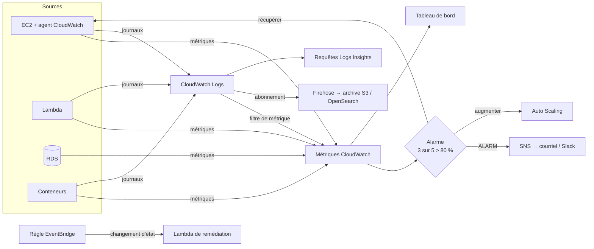

# Amazon CloudWatch — Surveillance et observabilité

> **Catégorie :** Gestion et gouvernance · **Portée :** Régionale (tableaux de bord et observabilité inter-comptes / inter-Régions pris en charge)
> [← Retour à la présentation](../AWS-core-services.md)

---

## 1. À quoi ça sert

Amazon CloudWatch **collecte et visualise des métriques, journaux, traces et événements** provenant des ressources AWS, des applications et des serveurs sur site, et **agit en conséquence** grâce aux alarmes et à l'automatisation.

Il répond aux questions opérationnelles :
- *Mon système est-il sain en ce moment ?* → **métriques, tableaux de bord**
- *Réveille-moi quand quelque chose casse* → **alarmes**
- *Que s'est-il passé et pourquoi ?* → **journaux, Logs Insights, traces**
- *Que vivent les utilisateurs ?* → **Synthetics, RUM, Application Signals**

> **CloudWatch vs CloudTrail :** CloudWatch = *performances et santé opérationnelle* (« comment ça tourne ? »). CloudTrail = *audit des API* (« qui a fait quoi ? »).

---

## 2. Composants clés

### 2.1 Métriques
Une **série chronologique de points de données** identifiée par :

| Élément | Exemple |
|---------|---------|
| **Espace de noms** | `AWS/EC2`, `AWS/RDS`, `AWS/Lambda`, `MyApp/Orders` |
| **Nom de la métrique** | `CPUUtilization`, `Invocations`, `OrdersPlaced` |
| **Dimensions** | Paires clé/valeur (jusqu'à 30) — `InstanceId=i-0abc`, `AutoScalingGroupName=web-asg` |
| **Horodatage, valeur, unité** | `2026-10-17T12:00Z, 73.5, Percent` |
| **Statistique** | `Average`, `Sum`, `Minimum`, `Maximum`, `SampleCount`, percentiles `p90`, `p99`, moyenne tronquée |
| **Période** | Fenêtre d'agrégation : 1 s, 5 s, 10 s, 30 s, 60 s ou multiples |

**Résolution et rétention**
| Période des points | Rétention |
|--------------------|-----------|
| < 60 s (haute résolution) | 3 heures |
| 60 s | 15 jours |
| 300 s (5 min) | 63 jours |
| 3 600 s (1 h) | **455 jours (15 mois)** |

**Surveillance de base vs détaillée (EC2) :** de base = métriques toutes les **5 minutes** (gratuit) ; **détaillée = 1 minute** (payant).

**Métriques EC2 par défaut :** CPUUtilization, NetworkIn/Out, DiskRead/Write (stockage d'instance), **StatusCheckFailed** (système/instance/EBS), métriques de crédits CPU.
**NON collectées par défaut :** **utilisation de la mémoire, de l'espace disque, du swap, métriques par processus** → installer l'**agent CloudWatch**.

**Métriques personnalisées :** publiez les vôtres avec `PutMetricData` (standard 1 min ou **haute résolution 1 s**), ou via l'**Embedded Metric Format (EMF)** dans les journaux (sans appels d'API, idéal pour Lambda).

**Mathématiques sur les métriques :** calculer de nouvelles séries à partir des existantes (`m1/m2*100` taux d'erreur, `SUM(METRICS())`).

### 2.2 Agent CloudWatch (unifié)
- S'exécute sur EC2, les serveurs sur site et les conteneurs (Linux, Windows, macOS).
- Collecte les **métriques système** (mémoire, disque, netstat, processus via procstat), des **métriques personnalisées StatsD/collectd**, et des **fichiers journaux**.
- Configuration stockée dans **SSM Parameter Store**, installation via **Systems Manager**.
- Nécessite un rôle IAM avec `CloudWatchAgentServerPolicy`.

### 2.3 Alarmes
Surveillent **une métrique**, une **expression mathématique** ou une **bande de détection d'anomalies** et changent d'état :

| État | Signification |
|------|---------------|
| `OK` | Dans le seuil |
| `ALARM` | Seuil franchi |
| `INSUFFICIENT_DATA` | Pas encore assez de données / métrique manquante |

Configuration : seuil, opérateur de comparaison, **période**, **périodes d'évaluation**, **points de données pour déclencher** (ex. 3 sur 5 — « M sur N » pour réduire le bruit), **traitement des données manquantes** (`missing`, `notBreaching`, `breaching`, `ignore`).

**Actions d'alarme :**
| Action | Exemple |
|--------|---------|
| **Notification SNS** | Courriel, SMS, Slack/Chatbot, PagerDuty |
| **Action EC2** | **Arrêter, résilier, redémarrer, récupérer** une instance (ex. récupérer sur `StatusCheckFailed_System`) |
| **Auto Scaling** | Politiques par paliers/simples (le suivi de cible crée ses propres alarmes) |
| **Systems Manager** | Créer un OpsItem / incident dans Incident Manager |
| **Lambda** | Invoquer directement une fonction (récent) |

**Alarmes composites :** combiner des alarmes avec `AND`/`OR`/`NOT` → réduire la fatigue d'alerte (alerter seulement si *CPU élevé ET latence élevée*).
**Détection d'anomalies :** bande ML basée sur l'historique (saisonnalité quotidienne/hebdomadaire) au lieu d'un seuil statique.

### 2.4 Tableaux de bord
- Pages d'accueil personnalisables avec graphiques, nombres, jauges, tableaux de journaux, état des alarmes, texte (Markdown).
- **Inter-comptes et inter-Régions** dans un même tableau de bord ; partageables publiquement ou avec des utilisateurs SSO.
- **Tableaux de bord automatiques** par service ; variables de tableau de bord ; jusqu'à 3 tableaux de bord gratuits (50 métriques) dans l'offre gratuite.

### 2.5 CloudWatch Logs
| Concept | Description |
|---------|-------------|
| **Groupe de journaux** | Conteneur des journaux d'une appli/d'un service, ex. `/aws/lambda/orders-api` ; porte la **rétention**, le **chiffrement KMS**, la **protection des données** |
| **Flux de journaux** | Séquence d'événements d'une source (une instance, un environnement Lambda) |
| **Événement de journal** | Horodatage + message brut (≤ 256 Ko) |
| **Rétention** | 1 jour → 10 ans, ou **N'expire jamais (par défaut !)** → définissez une rétention pour maîtriser les coûts |
| **Classes de journaux** | **Standard** vs **Infrequent Access** (ingestion moins chère, moins de fonctions) |

**Sources :** Lambda (automatique), ECS/EKS (awslogs, Fluent Bit), EC2 (agent CloudWatch), API Gateway, VPC Flow Logs, journaux de requêtes Route 53 Resolver, CloudTrail, exportations de journaux RDS, Elastic Beanstalk…

**Fonctions**
| Fonction | Objectif |
|----------|----------|
| **Logs Insights** | Langage de requête interactif (aussi SQL/OpenSearch PPL) pour rechercher et agréger les journaux |
| **Filtres de métriques** | Transformer des motifs de journaux en métriques (ex. compter les lignes `ERROR` → alarme) |
| **Filtres d'abonnement** | Diffuser les journaux en quasi temps réel vers **Lambda, Kinesis Data Streams, Firehose, OpenSearch** — aussi en inter-comptes pour une journalisation centralisée |
| **Exportation vers S3** | Export par lots (jusqu'à 12 h de délai) — pour l'archivage, préférez abonnement/Firehose |
| **Live Tail** | Vue en temps réel dans la console/CLI |
| **Politiques de protection des données** | Détecter et **masquer les données sensibles** (données personnelles, identifiants) |
| **Détection d'anomalies et analyse de motifs** | Détection ML de motifs de journaux inhabituels |
| **Index de champs, gestion centralisée des journaux** | Requêtes plus rapides, collecte à l'échelle de l'organisation |

Exemple Logs Insights — les 10 invocations Lambda les plus lentes :
```
fields @timestamp, @requestId, @duration
| filter @type = "REPORT"
| sort @duration desc
| limit 10
```

Erreurs par tranche de 5 minutes :
```
fields @timestamp, @message
| filter @message like /ERROR/
| stats count(*) as errors by bin(5m)
```

### 2.6 Événements → Amazon EventBridge
- L'ancien **CloudWatch Events** est devenu **Amazon EventBridge** (même API, plus de fonctions).
- Des **règles** correspondent à des événements (ex. *changement d'état d'une instance EC2 vers stopped*, *constat GuardDuty*, *appel d'API CloudTrail*) ou s'exécutent selon des **planifications** (cron/rate) → cibles : Lambda, SNS, SQS, Step Functions, SSM Automation, tâches ECS…
- **EventBridge Scheduler** pour des millions de planifications ponctuelles ou récurrentes.

### 2.7 Surveillance applicative et de l'expérience utilisateur
| Fonction | Objectif |
|----------|----------|
| **CloudWatch Synthetics (canaris)** | Tests scriptés Node.js/Python (Puppeteer/Selenium/Playwright) de points de terminaison/parcours UI selon une planification — détecter les pannes avant les utilisateurs |
| **CloudWatch RUM** | Surveillance des utilisateurs réels — performances du navigateur, erreurs JS, sessions |
| **Application Signals** | APM : cartes de services auto-instrumentées, SLO, métriques de latence/erreurs/défaillances (OpenTelemetry) |
| **AWS X-Ray / traces CloudWatch** | Traçage distribué entre microservices |
| **ServiceLens / carte des services** | Vue corrélée des métriques, journaux, traces |
| **Internet Monitor** | Disponibilité/performance côté Internet pour vos utilisateurs |
| **Network Flow Monitor** | Performances réseau entre charges de travail |
| **Evidently** (indicateurs de fonctionnalités) | En cours de retrait — utilisez AWS AppConfig |

### 2.8 Insights (surveillance spécialisée)
| Insight | Pour |
|---------|------|
| **Container Insights** | ECS, EKS, Kubernetes — métriques et journaux de cluster/nœud/pod/conteneur |
| **Lambda Insights** | Métriques système Lambda (mémoire, CPU, démarrages à froid) |
| **Database Insights** | Surveillance du parc RDS/Aurora (dont Performance Insights) |
| **Contributor Insights** | Top N des contributeurs à partir des journaux (IP les plus actives, clés DynamoDB chaudes) |
| **Application Insights** | Surveillance auto-configurée pour .NET, SQL Server, SAP… |

### 2.9 Observabilité inter-comptes
- Relier des **comptes sources** à un **compte de surveillance** central (via les récepteurs d'**Observability Access Manager**) pour explorer métriques, journaux et traces de toute une Organisation.

### 2.10 Autres intégrations
- **Metric Streams :** flux continu quasi temps réel de métriques vers Firehose → S3, Datadog, Splunk, New Relic…
- **CloudWatch Investigations** (analyse des causes racines assistée par IA) et requêtes en langage naturel avec **Amazon Q**.
- **Amazon Managed Service for Prometheus / Managed Grafana** pour les piles open source.

---

## 3. Fonctionnement



---

## 4. Tarification (concepts)
Offre gratuite : métriques de surveillance de base, 10 métriques personnalisées, 10 alarmes, 3 tableaux de bord, 5 Go de journaux (ingestion + archivage), 1 M de requêtes d'API. Au-delà : **métriques personnalisées** par métrique-mois, **surveillance détaillée**, **requêtes d'API** (`GetMetricData`, `PutMetricData`), **alarmes** par alarme-métrique (haute résolution et détection d'anomalies plus chères), **tableaux de bord** par mois, **ingestion de journaux par Go** (principal poste de coût), **stockage de journaux par Go-mois**, Logs Insights par Go analysé, journaux vendus, exécutions de canaris Synthetics, événements RUM, Container/Lambda Insights.

> Astuces de coûts : définir la **rétention des journaux**, éviter les journaux DEBUG en production, utiliser la classe **Infrequent Access**, filtrer avant ingestion, préférer EMF à de nombreux appels `PutMetricData`.

---

## 5. Bonnes pratiques

- [ ] Définir des **SLI/SLO** et alerter sur les symptômes visibles par les utilisateurs (latence, erreurs) — pas seulement le CPU
- [ ] Installer l'**agent CloudWatch** (via SSM) pour la mémoire/le disque sur chaque EC2
- [ ] Utiliser les **points M sur N**, les **alarmes composites** et la **détection d'anomalies** pour réduire le bruit
- [ ] Router les alarmes vers **SNS** → outils d'astreinte ; baliser les alarmes avec propriétaire/lien vers le runbook
- [ ] **Définir la rétention** de chaque groupe de journaux ; chiffrer les journaux sensibles avec KMS ; activer le masquage de **protection des données**
- [ ] Utiliser des **journaux JSON structurés** → requêtes Logs Insights plus simples
- [ ] Centraliser journaux et métriques dans un **compte de surveillance** (observabilité inter-comptes)
- [ ] Ajouter des **canaris Synthetics** pour les parcours utilisateurs critiques
- [ ] Automatiser la remédiation avec **EventBridge + Lambda / SSM Automation**
- [ ] Créer les tableaux de bord en code (CloudFormation/CDK)

---

## 6. Laboratoire pratique — Agent, alarme, filtre de métrique, Logs Insights

1. **Installer l'agent CloudWatch** sur l'instance EC2 du lab (rôle avec `CloudWatchAgentServerPolicy` + `AmazonSSMManagedInstanceCore`) :
   *Systems Manager → Run Command → `AWS-ConfigureAWSPackage` (nom `AmazonCloudWatchAgent`)*, puis configurer avec ce JSON stocké dans le paramètre SSM `AmazonCloudWatch-linux` :
   ```json
   {
     "metrics": {
       "namespace": "Lab/EC2",
       "append_dimensions": { "InstanceId": "${aws:InstanceId}" },
       "metrics_collected": {
         "mem":  { "measurement": ["mem_used_percent"] },
         "disk": { "measurement": ["used_percent"], "resources": ["/"] }
       }
     },
     "logs": { "logs_collected": { "files": { "collect_list": [
       { "file_path": "/var/log/nginx/access.log", "log_group_name": "/lab/nginx/access",
         "log_stream_name": "{instance_id}", "retention_in_days": 7 }
     ]}}}
   }
   ```
   Exécutez `AmazonCloudWatch-ManageAgent` avec l'action `configure`, source `ssm:AmazonCloudWatch-linux`.

2. **Rubrique SNS + alarme CPU :**
   ```bash
   TOPIC=$(aws sns create-topic --name lab-alerts --query TopicArn --output text)
   aws sns subscribe --topic-arn $TOPIC --protocol email --notification-endpoint vous@example.com

   aws cloudwatch put-metric-alarm --alarm-name lab-high-cpu \
     --namespace AWS/EC2 --metric-name CPUUtilization --dimensions Name=InstanceId,Value=$INSTANCE_ID \
     --statistic Average --period 60 --evaluation-periods 5 --datapoints-to-alarm 3 \
     --threshold 70 --comparison-operator GreaterThanThreshold \
     --treat-missing-data notBreaching --alarm-actions $TOPIC --ok-actions $TOPIC
   ```
3. **Générer de la charge** (via Session Manager) : `sudo dnf -y install stress-ng && stress-ng --cpu 2 --timeout 600` → vous recevez le courriel ALARM.

4. **Filtre de métrique sur les 404 + alarme :**
   ```bash
   aws logs put-metric-filter --log-group-name /lab/nginx/access --filter-name http404 \
     --filter-pattern '[ip, id, user, timestamp, request, status_code=404, size, ...]' \
     --metric-transformations metricName=Http404Count,metricNamespace=Lab/Web,metricValue=1,defaultValue=0
   for i in $(seq 1 50); do curl -s http://<instance>/nope > /dev/null; done
   ```
5. **Logs Insights :** sélectionnez `/lab/nginx/access` et exécutez
   ```
   fields @timestamp, @message
   | parse @message '* - - [*] "* * *" * *' as ip, ts, method, path, proto, status, bytes
   | stats count(*) as hits by status
   | sort hits desc
   ```
6. **Tableau de bord :** créez `Lab-Ops` avec le CPU, `mem_used_percent`, `Http404Count` et le widget d'état des alarmes.
7. **Règle EventBridge :** notifier SNS quand une instance EC2 passe à l'état `stopped`.

**Nettoyage :** supprimer alarmes, tableau de bord, filtre de métrique, groupes de journaux, rubrique SNS, règle EventBridge.

---

## 7. Conseils de certification

- **Utilisation mémoire / disque** EC2 → **agent CloudWatch** (métriques personnalisées), non disponible par défaut.
- Période de surveillance EC2 par défaut : **5 min** ; détaillée : **1 min** ; métriques personnalisées haute résolution : **1 s**.
- Récupérer automatiquement une instance en cas de panne de l'hôte → alarme sur **`StatusCheckFailed_System`** avec l'action **recover**.
- Transformer le contenu de journaux en alarme → **filtre de métrique** → alarme.
- Traitement / centralisation des journaux en temps réel → **filtre d'abonnement** (Lambda, Kinesis, Firehose).
- Les journaux n'expirent jamais par défaut → **définir la rétention**.
- Tâches planifiées / réagir aux changements d'état → **EventBridge** (anciennement CloudWatch Events).
- Réduire les fausses alarmes → **alarmes composites**, **M sur N points**, **détection d'anomalies**.
- Surveiller la disponibilité d'un site depuis l'extérieur → **canaris Synthetics** ; performances réelles des utilisateurs → **RUM**.
- Métriques ECS/EKS → **Container Insights**.
- « Qui a supprimé la ressource ? » → c'est **CloudTrail**, pas CloudWatch.
- Métriques conservées jusqu'à **15 mois**.

---

## 8. Questions de révision

1. Quelles métriques EC2 nécessitent l'agent CloudWatch ?
2. Comment être averti quand le mot `Exception` apparaît plus de 10 fois en 5 minutes dans un journal applicatif ?
3. Quelle est la différence entre surveillance de base et détaillée ?
4. Une alarme oscille toutes les quelques minutes à cause de pics brefs. Citez deux façons de corriger.
5. Combien de temps les points de données à 1 minute sont-ils conservés ?
6. Comment envoyer tous les journaux applicatifs en quasi temps réel vers un cluster OpenSearch central ?
7. Quel service a remplacé CloudWatch Events ?
8. Comment détecter que votre page de connexion est en panne avant que les clients n'appellent ?

<details>
<summary><b>Réponses</b></summary>

1. **Utilisation de la mémoire, de l'espace disque, du swap, métriques par processus** (métriques au niveau de l'OS).
2. **Filtre de métrique** sur le groupe de journaux pour `Exception` → métrique personnalisée → **alarme** (Sum > 10 sur 5 min) → **SNS**.
3. De base : métriques toutes les **5 minutes**, gratuit. Détaillée : métriques toutes les **minutes**, payant.
4. Utiliser **M sur N points de données** / des périodes d'évaluation plus longues, des **alarmes composites** ou des bandes de **détection d'anomalies**.
5. **15 jours** (puis agrégés à 5 minutes pendant 63 jours et à 1 heure pendant 15 mois).
6. Un **filtre d'abonnement** vers Firehose (ou Lambda) qui livre à **OpenSearch**.
7. **Amazon EventBridge.**
8. Un **canari CloudWatch Synthetics** qui exécute le parcours de connexion selon une planification, avec une alarme en cas d'échec.
</details>
