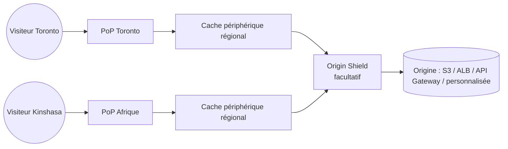
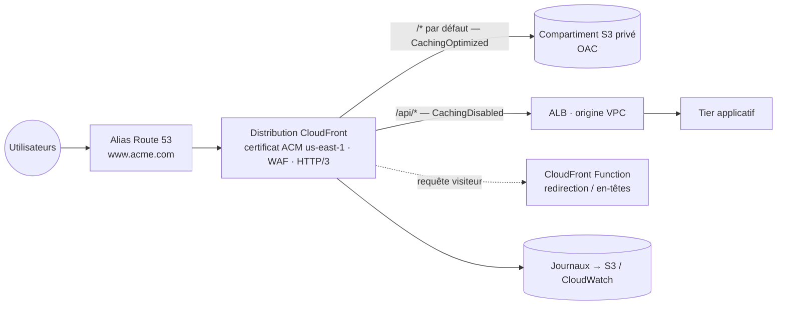

# Amazon CloudFront — Réseau de diffusion de contenu (CDN)

> **Catégorie :** Réseau et diffusion de contenu · **Portée :** Mondiale (configuration), servie depuis des centaines d'emplacements périphériques
> [← Retour à la présentation](../AWS-core-services.md)

---

## 1. À quoi ça sert

CloudFront est le **réseau mondial de diffusion de contenu** d'AWS. Il met en cache et distribue du contenu statique et dynamique (pages web, images, vidéo, API, téléchargements logiciels) depuis des **emplacements périphériques proches de vos utilisateurs**, ce qui réduit la latence et soulage votre origine.

Avantages :
- **Performance :** contenu servi depuis le point de présence (PoP) le plus proche ; connexions persistantes optimisées vers l'origine via le réseau dorsal AWS
- **Sécurité :** TLS partout, protection DDoS **AWS Shield Standard** incluse, intégration **AWS WAF**, masquage de l'origine
- **Coût :** le transfert des origines AWS vers CloudFront est gratuit ; la sortie CloudFront coûte souvent moins cher que la sortie directe S3/EC2
- **Programmabilité :** exécuter du code en périphérie (CloudFront Functions, Lambda@Edge)

---

## 2. Composants clés

### 2.1 Distribution
- L'objet de configuration CloudFront, avec un domaine du type `d111abcdef8.cloudfront.net`.
- Ajout de **noms de domaine alternatifs (CNAME)** comme `www.acme.com` — exige un **certificat ACM dans `us-east-1`** et un enregistrement **Alias** Route 53.
- Paramètres : classe de prix, versions HTTP (HTTP/2, **HTTP/3**), IPv6, objet racine par défaut (`index.html`), journalisation, ACL web WAF, restrictions géographiques.
- **Distributions multi-locataires / SaaS Manager** (récent) pour servir de nombreux domaines clients à partir d'une seule configuration.

### 2.2 Réseau périphérique
| Composant | Rôle |
|-----------|------|
| **Emplacements périphériques (PoP)** | Des centaines de sites dans le monde qui mettent en cache et servent le contenu aux visiteurs |
| **Caches périphériques régionaux (REC)** | Caches intermédiaires plus grands entre les PoP et l'origine — conservent plus longtemps le contenu moins populaire |
| **Origin Shield** | **Couche de cache centralisée supplémentaire** facultative, dans une Région, devant l'origine → meilleur taux de succès du cache, moins de charge sur l'origine |
| **PoP intégrés** | Caches au sein des réseaux de FAI pour les très grands événements |



### 2.3 Origines
| Type d'origine | Remarques |
|----------------|-----------|
| **Compartiment S3 (point de terminaison REST)** | Garder le compartiment **privé** ; accès via **Origin Access Control (OAC)** — successeur de l'**Origin Access Identity (OAI)** héritée ; prend en charge SSE-KMS |
| **Point de terminaison de site web statique S3** | Origine personnalisée (HTTP uniquement vers l'origine) ; nécessaire pour les redirections de site web S3 |
| **Application Load Balancer / EC2** | Origine personnalisée ; peut être une **origine VPC** (ALB/NLB/EC2 privé dans des sous-réseaux privés — aucune exposition publique) |
| **API Gateway, URL de fonction Lambda** | API dynamiques en périphérie |
| **MediaStore / MediaPackage** | Diffusion vidéo |
| **Tout serveur HTTP** | Sur site ou autres clouds |

**Groupes d'origines :** origine principale + secondaire pour le **basculement d'origine** sur des codes HTTP précis (ex. 500, 502, 503, 504) — requêtes GET/HEAD/OPTIONS.

Protéger les origines personnalisées : n'autoriser que la **liste de préfixes gérée CloudFront** dans le SG de l'ALB + exiger un **en-tête personnalisé secret** vérifié par l'ALB/WAF — ou utiliser des **origines VPC**.

### 2.4 Comportements de cache
Règles associées à un **modèle de chemin** (dans l'ordre), chacune avec sa propre origine et ses paramètres :

| Modèle de chemin | Origine | Exemple de paramètres |
|------------------|---------|-----------------------|
| `/api/*` | ALB | Politique CachingDisabled, transmettre tous les en-têtes/cookies, autoriser POST/PUT/DELETE |
| `/images/*` | S3 | Politique CachingOptimized, TTL long, compression |
| `Par défaut (*)` | S3 | `index.html` SPA |

Chaque comportement définit : la **politique de protocole visiteur** (HTTP et HTTPS / rediriger HTTP→HTTPS / HTTPS uniquement), les méthodes HTTP autorisées, la **politique de cache**, la **politique de requête d'origine**, la **politique d'en-têtes de réponse**, la compression (Gzip/Brotli), l'**exigence d'URL/cookies signés**, les **associations de fonctions**.

### 2.5 Cache — politiques et TTL
- **Clé de cache** = ce qui rend un objet unique dans le cache : par défaut le chemin de l'URL ; éventuellement certains **paramètres de requête, en-têtes, cookies**. Moins d'éléments → **meilleur taux de succès du cache**.
- **Politique de cache :** clé de cache + TTL (min / par défaut / max). Politiques gérées : `CachingOptimized`, `CachingDisabled`, `UseOriginCacheControlHeaders`…
- **Politique de requête d'origine :** valeurs envoyées à l'origine **sans** faire partie de la clé de cache (ex. `User-Agent` pour la journalisation).
- **Politique d'en-têtes de réponse :** ajouter des en-têtes de sécurité (HSTS, CSP, X-Frame-Options), des en-têtes CORS.
- Les en-têtes `Cache-Control: max-age` / `Expires` de l'origine sont respectés dans les bornes min/max du TTL. TTL par défaut = 24 h.

**Invalidations :** retirer des objets des caches périphériques avant l'expiration du TTL (`/images/*` ou `/*`). Les 1 000 premiers chemins par mois sont gratuits, puis facturés. **Meilleure pratique :** des **noms de fichiers versionnés** (`app.3f9a1c.js`) — aucune invalidation nécessaire et pas de contenu périmé.

### 2.6 Fonctions de sécurité
| Fonction | Objectif |
|----------|----------|
| **HTTPS / TLS** | Certificats visiteurs **ACM (us-east-1)**, **SNI** (gratuit) ou IP dédiée (héritage, coûteux) ; politique de sécurité (version TLS minimale) |
| **Origin Access Control (OAC)** | Seul CloudFront peut lire le compartiment S3 privé (requêtes signées SigV4) |
| **URL signées** | Restreindre l'accès à **un fichier** (ex. un téléchargement payant), expiration, plage d'IP facultative |
| **Cookies signés** | Restreindre l'accès à **plusieurs fichiers** (ex. toute une vidéothèque premium) sans changer les URL |
| Groupes de clés approuvées | Clés publiques servant à vérifier les URL/cookies signés (préférables aux anciennes paires de clés du compte root) |
| **Restrictions géographiques** | Liste d'autorisation / de blocage de pays (licences, sanctions) |
| **AWS WAF** | ACL web en périphérie : groupes de règles gérés (OWASP, injection SQL, XSS, robots malveillants), règles de limitation de débit, ensembles d'IP, correspondance géographique |
| **AWS Shield Standard** | Protection DDoS automatique couches 3/4 (gratuite) ; **Shield Advanced** pour une protection renforcée, équipe DRT 24/7, protection des coûts |
| **Chiffrement au niveau des champs** | Chiffrer certains champs POST en périphérie |
| **Journaux en temps réel / standard** | Journaux d'accès vers S3 / CloudWatch Logs / Kinesis Data Streams |

**URL signée CloudFront vs URL pré-signée S3 :** les URL signées CloudFront passent par le CDN, pour toute origine, avec mise en cache ; les URL pré-signées S3 vont directement à S3 avec les permissions IAM du signataire.

### 2.7 Calcul en périphérie
| | **CloudFront Functions** | **Lambda@Edge** |
|---|--------------------------|-----------------|
| Runtime | JavaScript (léger) | Node.js, Python |
| Lieu d'exécution | **Tous les emplacements périphériques (PoP)** | **Caches périphériques régionaux** |
| Déclencheurs | Requête visiteur, réponse visiteur | Requête/réponse visiteur **+ requête/réponse d'origine** |
| Durée d'exécution max | < 1 ms | 5 s (visiteur) / 30 s (origine) |
| Accès réseau / corps | ❌ Pas de réseau, pas de corps | ✅ Appels réseau, corps de la requête |
| Échelle et coût | Millions de req/s, ~1/6 du prix de Lambda@Edge | Milliers de req/s |
| Cas d'usage | Manipulation d'en-têtes, réécritures/redirections d'URL, normalisation de la clé de cache, validation JWT simple, cookies A/B | Authentification avec un IdP externe, choix dynamique de l'origine, redimensionnement d'images, rendu SEO |

**CloudFront KeyValueStore :** données clé-valeur à faible latence lisibles depuis CloudFront Functions (tables de redirection, indicateurs de fonctionnalités).

### 2.8 Classes de prix
| Classe de prix | Emplacements périphériques utilisés |
|----------------|-------------------------------------|
| **All** | Toutes les régions — meilleures performances |
| **200** | La plupart des régions, sauf les plus coûteuses |
| **100** | Seulement les régions les moins chères (Amérique du Nord, Europe) |

### 2.9 Autres fonctions
- **Déploiement continu :** une distribution de préproduction reçoit un pourcentage du trafic ou un trafic basé sur un en-tête pour tester des changements de configuration avant promotion.
- **Pages d'erreur personnalisées** (ex. renvoyer `/index.html` avec 200 pour 403/404 → applications monopage).
- **Compression** (Gzip, Brotli), **requêtes de plage**, **WebSockets**, **gRPC**.
- **Forfaits CloudFront à tarif fixe** (récents) regroupant CDN, WAF et protection DDoS — vérifiez la disponibilité.

### 2.10 CloudFront vs alternatives
| Besoin | Service |
|--------|---------|
| Mettre en cache du contenu HTTP(S) en périphérie | **CloudFront** |
| Améliorer les performances **non HTTP (TCP/UDP)**, **IP anycast statiques**, basculement régional rapide | **AWS Global Accelerator** (pas de cache) |
| Répliquer des données S3 dans une autre Région | Réplication inter-Régions S3 (pas un CDN) |

---

## 3. Architecture de référence — Site statique sécurisé + API



---

## 4. Tarification (concepts)
Transfert de données vers les visiteurs (varie selon la géographie), requêtes HTTP/HTTPS (par tranche de 10 000), chemins d'invalidation au-delà du quota gratuit, requêtes Origin Shield, invocations et durée de CloudFront Functions / Lambda@Edge, journaux en temps réel, chiffrement au niveau des champs, SSL personnalisé à IP dédiée. **Gratuit :** transfert des origines AWS vers CloudFront, certificats ACM, Shield Standard. L'**offre gratuite permanente** inclut un quota mensuel de transfert et de requêtes. Économies via le **CloudFront Security Savings Bundle** ou une tarification privée pour les gros engagements.

---

## 5. Bonnes pratiques

- [ ] Garder les origines S3 **privées** avec **OAC** ; ne jamais rendre le compartiment public
- [ ] Restreindre les origines personnalisées (liste de préfixes + en-tête secret, ou **origines VPC**)
- [ ] **Rediriger HTTP → HTTPS**, politique de sécurité TLS 1.2+, en-têtes de sécurité via une politique d'en-têtes de réponse
- [ ] Associer **AWS WAF** avec règles gérées + limitation de débit
- [ ] Minimiser la clé de cache ; utiliser des **noms de ressources versionnés** plutôt que des invalidations
- [ ] Séparer les comportements de cache pour les chemins statiques et dynamiques
- [ ] Activer **Origin Shield** pour les origines desservant de nombreux PoP/visiteurs
- [ ] Utiliser des **groupes d'origines** pour le basculement
- [ ] Préférer **CloudFront Functions** pour la logique périphérique simple
- [ ] Activer la journalisation et surveiller `CacheHitRate`, `4xxErrorRate`, `5xxErrorRate`, `OriginLatency`

---

## 6. Laboratoire pratique — Site S3 privé derrière CloudFront avec OAC

**Prérequis :** compartiment privé issu du [lab S3](../Stockage/S3.md) contenant `index.html` (blocage de l'accès public ACTIVÉ).

1. **Console :** *CloudFront → Créer une distribution*
   - Domaine d'origine : sélectionnez votre compartiment S3 (point de terminaison REST, **pas** le point de terminaison de site web)
   - Accès à l'origine : **Paramètres Origin Access Control (recommandé)** → *Créer un nouvel OAC*
   - Politique de protocole visiteur : **Rediriger HTTP vers HTTPS**
   - Politique de cache : **CachingOptimized**
   - Objet racine par défaut : `index.html`
   - WAF : activer les protections de sécurité (facultatif en lab)
2. **Copiez la politique de compartiment générée** et appliquez-la :
   ```json
   {
     "Version": "2012-10-17",
     "Statement": [{
       "Sid": "AllowCloudFrontOAC",
       "Effect": "Allow",
       "Principal": { "Service": "cloudfront.amazonaws.com" },
       "Action": "s3:GetObject",
       "Resource": "arn:aws:s3:::<BUCKET>/*",
       "Condition": { "StringEquals": {
         "AWS:SourceArn": "arn:aws:cloudfront::<ACCOUNT_ID>:distribution/<DIST_ID>" } }
     }]
   }
   ```
3. Attendez l'état **Deployed**, puis :
   ```bash
   curl -I https://<dist>.cloudfront.net/            # 200, en-tête x-cache: Miss from cloudfront
   curl -I https://<dist>.cloudfront.net/            # x-cache: Hit from cloudfront
   curl -I https://<BUCKET>.s3.ca-central-1.amazonaws.com/index.html   # 403 — le compartiment reste privé
   ```
4. **Modifiez le contenu** → toujours l'ancienne version (en cache). Lancez une invalidation :
   ```bash
   aws cloudfront create-invalidation --distribution-id <DIST_ID> --paths "/index.html"
   ```
5. **CloudFront Function** (requête visiteur) — ajouter une redirection `/old → /` :
   ```javascript
   function handler(event) {
     var req = event.request;
     if (req.uri === '/old') {
       return { statusCode: 301, statusDescription: 'Moved Permanently',
                headers: { location: { value: '/' } } };
     }
     return req;
   }
   ```
6. **Facultatif :** domaine personnalisé — demandez un certificat ACM dans **us-east-1**, ajoutez `www.votredomaine` comme domaine alternatif, créez un **Alias** Route 53 vers la distribution.

**Nettoyage :** désactiver la distribution → attendre → supprimer ; supprimer la fonction, l'OAC, le certificat s'il n'est plus utilisé.

---

## 7. Conseils de certification

- Utilisateurs mondiaux + latence du contenu statique → **CloudFront** (cache). Non HTTP / IP statique / sans cache → **Global Accelerator**.
- Restreindre S3 à CloudFront uniquement → **OAC** (OAI est héritée).
- Contenu payant : un fichier → **URL signée** ; plusieurs fichiers → **cookies signés**.
- Bloquer des pays → **restrictions géographiques** (ou correspondance géographique WAF pour des règles plus fines).
- HTTPS avec domaine personnalisé sur CloudFront → **certificat ACM dans `us-east-1`**.
- Protection contre l'injection SQL/XSS en périphérie → **AWS WAF** sur CloudFront ; DDoS → **Shield** (Standard gratuit, Advanced payant).
- Basculement d'origine → **groupes d'origines**.
- Manipulation légère d'en-têtes/URL à très grande échelle → **CloudFront Functions** ; appels réseau / événements d'origine → **Lambda@Edge**.
- Réduire la charge sur l'origine depuis de nombreuses régions → **Origin Shield**.
- Contenu mis à jour mais les utilisateurs voient l'ancienne version → **invalidation** ou noms de fichiers versionnés / TTL plus court.
- Réduire les coûts en limitant les emplacements périphériques → **classe de prix**.

---

## 8. Questions de révision

1. Dans quelle Région le certificat d'un domaine personnalisé sur CloudFront doit-il se trouver ?
2. Comment s'assurer que les utilisateurs ne peuvent pas contourner CloudFront et lire directement le compartiment S3 ?
3. Une plateforme vidéo doit restreindre l'accès à tout un catalogue premium. URL signées ou cookies signés ?
4. Quelle est la différence entre CloudFront Functions et Lambda@Edge en matière de points de déclenchement ?
5. Des utilisateurs en Asie signalent un accès lent, et votre classe de prix est 100. Pourquoi ?
6. Pourquoi ajouter tous les en-têtes à la clé de cache nuit-il aux performances ?
7. Quelle fonction permet à CloudFront de basculer vers une origine de secours quand la principale renvoie 503 ?
8. Une entreprise de jeux a besoin d'IP statiques et d'un basculement rapide pour du trafic UDP. CloudFront ou Global Accelerator ?

<details>
<summary><b>Réponses</b></summary>

1. Un certificat ACM dans **us-east-1 (Virginie du Nord)**.
2. Garder le compartiment privé, configurer **OAC**, et une politique de compartiment n'autorisant que le principal de service CloudFront avec `AWS:SourceArn` = la distribution.
3. **Cookies signés** (plusieurs fichiers).
4. CloudFront Functions : **requête/réponse visiteur** uniquement. Lambda@Edge : requête/réponse visiteur **et d'origine**.
5. La classe de prix 100 ne sert que depuis les emplacements d'Amérique du Nord/Europe — les visiteurs asiatiques sont servis depuis des sites éloignés → utilisez la **classe de prix All** (ou 200).
6. Chaque variation d'en-tête crée une entrée de cache distincte → **taux de succès du cache plus faible**, plus de requêtes vers l'origine.
7. Les **groupes d'origines** (basculement d'origine).
8. **Global Accelerator.**
</details>
