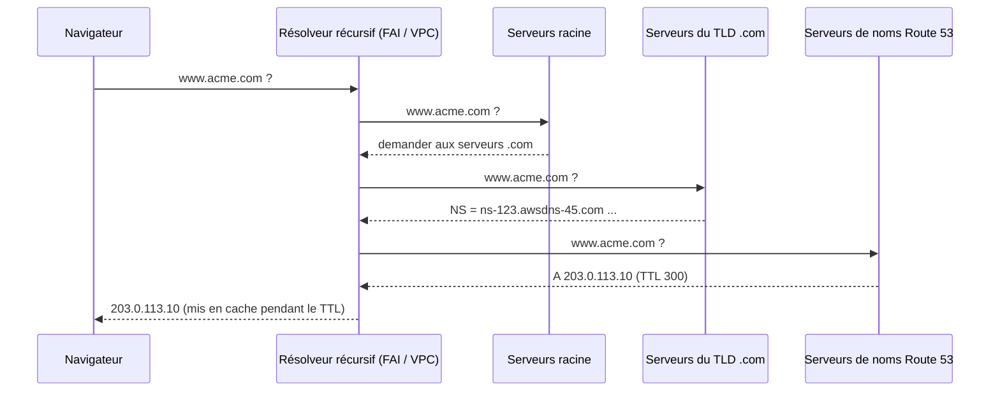
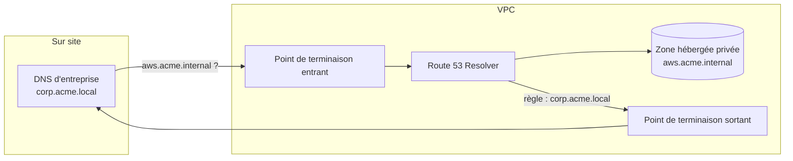
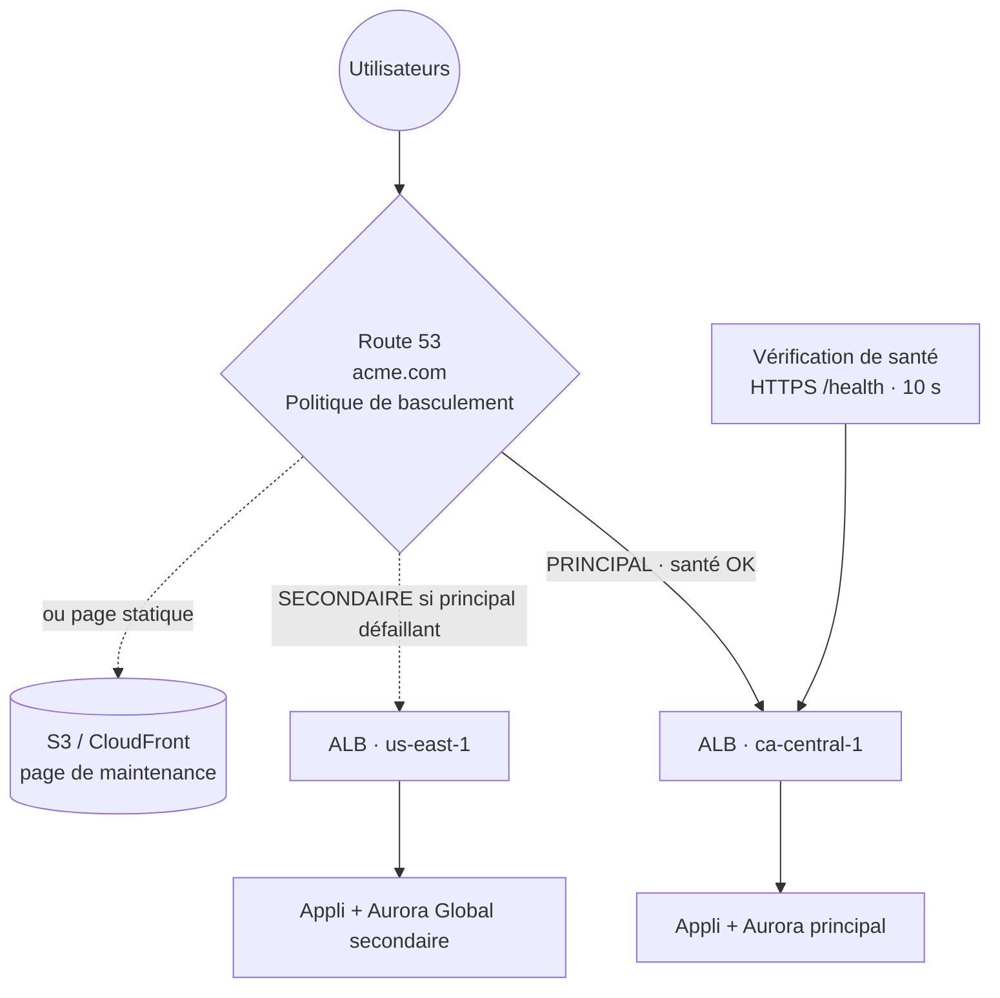

# Amazon Route 53 — DNS, enregistrement de domaines et vérifications de santé

> **Catégorie :** Réseau et diffusion de contenu · **Portée :** Mondiale · **SLA :** 100 % de disponibilité (le seul service AWS avec un SLA de 100 %)
> [← Retour à la présentation](../AWS-core-services.md)

---

## 1. À quoi ça sert

Route 53 est le **service DNS (Domain Name System) hautement disponible et évolutif** d'AWS. Son nom fait référence au **port 53** TCP/UDP utilisé par le DNS. Il assure quatre fonctions :

1. **Enregistrement de domaines** — acheter et renouveler des noms de domaine (`.com`, `.ca`, `.cd`…)
2. **DNS faisant autorité** — répondre aux requêtes pour vos domaines (publics et privés)
3. **Vérifications de santé** — surveiller des points de terminaison et éviter ceux qui sont défaillants
4. **Gestion du trafic** — politiques de routage (latence, géolocalisation, pondéré, basculement…)

S'y ajoute **Route 53 Resolver** pour le DNS dans les VPC et les réseaux hybrides.

---

## 2. Notions de base du DNS (rappel rapide)



| Terme | Signification |
|-------|---------------|
| **FQDN** | Nom de domaine pleinement qualifié, ex. `api.eu.acme.com.` |
| **TLD** | Domaine de premier niveau (`.com`, `.ca`, `.org`) |
| **Apex de zone / domaine racine** | `acme.com` lui-même (sans sous-domaine) |
| **TTL** | Secondes pendant lesquelles un résolveur met un enregistrement en cache — TTL élevé = moins de requêtes, changements plus lents |
| **Serveur de noms faisant autorité** | Serveur qui détient les enregistrements réels de la zone |

---

## 3. Composants clés

### 3.1 Enregistrement de domaines
- Enregistrer ou **transférer** des domaines ; Route 53 agit comme registraire (ou via ses registraires partenaires).
- Création automatique d'une zone hébergée publique ; renouvellement automatique ; protection de la confidentialité WHOIS pour les TLD pris en charge ; **verrouillage du domaine** contre les transferts non autorisés.
- Vous pouvez utiliser le DNS Route 53 avec un domaine enregistré ailleurs — il suffit de mettre à jour les **enregistrements NS chez le registraire**.

### 3.2 Zones hébergées
| Type | Répond aux requêtes provenant de | Usage |
|------|----------------------------------|-------|
| **Zone hébergée publique** | Internet | Site web, API `acme.com` |
| **Zone hébergée privée** | Un ou plusieurs **VPC associés** (même inter-comptes) | Noms internes `db.internal.acme.com` ; exige `enableDnsSupport` + `enableDnsHostnames` |

- Chaque zone hébergée publique reçoit **4 serveurs de noms** (ensemble de délégation) répartis sur différents TLD.
- **DNS à horizon partagé (split-horizon) :** même nom de domaine dans une zone publique et une zone privée → réponses différentes à l'intérieur et à l'extérieur du VPC.
- Facturation par zone hébergée et par mois + par requête.

### 3.3 Types d'enregistrements

| Type | Rôle | Exemple |
|------|------|---------|
| **A** | Nom → IPv4 | `www → 203.0.113.10` |
| **AAAA** | Nom → IPv6 | `www → 2001:db8::10` |
| **CNAME** | Nom → autre nom (**interdit à l'apex de zone**) | `blog → acme.wordpress.com` |
| **Alias** (extension Route 53) | Nom → ressource AWS, **autorisé à l'apex de zone**, requêtes gratuites, suit automatiquement les changements d'IP | `acme.com → d111.cloudfront.net` |
| **MX** | Serveurs de messagerie avec priorité | `10 mail.acme.com` |
| **TXT** | Texte — SPF, DKIM, vérification de domaine | `"v=spf1 include:amazonses.com ~all"` |
| **NS** | Serveurs de noms de la zone / délégation d'un sous-domaine | |
| **SOA** | Start of Authority — métadonnées de la zone | |
| **SRV** | Emplacement d'un service (hôte + port) | VoIP, AD |
| **CAA** | Autorités de certification autorisées à émettre des certificats | `0 issue "amazon.com"` |
| **PTR** | DNS inverse (IP → nom) | |
| **DS** | Signataire de délégation DNSSEC | |
| **HTTPS / SVCB** | Enregistrements de liaison de service (indications HTTP/3) | |

### 3.4 Enregistrement Alias vs CNAME

| | **Alias** | **CNAME** |
|---|-----------|-----------|
| Apex de zone (`acme.com`) | ✅ Oui | ❌ Non |
| Cibles | Ressources AWS : **CloudFront, ELB (ALB/NLB), site web S3, API Gateway, point de terminaison d'interface VPC, Global Accelerator, Elastic Beanstalk, autre enregistrement de la même zone** | N'importe quel nom DNS |
| Coût des requêtes | **Gratuit** pour un alias vers une ressource AWS | Facturé |
| TTL | Défini par AWS (hérité de la cible) | Défini par vous |
| **Ne peut pas cibler** | **Le nom DNS d'une instance EC2** | — |

> Préférez toujours **Alias** pour les ressources AWS.

### 3.5 Politiques de routage

| Politique | Réponse | Vérifications de santé | Usage typique |
|-----------|---------|------------------------|---------------|
| **Simple** | Un enregistrement, éventuellement à plusieurs valeurs (le client choisit au hasard) | ❌ Non | Ressource unique |
| **Pondérée** | Répartit selon un poids relatif (ex. 90/10) ; poids 0 = plus de trafic | ✅ | Canari/bleu-vert, tests A/B |
| **Basée sur la latence** | Région avec la **latence mesurée la plus faible** pour l'utilisateur | ✅ | Applications mondiales multi-Régions |
| **Basculement** (actif-passif) | **Principal** tant qu'il est sain, sinon **secondaire** | ✅ **Obligatoire sur le principal** | DR : Région principale → Région de secours / page de maintenance S3 |
| **Géolocalisation** | Selon le **continent / pays / État américain** de l'utilisateur ; prévoir un enregistrement **par défaut** | ✅ | Localisation du contenu, restrictions légales, licences |
| **Géoproximité** | Selon la distance géographique avec un **biais** pour étendre/réduire des zones (via Traffic Flow) | ✅ | Déplacer la charge entre Régions |
| **Basée sur l'IP** | Selon le **CIDR source** du client | ✅ | Routage par FAI, optimisation des coûts |
| **Réponse à valeurs multiples** | Renvoie jusqu'à **8 enregistrements sains** au hasard | ✅ | Répartition simple côté client (ne remplace pas un ELB) |

**Traffic Flow** — éditeur visuel pour construire des politiques imbriquées complexes (ex. latence → puis pondérée → puis basculement), enregistrées sous forme de **politiques de trafic** versionnées.

### 3.6 Vérifications de santé (health checks)
| Type | Surveille |
|------|-----------|
| **Point de terminaison** | IP ou domaine via HTTP, HTTPS ou TCP ; **recherche de chaîne** facultative dans les 5 120 premiers octets de la réponse |
| **Calculée** | Combine jusqu'à 256 vérifications enfants avec une logique ET/OU/au moins N |
| **Alarme CloudWatch** | Santé = état de l'alarme → surveiller des **ressources privées** (les vérificateurs sont sur Internet et ne joignent pas directement les IP privées) |

- ~15 vérificateurs répartis dans le monde ; point de terminaison sain si > 18 % des vérificateurs le déclarent sain.
- Intervalle de **30 s** (standard) ou **10 s** (rapide, en supplément) ; seuil d'échec par défaut de 3.
- Les plages d'IP des vérificateurs doivent être **autorisées dans vos SG/pare-feu**.
- Peuvent publier des métriques CloudWatch et déclencher des alarmes SNS.

### 3.7 Route 53 Resolver (DNS du VPC)
- Chaque VPC dispose du **DNS fourni par Amazon** (CIDR du VPC + 2) qui répond pour les noms publics, les zones hébergées privées et les noms internes EC2.
- **Point de terminaison entrant :** les serveurs DNS sur site transfèrent les requêtes **vers AWS** (résolution des zones privées depuis le site).
- **Point de terminaison sortant + règles de transfert :** les ressources AWS transfèrent des domaines précis (ex. `corp.acme.local`) **vers le DNS sur site**.
- Les règles peuvent être partagées entre comptes avec **AWS RAM**.
- **Resolver DNS Firewall :** listes de domaines autorisés/bloqués pour le DNS sortant (stopper l'exfiltration de données, les domaines malveillants).
- **Journalisation des requêtes Resolver** vers CloudWatch Logs, S3 ou Firehose.
- **Route 53 Profiles :** partager la configuration DNS (zones privées, règles, pare-feu) entre de nombreux VPC/comptes.



### 3.8 DNSSEC
- **Signature DNSSEC** des zones hébergées publiques (protège contre l'usurpation / l'empoisonnement de cache) avec une clé KMS asymétrique (obligatoirement dans `us-east-1`) ; établir la chaîne de confiance avec un **enregistrement DS** dans la zone parente.
- **Validation DNSSEC** activable sur Route 53 Resolver pour les VPC.

### 3.9 Application Recovery Controller (ARC)
Pour les applications multi-Régions / multi-AZ : **vérifications de préparation**, **contrôles de routage** (interrupteurs marche/arrêt adossés à des plans de données hautement disponibles) et **décalage zonal (zonal shift)** pour éloigner le trafic d'une AZ dégradée — utilisés dans les procédures de DR en entreprise.

---

## 4. Architecture de référence — Basculement multi-Régions



---

## 5. Tarification (concepts)
Zones hébergées par mois ; requêtes standard et de latence/géo/IP par million (géo/latence plus chères) ; **les requêtes Alias vers des ressources AWS sont gratuites** ; vérifications de santé par mois (points de terminaison AWS moins chers ; HTTPS, recherche de chaîne, intervalle rapide en supplément) ; enregistrement de domaine par an (selon le TLD) ; points de terminaison Resolver par ENI-heure + par requête ; DNS Firewall par domaine/requête ; Traffic Flow par enregistrement de politique.

---

## 6. Bonnes pratiques

- [ ] Utiliser des enregistrements **Alias** pour tous les points de terminaison AWS (y compris l'apex de zone)
- [ ] Choisir les TTL délibérément : bas (60 s) **avant** les migrations/basculements, élevés (300–86 400 s) pour les enregistrements stables
- [ ] Associer des **vérifications de santé** à chaque enregistrement de basculement/latence/pondéré devant des points de terminaison critiques
- [ ] Utiliser des **zones hébergées privées** pour les noms de services internes ; éviter les IP codées en dur
- [ ] Activer le **verrouillage du domaine**, le renouvellement automatique et **DNSSEC** pour les domaines publics importants
- [ ] Utiliser des **points de terminaison Resolver + règles partagées via RAM** pour le DNS hybride dans un VPC central
- [ ] Activer la **journalisation des requêtes** et **DNS Firewall** dans les environnements réglementés
- [ ] Gérer les enregistrements en code (CloudFormation/Terraform), pas à la main

---

## 7. Laboratoire pratique — Routage pondéré et basculement

> Nécessite un domaine enregistré dans Route 53 ou délégué vers lui (n'importe quel TLD bon marché). À défaut, entraînez-vous avec une **zone hébergée privée** associée à votre VPC de lab.

1. **Créer une zone hébergée** (si vous n'en avez pas) :
   ```bash
   aws route53 create-hosted-zone --name lab.example.com --caller-reference $(date +%s)
   ZONE_ID=<Id renvoyé>
   ```
2. **Enregistrements pondérés** — deux serveurs web (IP publiques EC2 ou deux ALB) :
   ```bash
   cat > weighted.json <<'EOF'
   {"Changes":[
    {"Action":"UPSERT","ResourceRecordSet":{"Name":"app.lab.example.com","Type":"A",
      "SetIdentifier":"blue","Weight":90,"TTL":60,
      "ResourceRecords":[{"Value":"203.0.113.10"}]}},
    {"Action":"UPSERT","ResourceRecordSet":{"Name":"app.lab.example.com","Type":"A",
      "SetIdentifier":"green","Weight":10,"TTL":60,
      "ResourceRecords":[{"Value":"203.0.113.20"}]}}
   ]}
   EOF
   aws route53 change-resource-record-sets --hosted-zone-id $ZONE_ID --change-batch file://weighted.json
   for i in $(seq 1 20); do dig +short app.lab.example.com @<un-de-vos-NS>; done | sort | uniq -c
   ```
3. **Vérification de santé + basculement :**
   ```bash
   HC=$(aws route53 create-health-check --caller-reference hc-$(date +%s) \
     --health-check-config IPAddress=203.0.113.10,Port=80,Type=HTTP,ResourcePath=/,RequestInterval=30,FailureThreshold=3 \
     --query HealthCheck.Id --output text)
   ```
   Créez `www` en **basculement PRIMARY** (avec `HealthCheckId=$HC`) → serveur 1, et **SECONDARY** → serveur 2 (ou un alias vers un site web S3).
4. **Simuler une panne :** arrêtez nginx sur le serveur 1 → après ~90 s la vérification échoue → `dig` renvoie le serveur 2.
5. **Alias vers CloudFront/ALB :** créez un enregistrement `A`, **Alias = Oui**, choisissez la distribution — notez que l'apex fonctionne.

**Nettoyage :** supprimer les enregistrements (sauf NS/SOA), les vérifications de santé, puis la zone hébergée.

---

## 8. Conseils de certification

- Faire pointer l'**apex de zone** vers une ressource AWS → **Alias** (CNAME interdit à l'apex). Un Alias **ne peut pas** pointer vers un nom DNS EC2.
- Latence minimale pour des utilisateurs mondiaux → **routage basé sur la latence**.
- Servir le contenu selon le pays de l'utilisateur / contraintes légales → **géolocalisation** (+ un enregistrement **par défaut**).
- Déplacer progressivement le trafic entre Régions avec un biais → **géoproximité** (Traffic Flow).
- DR actif-passif → **routage de basculement + vérifications de santé**.
- Bleu/vert ou canari au niveau DNS → **routage pondéré**.
- Renvoyer plusieurs IP saines → **réponse à valeurs multiples** (jusqu'à 8).
- Surveiller une ressource privée → vérification de santé basée sur une **alarme CloudWatch**.
- Résoudre des noms sur site depuis un VPC → **point de terminaison sortant Resolver + règle de transfert** ; résoudre des zones privées AWS depuis le site → **point de terminaison entrant**.
- Changements DNS pas encore visibles → mise en cache selon le **TTL**.
- Route 53 est **mondial** et dispose d'un **SLA de disponibilité de 100 %**.

---

## 9. Questions de révision

1. Pourquoi ne peut-on pas créer un CNAME pour `acme.com` pointant vers un ALB, et que faut-il utiliser ?
2. Quelle politique de routage envoie les utilisateurs européens vers un site français hébergé dans l'UE et les autres vers le site par défaut ?
3. Comment router le trafic vers une Région de secours uniquement si la principale est défaillante ?
4. Votre vérification de santé déclare un serveur web EC2 défaillant, mais le site fonctionne depuis votre portable. Qu'est-ce qui cloche ?
5. Des serveurs sur site doivent résoudre `db.aws.acme.internal` (zone hébergée privée). Que configurez-vous ?
6. Quelle est la différence entre le routage basé sur la latence et la géolocalisation ?
7. Vous prévoyez une migration la semaine prochaine. Que faire dès maintenant avec le TTL des enregistrements concernés ?
8. Quel type d'enregistrement utiliser pour prouver la propriété d'un domaine à un fournisseur SaaS ?

<details>
<summary><b>Réponses</b></summary>

1. La norme DNS interdit le CNAME à l'apex de zone — utilisez un **enregistrement Alias A/AAAA** pointant vers l'ALB.
2. **Routage par géolocalisation** avec un enregistrement Europe (continent) et un enregistrement **par défaut**.
3. **Routage de basculement** : enregistrement principal avec **vérification de santé**, enregistrement secondaire dans la Région de secours.
4. Le **groupe de sécurité / la NACL / le pare-feu** n'autorise pas les **plages d'IP des vérificateurs Route 53** (ou le chemin / la chaîne recherchée est incorrect).
5. Un **point de terminaison entrant Route 53 Resolver** dans le VPC ; configurez le DNS sur site pour **transférer** ce domaine vers les IP du point de terminaison.
6. La **latence** choisit la Région offrant la meilleure latence réseau mesurée ; la **géolocalisation** choisit selon l'emplacement géographique de l'utilisateur, indépendamment de la latence.
7. **Réduire le TTL** (ex. 60 s) bien à l'avance pour que les enregistrements en cache expirent rapidement lors de la bascule.
8. Un enregistrement **TXT**.
</details>
