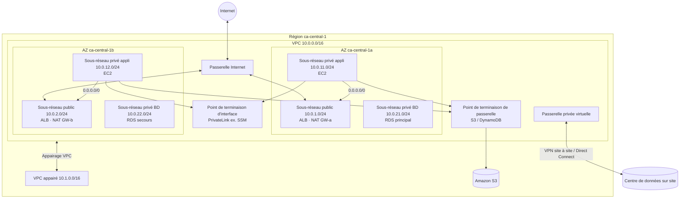
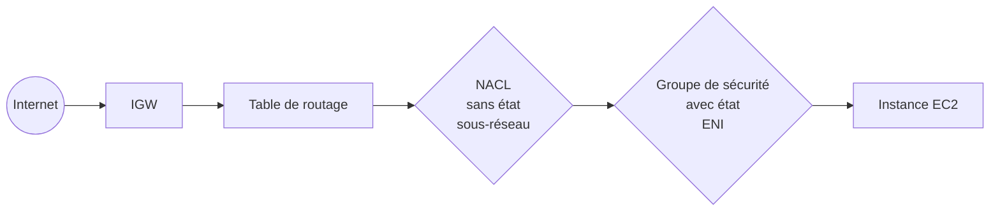

# VPC — Cloud privé virtuel (Virtual Private Cloud)

> **Catégorie :** Réseau et diffusion de contenu · **Portée :** Régionale (couvre toutes les AZ d'une Région) · **Coût :** le VPC est gratuit ; certains composants sont facturés à l'heure
> [← Retour à la présentation](../AWS-core-services.md)

---

## 1. À quoi ça sert

Un VPC est un **réseau virtuel logiquement isolé** que vous définissez dans une Région AWS. Vous contrôlez :

- la **plage d'adresses IP** (CIDR IPv4, IPv6 facultatif)
- le découpage du réseau en **sous-réseaux** répartis sur les zones de disponibilité
- le **routage** entre sous-réseaux, vers Internet, vers votre site et vers d'autres VPC
- la **sécurité** au niveau de l'instance (groupes de sécurité) et du sous-réseau (ACL réseau)

Voyez-le comme le réseau de votre propre centre de données, mais défini par logiciel, créé en quelques secondes et réparti sur plusieurs centres de données physiques (AZ).

Chaque Région inclut un **VPC par défaut** (`172.31.0.0/16`, un sous-réseau public `/20` par AZ, une passerelle Internet attachée). Pratique pour les labs — **la production doit toujours utiliser un VPC personnalisé.**

---

## 2. Architecture de référence



---

## 3. Composants clés

### 3.1 VPC et blocs CIDR
| Élément | Détail |
|---------|--------|
| Taille du CIDR IPv4 | Entre **/16** (65 536 adresses) et **/28** (16 adresses) |
| Plages recommandées | Plages privées RFC 1918 : `10.0.0.0/8`, `172.16.0.0/12`, `192.168.0.0/16` |
| CIDR secondaires | Ajout possible de blocs IPv4 secondaires (dans les limites des quotas) |
| IPv6 | Bloc `/56` facultatif, fourni par Amazon ou BYOIP — toutes les adresses IPv6 sont routables mondialement |
| Règle de planification | **Jamais de chevauchement** avec le réseau sur site ou d'autres VPC à interconnecter — des CIDR qui se chevauchent ne peuvent pas être routés |
| IPAM | **VPC IP Address Manager** planifie et attribue centralement des CIDR sans chevauchement entre comptes |
| Location (tenancy) | `default` (matériel partagé) ou `dedicated` (matériel mono-locataire, coûteux) |

### 3.2 Sous-réseau (Subnet)
Une **plage d'adresses IP du VPC, rattachée à une seule zone de disponibilité.**

- **Sous-réseau public :** sa table de routage contient `0.0.0.0/0 → passerelle Internet`.
- **Sous-réseau privé :** aucune route directe vers une IGW ; la sortie Internet (si nécessaire) passe par une NAT.
- **Sous-réseau isolé / VPN uniquement :** routes uniquement vers une VGW/TGW ou aucune sortie du VPC.
- **5 adresses IP sont réservées** dans chaque sous-réseau. Pour `10.0.1.0/24` :
  | Adresse | Réservée pour |
  |---------|--------------|
  | `10.0.1.0` | Adresse réseau |
  | `10.0.1.1` | Routeur du VPC |
  | `10.0.1.2` | DNS fourni par Amazon (base du VPC + 2) |
  | `10.0.1.3` | Réservée pour usage futur |
  | `10.0.1.255` | Diffusion (non prise en charge, mais réservée) |
  → Un `/24` offre **251** adresses utilisables ; un `/28` en offre **11**.
- Paramètres : *attribution automatique d'IPv4 publique*, *attribution automatique d'IPv6*, noms DNS basés sur la ressource.
- Modèle de conception : **un sous-réseau par tier et par AZ** (public, appli, données) × au moins **2 AZ**.

### 3.3 Routeur (implicite du VPC) et tables de routage
- Chaque VPC possède un **routeur implicite** — invisible en tant que ressource ; vous le pilotez via les **tables de routage**. Il se trouve à la base du sous-réseau + 1.
- **Table de routage principale :** créée avec le VPC ; utilisée par tout sous-réseau non associé explicitement à une autre table. Gardez-la privée (pas de route vers l'IGW).
- **Tables de routage personnalisées :** chaque sous-réseau est associé à **une seule** table (une table peut servir plusieurs sous-réseaux).
- La **route locale** (`10.0.0.0/16 → local`) est toujours présente et non supprimable → tous les sous-réseaux d'un VPC communiquent entre eux par défaut.
- **Correspondance du préfixe le plus long :** la route la plus spécifique gagne (`10.1.2.0/24` l'emporte sur `10.1.0.0/16`, qui l'emporte sur `0.0.0.0/0`).
- **Tables de routage de passerelle** (association en périphérie) : attachées à une IGW ou VGW pour faire passer le trafic entrant par une appliance de sécurité.

| Destination | Cible | Signification |
|-------------|-------|---------------|
| `10.0.0.0/16` | `local` | Trafic interne au VPC |
| `0.0.0.0/0` | `igw-xxxx` | Internet (sous-réseau public) |
| `0.0.0.0/0` | `nat-xxxx` | Sortie Internet (sous-réseau privé) |
| `10.1.0.0/16` | `pcx-xxxx` | VPC appairé |
| `pl-xxxx` (liste de préfixes S3) | `vpce-xxxx` | Point de terminaison de passerelle |
| `192.168.0.0/16` | `vgw-xxxx` / `tgw-xxxx` | Réseau sur site |

### 3.4 Passerelle Internet (Internet Gateway, IGW)
- Composant du VPC à mise à l'échelle horizontale, redondant et hautement disponible permettant la communication entre le VPC et Internet. **Aucune contrainte de bande passante, aucun risque de disponibilité, aucun frais horaire.**
- **Une IGW par VPC** ; un VPC par IGW.
- Effectue une **NAT 1:1** entre l'IP privée d'une instance et son **IPv4 publique / IP élastique**.
- Pour qu'une instance soit joignable depuis Internet, il faut **les quatre** : IGW attachée → route `0.0.0.0/0 → IGW` → IP publique / EIP sur l'instance → SG et NACL autorisant le trafic.

### 3.5 Passerelle Internet de sortie uniquement (Egress-only IGW)
- Équivalent IPv6 d'une NAT : autorise le trafic IPv6 **sortant uniquement**, bloque les connexions initiées depuis Internet. Avec état.

### 3.6 IP élastique (EIP) et IPv4 publique
- L'**IPv4 publique** attribuée automatiquement change à chaque arrêt/démarrage.
- L'**IP élastique** est une IPv4 publique statique conservée dans le compte jusqu'à sa libération ; réaffectable à une autre instance en quelques secondes.
- AWS facture **toutes les adresses IPv4 publiques** (utilisées ou non) à l'heure → privilégiez IPv6, les équilibreurs de charge ou la connectivité privée.

### 3.7 Passerelle NAT (NAT Gateway)
Service géré permettant aux instances des **sous-réseaux privés** d'initier des connexions IPv4 **sortantes** (correctifs, API) tout en bloquant les connexions entrantes depuis Internet.

| Propriété | Détail |
|-----------|--------|
| Emplacement | Créée **dans un sous-réseau public** (NAT publique) avec une IP élastique |
| Disponibilité | Redondante **au sein d'une AZ** → pour la HA, créez **une passerelle NAT par AZ** et routez chaque sous-réseau privé vers la NAT de son AZ |
| Passerelle NAT régionale | Option plus récente couvrant automatiquement plusieurs AZ — vérifiez sa disponibilité dans votre Région |
| Bande passante | Mise à l'échelle automatique (5 Gbit/s au départ, jusqu'à 100 Gbit/s) |
| Groupes de sécurité | **Impossible** d'en associer à une passerelle NAT — contrôlez le trafic avec les NACL et les SG des instances |
| Passerelle NAT privée | Sans EIP ; pour router entre réseaux privés/chevauchants via TGW/VGW |
| Tarification | À l'heure **+ par Go traité** — source fréquente de factures surprises |
| Redirection de ports / bastion | **Non pris en charge** |

### 3.8 Instance NAT (héritage)
Instance EC2 lancée à partir d'une AMI configurée pour la NAT, jouant le même rôle.

| | Passerelle NAT | Instance NAT |
|---|----------------|--------------|
| Gestion | Entièrement gérée par AWS | Vous gérez correctifs, mise à l'échelle, basculement |
| Disponibilité | HA au sein d'une AZ | Instance unique — scripts/ASG pour le basculement |
| Bande passante | Jusqu'à 100 Gbit/s | Dépend du type d'instance |
| Groupes de sécurité | Non pris en charge | Pris en charge |
| Bastion / redirection de ports | Non | Oui |
| **Vérification source/destination** | N/A | **Doit être désactivée** sur l'instance |
| Coût | Plus élevé à petite échelle | Peut être moins chère pour de très petites charges/labs (ex. petite instance Graviton) |

> Réponse d'examen : **passerelle NAT**, sauf si la question demande explicitement de minimiser les coûts pour une très petite charge ou exige la redirection de ports / un SG sur la NAT.

### 3.9 Groupe de sécurité (Security Group, SG)
Un **pare-feu virtuel avec état attaché à une interface réseau élastique (ENI)** — donc en pratique au niveau de l'instance.

| Propriété | Détail |
|-----------|--------|
| Règles | **Autorisation uniquement** — pas de règles de refus |
| État | **Avec état (stateful)** : le trafic de retour est automatiquement autorisé, quelles que soient les règles |
| Par défaut pour un nouveau SG | Tout **entrant refusé**, tout **sortant autorisé** |
| Évaluation | Toutes les règles évaluées ensemble (pas d'ordre) |
| Sources | CIDR, liste de préfixes ou **ID d'un autre groupe de sécurité** (référencement de SG — le modèle clé des applications multi-tiers) |
| Portée | Un VPC ; une ENI peut avoir jusqu'à 5 SG par défaut (ajustable) |
| Modifications | Appliquées immédiatement |

Exemple multi-tiers :
| SG | Règle entrante |
|----|----------------|
| `sg-alb` | TCP 443 depuis `0.0.0.0/0` |
| `sg-app` | TCP 8080 depuis **`sg-alb`** |
| `sg-db` | TCP 5432 depuis **`sg-app`** |

### 3.10 ACL réseau (Network ACL, NACL)
Un **pare-feu sans état à la frontière du sous-réseau.**

| Propriété | Détail |
|-----------|--------|
| Règles | **Autorisation et refus** |
| État | **Sans état (stateless)** : le trafic de retour doit être explicitement autorisé (ports éphémères `1024–65535`) |
| Évaluation | **Dans l'ordre, numéro le plus bas d'abord ; la première correspondance gagne** ; la règle finale `*` refuse |
| NACL par défaut | Autorise **tout** en entrée et en sortie |
| NACL personnalisée | Refuse **tout** jusqu'à l'ajout de règles |
| Association | Un sous-réseau ↔ une NACL ; une NACL ↔ plusieurs sous-réseaux |
| Usage typique | Bloquer une IP/CIDR malveillante, ajouter un garde-fou grossier au niveau du sous-réseau |

### 3.11 Groupe de sécurité vs NACL

| | Groupe de sécurité | ACL réseau |
|---|--------------------|------------|
| Niveau | ENI / instance | Sous-réseau |
| État | Avec état | Sans état |
| Règles | Autorisation uniquement | Autorisation + refus |
| Ordre | Toutes les règles évaluées | Numérotées, première correspondance |
| Par défaut (personnalisé) | Refus entrant, autorisation sortante | Tout refusé |
| Référencer d'autres SG | Oui | Non (CIDR uniquement) |
| Bloquer une IP précise | ❌ Impossible | ✅ Règle de refus |



### 3.12 Appairage de VPC (VPC Peering)
Une **connexion réseau privée point à point** entre deux VPC (mêmes comptes ou non, mêmes Régions ou non) utilisant le réseau dorsal d'AWS.

- **Non transitif :** si A↔B et B↔C, A ne peut pas joindre C via B → il faut A↔C.
- **Pas de CIDR qui se chevauchent.**
- Pas de routage de bord à bord (A ne peut pas utiliser l'IGW, la NAT, le VPN ou le Direct Connect de B).
- Il faut **mettre à jour les tables de routage des deux côtés** et autoriser le trafic dans les SG (référencement possible d'un SG du VPC pair dans la même Région).
- Aucun frais horaire ; le transfert de données inter-AZ/inter-Régions est facturé.
- Problème d'échelle : un maillage complet de *n* VPC = n(n−1)/2 connexions → utilisez **Transit Gateway** au-delà de quelques VPC.

### 3.13 Points de terminaison de VPC (VPC Endpoints)
Connectivité privée entre votre VPC et les services AWS (ou tiers) **sans IGW, NAT, VPN ni IP publique** — le trafic reste sur le réseau AWS.

| | **Point de terminaison de passerelle** | **Point de terminaison d'interface (AWS PrivateLink)** |
|---|----------------------------------------|-------------------------------------------------------|
| Services | **S3 et DynamoDB uniquement** | La plupart des services AWS (SSM, SQS, SNS, KMS, ECR, CloudWatch, STS…), S3, services de partenaires et vos propres services |
| Mécanisme | Cible dans la **table de routage** (liste de préfixes) | **ENI avec IP privée** dans vos sous-réseaux |
| Sécurité | **Politique du point de terminaison** | Politique du point de terminaison **+ groupe de sécurité** |
| DNS | Utilise les noms publics du service | Les noms DNS privés résolvent vers les IP de l'ENI |
| Accessible depuis le site / un VPC appairé | ❌ Non | ✅ Oui |
| Coût | **Gratuit** | À l'heure par AZ + par Go |

Autres types : **point de terminaison Gateway Load Balancer** (insérer des pare-feu tiers en ligne), **points de terminaison de ressources / réseau de services** (VPC Lattice).

Modèle courant de politique de compartiment S3 : refuser sauf si `aws:SourceVpce = vpce-xxxx` → données accessibles uniquement via votre réseau privé.

### 3.14 Connectivité hybride et multi-VPC
| Composant | Rôle |
|-----------|------|
| **Passerelle privée virtuelle (VGW)** | Point d'ancrage côté AWS d'un VPN site à site ou d'un Direct Connect, attachée à un VPC |
| **Passerelle client (CGW)** | Ressource représentant votre équipement/IP VPN sur site |
| **VPN site à site** | Deux tunnels IPsec sur Internet, rapide à mettre en place, jusqu'à ~1,25 Gbit/s par tunnel |
| **AWS Client VPN** | Accès à distance géré (basé sur OpenVPN) pour les utilisateurs |
| **AWS Direct Connect (DX)** | Fibre privée dédiée (1/10/100 Gbit/s, ou vitesses inférieures hébergées) ; latence constante ; plusieurs semaines de mise en service ; non chiffré par défaut (MACsec ou VPN sur DX) |
| **Transit Gateway (TGW)** | **Routeur central en étoile** régional reliant des milliers de VPC, VPN et DX — **transitif**, avec ses propres tables de routage pour la segmentation ; appairage inter-Régions |
| **AWS Cloud WAN** | WAN mondial géré, basé sur les concepts de TGW |
| **VPC Lattice** | Connectivité service à service au niveau applicatif entre VPC/comptes |

### 3.15 DNS dans le VPC
- **Amazon Route 53 Resolver** à la base du VPC + 2 (`169.254.169.253` fonctionne aussi).
- Attributs du VPC : `enableDnsSupport` et `enableDnsHostnames` — **les deux doivent être activés** pour les zones hébergées privées et le DNS privé des points de terminaison d'interface.
- **Points de terminaison Resolver** (entrants/sortants) pour le DNS hybride avec le site.
- **Jeu d'options DHCP :** nom de domaine, serveurs DNS, serveurs NTP du VPC.

### 3.16 Journaux de flux VPC (VPC Flow Logs)
- Capturent les **métadonnées du trafic IP** (pas le contenu des paquets) au niveau du VPC, du sous-réseau ou de l'ENI.
- Destinations : **CloudWatch Logs**, **S3** ou **Kinesis Data Firehose**.
- Champs : srcaddr, dstaddr, srcport, dstport, protocol, packets, bytes, **action (ACCEPT/REJECT)**, log-status…
- Règle de dépannage : ACCEPT entrant + REJECT sortant → problème de **NACL** (sans état) ; REJECT entrant → SG ou NACL.
- Non capturé : trafic vers le DNS Amazon, IMDS (`169.254.169.254`), DHCP, activation de licence Windows.
- **Traffic Mirroring** copie les paquets réels pour une inspection approfondie (IDS).
- **Reachability Analyzer** teste la connectivité entre deux ressources sans envoyer de paquets.

### 3.17 Autres composants à connaître
| Composant | Rôle |
|-----------|------|
| **Interface réseau élastique (ENI)** | Carte réseau virtuelle : IP privées, IP publique, MAC, SG ; déplaçable entre instances d'une même AZ |
| **Listes de préfixes** | Ensembles nommés de CIDR réutilisables dans les SG et tables de routage |
| **Hôte bastion** | Serveur de rebond durci dans un sous-réseau public — **privilégiez SSM Session Manager ou EC2 Instance Connect Endpoint** (aucun port SSH ouvert) |
| **AWS Network Firewall** | Pare-feu géré avec état, IDS/IPS pour le VPC |
| **Blocage de l'accès public du VPC** | Contrôle au niveau du compte pour bloquer le trafic Internet vers/depuis les VPC |

---

## 4. Tarification (concepts)
| Gratuit | Facturé |
|---------|---------|
| VPC, sous-réseaux, tables de routage, IGW, SG, NACL, connexion d'appairage, points de terminaison de passerelle | Passerelle NAT (heure + Go), adresses IPv4 publiques, points de terminaison d'interface (heure + Go), Transit Gateway (heure d'attachement + Go), heure de connexion VPN, heure de port Direct Connect, ingestion des Flow Logs, transfert de données inter-AZ / inter-Régions |

---

## 5. Bonnes pratiques

- [ ] Planifier les CIDR avec **IPAM** ; dimensionner généreusement (`/16`) et éviter tout chevauchement avec le site
- [ ] Déployer chaque tier sur **au moins 2 AZ** (3 pour les charges critiques)
- [ ] Ne placer que **les équilibreurs de charge et la NAT** dans les sous-réseaux publics ; charges de travail et bases de données en privé
- [ ] **Une passerelle NAT par AZ** pour la HA en production
- [ ] Utiliser des **points de terminaison de passerelle pour S3/DynamoDB** (gratuits, réduisent les coûts de NAT)
- [ ] Utiliser le **référencement de SG** entre tiers plutôt que des CIDR
- [ ] Utiliser **SSM Session Manager** plutôt que des bastions et le port 22
- [ ] Activer les **VPC Flow Logs** vers S3 ou CloudWatch Logs
- [ ] Utiliser **Transit Gateway** au-delà de quelques VPC
- [ ] Garder la **table de routage principale privée** ; associer les sous-réseaux explicitement

---

## 6. Laboratoire pratique — Construire un VPC sur 2 AZ de A à Z

**Objectif :** VPC avec sous-réseaux publics et privés sur 2 AZ, IGW, passerelle NAT, point de terminaison de passerelle S3 et SG.

```bash
REGION=ca-central-1
VPC_ID=$(aws ec2 create-vpc --cidr-block 10.0.0.0/16 \
  --tag-specifications 'ResourceType=vpc,Tags=[{Key=Name,Value=lab-vpc}]' \
  --query Vpc.VpcId --output text)
aws ec2 modify-vpc-attribute --vpc-id $VPC_ID --enable-dns-hostnames

# Sous-réseaux
PUB_A=$(aws ec2 create-subnet --vpc-id $VPC_ID --cidr-block 10.0.1.0/24 --availability-zone ${REGION}a --query Subnet.SubnetId --output text)
PUB_B=$(aws ec2 create-subnet --vpc-id $VPC_ID --cidr-block 10.0.2.0/24 --availability-zone ${REGION}b --query Subnet.SubnetId --output text)
PRV_A=$(aws ec2 create-subnet --vpc-id $VPC_ID --cidr-block 10.0.11.0/24 --availability-zone ${REGION}a --query Subnet.SubnetId --output text)
PRV_B=$(aws ec2 create-subnet --vpc-id $VPC_ID --cidr-block 10.0.12.0/24 --availability-zone ${REGION}b --query Subnet.SubnetId --output text)

# Passerelle Internet + table de routage publique
IGW=$(aws ec2 create-internet-gateway --query InternetGateway.InternetGatewayId --output text)
aws ec2 attach-internet-gateway --internet-gateway-id $IGW --vpc-id $VPC_ID
PUB_RT=$(aws ec2 create-route-table --vpc-id $VPC_ID --query RouteTable.RouteTableId --output text)
aws ec2 create-route --route-table-id $PUB_RT --destination-cidr-block 0.0.0.0/0 --gateway-id $IGW
aws ec2 associate-route-table --route-table-id $PUB_RT --subnet-id $PUB_A
aws ec2 associate-route-table --route-table-id $PUB_RT --subnet-id $PUB_B

# Passerelle NAT (une seule, pour limiter les coûts du lab) + table de routage privée
EIP=$(aws ec2 allocate-address --domain vpc --query AllocationId --output text)
NAT=$(aws ec2 create-nat-gateway --subnet-id $PUB_A --allocation-id $EIP --query NatGateway.NatGatewayId --output text)
aws ec2 wait nat-gateway-available --nat-gateway-ids $NAT
PRV_RT=$(aws ec2 create-route-table --vpc-id $VPC_ID --query RouteTable.RouteTableId --output text)
aws ec2 create-route --route-table-id $PRV_RT --destination-cidr-block 0.0.0.0/0 --nat-gateway-id $NAT
aws ec2 associate-route-table --route-table-id $PRV_RT --subnet-id $PRV_A
aws ec2 associate-route-table --route-table-id $PRV_RT --subnet-id $PRV_B

# Point de terminaison de passerelle S3 sur la table de routage privée
aws ec2 create-vpc-endpoint --vpc-id $VPC_ID --service-name com.amazonaws.$REGION.s3 \
  --route-table-ids $PRV_RT

# Groupes de sécurité avec référencement de SG
SG_WEB=$(aws ec2 create-security-group --group-name sg-web --description "web" --vpc-id $VPC_ID --query GroupId --output text)
aws ec2 authorize-security-group-ingress --group-id $SG_WEB --protocol tcp --port 80 --cidr 0.0.0.0/0
SG_APP=$(aws ec2 create-security-group --group-name sg-app --description "app" --vpc-id $VPC_ID --query GroupId --output text)
aws ec2 authorize-security-group-ingress --group-id $SG_APP --protocol tcp --port 8080 --source-group $SG_WEB
```

**Validation :** lancez une instance dans `PRV_A` avec un rôle SSM → `curl https://aws.amazon.com` fonctionne (via la NAT), `aws s3 ls` fonctionne (via le point de terminaison), l'instance n'a pas d'IP publique. Activez les Flow Logs et observez les enregistrements REJECT.

**Ordre de nettoyage :** instances → passerelle NAT (attendre la suppression) → libérer l'EIP → point de terminaison → détacher/supprimer l'IGW → sous-réseaux → tables de routage → SG → VPC.

---

## 7. Conseils de certification

- Une instance d'un sous-réseau public n'accède pas à Internet ? Vérifiez : IGW attachée, route `0.0.0.0/0 → IGW`, **IP publique/EIP**, sortie du SG, **ports éphémères entrants de la NACL**.
- Les instances privées doivent télécharger des correctifs → **passerelle NAT dans un sous-réseau public** ; pour la HA, **une par AZ**.
- « Bloquer une IP malveillante précise » → **règle de refus de NACL** (les SG ne peuvent pas refuser).
- « Avec état » → SG ; « sans état » → NACL.
- Accéder à S3/DynamoDB de façon privée et économique → **point de terminaison de passerelle**. Tout autre service en privé → **point de terminaison d'interface (PrivateLink)**.
- Exposer votre service en privé à des centaines de VPC/comptes consommateurs → **PrivateLink (NLB + service de point de terminaison)**, pas l'appairage.
- L'appairage est **non transitif** et exige des **CIDR sans chevauchement** → nombreux VPC = **Transit Gateway**.
- Bande passante dédiée et constante vers le site → **Direct Connect** ; rapide/économique et chiffré → **VPN site à site** ; conception résiliente → DX + VPN de secours.
- 5 IP réservées par sous-réseau → un `/28` offre **11** adresses utilisables.
- Taille du VPC **/16 à /28** ; un sous-réseau vit dans **une seule AZ**.
- L'instance NAT exige de **désactiver la vérification source/destination**.

---

## 8. Questions de révision

1. Combien d'adresses IP utilisables offre le sous-réseau `10.0.5.0/26` ?
2. Vos instances EC2 privées téléchargent de gros volumes depuis S3 et la facture de la passerelle NAT est élevée. Quelle est la solution ?
3. Le VPC A est appairé avec B, et B avec C. A peut-il joindre C ?
4. Les Flow Logs montrent ACCEPT en entrée mais REJECT en sortie pour le même flux. Quel composant est mal configuré ?
5. Quelles sont les quatre conditions pour qu'une instance EC2 soit joignable depuis Internet ?
6. Pourquoi la production doit-elle utiliser une passerelle NAT par AZ ?
7. Quel type de point de terminaison est accessible depuis le site via Direct Connect : passerelle ou interface ?
8. Quelle est la différence entre une passerelle Internet et une passerelle Internet de sortie uniquement ?

<details>
<summary><b>Réponses</b></summary>

1. Un `/26` = 64 adresses − 5 réservées = **59**.
2. Ajouter un **point de terminaison de passerelle S3** aux tables de routage privées — gratuit, et le trafic contourne la NAT.
3. **Non** — l'appairage est non transitif. Créez un appairage A↔C ou utilisez une Transit Gateway.
4. La **NACL** (sans état) — la règle sortante pour les ports éphémères de retour est manquante.
5. IGW attachée au VPC, route `0.0.0.0/0 → IGW` dans la table du sous-réseau, IPv4 publique/IP élastique (ou IPv6), règles SG et NACL autorisant le trafic.
6. Une passerelle NAT n'est redondante qu'**au sein de son AZ** ; si cette AZ tombe, les sous-réseaux privés des autres AZ qui y sont routés perdent l'accès Internet. Des NAT par AZ évitent aussi les frais de transfert inter-AZ.
7. Le **point de terminaison d'interface** (PrivateLink).
8. L'IGW fournit un accès Internet bidirectionnel (IPv4/IPv6) ; l'**egress-only IGW** n'autorise que le trafic **IPv6** initié vers l'extérieur.
</details>
