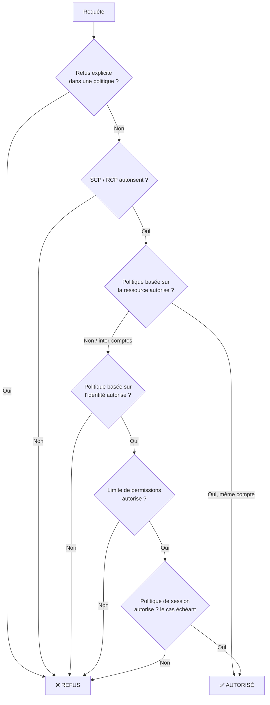
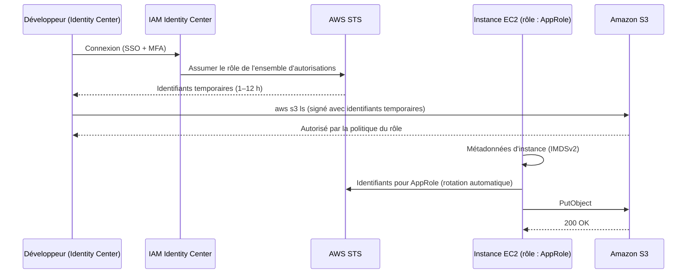

# IAM — Gestion des identités et des accès (Identity and Access Management)

> **Catégorie :** Sécurité, identité et conformité · **Portée :** Mondiale · **Coût :** Gratuit
> [← Retour à la présentation](../AWS-core-services.md)

---

## 1. À quoi ça sert

IAM est la **couche d'authentification et d'autorisation d'AWS**. Chaque appel d'API — depuis la console, la CLI, un SDK ou un autre service AWS — est évalué par IAM pour répondre à une seule question :

> **Ce principal est-il autorisé à effectuer cette action sur cette ressource dans ces conditions ?**

- **Authentification (AuthN) :** prouver *qui* vous êtes (mot de passe + MFA, clés d'accès, identifiants temporaires)
- **Autorisation (AuthZ) :** décider *ce que* vous pouvez faire (politiques)

IAM est mondial (non lié à une Région), à cohérence éventuelle, et **gratuit** — vous ne payez que les ressources utilisées par vos identités.

---

## 2. Composants clés

### 2.1 Utilisateur racine (root)
- L'identité créée avec le compte (courriel + mot de passe). Dispose d'un accès **illimité** qui ne peut pas être restreint par des politiques IAM (seulement par des SCP d'Organizations dans les comptes membres).
- **À utiliser uniquement pour les tâches réservées à root :** modifier les paramètres/le courriel du compte, fermer le compte, restaurer l'accès administrateur IAM, changer de plan de support, certains paramètres de facturation, configurer S3 MFA Delete.
- **À imposer :** MFA matérielle/virtuelle, aucune clé d'accès, mot de passe robuste, courriel sécurisé.

### 2.2 Utilisateurs IAM
- Identité à long terme représentant une personne ou (héritage) une application.
- Identifiants : **mot de passe console** et/ou **clés d'accès** (Access Key ID + Secret Access Key) pour l'accès programmatique — maximum 2 clés par utilisateur.
- **Bonne pratique moderne :** les humains se connectent via **IAM Identity Center** (fédération/SSO) avec des identifiants temporaires plutôt que des utilisateurs IAM. Les applications utilisent des **rôles**, jamais de clés à long terme.

### 2.3 Groupes IAM
- Ensemble d'utilisateurs. Les politiques attachées au groupe s'appliquent à tous ses membres.
- Les groupes **ne peuvent pas être imbriqués** et **ne sont pas des principaux** (impossible de référencer un groupe dans le `Principal` d'une politique basée sur les ressources).
- Un utilisateur peut appartenir à 10 groupes au maximum.

### 2.4 Rôles IAM
- Identité dotée de permissions mais **sans identifiants à long terme**. Quiconque *assume* le rôle reçoit des **identifiants temporaires** émis par **AWS STS** (Security Token Service), valides de 15 min à 12 h.
- Deux politiques définissent un rôle :
  - **Politique d'approbation (trust policy)** — *qui* peut l'assumer (`Principal` : un service, un compte, une identité fédérée)
  - **Politique de permissions** — *ce que* le rôle peut faire
- Usages typiques :
  | Cas d'usage | Principal approuvé |
  |-------------|-------------------|
  | Instance EC2 qui accède à S3 | `ec2.amazonaws.com` (via un **profil d'instance**) |
  | Lambda qui écrit dans DynamoDB | `lambda.amazonaws.com` (rôle d'exécution) |
  | Accès inter-comptes | Un autre ID de compte AWS |
  | SSO / SAML / OIDC des employés | Fournisseur d'identité |
  | GitHub Actions qui déploie sur AWS | Fournisseur OIDC GitHub |
- Les **rôles liés à un service** sont des rôles prédéfinis appartenant à un service AWS (ex. `AWSServiceRoleForAutoScaling`).

### 2.5 Politiques (documents JSON)

```json
{
  "Version": "2012-10-17",
  "Statement": [
    {
      "Sid": "ReadOnlyReportsBucket",
      "Effect": "Allow",
      "Action": ["s3:GetObject", "s3:ListBucket"],
      "Resource": [
        "arn:aws:s3:::acme-reports",
        "arn:aws:s3:::acme-reports/*"
      ],
      "Condition": {
        "IpAddress": { "aws:SourceIp": "203.0.113.0/24" },
        "Bool": { "aws:MultiFactorAuthPresent": "true" }
      }
    }
  ]
}
```

| Élément | Signification |
|---------|---------------|
| `Version` | Version du langage de politique — toujours `2012-10-17` |
| `Sid` | Identifiant facultatif de la déclaration |
| `Effect` | `Allow` (autoriser) ou `Deny` (refuser) |
| `Principal` | *Qui* — uniquement dans les politiques basées sur les ressources et d'approbation |
| `Action` / `NotAction` | Opérations d'API, ex. `ec2:StartInstances`, caractères génériques permis |
| `Resource` / `NotResource` | ARN visés par la déclaration |
| `Condition` | Vérifications de contexte facultatives (IP, MFA, balises, heure, point de terminaison VPC, ID d'organisation…) |

### 2.6 Types de politiques

| Type | Attachée à | Objectif |
|------|-----------|----------|
| **Politique gérée par AWS** | Utilisateurs/groupes/rôles | Maintenue par AWS (ex. `ReadOnlyAccess`, `AmazonS3ReadOnlyAccess`) |
| **Politique gérée par le client** | Utilisateurs/groupes/rôles | Vos politiques réutilisables et versionnées — **à privilégier** |
| **Politique en ligne (inline)** | Une seule identité | Relation stricte 1:1 ; supprimée avec l'identité |
| **Politique basée sur les ressources** | Une ressource (compartiment S3, clé KMS, file SQS, fonction Lambda, politique d'approbation d'un rôle) | Donne accès à des principaux, y compris d'autres comptes |
| **Limite de permissions (permissions boundary)** | Utilisateur ou rôle | Permissions **maximales** qu'une identité pourra jamais avoir — pour l'administration déléguée |
| **Politique de contrôle des services (SCP)** | UO/compte AWS Organizations | Garde-fou : permissions maximales de toutes les identités des comptes membres (y compris root) |
| **Politique de contrôle des ressources (RCP)** | AWS Organizations | Garde-fou sur les permissions maximales des ressources des comptes membres |
| **Politique de session** | Session de rôle assumé / fédérée | Restreint davantage une session donnée |
| **ACL** | S3, VPC | Mécanisme inter-comptes hérité — à éviter pour S3 |

### 2.7 Logique d'évaluation des politiques



**Trois règles à retenir :**
1. Tout est **implicitement refusé** par défaut.
2. Une **autorisation explicite** l'emporte sur le refus implicite.
3. Un **refus explicite gagne toujours.**

L'accès inter-comptes exige **les deux côtés** : la politique d'identité dans le compte A *et* la politique de ressource (ou la politique d'approbation du rôle) dans le compte B.

### 2.8 Authentification multifacteur (MFA)
- Prise en charge : **clés d'accès FIDO2 / clés de sécurité**, applications d'authentification virtuelles (TOTP), jetons TOTP matériels.
- Jusqu'à 8 dispositifs MFA par utilisateur root ou IAM.
- À imposer avec la condition `aws:MultiFactorAuthPresent`.

### 2.9 AWS STS — Security Token Service
| API | Usage |
|-----|-------|
| `AssumeRole` | Assumer un rôle dans le même compte ou un autre |
| `AssumeRoleWithSAML` | Fédération via un IdP SAML 2.0 (AD FS, Okta, Entra ID) |
| `AssumeRoleWithWebIdentity` | OIDC (Cognito, Google, GitHub Actions, EKS IRSA) |
| `GetSessionToken` | Identifiants temporaires pour un utilisateur, généralement avec MFA |
| `GetCallerIdentity` | « Qui suis-je ? » — idéal pour le dépannage (`aws sts get-caller-identity`) |

### 2.10 IAM Identity Center (anciennement AWS SSO)
- Accès centralisé des employés à **plusieurs comptes** d'une AWS Organization et aux applications métier.
- Source d'identité : annuaire intégré, Active Directory ou IdP externe (Entra ID, Okta, Google Workspace) via SAML + SCIM.
- **Ensembles d'autorisations (permission sets)** = modèles de politiques provisionnés en tant que rôles dans chaque compte cible.

### 2.11 Outils de sécurité et d'audit
| Outil | Ce qu'il montre |
|-------|-----------------|
| **Rapport d'identifiants (credential report)** | CSV de tous les utilisateurs du compte et de l'état des mots de passe, clés, MFA |
| **Access Advisor / dernier accès** | Services utilisés par un principal et quand → retirer les permissions inutilisées |
| **IAM Access Analyzer** | Accès externes, accès inutilisés, **validation de politiques**, génération de politiques à partir de l'activité CloudTrail |
| **Simulateur de politiques IAM** | Tester si une politique autorise une action |
| **Politique de mots de passe** | Longueur, complexité, rotation, réutilisation pour les utilisateurs IAM |

### 2.12 ABAC — Contrôle d'accès basé sur les attributs
Accorder l'accès selon des **balises** plutôt qu'en listant les ressources :

```json
"Condition": {
  "StringEquals": { "aws:ResourceTag/Project": "${aws:PrincipalTag/Project}" }
}
```
Un développeur balisé `Project=Phoenix` ne peut gérer que les ressources balisées `Project=Phoenix`. S'adapte bien mieux que le RBAC dans les grandes organisations.

---

## 3. Fonctionnement



---

## 4. Tarification
IAM, STS, IAM Identity Center et l'analyse des accès externes d'IAM Access Analyzer sont **gratuits**. Certaines fonctions avancées d'Access Analyzer (analyse des accès inutilisés, vérifications de politiques personnalisées) sont facturées.

---

## 5. Bonnes pratiques (liste de contrôle entreprise)

- [ ] Verrouiller l'**utilisateur root** : MFA, aucune clé d'accès, usage limité aux tâches réservées
- [ ] Utiliser **IAM Identity Center** + fédération pour les humains → identifiants temporaires uniquement
- [ ] Utiliser des **rôles** pour les charges de travail (profils d'instance EC2, rôles d'exécution Lambda, rôles de tâche ECS, OIDC pour la CI/CD)
- [ ] Appliquer le **moindre privilège** ; partir des politiques gérées AWS, puis affiner avec la génération de politiques d'Access Analyzer
- [ ] Préférer les politiques **gérées par le client** aux politiques en ligne
- [ ] Exiger la **MFA** pour les actions privilégiées
- [ ] Faire tourner puis éliminer les **clés d'accès** ; ne jamais les committer dans Git
- [ ] Utiliser les **limites de permissions** pour déléguer la création de rôles aux développeurs
- [ ] Utiliser des **SCP** pour les garde-fous à l'échelle de l'organisation (interdire de quitter l'Org, de désactiver CloudTrail, restreindre les Régions)
- [ ] Revoir le **rapport d'identifiants** et les données de **dernier accès** chaque trimestre
- [ ] Imposer **IMDSv2** sur EC2 pour protéger les identifiants de rôle contre les attaques SSRF

---

## 6. Laboratoire pratique — Sécuriser un compte et utiliser des rôles

**Objectif :** créer un groupe administrateur, un utilisateur et un rôle EC2 en lecture seule sur S3.

### Étape 1 — Protéger root
1. Connectez-vous en root → *Identifiants de sécurité* → **Attribuer un dispositif MFA**.
2. Vérifiez qu'il n'existe **aucune** clé d'accès root.

### Étape 2 — Créer un groupe et un utilisateur (CLI)
```bash
aws iam create-group --group-name Admins
aws iam attach-group-policy --group-name Admins \
  --policy-arn arn:aws:iam::aws:policy/AdministratorAccess

aws iam create-user --user-name alice
aws iam add-user-to-group --user-name alice --group-name Admins
aws iam create-login-profile --user-name alice \
  --password 'Ch@ngeMe-Now-2026!' --password-reset-required
```

### Étape 3 — Définir la politique de mots de passe du compte
```bash
aws iam update-account-password-policy \
  --minimum-password-length 14 --require-symbols --require-numbers \
  --require-uppercase-characters --require-lowercase-characters \
  --password-reuse-prevention 12 --max-password-age 90
```

### Étape 4 — Créer un rôle permettant à EC2 de lire S3
```bash
cat > trust-ec2.json <<'EOF'
{
  "Version": "2012-10-17",
  "Statement": [{
    "Effect": "Allow",
    "Principal": { "Service": "ec2.amazonaws.com" },
    "Action": "sts:AssumeRole"
  }]
}
EOF

aws iam create-role --role-name EC2-S3-ReadOnly \
  --assume-role-policy-document file://trust-ec2.json
aws iam attach-role-policy --role-name EC2-S3-ReadOnly \
  --policy-arn arn:aws:iam::aws:policy/AmazonS3ReadOnlyAccess

aws iam create-instance-profile --instance-profile-name EC2-S3-ReadOnly
aws iam add-role-to-instance-profile \
  --instance-profile-name EC2-S3-ReadOnly --role-name EC2-S3-ReadOnly
```

### Étape 5 — Vérifier
```bash
aws sts get-caller-identity
aws iam generate-credential-report && aws iam get-credential-report \
  --query Content --output text | base64 -d | head
```
Utilisez le **simulateur de politiques IAM** pour tester `s3:PutObject` pour le rôle → résultat attendu : *implicitDeny*.

### Nettoyage
```bash
aws iam remove-role-from-instance-profile --instance-profile-name EC2-S3-ReadOnly --role-name EC2-S3-ReadOnly
aws iam delete-instance-profile --instance-profile-name EC2-S3-ReadOnly
aws iam detach-role-policy --role-name EC2-S3-ReadOnly --policy-arn arn:aws:iam::aws:policy/AmazonS3ReadOnlyAccess
aws iam delete-role --role-name EC2-S3-ReadOnly
```

---

## 7. Conseils de certification

- **Refus explicite > Autorisation > refus implicite** — le concept IAM le plus testé.
- « Une application sur EC2 doit accéder à S3 » → **rôle IAM / profil d'instance**, jamais de clés d'accès sur l'instance.
- « Donner accès à des utilisateurs d'un autre compte AWS » → **rôle inter-comptes** (ou politique basée sur les ressources).
- « Des milliers d'employés / Active Directory existant » → **IAM Identity Center** ou fédération SAML, pas des utilisateurs IAM.
- « Les utilisateurs d'une application mobile doivent accéder à S3/DynamoDB » → **pools d'identités Amazon Cognito** (fédération d'identités web).
- « Limiter les permissions maximales que les développeurs peuvent accorder » → **limite de permissions**.
- « Empêcher tout compte de l'Organisation d'utiliser une Région / de désactiver CloudTrail » → **SCP**.
- Les SCP **n'accordent pas** de permissions ; elles ne font que filtrer.
- Les groupes ne peuvent pas être imbriqués ni servir de `Principal`.
- IAM est **mondial** ; les modifications sont **à cohérence éventuelle** (quelques secondes de propagation).
- Auditer « qui a accès à quoi » : **rapport d'identifiants** (compte), **Access Advisor** (par principal), **Access Analyzer** (partage externe).

---

## 8. Questions de révision

1. Une fonction Lambda doit écrire des éléments dans une table DynamoDB. Quelle est la façon la plus sécurisée de lui en donner l'accès ?
2. Un utilisateur dispose de `s3:*` en Allow dans une politique d'identité, mais la politique du compartiment contient un Deny explicite pour cet utilisateur. Que se passe-t-il ?
3. Quelle est la différence entre une politique d'approbation et une politique de permissions ?
4. Nommez trois tâches que seul l'utilisateur root peut effectuer.
5. Quelle fonctionnalité permet à une équipe de sécurité centrale de plafonner ce que peuvent faire les rôles créés par les développeurs ?
6. Quelle API STS GitHub Actions utilise-t-il pour déployer sur AWS sans clés stockées ?
7. Une SCP peut-elle accorder des permissions à un utilisateur IAM d'un compte membre ?
8. Comment trouver les permissions IAM inutilisées depuis 90 jours ?

<details>
<summary><b>Réponses</b></summary>

1. Attacher un **rôle d'exécution** à la fonction avec une politique de moindre privilège (`dynamodb:PutItem` uniquement sur l'ARN de cette table).
2. **Refusé** — un refus explicite gagne toujours.
3. La **politique d'approbation** définit *qui peut assumer* le rôle ; la **politique de permissions** définit *ce que le rôle peut faire* une fois assumé.
4. Trois parmi : modifier le courriel/nom/mot de passe root du compte, fermer le compte, changer de plan de support, restaurer les permissions IAM en cas de blocage, activer S3 MFA Delete, s'inscrire comme vendeur sur le Reserved Instance Marketplace.
5. Les **limites de permissions** (et, au niveau de l'organisation, les SCP).
6. `AssumeRoleWithWebIdentity` (fédération OIDC).
7. **Non.** Les SCP définissent seulement les permissions maximales disponibles ; une politique d'identité doit tout de même autoriser l'action.
8. Les informations de **dernier accès / Access Advisor** et les constats d'**accès inutilisés d'IAM Access Analyzer**.
</details>
