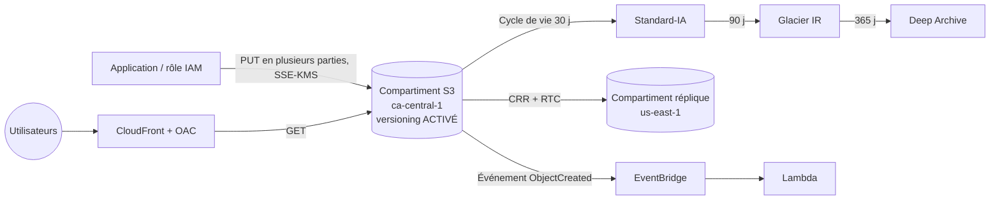

# Amazon S3 — Simple Storage Service

> **Catégorie :** Stockage · **Portée :** compartiment régional, nom unique au monde · **Modèle :** stockage d'objets, sans serveur
> [← Retour à la présentation](../AWS-core-services.md)

---

## 1. À quoi ça sert

Amazon S3 stocke **n'importe quelle quantité de données sous forme d'objets** dans des **compartiments (buckets)**, accessibles via des API HTTPS depuis n'importe où.

- **Durabilité :** conçue pour **99,999999999 % (11 neuf)** — les données sont stockées de façon redondante sur **≥ 3 AZ** (sauf les classes One Zone)
- **Disponibilité :** 99,99 % visée pour S3 Standard
- **Échelle :** stockage total illimité ; un objet peut atteindre **5 To**
- **Cohérence forte en lecture après écriture** pour toutes les opérations PUT/DELETE et LIST
- Ni système de fichiers ni périphérique bloc : pas de modification partielle sur place — on remplace l'objet entier

Usages typiques : sites web statiques, médias, sauvegardes et archives, lacs de données, stockage de journaux, artefacts logiciels, jeux de données ML.

---

## 2. Composants clés

### 2.1 Compartiment (bucket)
- Conteneur d'objets ; créé dans **une Région** ; nom **unique au monde**, 3 à 63 caractères, minuscules, conforme DNS.
- Quota par défaut : 10 000 compartiments à usage général par compte (ajustable).
- **Types de compartiments :**
  | Type | Description |
  |------|-------------|
  | **Usage général** | Compartiment standard, toutes les classes de stockage sauf Express One Zone |
  | **Compartiment de répertoire (directory)** | Pour **S3 Express One Zone** — une seule AZ, latence de quelques millisecondes, espace de noms hiérarchique |
  | **Compartiment de tables** | **S3 Tables** — tables Apache Iceberg gérées pour l'analytique |
  | **Compartiment vectoriel** | **S3 Vectors** — stocker et interroger des plongements vectoriels (fonction récente) |

### 2.2 Objet
| Partie | Description |
|--------|-------------|
| **Clé** | Nom/chemin complet, ex. `factures/2026/10/fact-001.pdf` — les « dossiers » ne sont que des préfixes de clé |
| **Valeur** | Les données (0 o → 5 To) |
| **ID de version** | Lorsque la gestion des versions est activée |
| **Métadonnées** | Système (Content-Type, Last-Modified) + définies par l'utilisateur `x-amz-meta-*` |
| **Balises** | Jusqu'à 10 paires clé/valeur — utilisées par le cycle de vie, l'ABAC IAM, la répartition des coûts |

**Téléversements :** `PUT` unique jusqu'à **5 Go** ; **téléversement en plusieurs parties recommandé au-delà de 100 Mo, obligatoire au-delà de 5 Go** (parties parallèles, reprise en cas d'échec). **S3 Transfer Acceleration** utilise les emplacements périphériques CloudFront pour accélérer les téléversements longue distance.

### 2.3 Classes de stockage

| Classe | Disponibilité visée | AZ | Durée minimale | Récupération | Cas d'usage |
|--------|--------------------|----|----------------|--------------|-------------|
| **S3 Standard** | 99,99 % | ≥ 3 | — | ms | Données fréquemment consultées |
| **S3 Intelligent-Tiering** | 99,9 % | ≥ 3 | — | ms (niveaux d'archive facultatifs) | Accès inconnu/variable — déplacement automatique entre niveaux, petits frais de surveillance, **aucuns frais de récupération** |
| **S3 Express One Zone** | 99,95 % | 1 | — (facturation par heure) | quelques ms | Hautes performances, sensible à la latence (entraînement ML, analytique) |
| **S3 Standard-IA** (accès peu fréquent) | 99,9 % | ≥ 3 | 30 jours | ms, **frais de récupération par Go** | Sauvegardes, copies DR consultées mensuellement |
| **S3 One Zone-IA** | 99,5 % | **1** | 30 jours | ms, frais de récupération | Données recréables, copies secondaires |
| **S3 Glacier Instant Retrieval** | 99,9 % | ≥ 3 | 90 jours | **ms** | Archives consultées chaque trimestre (imagerie médicale, médias d'actualité) |
| **S3 Glacier Flexible Retrieval** | 99,99 % | ≥ 3 | 90 jours | Accélérée 1–5 min · Standard 3–5 h · En masse 5–12 h | Archives rarement consultées |
| **S3 Glacier Deep Archive** | 99,99 % | ≥ 3 | 180 jours | Standard ≤ 12 h · En masse ≤ 48 h | Archives de conformité 7 à 10+ ans — **coût le plus bas** |

Toutes les classes offrent **11 neuf de durabilité** (les classes One Zone perdent les données si l'AZ est détruite).

### 2.4 Règles de cycle de vie
Automatisent les **transitions** et l'**expiration** par préfixe ou balise :

```json
{
  "Rules": [{
    "ID": "logs-tiering",
    "Filter": { "Prefix": "logs/" },
    "Status": "Enabled",
    "Transitions": [
      { "Days": 30,  "StorageClass": "STANDARD_IA" },
      { "Days": 90,  "StorageClass": "GLACIER_IR" },
      { "Days": 365, "StorageClass": "DEEP_ARCHIVE" }
    ],
    "Expiration": { "Days": 2555 },
    "NoncurrentVersionExpiration": { "NoncurrentDays": 30 },
    "AbortIncompleteMultipartUpload": { "DaysAfterInitiation": 7 }
  }]
}
```
**S3 Storage Lens** et **Storage Class Analysis** aident à décider quand effectuer les transitions.

### 2.5 Gestion des versions (versioning)
- États du compartiment : *Non versionné* (par défaut) → *Activé* → *Suspendu* (impossible de revenir à non versionné).
- Protège contre l'**écrasement et la suppression accidentels** : un DELETE ajoute un **marqueur de suppression** ; les versions précédentes restent récupérables.
- Requise pour la **réplication** et **Object Lock**.
- **MFA Delete** (utilisateur root, CLI uniquement) exige la MFA pour supprimer définitivement des versions ou modifier l'état de versionnement.

### 2.6 Réplication
| Type | Description |
|------|-------------|
| **CRR — réplication inter-Régions** | Conformité, latence réduite dans une autre Région, reprise après sinistre |
| **SRR — réplication dans la même Région** | Agrégation de journaux, copies prod → test, propriété séparée par compte |
- Exige la **gestion des versions sur la source et la destination** et un rôle IAM.
- Réplique les **nouveaux objets** après activation ; utilisez **S3 Batch Replication** pour les objets existants.
- **Replication Time Control (RTC) :** 99,99 % des objets répliqués en **15 minutes** (SLA).
- Marqueurs de suppression répliqués en option ; **la réplication en chaîne n'est pas transitive** (A→B→C exige des règles explicites).

### 2.7 Sécurité et contrôle d'accès

| Mécanisme | Portée | Remarques |
|-----------|--------|-----------|
| **Politiques d'identité IAM** | Utilisateurs/rôles de votre compte | À privilégier pour l'accès interne |
| **Politique de compartiment** | JSON basé sur la ressource | Accès inter-comptes, imposer TLS/chiffrement, restreindre par point de terminaison VPC / IP / Organisation |
| **Blocage de l'accès public** | Compte et compartiment | **Activé par défaut** — à conserver sauf si vous hébergez réellement du contenu public |
| **Propriété des objets** | Compartiment | **« Propriétaire du compartiment imposé »** (par défaut) **désactive les ACL** — recommandé |
| **ACL** | Compartiment/objet | Héritage — à éviter |
| **Points d'accès (Access Points)** | Points de terminaison réseau nommés avec leur propre politique | Simplifient les jeux de données partagés entre équipes ; peuvent être limités au VPC |
| **Points d'accès multi-Régions** | Point de terminaison mondial routant vers la réplique la plus proche | Applications actif-actif multi-Régions |
| **URL pré-signées** | GET/PUT temporaire pour un objet | Permettre aux utilisateurs de téléverser/télécharger sans identifiants AWS (expiration jusqu'à 7 jours avec SigV4 et identifiants utilisateur) |
| **S3 Object Lambda** | Transformer les données au GET (masquer des données personnelles, redimensionner) | |

Exemple de politique de compartiment — imposer HTTPS et l'accès via un point de terminaison VPC uniquement :
```json
{
  "Version": "2012-10-17",
  "Statement": [
    { "Sid": "DenyInsecureTransport", "Effect": "Deny", "Principal": "*",
      "Action": "s3:*",
      "Resource": ["arn:aws:s3:::acme-data", "arn:aws:s3:::acme-data/*"],
      "Condition": { "Bool": { "aws:SecureTransport": "false" } } },
    { "Sid": "DenyOutsideVpce", "Effect": "Deny", "Principal": "*",
      "Action": "s3:*",
      "Resource": ["arn:aws:s3:::acme-data", "arn:aws:s3:::acme-data/*"],
      "Condition": { "StringNotEquals": { "aws:SourceVpce": "vpce-0abc123" } } }
  ]
}
```

### 2.8 Chiffrement
| Option | Gestion des clés | Remarques |
|--------|------------------|-----------|
| **SSE-S3** | Clés détenues par AWS (AES-256) | **Par défaut pour tous les nouveaux objets** depuis janvier 2023 |
| **SSE-KMS** | Clé AWS KMS (gérée par AWS ou par le client) | Audit dans CloudTrail, politiques de clé, rotation ; quotas de requêtes KMS → activer les **S3 Bucket Keys** pour réduire coûts/appels |
| **DSSE-KMS** | Chiffrement double couche avec KMS | Conformité exigeant deux couches |
| **SSE-C** | Clé fournie par le client à chaque requête | AWS ne stocke pas la clé ; HTTPS obligatoire |
| **Chiffrement côté client** | Chiffrer avant le téléversement | Vous gérez tout |
| **En transit** | TLS (HTTPS) | À imposer avec `aws:SecureTransport` |

### 2.9 Object Lock et Glacier Vault Lock (WORM)
- **Object Lock** (exige le versionnement) : rétention en écriture unique, lecture multiple.
  - **Mode Gouvernance :** les utilisateurs disposant d'une permission spéciale peuvent outrepasser.
  - **Mode Conformité :** **personne, pas même root**, ne peut supprimer/raccourcir avant l'expiration.
  - **Conservation légale (legal hold) :** blocage indéfini, indépendant de la période de rétention.
- Utilisé pour SEC 17a-4, FINRA, la santé et la protection contre les rançongiciels.

### 2.10 Notifications d'événements
Déclenchement sur `ObjectCreated`, `ObjectRemoved`, `ObjectRestore`, `Replication`, etc. → **Lambda, SQS, SNS** directement, ou **Amazon EventBridge** (filtrage avancé, nombreuses cibles, archivage/relecture).

### 2.11 Hébergement de site web statique
- À activer sur le compartiment, définir `index.html` / `error.html` ; point de terminaison `http://<compartiment>.s3-website-<region>.amazonaws.com` (**HTTP uniquement**).
- **Modèle de production :** garder le compartiment **privé** et servir via **CloudFront avec Origin Access Control (OAC)** pour le HTTPS, le cache et les domaines personnalisés.

### 2.12 Performances
- Au moins **3 500 requêtes PUT/COPY/POST/DELETE** et **5 500 GET/HEAD par seconde et par préfixe** — paralléliser sur plusieurs préfixes pour aller au-delà.
- **Téléversement en plusieurs parties**, **lectures par plages d'octets** (téléchargements parallèles), **Transfer Acceleration**, **S3 Express One Zone** pour les charges critiques en latence.
- **S3 Select** (SQL sur un seul objet CSV/JSON/Parquet — héritage, les nouveaux clients doivent utiliser **Athena**).

### 2.13 Fonctions de gestion et d'analyse
| Fonction | Objectif |
|----------|----------|
| **S3 Inventory** | Rapport planifié CSV/Parquet des objets et de leurs métadonnées/chiffrement |
| **S3 Batch Operations** | Exécuter une action sur des milliards d'objets (copier, baliser, restaurer, invoquer Lambda) |
| **S3 Storage Lens** | Tableaux de bord d'utilisation et d'activité à l'échelle de l'organisation |
| **Journaux d'accès serveur / événements de données CloudTrail** | Qui a accédé à quel objet |
| **Paiement par le demandeur (Requester Pays)** | Le demandeur paie les requêtes et le transfert |
| **CORS** | Autoriser des navigateurs d'autres origines à appeler le compartiment |
| **S3 Metadata** | Tables de métadonnées d'objets interrogeables |
| **Mountpoint for Amazon S3** | Monter un compartiment comme système de fichiers (charges à lecture intensive) |

### 2.14 Transfert de données et hybride
**AWS DataSync** (migration en ligne), **AWS Snowball** (transfert hors ligne à l'échelle du pétaoctet), **AWS Storage Gateway** (S3 File Gateway : NFS/SMB adossé à S3), **AWS Transfer Family** (SFTP/FTPS vers S3).

---

## 3. Fonctionnement



---

## 4. Tarification (concepts)
Vous payez : le **stockage en Go-mois** (selon la classe), les **requêtes** (PUT/COPY/LIST coûtent plus que GET), les **récupérations** (IA/Glacier), le **transfert sortant** vers Internet (l'entrant est gratuit ; le transfert vers CloudFront est gratuit), la **réplication**, les fonctions de gestion (Inventory, surveillance Intelligent-Tiering, Storage Lens avancé), et les frais de **durée minimale / taille minimale d'objet** (128 Ko minimum facturable pour les classes IA).

---

## 5. Bonnes pratiques

- [ ] Garder le **blocage de l'accès public ACTIVÉ** et les **ACL désactivées** (propriétaire du compartiment imposé)
- [ ] Donner l'accès via des rôles IAM + politiques de compartiment ; utiliser des **URL pré-signées** pour les utilisateurs finaux
- [ ] **Imposer TLS** et le chiffrement par défaut ; utiliser **SSE-KMS + Bucket Keys** pour les données sensibles
- [ ] Activer le **versionnement** sur les compartiments importants ; protéger avec **MFA Delete** ou **Object Lock**
- [ ] Ajouter des **règles de cycle de vie** (y compris l'abandon des téléversements incomplets et l'expiration des versions non courantes)
- [ ] Utiliser **Intelligent-Tiering** quand les modèles d'accès sont inconnus
- [ ] Servir le contenu web via **CloudFront + OAC**
- [ ] Accéder depuis le VPC via un **point de terminaison de passerelle**
- [ ] Journaliser les accès (**événements de données CloudTrail** ou journaux d'accès serveur) pour les compartiments sensibles
- [ ] Répliquer les données critiques entre Régions (et entre comptes) pour la reprise après sinistre et la résilience aux rançongiciels

---

## 6. Laboratoire pratique — Site statique sécurisé avec versionnement et cycle de vie

```bash
REGION=ca-central-1
BUCKET=lab-site-$(date +%s)
aws s3api create-bucket --bucket $BUCKET --region $REGION \
  --create-bucket-configuration LocationConstraint=$REGION

# 1. Versionnement
aws s3api put-bucket-versioning --bucket $BUCKET --versioning-configuration Status=Enabled

# 2. Téléverser du contenu
echo '<h1>Bonjour S3 v1</h1>' > index.html
aws s3 cp index.html s3://$BUCKET/index.html --content-type text/html
echo '<h1>Bonjour S3 v2</h1>' > index.html
aws s3 cp index.html s3://$BUCKET/index.html --content-type text/html
aws s3api list-object-versions --bucket $BUCKET --prefix index.html

# 3. Supprimer puis récupérer
aws s3 rm s3://$BUCKET/index.html            # crée un marqueur de suppression
aws s3api list-object-versions --bucket $BUCKET --prefix index.html \
  --query 'DeleteMarkers[0].VersionId' --output text
aws s3api delete-object --bucket $BUCKET --key index.html --version-id <ID_MARQUEUR>  # restaure l'objet

# 4. Cycle de vie
aws s3api put-bucket-lifecycle-configuration --bucket $BUCKET \
  --lifecycle-configuration file://lifecycle.json   # utilisez le JSON du §2.4

# 5. URL pré-signée valide 10 minutes
aws s3 presign s3://$BUCKET/index.html --expires-in 600
```

6. **Servir en privé via CloudFront :** poursuivez avec le [lab CloudFront](../Reseau-Diffusion-de-contenu/CloudFront.md) — le compartiment reste privé, CloudFront y accède avec **OAC**.

**Nettoyage :** supprimer toutes les versions d'objets et les marqueurs de suppression (console *Vider le compartiment*), puis `aws s3 rb s3://$BUCKET`.

---

## 7. Conseils de certification

- Durabilité de **11 neuf** pour toutes les classes ; la disponibilité varie.
- Accès inconnu/imprévisible → **Intelligent-Tiering**. Archive avec récupération en **millisecondes** → **Glacier Instant Retrieval**. Le moins cher, 12–48 h → **Deep Archive**.
- Données recréables au coût le plus bas avec accès en ms → **One Zone-IA**.
- Durées minimales : **30 jours** (IA), **90 jours** (Glacier IR / Flexible), **180 jours** (Deep Archive).
- Protection contre la suppression accidentelle → **versionnement + MFA Delete**. WORM réglementaire → **Object Lock en mode Conformité**.
- Accès temporaire d'un utilisateur à un objet → **URL pré-signée**.
- Téléverser plus vite de gros fichiers sur de longues distances → **Transfer Acceleration** ; gros fichiers en général → **téléversement en plusieurs parties** (> 100 Mo).
- La réplication exige le **versionnement sur les deux compartiments** ; objets existants → **Batch Replication**.
- Site en HTTPS + domaine personnalisé → **CloudFront** devant S3 (le point de terminaison de site S3 est HTTP uniquement).
- Restreindre le compartiment pour que seul CloudFront le lise → **Origin Access Control (OAC)**.
- Coûts/limitations KMS élevés avec SSE-KMS → activer les **S3 Bucket Keys**.
- Chiffrement par défaut : **SSE-S3** est appliqué automatiquement aux nouveaux objets.
- 3 500 écritures / 5 500 lectures **par seconde et par préfixe**.

---

## 8. Questions de révision

1. Une entreprise doit conserver ses journaux d'audit 7 ans, les lit rarement et doit pouvoir les récupérer en 48 h. Option la moins chère ?
2. Que se passe-t-il quand vous supprimez un objet dans un compartiment versionné sans préciser d'ID de version ?
3. Quels sont les deux prérequis de la réplication inter-Régions ?
4. Comment un utilisateur d'application mobile peut-il téléverser directement dans un compartiment privé sans identifiants AWS ?
5. Quelle est la différence entre les modes Gouvernance et Conformité d'Object Lock ?
6. Pourquoi ajouter `AbortIncompleteMultipartUpload` à une règle de cycle de vie ?
7. Quelle classe de stockage conserve les données dans une seule AZ avec la latence la plus faible ?
8. Comment garantir que les objets ne peuvent être téléversés qu'en HTTPS ?

<details>
<summary><b>Réponses</b></summary>

1. **S3 Glacier Deep Archive** (avec une règle de cycle de vie, plus Object Lock si l'immuabilité est exigée).
2. S3 insère un **marqueur de suppression** ; l'objet disparaît des listes mais les versions précédentes sont récupérables en supprimant le marqueur.
3. **Versionnement activé sur les compartiments source et destination**, et un **rôle IAM** autorisant S3 à répliquer (plus les permissions KMS si chiffré).
4. Le serveur génère une **URL PUT pré-signée** (ou utilise des identifiants temporaires émis par Cognito).
5. **Gouvernance :** les utilisateurs privilégiés disposant de `s3:BypassGovernanceRetention` peuvent outrepasser. **Conformité :** personne, y compris root, ne peut supprimer ni raccourcir la rétention.
6. Les téléversements incomplets conservent leurs parties stockées — et **facturées** — indéfiniment et de façon invisible.
7. **S3 Express One Zone** (compartiment de répertoire).
8. Une politique de compartiment avec **Deny** lorsque `aws:SecureTransport = false`.
</details>
