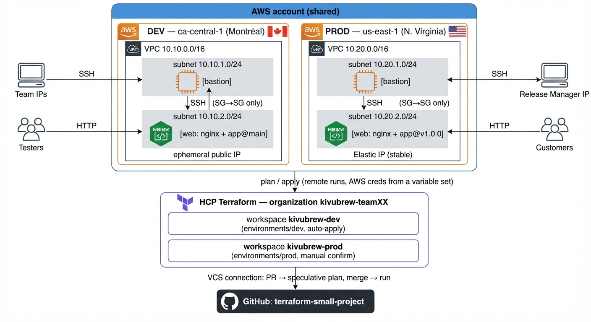

# 🏗️ Lab Terraform en équipe — « KivuBrew passe en production »

### Deux environnements, un seul code : déployer une application web statique sur EC2 derrière un bastion

> **Niveau :** intermédiaire · **Durée :** 2 séances d'environ 3 h (ou 1 journée) · **Équipe :** 4 étudiants · **Cloud :** AWS (compte partagé) · **Exécution :** HCP Terraform ([app.terraform.io](https://app.terraform.io))
> 🇬🇧 English version: [`SCENARIO.md`](SCENARIO.md)

---

## 1. Le contexte

**KivuBrew Coffee** est une petite marque de café congolaise qui lance son premier site web. L'équipe marketing a déjà un site statique (HTML/CSS/JS) dans son propre dépôt Git. Vous êtes l'**équipe plateforme** chargée de l'héberger sur AWS.

Le CTO impose quatre exigences :

1. **Deux environnements complètement isolés.** DEV pour les tests et PROD pour les clients, chacun avec **son propre VPC dans sa propre région AWS**.
2. **Tout en code.** Aucun clic dans la console. Chaque changement passe par une Pull Request.
3. **La PROD n'exécute que du code publié.** DEV peut suivre le dernier commit. La PROD n'exécute qu'une version taguée et approuvée de l'application.
4. **Pas de SSH direct vers les serveurs.** Les administrateurs passent par un **bastion**, et seulement depuis des adresses IP connues.

Il n'y a pas encore de nom de domaine. Clients et testeurs utilisent l'**adresse IP publique de l'instance EC2** (`http://x.x.x.x`).

---

## 2. Objectifs d'apprentissage

À la fin de ce lab, vous saurez :

- Écrire des **modules Terraform réutilisables** (`network`, `bastion`, `app_service`) avec des contrats d'entrées et de sorties clairs
- Déployer **le même code** dans deux environnements qui ne diffèrent **que par `terraform.tfvars`**
- Exécuter Terraform dans des **workspaces HCP Terraform** (état distant, verrouillage, exécutions à distance) et expliquer pourquoi chaque environnement a son propre workspace
- Passer clés et identifiants sous forme de **variables de workspace** plutôt que de fichiers locaux ou de Git
- Déployer une application depuis un **dépôt Git séparé** avec `user_data` et un **tag Git** figé
- Mettre en place le **modèle bastion (jump host)** avec des règles de groupe de sécurité à groupe de sécurité
- Collaborer avec **branches, PR, CODEOWNERS et revues de plan**
- Détecter et corriger une **dérive (drift)**, gérer un **conflit de verrou** et faire un **retour arrière (rollback)** après une mauvaise version

---

## 3. Architecture cible

```
                 ┌──────────────────────────── Compte AWS (partagé) ──────────────────────────────┐
                 │                                                                                 │
                 │   DEV — ca-central-1 (Montréal)            PROD — us-east-1 (Virginie du Nord)   │
                 │   VPC 10.10.0.0/16                         VPC 10.20.0.0/16                      │
                 │  ┌───────────────────────────────┐       ┌───────────────────────────────┐      │
  IP équipe ─SSH─┼─►│ sous-réseau 10.10.1.0/24      │       │ sous-réseau 10.20.1.0/24      │◄─SSH─┼── IP du Release Manager
                 │  │   [bastion]                   │       │   [bastion]                   │      │
                 │  │       │ SSH (SG→SG seulement) │       │       │ SSH (SG→SG seulement) │      │
                 │  │       ▼                       │       │       ▼                       │      │
  Testeurs ─HTTP─┼─►│ sous-réseau 10.10.2.0/24      │       │ sous-réseau 10.20.2.0/24      │◄HTTP─┼── Clients
                 │  │   [web : nginx + app@main]    │       │   [web : nginx + app@v1.0.0]  │      │
                 │  │   IP publique éphémère        │       │   Elastic IP (stable)         │      │
                 │  └───────────────────────────────┘       └───────────────────────────────┘      │
                 │                                                                                 │
                 └─────────────────────────────────────────────────────────────────────────────────┘
                        ▲ plan / apply (exécutions à distance, identifiants AWS via un variable set)
                 ┌──────┴──────── HCP Terraform — organisation kivubrew-teamXX ────────────────────┐
                 │   workspace kivubrew-dev   (environments/dev,  auto-apply)                      │
                 │   workspace kivubrew-prod  (environments/prod, confirmation manuelle)           │
                 │                    ▲ connexion VCS : PR → plan spéculatif, fusion → exécution   │
                 └────────────────────┴────────────── GitHub : terraform-small-project ────────────┘
```



### Matrice des environnements

| Paramètre           | DEV                         | PROD                                    | Pourquoi ils diffèrent                                                                |
| ------------------- | --------------------------- | --------------------------------------- | ------------------------------------------------------------------------------------- |
| Région              | `ca-central-1`              | `us-east-1`                             | Isolation. Montre aussi que les AMI, les AZ et les paires de clés sont **régionales** |
| CIDR du VPC         | `10.10.0.0/16`              | `10.20.0.0/16`                          | Jamais de chevauchement, pour qu'un peering VPC reste possible plus tard              |
| `app_version`       | `main` (branche)            | `v1.0.0` (tag)                          | La PROD n'exécute que du code publié                                                  |
| IP publique web     | éphémère                    | **Elastic IP**                          | Pas de DNS : les clients ont besoin d'une adresse qui ne change pas                   |
| SSH autorisé depuis | le `/32` de chaque membre   | le `/32` du Release Manager seulement   | Moindre privilège en PROD                                                             |
| Workspace HCP       | `kivubrew-dev` (auto-apply) | `kivubrew-prod` (confirmation manuelle) | États séparés : un `apply` raté en DEV ne peut jamais toucher la PROD                 |
| `ssh_public_key`    | clé DEV (toute l'équipe)    | clé PROD (Release Manager)              | Définie comme **variable de workspace**, jamais dans Git                              |

### Règles des groupes de sécurité (le cœur du modèle bastion)

| Groupe de sécurité | Entrant | Source                                                                                   |
| ------------------ | ------- | ---------------------------------------------------------------------------------------- |
| `bastion-sg`       | 22/tcp  | IP de l'équipe (`x.x.x.x/32`). **`0.0.0.0/0` est rejeté par une validation de variable** |
| `web-sg`           | 80/tcp  | `0.0.0.0/0` (c'est un site public)                                                       |
| `web-sg`           | 22/tcp  | **`bastion-sg` seulement** (référence à un groupe de sécurité, pas de CIDR)              |

> 💡 **Point de discussion :** le serveur web garde une IP publique, car sans répartiteur de charge c'est le seul moyen de servir le HTTP. Son port 22 reste de toute façon injoignable depuis Internet. _Que changerait l'ajout d'un ALB ?_ (Réponse : le serveur web pourrait passer dans un sous-réseau privé avec une passerelle NAT, et le bastion deviendrait le seul point d'entrée SSH public.)

---

## 4. Les deux dépôts

| Dépôt                     | Responsable dans l'équipe         | Contenu                                                         |
| ------------------------- | --------------------------------- | --------------------------------------------------------------- |
| `terraform-small-project` | Réseau + Calcul + Release Manager | Tout le code d'infrastructure (structure ci-dessous)            |
| `static-web-app`          | Développeur·se applicatif         | `site/index.html`, `styles.css`, `app.js`. **Doit être public** |

**Comment ils sont reliés :** au premier démarrage, le `user_data` du serveur web exécute :

```
dnf install nginx git
git clone --depth 1 --branch <app_version> <app_repo_url>
copie site/ → /usr/share/nginx/html/
écrit env.json → {"environment":"prod","region":"us-east-1","app_version":"v1.0.0"}
```

La page lit `env.json` et affiche une **bannière verte DEV** ou **rouge PROD** avec la région et la version. Les correcteurs voient d'un coup d'œil ce qui est déployé où.

Comme `user_data_replace_on_change = true`, **changer `app_version` remplace l'instance**. Ce remplacement constitue le déploiement.

### Structure du dépôt d'infrastructure (votre fichier, plus 2 ajouts)

```
terraform-small-project/
├── .gitignore
├── README.md
├── .github/                         ← ajout : CODEOWNERS, modèle de PR, CI (fmt + validate)
├── modules/
│   ├── network/       (main, variables, outputs)
│   ├── bastion/       (main, variables, outputs)       ← ajout
│   └── app_service/   (main, variables, outputs, templates/user_data.sh.tftpl)
└── environments/
    ├── dev/   (backend, providers, main, variables, outputs, terraform.tfvars)
    └── prod/  (backend, providers, main, variables, outputs, terraform.tfvars)
```

> 📏 **Règle d'or :** `environments/dev/main.tf` et `environments/prod/main.tf` sont **identiques**. Toutes les différences entre environnements se trouvent dans `terraform.tfvars`. Les relecteurs lanceront `diff environments/dev/main.tf environments/prod/main.tf`, qui ne doit rien afficher.

---

## 5. Rôles dans l'équipe

| Rôle                             | Responsable de (CODEOWNERS)                 | Missions principales                                                                                                        |
| -------------------------------- | ------------------------------------------- | --------------------------------------------------------------------------------------------------------------------------- |
| 🌐 **Responsable réseau**        | `modules/network/`, `modules/bastion/`      | VPC, sous-réseaux, routage, bastion, règles d'accès SSH                                                                     |
| 🖥️ **Responsable calcul**        | `modules/app_service/`, `environments/dev/` | Serveur web, groupe de sécurité, user_data, déploiements DEV                                                                |
| 🚀 **Release Manager**           | `environments/prod/`                        | Organisation, workspaces et variables HCP. Approbations PROD. **Seule personne qui clique sur « Confirm & Apply » en PROD** |
| 👩‍💻 **Développeur·se applicatif** | dépôt `static-web-app`                      | Modifications du site, tags de version, CHANGELOG                                                                           |

Vous pouvez faire tourner les rôles entre la séance 1 et la séance 2 pour que chacun touche à toutes les parties.

### Règles du jeu

1. `main` est **protégée** dans les deux dépôts : 1 approbation obligatoire, revue CODEOWNERS obligatoire, la CI doit passer.
2. **Aucune modification dans la console**, jamais (sauf quand une carte chaos du formateur le demande 😈).
3. Pour chaque PR d'infrastructure, HCP Terraform publie un **plan spéculatif** comme vérification de PR. Les relecteurs **l'ouvrent et le lisent** avant d'approuver, et l'auteur recopie la ligne de résumé du plan dans la description de la PR.
4. **Ne jamais committer** `*.tfstate`, des clés privées ni des identifiants AWS. `.terraform.lock.hcl` **est** committé.
5. **Personne n'applique depuis son ordinateur.** Les applies se font uniquement dans HCP Terraform, après une fusion dans `main`. (Un `terraform plan` local est permis : il s'exécute à distance comme plan spéculatif.)

---

## 6. Prérequis

- Terraform **≥ 1.10** sur chaque ordinateur (pour `terraform login`, `plan` et `output`), AWS CLI v2, Git, un client SSH
- Un **compte HCP Terraform** gratuit sur [app.terraform.io](https://app.terraform.io) pour chaque membre
- Du formateur : un numéro d'équipe (`team01`, `team02`, …) et une **clé d'accès AWS pour l'équipe**, que seul le Release Manager manipule
- L'IP publique de chaque membre : `curl -s https://checkip.amazonaws.com`

---

## 7. Le lab, phase par phase

### Phase 0 — Lancement et configuration de HCP Terraform (45 min) · _toute l'équipe, menée par le Release Manager_

**A. GitHub**

1. Créez les deux dépôts dans votre organisation GitHub à partir des fichiers de départ. Rendez `static-web-app` **public**.
2. Remplissez `.github/CODEOWNERS` avec les vrais identifiants GitHub. Activez la protection de branche sur `main`.

**B. Organisation HCP Terraform** _(Release Manager)_ 3. Créez l'organisation **`kivubrew-teamXX`**, puis invitez les 3 coéquipiers. 4. Reportez ce nom d'organisation dans les deux fichiers `environments/*/backend.tf`, qui contiennent un bloc `cloud {}` (ouvrez une PR).

**C. Deux workspaces** _(Release Manager)_. Créez-les avec le **Version Control workflow** → GitHub → `terraform-small-project` :

| Paramètre                                                                           | `kivubrew-dev`                      | `kivubrew-prod`                      |
| ----------------------------------------------------------------------------------- | ----------------------------------- | ------------------------------------ |
| Terraform Working Directory                                                         | `environments/dev`                  | `environments/prod`                  |
| Automatic run triggering → _only trigger runs when files in specified paths change_ | `environments/dev/**`, `modules/**` | `environments/prod/**`, `modules/**` |
| Apply method (Settings → General)                                                   | **Auto apply**                      | **Manual apply**                     |
| Version de Terraform                                                                | dernière 1.x (≥ 1.10)               | identique à DEV                      |

> _Pourquoi les deux workspaces surveillent-ils `modules/**` ? Que se passe-t-il en PROD quand quelqu'un fusionne une modification de module ?_

**D. Identifiants AWS, une seule fois pour les deux workspaces** _(Release Manager)_ 5. **Settings → Variable sets** de l'organisation → créez `aws-team-credentials`, appliqué aux deux workspaces :

| Clé                     | Catégorie            | Sensible |
| ----------------------- | -------------------- | -------- |
| `AWS_ACCESS_KEY_ID`     | Environment variable | ✅       |
| `AWS_SECRET_ACCESS_KEY` | Environment variable | ✅       |

Aucune région ici : le `terraform.tfvars` de chaque environnement définit son propre `aws_region`.

**E. Clés SSH : passer la clé PUBLIQUE comme variable de workspace** 🔑 6. Le Release Manager génère une paire de clés par environnement **sur son ordinateur** :

```bash
ssh-keygen -t ed25519 -f ~/.ssh/kivubrew-dev  -C "kivubrew dev"
ssh-keygen -t ed25519 -f ~/.ssh/kivubrew-prod -C "kivubrew prod"
cat ~/.ssh/kivubrew-dev.pub     # une ligne : ssh-ed25519 AAAA... kivubrew dev
```

7. Dans **chaque** workspace, allez dans **Variables → Add variable** et ajoutez :

| Workspace       | Clé              | Catégorie              | Valeur                                   | Sensible               |
| --------------- | ---------------- | ---------------------- | ---------------------------------------- | ---------------------- |
| `kivubrew-dev`  | `ssh_public_key` | **Terraform variable** | la ligne complète de `kivubrew-dev.pub`  | ❌ (elle est publique) |
| `kivubrew-prod` | `ssh_public_key` | **Terraform variable** | la ligne complète de `kivubrew-prod.pub` | ❌                     |

8. Partagez la **clé privée DEV** (`~/.ssh/kivubrew-dev`, sans `.pub`) avec les coéquipiers par un canal sécurisé (ni Git, ni le chat), puis exécutez `chmod 600 ~/.ssh/kivubrew-dev` sur chaque ordinateur. La clé privée PROD **reste chez le Release Manager**.

> 💡 **Pourquoi une variable et pas `file("~/.ssh/...")` ?** HCP Terraform s'exécute sur les serveurs de HashiCorp, pas sur votre ordinateur, donc `~/.ssh` n'y existe pas. Seule la moitié **publique** quitte votre machine. La variable a une validation qui rejette tout ce qui ne ressemble pas à une ligne de clé publique : coller une clé privée par erreur fait échouer le plan. _Essayez avec une valeur bidon et collez l'erreur dans ANSWERS.md._

**F. Première exécution** 9. Mettez à jour les deux `terraform.tfvars` (`team`, `allowed_ssh_cidrs`, `app_repo_url`) et fusionnez. 10. Un workspace VCS tout neuf **ne démarre pas tout seul** : dans chaque workspace, cliquez une fois sur **New run → Plan and apply**.

✅ **Point de contrôle 0 :** les deux workspaces affichent une première exécution réussie (DEV : `Plan: 7 to add` une fois la phase 1 fusionnée, ou un plan vide avant). Sur un ordinateur, `terraform login`, `cd environments/dev`, `terraform init` puis `terraform plan` lancent un plan spéculatif **à distance**.

---

### Phase 1 — Module réseau (45 min) · _Responsable réseau (les autres relisent)_

Implémentez `modules/network` : VPC, Internet Gateway, un sous-réseau public par CIDR réparti sur les AZ, une table de routage et ses associations.

Exigences :

- Les AZ viennent de `data "aws_availability_zones"`. **Pas de `ca-central-1a` codé en dur**, sinon le module casse en PROD.
- Sorties obligatoires : `vpc_id`, `vpc_cidr`, `public_subnet_ids`.

Ouvrez la PR. HCP Terraform publie un **plan spéculatif** pour les deux workspaces comme vérifications de PR (seul le module réseau est branché à ce stade).

✅ **Point de contrôle 1 :** le plan DEV affiche **`Plan: 7 to add`**. _Listez les 7 ressources et expliquez d'où vient chacune._ Fusionnez : DEV s'**applique automatiquement**. La PROD planifie et **attend une confirmation**. Le Release Manager confirme quand l'équipe est prête.

---

### Phase 2 — Module bastion (45 min) · _Responsable réseau + Développeur·se en binôme_

Pendant que le responsable réseau construit le bastion, le **développeur·se applicatif** personnalise le site (nom, menu, couleurs) et ouvre une PR dans `static-web-app`.

Implémentez `modules/bastion` : paire de clés, groupe de sécurité, règle SSH entrante **par IP de l'équipe** (`for_each`), règle sortante et une instance AL2023.

Exigences :

- L'AMI vient du paramètre SSM public `/aws/service/ami-amazon-linux-latest/al2023-ami-kernel-default-x86_64`. _Pourquoi est-ce important quand DEV et PROD sont dans des régions différentes ?_
- `variables.tf` **rejette `0.0.0.0/0`**. Essayez, constatez l'échec du plan et collez l'erreur dans votre PR.
- Branchez `module "bastion"` dans les **deux** `main.tf` d'environnement (ils restent identiques !).

✅ **Point de contrôle 2 :** `ssh -i ~/.ssh/kivubrew-dev ec2-user@<bastion_public_ip>` fonctionne depuis l'ordinateur de chaque membre. Une personne hors de l'équipe obtient un **timeout**, pas un « permission denied ». _Pourquoi un timeout ?_

---

### Phase 3 — Module app_service et premier déploiement DEV (60 min) · _Responsable calcul_

Implémentez `modules/app_service` : groupe de sécurité web (HTTP pour tous, **SSH depuis le SG du bastion uniquement**), l'instance EC2 avec un `user_data` généré depuis `templates/user_data.sh.tftpl`, une Elastic IP optionnelle et les sorties.

Exigences :

- La règle SSH utilise `referenced_security_group_id = var.bastion_security_group_id`. **Pas de CIDR.**
- `user_data_replace_on_change = true`. Expliquez dans la PR ce que cela fait et pourquoi on le veut.
- `lifecycle { ignore_changes = [ami] }`. _Que se passerait-il en PROD sans cela, à chaque nouvelle AMI publiée par AWS ?_
- Branchez `module "app_service"` et les sorties (`app_url`, `ssh_command`, …) dans les deux environnements.

Déployez en DEV : lisez le plan spéculatif de la PR, faites approuver, puis fusionnez. Suivez l'exécution dans **`kivubrew-dev` → Runs**. À la fin, lisez les sorties dans l'onglet **Outputs** du workspace, ou depuis un ordinateur :

```bash
cd environments/dev
terraform output app_url                 # ouvrez-la : attendez 1–2 min la fin du user_data
$(terraform output -raw ssh_command)     # utilise VOTRE ~/.ssh/kivubrew-dev local
```

Sur le serveur web, via le bastion :

```bash
sudo tail -n 20 /var/log/user-data.log
curl -s localhost/env.json
```

✅ **Point de contrôle 3 :**

- `http://<ip-publique-dev>` affiche le site avec une bannière **verte `DEV · ca-central-1 · main`**
- Le SSH vers le serveur web fonctionne **uniquement** avec `-J` (le SSH direct vers l'IP web aboutit à un timeout)

---

### Phase 4 — Le cycle de modification en DEV (30 min) · _Développeur·se → Responsable calcul_

1. Le développeur·se fusionne un changement visible sur `main` dans `static-web-app` (par exemple un nouvel article au menu).
2. Rafraîchissez le site DEV. **Le changement n'apparaît pas.** Discutez-en : le `user_data` ne s'exécute qu'au premier démarrage, et `app_version = "main"` n'a pas changé, donc Terraform ne voit aucune différence.
3. Le responsable calcul redéploie depuis l'interface HCP : **`kivubrew-dev` → New run → Plan and apply → Additional planning options → Replace resources** → sélectionnez `module.app_service.aws_instance.web`. (C'est l'équivalent graphique de `terraform apply -replace=...`, qu'un workspace connecté à un VCS refuse depuis la CLI.)
4. Remarquez que **l'IP publique DEV a changé** (pas d'EIP en DEV). Mettez à jour l'URL partagée avec les testeurs.

✅ **Point de contrôle 4 :** le nouvel article est visible en DEV. L'équipe sait expliquer pourquoi l'IP a changé.

---

### Phase 5 — Première mise en production (45 min) · _Développeur·se → Release Manager_

1. Le développeur·se met à jour `CHANGELOG.md` et tague la version :
   ```bash
   git tag -a v1.0.0 -m "Première version de production" && git push origin v1.0.0
   ```
2. Le Release Manager ouvre une PR dans le dépôt d'infrastructure. `prod/terraform.tfvars` contient déjà `app_version = "v1.0.0"`. Vérifiez les autres valeurs (IP et chemin de clé).
3. **Revue de plan (5 min) :** toute l'équipe ouvre le plan spéculatif PROD sur la PR. Points à vérifier :
   - la région du plan est `us-east-1`
   - les CIDR sont en `10.20.x.x`
   - une `aws_eip` figure dans le plan
   - rien n'est détruit
4. Fusionnez. L'exécution `kivubrew-prod` s'arrête sur **« Needs Confirmation »**. **Seul le Release Manager** clique sur **Confirm & Apply** et ajoute un commentaire d'exécution, par exemple « Version v1.0.0, approuvée dans la PR #12 ».

✅ **Point de contrôle 5 :** `http://<elastic-ip-prod>` affiche une bannière **rouge `PROD · us-east-1 · v1.0.0`**. DEV et PROD font maintenant tourner **deux versions différentes** de la même application, côte à côte.

---

### Phase 6 — Cartes chaos 😈 (45 min) · _le formateur en choisit 2 ou 3_

Le formateur remet une carte à la fois à chaque équipe. L'équipe doit **détecter, expliquer et corriger le problème uniquement avec Terraform et Git**.

| Carte                             | Ce que fait le formateur                                                                                 | Ce que l'équipe doit faire                                                                                                                                                                                                    |
| --------------------------------- | -------------------------------------------------------------------------------------------------------- | ----------------------------------------------------------------------------------------------------------------------------------------------------------------------------------------------------------------------------- |
| 🃏 **A — Dérive**                 | Ajoute `22/tcp depuis 0.0.0.0/0` au `web-sg` DEV dans la console                                         | La détecter avec une nouvelle exécution **Plan only**, expliquer la sortie, la supprimer avec **Plan and apply**. Bonus : essayer le mode **Refresh state**                                                                   |
| 🃏 **B — File d'attente**         | Demande à deux membres de fusionner des PR DEV, et de lancer une exécution manuelle, dans la même minute | Trouver les exécutions **en file d'attente** dans le workspace. Expliquer pourquoi HCP les met en file et pourquoi le verrou par workspace évite tout conflit. Discuter de l'utilité du bouton manuel **Lock** d'un workspace |
| 🃏 **C — Mauvaise version**       | Demande au développeur·se de taguer une `v1.1.0` cassée, que l'équipe déploie en PROD                    | Revenir en arrière avec une **PR de revert** vers `v1.0.0`. Constater que **l'IP PROD n'a pas changé** (merci l'EIP). Ne jamais supprimer ni déplacer le tag                                                                  |
| 🃏 **D — IP compromise**          | « L'IP d'un membre a changé » ou « un stagiaire a quitté l'équipe »                                      | Mettre à jour `allowed_ssh_cidrs` par une PR. Constater que seule une **règle** de SG change ; le bastion n'est **pas** remplacé                                                                                              |
| 🃏 **E — Montée en charge PROD**  | « Black Friday : la PROD a besoin d'un `t3.small` »                                                      | Le modifier **uniquement** dans `prod/terraform.tfvars`. Lire le plan : l'instance est-elle modifiée **sur place** ou remplacée ? L'EIP survit-elle ?                                                                         |
| 🃏 **F — Piège du copier-coller** | Change `vpc_cidr` dans `prod/terraform.tfvars` en `10.10.0.0/16`                                         | Le repérer en revue de PR _avant_ l'apply. Expliquer pourquoi des CIDR qui se chevauchent empêchent un futur peering                                                                                                          |

✅ **Point de contrôle 6 :** chaque carte est résolue par une PR avec son plan et une courte explication dans la description.

---

### Phase 7 — Démantèlement (15 min) · _Release Manager_

Dans chaque workspace, PROD d'abord : **Settings → Destruction and Deletion → Queue destroy plan**. Lisez le plan (tout doit être en `destroy`), puis **Confirm & Apply**. Gardez les workspaces : leur historique d'état fait partie de la note.

✅ **Point de contrôle 7 :** `aws ec2 describe-instances --filters Name=tag:Team,Values=team01 --region us-east-1` (et `ca-central-1`) ne renvoie aucune instance en cours d'exécution. **Une Elastic IP allouée mais non attachée reste facturée** : vérifiez qu'elle a aussi disparu.

---

## 8. Livrables

1. Les deux dépôts, avec un **historique de PR propre** : au moins une PR par phase, chacune avec un plan et une approbation
2. Captures d'écran : le site DEV (bannière verte) et le site PROD (bannière rouge), côte à côte
3. Un court `ANSWERS.md` dans le dépôt d'infrastructure qui répond aux _questions en italique_ de ce guide
4. Une capture d'une session `ssh -J` réussie, et d'une tentative de SSH direct vers le serveur web qui échoue

---

## 9. Grille d'évaluation (100 pts)

| Critère                                                                                                                   | Pts |
| ------------------------------------------------------------------------------------------------------------------------- | --- |
| Les modules fonctionnent et respectent leurs contrats d'entrées/sorties                                                   | 20  |
| `dev/main.tf` et `prod/main.tf` identiques ; toutes les différences sont dans les tfvars                                  | 10  |
| Workspaces HCP correctement configurés : répertoire de travail, chemins de déclenchement, variables, apply manuel en PROD | 10  |
| Modèle bastion correct : SSH uniquement depuis les IP de l'équipe, SSH web uniquement depuis le SG du bastion             | 15  |
| Application déployée depuis le dépôt séparé ; DEV sur `main`, PROD sur un tag                                             | 15  |
| Collaboration Git : PR, CODEOWNERS respectés, plans collés, revues pertinentes                                            | 15  |
| Cartes chaos résolues correctement et expliquées                                                                          | 10  |
| Démantèlement propre, aucune ressource oubliée                                                                            | 5   |

---

## 10. Notes pour le formateur

**Avant le lab : AWS**

- Un seul compte partagé : donnez à chaque équipe un utilisateur IAM (dont la clé d'accès va dans le variable set HCP de l'équipe). Limitez-le à `ca-central-1` et `us-east-1` avec une SCP ou une condition IAM (`aws:RequestedRegion`).
- Tous les noms portent `kivubrew-teamXX-<env>` et utilisent `name_prefix`, donc 6 équipes peuvent partager le compte sans collision. Attention au quota par défaut de **5 Elastic IP par région** (une par équipe en `us-east-1`).
- Coût : avec 4 × `t3.micro` par équipe et 1 EIP, un lab de 2 jours coûte quelques dollars par équipe, à condition d'imposer le démantèlement.

**Avant le lab : HCP Terraform**

- Utilisez **une organisation gratuite par équipe** (`kivubrew-team01`, `kivubrew-team02`, …). Le plan Free n'autorise **qu'une exécution simultanée par organisation** : une organisation partagée ferait passer les exécutions de toutes les équipes dans une seule file. Une équipe utilise environ 40 ressources gérées (deux environnements), bien en dessous des 500 du plan Free.
- Demandez à chaque Release Manager de vous ajouter à son organisation pour suivre les exécutions et noter l'historique.
- La connexion GitHub se fait par organisation, à la création du premier workspace VCS. Les étudiants doivent être administrateurs de leur dépôt pour autoriser la GitHub App de HashiCorp.
- Réserver l'apply PROD au Release Manager par des permissions d'équipe dépend de ce que propose votre plan HCP. Sinon, **Manual apply + un `environments/prod/` protégé par CODEOWNERS + un commentaire d'exécution** est appliqué par le processus et visible dans l'historique.

**Pièges fréquents (et ce qu'ils enseignent)**

| Symptôme                                                             | Cause                                                                               | Leçon                                                                                                         |
| -------------------------------------------------------------------- | ----------------------------------------------------------------------------------- | ------------------------------------------------------------------------------------------------------------- |
| Le site ne charge pas juste après l'apply                            | `user_data` encore en cours (1–2 min)                                               | `instance running` ≠ `application prête`                                                                      |
| Le site en `https://` échoue                                         | Seul le port 80 est ouvert, pas de certificat                                       | Utiliser `http://`. ALB + ACM est une suite logique                                                           |
| `git clone` échoue dans le log user-data                             | Dépôt applicatif privé, ou mauvais nom de tag                                       | Un clone HTTPS anonyme exige un dépôt public                                                                  |
| SSH : `Permission denied (publickey)`                                | Mauvaise clé pour l'environnement, ou `ubuntu@` utilisé                             | L'utilisateur AL2023 est `ec2-user`. Les clés sont par environnement                                          |
| SSH : timeout                                                        | IP absente de `allowed_ssh_cidrs` (IP de la maison changée)                         | Un SG ignore le paquet en silence : timeout, pas de refus                                                     |
| `InvalidKeyPair.NotFound` en PROD                                    | Paire de clés créée dans la région DEV                                              | Paires de clés, AMI et SG sont **régionaux**                                                                  |
| `Invalid value for "path" parameter: no file exists at "~/.ssh/..."` | Quelqu'un a remis `file("~/.ssh/...")` dans le code                                 | Les exécutions à distance ne voient pas votre ordinateur : utilisez la variable de workspace `ssh_public_key` |
| `No valid credential sources found`                                  | Variable set non appliqué à ce workspace                                            | Les variable sets s'attachent par workspace (ou globalement)                                                  |
| Une fusion dans `main` ne lance rien                                 | Workspace tout neuf jamais exécuté, ou changement hors des chemins de déclenchement | La première exécution se lance à la main. Vérifiez _Automatic run triggering_                                 |
| `Apply not allowed for workspaces with a VCS connection`             | `terraform apply` lancé depuis un ordinateur                                        | En workflow VCS, les applies viennent des fusions ou de l'interface                                           |
| Le bloc `cloud` refuse les variables                                 | `var.` utilisé dans `backend.tf`                                                    | Le bloc `cloud {}` est lu avant que les variables existent                                                    |
| Le plan veut remplacer le serveur web sans raison apparente          | `user_data` modifié (même un espace)                                                | C'est `user_data_replace_on_change`, voulu par conception                                                     |

---

## 11. Suggestions et extensions

- **🔁 Lien avec Ansible :** le bastion + `ProxyJump` est exactement ce qu'il faut pour un inventaire Ansible (`ansible_ssh_common_args: '-J ec2-user@<bastion>'`). Faites générer par Terraform un fichier d'inventaire avec `local_file`, puis laissez Ansible configurer nginx à la place du `user_data`. Cela s'articule bien avec un module « Ansible + Terraform ».
- **🔑 Fini les clés AWS statiques :** remplacez le variable set par les **dynamic provider credentials** de HCP Terraform (confiance OIDC entre `app.terraform.io` et un rôle IAM, via `TFC_AWS_PROVIDER_AUTH` et `TFC_AWS_RUN_ROLE_ARN`). Faites aussi créer ce rôle IAM en Terraform par les étudiants.
- **📦 Registre privé de modules :** publiez `network`, `bastion` et `app_service` dans le registre privé de l'organisation avec des tags de version, et consommez-les avec `version = "~> 1.0"` au lieu de `../../modules`.
- **🛡️ Analyse statique :** ajoutez `tflint` et `trivy config` (ou `checkov`) à la CI. Chaque étudiant corrige une alerte.
- **⚖️ Comparer les approches :** reconstruisez DEV avec les **workspaces Terraform** au lieu des dossiers, puis débattez des compromis (code partagé, rayon d'impact, visibilité).
- **🌍 Lab suivant :** déplacez le serveur web dans un **sous-réseau privé + passerelle NAT + ALB**. Le bastion devient la seule instance publique, et les étudiants voient pourquoi ce modèle existe.
- **🔐 Alternative moderne :** remplacez le bastion par **EC2 Instance Connect Endpoint** ou **SSM Session Manager** (aucun port 22 ouvert) et comparez la posture de sécurité.
