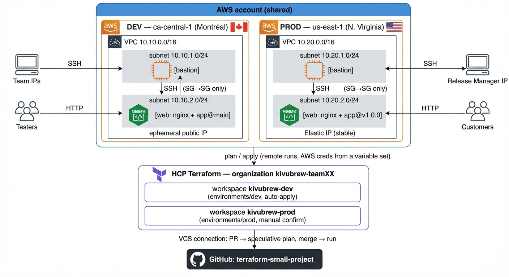

# 🏗️ Terraform Team Lab — "KivuBrew Goes Live"
### Two environments, one codebase: deploying a static web app on EC2 behind a bastion host

> **Level:** Intermediate · **Duration:** 2 sessions of about 3 h (or 1 day) · **Team size:** 4 students · **Cloud:** AWS (shared account) · **Runs in:** HCP Terraform ([app.terraform.io](https://app.terraform.io))
> 🇫🇷 French version: [`SCENARIO.fr.md`](SCENARIO.fr.md)

---

## 1. The story

**KivuBrew Coffee** is a small Congolese coffee brand launching its first website. The marketing team already has a static website (HTML/CSS/JS) in its own Git repo. You are the **platform team** hired to host it on AWS.

The CTO has four non-negotiable requirements:

1. **Two fully isolated environments.** DEV for testing and PROD for customers, each with its **own VPC in its own AWS region**.
2. **Everything as code.** No clicking in the console. Every change goes through a Pull Request.
3. **PROD only runs released code.** DEV can follow the latest commit. PROD runs only a tagged, approved version of the app.
4. **No direct SSH to servers.** Admins connect through a **bastion host**, and only from known IP addresses.

There is no domain name yet. Customers and testers use the **EC2 public IP address** (`http://x.x.x.x`).

---

## 2. Learning objectives

By the end of this lab you will be able to:

- Write **reusable Terraform modules** (`network`, `bastion`, `app_service`) with clear input and output contracts
- Deploy the **same code** to two environments that differ **only by `terraform.tfvars`**
- Run Terraform in **HCP Terraform workspaces** (remote state, locking, remote runs) and explain why each environment has its own workspace
- Pass keys and credentials as **workspace variables** instead of local files or Git
- Deploy an application from a **separate Git repo** using `user_data` and a pinned **Git tag**
- Build a **bastion (jump host) pattern** with security-group-to-security-group rules
- Collaborate with **branches, PRs, CODEOWNERS and plan reviews**
- Detect and fix **drift**, handle **state lock** conflicts, and **roll back** a bad release

---

## 3. Target architecture

```
                 ┌──────────────────────────── AWS account (shared) ──────────────────────────────┐
                 │                                                                                 │
                 │   DEV — ca-central-1 (Montréal)            PROD — us-east-1 (N. Virginia)        │
                 │   VPC 10.10.0.0/16                         VPC 10.20.0.0/16                      │
                 │  ┌───────────────────────────────┐       ┌───────────────────────────────┐      │
  Team IPs ─SSH──┼─►│ subnet 10.10.1.0/24           │       │ subnet 10.20.1.0/24           │◄─SSH─┼── Release Manager IP
                 │  │   [bastion]                   │       │   [bastion]                   │      │
                 │  │       │ SSH (SG→SG only)      │       │       │ SSH (SG→SG only)      │      │
                 │  │       ▼                       │       │       ▼                       │      │
  Testers ─HTTP──┼─►│ subnet 10.10.2.0/24           │       │ subnet 10.20.2.0/24           │◄HTTP─┼── Customers
                 │  │   [web: nginx + app@main]     │       │   [web: nginx + app@v1.0.0]   │      │
                 │  │   ephemeral public IP         │       │   Elastic IP (stable)         │      │
                 │  └───────────────────────────────┘       └───────────────────────────────┘      │
                 │                                                                                 │
                 └─────────────────────────────────────────────────────────────────────────────────┘
                        ▲ plan / apply (remote runs, AWS creds from a variable set)
                 ┌──────┴──────── HCP Terraform — organization kivubrew-teamXX ────────────────────┐
                 │   workspace kivubrew-dev   (environments/dev,  auto-apply)                      │
                 │   workspace kivubrew-prod  (environments/prod, manual confirm)                  │
                 │                    ▲ VCS connection: PR → speculative plan, merge → run         │
                 └────────────────────┴────────────── GitHub: terraform-small-project ─────────────┘
```


### Environment matrix

| Setting | DEV | PROD | Why they differ |
|---|---|---|---|
| Region | `ca-central-1` | `us-east-1` | Isolation; also shows that AMIs, AZs and key pairs are **regional** |
| VPC CIDR | `10.10.0.0/16` | `10.20.0.0/16` | Never overlap, so VPC peering stays possible later |
| `app_version` | `main` (branch) | `v1.0.0` (tag) | PROD only runs released code |
| Web public IP | ephemeral | **Elastic IP** | No DNS: customers need an address that doesn't change |
| SSH allowed from | every team member's `/32` | Release Manager's `/32` only | Least privilege in PROD |
| HCP workspace | `kivubrew-dev` (auto-apply) | `kivubrew-prod` (manual confirm) | Separate state: a broken DEV apply can never touch PROD |
| `ssh_public_key` | DEV key (whole team) | PROD key (Release Manager) | Set as a **workspace variable**, never in Git |

### Security group rules (the heart of the bastion pattern)

| Security group | Inbound | Source |
|---|---|---|
| `bastion-sg` | 22/tcp | team IPs (`x.x.x.x/32`). **`0.0.0.0/0` is rejected by a variable validation** |
| `web-sg` | 80/tcp | `0.0.0.0/0` (it's a public website) |
| `web-sg` | 22/tcp | **`bastion-sg` only** (security group reference, no CIDR) |

> 💡 **Discussion point:** the web server still has a public IP, because without a load balancer that is the only way to serve HTTP. Port 22 on it is unreachable from the internet anyway. *What would change if we added an ALB?* (Answer: the web server could move to a private subnet with a NAT gateway, and the bastion would become the only public SSH entry point.)

---

## 4. The two repositories

| Repo | Owner on the team | Content |
|---|---|---|
| `terraform-small-project` | Network + Compute + Release Manager | All infrastructure code (structure below) |
| `static-web-app` | App Developer | `site/index.html`, `styles.css`, `app.js`. **Must be public** |

**How they connect:** at first boot, the web server's `user_data` runs:

```
dnf install nginx git
git clone --depth 1 --branch <app_version> <app_repo_url>
copy site/ → /usr/share/nginx/html/
write env.json  → {"environment":"prod","region":"us-east-1","app_version":"v1.0.0"}
```

The page reads `env.json` and shows a **green DEV** or **red PROD** banner with the region and version. Graders can tell at a glance what is deployed where.

Because `user_data_replace_on_change = true`, **changing `app_version` replaces the instance**. That replacement is the deployment.

### Infra repo structure (your file, plus 2 additions)

```
terraform-small-project/
├── .gitignore
├── README.md
├── .github/                         ← added: CODEOWNERS, PR template, CI (fmt + validate)
├── modules/
│   ├── network/       (main, variables, outputs)
│   ├── bastion/       (main, variables, outputs)       ← added
│   └── app_service/   (main, variables, outputs, templates/user_data.sh.tftpl)
└── environments/
    ├── dev/   (backend, providers, main, variables, outputs, terraform.tfvars)
    └── prod/  (backend, providers, main, variables, outputs, terraform.tfvars)
```

> 📏 **Golden rule:** `environments/dev/main.tf` and `environments/prod/main.tf` are **identical**. Every difference between the environments lives in `terraform.tfvars`. Reviewers will run `diff environments/dev/main.tf environments/prod/main.tf`, and it must print nothing.

---

## 5. Team roles

| Role | Owns (CODEOWNERS) | Main responsibilities |
|---|---|---|
| 🌐 **Network owner** | `modules/network/`, `modules/bastion/` | VPC, subnets, routing, bastion, SSH access rules |
| 🖥️ **Compute owner** | `modules/app_service/`, `environments/dev/` | Web server, security group, user_data, DEV deployments |
| 🚀 **Release Manager** | `environments/prod/` | HCP organization, workspaces and variables. PROD approvals. **Only person who clicks "Confirm & Apply" in PROD** |
| 👩‍💻 **App Developer** | `static-web-app` repo | Website changes, release tags, CHANGELOG |

Rotate roles between sessions 1 and 2 if you want everyone to touch every part.

### Ground rules

1. `main` is **protected** in both repos: 1 approval required, CODEOWNERS review required, CI must pass.
2. **No console changes**, ever (except when the instructor's chaos card asks for one 😈).
3. Every infra PR gets a **speculative plan** posted by HCP Terraform as a PR check. Reviewers **open it and read it** before approving, and the author copies the plan summary line into the PR description.
4. **Never commit** `*.tfstate`, private keys, or AWS credentials. `.terraform.lock.hcl` **is** committed.
5. **Nobody applies from a laptop.** Applies happen only in HCP Terraform, after a merge to `main`. (`terraform plan` from a laptop is fine: it runs remotely as a speculative plan.)

---

## 6. Prerequisites

- Terraform **≥ 1.10** on each laptop (for `terraform login`, `plan` and `output`), AWS CLI v2, Git, an SSH client
- A free **HCP Terraform account** at [app.terraform.io](https://app.terraform.io) for every member
- From the instructor: a team number (`team01`, `team02`, …) and an **AWS access key for the team**, which only the Release Manager handles
- Each member's public IP: `curl -s https://checkip.amazonaws.com`

---

## 7. The lab, phase by phase

### Phase 0 — Kick-off and HCP Terraform setup (45 min) · *all, led by Release Manager*

**A. GitHub**
1. Create the two repos in your GitHub org from the starter files. Make `static-web-app` **public**.
2. Fill in `.github/CODEOWNERS` with real GitHub handles. Turn on branch protection on `main`.

**B. HCP Terraform organization** *(Release Manager)*
3. Create the organization **`kivubrew-teamXX`**, then invite the 3 teammates.
4. Put that organization name in both `environments/*/backend.tf` files, which contain a `cloud {}` block (open a PR).

**C. Two workspaces** *(Release Manager)*. Create both with **Version Control workflow** → GitHub → `terraform-small-project`:

| Setting | `kivubrew-dev` | `kivubrew-prod` |
|---|---|---|
| Terraform Working Directory | `environments/dev` | `environments/prod` |
| Automatic run triggering → *only trigger runs when files in specified paths change* | `environments/dev/**`, `modules/**` | `environments/prod/**`, `modules/**` |
| Apply method (Settings → General) | **Auto apply** | **Manual apply** |
| Terraform version | latest 1.x (≥ 1.10) | same as DEV |

> *Why do both workspaces watch `modules/**`? What happens to PROD when someone merges a module change?*

**D. AWS credentials, once for both workspaces** *(Release Manager)*
5. Organization **Settings → Variable sets** → create `aws-team-credentials`, applied to both workspaces:

| Key | Category | Sensitive |
|---|---|---|
| `AWS_ACCESS_KEY_ID` | Environment variable | ✅ |
| `AWS_SECRET_ACCESS_KEY` | Environment variable | ✅ |

No region is set here: each environment's `terraform.tfvars` sets its own `aws_region`.

**E. SSH keys: pass the PUBLIC key as a workspace variable** 🔑
6. The Release Manager generates one key pair per environment **on their laptop**:
   ```bash
   ssh-keygen -t ed25519 -f ~/.ssh/kivubrew-dev  -C "kivubrew dev"
   ssh-keygen -t ed25519 -f ~/.ssh/kivubrew-prod -C "kivubrew prod"
   cat ~/.ssh/kivubrew-dev.pub     # one line: ssh-ed25519 AAAA... kivubrew dev
   ```
7. In **each** workspace, go to **Variables → Add variable** and add:

| Workspace | Key | Category | Value | Sensitive |
|---|---|---|---|---|
| `kivubrew-dev` | `ssh_public_key` | **Terraform variable** | the full line of `kivubrew-dev.pub` | ❌ (it's public) |
| `kivubrew-prod` | `ssh_public_key` | **Terraform variable** | the full line of `kivubrew-prod.pub` | ❌ |

8. Share the **private DEV key** (`~/.ssh/kivubrew-dev`, no `.pub`) with teammates through a secure channel (not Git, not the chat), then on each laptop run `chmod 600 ~/.ssh/kivubrew-dev`. The PROD private key **stays with the Release Manager**.

> 💡 **Why a variable and not `file("~/.ssh/...")`?** HCP Terraform runs on HashiCorp's servers, not on your laptop, so `~/.ssh` doesn't exist there. Only the **public** half ever leaves your machine. The variable has a validation that rejects anything that doesn't look like a public key line, so pasting a private key by mistake fails the plan. *Try it with a dummy value and paste the error in ANSWERS.md.*

**F. First run**
9. Update both `terraform.tfvars` files (`team`, `allowed_ssh_cidrs`, `app_repo_url`) and merge.
10. A brand-new VCS workspace **does not start on its own**: in each workspace, click **New run → Plan and apply** once.

✅ **Checkpoint 0:** both workspaces show a successful first run (DEV: `Plan: 7 to add` once Phase 1 is merged, or an empty plan before that). On a laptop, `terraform login`, `cd environments/dev`, `terraform init` and `terraform plan` run a **remote** speculative plan.

---

### Phase 1 — Network module (45 min) · *Network owner (others review)*

Implement `modules/network`: VPC, Internet Gateway, one public subnet per CIDR across AZs, a route table, and associations.

Requirements:
- AZs come from `data "aws_availability_zones"`. **No hard-coded `ca-central-1a`**, or the module breaks in PROD.
- Required outputs: `vpc_id`, `vpc_cidr`, `public_subnet_ids`.

Open the PR. HCP Terraform posts a **speculative plan** for both workspaces as PR checks (only the network module is wired at this point).

✅ **Checkpoint 1:** the DEV plan shows **`Plan: 7 to add`**. *List the 7 resources and explain where each one comes from.* Merge: DEV **auto-applies**. PROD plans and **waits for confirmation**. The Release Manager confirms it when the team is ready.

---

### Phase 2 — Bastion module (45 min) · *Network owner + App Developer pair-programming*

While the Network owner builds the bastion, the **App Developer** customises the website (company name, menu, colours) and opens a PR in `static-web-app`.

Implement `modules/bastion`: key pair, security group, SSH ingress **per team IP** (`for_each`), egress, and an AL2023 instance.

Requirements:
- AMI comes from the public SSM parameter `/aws/service/ami-amazon-linux-latest/al2023-ami-kernel-default-x86_64`. *Why does this matter when DEV and PROD are in different regions?*
- `variables.tf` **rejects `0.0.0.0/0`**. Try it, watch the plan fail, and paste the error in your PR.
- Wire `module "bastion"` in **both** environment `main.tf` files (they stay identical!).

✅ **Checkpoint 2:** `ssh -i ~/.ssh/kivubrew-dev ec2-user@<bastion_public_ip>` works from every team member's laptop. A friend outside the team gets a **timeout**, not "permission denied". *Why a timeout?*

---

### Phase 3 — App service module and first DEV deploy (60 min) · *Compute owner*

Implement `modules/app_service`: web security group (HTTP from everyone, **SSH from the bastion SG only**), the EC2 instance with `user_data` rendered from `templates/user_data.sh.tftpl`, an optional Elastic IP, and outputs.

Requirements:
- The SSH rule uses `referenced_security_group_id = var.bastion_security_group_id`. **No CIDR.**
- `user_data_replace_on_change = true`. Explain in the PR what it does and why we want it.
- `lifecycle { ignore_changes = [ami] }`. *What would happen to PROD every time AWS publishes a new AMI without this?*
- Wire `module "app_service"` and the outputs (`app_url`, `ssh_command`, …) in both environments.

Deploy DEV: read the speculative plan on the PR, get approval, then merge. Watch the run in **`kivubrew-dev` → Runs**. When it finishes, read the outputs on the workspace's **Outputs** tab, or from a laptop:

```bash
cd environments/dev
terraform output app_url                 # open it: wait 1–2 min for user_data to finish
$(terraform output -raw ssh_command)     # uses YOUR local ~/.ssh/kivubrew-dev
```

On the web server, through the bastion:

```bash
sudo tail -n 20 /var/log/user-data.log
curl -s localhost/env.json
```

✅ **Checkpoint 3:**
- `http://<dev-public-ip>` shows the site with a **green `DEV · ca-central-1 · main`** banner
- SSH to the web server works **only** through `-J` (direct SSH to the web IP times out)

---

### Phase 4 — The app change flow in DEV (30 min) · *App Developer → Compute owner*

1. The App Developer merges a visible change on `main` in `static-web-app` (for example a new menu item).
2. Refresh the DEV site. **The change isn't there.** Discuss why (`user_data` only runs at first boot, and `app_version = "main"` didn't change, so Terraform sees no diff).
3. The Compute owner redeploys from the HCP UI: **`kivubrew-dev` → New run → Plan and apply → Additional planning options → Replace resources** → select `module.app_service.aws_instance.web`. (This is the UI equivalent of `terraform apply -replace=...`, which a VCS-connected workspace won't accept from the CLI.)
4. Notice that the **DEV public IP changed** (no EIP in DEV). Update the URL you share with testers.

✅ **Checkpoint 4:** the new menu item is visible in DEV. The team can explain why the IP changed.

---

### Phase 5 — First PROD release (45 min) · *App Developer → Release Manager*

1. The App Developer updates `CHANGELOG.md` and tags the release:
   ```bash
   git tag -a v1.0.0 -m "First production release" && git push origin v1.0.0
   ```
2. The Release Manager opens a PR in the infra repo. `prod/terraform.tfvars` already has `app_version = "v1.0.0"`. Check the other values (IPs and key path).
3. **Plan review meeting (5 min):** the whole team opens the PROD speculative plan on the PR. Things to check:
   - the region in the plan is `us-east-1`
   - the CIDRs are `10.20.x.x`
   - an `aws_eip` is in the plan
   - nothing is being destroyed
4. Merge. The `kivubrew-prod` run stops at **"Needs Confirmation"**. **Only the Release Manager** clicks **Confirm & Apply**, and adds a run comment such as "Release v1.0.0, approved in PR #12".

✅ **Checkpoint 5:** `http://<prod-elastic-ip>` shows a **red `PROD · us-east-1 · v1.0.0`** banner. DEV and PROD now run **different versions** of the same app, side by side.

---

### Phase 6 — Chaos cards 😈 (45 min) · *instructor picks 2–3*

The instructor hands each team one card at a time. The team must **detect, explain and fix the problem using only Terraform and Git**.

| Card | What the instructor does | What the team must do |
|---|---|---|
| 🃏 **A — Drift** | Adds `22/tcp from 0.0.0.0/0` to the DEV `web-sg` in the console | Detect it with a new **Plan only** run, explain the plan output, remove it with **Plan and apply**. Bonus: try the **Refresh state** run mode |
| 🃏 **B — Run queue** | Tells two members to merge DEV PRs, and queue a manual run, within the same minute | Find the **queued** runs in the workspace. Explain why HCP queues runs and why the per-workspace lock means there's no conflict. Discuss when a workspace's manual **Lock** button is useful |
| 🃏 **C — Bad release** | Asks the App Developer to tag `v1.1.0` with a broken page, and the team ships it to PROD | Roll back with a **revert PR** to `v1.0.0`. Note that the **PROD IP didn't change** (thanks, EIP). Never delete or move the tag |
| 🃏 **D — Leaked IP** | "A team member's home IP changed" or "an intern left the team" | Update `allowed_ssh_cidrs` through a PR. Observe that only an SG **rule** changes; the bastion is **not** replaced |
| 🃏 **E — PROD scale-up** | "Black Friday: PROD needs `t3.small`" | Change it **only** in `prod/terraform.tfvars`. Read the plan: is the instance updated **in place** or replaced? Does the EIP survive? |
| 🃏 **F — Copy-paste trap** | Changes `vpc_cidr` in `prod/terraform.tfvars` to `10.10.0.0/16` | Spot it in the PR review *before* apply. Explain why overlapping CIDRs break future peering |

✅ **Checkpoint 6:** each card is resolved through a PR with its plan and a short explanation in the PR description.

---

### Phase 7 — Teardown (15 min) · *Release Manager*

In each workspace, PROD first: **Settings → Destruction and Deletion → Queue destroy plan**. Read the plan (everything should be `destroy`), then **Confirm & Apply**. Keep the workspaces: their state history is part of your grade.

✅ **Checkpoint 7:** `aws ec2 describe-instances --filters Name=tag:Team,Values=team01 --region us-east-1` (and `ca-central-1`) returns no running instances. **Elastic IPs that are allocated but not attached are still billed**, so check that they are gone too.

---

## 8. Deliverables

1. Both repos, with a **clean PR history**: at least one PR per phase, each with a plan and an approval
2. Screenshots: the DEV site (green banner) and the PROD site (red banner), side by side
3. A short `ANSWERS.md` in the infra repo answering the *italic questions* in this guide
4. A screenshot of a successful `ssh -J` session, and of a failed direct SSH attempt to the web server

---

## 9. Grading rubric (100 pts)

| Criterion | Pts |
|---|---|
| Modules work and respect their input/output contracts | 20 |
| `dev/main.tf` and `prod/main.tf` identical; all differences live in tfvars | 10 |
| HCP workspaces configured correctly: working directory, trigger paths, variables, PROD manual apply | 10 |
| Bastion pattern correct: SSH only from team IPs, web SSH only from bastion SG | 15 |
| App deployed from the separate repo; DEV on `main`, PROD on a tag | 15 |
| Git collaboration: PRs, CODEOWNERS respected, plans pasted, reviews meaningful | 15 |
| Chaos cards resolved correctly and explained | 10 |
| Clean teardown, no leftover resources | 5 |

---

## 10. Instructor notes

**Before the lab: AWS**
- One shared account: give each team an IAM user (whose access key goes into the team's HCP variable set). Restrict it to `ca-central-1` and `us-east-1` with an SCP or IAM condition (`aws:RequestedRegion`).
- All names carry `kivubrew-teamXX-<env>` and use `name_prefix`, so 6 teams can share the account without collisions. Watch the default quota of **5 Elastic IPs per region** (one per team in `us-east-1`).
- Cost: with 4 × `t3.micro` per team plus 1 EIP, a 2-day lab costs a few dollars per team as long as teardown is enforced.

**Before the lab: HCP Terraform**
- Use **one free organization per team** (`kivubrew-team01`, `kivubrew-team02`, …). The Free plan allows **1 concurrent run per organization**, so a single shared organization would serialise every team's runs into one queue. One team uses roughly 40 managed resources (both environments), well under the Free plan's 500.
- Ask each Release Manager to add you to their organization so you can watch runs and grade the run history.
- The GitHub connection is made per organization when the first VCS workspace is created. Students need admin rights on their repo to authorise the HashiCorp GitHub App.
- Restricting PROD apply to the Release Manager through team permissions depends on what your HCP plan offers. If it isn't available, **Manual apply + a CODEOWNERS-protected `environments/prod/` + a run comment** is enforced by process and visible in the run history.

**Common pitfalls (and what they teach)**

| Symptom | Cause | Lesson |
|---|---|---|
| Site doesn't load right after apply | `user_data` still running (1–2 min) | `instance running` ≠ `app ready` |
| Site loads over `https://` → fails | Only port 80 is open, no certificate | Use `http://`. A natural next step is ALB + ACM |
| `git clone` fails in user-data log | App repo is private, or a wrong tag name | Anonymous HTTPS clone needs a public repo |
| SSH: `Permission denied (publickey)` | Wrong key for the env, or used `ubuntu@` | AL2023 user is `ec2-user`. Keys are per environment |
| SSH: timeout | IP not in `allowed_ssh_cidrs` (home IP changed) | SG = silent drop, so you get a timeout, not a refusal |
| `InvalidKeyPair.NotFound` in PROD | Key pair created in DEV's region | Key pairs, AMIs and SGs are **regional** |
| `Invalid value for "path" parameter: no file exists at "~/.ssh/..."` | Someone put `file("~/.ssh/...")` back into the code | Remote runs don't see your laptop: use the `ssh_public_key` workspace variable |
| `No valid credential sources found` | Variable set not applied to that workspace | Variable sets are attached per workspace (or globally) |
| Merging to `main` doesn't start a run | Brand-new workspace never ran, or the change is outside the trigger paths | First run must be queued manually. Check *Automatic run triggering* |
| `Apply not allowed for workspaces with a VCS connection` | Ran `terraform apply` from a laptop | In the VCS workflow, applies come from merges or UI runs |
| `cloud` block complains about variables | Tried `var.` in `backend.tf` | The `cloud {}` block is read before variables exist |
| Plan wants to replace web server unexpectedly | `user_data` changed (even whitespace) | That's `user_data_replace_on_change`, by design |

---

## 11. Suggestions and extensions

- **🔁 Tie in Ansible:** the bastion + `ProxyJump` setup is exactly what an Ansible inventory needs (`ansible_ssh_common_args: '-J ec2-user@<bastion>'`). Have Terraform output an inventory file with `local_file`, then let Ansible configure nginx in place of `user_data`. This pairs well with an "Ansible + Terraform" module.
- **🔑 No more static AWS keys:** replace the variable set with HCP Terraform **dynamic provider credentials** (OIDC trust between `app.terraform.io` and an IAM role, using `TFC_AWS_PROVIDER_AUTH` and `TFC_AWS_RUN_ROLE_ARN`). Have the students build that IAM role with Terraform too.
- **📦 Private module registry:** publish `network`, `bastion` and `app_service` to the organization's private registry with version tags, and consume them with `version = "~> 1.0"` in place of `../../modules`.
- **🛡️ Static analysis:** add `tflint` and `trivy config` (or `checkov`) to CI. Have students fix one finding each.
- **⚖️ Compare approaches:** rebuild DEV with **Terraform workspaces** in place of folders, then debate the trade-offs (shared code vs blast radius vs visibility).
- **🌍 Next lab:** move the web server to a **private subnet + NAT gateway + ALB**. The bastion becomes the only public instance, and students see why the pattern exists.
- **🔐 Modern alternative:** replace the bastion with **EC2 Instance Connect Endpoint** or **SSM Session Manager** (no open port 22 at all) and compare the security posture.
