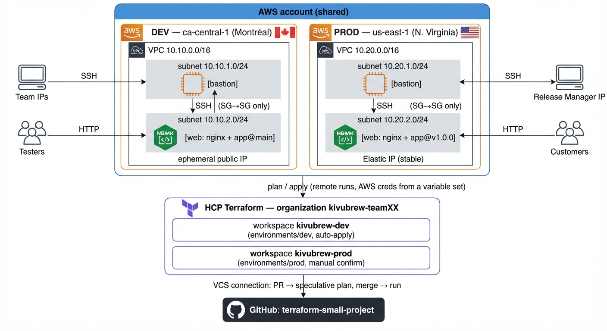

# 🏗️ Lab Terraform en équipe — « KivuBrew passe en production »
### Deux environnements, un seul code : déployer une application web statique sur EC2 derrière un bastion

> **Niveau :** intermédiaire · **Durée :** 2 séances d'environ 3 h (ou 1 journée) · **Équipe :** 4 étudiants · **Cloud :** AWS (compte partagé)
> 🇬🇧 English version: [`SCENARIO.md`](SCENARIO.md)

---

## 1. Le contexte

**KivuBrew Coffee** est une petite marque de café congolaise qui lance son premier site web. L'équipe marketing a déjà un site statique (HTML/CSS/JS) dans son propre dépôt Git. Vous êtes l'**équipe plateforme** chargée de l'héberger sur AWS.

Le CTO impose quatre exigences :

1. **Deux environnements complètement isolés.** DEV pour les tests et PROD pour les clients, chacun avec **son propre VPC dans sa propre région AWS**.
2. **Tout en code.** Aucun clic dans la console. Chaque changement passe par une Pull Request.
3. **La PROD n'exécute que du code publié.** DEV peut suivre le dernier commit. La PROD n'exécute qu'une version taguée et approuvée de l'application.
4. **Pas de SSH direct vers les serveurs.** Les administrateurs passent par un **bastion**, et seulement depuis des adresses IP connues.

Il n'y a pas encore de nom de domaine. Clients et testeurs utilisent l'**adresse IP publique de l'instance EC2** (`http://x.x.x.x`).

---

## 2. Objectifs d'apprentissage

À la fin de ce lab, vous saurez :

- Écrire des **modules Terraform réutilisables** (`network`, `bastion`, `app_service`) avec des contrats d'entrées et de sorties clairs
- Déployer **le même code** dans deux environnements qui ne diffèrent **que par `terraform.tfvars`**
- Utiliser un **backend S3 distant avec verrouillage de l'état** et expliquer pourquoi chaque environnement a son propre fichier d'état
- Déployer une application depuis un **dépôt Git séparé** avec `user_data` et un **tag Git** figé
- Mettre en place le **modèle bastion (jump host)** avec des règles de groupe de sécurité à groupe de sécurité
- Collaborer avec **branches, PR, CODEOWNERS et revues de plan**
- Détecter et corriger une **dérive (drift)**, gérer un **conflit de verrou** et faire un **retour arrière (rollback)** après une mauvaise version

---

## 3. Architecture cible

```
                 ┌──────────────────────────── Compte AWS (partagé) ──────────────────────────────┐
                 │                                                                                 │
                 │   DEV — ca-central-1 (Montréal)            PROD — us-east-1 (Virginie du Nord)   │
                 │   VPC 10.10.0.0/16                         VPC 10.20.0.0/16                      │
                 │  ┌───────────────────────────────┐       ┌───────────────────────────────┐      │
  IP équipe ─SSH─┼─►│ sous-réseau 10.10.1.0/24      │       │ sous-réseau 10.20.1.0/24      │◄─SSH─┼── IP du Release Manager
                 │  │   [bastion]                   │       │   [bastion]                   │      │
                 │  │       │ SSH (SG→SG seulement) │       │       │ SSH (SG→SG seulement) │      │
                 │  │       ▼                       │       │       ▼                       │      │
  Testeurs ─HTTP─┼─►│ sous-réseau 10.10.2.0/24      │       │ sous-réseau 10.20.2.0/24      │◄HTTP─┼── Clients
                 │  │   [web : nginx + app@main]    │       │   [web : nginx + app@v1.0.0]  │      │
                 │  │   IP publique éphémère        │       │   Elastic IP (stable)         │      │
                 │  └───────────────────────────────┘       └───────────────────────────────┘      │
                 │                                                                                 │
                 │   Bucket S3 (ca-central-1) : kivubrew-teamXX-tfstate-<compte>                   │
                 │     ├── teamXX/dev/terraform.tfstate                                            │
                 │     └── teamXX/prod/terraform.tfstate                                           │
                 └─────────────────────────────────────────────────────────────────────────────────┘
```



### Matrice des environnements

| Paramètre | DEV | PROD | Pourquoi ils diffèrent |
|---|---|---|---|
| Région | `ca-central-1` | `us-east-1` | Isolation. Montre aussi que les AMI, les AZ et les paires de clés sont **régionales** |
| CIDR du VPC | `10.10.0.0/16` | `10.20.0.0/16` | Jamais de chevauchement, pour qu'un peering VPC reste possible plus tard |
| `app_version` | `main` (branche) | `v1.0.0` (tag) | La PROD n'exécute que du code publié |
| IP publique web | éphémère | **Elastic IP** | Pas de DNS : les clients ont besoin d'une adresse qui ne change pas |
| SSH autorisé depuis | le `/32` de chaque membre | le `/32` du Release Manager seulement | Moindre privilège en PROD |
| Fichier d'état | `teamXX/dev/...` | `teamXX/prod/...` | Un `apply` raté en DEV ne peut jamais toucher la PROD |

### Règles des groupes de sécurité (le cœur du modèle bastion)

| Groupe de sécurité | Entrant | Source |
|---|---|---|
| `bastion-sg` | 22/tcp | IP de l'équipe (`x.x.x.x/32`). **`0.0.0.0/0` est rejeté par une validation de variable** |
| `web-sg` | 80/tcp | `0.0.0.0/0` (c'est un site public) |
| `web-sg` | 22/tcp | **`bastion-sg` seulement** (référence à un groupe de sécurité, pas de CIDR) |

> 💡 **Point de discussion :** le serveur web garde une IP publique, car sans répartiteur de charge c'est le seul moyen de servir le HTTP. Son port 22 reste de toute façon injoignable depuis Internet. *Que changerait l'ajout d'un ALB ?* (Réponse : le serveur web pourrait passer dans un sous-réseau privé avec une passerelle NAT, et le bastion deviendrait le seul point d'entrée SSH public.)

---

## 4. Les deux dépôts

| Dépôt | Responsable dans l'équipe | Contenu |
|---|---|---|
| `terraform-small-project` | Réseau + Calcul + Release Manager | Tout le code d'infrastructure (structure ci-dessous) |
| `static-web-app` | Développeur·se applicatif | `site/index.html`, `styles.css`, `app.js`. **Doit être public** |

**Comment ils sont reliés :** au premier démarrage, le `user_data` du serveur web exécute :

```
dnf install nginx git
git clone --depth 1 --branch <app_version> <app_repo_url>
copie site/ → /usr/share/nginx/html/
écrit env.json → {"environment":"prod","region":"us-east-1","app_version":"v1.0.0"}
```

La page lit `env.json` et affiche une **bannière verte DEV** ou **rouge PROD** avec la région et la version. Les correcteurs voient d'un coup d'œil ce qui est déployé où.

Comme `user_data_replace_on_change = true`, **changer `app_version` remplace l'instance**. Ce remplacement constitue le déploiement.

### Structure du dépôt d'infrastructure (votre fichier, plus 3 ajouts)

```
terraform-small-project/
├── .gitignore
├── README.md
├── .github/                         ← ajout : CODEOWNERS, modèle de PR, CI (fmt + validate)
├── bootstrap/main.tf                ← ajout : bucket S3 de l'état, exécuté une seule fois
├── modules/
│   ├── network/       (main, variables, outputs)
│   ├── bastion/       (main, variables, outputs)       ← ajout
│   └── app_service/   (main, variables, outputs, templates/user_data.sh.tftpl)
└── environments/
    ├── dev/   (backend, providers, main, variables, outputs, terraform.tfvars)
    └── prod/  (backend, providers, main, variables, outputs, terraform.tfvars)
```

> 📏 **Règle d'or :** `environments/dev/main.tf` et `environments/prod/main.tf` sont **identiques**. Toutes les différences entre environnements se trouvent dans `terraform.tfvars`. Les relecteurs lanceront `diff environments/dev/main.tf environments/prod/main.tf`, qui ne doit rien afficher.

---

## 5. Rôles dans l'équipe

| Rôle | Responsable de (CODEOWNERS) | Missions principales |
|---|---|---|
| 🌐 **Responsable réseau** | `modules/network/`, `modules/bastion/` | VPC, sous-réseaux, routage, bastion, règles d'accès SSH |
| 🖥️ **Responsable calcul** | `modules/app_service/`, `environments/dev/` | Serveur web, groupe de sécurité, user_data, déploiements DEV |
| 🚀 **Release Manager** | `environments/prod/`, `bootstrap/` | Backend d'état, approbations PROD, **seule personne qui applique en PROD** |
| 👩‍💻 **Développeur·se applicatif** | dépôt `static-web-app` | Modifications du site, tags de version, CHANGELOG |

Vous pouvez faire tourner les rôles entre la séance 1 et la séance 2 pour que chacun touche à toutes les parties.

### Règles du jeu

1. `main` est **protégée** dans les deux dépôts : 1 approbation obligatoire, revue CODEOWNERS obligatoire, la CI doit passer.
2. **Aucune modification dans la console**, jamais (sauf quand une carte chaos du formateur le demande 😈).
3. Chaque PR d'infrastructure contient la **sortie de `terraform plan`** (voir le modèle de PR).
4. **Ne jamais committer** `*.tfstate`, `*.tfplan` ni des **clés privées**. `.terraform.lock.hcl` **est** committé.
5. Une **seule personne applique** sur un environnement donné à la fois. Annoncez-le dans le chat de l'équipe (« 🔒 apply DEV en cours »).

---

## 6. Prérequis

- Terraform **≥ 1.10** (requis pour le verrouillage natif S3, `use_lockfile = true`), AWS CLI v2, Git, un client SSH
- Des identifiants AWS pour le compte partagé (`aws sts get-caller-identity` fonctionne)
- Un numéro d'équipe donné par le formateur : `team01`, `team02`, …
- L'IP publique de chaque membre : `curl -s https://checkip.amazonaws.com`

---

## 7. Le lab, phase par phase

### Phase 0 — Lancement et fondations (30 min) · *toute l'équipe, menée par le Release Manager*

1. Créez les deux dépôts dans votre organisation GitHub à partir des fichiers de départ. Rendez `static-web-app` **public**.
2. Remplissez `.github/CODEOWNERS` avec les vrais identifiants GitHub. Activez la protection de branche sur `main`.
3. **Release Manager :** créez le bucket d'état :
   ```bash
   cd bootstrap
   terraform init && terraform apply -var team=team01
   ```
   Reportez le nom du bucket et `teamXX` dans les deux fichiers `backend.tf` (ouvrez une PR).
4. **Chaque environnement a sa propre paire de clés SSH.** Le Release Manager les génère et partage la clé privée DEV avec l'équipe par un canal sécurisé (ni Git, ni le chat) :
   ```bash
   ssh-keygen -t ed25519 -f ~/.ssh/kivubrew-dev  -C "kivubrew dev"
   ssh-keygen -t ed25519 -f ~/.ssh/kivubrew-prod -C "kivubrew prod"   # reste chez le Release Manager
   ```
5. Mettez à jour les deux `terraform.tfvars` : `team`, `allowed_ssh_cidrs`, `app_repo_url`.

✅ **Point de contrôle 0 :** le bucket existe avec le versioning activé, et `terraform init` réussit dans `environments/dev` et `environments/prod`.

---

### Phase 1 — Module réseau (45 min) · *Responsable réseau (les autres relisent)*

Implémentez `modules/network` : VPC, Internet Gateway, un sous-réseau public par CIDR réparti sur les AZ, une table de routage et ses associations.

Exigences :
- Les AZ viennent de `data "aws_availability_zones"`. **Pas de `ca-central-1a` codé en dur**, sinon le module casse en PROD.
- Sorties obligatoires : `vpc_id`, `vpc_cidr`, `public_subnet_ids`.

Ouvrez la PR **avec le plan DEV** (seul le module réseau est branché à ce stade).

✅ **Point de contrôle 1 :** le plan DEV affiche **`Plan: 7 to add`**. *Listez les 7 ressources et expliquez d'où vient chacune.* Appliquez en DEV.

---

### Phase 2 — Module bastion (45 min) · *Responsable réseau + Développeur·se en binôme*

Pendant que le responsable réseau construit le bastion, le **développeur·se applicatif** personnalise le site (nom, menu, couleurs) et ouvre une PR dans `static-web-app`.

Implémentez `modules/bastion` : paire de clés, groupe de sécurité, règle SSH entrante **par IP de l'équipe** (`for_each`), règle sortante et une instance AL2023.

Exigences :
- L'AMI vient du paramètre SSM public `/aws/service/ami-amazon-linux-latest/al2023-ami-kernel-default-x86_64`. *Pourquoi est-ce important quand DEV et PROD sont dans des régions différentes ?*
- `variables.tf` **rejette `0.0.0.0/0`**. Essayez, constatez l'échec du plan et collez l'erreur dans votre PR.
- Branchez `module "bastion"` dans les **deux** `main.tf` d'environnement (ils restent identiques !).

✅ **Point de contrôle 2 :** `ssh -i ~/.ssh/kivubrew-dev ec2-user@<bastion_public_ip>` fonctionne depuis l'ordinateur de chaque membre. Une personne hors de l'équipe obtient un **timeout**, pas un « permission denied ». *Pourquoi un timeout ?*

---

### Phase 3 — Module app_service et premier déploiement DEV (60 min) · *Responsable calcul*

Implémentez `modules/app_service` : groupe de sécurité web (HTTP pour tous, **SSH depuis le SG du bastion uniquement**), l'instance EC2 avec un `user_data` généré depuis `templates/user_data.sh.tftpl`, une Elastic IP optionnelle et les sorties.

Exigences :
- La règle SSH utilise `referenced_security_group_id = var.bastion_security_group_id`. **Pas de CIDR.**
- `user_data_replace_on_change = true`. Expliquez dans la PR ce que cela fait et pourquoi on le veut.
- `lifecycle { ignore_changes = [ami] }`. *Que se passerait-il en PROD sans cela, à chaque nouvelle AMI publiée par AWS ?*
- Branchez `module "app_service"` et les sorties (`app_url`, `ssh_command`, …) dans les deux environnements.

Déployez en DEV :

```bash
cd environments/dev
terraform plan -out=tfplan      # à coller dans la PR, faire approuver
terraform apply tfplan
terraform output app_url        # ouvrez-la : attendez 1–2 min la fin du user_data
$(terraform output -raw ssh_command)
```

Sur le serveur web, via le bastion :

```bash
sudo tail -n 20 /var/log/user-data.log
curl -s localhost/env.json
```

✅ **Point de contrôle 3 :**
- `http://<ip-publique-dev>` affiche le site avec une bannière **verte `DEV · ca-central-1 · main`**
- Le SSH vers le serveur web fonctionne **uniquement** avec `-J` (le SSH direct vers l'IP web aboutit à un timeout)

---

### Phase 4 — Le cycle de modification en DEV (30 min) · *Développeur·se → Responsable calcul*

1. Le développeur·se fusionne un changement visible sur `main` dans `static-web-app` (par exemple un nouvel article au menu).
2. Rafraîchissez le site DEV. **Le changement n'apparaît pas.** Discutez-en : le `user_data` ne s'exécute qu'au premier démarrage, et `app_version = "main"` n'a pas changé, donc Terraform ne voit aucune différence.
3. Le responsable calcul redéploie :
   ```bash
   terraform apply -replace=module.app_service.aws_instance.web
   ```
4. Remarquez que **l'IP publique DEV a changé** (pas d'EIP en DEV). Mettez à jour l'URL partagée avec les testeurs.

✅ **Point de contrôle 4 :** le nouvel article est visible en DEV. L'équipe sait expliquer pourquoi l'IP a changé.

---

### Phase 5 — Première mise en production (45 min) · *Développeur·se → Release Manager*

1. Le développeur·se met à jour `CHANGELOG.md` et tague la version :
   ```bash
   git tag -a v1.0.0 -m "Première version de production" && git push origin v1.0.0
   ```
2. Le Release Manager ouvre une PR dans le dépôt d'infrastructure. `prod/terraform.tfvars` contient déjà `app_version = "v1.0.0"`. Vérifiez les autres valeurs (IP et chemin de clé).
3. **Revue de plan (5 min) :** toute l'équipe lit le plan PROD ensemble. Points à vérifier :
   - la région du plan est `us-east-1`
   - les CIDR sont en `10.20.x.x`
   - une `aws_eip` figure dans le plan
   - rien n'est détruit
4. Après approbation, **seul le Release Manager** applique en PROD.

✅ **Point de contrôle 5 :** `http://<elastic-ip-prod>` affiche une bannière **rouge `PROD · us-east-1 · v1.0.0`**. DEV et PROD font maintenant tourner **deux versions différentes** de la même application, côte à côte.

---

### Phase 6 — Cartes chaos 😈 (45 min) · *le formateur en choisit 2 ou 3*

Le formateur remet une carte à la fois à chaque équipe. L'équipe doit **détecter, expliquer et corriger le problème uniquement avec Terraform et Git**.

| Carte | Ce que fait le formateur | Ce que l'équipe doit faire |
|---|---|---|
| 🃏 **A — Dérive** | Ajoute `22/tcp depuis 0.0.0.0/0` au `web-sg` DEV dans la console | La détecter avec `terraform plan`, expliquer la sortie, la supprimer avec `apply`. Bonus : discuter de `terraform plan -refresh-only` |
| 🃏 **B — Bataille de verrou** | Demande à deux membres de lancer `apply` en DEV au même moment | Lire l'erreur de verrou, trouver qui le détient, discuter de quand (et si) `terraform force-unlock` est acceptable |
| 🃏 **C — Mauvaise version** | Demande au développeur·se de taguer une `v1.1.0` cassée, que l'équipe déploie en PROD | Revenir en arrière avec une **PR de revert** vers `v1.0.0`. Constater que **l'IP PROD n'a pas changé** (merci l'EIP). Ne jamais supprimer ni déplacer le tag |
| 🃏 **D — IP compromise** | « L'IP d'un membre a changé » ou « un stagiaire a quitté l'équipe » | Mettre à jour `allowed_ssh_cidrs` par une PR. Constater que seule une **règle** de SG change ; le bastion n'est **pas** remplacé |
| 🃏 **E — Montée en charge PROD** | « Black Friday : la PROD a besoin d'un `t3.small` » | Le modifier **uniquement** dans `prod/terraform.tfvars`. Lire le plan : l'instance est-elle modifiée **sur place** ou remplacée ? L'EIP survit-elle ? |
| 🃏 **F — Piège du copier-coller** | Change `vpc_cidr` dans `prod/terraform.tfvars` en `10.10.0.0/16` | Le repérer en revue de PR *avant* l'apply. Expliquer pourquoi des CIDR qui se chevauchent empêchent un futur peering |

✅ **Point de contrôle 6 :** chaque carte est résolue par une PR avec son plan et une courte explication dans la description.

---

### Phase 7 — Démantèlement (15 min) · *Release Manager*

```bash
cd environments/prod && terraform destroy
cd ../dev           && terraform destroy
# Dernier jour du cours seulement : mettre force_destroy = true dans bootstrap, apply, puis destroy
```

✅ **Point de contrôle 7 :** `aws ec2 describe-instances --filters Name=tag:Team,Values=team01 --region us-east-1` (et `ca-central-1`) ne renvoie aucune instance en cours d'exécution. **Une Elastic IP allouée mais non attachée reste facturée** : vérifiez qu'elle a aussi disparu.

---

## 8. Livrables

1. Les deux dépôts, avec un **historique de PR propre** : au moins une PR par phase, chacune avec un plan et une approbation
2. Captures d'écran : le site DEV (bannière verte) et le site PROD (bannière rouge), côte à côte
3. Un court `ANSWERS.md` dans le dépôt d'infrastructure qui répond aux *questions en italique* de ce guide
4. Une capture d'une session `ssh -J` réussie, et d'une tentative de SSH direct vers le serveur web qui échoue

---

## 9. Grille d'évaluation (100 pts)

| Critère | Pts |
|---|---|
| Les modules fonctionnent et respectent leurs contrats d'entrées/sorties | 20 |
| `dev/main.tf` et `prod/main.tf` identiques ; toutes les différences sont dans les tfvars | 10 |
| État distant + verrouillage configurés ; un état distinct par environnement | 10 |
| Modèle bastion correct : SSH uniquement depuis les IP de l'équipe, SSH web uniquement depuis le SG du bastion | 15 |
| Application déployée depuis le dépôt séparé ; DEV sur `main`, PROD sur un tag | 15 |
| Collaboration Git : PR, CODEOWNERS respectés, plans collés, revues pertinentes | 15 |
| Cartes chaos résolues correctement et expliquées | 10 |
| Démantèlement propre, aucune ressource oubliée | 5 |

---

## 10. Notes pour le formateur

**Avant le lab**
- Un seul compte partagé : donnez à chaque équipe un utilisateur IAM ou un rôle SSO. Limitez-les à `ca-central-1` et `us-east-1` avec une SCP ou une condition IAM (`aws:RequestedRegion`).
- Tous les noms portent `kivubrew-teamXX-<env>` et utilisent `name_prefix`, donc 6 équipes peuvent partager le compte sans collision. Attention au quota par défaut de **5 Elastic IP par région** (une par équipe en `us-east-1`).
- Coût : avec 4 × `t3.micro` par équipe et 1 EIP, un lab de 2 jours coûte quelques dollars par équipe, à condition d'imposer le démantèlement.

**Pièges fréquents (et ce qu'ils enseignent)**

| Symptôme | Cause | Leçon |
|---|---|---|
| Le site ne charge pas juste après l'apply | `user_data` encore en cours (1–2 min) | `instance running` ≠ `application prête` |
| Le site en `https://` échoue | Seul le port 80 est ouvert, pas de certificat | Utiliser `http://`. ALB + ACM est une suite logique |
| `git clone` échoue dans le log user-data | Dépôt applicatif privé, ou mauvais nom de tag | Un clone HTTPS anonyme exige un dépôt public |
| SSH : `Permission denied (publickey)` | Mauvaise clé pour l'environnement, ou `ubuntu@` utilisé | L'utilisateur AL2023 est `ec2-user`. Les clés sont par environnement |
| SSH : timeout | IP absente de `allowed_ssh_cidrs` (IP de la maison changée) | Un SG ignore le paquet en silence : timeout, pas de refus |
| `InvalidKeyPair.NotFound` en PROD | Paire de clés créée dans la région DEV | Paires de clés, AMI et SG sont **régionaux** |
| Le `backend` refuse les variables | `var.` utilisé dans `backend.tf` | La config du backend est lue avant que les variables existent |
| Le plan veut remplacer le serveur web sans raison apparente | `user_data` modifié (même un espace) | C'est `user_data_replace_on_change`, voulu par conception |

---

## 11. Suggestions et extensions

- **🔁 Lien avec Ansible :** le bastion + `ProxyJump` est exactement ce qu'il faut pour un inventaire Ansible (`ansible_ssh_common_args: '-J ec2-user@<bastion>'`). Faites générer par Terraform un fichier d'inventaire avec `local_file`, puis laissez Ansible configurer nginx à la place du `user_data`. Cela s'articule bien avec un module « Ansible + Terraform ».
- **🤖 Plan automatique sur les PR :** ajoutez GitHub Actions avec **OIDC** (aucune clé statique) pour publier `terraform plan` en commentaire de PR.
- **🛡️ Analyse statique :** ajoutez `tflint` et `trivy config` (ou `checkov`) à la CI. Chaque étudiant corrige une alerte.
- **⚖️ Comparer les approches :** reconstruisez DEV avec les **workspaces Terraform** au lieu des dossiers, puis débattez des compromis (code partagé, rayon d'impact, visibilité).
- **🌍 Lab suivant :** déplacez le serveur web dans un **sous-réseau privé + passerelle NAT + ALB**. Le bastion devient la seule instance publique, et les étudiants voient pourquoi ce modèle existe.
- **🔐 Alternative moderne :** remplacez le bastion par **EC2 Instance Connect Endpoint** ou **SSM Session Manager** (aucun port 22 ouvert) et comparez la posture de sécurité.
